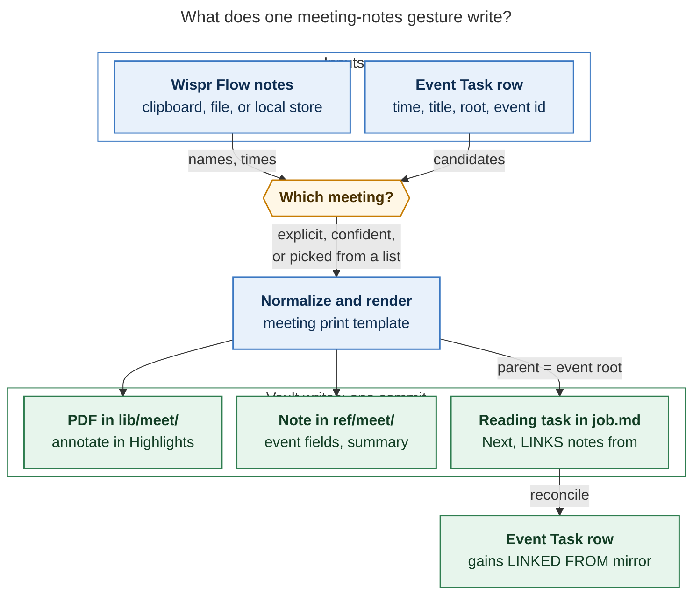
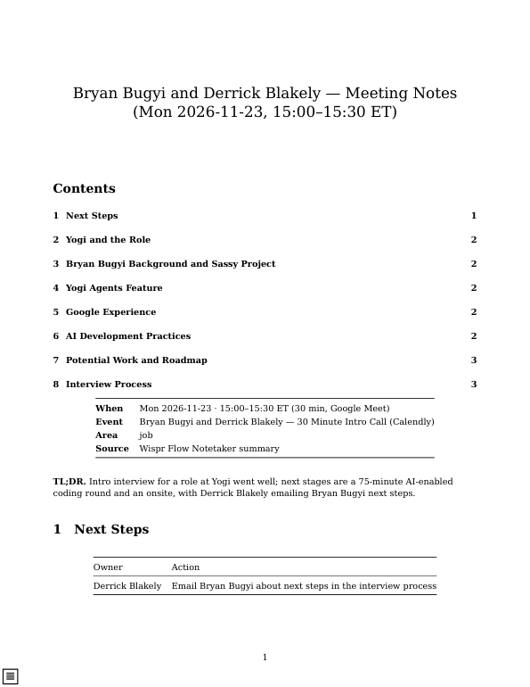

# Meeting notes as references: one gesture from Wispr Flow to a linked, filed ref

*Researcher `cld` · 2026-11-24 (Tuesday of 2026-W48). I checked bob-cli at `8d82c621`,
bob-plugins (read-only), the live vault (read-only), your bob config, the 2026-11
private-event-note research, and Wispr Flow's public docs. I ran `bob ref create` and
`bob capture` only as dry runs against the real vault. The prototype PDF was rendered in
a scratch vault under `/tmp`. I changed nothing in `~/bob` or bob-cli.*

> **The request.** Integrate AI meeting notes (Wispr Flow) into Event Tasks by making
> it as easy as possible to create excellent reference notes for meetings, filed under
> the right area or project and linked to the matching Event Task. The first use case is
> `~/tmp/bryan_derrick_meet_notes.txt` → `^bryan-bugyi-derrick` in
> `2026/20261123.md`. Lead the design: intuitive, reliable, beautiful. Critique the
> plan, adjust the requirements where justified, and end with a recommendation.

## Bottom line

- **Yes, build it, and keep it a reference.** The meeting itself can't hold the
  follow-up. Event Tasks are deliberately kept out of review, freshness, and lanes
  (`decisions:calendar-events-are-daily-note-event-tasks`). A reference's reading task
  can hold it: it lives in `job.md`, walks in Next, and turns Highlights `#task`
  annotations into follow-ups that are already linked `inspired by` it. Today you
  filled that gap by hand with `job#^whisperflow-meeting` ("Review WhisperFlow meeting
  notes…"). The feature should make that task unnecessary.
- **Most of the pipeline already exists.** `bob ref create` renders, files, and
  commits. Capture `~` writes the relation (I dry-ran it against the real event). gcal
  sync already allows a LINKS/LINKED FROM line on Event Task rows. What's missing is
  the glue:
  1. pick the event,
  2. derive the parent, title, and name from it,
  3. turn Wispr's plain text back into structure,
  4. write the relation in the same commit,
  5. give the PDF a meeting-shaped layout.
- **One command, three surfaces.** Add **`bob ref meet`**, a purpose-built front door
  on the existing create pipeline:
  - Bare `bob ref meet` lists recent meetings and whether they have notes.
  - `bob ref meet derrick -c` files the clipboard as notes for that meeting.
  - `-f json` feeds the clients.

  Then put a one-gesture surface where you are when a call ends: a Command Mode row on
  the Event Task in Obsidian, and a Meeting-notes mode in Bob Mac Capture (the Mac is
  where Wispr runs). Automatic import from Wispr's local store comes last, after the
  shape has proven itself.
- **Requirement adjustments** (all in §4):
  - What you have is a **summary**, not a transcript; transcripts are opt-in.
  - "Correct area" means **the Event Task's `[root::]`**. An inbox root asks once, and
    that one answer also re-roots the event.
  - The link is one labelled relation, **`notes from`**, written on the reading task.
    That's the only direction that still works the day after the meeting.
  - The reading task is **born Next** and *is* the review task.
  - **Don't let the build block your follow-up email to Derrick.** Use case 1 can ship
    today with existing commands (§7).
- **Beautiful means three things:**
  - a two-page meeting PDF: header band in the area's hue, TL;DR box, next steps
    first, no Contents page;
  - a ref note you can search in Obsidian, with a managed summary region;
  - a `notes in →` chip on the Event Task.

  My scratch render shows that today's renderer already gets most of the way there
  once the text has structure (§5.4, appendix).

## Contents

1. [What exists today](#1-what-exists-today)
2. [What Wispr Flow actually gives us](#2-what-wispr-flow-actually-gives-us)
3. [Critique: is this a good idea?](#3-critique-is-this-a-good-idea)
4. [Requirement adjustments](#4-requirement-adjustments)
5. [The design](#5-the-design)
6. [Alternatives considered](#6-alternatives-considered)
7. [Use case 1, today, with no new code](#7-use-case-1-today-with-no-new-code)
8. [Recommended solution](#8-recommended-solution)
9. [Appendix: prototype and sources](#9-appendix-prototype-and-sources)

## 1. What exists today

### 1.1 The input, the event, and the task chain

**The input.** `~/tmp/bryan_derrick_meet_notes.txt` is 3,246 bytes of UTF-8 plain text
with a very regular shape:

- **First line:** a one-sentence headline.
- **Body:** eight sections. Each starts after three blank lines with a short heading
  line, followed by one-line paragraphs separated by single blank lines (23 in all).
- **Last section, "Next Steps":** one action written as `(Derrick Blakely) Email Bryan
  Bugyi about next steps…`.
- **What's missing:** no title, date, attendee list, or transcript.
- **What it is:** Wispr's **Summary**, copied as plain text, which lost its Markdown
  headings. I'm inferring that from the shape. Wispr documents a three-tab note: My
  thoughts, Summary, and Transcript.
- **Likely mishearings:**
  - "Sassy" is almost certainly SASE.
  - "BOLI" is flagged by Wispr itself ("sounded like").

**The event** (`2026/20261123.md`, line 36) is a closed `MEET` Event Task:

```markdown
- [x] #task **1500-1530** Bryan Bugyi and Derrick Blakely [📅](…eid=OXVvcGU1…) [📹](…) [📍](…) [buffer:: -15m] [root:: job] [type:: MEET]  [completion:: 2026-11-23] ^bryan-bugyi-derrick
  - 🪢 **LINKS:** [[job#^ref-yogi-senior-swe-product-intro-call-prep]]
  - 🪢 **LINKED FROM:** [[job#^whisperflow-meeting]] (💬 mentions)
```

Four facts the design relies on:

- `[root:: job]` already answers "which area".
- The 📅 link's `eid` decodes to the stable Google event id `9uope591lh6bhhs75fl07dk6ig`.
  bob already has `decode_calendar_eid` (`src/native/gcal/note.rs:447`).
- bob can find the row by block id (`event_task_by_id`, `src/native/event_task.rs:631`).
- A prep reference is already linked from the event side, with no label.

**The task chain.** You have already modelled the workflow by hand, and it shows what
the feature has to make unnecessary:

```text
bob#^wispr-flow-meet-notes  (BUILD, [/])
  └─ blocks job#^whisperflow-meeting  "Review WhisperFlow meeting notes on [[20261123#^bryan-bugyi-derrick]]!"  (CHORE)
       └─ blocks job#^send-yogi-follow-up  "Send a follow-up email to Derrick!"
```

The follow-up email to an interviewer is now blocked, transitively, on building a bob
feature. That's the first thing to fix (§7).

### 1.2 What `bob ref create` already does, and where it falls short

`bob ref create report.md -P job` already renders Markdown with pandoc and XeLaTeX. It
files `lib/<type>/<stem>.pdf`, writes `ref/<type>/<stem>.md` and the reading task in
the parent's `## Tasks`, and commits and pushes under `bob_sync.lock → scan.lock`. If
it can't ingest safely, it queues the PDF (`decisions:references-are-ingested-at-birth`).

I dry-ran it on a `.md` copy of your file:

```text
$ bob ref create bryan_derrick_meet_notes.md -P job -t meet -s next -d
[dry-run] ok would create Highlights-ready PDF
pdf: ~/bob/xlib/meet/bryan_derrick_meet_notes.pdf
title: bryan_derrick_meet_notes
status: next
parent    job  (area · job.md)
intake: would ingest into lib/meet/bryan_derrick_meet_notes.pdf → ref/meet/bryan_derrick_meet_notes.md …
writes: none
```

Gaps against "excellent, associated, linked":

| Need | Today |
| --- | --- |
| Accept Wispr's `.txt`, or stdin from the clipboard | Refused: "TARGET must be a Markdown file (.md), a PDF file, or an http(s) URL" (`src/native/highlights_ref/target.rs:62`) |
| Structure (headings, next steps) | Plain text has none. Heading lines print as ordinary paragraphs |
| Title and name | The filename stem: `bryan_derrick_meet_notes` |
| Parent from the event | You must type `-P job` |
| Link to the Event Task | Nothing. LINKS are added by hand afterwards. The Derrick prep ref's link was added on the Mac the next morning |
| One reference per meeting (dedupe) | Dedupe is keyed by URL only |
| JSON for clients | `ref create` has no `--format`, and `-f` already means `--force` |

### 1.3 The relation works today, and where its mirror lands

```text
$ bob capture --dry-run '@job+ref-yogi-senior-swe-product-intro-call-prep ~20261123:bryan-bugyi-derrick|"notes from"'
[dry-run] ok would update  job.md
  [*] stays Next  [[ref/chat/yogi_senior_swe_product_intro_call_prep|…]]  ^ref-yogi-senior-swe-product-intro-call-prep
  🪢 would link to "**1500-1530** Bryan Bugyi and Derrick Blakely …" · notes from   2026/20261123.md ^bryan-bugyi-derrick
```

Two rules shape the design:

- **gcal sync tolerates relations on Event Task rows.** "Managed first children
  (CANCEL LOG, Depends-On, LINKS, …) stay above the bullets; your own notes go below
  them" (`docs/gcal.md`, Description bullets). Other children are "You · Never
  touched".
- **The previous daily note is read-only to relation writers.** Today (11-24), the
  11-23 note is *the previous daily note*. `T owns a LINKED FROM line ⇔ … T is
  writable (not done/, not the previous daily note)` (`docs/task-relations.md` §6), and
  conformance vector LG27 shows "linked with no mirror, plus the suffix `· previous
  daily note: 🪢 LINKED FROM follows after rollover`".

So a relation **authored on the reading task** always works, even the morning after.
The event's chip simply appears at the next rollover. A relation authored *on the
event row* (`~~`) is refused for daily notes. That settles which end of the link should
own it (§5.2).

### 1.4 Tools that look relevant but aren't the right ones

- **Private event notes** (`bob gcal note`, ⌘E on the Mac) are Bob-only *description
  directives* keyed by the Google event. They're capped at **2,048 bytes** and parsed
  as `@route`, `#off`, `-30` grammar, then projected into the row as bullets. Your
  summary (3,246 bytes) wouldn't even fit, and projecting it into a daily note would
  bury the row. The right reuse is the *identity* (calendar id plus event id) and the
  ⌘E *picker*, not the storage.
- **The `meet` notebook** (`meet.md`, "Notes from meetings, appointments, and calls")
  and `meet_inbox.md` ("Meeting notes live in [[meet]]") predate this. Notebooks hold
  only note bullets, so they're the wrong home for a 3 KB structured summary. Once
  `ref/meet/` exists, their one-line summaries should point there (a vault edit for
  you).
- **gcal attendee data is thin.** Sync fetches only `attendees(self,responseStatus)` and
  the organizer (`src/native/gcal/gog.rs:92`). Attendee *names* in the ref header would
  need the request fields widened. Nice to have, not v1.

## 2. What Wispr Flow actually gives us

I verified these on Wispr's docs and blog unless marked. A helper read the two
community tools' source in external checkouts.

**Notetaker** is Wispr's meeting product. It launched on Mac (2026-08-05) and Windows
(2026-09-15), and in-person-only on iPhone (2026-11-18).

- **Capture.** No bot joins the call. It records the microphone plus system audio, and
  transcription runs on Wispr's servers. Local audio is kept 7 days.
  ([launch post](https://wisprflow.ai/post/wispr-flow-notetaker),
  [recording doc](https://docs.wisprflow.ai/articles/9238501024-Recording-a-meeting-with-Notetaker))
- **Output.** Each note has three tabs:
  - **My thoughts**: your own notes;
  - an editable **Summary**, organized by topic, with decisions and Next steps;
  - a **Transcript**, which gets speaker names after a refinement pass.
  ([editor doc](https://docs.wisprflow.ai/articles/9406970664-meeting-notes-and-the-editor-in-notetaker-beta))
- **Export.** Two options:
  - **Copy as Markdown** gives the whole meeting: title, meeting info, your notes,
    brief, summary, chat, and transcript, with empty sections omitted.
  - **Copy transcript** gives plain text with speaker labels and no timestamps.

  Public share links never include transcripts.
  ([sharing doc](https://docs.wisprflow.ai/articles/5073796184-sharing-meeting-notes-from-notetaker-beta))
- **Calendar linkage.**
  - Google and Outlook calendars only.
  - A note is linked to an event **only when recording starts from the event**
    ("Join & start Notetaker", or within 10 minutes of it).
  - Linked notes keep the event's scheduled time, participants, and title.
  - Matching afterwards by time is not documented.
  ([calendar doc](https://docs.wisprflow.ai/articles/8955305188-Connect-a-calendar-and-use-Notetaker-reminders))
- **Machine access.**
  - An official **MCP server** at `https://api.wisprflow.ai/connect/mcp` reads notes,
    summaries, action items, speaker names, and calendar events with attendees. It
    requires Google or enterprise SSO.
    ([MCP doc](https://docs.wisprflow.ai/articles/5166327995-switching-to-wispr-flow-keep-all-your-notetakers-in-one-place-mcp))
  - The public developer API is dictation-only.
  - No webhooks or Zapier integration found.
- **Local store (community, undocumented).**
  - `~/Library/Application Support/Wispr Flow/flow.sqlite`, with a `Meetings` table:
    `id, title, createdAt, endedAt, recordedMs, participantNames, summary` (Markdown
    with `:::toggle` blocks and `<@speaker:N>` refs), `speakerMap, refineStatus,
    finalized, …`.
  - Transcripts are under `meetings/<id>/refined.ndjson`.
  - Read by the [Wispr Flow Sync Obsidian plugin](https://community.obsidian.md/plugins/wispr-flow-sync)
    and [wispr-cli](https://github.com/iamnikolie/wispr-cli).
  - The schema is managed by Sequelize migrations and can change in any release.
- **Consent.** Notetaker's "Post a consent notice in the meeting chat" setting is
  **off by default**
  ([settings doc](https://docs.wisprflow.ai/articles/9319084321-notetaker-settings-explained-beta)).

**Comparable products** link notes to events *at capture time* through the calendar
integration. Google Meet's "Take notes for me" attaches a Doc to the event. Granola
pre-creates a note page per event. Fathom and Fireflies return scheduled times and event
ids in their APIs. Matching afterwards by time overlap is the uncommon case.

**What follows for the design:**

1. The paste path ("Copy as Markdown", or the Summary as plain text) is documented and
   stable, and works on every host. It should be the contract.
2. Wispr knows the event only when you started recording from it, so bob still needs a
   matcher.
3. The local store is the only zero-click source. It's undocumented, so it belongs in a
   later phase behind a schema check, as bob already does for Alfred's and Clipy's
   clipboard stores (opened read-only).

## 3. Critique: is this a good idea?

**Yes. The reasons are specific to your system:**

1. **It closes a real loop you're running by hand.** Your task chain (§1.1) is the
   workflow: meeting → review the notes → act. Each arrow is currently a hand-made
   task.
2. **The reference model fits meetings well.**
   - The reading task gives the review a lane (Next), a daily walk (`next_interval: 1`
     in your config), and Pomodoro attribution to `job`.
   - Highlights annotations with `#task` become follow-up tasks linked
     `inspired by` the reading task (`highlights.annotation_task_relation`).
   - That gives you meeting → notes → follow-ups as a navigable graph with no new
     grammar.
3. **The Event Task can't do this job.** Daily residence keeps meetings out of review
   and lanes, on purpose. Without a reading task, meeting notes would be write-only.
4. **The ingredients exist.** Event identity, roots, relation writing, the PDF pipeline,
   the ingest lock, Command Mode, and the Mac event picker are all shipped.

**Risks:**

- **Heavy machinery for a 3 KB note.** Rendering takes seconds; ingest commits and
  pushes. That's acceptable for a once-per-meeting gesture, but the surface must never
  block on it without feedback (the Mac pattern: spinner, then a banner).
- **Notes locked in a PDF.** Reference content normally lives only in the PDF and the
  hidden `.bob/ref-sources/` store, so Obsidian search can't find "Temporal" in the
  Derrick meeting. That's fine for research reports, but meeting notes need to be
  findable (§5.3).
- **Transcription errors become permanent.** "Sassy" for SASE would sit in an
  interview record forever. bob must never rewrite words silently. The fix belongs at
  the source (Wispr's dictionary, and the Summary tab is editable) plus an optional
  review-before-filing step.
- **Wrong-event links.** A plausible wrong match is worse than asking. The matcher must
  show its evidence and refuse to guess between close candidates.
- **Privacy.** These are other people's words in a git-synced vault. Default to the
  summary, keep transcripts opt-in, and turn on Wispr's consent notice. This is not
  legal advice, but several US states require all-party consent, and the notice is
  cheap.

**What I'd do differently from the request as written:** treat this as one small,
general primitive, *file notes for an event*, rather than a Wispr integration. The same
command then serves Google Meet's Gemini notes, Granola, Otter, or notes you typed
yourself. It also delivers the "after" half of your own unfinished idea,
`bob#^event-note-relation` ("Add 'event note of' relation!"). Wispr becomes one source
adapter.

## 4. Requirement adjustments

Each one changes what you asked for. They're numbered so you can accept or reject them
individually.

| # | As requested | Adjusted to | Why |
| --- | --- | --- | --- |
| A1 | "meeting transcript" | **Meeting notes = the summary.** A transcript is an opt-in PDF appendix (`-t`), never in the vault note | Your file is a summary. Transcripts are long, noisy, and full of other people's verbatim words |
| A2 | "ref notes" | **A ref with a `meet` type, a meeting print template, and a managed summary region in the note** | The PDF stays the annotation surface. The note becomes searchable, and hover previews show something useful |
| A3 | "the correct area/project" | **The Event Task's `[root::]`.** If the root is an inbox (`meet_inbox`), ask once, and that answer also re-roots the event | The root is already the curated answer to "what did this meeting serve" (`decisions:gcal-root-follows-google-until-edited`, which also teaches the series). One question fixes two places |
| A4 | "properly linked" | **One relation on the reading task: `notes from` → the event**, plus the Google event identity recorded in the ref | Only the reading-task side is writable the day after (§1.3). The recorded event identity survives a row being deleted or restored |
| A5 | a separate "review the notes" task | **The reading task *is* the review: born Next (`[*]`)** | Meeting follow-ups are time-sensitive. It also removes the hand-made CHORE |
| A6 | first use case waits on the feature | **Use case 1 ships today with existing commands (§7), and the follow-up email unblocks now** | A follow-up email to an interviewer shouldn't wait for a bob release |
| A7 | (implicit) automatic integration | **Explicit one-gesture filing first. Automatic import from Wispr's store is Phase 3** | The paste contract is documented. The store isn't. Reliability first |
| A8 | "excellent" | **Structural normalization only. Words are never changed.** Corrections happen at the source or in `-e` review | A silent "Sassy → SASE" replacement is exactly the kind of rewrite that destroys trust |

## 5. The design

### 5.1 The model



*One run reads the notes and the Event Task, then writes the PDF, the ref note, and a
reading task linked `notes from` the event, all in one commit. Reconcile adds the
event's LINKED FROM chip, at once for today's note and after rollover for yesterday's.*

The object is **the meeting's notes reference**. The Event Task stays what it is, a
calendar projection that Google and gcal sync own. It gains only a generated mirror
line. The design adds no new line grammar, no new task kind, and no field on the event
row.

### 5.2 The link: `notes from`, authored on the reading task

```markdown
## Tasks   (job.md)
- [*] #task #ref [[ref/meet/261123_bryan_bugyi_derrick_blakely|Bryan Bugyi and Derrick Blakely — Meeting Notes (Mon 2026-11-23, 15:00–15:30 ET)]] [created::2026-11-24] ^ref-261123-bryan-bugyi-derrick-blakely
	- 🪢 **LINKS:** notes from [[20261123#^bryan-bugyi-derrick]]
```

```markdown
## Events   (2026/20261123.md, after rollover)
- [x] #task **1500-1530** Bryan Bugyi and Derrick Blakely … ^bryan-bugyi-derrick
  - 🪢 **LINKS:** [[job#^ref-yogi-senior-swe-product-intro-call-prep]]
  - 🪢 **LINKED FROM:** [[job#^ref-261123-bryan-bugyi-derrick-blakely]] (notes from) • [[job#^whisperflow-meeting]] (💬 mentions)
```

**Why this direction:** it's the only end that's writable on the day after (§1.3). It
also matches how annotation tasks point at their reading task, and it keeps the
gcal-owned row free of authored lines.

**Why this label:** `notes from` reads correctly ("the reading task is notes from the
event"). It leaves room for a sibling **`prep for`** on pre-meeting references, such as
your Closing-Question Playbook. Those two labels together are the "event note of"
relation from `bob#^event-note-relation`. Add one display-only inverse pair to the §10
table, **`notes from` ⇄ `notes in`**, so the event's chip reads
`notes in → [◐ Bryan Bugyi and Derrick Blakely — Meeting Notes ↗ job]`. That's a few
lines in `task_relations::label::inverse_phrase`. Without it, the chip falls back to
`(chip) · notes from → this`, which is also fine.

**Relation semantics:** the label carries no effect. It doesn't cancel, complete, or
offer a successor, so it stays inert.

### 5.3 The reference

**Paths and name.**

- Files: `ref/meet/<YYMMDD>_<title-slug>.md` and `lib/meet/<…>.pdf`.
- The date is the **meeting's** day, which sorts `ref/meet/` chronologically and
  matches your `mail/2026/261123_…` convention.
- The slug is at most six content words from the event title, stop-words dropped:
  `261123_bryan_bugyi_derrick_blakely`.
- The reading task id follows the existing rule: `^ref-261123-bryan-bugyi-derrick-blakely`.

**Title.**

- Format: `<event title> — Meeting Notes (<Ddd YYYY-MM-DD>, <HH:MM>–<HH:MM> <TZ>)`,
  which is the convention your prep refs already use.
- Override with `-T`.
- A better *semantic* title ("Yogi intro call with Derrick Blakely") needs judgment.
  Offer it as the prefilled, editable field in the card, not as an automatic rewrite.

**Frontmatter.** Additive; every key below already exists or follows an existing rule.

```yaml
type: "[[ref]]"
ref_type: meet
status: next
parent: "[[job]]"
title: "Bryan Bugyi and Derrick Blakely — Meeting Notes (Mon 2026-11-23, 15:00–15:30 ET)"
id: 261123_bryan_bugyi_derrick_blakely
source_url: "https://www.google.com/calendar/event?eid=OXVvcGU1OTFsaDZiaGhzNzVmbDA3ZGs2aWcgYnJ5YW5idWd5aTM0QG0"
event: "[[2026/20261123#^bryan-bugyi-derrick]]"
meeting: 2026-11-23T15:00-05:00/2026-11-23T15:30-05:00
notes_source: wispr-flow
captured: "2026-11-24T09:02-0500"
```

Notes on the new keys:

- **`source_url` is the canonical Google event URL, keyed by the decoded event id.**
  This buys a lot for free:
  - **Dedupe:** "already captured: … `hint: -f` / `hint: -f overwrite`" with no new
    machinery.
  - **Find:** `bob ref find <📅 link>` finds a meeting's notes.
  - **Linkage:** it ties the notes to Google's identity, not the row's.

  (The alternative is a separate `event_url` key; it's honest about provenance but
  duplicates the dedupe and find work. I'd reuse `source_url`, which is already allowed
  to be list-valued if you later add a Wispr share link.)
- **`event` and `meeting` should be *synced* user properties**, so they round-trip
  through the PDF marker. A capture that intake has to queue (lock busy, offline)
  still writes its LINKS line when `bob ref scan -i` files it later. This is the
  reliability-critical choice. Treating them as note-local fields like `created` would
  lose the link on the queued path.

**Body.** The managed embed, then a **managed summary region**, then the managed
Highlights region:

```markdown
# Bryan Bugyi and Derrick Blakely — Meeting Notes (Mon 2026-11-23, 15:00–15:30 ET)

![[job#^ref-261123-bryan-bugyi-derrick-blakely]]

<!-- meeting:begin -->
> [!summary]- Meeting summary · Wispr Flow · Mon 15:00–15:30 · [[2026/20261123#^bryan-bugyi-derrick|event]]
> **TL;DR** Intro interview for a role at Yogi went well; next stages are a 75-minute AI-enabled coding round and an onsite…
>
> **Next steps** · Derrick Blakely — Email Bryan Bugyi about next steps in the interview process
>
> ## Yogi and the Role
> - Derrick Blakely is product team tech lead at Yogi (2+ years)…
<!-- meeting:end -->

## Highlights

<!-- highlights:begin -->
<!-- highlights:end -->
```

The region is collapsed by default (`-`), so it's quiet, but it's searchable and shows
in hover previews. Bob owns it the way it owns the Highlights region: a `-R` replace
refreshes it, and your prose outside it is never touched. This reverses the usual
"content lives only in the PDF" rule for one ref type, on purpose (A2).

### 5.4 Normalization and the print template

The **Wispr plain-text summary adapter** is deterministic. My 60-line prototype
(appendix) handles your file exactly:

1. Split on runs of two or more blank lines into sections.
2. The first block is the **TL;DR**.
3. A section whose first block is a single short line with no terminal punctuation has
   that line as its **heading**.
4. Every other block becomes a **bullet**.
5. Under a "Next steps" or "Action items" heading, `(Owner) Action` lines become an
   **owner/action table**.
6. Words are never changed.

A second adapter handles **Copy as Markdown**: drop empty sections, unwrap `:::toggle`,
resolve `<@speaker:N>` to names, and send the Transcript section to the appendix only
with `-t`. Its exact shape is unverified, so build it from a real paste (see Q3 in §8).
Unknown shapes fall back to verbatim paragraphs with the warning
`unrecognized notes shape; filed as plain text`. They are never refused.

**The meeting print template.** Your current renderer already does well once the text
has structure; see the scratch render in the appendix. What a meeting template adds:

- **No Contents page.** Today a 3-page note spends a third of page 1 on a table of
  contents.
- **A header band in the root area's hue** (`job` is `color: aqua`). This follows the
  theme-hue decisions, so the color matches the Obsidian and Mac renderings.
- **A one-line meta strip:** day · time · duration · video badge · "notes by Wispr
  Flow".
- **A TL;DR box.**
- **Next steps first**, as an owner/action table. They're what you need when you open
  the PDF.
- **Topic sections after that.** Section numbers are optional; I'd keep them, because
  Highlights page captions use them.

Expected result: two pages instead of three, and you can tell it's a meeting note from
across the room.

### 5.5 Matching: "which meeting?"

There are three ways to name the event, in strict precedence:

1. **Explicit.** A block reference (`20261123#^bryan-bugyi-derrick`), a wikilink, an
   Obsidian URL, or a pasted 📅 Google Calendar URL (eid-decoded, as `gcal note` does).
   Always wins. This is what the Obsidian surface passes, because the cursor is on the
   row.
2. **Query words.** Every word must appear in the event title (the `gcal note`
   matching rule). One match is used; several open a picker on a TTY, or exit 2
   with candidates off a TTY.
3. **Auto** (no event named). Candidates are Event Tasks from the last `-D 7` days that
   have started and aren't cancelled. The signals:

   | Signal | Strength | Your file |
   | --- | --- | --- |
   | The recording window (Wispr Markdown meeting info, or store `createdAt`/`endedAt`) overlaps the meeting span by ≥ 50% | strong | not present |
   | ≥ 75% of the event title's content words, and at least two, appear in the notes | strong | "Bryan Bugyi", "Derrick Blakely": 4/4 |
   | Ended in the last 12 h and has no notes yet | weak, used only to order | true |

   Auto-select only when exactly one candidate has a strong signal and no other
   candidate has any. Otherwise show the ranked list with each row's evidence ("names
   in title: Derrick Blakely"). In JSON, return `candidates[]` with `evidence[]`, so
   clients show *why*.

For your file, auto mode picks `^bryan-bugyi-derrick` on title names alone. None of the
day's other events ("Swings!", "Phone Call w/ Dan", "Watch "Bolt" w/ Abby") share a
content word with the notes.

### 5.6 The command: `bob ref meet`

`ref create` can't carry this cleanly: `-f` is already `--force`, it has no JSON
output, and it has no list mode. A dedicated leaf under `bob ref` fits the CLI rules.
Its membership is plain (it creates library references), and it reuses the create
pipeline, so there's no second renderer.

```text
bob ref meet [OPTIONS] [EVENT]...

File meeting notes as a reference linked to their Event Task; bare lists recent meetings

Arguments:
  [EVENT]...  Event Task: 20261123#^bryan-bugyi-derrick, a [[wikilink]], a Google
              Calendar URL, or words from its title; omitted with notes = best match

Options:
  -b, --bob-dir <PATH>    Bob vault root; defaults to BOB_DIR or ~/bob
  -c, --clipboard         Read the notes from the clipboard
  -D, --days <N>          Look back N days for meetings [default: 7]
  -d, --dry-run           Show the match, filing, and outline; write nothing
  -e, --edit              Review the normalized Markdown in $VISUAL/$EDITOR before filing
  -f, --format <FORMAT>   human (default) or json
  -i, --input <FILE>      Read the notes from FILE (.txt or .md); - reads stdin
  -P, --parent <NOTE>     File under this area or project instead of the event's root
                          (required when the root is an inbox, which it also re-roots)
  -R, --replace           Replace this meeting's notes in place while unannotated
  -r, --reread            File another set of notes for an already-noted meeting (vN)
  -s, --status <STATUS>   Reading status [default: next]
  -T, --title <TITLE>     Override the derived title
  -t, --transcript        Keep a transcript section as a PDF appendix
```

Bare `bob ref meet` (read-only, colored, root hues). This is a mockup: the 11-17 and 11-20 rows are illustrative, not real vault state.

```text
📝 MEETINGS  Mon 11-17 → Tue 11-24 · 1 with notes · 4 without
  Mon 11-23  15:00–15:30  Bryan Bugyi and Derrick Blakely   job          — no notes
  Mon 11-23  11:00–11:30  Phone Call w/ Dan                 job          — no notes
  Mon 11-23  08:15–08:30  Swings!                           abby         — no notes
  Tue 11-17  13:00–13:45  Screening between …               job          📝 read · 4 highlights
  Fri 11-20  10:00–10:30  …                                 meet_inbox   ⚑ route first
```

A real run:

```text
$ bob ref meet derrick -i ~/tmp/bryan_derrick_meet_notes.txt
📝 filed meeting notes   Bryan Bugyi and Derrick Blakely — Meeting Notes (Mon 2026-11-23, 15:00–15:30 ET)
   event    Mon 15:00–15:30  Bryan Bugyi and Derrick Blakely · matched by query "derrick"
   parent   job  (area · from the event's root)
   task     [*] Next  job.md ^ref-261123-bryan-bugyi-derrick-blakely  → notes from 20261123#^bryan-bugyi-derrick
   pdf      lib/meet/261123_bryan_bugyi_derrick_blakely.pdf · 2 pages · 8 sections · 1 next step
   mirror   follows after rollover (20261123 is the previous daily note)
   commit   bob ref meet: file meet/261123_bryan_bugyi_derrick_blakely
```

When the meeting already has notes, the command refuses with today's hints, phrased
for meetings:

- `-R`: replace in place while unannotated;
- `-r`: file a second set as `__v2`.

The JSON schema (schema 1, additive) has these fields: `action` (`list`, `preview`, or
`filed`), `event{…}`, `candidates[]{…, evidence[]}`, `parent{name, source, hue}`,
`reference{title, stem, paths}`, `outline{sections, bullets, next_steps[]}`,
`warnings[]`, `mirror` (`written` or `after_rollover`), and `status`. A dry run never
touches locks, matching `ref create -d`.

### 5.7 Surfaces: where each gesture happens

The rule is **copy in Wispr, then one gesture**. Every surface is a thin client of
`bob ref meet` (`decisions:mac-capture-is-a-thin-client`).

**1. Bob Mac Capture: a Meeting-notes mode** (Phase 2, primary right after a call). The
Mac is where Wispr runs and where the clipboard is.

- **Entry: ⌘⇧E**, the sibling of ⌘E (private event note). ⌘M is avoided because it's
  the system Minimize shortcut. I haven't verified ⌘⇧E against every Mac panel binding;
  confirm it against `docs/keyboard.md` in bob-mac-capture.
- **Ended agenda rows.** The Calendar band's ended rows (behind "+M earlier") gain a
  "Notes" action next to the existing Event note action.
- **The card** (a mockup; the ages and counts are illustrative):

  ```text
  ┌ Meeting notes ───────────────────────────────── from clipboard · Wispr Flow ┐
  │ ● 15:00–15:30  Bryan Bugyi and Derrick Blakely            ended 18h ago  ✓ │
  │   names in title: Derrick Blakely · Bryan Bugyi                             │
  │ ○ 11:00–11:30  Phone Call w/ Dan                                            │
  ├─────────────────────────────────────────────────────────────────────────────┤
  │ Title  Bryan Bugyi and Derrick Blakely — Meeting Notes (Mon 2026-11-23, …)  │
  │ Files  ● job · reading task Next · ref/meet/261123_bryan_bugyi_derrick_…    │
  │ TL;DR  Intro interview for a role at Yogi went well; next stages are a …    │
  │ 8 sections · 23 bullets · Next steps: Derrick Blakely — Email Bryan …       │
  ├─────────────────────────────────────────────────────────────────────────────┤
  │ ⏎ File   ⌃N/⌃P Event   ⌘T Title   ⎋ Back                                    │
  └─────────────────────────────────────────────────────────────────────────────┘
  ```

  The preselected row and all of the card's text come from `bob ref meet -c -d -f json`.
  ⏎ runs the real command. The banner then reads "📝 Filed → job · Next · linked to
  15:00 Bryan Bugyi and Derrick Blakely · ⌘O open". For an inbox root, the card adds
  the route picker; one answer sets `-P` and re-roots the event.
- **Total gestures after copying:** hotkey, ⌘⇧E, ⏎.

**2. Obsidian: a Command Mode row** (Phase 2, primary when you're already in the daily
note).

- With the cursor on the Event Task, or on its 🍅 Task Link under the MEET Pomodoro,
  `:` opens Command Mode.
- The top group (FOR THIS NOTE) offers "📝 File meeting notes from clipboard → 15:00
  Bryan Bugyi and Derrick Blakely". It runs `bob ref meet <row ref> -c` with an explicit
  event, so no matching is needed.
- Shift+Enter previews (the dry run) and Ctrl+Enter files.
- Rows come from bob's `__catalog` handshake, so the plugin work is passing the cursor's
  Event Task. bob decides everything else.
- A Task Card action on Event Tasks is later polish.

**3. CLI and agents** (Phase 1). `bob ref meet`, as in §5.6. This is also the SASE
route: an agent that has drafted or polished notes, or that read them through Wispr's
MCP server, files them with `bob ref meet <event> -i - < notes.md`.

**4. Automatic** (Phase 3, Mac only). Add a `bob tick` step (`tick.steps.wispr`) that
reads Wispr's store read-only behind a schema check, which fails closed with a
`doctor` hint.

- **Imported:** finalized, refined meetings only.
- **Filed:** only on a *strong time-overlap* match.
- **Everything else** goes to an "unfiled meeting notes" count. The idle agenda shows it
  as a quiet chip ("📝 1 to file"), and it opens the same card.
- **Ownership** mirrors gcal: *notes follow Wispr until you annotate them*. A re-edited
  Wispr summary replaces an unannotated ref in place (`-R`); an annotated one is left
  alone and the change is reported once.

### 5.8 Reliability rules

1. **All or nothing.** The PDF, note, reading task, and LINKS line go in one ingest
   commit under the existing locks. If intake has to queue, the marker carries `event`,
   so the link is written when the PDF is filed (§5.3).
2. **One family per meeting.** Dedupe runs on the event identity, and repeats refuse
   with the `-R`/`-r` hints.
3. **Identity survives row churn.** The ref records the Google event id, so a row that
   is deleted and restored with `sync -F` (which keeps block IDs) still resolves. A
   `doctor` check can relink by event id.
4. **Never guess between close candidates.** Auto-select needs a sole strong signal.
5. **Never rewrite words.** Normalization is structural only, and unknown shapes go in
   verbatim with a warning.
6. **Honest mirror timing.** Report `mirror: after_rollover` for the previous daily
   note instead of failing or pretending.
7. **Undo is `git revert` of one commit,** and the Mac banner can offer it. Name the
   commit `bob ref meet: file meet/<stem>`, after today's
   `bob ref create: ingest <type>/<stem>`.

## 6. Alternatives considered

| Option | Verdict | Why |
| --- | --- | --- |
| **A. Reference via `bob ref meet`** (recommended) | ✅ | Reuses the reading lifecycle, Highlights → follow-ups, the Ref Panel, rename, and dedupe. Adds a searchable summary region |
| B. Obsidian-native meeting note (Markdown, no PDF) | ✗ for now | Searchable and editable, but loses the reading task and annotation → task flow, and invents a new note type. A2's summary region recovers most of the searchability |
| C. Summary as child bullets under the Event Task | ✗ | Puts 3 KB into the daily note under a gcal-owned row, with no review lifecycle. The previous daily note is read-only anyway |
| D. Private event note (`bob gcal note`) | ✗ | Description-directive grammar, 2,048-byte cap, projected into the row. Wrong storage. Reuse only its identity and picker |
| E. Extend `bob ref create` with `-E/--event` | ◐ | Workable for the CLI, but `-f` collides, there's no JSON or list mode, and its help is already long. `bob ref meet` can share all of its internals |
| F. Automatic Wispr import as v1 | ✗ (Phase 3) | Undocumented schema, Mac only, and Wispr links events only when recording starts from them |
| G. A SASE agent polishes the notes (LLM) before filing | ◐ optional | Best prose and could fix "Sassy", but it's nondeterministic, slow, and needs a review step. It composes cleanly as a producer feeding `bob ref meet -i -` |
| H. Wispr MCP in bob | ✗ | It needs Google OAuth in an MCP client inside a Rust CLI. Agents already speak MCP, so use G's route |

## 7. Use case 1, today, with no new code

This unblocks the Derrick follow-up now and doubles as the acceptance fixture for
Phase 1.

1. **Normalize the text.** Use the appendix script, or edit by hand: `##` headings,
   `-` bullets, a `**TL;DR.**` lead, and Next Steps moved to the top. Decide on
   "Sassy" → "SASE". I'd make that edit (it's your project's name), but it's your call.
   Save it as `~/tmp/261123_bryan_bugyi_derrick_blakely.md`. Don't add an H1 or a
   frontmatter `title`; let `-T` supply the title. My scratch render with both printed
   the title twice.
2. **File it** (apollo is fine; intake commits and pushes):

   ```bash
   bob ref create ~/tmp/261123_bryan_bugyi_derrick_blakely.md -P job -t meet -s next \
     -T "Bryan Bugyi and Derrick Blakely — Meeting Notes (Mon 2026-11-23, 15:00–15:30 ET)" -d
   # drop -d once the dry run looks right
   ```

3. **Link it** (dry-run first; I verified the dry run with the prep ref's id):

   ```bash
   bob capture --dry-run '@job+ref-261123-bryan-bugyi-derrick-blakely ~20261123:bryan-bugyi-derrick|"notes from"'
   ```

   Check the reading task's actual `^ref-…` id in `job.md` first. The event's LINKED
   FROM chip appears after tonight's rollover.
4. **Retire the hand-made review task.** Link `job#^whisperflow-meeting superseded by`
   the new reading task, which cancels it. Then repoint
   `job#^send-yogi-follow-up`'s Depends-On to the reading task, or drop the dependency:
   honestly, the email can go out as soon as you've skimmed the TL;DR. Keep
   `bob#^wispr-flow-meet-notes` open for Phases 1–2.

## 8. Recommended solution

**Build "file notes for an event" as one bob command and three thin gestures, in this
order:**

1. **Phase 0, today (no code).** Do §7: file the Derrick notes, link them, and send the
   follow-up email. Turn on Wispr's "Post a consent notice in the meeting chat". Add
   "SASE" to Wispr's dictionary, and check whether Notetaker honors it (unverified).
2. **Phase 1, bob-cli: `bob ref meet`.** The bob-cli work is:
   - **Matching:** event resolution (explicit, query, or auto with evidence) on
     `event_task_by_id` and `decode_calendar_eid`.
   - **Defaults:** parent from `[root::]`, with the inbox question that also re-roots
     the event; `meet` type; Next status; `YYMMDD_slug` names; the event-based title.
   - **Normalization:** the Wispr plain-text adapter, plus the Markdown adapter once
     there's a fixture.
   - **Rendering:** the meeting print template (no Contents page, hue header, TL;DR box,
     next steps first).
   - **Note shape:** synced `event`/`meeting` properties, `source_url` set to the event
     URL, and the managed `meeting` summary region.
   - **Linking:** the LINKS `notes from` line written by ingest, as
     `annotation_task_relation` already does.
   - **Display:** the `notes from` ⇄ `notes in` inverse pair.
   - **Output:** the list mode and `-f json`.

   Docs go in `docs/refs-meet.md`, linked from `docs/ref.md` and `docs/gcal.md`, and the
   decision gets a record ("Meeting notes are references linked `notes from` their
   Event Task"). Use your file as the golden fixture.
3. **Phase 2, surfaces.** Each surface is a thin client of bob:
   - **Obsidian:** a Command Mode FOR THIS NOTE row on Event Tasks, driven by the
     catalog.
   - **Mac:** Bob Mac Capture's Meeting-notes mode (⌘⇧E) and a "Notes" action on ended
     agenda rows. Its gate is macOS CI.
4. **Phase 3, automatic.** A Mac-only read-only Wispr store adapter in `bob tick`. It
   files strong time-overlap matches only, queues everything else behind a quiet chip,
   and ships with a `doctor` schema check. The rule is follow-until-annotated.
5. **Later.** `prep for` on pre-meeting references, which completes
   `bob#^event-note-relation`. Wider gcal fields for attendee names. "Create tasks
   for my next steps" from the owner/action table.

**Questions for you:**

- **Q1.** Is `notes from` ⇄ `notes in` the wording you want? Alternatives: `minutes
  of` ⇄ `minutes in`, or `recap of` ⇄ `recapped in`.
- **Q2.** Should the reading task be born Next, or Ready for meetings older than two
  days? I'd say Next always, because the walk will ask anyway.
- **Q3.** Can you paste one real "Copy as Markdown" export into `~/tmp`? The second
  adapter should be built from a real fixture, not from the community tools' guesses.
- **Q4.** Should the managed summary region hold the whole summary (my
  recommendation, about 3 KB) or only the TL;DR and next steps?

## 9. Appendix: prototype and sources

**Prototype normalizer.**
[`wispr_normalize_prototype.py`](wispr_meeting_notes_to_event_refs__cld_assets/wispr_normalize_prototype.py)
holds the adapter heuristic from §5.4 in about 60 lines. On your file it found the
headline, eight sections, and 23 bullets, and turned the one `(Owner) Action` line into
a table, with no misclassified blocks.

**Scratch render.** This is page 1 of today's `bob ref create` on the prototype's output
in a scratch vault, with Next Steps moved up and `-T` for the title. Today's renderer
already produces a clean header table, TL;DR, and action table. The remaining gaps are
the Contents block, the plain header, and the lack of area color, which is what §5.4's
template fixes.



**Sources in bob-cli** (`8d82c621`):

- `docs/highlights-create.md`: targets, intake, dedupe, recapture
- `docs/highlights-ref-sync.md`: synced properties, `annotation_task_relation`, generated
  body contract
- `docs/task-relations.md`: §3 grammar, §6 projection and previous-daily rule, §10
  chips and inverse phrases, LG27
- `docs/capture.md`: `~` relations, `%c` clipboard, reading-queue capture
- `docs/gcal.md`: row ownership, description bullets, root selection
- `docs/gcal-notes.md`: private event notes, 2,048-byte cap
- `docs/reference/mac-capture/event-notes.md` and `idle-agenda.md`
- `src/native/highlights_ref/target.rs:62`
- `src/native/gcal/note.rs:447`
- `src/native/gcal/gog.rs:92`
- `src/native/event_task.rs:631`

**Decisions consulted:**

- `calendar-events-are-daily-note-event-tasks`
- `private-event-notes-beat-google-per-field`
- `references-are-ingested-at-birth`
- `reference-ids-follow-file-stems`
- `mac-capture-is-a-thin-client`
- `gcal-root-follows-google-until-edited`

**Vault (read-only):** `2026/20261123.md`, `job.md`, `bob.md`, `meet.md`,
`meet_inbox.md`, `ref/chat/yogi_*`, `~/.config/bob/config.yml`.

**External:** Wispr Flow
[Notetaker launch](https://wisprflow.ai/post/wispr-flow-notetaker),
[Windows](https://wisprflow.ai/post/notetaker-on-windows),
[iPhone](https://wisprflow.ai/post/notetaker-on-iphone),
[recording](https://docs.wisprflow.ai/articles/9238501024-Recording-a-meeting-with-Notetaker),
[settings](https://docs.wisprflow.ai/articles/9319084321-notetaker-settings-explained-beta),
[editor](https://docs.wisprflow.ai/articles/9406970664-meeting-notes-and-the-editor-in-notetaker-beta),
[sharing and copy](https://docs.wisprflow.ai/articles/5073796184-sharing-meeting-notes-from-notetaker-beta),
[calendar](https://docs.wisprflow.ai/articles/8955305188-Connect-a-calendar-and-use-Notetaker-reminders),
[MCP](https://docs.wisprflow.ai/articles/5166327995-switching-to-wispr-flow-keep-all-your-notetakers-in-one-place-mcp).
Community readers of the local store:
[Wispr Flow Sync](https://community.obsidian.md/plugins/wispr-flow-sync) and
[wispr-cli](https://github.com/iamnikolie/wispr-cli).
Comparables:
[Google Meet notes](https://support.google.com/meet/answer/14754931?hl=en),
[Granola calendars](https://docs.granola.ai/help-center/getting-started/syncing-your-calendars),
[Fathom webhook payload](https://developers.fathom.ai/api-reference/webhook-payloads/new-meeting-content-ready).

**Unverified:**

- the exact fields in "Copy as Markdown" meeting info;
- whether Wispr's local store records a calendar event id;
- whether Notetaker uses the dictation dictionary;
- whether ⌘⇧E is free in every Mac panel.
