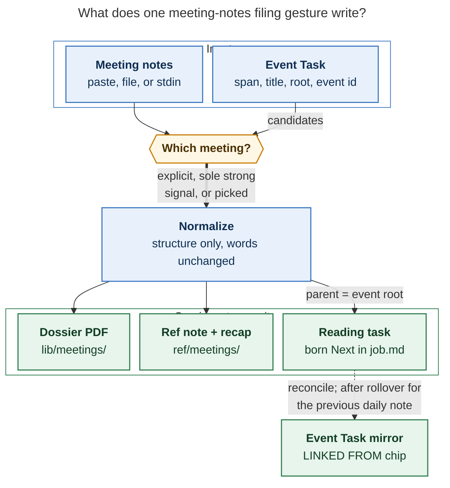

# Meeting notes become event-linked references: consolidated design

Lead researcher consolidation · 2026-11-24 · merges five independent swarm reports
(`__cdx`, `__cld`, `__grk`, `__mus`, `__gem`, filed beside this report) plus my own
verification pass against bob-cli `8d82c621`, the installed `bob` binary, the live vault
(read-only), `~/.config/bob/config.yml`, and the audited `cli_rules` memory and glossary.

> **The request.** Integrate AI meeting notes (Wispr Flow) into Event Tasks by making it
> as easy as possible to create excellent ref notes for meetings, associated with the
> correct area/project and linked to the corresponding Event Task. First use case:
> `~/tmp/bryan_derrick_meet_notes.txt` → `^bryan-bugyi-derrick` in `2026/20261123.md`.
> Lead the design (intuitive, reliable, beautiful), critique the plan, call out
> requirement adjustments, and end with a recommendation.

## Verdict

**Build it — all five researchers independently said yes, and the vault itself proves
the demand.** For this very meeting you hand-built the whole workflow: two prep refs
linked to the Event Task, a manual review chore (`job#^whisperflow-meeting`) blocked on
a bob build task, and a follow-up email task blocked on the review. The feature's job is
to make that manual chain unnecessary.

But reframe it: **this is not a Wispr Flow integration. It is one small, general
primitive — *file notes onto an event* — and Wispr is its first producer.** Wispr's
public API is dictation-only, its local store is undocumented, and you have already
considered switching dictation tools. The documented, durable contract is a paste or a
file. Granola, Gemini notes, an agent's draft, or your own typed notes should hit the
same command.

The recommended shape, in one sentence: a new **`bob ref meet`** leaf on the existing
reference-create pipeline that resolves the Event Task, inherits its `[root::]` as the
parent, normalizes the notes structurally (never changing a word), renders a meeting
dossier PDF, files a `ref/meetings/` note with a searchable recap, births the reading
task **Next** in the parent, and writes one inert **`notes from`** relation to the event
— all in one ingest commit — with Obsidian and Mac Capture as thin clients, and the
Derrick use case shipped **today, by hand, before any code lands** (§7).

## 1. Facts every report converged on (and I re-verified)

These are load-bearing and now multiply confirmed:

- **The input is a summary, not a transcript.** `~/tmp/bryan_derrick_meet_notes.txt`
  (3,246 bytes, verified) is Wispr's plain-text Summary copy: a one-line lede, bare
  Title-Case section headings separated by blank runs, one `(Derrick Blakely) Email
  Bryan Bugyi…` next step. No timestamps, speakers, attendees, or Markdown structure.
  It also carries built-in quality fixtures: "Sassy" (your project is SASE), "BOLI"
  (flagged by Wispr itself as uncertain), and a 60-vs-75-minute coding-round
  discrepancy. Any design that silently "fixes" these destroys trust in the record.
- **`bob ref create` refuses the file today.** The target classifier accepts only `.md`,
  PDF, or http(s) URLs (`src/native/highlights_ref/target.rs`); cdx confirmed the
  refusal by running the installed binary. Accepting `.txt`/stdin is a tiny intake
  change, not a new pipeline.
- **The Event Task already answers "which area".** The row (verified at
  `2026/20261123.md:36`) carries `[root:: job]`, a decodable Google Calendar `eid`
  (→ event id `9uope591lh6bhhs75fl07dk6ig`), `[type:: MEET]`, and is closed `[x]`.
  `job.md` is an area; `job_2026.md` is a project under it. Asking the user to re-pick
  the parent is how notes end up misfiled.
- **The link must be authored on the reading-task side.** `docs/task-relations.md`
  (verified, line 300): a task owns a LINKED FROM line only when it is writable — *not*
  `done/` and *not the previous daily note*. The event row is gcal-owned and, the
  morning after, read-only to relation writers. A relation written on the reading task
  always works; the event's mirror chip is generated by reconcile, after rollover for
  yesterday's note. Relations are inert (never block, complete, or count as Pomodoro
  Task Links), which is exactly the right semantics: the note is *about* the meeting,
  not dependent on it. Your three existing prep/mail tasks already use this join.
- **The wrong homes are genuinely wrong.** Private event notes (`bob gcal note`) are
  directive grammar capped at 2,048 bytes — the summary alone doesn't fit. The daily
  note under the event row is Google-adjacent, sync-reconciled territory. `meet.md` is a
  notebook (note bullets only; `notebook-routes-write-notes`) and a catalog of
  *unattributed* meetings. All five reports rejected each of these independently.
- **The reference model pays for itself.** A Reference Note is, by glossary definition,
  "a book, article, or captured conversation." Filing as a ref buys the reading task
  (lane, walk, Pomodoro attribution to `job`), Highlights annotation where `#task`
  annotations become follow-ups linked `inspired by` the reading task (already enabled
  in your config), Bob Refs / Reading Board visibility, rename-with-identity, dedupe,
  and the write-once source store — none of which a plain Markdown note gets.
- **Never auto-create follow-up tasks.** "(Derrick Blakely) Email Bryan Bugyi" is
  *Derrick's* commitment; your real task (`^send-yogi-follow-up`) already exists.
  Automatic extraction would file other people's work as yours and mint duplicates.
  Offers only, matching `unblocked-tasks-are-offered`; the similar-tasks band can
  surface the existing task after filing.
- **Dedupe and identity key on the Google event, not the row.** Daily-note carets move
  when Google moves the meeting. Store the decoded event id (and calendar context) in
  the ref's frontmatter; one notes-ref family per occurrence; repeats refuse with the
  existing `-f reread`/`overwrite` hints.

## 2. Where the reports disagreed, and the resolutions

| Question | Positions | Resolution |
| --- | --- | --- |
| Command surface | flags on `ref create` (mus, grk) · `bob ref meet` leaf (cld) · `bob ref meeting` producer (cdx) · top-level `bob meet` group (gem) | **`bob ref meet`** (§3.1) |
| Library type | reuse `chat` (mus) · `meet` (cld) · `meets` (grk) · `meetings` (cdx, gem) | **`meetings`** (§3.2) |
| Birth status | Next (cld, grk, mus) · reviewed/closed by default (cdx) · ready + archive option (gem) | **Next default, `-s read` escape hatch** (§3.3) |
| Note body | empty until highlighted (mus) · managed recap region (cld, gem) · brief as body (cdx) | **Managed, digest-guarded recap region** (§3.4) |
| AI in v1 | none (mus, grk, cld) · editable AI preview (cdx) · enrich command (gem) | **Deterministic v1; AI as a decoupled layer** (§3.5) |
| Wispr source | paste/file (all) · local `flow.sqlite` primary on Mac (gem) · MCP later (cdx) | **Paste/file is the contract; store adapter Phase 3; no MCP/OAuth in bob** (§3.6) |

### 3.1 Surface: a `bob ref meet` leaf, on the create pipeline, plus one reusable primitive

I verified `bob ref create --help` on the installed binary, and it settles this:

- `-f` is already `--force`, and there is **no `--format`**: the command has no JSON
  surface, yet every client (Mac Capture, Obsidian Command Mode) must be a thin
  renderer of bob's JSON (`mac-capture-is-a-thin-client`). Both `-e` and `-E` are
  technically free, but bolting event resolution, candidate evidence, a list mode, and
  a JSON envelope onto `ref create` — whose help is already the longest in the CLI —
  is the wrong altitude.
- A meetings **list mode** ("which recent meetings have no notes yet?") has no home on
  `ref create` at all, and it is what makes the feature discoverable: bare
  `bob ref meet` is the read-only answer to "what should I file?".
- `cli_rules` (audited) permits nesting under a noun with a stated membership rule.
  `bob ref meet` creates library references — plain membership — and a bare group may
  default to a flag-only read-only member (the list). A top-level `bob meet` group
  (gem) only earns its keep in Phase 3 if the Wispr store adapter ships; grk is also
  right that `meet` is already a notebook stem, which argues against a new top-level
  noun now.

mus and grk's instinct — *smallest correct change, reuse create's intake, locks,
dedupe, and commit machinery* — is honored by making `ref meet` a front door on the
same pipeline, not a second renderer. And gem's one genuinely reusable idea should ship
as the substrate: a **birth-relation primitive** (internally, or exposed as
`bob ref create -R/--relate "[LABEL:]TARGET"`; `-R` is verified free) that lets any
newborn reading task attach LINKS relations inside the same ingest commit. Prep docs,
playbooks, and research reports benefit, not just meetings.

Sketch (final grammar per `cli_rules`: alphabetical options, short aliases, excellent
help):

```text
bob ref meet [OPTIONS] [EVENT]...

File meeting notes as a reference linked to their Event Task; bare lists recent meetings

  [EVENT]...            20261123#^bryan-bugyi-derrick, a [[wikilink]], a Google
                        Calendar URL (eid-decoded), or words from the event title
  -c, --clipboard       Read the notes from the clipboard
  -D, --days <N>        Look back N days for meetings [default: 7]
  -d, --dry-run         Show the match, filing, and outline; write nothing
  -e, --edit            Review the normalized Markdown in $EDITOR before filing
  -F, --format <F>      human (default) or json
  -i, --input <FILE>    Notes from FILE (.txt or .md); - reads stdin
  -P, --parent <NOTE>   Override the event-root parent (required for inbox roots)
  -s, --status <S>      Reading status [default: next]
  -T, --title <TITLE>   Override the derived title
  -t, --transcript      Keep a transcript section as a PDF appendix
```

plus create's inherited `-f reread`/`overwrite` semantics for the one-family-per-event
dedupe. A dry run touches no locks and never contacts a model.

### 3.2 Library type: `meetings`

A dedicated type beats reusing `chat` decisively: `ref/chat/` holds **~704** notes,
mostly SASE agent reports (grk's count), and the Markdown-route default would bury
meetings among them with no board lane, icon, or filter. The cost is small — `-t`
already accepts any library subdirectory (cld dry-ran one successfully), and the Mac
client decodes unknown kinds as `.other(raw:)`, so support is additive. On the name:
`meetings` (cdx, gem) over `meet`/`meets`, because `lib/` convention is plural
(`blogs`, `docs`, `notes`, `papers`, `podcasts` — verified) and `meet` is taken as a
notebook stem. Existing Yogi prep refs stay `chat`; no migration.

### 3.3 Birth status: Next by default, with an honest archive path

The reading task **is** the review — that is the insight that retires the hand-made
`^whisperflow-meeting` pattern. Meeting follow-ups are time-sensitive, so the default is
born `[*]` Next (the status machinery already exists: `-s` takes
`ready|next|wip|read|…`, verified). cdx's counter-worry — an open backlog item per
attended meeting — is real but is answered by two other choices, not by a closed-by-
default birth: filing is a **deliberate gesture** (nothing auto-imports, §3.6), and a
meeting you only want on the record files with `-s read`, gem's "archive as read": full
note, PDF, link, and searchability, with no walk obligation. Do not silently exclude
these from reading stats; that is visible, acceptable behavior.

### 3.4 The note: a managed recap above the Highlights region

A standard ref note is empty until highlighted. For a meeting you attended, that is a
failure: Obsidian search cannot see inside `lib/*.pdf` or `.bob/ref-sources/`, so two
weeks later "Temporal" or "75-minute" finds nothing, and hover previews from the daily
note show a blank page. cld and gem converged on the fix, and gem found the precedent:
a **managed, digest-guarded recap region** between the managed embed and
`## Highlights` —

```markdown
<!-- bob:meeting-recap:begin -->
*Mon 2026-11-23 · 15:00–15:30 ET · [[20261123#^bryan-bugyi-derrick|event]] · Wispr Flow summary*

> [!summary] TL;DR
> Intro interview for a role at Yogi went well; next stages are a 75-minute
> AI-enabled coding round and an onsite.

- **Next steps** — *Derrick Blakely:* email Bryan next steps.
- …section bullets…
<!-- bob:meeting-recap:end -->
```

— owned the way `bob periods draft` owns its summary (digest check: if you edit it, bob
never overwrites it; `region.rs` already preserves prose between the embed and
`## Highlights`, and `bob ref show` exposes it as `own_notes`). Untrusted spoken prose
is neutralized on seeding (no live `#task`, checkboxes, Dataview fields, or wikilinks
from transcript text — reuse `bob gmail`'s inert-escaping rules). The verbatim source
stays in the write-once store and the PDF; the recap is deliberately compact. This
reverses "content lives only in the PDF" for one ref type, on purpose.

Frontmatter additions: the event wikilink, the meeting span, the decoded Google event
identity (dedupe + relink key), and `notes_source` provenance. cld's refinement
matters for reliability: carry the event identity through the **PDF marker** as synced
properties, so a capture that intake has to queue still writes its LINKS line when
`bob ref scan` files it later.

### 3.5 AI: deterministic core, decoupled enrichment, transparent corrections

v1 normalization is **structural only and provably sufficient**: cld's ~60-line
prototype handled your exact file — headline → TL;DR, bare heading lines → `##`
sections, paragraphs → bullets, `(Owner) Action` → an owner/action table — with zero
misclassified blocks and zero changed words. Unknown shapes file verbatim with a
warning, never a refusal.

AI belongs in the system but **never inline in bob-cli and never silently in the filed
bytes**: bob makes zero LLM calls today, and model output written into the write-once
source store poisons provenance. The composition that preserves both excellence and
trust (gem's two-layer design, agreeing with cdx's model boundary):

- **Layer 1 (default):** deterministic, offline, <2 s, works on every host.
- **Layer 2 (optional):** a context packer (`bob ref meet --brief`-style output:
  notes + event + parent summary + already-linked prep refs + a vault vocabulary so
  "Sassy"→SASE is *correctable with evidence*) feeding a configured command or SASE
  agent, which pipes its reviewed draft back through the same `-i -` import. Every
  correction is logged in a provenance footer ("Normalized from vault context: 'Sassy'
  → SASE; unverified term kept: 'BOLI'"); the transcript appendix is never altered.
  `highlights.listen_command` is the configuration precedent.

The acceptance fixtures are already in the file: no silent correction of "BOLI", no
false exactness on 60–75 minutes, no Bryan-task minted from Derrick's commitment.

### 3.6 Producers: paste/file is the contract; the store adapter waits

Wispr's documented exports are **Copy as Markdown** (title, meeting info, notes, brief,
summary, chat, transcript) and plain-text copies; the public API is dictation-only and
share links never include transcripts. The local Mac store
(`~/Library/Application Support/Wispr Flow/flow.sqlite` + `meetings/<id>/refined.ndjson`)
is real and rich — gem documented the schema from two community readers, and bob already
bundles `rusqlite` with a read-only precedent in `alfred.rs` — but it is an
undocumented, Sequelize-migrated schema. So: file/clipboard/stdin are Phase 1; the
Mac-only, read-only, schema-probed store adapter is Phase 3, gated by a `doctor` check
and failing closed. No Google-OAuth MCP client inside a Rust CLI, ever; agents already
speak MCP and can feed `-i -`. Note the store details and "Copy as Markdown" field
shapes remain **unverified on this machine** (Linux); build the Markdown adapter from a
real paste fixture, not from the community tools' guesses.

Matching, when the event isn't named explicitly: precedence is explicit ref/URL →
query words against event titles → auto only on a **sole strong signal** (recording-
window overlap when present, or ≥75 % of title content words in the notes), with ranked
candidates and per-row evidence otherwise, exit 2 off a TTY. For your file, title names
alone select `^bryan-bugyi-derrick`; none of the day's other events ("Swings!", "Phone
Call w/ Dan", "Watch "Bolt" w/ Abby") share a content word. One more rule from the
verified config: `gcal.root` defaults Event Tasks to `meet_inbox`, an inbox that holds
no tasks — when the root is an inbox, the command must ask once, and that single answer
both sets the parent **and re-roots the Event Task** (one question fixes two places).

## 3.7 The pipeline in one picture



*One run reads the notes and the matched Event Task, then writes the dossier PDF, the
recap-bearing ref note, and a Next reading task related `notes from` the event in a
single ingest commit; the event row itself is never authored — reconcile generates its
LINKED FROM chip, after rollover when the row lives in the previous daily note.*
(Rendered with Mermaid CLI 12.0.0 under the PDF-mirroring config: 690×1159 px, fit
77.0 %.)

## 4. Explicit adjustments to the request

Each changes what you asked for; accept or reject individually.

1. **"Transcript" → "notes, with transcripts opt-in."** Your file is a summary.
   Transcripts are long, carry other people's verbatim words into a git-synced vault,
   and belong in an opt-in PDF appendix (`-t`), never in the vault note. Relatedly:
   turn on Wispr's consent notice (off by default), and never copy Wispr's 15–50 MB
   audio files into the vault.
2. **"Correct area/project" → "the Event Task's `[root::]`."** It is already the
   curated answer; `-P` overrides; inbox roots ask once and re-root the event.
3. **"Properly linked" → one inert labelled relation on the reading task.** The event
   row is never authored; its chip is generated, honestly reported as
   `after_rollover` for yesterday's meetings. The label must stay out of
   `cancel_labels`/`complete_labels`/`successor_labels`.
4. **A separate review chore → the reading task *is* the review, born Next.** With
   `-s read` as the deliberate "on the record, no review" path.
5. **"Wispr integration" → producer-agnostic filing.** Paste/file first; the
   undocumented store adapter later; no cloud API coupling.
6. **"Excellent" → structurally normalized, never rewritten.** AI enrichment is
   optional, decoupled, evidence-grounded, and logged; proposed follow-ups are offered,
   never filed.
7. **The first use case must not wait for the feature.** Your follow-up email to an
   interviewer is currently blocked, transitively, on a bob release. Ship it today
   (§5).

## 5. First use case: today, with no new code

This doubles as the Phase-1 acceptance fixture (cld verified the dry runs; adjust the
block id to what intake actually mints):

1. Normalize `~/tmp/bryan_derrick_meet_notes.txt` by hand or with the prototype script
   beside the cld report (`##` headings, bullets, TL;DR first, Next Steps promoted).
   Decide "Sassy"→SASE yourself; keep "BOLI" flagged. Save as
   `~/tmp/261123_bryan_bugyi_derrick_blakely.md` (no H1 — let `-T` supply the title).
2. `bob ref create ~/tmp/261123_bryan_bugyi_derrick_blakely.md -P job -t meetings -s next
   -T "Bryan Bugyi and Derrick Blakely — Meeting Notes (Mon 2026-11-23, 15:00–15:30 ET)" -d`,
   then drop `-d`.
3. Link it:
   `bob capture '@job+<new-ref-task-id> ~20261123:bryan-bugyi-derrick|"notes from"'`
   (dry-run first). The event's chip appears after tonight's rollover.
4. Retire the scaffolding: close or supersede `job#^whisperflow-meeting` with the new
   reading task, re-hang or release `job#^send-yogi-follow-up` — honestly, the email
   can go out as soon as you've skimmed the TL;DR — and keep
   `bob#^wispr-flow-meet-notes` open to track Phases 1–2.

End state after the real feature ships, for every future meeting: copy in Wispr → one
gesture → dossier beside the prep packet, recap searchable in Obsidian, reading task in
Next under `job`, relation on both ends, `Cmd+Enter` opens Highlights, and `#task`
annotations become linked follow-ups.

## 6. Phasing

| Phase | Ships | Notes |
| --- | --- | --- |
| **0 — today** | §5 by hand; Wispr consent notice on; add SASE to Wispr's dictionary | Unblocks the Derrick follow-up now |
| **1 — bob-cli** | `bob ref meet` (matching, root/inbox logic, `.txt`/stdin intake, structural normalizer, `meetings` type, recap region, birth relation + marker-carried event identity, meeting print template, list mode, JSON) | Golden fixture: your file. Docs + a decision record ("meeting notes are references linked `notes from` their Event Task") |
| **2 — surfaces** | Obsidian Command Mode row on Event Tasks; Mac Capture meeting-notes sheet + "Notes" action on ended agenda rows + quiet "notes ready" pill | Thin clients of `-F json`; macOS CI gates the Mac side |
| **3 — producers** | Mac-only read-only `flow.sqlite` adapter behind a schema probe + `doctor`; Copy-as-Markdown adapter from a real fixture | Strong time-overlap matches only; everything else queues behind the pill |
| **Later** | Layer-2 enrichment command/skill; owner-aware next-step offers; `prep for` label (completes `bob#^event-note-relation`); display inverse pair `notes from ⇄ notes in` (the `inverse_phrase` seam exists, verified) | Each optional, none blocking |

## 7. Risks worth keeping in view

- **Publication is not atomic.** The write sequence is explicitly not a multi-file
  transaction; cdx's analysis of intake outcomes (`Ingested`/`Queued`/`Incomplete`)
  is the deepest of the five on this. Mitigations that must survive implementation:
  marker-carried event identity so a queued PDF still links when scanned; idempotent
  re-runs that adopt rather than duplicate; honest states (never "saved" before it
  is); undo = revert of the one named commit.
- **Wrong-event links are worse than asking.** Auto-select only on a sole strong
  signal; show evidence; recurring meetings resolve per-occurrence (date-prefixed
  stems `YYMMDD_slug`, event-id identity, `originalStartTime` semantics for
  rescheduled instances).
- **Moved events.** The frontmatter event id is the durable key; a `doctor` check can
  re-resolve a stale `[[20261123#^…]]` wikilink after Google moves a row. v1 may leave
  the stale link; say so in help.
- **A Next reading task per meeting occupies the lane.** That is the point — but it is
  also why `-s read` and deliberate (never automatic) filing are part of the design,
  not conveniences.
- **Privacy.** Other people's words land in a git-synced vault; summaries by default,
  transcripts opt-in, consent notice on, no audio in git, no raw meeting text in logs.

## 8. Open questions for Bryan

1. **Relation label wording:** `notes from` (recommended; reads correctly from the
   task side) vs `notes of` / `notes for` / `minutes of`. Also whether to add the
   display-only inverse pair now or later.
2. **Recap scope:** the whole normalized summary (~3 KB, cld's recommendation) or only
   TL;DR + next steps?
3. **A real "Copy as Markdown" fixture:** paste one into `~/tmp` so the Markdown
   adapter is built from reality; it is the better everyday paste (attendees,
   transcript) and its exact shape is unverified.
4. **Enrichment frontend:** config `meetings.enrich_command` mirroring
   `listen_command`, a SASE skill, or both — and should Phase 1 ship without it (my
   recommendation: yes)?
5. **Recurring 1:1s:** one ref per occurrence (recommended, matches per-event
   identity), with the typed `fscarpel_meet_*` notebooks staying what they are?

## Appendix: provenance

**Per-report contributions.** cdx: event-centered UX framing, quality fixtures as
acceptance criteria, occurrence identity (`originalStartTime`), publication/recovery
envelope, Wispr MCP survey. cld: the previous-daily-note relation rule and mirror
timing, `bob ref meet` grammar and list mode, the working normalizer prototype and
scratch render, Wispr product/doc survey, the ship-today path. grk: `ref/chat/`
pollution count, `meets`-type argument, "don't build a Wispr integration" critique,
owner-aware task warnings, phase discipline. mus: smallest-correct-change discipline,
intake/lock/guard inheritance, relation-vs-mention hygiene, precedent inventory in
`job.md`. gem: `flow.sqlite` schema and WAL-safety detail, the digest-guarded recap
with the `periods draft` precedent, the two-layer AI architecture, `-R/--relate`,
`meet_inbox` interception, archive-as-read.

**My verification pass (beyond the reports):** `bob ref create --help` on the installed
binary (flag inventory: `-f`=force, no `--format`, `-e`/`-E`/`-R` free, `-s` statuses,
`-t` arbitrary dirs); `docs/task-relations.md:300` (LINKED FROM ownership excludes the
previous daily note); `~/.config/bob/config.yml` (`gcal.root: meet_inbox`,
`next_interval: 1`, `plan.max_ready: 21`); `lib/` type inventory;
`task_relations/inverse.rs` `inverse_phrase` seam; the event row at
`2026/20261123.md:36`; the input file (3,246 bytes); `job_2026.md` and `meet.md`
existence; audited reads of `cli_rules` memory and the Event Task / Reference Note /
Reference Task / Task Relation glossary strands. Unverified anywhere in the swarm:
Wispr's local store on a real Mac, "Copy as Markdown" field shapes, whether Notetaker
honors the dictation dictionary, and all rendered-UI usability.
