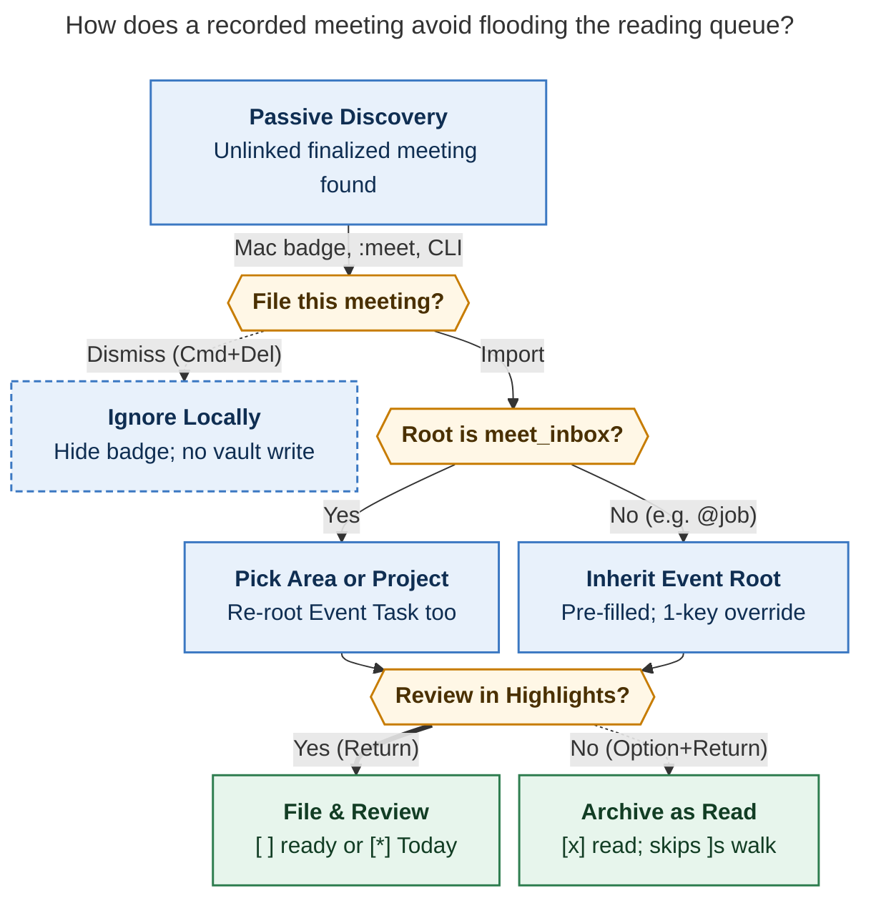

# Integrating Wispr Flow AI Meeting Notes with Bob Event Tasks

**Date:** 2026-11-24
**Scope:** `bob-cli`, `bob-mac-capture`, `bob-plugins`, and the Bob Obsidian vault
**First Concrete Use Case:** `~/tmp/bryan_derrick_meet_notes.txt` → `2026/20261123.md#^bryan-bugyi-derrick`

---

## 1. Executive Summary & Bottom-Line Verdict

**Verdict: Yes — modeling Wispr Flow meeting notes as first-class `ref/meetings/` Reference Notes linked to daily Event Tasks is the right architectural home in Bob, *provided* we make six concrete adjustments to the initial framing.**

Bryan's own vault already proves the demand and the workflow shape. For the 2026-11-23 Derrick Blakely intro call (`2026/20261123.md#^bryan-bugyi-derrick`), Bryan created two pre-call Highlights ref notes in `job.md` (`^ref-yogi-senior-swe-product-intro-call-prep` and `^ref-yogi-derrick-question-playbook`), linked them to the Event Task via `🪢 **LINKS:**`, and then wrote a manual post-call chore task (`Review WhisperFlow meeting notes on [[20261123#^bryan-bugyi-derrick]]! ^whisperflow-meeting`) blocking `Send a follow-up email to Derrick! ^send-yogi-follow-up`. Filing the meeting notes directly as a **`ref/meetings/` Highlights dossier** turns that manual review chore *into* the `#task #ref` reading task, unlocks Highlights annotation + automatic `#task` follow-up extraction (`highlights.annotation_task_relation: inspired by`, already enabled in `~/.config/bob/config.yml`), integrates with **Bob Refs (`⌘]`)**, and preserves the full transcript write-once in `.bob/ref-sources/meetings/`.

However, implementing the request naively — manually copying `.txt` files into pandoc Markdown PDFs, leaving the Obsidian ref note body empty until highlighted, auto-dumping every recorded call into `NEW`, or embedding LLM calls inside `bob-cli` — would create real friction across Bryan's daily GTD flow.

### Summary of Six Justified Requirement Adjustments

| ID | Original / Implicit Assumption | Adjusted Requirement | Why It Matters |
| :--- | :--- | :--- | :--- |
| **RA-1** | Import from exported `.txt` files copied out of Wispr Flow | **Read Wispr Flow's local macOS SQLite store (`flow.sqlite` + `refined.ndjson`) directly as the primary path**, with file / `Copy as Markdown` / clipboard / stdin as a first-class cross-host fallback | `~/tmp/bryan_derrick_meet_notes.txt` is a plain-text summary copy that lost headings, timestamps, and the verbatim transcript; `flow.sqlite` holds everything locally, and `bob-cli` already bundles `rusqlite` on macOS. |
| **RA-2** | Standard Highlights ref note (empty body except `## Highlights`) | **Hybrid Meeting Ref Note**: seed a compact, digest-guarded Meeting Recap (metadata + Executive Summary + Key Takeaways + Next Steps) above `## Highlights`, while the full Meeting Dossier + verbatim transcript live in `lib/meetings/<stem>.pdf` and `.bob/ref-sources/` | Standard ref notes are blank in Obsidian until highlighted; without an in-note recap, Obsidian global search (`Cmd+Shift+F`), hover previews, and Linux/mobile lookups find zero meeting content. |
| **RA-3** | Rely on Wispr's built-in AI summary alone *or* wire an LLM directly into `bob-cli` | **Two-layer split**: fast, deterministic, zero-LLM **Layer 1** in `bob-cli` + optional, pluggable **Layer 2** vault-aware AI enrichment (`bob meet brief` + `meetings.enrich_command` / SASE skill) | Wispr transcribed `SASE` as `"Sassy"` 3× and guessed `'BOLI'` because it lacks vault context. Keeping Layer 1 deterministic preserves Bob's offline reliability (`bob periods brief`/`draft` & `highlights.listen_command` precedent). |
| **RA-4** | Auto-sync every Wispr Flow meeting into `ref/` as an open reading task | **Passive discovery + one-gesture intentional filing**, offering **File & Review** (`[ ] ready` / `[*] next`) alongside **Archive as Read** (`[x] read`) and **Ignore** | Auto-importing every call would flood `NEW`, blow past `plan.max_ready` (21) and per-note Ready caps (5), and nag the `]s` morning review walk on routine calls. |
| **RA-5** | Blindly inherit the Event Task's `[root::]` as the ref note's parent | **Inherit `[root::]` when real (`job`), allow 1-key narrowing (`job_2026`), and intercept `[root:: meet_inbox]`** to pick a real area/project and re-root the Event Task in one gesture | `meet_inbox.md` is an inbox root that holds no tasks (`glossary:inbox-file`); filing a reading task there violates vault structure. |
| **RA-6** | Mutate the Event Task's `LINKS` line directly, with a meeting-only linking mechanism | **Author `🪢 **LINKS:** notes for [[YYYYMMDD#^event]]` on the new `#task #ref` reading task** (mirroring `LINKED FROM` onto the Event Task) via a reusable `-R/--relate` flag on `bob ref create` | Matches Bryan's existing convention in `job.md` (`yogi_derrick_question_playbook`, `yogi_senior_swe`), avoids ownership collisions with `bob gcal sync`, and benefits *all* refs (prep docs, playbooks, reports). |

---

## 2. Critique of the Plan & Architectural Trade-Offs

### 2.1 Is Making Meeting Notes `ref/` Notes Actually a Good Idea?

Before committing to `ref/`, we should seriously evaluate all four existing Bob note homes against how Bryan actually works with meetings.

| Candidate Home | Examples in Bob Today | Strengths for Meeting Notes | Fatal Weaknesses | Verdict |
| :--- | :--- | :--- | :--- | :--- |
| **1. `ref/meetings/` Ref Note + Highlights Dossier PDF (Hybrid)** | `ref/podcasts/` (spoken dossier + transcript), `ref/chat/` (interview prep) | Full Highlights reading + annotation loop; automatic `#task` follow-ups linked via `inspired by`; Bob Refs (`⌘]`) search, Copy card, Link to Today; write-once `.bob/ref-sources/` transcript archive; unified reading-state lifecycle (`ready → read`) eliminates duplicate "Review meeting notes" chores. | Without an in-note recap, Obsidian search/hover sees an empty file; indiscriminate auto-import would pollute the reading queue. *(Both solved by RA-2 & RA-4.)* | **Recommended** |
| **2. Plain Vault Folder (`meetings/2026/`) like `mail/`** | `mail/2026/261123_yogi_senior_swe_technical_screen.md` | Instantly editable & full-text searchable in Obsidian; zero Pandoc/Chrome PDF render latency; natural home for append-only raw dumps. | **Loses the entire Highlights annotation + `#task` extraction workflow** (Bryan's primary tool for studying dense material like 30–60 min interviews); invisible in **Bob Refs (`⌘]`)** and the Reading Board; invents a *second* review-task lifecycle separate from `#task #ref`. | **Reject as primary** *(though the in-note recap in Option 1 captures its main benefit)* |
| **3. Notebook Bullets (`meet.md` or `<area>_meet.md`)** | `meet.md`, `legacy_meet.md` | Zero new file per meeting; fast bullet capture (`@meet`). | Notebooks forbid checkboxes (`notebook_checkbox`), cannot hold multi-page transcripts cleanly, have no Highlights PDF or reading state, and force all meetings into one monolithic file (`legacy_meet.md` shows why Zorg-era monolithic meeting logs degraded into hard-to-link sprawl). | **Reject** *(keep `meet.md` as a scratch/meta index only)* |
| **4. Private Event Note (`.bob/gcal/`) or Task Drawer on Event Task** | `gcal.note` (`-15 Final prep…`) | Lives directly on the daily Event Task. | `gcal.note` has a hard 2048-byte cap (`docs/gcal-notes.md`), is designed for pre-meeting directives/buffers, and dumping 4,000-word transcripts into `2026/20261123.md` would ruin daily-note readability and link-ordering. | **Reject** |

**Why Option 1 (Hybrid `ref/meetings/`) decisively wins:**
Bob already solved the hardest half of this exact problem for **Spotify podcasts** (`src/native/highlights_ref/podcast/dossier.rs` + `scripts/web_clip/web_clip_render.py`). A recorded meeting is structurally identical to a podcast episode — metadata header, structured notes/summary, and a timestamped, speaker-diarized transcript — except that its source is Wispr Flow + Google Calendar rather than Spotify + RSS, and its anchor in the vault is a **daily Event Task** rather than a public URL.

### 2.2 Detailed Critique of the Six Fault Lines (RA-1 through RA-6)

#### Fault Line 1 (RA-1): Manual `.txt` Export Throws Away Wispr Flow's Best Data
Inspecting `~/tmp/bryan_derrick_meet_notes.txt` directly exposes what happens when a user copies notes manually from the Wispr Flow UI:
- **It is NOT a transcript.** All 79 lines are Wispr's pre-summarized bullet points — there are zero timestamps, zero speaker turns, and zero verbatim quotes from Derrick.
- **It lost all Markdown structure.** Section titles (`Yogi and the Role`, `Yogi Agents Feature`, `Next Steps`) became bare lines separated by triple blank lines instead of `##` headings, and bullets became unbulleted paragraphs.
- **It lost meeting provenance.** No recording start/end time, no duration, no attendee list, no Wispr meeting UUID for deduplication.

Meanwhile, Wispr Flow's macOS desktop app persists *far* richer data locally in an open SQLite database (`~/Library/Application Support/Wispr Flow/flow.sqlite`) and sibling folder (`~/Library/Application Support/Wispr Flow/meetings/<meeting-id>/`):
- The `Meetings` table holds `id`, `title`, `createdAt`, `modifiedAt`, `endedAt`, `recordedMs`, `participantNames`, `summary` (Markdown!), `notes` (user notes + `:::toggle` summary blocks), `speakerMap` (JSON mapping `<@speaker:N>` to real names), `refineStatus`, `finalized`, `isDeleted`, and `isTourDemo`.
- `meetings/<id>/refined.ndjson` holds the full server-refined, speaker-diarized transcript (`{id, timestamp, speaker, text}`), with `live.ndjson` as a raw fallback and `upload.{ogg,opus,m4a,wav}` for local audio.
- And Wispr Flow's `⋯ → Copy as Markdown` menu copies structured Markdown (`# Title`, `## Meeting Info`, `## User Notes`, `## Brief`, `## Summary`, `## Chat`, `## Transcript` with `[M:SS] Label: text`) — dramatically cleaner than plain-text copy when working off-Mac.

**Critical engineering win:** `bob-cli` **already depends on `rusqlite = { version = "0.40", features = ["bundled"] }`** on macOS (`Cargo.toml`, used for Alfred clipboard history in `src/native/capture_clip/alfred.rs`) and in `dev-dependencies` for cross-platform tests! Reading `flow.sqlite` directly on macOS requires **zero new crate dependencies** and **zero manual copy-paste**. Yet because Bryan also runs SASE and `bob` on Linux (`athena`, `apollo`) — and because Wispr's undocumented SQLite schema could drift — supporting **both** direct SQLite reads on macOS *and* file / `Copy as Markdown` / plain-text / clipboard / stdin imports makes the system both effortless and indestructible.

#### Fault Line 2 (RA-2): Empty Obsidian Ref Notes Break Discovery & Quick Reference
Look at `~/bob/ref/chat/yogi_senior_swe_product_intro_call_prep.md`:
```markdown
# Yogi Senior Software Engineer, Product: Intro Call Prep (Mon 2026-11-23, 15:00–15:30 ET)

![[job#^ref-yogi-senior-swe-product-intro-call-prep]]

## Highlights

<!-- highlights:begin -->

<!-- highlights:end -->
```
For an external blog post or academic paper, an empty note body before reading is fine: you read in Highlights, and your highlights populate the note. For a **meeting you just attended**, an empty Obsidian note is a serious UX failure:
1. Two weeks later, when you search Obsidian (`Cmd+Shift+F`) for `"Temporal"` or `"Prefect"` or `"Pepsi"` or `"75-minute coding round"`, Obsidian **will not index `lib/meetings/*.pdf` or `.bob/ref-sources/`** (hidden dot-directories are invisible to Obsidian search). If you didn't highlight that exact sentence in Highlights, it vanishes from vault search.
2. Hovering over `[[job#^ref-261123-yogi-derrick-blakely]]` or clicking through from `2026/20261123.md` in Obsidian on Linux or mobile would open a blank page!

**The fix already fits Bob's parser cleanly:** `src/native/highlights_ref/region.rs` (`split_note_body`) preserves everything between the managed embed `![[parent#^ref-...]]` and `## Highlights`, and `bob ref show` (`src/native/ref_library/show.rs`) + `Bob Refs` inspector expose it as `own_notes`. By seeding a compact **Meeting Recap** (metadata bar linking `[[20261123#^bryan-bugyi-derrick]]`, a 2-sentence `> [!summary]` lead, concise Key Takeaways, and Next Steps) inside a digest-guarded `<!-- bob:meeting-recap:begin --> … <!-- bob:meeting-recap:end -->` region above `## Highlights` — modeled directly on `bob periods draft`'s `summary_digest` ownership rule (`src/native/periods/draft.rs`) — Bryan gets:
- Instant Obsidian searchability and hover previews without bloating the note with a 5,000-word raw transcript (the full transcript stays in the PDF and `.bob/ref-sources/`);
- Safe editability (if Bryan edits the recap in Obsidian, `meeting_recap_digest` mismatches and Bob never overwrites his edits on re-import/overwrite);
- Unchanged Highlights sync semantics inside `<!-- highlights:begin --> … <!-- highlights:end -->`.

#### Fault Line 3 (RA-3): Raw Wispr AI Notes Aren't "Excellent", Yet `bob-cli` Must Stay Deterministic
Look at concrete flaws inside `~/tmp/bryan_derrick_meet_notes.txt`:
- Line 17, 23, 27: `"Bryan Bugyi Background and Sassy Project"`, `"Built Sassy, a meta-harness..."`, `"Sassy uses a systemd scheduler..."` — Wispr has no idea Bryan's flagship project is spelled **`SASE`**.
- Line 57: `"Yogi uses a code quality tool (sounded like 'BOLI')..."` — left unflagged as an uncertain transcription.
- Line 79: `Next Steps: (Derrick Blakely) Email Bryan Bugyi...` — omits Bryan's own implicit next steps (sending a thank-you/follow-up email, preparing for the 75-minute Python/uv AI-enabled coding round, researching Prefect→Temporal and BOLI/linting context).
- Zero cross-reference to Bryan's linked prep docs (`ref/chat/yogi_senior_swe_product_intro_call_prep.md`, `ref/chat/yogi_derrick_question_playbook.md`) — e.g., which open questions were answered vs. still unanswered for the onsite!

At the same time, **hardcoding an Anthropic/OpenAI/Gemini HTTP client inside `bob-cli` would be an architectural mistake**:
- `bob-cli` currently makes **zero LLM API calls**; every AI-assisted workflow in Bob separates deterministic context-gathering + guarded writes from an external model/agent (`bob periods brief` → agent → `bob periods draft`; `bob ref create -L` → `highlights.listen_command: sase listen render ...`).
- Putting network LLM calls on the critical path of meeting import would make filing slow (10–30 s), brittle when offline/rate-limited, and expensive for trivial 10-minute calls.

**The clean two-layer architecture:**
1. **Layer 1 — Deterministic Fast Path (default, <2 s, offline, zero tokens):** Normalizes Wispr's summary/notes/transcript, resolves `<@speaker:N>`, attaches Event Task metadata & root hue, renders the Meeting Dossier PDF via `web_clip_render.py`, writes `.bob/ref-sources/`, seeds the Obsidian recap, and links the reading task to the Event Task. **100% reliable on every machine.**
2. **Layer 2 — Optional Vault-Aware AI Enrichment (`--enrich` / `bob meet brief`):** When toggled on (either inline via a configured `meetings.enrich_command` mirroring `highlights.listen_command`, or interactively via a SASE agent/skill calling `bob meet brief <target>`), Bob packs a clean structured context bundle:
   - Wispr summary + user notes + refined transcript (or pasted file),
   - Matched Event Task (`20261123#^bryan-bugyi-derrick`) + private event note + Google description,
   - Parent area/project summary (`job.md`, `job_2026.md`) + **titles/summaries of any refs already linked to the Event Task** (`yogi_senior_swe_product_intro_call_prep`, `yogi_derrick_question_playbook`),
   - A compact **vault glossary/vocabulary list** (project/area names & aliases like `SASE`, `Bob`, `Paraform` so ASR mishearings like `"Sassy"` are reliably corrected and transparently logged in a `Normalized terms` provenance footer!).
   - Crucially, **Layer 2 enriches the Executive Summary, Discussion Notes, Open Questions, and Split Action Items (Yours vs. Theirs), while NEVER altering the verbatim transcript appendix**, preserving forensic truth! And because `bob ref create -f overwrite` works on unannotated refs, Bryan can fast-file with Layer 1 right after hanging up and optionally upgrade to Layer 2 later with one command.

#### Fault Line 4 (RA-4): Don't Auto-Flood the Reading Queue
In Bryan's `~/.config/bob/config.yml`, `plan.max_ready` is `21`, `freshness.interval` is `3` days, and every open `#task #ref` enters the `NEW` tier of the `]s` morning walk (`decisions:recurring-occurrences-walk-when-due`). Silently auto-importing every Wispr recording via `bob tick` would:
- Turn minor status syncs or aborted test recordings into unread `#task #ref` obligations in `NEW`;
- File meetings before Bryan fixes a misidentified speaker name or lets Wispr finish refining;
- Risk leaking confidential or misrecorded audio notes into the Git-synced vault without consent.

Instead, **discovery is passive and read-only; filing is one deliberate gesture**, and that gesture offers two crisp outcomes:
- **File & Review (`-s ready`, default; or `--today` → `[*] next` + Today link):** For meetings you actually want to digest, highlight in Highlights, and mine for follow-ups (like the Derrick Blakely interview).
- **Archive as Read (`-s read`):** Creates the full `ref/meetings/` note + PDF + `.bob/ref-sources/` + `🪢 LINKS: notes for` relation with a **born-done `[x]` reading task** (`[completion:: YYYY-MM-DD]`). Immediately searchable in Obsidian and Bob Refs, linked to the Event Task forever, and **never appears in `NEW`, `READY`, or the `]s` walk**!

#### Fault Line 5 (RA-5): `meet_inbox` Trap & Area-vs-Project Routing
When `bob gcal sync` imports an Event Task without a private note or routing rule, it sets `[root:: meet_inbox]` (`config.yml` line 97). Per `glossary:inbox-file`, **`meet_inbox.md` holds no tasks**.
- When an Event Task already has a real area/project root (like `^bryan-bugyi-derrick` having `[root:: job]`), pre-select `job` as the parent — and offer active child projects (`job_2026`) right underneath it as a one-key override!
- When an Event Task still has `[root:: meet_inbox]`, **refuse silent filing into `meet_inbox`**: focus the parent route picker, and offer a single atomic commit that **both** files the ref note under the chosen area/project **and** updates `[root:: <chosen>]` on the Event Task (plus writes the `gcal.note` root override so `bob gcal sync` keeps it).

#### Fault Line 6 (RA-6): Relation Direction, Reusability & Vault Hygiene
Look at how Bryan already links meeting artifacts in `~/bob/job.md` and `~/bob/2026/20261123.md`:
- `job.md` line 62–63: `^ref-yogi-derrick-question-playbook` has `🪢 **LINKS:** [[20261123#^bryan-bugyi-derrick]]`.
- `job.md` line 66–67: `^yogi-senior-swe` (mail task) has `🪢 **LINKS:** [[20261123#^bryan-bugyi-derrick]]`.
- `20261123.md` line 37: only `^ref-yogi-senior-swe-product-intro-call-prep` was authored on the Event Task's `LINKS` line; everything post-event points *to* the Event Task.

Authoring **`🪢 **LINKS:** notes for [[20261123#^bryan-bugyi-derrick]]`** on the newly created `#task #ref` reading task (and immediately projecting the `🪢 **LINKED FROM:** [[job#^ref-...]] (notes for)` mirror onto `20261123.md` via `src/native/task_relations/plan.rs`) has four big advantages:
1. **Clean ownership:** `20261123.md`'s Event Task never gets a hand-authored `LINKS` edit from automation — only its machine-owned `LINKED FROM` mirror updates, staying 100% harmonious with `bob gcal sync` and `bob task reconcile`.
2. **Reusable across all of Bob:** Exposing this as **`-R, --relate <[LABEL:]TARGET>`** (repeatable) on `bob ref create` means *every* `bob ref create` call (prep docs, call playbooks, SASE research reports, podcasts, and meeting notes) can link its newborn reading task to any existing task at birth!
3. **Resilient across archiving & renaming:** `bob task archive` and `bob ref rename` already rewrite `🪢 **LINKS:**` / `LINKED FROM` block links when tasks move to `done/` or refs rename (`decisions:reference-renames-keep-identity`).
4. **No raw audio blobs in Git:** Wispr's `meetings/<id>/upload.ogg` / `.m4a` files can be 15–50 MB per hour. Never copy raw meeting recordings into `lib/meetings/` by default (Git bloat hurts every `bob vault-sync` across hosts). Keep recording audio local in Wispr's folder (or behind an explicit opt-in `--attach-audio` flag if ever desired).

*(Bonus note on `bob#^event-note-relation`: Bryan has a separate blocked task in `bob.md` line 176 to link pre-event items to future calendar events via private event notes before the daily note exists. Because Wispr Flow meeting notes are always created **during or after** a meeting, the daily note and Event Task already exist — so `bob meet` does NOT need to block on `^event-note-relation`, while staying completely compatible with it!)*

---

## 3. Technical Grounding: Wispr Flow Storage & Offline Event Matching

### 3.1 Wispr Flow's Local macOS Storage Contract

Verified against real-world Wispr Flow Notetaker reader implementations (`wispr-cli` and `obsidian-wispr-flow-sync`) and Wispr Flow's Notetaker documentation:

| Artifact | macOS Path | Format & Key Fields | Critical Reliability Quirks |
| :--- | :--- | :--- | :--- |
| **SQLite Database** | `~/Library/Application Support/Wispr Flow/flow.sqlite` | SQLite in **WAL mode**; `Meetings` table: `id`, `title`, `createdAt` (Sequelize UTC string `YYYY-MM-DD HH:MM:SS.SSS +00:00`), `modifiedAt`, `endedAt` (epoch ms), `recordedMs`, `participantNames`, `summary`, `notes`, `speakerMap`, `refineStatus`, `finalized` (`0`/`1`), `isDeleted` (`0`/`1`), `isTourDemo` (`0`/`1`), `importSource`, `shareSlug` | **Undocumented schema** — must probe with `PRAGMA table_info('Meetings')` before querying and fail cleanly with actionable diagnostics if columns drift. Open strictly `SQLITE_OPEN_READ_ONLY` + `PRAGMA query_only=1` + `busy_timeout(500)` + short retry on `DatabaseBusy`/`DatabaseLocked` (matching `src/native/capture_clip/alfred.rs`). Never checkpoint or modify WAL! Filter out `isDeleted = 1`, `isTourDemo = 1`, and by default wait for `finalized = 1` (showing `refining…` in `list` while in progress). |
| **Refined Transcript** | `~/Library/Application Support/Wispr Flow/meetings/<id>/refined.ndjson` | Line-delimited JSON utterances: `{id, timestamp, text, speaker: {id, name}}` | Prefer `refined.ndjson`; fall back to `live.ndjson` with a clear provenance badge (`live transcript — refinement pending`). Tolerate a truncated final line without failing the file; skip `meta` header and text-less `marker` lines. |
| **Speaker Resolution** | `Meetings.speakerMap` JSON | `{"people": {pid: {name}}, "assignments": {sid: {user, consensus, mic, dom, llm}}}` | Resolve `<@speaker:N>` in `summary`, `notes`, and transcript utterances using strict precedence: **`user > consensus > mic > dom > llm`**, falling back to `Speaker N`. Human corrections in Wispr always win. |
| **Summary Toggles** | `Meetings.notes` | Contains `:::toggle\n## Flow Summary\n…\n:::` blocks | Unwrap `:::toggle … :::` into structured Summary vs. User Notes sections so raw directive fences never leak into PDFs or Obsidian notes. |
| **Manual / Cross-Host Exports** | Clipboard / file / stdin | (a) Wispr **`⋯ → Copy as Markdown`** (`# Title`, `## Meeting Info`, `## User Notes`, `## Brief`, `## Summary`, `## Chat`, `## Transcript` with `[M:SS] Speaker: text`) <br/> (b) Plain-text UI copy like `~/tmp/bryan_derrick_meet_notes.txt` (lead paragraph + title-case section headings separated by 2–3 blank lines + `Next Steps`) | Auto-detect input format: (1) `Copy as Markdown` structured headings, (2) standard Markdown with `#`/`##` headings, (3) plain-text Wispr summary heuristic (promote standalone short heading lines bordered by blank runs into `##` headings, convert paragraphs beneath them into structured bullets/prose, detect `Next Steps`). |

**Security & Privacy Hygiene (mirroring `bob gmail`):**
- Never print raw meeting titles, summaries, or transcript lines into stderr diagnostic logs, tick receipts, or telemetry.
- Neutralize untrusted transcript/summary text when seeding the Obsidian in-note recap so stray `#task`, checkboxes (`- [ ]`), Dataview `[key:: val]`, or accidental `[[wikilinks]]` inside spoken prose cannot corrupt Bob's task index (reusing `bob gmail`'s inert Markdown escaping rules).

### 3.2 Deterministic Offline Wispr ↔ Event Task Matcher

Matching a Wispr Flow meeting to its daily Event Task requires **zero Google Calendar network calls** because Bob already maintains both local ground-truth sources inside the vault:
1. **Rendered Event Tasks** in `YYYY/YYYYMMDD.md` under `## Events`, parsed by the existing shared module `src/native/event_task.rs` (`events_section_range`, `parse_event_span`, `clean_event_title`, `[root:: …]`, trailing `^block-id`, `📅`/`📹` badges, existing `🪢 **LINKS:**`).
2. **Calendar Journal** in `.bob/gcal/*.jsonl` (`gcal.row` and `gcal.note`), which links each `YYYY/YYYYMMDD.md#^block-id` to its immutable `{calendar_id, event_id}`, `ical_uid`, `series_id`, `root.source`, and exact RFC 3339 start time.

**Matching algorithm (given a Wispr meeting with local start/end `[W_start, W_end]`, `title`, and `participants`):**
1. **Candidate window:** Read `## Events` from the meeting's local date `D` (plus `D-1`/`D+1` if within 2 hours of midnight for late-night/overnight spans). Exclude cancelled `[-]` Event Tasks unless no non-cancelled candidate matches.
2. **Score each Event Task `E` with span `[E_start, E_end]`:**
   - **Time overlap (0–60 pts):** Overlap ratio between `[W_start, W_end]` and `[E_start − 15m, E_end + 15m]` (grace window handles joining early or running over). Strong bonus when `|W_start − E_start| <= 10m`.
   - **Title & participant token similarity (0–40 pts):** Normalized token Jaccard/Dice between Wispr `title` + `participantNames` and `clean_event_title(E)` (ignoring punctuation, stopwords, and `"Bryan Bugyi"` self-name bias).
3. **Decision bands:**
   - **High confidence (`score >= 70` and margin `>= 20` over #2):** Auto-selected in interactive UI / `--event auto`, still shown in preview before commit.
   - **Ambiguous (2+ close candidates, e.g. back-to-back calls):** Ranked picker showing time overlap and root hue — never guesses silently off a TTY (exits 2 with candidate list, matching `bob gcal note`).
   - **No match (ad-hoc / unscheduled call, or manual `.txt` file with no timestamp):** Offers three explicit options:
     1. Pick any recent Event Task (past 14 days, searchable — e.g. `-E 20261123#^bryan-bugyi-derrick`);
     2. **Mint a hand-written Event Task** on day `D` (`- [x] #task **HHMM-HHMM** <Title> [root:: <parent>] [type:: MEET] [completion:: YYYY-MM-DD] ^<slug>`, valid per `glossary:event-task`) and link to it;
     3. File into `ref/meetings/` with **no Event Task link** (`--no-event`).

### 3.3 Deduplication, Naming & Update Lifecycle

- **Stem & path convention:** `ref/meetings/<YYMMDD>_<slug>.md` and `lib/meetings/<YYMMDD>_<slug>.pdf` (for example, `261123_yogi_derrick_blakely`).
  - *Why date-prefixed (`YYMMDD_`)?* Recurring meetings (weekly 1:1s, multi-round interviews with the same company/person) naturally collide if named by title alone; `YYMMDD_` matches Bryan's existing `mail/2026/261123_*` and `ref/notes/sase_blog_261116.md` conventions, sorts chronologically, and keeps `id` aligned with the stem (`decisions:reference-ids-follow-file-stems`).
- **Deduplication keys:** Store `wispr_id` (when from `flow.sqlite`) and `source_event` (`"[[20261123#^bryan-bugyi-derrick]]"` plus `gcal_event_id` when known from `.bob/gcal/`) in both the page-1 PDF marker and ref note frontmatter, indexed by `src/native/highlights_ref/sources.rs`.
  - Importing the same `wispr_id` twice refuses with `already captured: ref/meetings/261123_yogi_derrick_blakely.md` and hints `-f overwrite` (for upgrading an unannotated draft, e.g. after Wispr finishes refining speakers or running Layer-2 AI enrichment) or `-f reread` (`__v2`).
  - Multiple distinct recordings linked to the *same* Event Task (e.g. a call dropped and resumed as two Wispr sessions) warn clearly and let the user choose: merge into one dossier, overwrite, or file as a separate `_2` part.

---

## 4. UX Design: Intuitive, Reliable, and Beautiful Across Every Surface

The north star for UX is **one deliberate gesture, zero repetitive typing, and print-grade artifacts that feel native to Bob**.

### 4.1 Avoiding Queue Flood: The Post-Meeting UX Flow

**Reader question:** How does a recorded meeting move from completion to filed reference without flooding the reading queue?



*Caption: Passive discovery never writes to the vault; one deliberate gesture resolves the Event Task and real parent area, then files the meeting either for Highlights review or directly archived as read. (Rendered with Mermaid CLI 12.0.0 PDF-mirroring config: 678 × 1048 px, 85.2% PDF fit.)*

### 4.2 Visual & Print Craft: The "Meeting Dossier" PDF

Reusing `scripts/web_clip/web_clip_render.py` + `scripts/web_clip/template/reader.css` (the exact offline print engine built for `podcast_episode`, with bundled `Source Serif 4`, `Inter`, and `JetBrains Mono` fonts and Highlights-safe clean text layer) lets us ship a **bespoke `meeting_notes` dossier layout** that looks genuinely publication-grade rather than like a raw Markdown dump:

1. **Masthead Card (Page 1 top):**
   - Left accent bar tinted in the parent root's Bob palette hue (e.g., `aqua` for `job`).
   - Small-caps kicker: `MEETING NOTES · JOB · MON NOV 23, 2026 · 15:00–15:30 ET · 30 MIN`.
   - Display H1 title: `Bryan Bugyi & Derrick Blakely — Yogi Intro Call`.
   - **Participant chips:** `Bryan Bugyi` · `Derrick Blakely` (with resolved Wispr speaker names).
   - **Clickable action pills** (reusing `.episode-pill` SVG-icon pills):
     - `Open Event Task` (`obsidian://open?vault=bob&file=2026%2F20261123` / block jump)
     - `Google Calendar` (event URL from `📅`)
     - Related prep refs when present (e.g., `Prep: Yogi Intro Call Prep`).
2. **Executive Summary Callout:** Subtle tinted left-border summary card (2–4 sentences) so opening Page 1 in Highlights or Quick Look tells the whole story in 5 seconds.
3. **Action Items & Next Steps Band:** Visually separated two-column or grouped list:
   - **Yours** (e.g., *Follow-up email to Derrick; prep 75-min Python/uv AI coding round*)
   - **Theirs / Waiting On** (e.g., *Derrick Blakely: email next steps*)
   - Clean, highlightable lines designed for quick `- #task` annotation in Highlights.
4. **Structured Discussion Notes:** Clean numbered/titled sections (`Yogi and the Role`, `Yogi Agents Feature`, `AI Development Practices`, `Potential Work & Roadmap`, etc.) plus a distinct **Your Live Notes** card whenever Bryan typed notes inside Wispr Flow during the call.
5. **Context & Provenance Footer:** Subtle grey metadata strip naming the source (`Wispr Flow Notetaker · refined transcript · 28 min`), enrichment mode if Layer 2 ran, and explicit ASR-correction transparency (`Normalized from vault context: "Sassy" → SASE; unverified term flagged: "BOLI"`).
6. **Verbatim Transcript Appendix (fresh page break):** Directly reuses `web_clip_render.py`'s `.episode-transcript` / `.transcript-para` layout — muted monospace gutter timestamps (`00:00`, `04:18`), bold speaker labels printed only on speaker changes, generous vertical breathing room, and exact verbatim text untouched by AI enrichment!
7. **Write-Once Source Store:** The same render pass writes `.bob/ref-sources/meetings/<stem>--<hash>/source.md` plus link/code catalogs so `bob ref code`, `bob ref links`, and SASE agents can read every word of the summary and transcript without touching the PDF.

### 4.3 Surface-by-Surface Interaction Design

#### Surface 1: Bob Mac Capture (Primary macOS Experience — Zero Copy-Paste)
Following `decisions:mac-capture-is-a-thin-client` and `decisions:q-and-ctrl-bracket-mirror-esc`, Bob Mac Capture stays a pure presentation client of `bob meet … -f json`:

1. **Idle Agenda Passive Cue:** In the idle Capture Panel's Calendar section, any ended meeting whose Event Task matches an unimported, finalized Wispr Flow meeting displays a quiet, focusable pill beside its row: **`✦ Notes ready`** (muted root-hue dot, never an intrusive system notification banner).
2. **Meeting Notes Import Sheet (`⌘M` from Capture, or clicking/activating `✦ Notes ready` on a Calendar row):** Mirrors the exact visual grammar and polish of the existing Event Notes sheet (`⌘E`, `bob-mac-capture:docs/event-notes.md`):
   - **Header:** Wispr meeting title, recorded time + duration (`15:00–15:30 · 28 min`), speaker chips, and transcript state (`Refined · 4,120 words` or `Summary only`).
   - **Linked Event Card:** Shows the matched Event Task (`2026-11-23 · 1500-1530 · Bryan Bugyi and Derrick Blakely`) with time-overlap confirmation and root hue dot. Pressing `E` opens the Event picker if the user wants to re-bind or pick `No event` / `Create Event Task`.
   - **Parent Route Row:** Pre-filled with `@job` (inherited from `[root:: job]`), with child projects (`@job_2026`) one keystroke away (`P` to change). If `[root:: meet_inbox]`, this field auto-focuses with an inline amber hint: `meet_inbox holds no tasks — pick an area or project (also re-roots Event Task)`.
   - **Editable Title & Options Strip:** Editable display title (defaults to clean title); `A` toggles AI Enrichment (`Off` / `Vault AI`, shown only when `meetings.enrich_command` is configured); `T` toggles Transcript appendix (`Included` / `Summary only`).
   - **Live Vault Preview:** Rendered verbatim from `bob meet import -d -f json`:
     - File path: `ref/meetings/261123_yogi_derrick_blakely.md`
     - Reading task: `- [ ] #task #ref [[ref/meetings/261123_yogi_derrick_blakely|…]]` in `job.md`
     - Relation: `ref task ──(notes for)──▶ 20261123#^bryan-bugyi-derrick`
   - **Footer Key Hints:**
     - `⏎ File & Review` (`[ ] ready`)
     - `⇧⏎ File & Link Today` (`[*] next` + Today Pomodoro link)
     - `⌥⏎ Archive as Read` (`[x] read`, skips `]s` walk)
     - `⌘⌫ Ignore` (hides locally; undoable via `bob meet unignore`)
     - `⎋ / ⌃[ / q` Back (keeping any draft edits in memory)
3. **Bob Refs (`⌘]`) First-Class Support:**
   - Add `case meeting` (`"meetings"` → label `"Meeting"`, SF Symbol `"waveform.and.person.filled"`, dedicated tint) to `RefsCore/RefsModel.swift`.
   - The Inspector displays the seeded recap (`own_notes`), Highlights annotations, and a one-key shortcut to jump to the linked Event Task in Obsidian (`event` frontmatter field).

#### Surface 2: Obsidian (`bob-plugins`)
1. **From an Event Task in a Daily Note:** With cursor on `^bryan-bugyi-derrick`, opening **Bob Command Mode (`:`)** and typing `meet` (or triggering a Task Card action / hotkey on Event Tasks) runs `bob meet import -E 20261123#^bryan-bugyi-derrick` (pre-bound to the exact Event Task under cursor!).
2. **Reading & Navigating After Filing:**
   - On `2026/20261123.md#^bryan-bugyi-derrick`, the live relation chip immediately shows `[[job#^ref-261123-yogi-derrick-blakely]] (notes for)`.
   - Clicking/hovering opens the searchable recap right inside Obsidian; **`Cmd+Enter`** on the reading task (or via Bob Refs) opens `lib/meetings/261123_yogi_derrick_blakely.pdf` straight in **Highlights**!
   - Highlighting any quote in Highlights and writing `- #task Ask about Prefect → Temporal migration scope in coding round` automatically creates that follow-up task in `job.md` with `🪢 **LINKS:** inspired by [[job#^ref-261123-yogi-derrick-blakely]]` and a `🔖` page jump on `⌘S` scan!
3. **Reading Board (`bob-ledger-tools`):** Add `meetings: Object.freeze({ icon: "🗣️", label: "Meeting" })` to `READING_BOARD_KIND_MAP` (`plugins/bob-ledger-tools/src/242-plugin-reading-board-models.js`).

#### Surface 3: CLI (`bob meet` + `bob ref create -R/--relate`)
Following `sase/memory/cli_rules.md` (Integrations section beside `gcal`/`gkeep`/`gmail`; bare `bob meet` defaults to read-only `list`; every long flag has a short alias; alphabetical options; `-f human|json`; `-d/--dry-run`):

```bash
# Discover recent Wispr Flow meetings and their offline Event Task matches (default: list)
bob meet [list] [-a|--all] [-b|--bob-dir DIR] [-D|--db PATH] [-f|--format human|json] [-l|--limit N] [-s|--since DURATION]

# Import from Wispr ID/prefix, Event Task, file, clipboard, or stdin
bob meet import [SOURCE] \
  [-b|--bob-dir DIR] \
  [-c|--clipboard] \
  [-D|--db PATH] \
  [-d|--dry-run] \
  [-E|--event EVENT_REF] \
  [-e|--enrich] \
  [-F|--force[=reread|overwrite]] \
  [-f|--format human|json] \
  [-I|--include-live] \
  [-L|--link-label LABEL] \
  [-N|--name STEM] \
  [-n|--no-event] \
  [-P|--parent ROUTE] \
  [-R|--relate TARGET] \
  [-s|--status ready|next|read] \
  [-T|--title TITLE] \
  [-t|--today] \
  [-x|--no-transcript]

# Emit structured vault+meeting context bundle for Layer-2 AI enrichment (SASE skill / external enricher)
bob meet brief [SOURCE] [-b|--bob-dir DIR] [-D|--db PATH] [-E|--event EVENT_REF] [-f|--format markdown|json]

# Manage ignored Wispr meetings (never hides already-filed refs)
bob meet ignore <WISPR-ID> [-b|--bob-dir DIR] [-f|--format human|json]
bob meet unignore <WISPR-ID> [-b|--bob-dir DIR] [-f|--format human|json]

# Verify flow.sqlite path, schema probe, web_clip tools, and optional enrich_command
bob meet doctor [-b|--bob-dir DIR] [-D|--db PATH] [-f|--format human|json]

# Reusable primitive on existing `bob ref create` (benefits ALL refs!)
bob ref create <TARGET> -P <PARENT> -R "notes for:20261123#^bryan-bugyi-derrick"
```

*Note on `bob ref create` short flags:* `-R, --relate <[LABEL:]TARGET>` does not collide with any existing `bob ref create` option (`-r` is `--ref-dir`, `-L` is `--listen`, `-l` is `--lib-dir`). It accepts repeatable `[LABEL:]TARGET` values (bare `TARGET` writes an unlabelled relation) and updates both the new reading task's `🪢 **LINKS:**` line and the target's `🪢 **LINKED FROM:**` mirror inside the same guarded birth commit!

#### Surface 4: SASE Agent / Cross-Host Workflow (Linux `athena`/`apollo`)
When Bryan is on Linux (or wants deep multi-document AI synthesis for a high-stakes meeting like an interview):
- A thin SASE skill (or `meetings.enrich_command` in `~/.config/bob/config.yml`) calls `bob meet brief ~/tmp/bryan_derrick_meet_notes.txt -E 20261123#^bryan-bugyi-derrick -f json`, receives the raw notes + Event Task + linked prep docs (`yogi_senior_swe_product_intro_call_prep`, `yogi_derrick_question_playbook`) + vault vocabulary, generates a clean enriched JSON/Markdown dossier, and pipes it into `bob meet import - -E 20261123#^bryan-bugyi-derrick --enriched`.
- Because `bob ref create` / `bob meet import` follows `decisions:references-are-ingested-at-birth` (`bob_sync.lock → scan.lock`, scoped commit + push), the PDF, ref note, reading task, and Event Task link appear immediately on the Mac in Obsidian, Highlights, and **Bob Refs**!

---

## 5. Concrete Walkthrough: First Use Case (`bryan_derrick_meet_notes.txt` → `20261123#^bryan-bugyi-derrick`)

### 5.1 Diagnosis of `~/tmp/bryan_derrick_meet_notes.txt`
Running our pipeline on Bryan's actual 79-line input highlights why both Layer 1 normalization and Layer 2 vault-aware enrichment earn their keep:
- **Detected format:** Plain-text Wispr Flow UI summary (no `#` headings, triple-newline section breaks, no transcript block, no frontmatter).
- **Explicit Event Task target:** `2026/20261123.md#^bryan-bugyi-derrick` → supplies date `2026-11-23`, time `1500-1530`, title `Bryan Bugyi and Derrick Blakely`, Google Calendar URL, Google Meet URL, `[root:: job]`, and linked prep ref `[[job#^ref-yogi-senior-swe-product-intro-call-prep]]` (plus `[[job#^ref-yogi-derrick-question-playbook]]` linking to it).
- **Default parent:** `job` (with `job_2026` offered as a child-project option; `job` matches where `^ref-yogi-senior-swe-product-intro-call-prep`, `^ref-yogi-derrick-question-playbook`, `^whisperflow-meeting`, and `^send-yogi-follow-up` already live!).
- **ASR / quality catches for Layer 2 (vault-aware enrichment):**
  1. `"Sassy"` (lines 17, 23, 27) → corrected to **`SASE`** (logged transparently in provenance).
  2. `"(sounded like 'BOLI')"` (line 57) → explicitly preserved as `[unverified ASR: "BOLI"]` instead of silently guessing.
  3. **Prep cross-check:** Answers several prep questions from `yogi_senior_swe_product_intro_call_prep.md` (confirming single-agent nightly/weekly loops, Prefect → Temporal migration opportunity, Claude Code-heavy SDLC) while highlighting new details (75-minute AI-enabled coding round building a data-processing app, Pepsi 10× expansion).
  4. **Split action items:** Separates Derrick's action (*email next steps*) from Bryan's implied actions (*follow-up thank-you email; prep for 75-min data-processing coding round*).
  5. **Completeness hint:** Because `~/tmp/bryan_derrick_meet_notes.txt` has no transcript, Bob prints a quiet hint: `note: plain-text summary imported without transcript — on macOS, bob meet import reads the full diarized transcript directly from Wispr Flow`.

### 5.2 Exact Command & Resulting Vault Artifacts

```bash
# Fast deterministic Layer-1 import (works anywhere, offline, <2s):
bob meet import ~/tmp/bryan_derrick_meet_notes.txt -E 20261123#^bryan-bugyi-derrick

# Or with Layer-2 vault-aware AI polish + immediate Today link:
bob meet import ~/tmp/bryan_derrick_meet_notes.txt -E 20261123#^bryan-bugyi-derrick -e -t
```

#### Artifact 1: `~/bob/ref/meetings/261123_yogi_derrick_blakely.md`
```markdown
---
status: ready
parent: "[[job]]"
type: "[[ref]]"
ref_type: meetings
title: "Bryan Bugyi & Derrick Blakely — Yogi Intro Call (2026-11-23)"
id: 261123_yogi_derrick_blakely
meeting_date: "2026-11-23"
meeting_span: "1500-1530"
participants:
  - Bryan Bugyi
  - Derrick Blakely
source_event: "[[20261123#^bryan-bugyi-derrick]]"
gcal_event_id: 9uope591lh6bhhs75fl07dk6ig
meeting_source: wispr-flow-text
meeting_recap_digest: sha256:9c4e7a1b2f3d8012
captured: "2026-11-24T09:15-0500"
return_links: true
source_markdown: .bob/ref-sources/meetings/261123_yogi_derrick_blakely--<hash>/source.md
created: 2026-11-24T09:15:02-0500
source_pdf: lib/meetings/261123_yogi_derrick_blakely.pdf
source_pdf_sha256: <sha256>
highlights_marker_hash: <sha256>
highlights_marker_base: "<json>"
pipeline_version: highlights-ref-mvp-3
---

# Bryan Bugyi & Derrick Blakely — Yogi Intro Call (2026-11-23)

![[job#^ref-261123-yogi-derrick-blakely]]

<!-- bob:meeting-recap:begin -->
*Mon 2026-11-23 · 15:00–15:30 ET · [[20261123#^bryan-bugyi-derrick|Event Task]] · Bryan Bugyi, Derrick Blakely · Prep: [[ref/chat/yogi_senior_swe_product_intro_call_prep|Intro Call Prep]]*

> [!summary] Executive Summary
> Intro interview with Derrick Blakely (Product Team Tech Lead at Yogi) went well; next stages are a 75-minute AI-enabled coding round building a data-processing app, followed by an onsite.

- **Company & traction:** Series A B2B SaaS (~80 CPG/electronics brands including Mars, Nestlé, Microsoft, Beats, Apple); strong renewals with up to 10× expansion (Pepsi); expanding from reviews/care into social data and emerging trends.
- **Agents & roadmap:** Nightly/weekly single-agent loops filtering for novel, actionable insights (e.g., skincare smell trend traced to decaying ingredient); upcoming work includes scheduled executive reports, migrating orchestration from Prefect to Temporal, and social insight data modeling.
- **AI SDLC:** Team writes code almost exclusively with Claude Code; reviews prod-bound non-flagged changes at a high level plus automated repo pattern linting (`"BOLI"` — unverified ASR).
- **Next steps:**
  - *Derrick Blakely:* Email next steps for the 75-minute AI-enabled coding round.
  - *Bryan:* Follow up with Derrick and prep for the data-processing app coding round.
<!-- bob:meeting-recap:end -->

## Highlights

<!-- highlights:begin -->

<!-- highlights:end -->
```

#### Artifact 2: `~/bob/job.md` (new `#task #ref` inserted under `## Tasks`)
```markdown
- [ ] #task #ref [[ref/meetings/261123_yogi_derrick_blakely|Bryan Bugyi & Derrick Blakely — Yogi Intro Call (2026-11-23)]] [created:: 2026-11-24] ^ref-261123-yogi-derrick-blakely
	- 🪢 **LINKS:** notes for [[20261123#^bryan-bugyi-derrick]]
```
*(In this specific one-off transition, Bryan can then supersede `job#^whisperflow-meeting` with `^ref-261123-yogi-derrick-blakely` or re-point `job#^send-yogi-follow-up` to depend on it; for all future meetings, Bryan never needs to create a manual "Review Wispr notes" chore task at all!)*

#### Artifact 3: `~/bob/2026/20261123.md` (mirror automatically projected onto `^bryan-bugyi-derrick`)
```markdown
- [x] #task **1500-1530** Bryan Bugyi and Derrick Blakely [📅](...) [📹](...) [📍](...) [buffer:: -15m] [root:: job] [type:: MEET]  [completion:: 2026-11-23] ^bryan-bugyi-derrick
	- 🪢 **LINKS:** [[job#^ref-yogi-senior-swe-product-intro-call-prep]]
	- 🪢 **LINKED FROM:** [[job#^ref-261123-yogi-derrick-blakely]] (notes for) • [[job#^ref-yogi-derrick-question-playbook]] • [[job#^yogi-senior-swe]] • [[job#^whisperflow-meeting]] (💬 mentions)
	- ↤ *15m before* · Final prep for interview!
```

#### Artifact 4: `~/bob/lib/meetings/261123_yogi_derrick_blakely.pdf` + `.bob/ref-sources/meetings/…/source.md`
- Clean print-typeset Meeting Dossier PDF (ready for `Cmd+Enter` in Highlights, searchable in **Bob Refs** under `Meeting`), backed by the write-once source Markdown + link/code catalog.

---

## 6. Risk Analysis, Edge Cases & Reliability Engineering

| Risk / Edge Case | Failure Mode If Ignored | Concrete Mitigation |
| :--- | :--- | :--- |
| **Wispr Flow undocumented SQLite schema drift** | App update renames or drops a column in `Meetings`, breaking macOS discovery/import with opaque SQL errors. | Run `PRAGMA table_info('Meetings')` on every open (matching `alfred.rs` & `obsidian-wispr-flow-sync`). Treat core columns (`id`, `title`, `createdAt`, `summary`, `notes`) as required and enrichment columns (`participantNames`, `speakerMap`, `refineStatus`, `finalized`, `isTourDemo`) as optional with graceful degradation. Always keep `Copy as Markdown` / file / clipboard import as an independent fallback. |
| **SQLite WAL concurrency while Wispr is recording** | Locking error (`SQLITE_BUSY`), partial read, or accidental WAL checkpoint interfering with the running Wispr app. | Open strictly `SQLITE_OPEN_READ_ONLY \| SQLITE_OPEN_NO_MUTEX`, execute `PRAGMA query_only = ON`, set `busy_timeout(500)`, retry up to 3× with exponential backoff, close the connection before any rendering or vault writes, and skip rows where `finalized = 0` unless `--include-live` is passed. |
| **Wispr re-refines transcript or user renames a speaker *after* import** | Vault PDF has `Speaker 1` instead of `Derrick Blakely`, or misses refined transcript turns. | Track `wispr_id` and `wispr_modified_at` in frontmatter/marker. `bob meet list` flags `updated in Wispr` when `modifiedAt > wispr_modified_at`. Unannotated refs upgrade cleanly in place via `-F overwrite` (keeping any hand-edited Obsidian recap whose `meeting_recap_digest` changed); annotated refs refuse in-place overwrite and offer `-F reread` (`__v2`) so Highlights annotations are never lost. |
| **Multi-host Git conflicts & split commits** | Linux host (`athena`/`apollo`) and Mac (`kellys-macbook-pro`) race on `job.md` or `20261123.md`. | Execute all writes inside `decisions:references-are-ingested-at-birth`'s `bob_sync.lock → scan.lock` pipeline: pre-sync, write PDF + `.bob/ref-sources/` + `ref/meetings/` + parent `#task #ref` (with `LINKS`) + Event Task `LINKED FROM` mirror, make **one scoped commit**, and post-sync. Store ignored Wispr IDs locally (or in union-merged per-host `.bob/meetings/<host>.jsonl`). |
| **Markdown / Dataview injection in spoken transcripts** | Speaker says `"dash bracket space bracket #task"` or `[[foo]]`, creating phantom tasks or broken links in Obsidian. | Neutralize untrusted prose inside the Obsidian `<!-- bob:meeting-recap -->` block (reusing `bob gmail`'s inert escaping rules). Full transcript lives in the PDF and write-once `.bob/ref-sources/` (outside Obsidian's task/link index). |
| **Recurring meetings (weekly 1:1s, multi-round interviews)** | Second occurrence collides on filename stem or links to wrong day's Event Task. | Date-prefix stems (`YYMMDD_<slug>`). Event matcher restricts default window to the recording's local calendar day `D` (±2 h at midnight boundary), so every weekly instance maps unambiguously to its own day's Event Task. |
| **Ad-hoc / unscheduled calls (no Google Calendar event)** | Import refuses or attaches to an unrelated adjacent meeting. | Time-overlap + title scoring refuses weak matches cleanly. Offers: (1) pick another Event Task, (2) create a hand-written Event Task on day `D` (explicitly valid per `glossary:event-task`), or (3) `-n/--no-event` to file standalone under `-P <parent>`. |
| **Git vault bloat from meeting audio** | Copying 20–50 MB `.ogg`/`.m4a` call recordings into `lib/meetings/` bloats Git history permanently. | **Do not copy Wispr audio into the vault by default.** Keep recording audio local in Wispr's app folder (optionally surfacing a local play action on macOS only). |
| **`bob ref create` / `bob meet` overwrite vs. user edits** | Re-importing clobbers Bryan's hand-edited summary in `ref/meetings/<stem>.md`. | Stamp `meeting_recap_digest` (SHA-256 of normalized recap bytes, identical to `bob periods draft`'s `summary_digest`). On overwrite, update `<!-- bob:meeting-recap -->` only when untouched; if Bryan edited it, keep his text untouched and report `kept your edited meeting recap`. |

---

## 7. Recommended Solution & Phased Implementation Roadmap

### Recommended Architecture in One Paragraph

Make **`ref/meetings/`** a first-class reference type powered by a new **`bob meet`** Integrations command group and a reusable **`-R/--relate <[LABEL:]TARGET>`** flag on `bob ref create`. On macOS, `bob meet` reads Wispr Flow's local `flow.sqlite` + `meetings/<id>/refined.ndjson` read-only via `bob-cli`'s already-bundled `rusqlite`, matches meetings offline against daily `## Events` + `.bob/gcal/`, inherits the Event Task's `[root::]` (intercepting `meet_inbox`), prints a magazine-grade **Meeting Dossier PDF** through `web_clip_render.py` (reusing `podcast_episode`'s offline print and transcript engine), seeds a searchable, digest-guarded recap above `## Highlights`, inserts the `#task #ref` reading task with `🪢 **LINKS:** notes for [[YYYYMMDD#^event]]`, and updates the Event Task's `LINKED FROM` mirror — all in one birth-ingested commit. On Linux or when exporting manually, the exact same pipeline accepts Wispr `Copy as Markdown`, plain-text summaries (like `~/tmp/bryan_derrick_meet_notes.txt`), clipboard, or stdin, with optional Layer-2 vault-aware AI enrichment (`bob meet brief` + `meetings.enrich_command`) cleanly decoupled from Layer 1's deterministic core.

### Phased Delivery Plan

#### Phase 1 — Core Primitives & Immediate Use Case (`bob-cli`)
*Goal: Deliver end-to-end filing of `~/tmp/bryan_derrick_meet_notes.txt` → `20261123#^bryan-bugyi-derrick` cleanly on both Linux and macOS.*
1. **Reusable birth-relation primitive (`bob ref create -R/--relate`):** Wire `src/native/task_relations/plan.rs` into `highlights_ref`'s reading-task birth execution (`reading_execute.rs` + `intake.rs`) so any new reading task can attach `🪢 **LINKS:**` relations and mirror `LINKED FROM` atomically inside the birth commit.
2. **Meeting Dossier renderer (`meeting_notes` payload):** Extend `scripts/web_clip/web_clip_render.py` and `reader.css` alongside `podcast_episode` to render the Meeting Masthead, Executive Summary callout, Split Action Items, Discussion Notes, Provenance Footer, and Verbatim Transcript Appendix — outputting both PDF and `.bob/ref-sources/meetings/` Markdown.
3. **Hybrid recap seeding (`highlights_ref`):** Support seeding a digest-guarded `<!-- bob:meeting-recap:begin/end -->` block between `![[parent#^ref-...]]` and `## Highlights`, preserved across `bob ref scan` and protected against clobbering on overwrite.
4. **`bob meet import` + `bob meet brief` (file / Markdown / plain-text / clipboard / stdin):**
   - Auto-detect `Copy as Markdown`, standard Markdown, and plain-text Wispr summary formats.
   - Offline Event Task matcher (`src/native/event_task.rs` + `.bob/gcal/*.jsonl`), `[root::]` inheritance, and `meet_inbox` interception.
   - `source_event` / `wispr_id` dedupe in `highlights_ref/sources.rs`.
   - `bob meet brief` JSON/Markdown context exporter (incorporating Event Task, parent note, linked prep refs, and vault vocabulary) + optional `meetings.enrich_command` hook (`-e/--enrich`).

#### Phase 2 — Zero-Copy macOS Wispr Flow Reader (`bob-cli`)
*Goal: Eliminate manual file exporting on macOS completely.*
1. **Read-only `rusqlite` Wispr adapter (`src/native/meetings/wispr.rs`):** Read `flow.sqlite` (`Meetings` table with `PRAGMA table_info` schema probe, WAL-safe read-only + retry), `meetings/<id>/{refined,live}.ndjson`, `speakerMap` resolution (`user > consensus > mic > dom > llm`), and `:::toggle` unwrapping.
2. **`bob meet [list]`, `bob meet doctor`, `bob meet ignore/unignore`:** Rich colored terminal table + schema-versioned `-f json` envelope for thin clients.
3. **CLI docs & Command Catalog:** Register `bob meet` in `docs/command-catalog.md` (automatically surfacing it in Obsidian's `bob-command-mode`) and write `docs/meetings.md`.

#### Phase 3 — Native Mac & Obsidian Polish (`bob-mac-capture` & `bob-plugins`)
*Goal: Make post-meeting filing a joyful 2-second, 1-hotkey flow.*
1. **`bob-mac-capture`:**
   - Add `RefKind.meeting` (`ref_type: "meetings"`, icon `waveform.and.person.filled`) to `RefsCore/RefsModel.swift` and Inspector event jump.
   - Add passive `✦ Notes ready` pill on ended Calendar rows in the Idle Agenda (backed by `bob meet list -f json`, read-only polling on vault/show refresh — never writing the vault).
   - Ship the **`⌘M` Meeting Import Sheet** (thin client over `bob meet list -f json`, `bob meet import -d -f json`, `bob meet import -f json`) with `⏎ File & Review`, `⇧⏎ File & Link Today`, `⌥⏎ Archive as Read`, and `⌘⌫ Ignore`.
2. **`bob-plugins`:**
   - Add `meetings` to `READING_BOARD_KIND_MAP` in `bob-ledger-tools`.
   - Add an Event Task context action in `bob-navigation-hotkeys` / `bob-command-mode` to invoke `bob meet import -E <day>#^<id>` directly from the cursor's Event Task.

#### Phase 4 — Optional Future Enhancements *(Explicitly Deferred Beyond MVP)*
- **Recurring series memory in `bob meet brief`:** When `gcal.row` carries a `series_id`, automatically include the previous occurrence's summary and open action items in the enrichment brief.
- **Pre-meeting prep synergy (`bob#^event-note-relation`):** Automatically include any future-event prep notes once `^event-note-relation` ships.
- **Mac-local audio deep-link:** Optional `Open audio` button in Bob Refs Inspector pointing to local Wispr recording without ever committing audio to Git.

---

### Open Decisions for Bryan Before Planning

1. **Default relation label:** Recommend **`notes for`** (`🪢 **LINKS:** notes for [[20261123#^bryan-bugyi-derrick]]`, mirroring as `(notes for)` on the Event Task). Alternative: unlabelled `[[20261123#^bryan-bugyi-derrick]]` (matching `^ref-yogi-derrick-question-playbook`).
2. **Default `ref_type` directory:** Recommend **`meetings`** (`ref/meetings/`, `lib/meetings/`) so meetings stay cleanly separated from `ref/chat/` (SASE research reports & prep docs) and gain their own icon/filter in **Bob Refs** and the Reading Board.
3. **Layer-2 AI enricher frontend:** Recommend mirroring `highlights.listen_command` with a configurable **`meetings.enrich_command`** in `~/.config/bob/config.yml` (plus a `/bob_meet` SASE skill consuming `bob meet brief`) so `bob-cli` remains 100% deterministic and provider-agnostic.
4. **First use-case execution timing:** Should Phase 1 land first and then import `~/tmp/bryan_derrick_meet_notes.txt` through the real `bob meet import` command, or would you also like a one-off enriched Markdown ref created via today's `bob ref create` immediately to unblock `job#^send-yogi-follow-up`?
