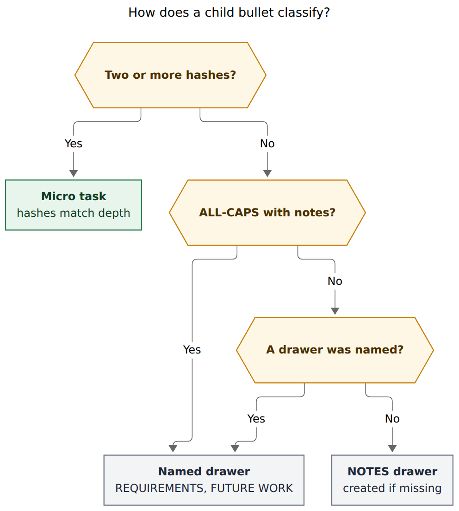
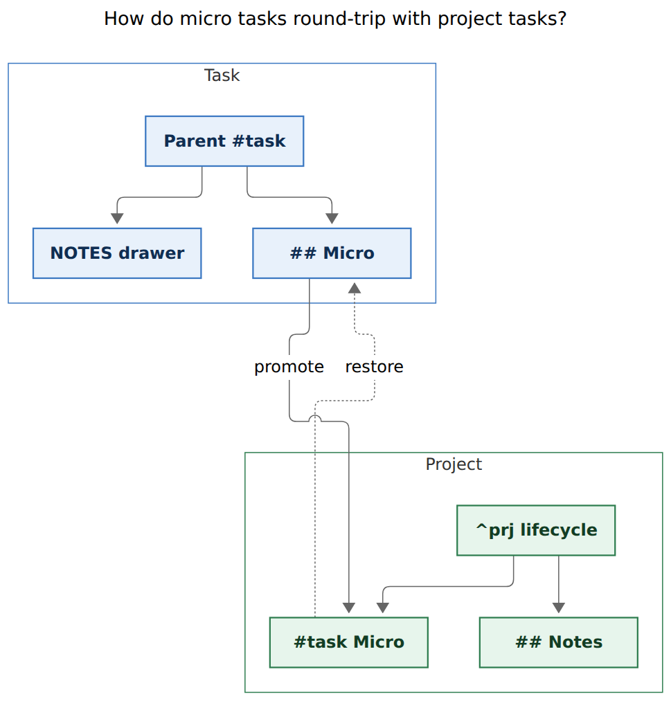

# Explicit micro tasks with hashed markers and a close-time audit

- **Researcher:** grk
- **Date:** 2026-11-20
- **Question:** How should Bob add explicit “micro tasks” — nested commitments under a `#task` that become real tasks on promotion, default notes into a NOTES drawer, audit those commitments when the parent closes, and stay easy to type in capture — while remaining intuitive, reliable, and beautiful? Is the requested plan sound, and what should change?
- **Verdict:** Build it. Explicit marking is the right cut, and a close-time successor audit is the feature that makes the cut worth doing. **Do not** store `#task` or `TASK:` as the mark. Store and render two or more `#` characters whose count matches nesting depth. Treat opening a micro task as a split, not as a new Done chord.

---

## 1. In one breath

A **micro task** is a heading-shaped commitment living inside a `#task`, the way a `#task` lives inside a project. It is not a nested `#task`, not a drawer, and not a note. Today every non-drawer child bullet is an implicit micro task: `Ctrl+Shift+Alt+N` turns it into a `#task` in the new project note (`buildProjectSeedFromChildBullets` in bob-navigation-hotkeys). That implicit rule is why promotion surprises, why capture notes look like leftover work, and why closing a parent cannot ask “did you really finish what this task committed to?”

Recommended encoding:

```markdown
- [ ] #task Prepare the launch review [created:: 2026-11-20] ^launch
	- ## Confirm the rollout owner
		- ### Send the owner the final date
	- ## Attach the final checklist
	- NOTES
		- brand preference still TBD
		- link the runbook when it lands
```

- Two or more `#` characters, then a space, mark a micro task. Depth owns the count: `##` at depth 1, `###` at depth 2, up to `######`.
- Capture types that mark with `- ..` at a bullet start. `Ctrl+G t` toggles it (Mac Capture already has a `Ctrl+G` leader; only `u` is bound).
- Unmarked notes, including `@foo+bar` same-line notes, file in a `NOTES` drawer created on demand.
- Closing the parent offers top-level micro tasks on the existing successor card, Leave by default (completed with the parent). `Ctrl+X` extracts one as its own Ready task. `Tab` / empty-filter `Space` extracts and pulls it into today. `Ctrl+Shift+X` strikes it as abandoned. Nested micro tasks show, muted, and follow their parent micro task.
- Merge writes `## <source description>` in the target instead of a plain title bullet.
- Opening reuses split: a sibling `#task`, a stub in the parent, a LINKED FROM mention on the new task.

Mac Capture stays a thin client of `bob`. The grammar bumps from 28. Nested `#task` lines (checkbox plus the global filter) stay a different species.



**Figure 1.** Two or more hashes mark a micro task. An ALL-CAPS title with nested notes is still a named drawer. Every other note files in `NOTES`, created if missing. Rendered with mermaid-cli 12.0.0; 661 × 736 px, fit 98.8%.

---

## 2. Is this a good idea?

Yes. Three facts already in the tree make the feature the missing third outline kind, rather than a new engine.

**Promotion already treats non-drawer children as tasks.** `docs/projects.md` and `buildProjectTaskLineFromChildBullet` take every eligible direct child that is not an ALL-CAPS drawer and not a managed log, force a checkbox, and insert `#task` unless one is present. That is the implicit micro-task rule the request wants to make explicit. The converter is lossless-or-abort. Once unmarked bullets mean notes, promotion stops minting surprise tasks.

**The successor card already has the close-time verbs.** `docs/task-dependencies.md` §12.22 stages Leave, Pull in, Done, and Cancel per row. `Ctrl+X` is Done, `Ctrl+Shift+X` is Cancel, `Tab` / empty-filter `Space` is Pull in, Leave is the default. The card already appears only when the offer set is non-empty. Micro tasks are a new offer group on that same card, so closing a parent with leftover commitments cannot skip the audit. That is exactly the stated goal: make sure the work a task commits to is finished, extracted, or abandoned before the parent leaves the plan.

**Split is already the open gesture.** `docs/task-split.md` promotes a first-level authored note or a drawer entry into a sibling `#task`, replaces the bullet with an aliased stub, and writes a LINKED FROM mention. A `##` micro task is a first-level authored child. Opening it must strip the hashes and reuse that engine. Inventing a third promotion path would fork identity, stubs, and mentions.

What would make it a bad idea: storing `#task` on a non-checkbox bullet (the Tasks global filter is `#task`; bank rows are defined as “never carry `#task`”), using `TASK:` (drawer titles may end in `:`), putting micro tasks inside `NOTES` (then they are notes), or teaching `Ctrl+X` as “open” on the same card that already labels it “done” without changing the consequence copy.

The out-of-scope goal — convert any project back into an equivalent task — is the right north star. Hash depth is the task-shaped form of a project outline. That round-trip should constrain v1 even though reversal of a complex project is later work.



**Figure 2.** Promotion turns `## Micro` into a project `#task` and a `NOTES` drawer into `## Notes`. Restore walks the same edge back. Nested micro tasks stay hashed children of the new task, so the project does not grow nested `#task` lines that status grouping already warns about. Rendered with mermaid-cli 12.0.0; 646 × 676 px, fit 100%.

---

## 3. Critique of the requested plan

The product intent is right: explicit mark, NOTES as the default for notes, nested micro tasks, a close-time audit, merge as a micro-task write, a glossary term, and capture that is easy to type. Several spellings in the brief collide with live grammar, live keys, or live identity rules.

### 3.1 `#task` cannot be the stored mark

The Tasks plugin global filter is `#task` (`vault/.obsidian/plugins/obsidian-tasks-plugin/data.json`, `docs/freshness.md`, `docs/bank.md`). A Bob task is a checkbox line that carries that token. Bank rows “never carry `#task`, so they stay invisible to `bob plan`.” Nested real tasks already exist as checkbox plus `#task` under a parent; merge refuses `merge_source_open_subtasks` when they are open.

A prefix `#task` on a plain bullet would either:

- sit next to the global filter token in a non-task line, so every “is this a task?” predicate has to special-case it, or
- grow a checkbox later and become a real nested `#task` without an explicit open.

Both fight the house rule that `#task` *is* the task. The request’s own example (`- ..` → `- #task `) should not land.

### 3.2 `TASK:` is a drawer title

Drawer titles allow a final `:` (`OPTIONS:` qualifies; `NOTE: X` does not — `docs/capture.md` authored sub-bullets, `is_drawer_title` in `capture_drawers.rs`). `TASK:` with nested notes is a drawer named `TASK:`. `TASKS` is already reserved as a Bob-managed name (`reserved_drawer`). A `TASK:` / `TASKS` pair would be a near-duplicate trap and a teaching error factory.

### 3.3 `##` is already carved out of the drawer shortcut

`src/native/capture_language/drawer_bullet.rs`: a leading `#` on a first-level bullet is a drawer shortcut only when the next character is a letter, a quote, or whitespace. “`#` plus a digit, `##`, and `#-` stay prose.” Claiming `##` as the micro-task mark does not steal the drawer menu. One hash still names a drawer (`- #future-work` → `- FUTURE WORK`). Two or more hashes mark a micro task. That is the beautiful grammar.

### 3.4 `..` is already an escape, except at a bullet start

Capture aliases (`glossary:capture-alias`, `docs/reference/mac-capture/keyboard.md`):

- At an item start, `.` becomes `@`, and fast `..` types a literal `.` so `.bashrc` works.
- After body text plus a space, `.` becomes `@` or `&`.
- At a bullet-body start, `.` stays literal, except a sealed project-note `- .` which becomes `- ^` (Move).

So `- ..` is currently two literal dots. That is the one place a two-dot alias is free. Item-start `..` must keep the `.bashrc` escape. The request’s “`- ..` becomes the marker” is right if and only if it is restricted to a list-item start.

### 3.5 `Ctrl+X` already means Done on the successor card

Picker v4 (`docs/task-dependencies.md` §12.22, bob-navigation-hotkeys successor picker): `Ctrl+X` stages Done, `Ctrl+Shift+X` stages Cancel, `Tab` / empty-filter `Space` turns a verdict into Pull in. The request wants `Ctrl+X` to *open* a micro task (create a `#task`). Same chord, opposite verb, same card.

That is survivable only if the row type changes the consequence copy and the footer. A highlighted micro-task row must say `open as its own task`, never `✓ Completes`. The key can stay; the word “done” cannot. `Tab` should extract *and* pull in in one step, matching today’s “Tab means pull in.” Making Tab require a prior `Ctrl+X` is a two-step trap.

### 3.6 “Link next to it to the original parent” inverts split provenance

Split replaces the bullet with `[[#^new|Alias]]` (or a cross-note form) and writes `🪢 **LINKED FROM:** [[P]] (💬 mentions)` on the new task. The closed parent then points at the leftover work; the new task records where it came from. A note on the struck bullet that links *back to the parent* is a ring, and rings are why merge title bullets carry no link back to S (`docs/task-merge.md` §2).

Strikethrough is the right write for *cancel*. Extract should use the split stub, live, not struck. A struck wikilink is ugly and chips do not treat it as a mention source.

### 3.7 Unmarked children already promote to tasks

A hard cut that treats every existing plain child as a note will change the next `Ctrl+Shift+Alt+N` on any task that has leftover bullets. That is the intended semantic, and it will surprise. v1 must not rewrite the vault. New writes go to `NOTES` or `##`. Existing unmarked children need a dual-read plus a doctor, not a silent migration.

### 3.8 Micro tasks are siblings of drawers, not NOTES entries

If a micro task lived inside `NOTES`, promotion would copy it as a note under `## Notes`, which is the opposite of “converted to a task in the new project file.” Drawers hold notes. Micro tasks hold commitments. They sit on the task as direct children, beside drawers, after managed link lines, before logs.

### 3.9 Nested non-actionable rows are right; “status determined by parent” needs a write rule

The request is right that `###` / `####` rows show on the card and are not independently Leave / Open / Cancel. The parent micro task’s verdict decides:

| Parent verdict | Nested micro tasks |
| --- | --- |
| Leave | stay hashed under the closed parent (completed by containment) |
| Open / Pull in | travel with the new `#task`, hashes rewritten to the new depth |
| Cancel | struck with the parent micro task |

Do not invent per-nested checkboxes.

### 3.10 Merge already copies a plain title bullet

`docs/task-merge.md` §1: S’s description becomes one plain title bullet in T; authored children copy under it; S cancels with `merged into`. The request to “just add the microtask marker” is almost the whole write: prefix that title with `## `. Same-named drawers still do not flatten. Open nested `#task` lines still refuse the merge. That is a small, correct change, not a new merge engine.

---

## 4. Marker choice

Compared alternatives, then the winner.

| Candidate | Why it looks appealing | Why it loses |
| --- | --- | --- |
| `#task` prefix | Matches “this is a task” | Global filter; bank-row definition; nested real tasks |
| `TASK:` prefix | Readable, ALL-CAPS like drawers | Valid drawer title; collides with reserved `TASKS` |
| A `TASKS` drawer | Project notes already have `## Tasks` | Reserved under a task; structural merge on project capture |
| Checkbox without `#task` | Looks completable | Third checkbox species; split already treats `- [ ] text` as splittable; cycler/Tasks edge risk |
| Emoji (`📍`, `☐`) | Pretty in reading view | Does not encode depth; Bob Emoji is a different engine |
| `#micro` / `#μ` tag | Explicit | Tag noise; one hash is the drawer shortcut; no depth |
| `##` / `###` / … | Heading-shaped, depth-visible, already prose to the drawer lexer | Must be Bob-owned so indent and hash count cannot disagree |

**Winner: Bob-owned ATX hashes.** Structure is Markdown indent, as everywhere else in capture. The writer rewrites the leading hashes to `1 + depth` (`##` at the parent’s first child level). Capture may type `##`, `###`, or `..`; commit canonicalises. Depth greater than 5 (`######`) is a teaching error. A lone `#` remains the drawer shortcut. `\##` keeps a literal.

This is also the round-trip encoding the future project→task conversion needs:

| Project | Task |
| --- | --- |
| `#task` row in `## Tasks` | `##` micro task |
| nested `#task` (discouraged) | `###` micro task under that parent |
| `## Notes` / other H2 | `NOTES` / named drawer |
| `^prj` | the restored parent `#task` |

Do not promote nested micro tasks into nested `#task` lines. Status grouping already warns on nested tasks (`task_status_groups::warn_nested_tasks`). Keep them hashed under the new project task so the close-time audit still works one level down.

---

## 5. Capture UX

Capture bullets already mirror the task block (`decisions:capture-bullets-mirror-the-task-block`). The draft must keep reading like the note it writes.

**Typing.** `- ..` at a first-level or nested list-item start expands to the depth-correct hashes plus a space (`- ## ` or `  - ### `). This is a `capture-rewrite --cursor` rule, sibling to the other sigil aliases, with an `alias` object so Undo restores `..`. It does not fire:

- at an item start (`.bashrc` / `.` → `@` escape stays)
- glued to a word
- inside backticks or a wikilink
- on a sealed project-note move bullet (`- .` is still Move)

A third `.` after the expansion is leftover prose (`- ## .`). Fast-`..` literal-dot fallback stays for positions where the first `.` *was* an alias.

**Toggle.** Mac Capture’s `Ctrl+G` is already “a one-key editor leader.” After Control-G, `u` toggles case; any other key beeps (`docs/reference/mac-capture/keyboard.md`). Bind `t` as `toggle_micro_task_marker`:

- on an unmarked bullet under a task: insert the depth-correct hashes (and, if that bullet currently lives in `NOTES`, lift it out to sit as a sibling of the drawer)
- on a micro task: strip the hashes and file the bullet into `NOTES` (creating the drawer if needed)
- on a drawer title, managed line, or parent `#task`: beep

Unlike `Ctrl+G u`, this toggle must know capture syntax, so it is a bob rewrite, not an app-local edit. The footer while the leader waits becomes `⌃G · U case · T micro task · esc cancel`.

Obsidian gets a command `toggle-micro-task-prefix` with no default hotkey in v1 (Vim’s `Ctrl+G` is file-info). Bryan can bind it. In-note, the command toggles the current list item under a `#task` the same way.

**Preview.** `capture-parse` grows a `micro_task_marker` span over the hashes and a parallel `sub_bullet_kinds` array (`micro_task` | `drawer` | `note`). Mac renders those spans; it does not guess. Dry-run preview shows the canonical hashes, the `NOTES` title when a note will create that drawer, and `new drawer` when `created`.

**Same-line notes.** `Note text @foo+bar` and first-level unmarked bullets both file in `NOTES`. `@foo+bar#req` and `- #req` still name another drawer. A micro-task marker on a same-line note is refused (`micro_task_position`): markers live on child bullets, so the parent line stays the `#task`.

**New tasks.** Authored children of a brand-new task follow the same classifier. A new task with only micro tasks has no `NOTES` drawer (drawers stay nonempty by construction). A new task with only notes has `NOTES` and no hashes.

**Project-note capture.** First-level `##` bullets in `@route^id@` become `#task` rows in `## Tasks` (the promotion rule at birth). Unmarked first-level bullets become notes under `## Notes`, not tasks. That matches the requested promotion semantics and is a grammar-visible break from “every child bullet is a task.”

---

## 6. NOTES as the default note drawer

`NOTES` is already the fixture spelling in `capture_drawers` tests and `complete_drawers`. It is not reserved. Do not reserve it like `TASKS`. Match it case-insensitively through the existing drawer resolver; create it with the catalog’s most-used spelling, else `NOTES`.

Insertion point for a default note:

1. If `NOTES` exists, append via `drawer_insertion` (same helper `plan_sub_bullet_capture` already uses for named drawers).
2. If it is missing, `ensure_drawer` creates it among content drawers, after micro tasks and other named drawers’ titles, before managed logs.
3. Empty `NOTES` is never written. Removing the last note deletes the drawer, same as every other drawer.

Virtual vs physical: new writes are physical. Existing unmarked direct children are **read** as notes (promotion seeds them into `## Notes`; the close-time card does not offer them as micro tasks). They are rewritten into `NOTES` only when that task is next captured into, split, merged, or passed through an explicit doctor.

`bob task doctor` (or a `bob task micro` lint) lists unmarked first-level children that would change promotion meaning, with `--file-notes` and `--mark-micro` rewrites. No automatic vault pass.

---

## 7. Close-time successor audit

Add offer group `micro_task` to the existing successor card.

**When it appears.** On every managed Done gesture that completes a parent which has at least one uncancelled top-level micro task. The picker appears even when there are no `hand_off` / `project` / `keep_moving` rows. Cancel of the parent does **not** open this group and does **not** auto-strike micro tasks: they remain commitments if the parent is reopened.

**Order.** `micro_task` first (audit this task’s commitments), then today’s successor groups (what to work on next). Nested micro tasks render indented under their parent row, muted, with `why: follows_parent`. They are not in the numbered pick set.

**Verdicts for a top-level micro task.**

| Card verdict | Key | Write |
| --- | --- | --- |
| Leave (default) | none | **No write** to the micro-task line. The parent’s `[x]` is the completion record. Reopening the parent restores the commitment. |
| Open | `Ctrl+X` | Split: mint a sibling `#task` after the parent block (daily-note parents still route through split’s root/inbox rule). Stub replaces the `##` bullet. LINKED FROM mention on the new task. No Task Link, no freshness stamp, status Ready. Nested micro tasks travel, hashes rewritten. |
| Pull in | `Tab` / empty-filter `Space` | Open, then the existing pick semantics: Task Link under the implicit destination, raise to Next, stamp fresh, mint a missing block ID. |
| Cancel | `Ctrl+Shift+X` | Strike the top-level `##` line and its nested micro tasks (`~~## …~~`). Optional inline reason is a suffix on that bullet, not a parent Cancel Log entry. |

Consequence copy is authored by bob, same as §12.22. Suggested strings:

| Where | Text |
| --- | --- |
| Consequence, Leave | `completes with “{P}”` |
| Consequence, Open | `↗ Opens “{S}” as its own task · Ready` |
| Consequence, Pull in | `↗ Opens “{S}” · Next in {NAME}` |
| Consequence, Cancel | `⊘ Abandons “{S}”` |
| Nested why | `“{S}” follows its parent micro task` |
| Footer | `open {O} · pull in {P} · ⊘ {C} cancel`, omitting zeros |

`Ctrl+A` still skips verdicts. Enter applies staged choices with no highlight fallback once any verdict is staged. Two-step Esc discards. Mac `⇧↩` / `⌃↩` keep their current pull-in-vs-open-notes meanings for *task* offers; for micro-task rows, `⇧↩` applies open/cancel without pull-in.

A parent with only Leave micro tasks still completes in one Enter. The card’s job is to make the commitments visible, not to add a confirm step.

**Identity.** A micro task has no block ID. The close key is a stable description digest of the hashed line plus parent identity, the same family as id-less offer keys. A look-alike is never substituted when that digest changes.

**Reopen of the parent.** Leave rows reappear as open micro tasks. Cancelled rows stay struck. Extracted stubs stay stubs. That three-way visual is the whole history:

```markdown
- [x] #task Prepare the launch review …
	- ## Confirm the rollout owner
	- [[#^checklist|Attach the final checklist]]
	- ~~## Write the tweet thread~~
```

---

## 8. Merge, split, and promotion

**Merge.** In `plan_task_merge`, the title bullet becomes `- ## <clean_description>` at the container’s child indent. Authored children still copy under it. If S itself had micro tasks, they nest and the writer rewrites hashes. S still cancels last with `merged into`. The close-time audit on T will then offer that merged work as a micro-task successor. That is the right “this is now a sub-commitment of T.”

**Split.** Extend “what is splittable” so a micro-task bullet is a first-class candidate: strip the leading hashes from the new task’s description, keep nested children, rewrite nested hashes. A `NOTES` entry stays a drawer-entry split. Ctrl+Shift+T on a `##` line is the in-note form of successor Open, minus pull-in.

**Promotion (`Ctrl+Shift+Alt+N`).** `buildProjectSeedFromChildBullets` grows a third kind:

- managed logs → under `^prj` (unchanged)
- ALL-CAPS drawers → H2 sections (unchanged)
- `##` micro tasks → `#task` rows in `## Tasks`; nested `###` stay hashed under that new task
- unmarked authored children → `## Notes` (not tasks)

Reverse conversion restores hashes from `#task` rows that have no nested `#task` identity to preserve, and restores `## Notes` as `NOTES`. Complex project reversal stays out of scope; the encoding is the preparation.

**Nested real `#task` lines.** Unchanged. They are tasks. They are not micro tasks. Opening them is not split. They already walk, stamp, and block.

---

## 9. Rendering

The mark in the vault, the capture preview, and the successor card must be the same bytes: `##`, `###`, `####`. No stored `#task` that a CSS widget rewrites into hashes. Consistency is the beauty.

Recommended plugin treatment, Live Preview and Reading:

- The leading hashes on a list item under a `#task` render as a compact heading token: same family as a quiet H2/H3, smaller than the parent checkbox line, no checkbox of their own.
- Nested depth uses the extra `#` characters, not a second glyph.
- Struck cancel uses Markdown strikethrough on the whole line, which already looks like a cancelled commitment.
- Extracted stubs keep the existing mention chip.
- Do not restyle `NOTES` beyond today’s drawer ALL-CAPS.

Capture preview uses bob’s spans, so the panel cannot drift from the vault. Successor rows show the canonical hashes in the title; nested rows indent one step and wear the muted class.

No new emoji. Work Log, Rotten Log, Depends-On already own the emoji lane. Hashes are the micro-task lane.

---

## 10. Glossary term

Add **Micro Task** to the glossary web. Draft body:

> A heading-shaped commitment nested under a `#task` that is not itself a `#task` until it is opened or its parent is promoted to a [[project-note]]. It is a child bullet whose body starts with two or more `#` characters, with the hash count matching nesting depth (`##` at depth 1, `###` at depth 2). It has no checkbox and no `#task` token, so the Tasks global filter, `bob plan`, and freshness ignore it.
>
> Closing the parent offers each top-level micro task as a [[successor-offer]] in group `micro_task`, Leave by default (completed with the parent). Opening one is a [[task-split]]: a new sibling `#task` is minted, a stub remains in the parent, and the new task records a LINKED FROM mention of the parent. Nested micro tasks follow their parent micro task’s verdict and are not independently actionable.
>
> A first-level authored note that is not a micro task files in the parent’s `NOTES` [[task-drawer]]. Drawers, managed logs, and nested `#task` lines are not micro tasks.

Aliases: `micro`, `hashed child`. Links: `[[glossary:task-drawer]]`, `[[glossary:successor-offer]]`, `[[glossary:task-split]]`, `[[glossary:project-note]]`, `[[glossary:capture-alias]]`.

This is a new strand, not a rewrite of Task Drawer or Task Successor. Task Successor stays “a task positioned to take another task’s place in today’s Pomodoro plan.” A micro task is not yet a task.

---

## 11. Requirement adjustments

These change the request. Each is a product call.

| ID | Adjustment | Why it is justified |
| --- | --- | --- |
| **ADJ-1** | Store and render `##` / `###` / …, never `#task` or `TASK:`. | `#task` is the global filter and the definition of a Bob task. `TASK:` is a legal drawer title. `##` is already prose to the drawer lexer. |
| **ADJ-2** | `- ..` expands only at a list-item start. Item-start `..` stays the `.bashrc` escape. | The two-dot fallback is load-bearing at item start (`docs/reference/mac-capture/keyboard.md`). Bullet start is the free slot. |
| **ADJ-3** | `Ctrl+G t` is a new suffix on the existing Mac `Ctrl+G` leader, implemented as a bob rewrite. Obsidian gets a command with no default hotkey. | The leader already exists and only binds `u`. Vim `Ctrl+G` in Obsidian is file-info. |
| **ADJ-4** | Successor `Ctrl+X` on a micro-task row means **open** (extract Ready). `Tab` / Space means **open and pull in** in one step. Footer/consequence copy says “open,” never “done.” | Same chord as Done on task offers, different row type. Two-step open-then-Tab would drop pull-ins. |
| **ADJ-5** | Extract reuses split (stub → new task, LINKED FROM parent). Cancel is the strikethrough write. Leave writes nothing. | Split already owns identity, stubs, and mentions. A link from the struck bullet back to the parent is a ring. |
| **ADJ-6** | Nested micro tasks show on the card and are not independently actionable. They follow the parent micro task’s verdict. | Requested, and it keeps one decision per commitment tree. |
| **ADJ-7** | New notes write into `NOTES`. Existing unmarked children are read as notes and are not offered as micro tasks. No silent vault rewrite; a doctor does optional `--file-notes` / `--mark-micro`. | Promotion currently mints tasks from those bullets. A hard cut without a doctor would surprise on the next `Ctrl+Shift+Alt+N`. |
| **ADJ-8** | Micro tasks are direct children of the `#task`, siblings of drawers. `NOTES` is a conventional default drawer, not a reserved name like `TASKS`. | A micro task inside `NOTES` would promote as a note. |
| **ADJ-9** | Merge prefixes the existing title bullet with `## `. No new merge engine. | `docs/task-merge.md` already copies S’s description as one child. |
| **ADJ-10** | Stored micro tasks have no checkbox. | Avoids a third checkbox species and keeps the Tasks global filter honest. |
| **ADJ-11** | Hash count is Bob-owned from indent, capped at `######`. | Authors should not have `##` at depth 2. Heading depth 6 is the familiar ceiling. |
| **ADJ-12** | Bump `GRAMMAR_REVISION` (currently 28). Mac stays a thin client of new spans, the `..` rewrite, and group `micro_task`. | First-level bullets that used to be notes become `NOTES` or `##`. That is a capture contract break (`!` in the train). |
| **ADJ-13** | Cancelling the parent does not auto-strike micro tasks and does not open the micro-task group. | Cancel already skips successor offers. Struck-on-cancel would destroy the work list if the parent is reopened. |
| **ADJ-14** | Group `micro_task` lists before `hand_off` / `project` / `keep_moving`, and it alone is enough to open the card. | Audit this task before choosing tomorrow’s work. |
| **ADJ-15** | Extracted tasks inherit nothing from the parent (match split): no type, priority, schedule, or freshness. Pull-in then raises Next and stamps, as today’s picks do. | One identity rule for every new task born from a bullet. |
| **ADJ-16** | `Ctrl+Shift+T` on a `##` line is in-note Open: split, stripping hashes. | The keymap already means “taskify this bullet.” |

---

## 12. Recommended solution

Ship **hashed micro tasks + NOTES default + close-time audit** as one family, in this order.

1. **Grammar and writers (bob-cli).** Classifier in `task_children.rs` (`TaskChildKind::MicroTask { depth }`). Drawer shortcut unchanged. `##` at a child start is a micro task. Default note path in `plan_sub_bullet_capture` goes through `ensure_drawer(NOTES)` when no selector and no micro-task mark. Capture-parse spans and `GRAMMAR_REVISION` 29. Rewrite: `..` at list-item start; `toggle_micro_task_marker` for `Ctrl+G t`.

2. **Promotion and split (bob-cli vectors + bob-navigation-hotkeys).** Seed converter and `bob task split` strip hashes. Unmarked children → `## Notes`. Doctor lists unmarked children.

3. **Merge (bob-cli).** Title bullet gets `## `. Vectors next to MG1.

4. **Successor group (bob-cli + cycler + nav + Mac).** `micro_task` offers, close keys, consequence copy, Mac Pull-In card. Leave / Open / Pull in / Cancel as in §7.

5. **Surface.** Glossary strand. Capture docs. Plugin CSS for the hash token. Mac leader footer. No Obsidian default for the toggle.

Mac never parses hashes itself. Older bob leaves `..` literal and omits the group, same as any other alias/capability fallback.

**v1 non-goals.** Project→task reversal of arbitrary projects. Checkboxes on micro tasks. Auto-migration of the vault. Inheriting type onto extracted tasks. A capture spelling for Open (the card and `Ctrl+Shift+T` are the surfaces). Nesting micro tasks inside `NOTES`.

---

## 13. Why this is the beautiful version

The outline a task *is* should look like the outline a project *will be*. Hashes are how Markdown already says “this is a heading-shaped child of something larger.” One hash names a drawer because drawers are titles. Two hashes name a commitment because commitments are the next heading level down from a task. Capture types two dots because two hashes is the mark, and `Ctrl+G t` sits on a leader that already means “change this line’s shape.” Closing a parent shows those hashes on the card Bryan already uses to decide what happens next. Opening one is the split he already has. Merging into a parent writes the same mark the close-time audit will later read.

Nothing in that loop is a new kind of checkbox, a new global filter, or a second `Ctrl+X` philosophy. It is one mark, one drawer default, one card group, and one reuse of split.

---

## 14. Sources

- bob-cli `docs/capture.md` (authored sub-bullets, drawer shortcut, `TASKS` reserved, `@route+id` notes); `docs/projects.md` (promotion of child bullets, `Ctrl+Shift+Alt+N`); `docs/task-dependencies.md` §12.22 (successor verdicts, `Ctrl+X` / `Ctrl+Shift+X`); `docs/task-merge.md` §1–2 (plain title bullet, no link back to S); `docs/task-split.md` (stub, mention, what is splittable); `docs/bank.md` (`#task` defines a task); `docs/freshness.md` (global filter); `docs/reference/mac-capture/keyboard.md` (`Ctrl+G` leader, `..` escape); `docs/reference/cli/capture-rewrite.md` (`.` stays literal at bullet-body start); `src/native/capture_language/drawer_bullet.rs` (`##` stays prose); `src/native/capture_language/mod.rs` (`GRAMMAR_REVISION = 28`); `src/native/capture/sub_bullet.rs` (named drawer vs plain child insertion); `src/native/task_children.rs` (`Authored`, `Drawer`, `NestedTask`, managed kinds); `src/native/capture_drawers.rs` (`is_drawer_title`, `NOTES` fixtures).
- bob-plugins `plugins/bob-navigation-hotkeys/src/110-project-seed.js` (`buildProjectSeedFromChildBullets`, `buildProjectTaskLineFromChildBullet`); `src/206-successor-picker-modal.js` / `src/206d-successor-picker-verdict-render.js` (`Ctrl+X` = done); `docs/bob-navigation-hotkeys.md`.
- Decisions: `capture-bullets-mirror-the-task-block`, `unblocked-tasks-are-offered`, `mac-capture-is-a-thin-client`, `capture-sigils-say-where-what-how`, `notebook-routes-write-notes`.
- Glossary: Capture, Capture Alias, Capture Panel, Task Drawer, Task Successor, Successor Offer, Task Merge, Task Split, Project Note, Project Task, Project Note Capture.
- Date of evidence: bob-cli and bob-plugins trees in this workspace on 2026-11-20.
