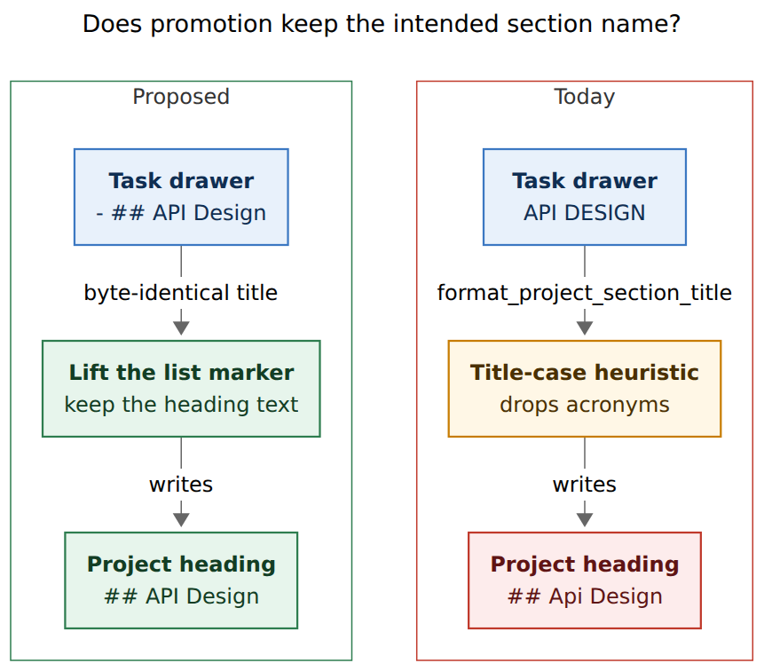
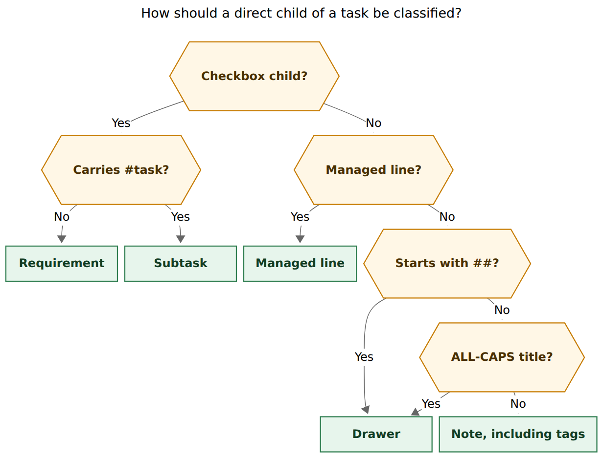

# Mixed-case task drawers

- **Researcher:** grk
- **Date:** 2026-11-22
- **Question:** How should Bob stop requiring ALL-CAPS drawer titles, mark those sub-bullets as drawers without tagging the parent task, reuse notebook H2 capture, render drawers as a distinct nested heading, and stay out of the in-progress `bob-cli-on` epic — while remaining a stepping stone toward lossless task ↔ project-note conversion?
- **Verdict:** Do this, after `bob-cli-on` promotion lands. ALL-CAPS is doing three jobs at once (recognition, display, identity) and that is why promotion mangles `API DESIGN` into `Api Design`. Split those jobs: store a list-item H2 (`- ## API Design`), keep identity case-folded, and paint the row as a nested heading. Keep glued `#foo` tags out of this. Reuse the notebook section resolver and create-title formatter; write a list-item heading under a task and a real `##` under a notebook or `^prj`.

---

## 1. In one breath

A drawer is the task-block image of a project-note `##` section. Markdown cannot put a real column-0 heading under a task without breaking the list, so today Bob fakes a heading with ALL-CAPS. That fake cannot store intended capitalization, so `format_project_section_title` guesses (`API DESIGN` → `Api Design`; `NON-GOALS` → `Non-Goals`). The lossless step is to store the heading text itself inside the list item:

```text
- [ ] #task Ship the exporter ^export
	- ## Notes
		- Morgan reported the original issue.
	- ## API Design
		- Keep the public struct names.
	- 🛠️ **WORK LOG**
```

On promotion, drop the list marker and indent; the heading bytes stay. On reversal, wrap the same heading as a child bullet. Capture already has the typing forms (`- #slug`, `- #"Title"`, `@route+id#slug`); stop uppercasing them and let `- ## Title` be the mirrored disk form, using the notebook create-title rules that already keep `API` when the slug is `#API-keys`.

Render the row as a nested H2 (heading weight, quiet left rule, conceal `## ` until the caret sits on the line). Do not paint small-caps: that would hide the casing this change exists to keep.

**Do not start this while `bob-cli-on` is rewriting promotion, NOTES scoop, and the JS twins of `is_drawer_title`.** Dual-read legacy ALL-CAPS so those vectors stay valid; recase `NOTES` → `Notes` only after the epic decides the `^prj` notes home (`## NOTES` vs `## Notes` is already a recorded bug on that bead).



**Figure 1.** Today a drawer title is forced through `format_project_section_title`, so `API DESIGN` lands as `## Api Design`. The proposed list-item heading lifts to the project note with the same title bytes. Mermaid CLI 12.0.0; 574 × 505 px, fit 100%.

---

## 2. Is this a good idea?

Yes. Three facts make mixed-case drawers the right next step, and one sequencing fact keeps it from colliding with work already in flight.

**Promotion already treats drawers as headings, then throws the casing away.** `docs/projects.md` and `capture_project_note::format_project_section_title` lowercase the whole body and capitalize every alphanumeric run. The comment in that function is explicit: acronyms are not preserved. `bob task rename-drawer` already writes ALL-CAPS on a task drawer and Title Case on a project `##` (`docs/task-requirements.md` §3.5). The two spellings of the same container are a product of the ALL-CAPS discriminator, not of two different objects.

**The discriminator cannot survive mixed case.** A first-level child that is not a checkbox is a note, a drawer, a managed line, or (after `bob-cli-on`) a requirement. ALL-CAPS plus the title grammar is how a drawer is told from a note titled "Future work". Drop that test and every nested note becomes a section, or mixed-case drawers become notes. A new on-disk mark is required. "Just stop uppercasing" is not a design.

**Notebooks already solved create-time casing.** `format_notebook_section_create_title` keeps typed capitals (`#API-keys` → `API Keys`) and title-cases the rest (`#git` → `Git`). `resolve_notebook_section` matches ignore-case, then unique slug, then near-miss, then create. Drawer write-out still runs `to_ascii_uppercase()`. The capture half of this feature is "use the notebook matcher and create-title on both scopes"; the vault half is a list-item heading so the matcher has mixed-case titles to find.

**The in-progress epic owns the same predicates.** `bob-cli-on` is still open: phases `.11` (Obsidian close card), `.12` (promotion maps NOTES → `## Notes`), `.15` (Mac Pull-In card), and `.17` (memory records). `is_drawer_title` is copied into three plugin twins (`task-status-cycler`, `bob-navigation-hotkeys`, `block-id-prompt`) and gates `req_in_drawer`, NOTES scoop, tidy, and rename-drawer. Land this after `.12` at the earliest. Dual-read keeps the ALL-CAPS vectors green during the switch.

A vault scan on 2026-11-22 (open `~/bob`, skipping `done/`, `ref/`, `_generated/`, `_templates/`) found almost no live ALL-CAPS task drawers besides literature-note `* NOTES:` templates that are not Bob drawers. The migration `REQUIREMENTS` → `NOTES` already ran. The feature is cheap on the vault and expensive on the engines, which is another reason to wait for those engines to finish the reqs layout.

---

## 3. Critique of the requested plan

The goals are right: intended capitalization, a stepping stone to lossless project notes, a capture fix, distinct rendering, and no fight with `bob-cli-on`. Five places in the brief need a sharper call than the request made.

### 3.1 ALL-CAPS is the current marker, so mixed case needs a new one

The request says drawers should no longer need to be capitalized, and that sub-bullets still need to be special. That pair only works with an explicit mark. Position ("direct child") and shape ("has nested notes") are already taken: notes nest, requirements nest, logs nest. Orthography was the remaining bit. Once orthography is free, syntax has to carry the type.

### 3.2 `#foo` tags are the wrong mark — and the user's instinct is correct

A glued hashtag on the drawer line (`- #future-work`, `- #drawer`, `- #APIDesign`) would enter Obsidian's note-level tag index. Dataview `file.etags` is per-file. The tag pane, tag search, and any `FROM #future-work` query would light up for every note that merely *contains* that drawer. That is "marking the task in the same way": the mark lives in the same `#` vocabulary as `#task`, `#prj`, types, and the reserved clock tags (`decisions:capture-reserves-clock-tags`). Capture already uses a leading `- #slug` as a *shortcut that rewrites away*. Persisting it would freeze a type-shaped token onto a section name.

Hash-*space* (`- # Future Work`) is a different character: Obsidian tags cannot contain a space, ATX headings require one. It is still the weaker sibling of `- ## Future Work`, because it looks like an H1, promotion would have to add a hash, and the current drawer/notebook lexers treat `#` plus whitespace as an incomplete shortcut.

### 3.3 Capture reuse is the matcher, not the write-out

Notebooks and `^prj` already target mixed-case H2s (`@nb#Section`, `@note#Heading`, `project_h2_drawers`). Task drawers uppercase because the on-disk form is ALL-CAPS, not because the glued `#` grammar is different. Reuse:

- `section_bullet.rs` / `drawer_bullet.rs` (already twins)
- `resolve_notebook_section` / `resolve_drawer_for_write` (same exact / slug / near-miss / create ladder)
- `format_notebook_section_create_title` for unquoted create

Do not reuse the notebook write-out. A notebook item's `- #Rust` line is a routing bullet that is *not* written; the nested notes land under a column-0 `## Rust`. A task item's drawer bullet *is* the block. `decisions:capture-bullets-mirror-the-task-block` says the draft should read like what it writes, so the disk form and the bullet-menu `replacement` should be the same string: `- ## Title`.

### 3.4 Rendering is not optional, and small-caps would fight the goal

Today ALL-CAPS *is* the render. Mixed-case titles without chrome look like notes. The request already says to render drawers distinctly regardless of storage; that has to be part of the same epic as the marker, or the vault gets quieter and harder to scan. Follow the requirement decoration pattern (`docs/task-requirements.md` §4): Live Preview `Decoration.line`, reading-view attributes, conceal the marker until caret adjacency, Mac span plus overlay. Use heading weight and a quiet left rule. Skip `font-variant-caps: all-small-caps` (that treatment is for type labels and relation pills, which *want* to hide casing).

### 3.5 Lossless project notes are larger than drawers — this is still the right slice

A full round-trip also has to preserve the `^prj` line, `## Tasks` rows vs nested `#task` children, requirements, catalogs, frontmatter, and managed logs. Drawers are the one child kind whose promotion *already* rewrites the title. Requirements already round-trip as checkboxes; notes already round-trip as bullets. Fixing drawer titles removes the remaining silent text mutation on that path. Treat "every project note has a lossless task image" as the north star, and this epic as "H2 ↔ drawer is byte-identical in the title."

---

## 4. Would I take a different approach?

I would still ship mixed-case drawers. I would steer the storage, the capture rewrite, and the calendar of the work as follows.

**I would store `- ## Title`, not a tag, field, glyph, or sidecar.** Promotion of `- ## API Design` to `## API Design` is "unwrap the list item." Reversal is "wrap it." Bob's `markdown::atx_heading` only sees ATX after 0–3 leading spaces and does not strip a list marker, so a tab-indented `- ## Title` is invisible to `project_h2_drawers`, notebook section scans, and `@note#Heading`. Obsidian's outline and heading-link completer also ignore headings inside lists (forum consensus 2021–2024: list headings render in the item and do not appear in Outline). That is the sweet spot: it *looks* like a heading in the task, and it *becomes* a document heading only after promotion.

**I would not put a real column-0 `##` under a task.** That ends the list, splits the block, and breaks indent, tidy, reqs, logs, and capture insertion.

**I would not use "any child with nested notes is a drawer."** Nested notes are ordinary.

**I would not auto-title-case on migration.** Prefix legacy ALL-CAPS titles with `## ` and leave the letters alone (`- FUTURE WORK` → `- ## FUTURE WORK`). Recasing is `bob task rename-drawer FUTURE WORK "Future Work"`, which already matches by `drawer_key`. Guessing `Api Design` is the bug we are retiring.

**I would keep `drawer_key` as whitespace-collapsed ASCII uppercase.** Identity stays case-insensitive, so `Notes`, `NOTES`, and `notes` merge. Display is the stored title. Catalog "most-used spelling" can then be mixed case.

**I would keep task types and Pomodoro names ALL-CAPS.** Those are a kind-of-work vocabulary (`FIX`, `READ`, `BUILD + REVIEW`). Drawers are section names. Mixing those alphabets was an accident of sharing `is_title`.

**I would wait for `bob-cli-on.12` (promotion) and prefer waiting for the whole epic.** Changing `is_drawer_title` during twin-copy work is how RL/RW vectors and `taskReqIsDrawerTitle` drift. Dual-read (new prefix or legacy ALL-CAPS) is the compatibility hatch, not a reason to interleave.

**I would recase the notes drawer to `Notes` in a follow-on**, after the epic's `^prj` notes home is `## Notes` with column-0 bullets (bead notes #2 and #4 on `bob-cli-on`: today's writer appends tab-indented `## NOTES` and duplicates the heading). Same key, new display title, one `rename-drawer` pass.

---

## 5. Marker alternatives, scored

| Mark on disk | Recognition | Tags / outline | Promotion | Beauty in source | Verdict |
| --- | --- | --- | --- | --- | --- |
| ALL-CAPS (today) | Orthography | Clean | Title-case heuristic | Loud, no intended case | Retire as *requirement*; keep as legacy read |
| Glued `#foo` / `#drawer` | Easy | Pollutes `file.etags`, collides with types and clock tags | Strip the tag | Looks like a type | Reject (user is right) |
| `- # Title` (hash-space) | ATX H1 echo | Not a tag | Must add a `#` | Ambiguous with incomplete `#` shortcuts | Reject |
| `- **Title**` | Emphasis | Clean | Strip stars | Collides with bold notes; logs already use `**LABEL**` | Reject |
| `[drawer::]` / `[h2::]` | Field | Clean | Strip field | Ugly; fields belong on tasks | Reject |
| Emoji (`📂 Title`) | Glyph | Clean | Strip glyph | Logs already own emoji; too loud for common sections | Reject |
| Sidecar / CSS-only class | Engine-only | Invisible on mobile and in git | External | Agents cannot see it | Reject |
| Column-0 `##` under the task | Real H2 | Outline and `@note#Heading` fire | Identity | Breaks the task list | Reject |
| **`- ## Title`** | List-item H2 | Not a tag; Outline ignores list headings; Bob `atx_heading` ignores list markers | Unwrap | Honest "heading in a list"; conceal in LP | **Take** |



**Figure 2.** Converging arrows mean any matching branch. Requirements stay checkbox children without `#task` (`bob-cli-on`). The new drawer test is a `## ` prefix; ALL-CAPS remains a legacy read. A glued `#foo` on a plain bullet stays a note tag. Mermaid CLI 12.0.0; 821 × 626 px, fit 79.5%.

---

## 6. Capture: reuse the notebook place-grammar

### 6.1 What already exists

| Surface | Today | After |
| --- | --- | --- |
| `@route+id#future-work` | Slug; writes `FUTURE WORK` | Slug; writes catalog / create-title casing under `- ## …` |
| `@route+id#"API Design"` | Quoted; `normalize_drawer_literal` uppercases | Quoted; exact mixed case |
| `- #future-work` plus nested notes | Completes to `- FUTURE WORK` | Completes to `- ## Future Work` (catalog) or `- ## API Keys` from `#API-keys` |
| `- #"API Design"` | Completes to `- API DESIGN` | Completes to `- ## API Design` |
| `- ## API Design` in the draft | Prose (`##` is excluded in `drawer_bullet.rs` / `section_bullet.rs`) | The mirrored disk form; exact title |
| ALL-CAPS with nested notes | Drawer | Legacy drawer (read); new writes use `## ` |
| Childless ALL-CAPS | Note | Note |
| `@nb#API Design` / `- #API-keys` on a notebook | Mixed-case H2, create-title preserves `API` | Unchanged write-out (`##` at column 0) |
| `^prj` `#drawer` | `project_h2_drawers` + Title Case on create | Same matcher; create with the given casing, not `format_project_section_title` |

The current exclusion "`#` plus a digit, `##`, and `#-` stay prose" exists so a pasted markdown heading is not eaten as a shortcut. After this change, a first-level `- ## Title` *is* a place name. Escape with `\#` / `\##` when the hashes are literal note text. That is the same escape already taught for `- \#git`.

### 6.2 One resolver, two write-outs

Lift the shared ladder (quoted exact → ignore-case title → unique slug → near-miss → create) into one named-container resolver. `DrawerScope::Task` writes `- ## Title` (creating the bullet through `ensure_drawer`). `DrawerScope::ProjectSection` and notebook routes write column-0 `## Title`. Near-duplicate, reserved (`TASKS`, logs, LINKS, …), and structural H2s (`Tasks`, `Events`, `Pomodoros`, …) stay refusals.

Unquoted create uses `format_notebook_section_create_title`, not `to_ascii_uppercase()`. Quoted create uses the decoded literal, whitespace-collapsed, with the widened title charset (below).

Bullet-menu `replacement` becomes the bare marked title (`## API Design`), matching "a row is valid only when committing that literal title reaches the row's intent."

### 6.3 Grammar

This is a capture grammar bump (30, currently 29 for requirements). Breaking user-facing bits:

- New writes never emit unmarked ALL-CAPS drawers.
- `- ## Title` on a task or notebook list is a place marker.
- Create titles may contain mixed case and, once the marker carries the type, H2-legal characters (`café` is `invalid_drawer_title` today and should not be).

Keep glued `@route+id#slug` as the whitespace-free form. Spaces still require quotes. Do not invent `@route+id##Title`.

---

## 7. Rendering: a nested heading, in the reqs family

Requirements taught the right mechanics: store ordinary Markdown, decorate in Live Preview, conceal the marker at rest, reveal it when the caret is on the line, overlay the same chrome on Mac from a parse span.

| Surface | Marker bytes | Chrome |
| --- | --- | --- |
| Task drawer | `## ` after the list marker (legacy: none) | Heading-2/3 weight, stored casing, quiet left rule in heading accent, no list-bullet disc |
| Requirement | `[ ] ` | Tight `⌗` run in the owner's type ink |
| Managed log | emoji + `**LABEL**` | Already distinct |
| Note | none | Body text |

Mac: additive `drawer_marker` span over the `## ` (four characters plus the following space, analogous to `req_marker`). Hide those cells; draw the title in heading weight. Caret adjacency reveals the hashes. Preview rows and the successor/split pickers use the same chrome.

Raw GitHub and mobile source keep `- ## API Design`, which reads as "heading in a list" even without Bob. That is acceptable honesty; concealment is an Obsidian/Mac privilege, not a second source of truth.

---

## 8. Conflict with `bob-cli-on`

Stay off these live surfaces:

- `is_drawer_title` / `taskReqIsDrawerTitle` twins (cycler, nav, block-id-prompt) and the RL/RW vectors that mention `NOTES` / ALL-CAPS drawers
- NOTES birth, first-req scoop, `note_home`, `ensure_notes_drawer`
- Promotion mapping (phase `.12`: notes + `NOTES` → `## Notes`, reqs → `## Tasks`)
- `bob task rename-drawer` casing (`NEW` is ALL-CAPS for task drawers, Title Case for H2s)
- Requirement rendering (`data-bob-req`, `req_marker`, the `⌗` run)
- Memory strands this epic is still authorized to edit (`glossary:task-drawer`, `glossary:task-requirement`, `decisions:capture-bullets-mirror-the-task-block`)

Safe to design now; unsafe to implement in parallel. Dual-read (prefix or legacy ALL-CAPS) is how the later epic keeps `.12`'s vectors. The `^prj` `## NOTES` duplicate-heading bug (epic notes #2, #4) is the same family as this work and should be fixed *by* `bob-cli-on` or as a fast follow that this epic then inherits. Do not "fix" it here by changing `ensure_drawer`'s project-H2 path while `.12` is rewriting that path.

`bob-cli-pf` (property-card UI "drawer") is a different word. No shared engine.

---

## 9. Requirement adjustments

Call-outs for the lead to adopt or reject.

| ID | Adjustment | Why it is justified |
| --- | --- | --- |
| **ADJ-1** | On-disk marker is a list-item ATX prefix: `- ## Title`. | Only form whose promotion is unwrap/wrap of the same heading bytes. Not a tag, not an outline heading, not a Bob `atx_heading`. |
| **ADJ-2** | Glued `#foo` tags are out as a persisted mark. Leading `- #slug` stays a *capture shortcut* that rewrites to `- ## Title`. | User is right: tags mark the note. Shortcuts that vanish on commit do not. |
| **ADJ-3** | Dual-read legacy ALL-CAPS drawers. New writes always include `## `. | Keeps `bob-cli-on` vectors and the open vault working without a forced recase. |
| **ADJ-4** | Migration prefixes `## ` onto legacy titles and does not title-case. Recase with `rename-drawer`. | Auto-title-case is the data loss we are removing (`API DESIGN` → `Api Design`). |
| **ADJ-5** | Unquoted create uses `format_notebook_section_create_title`. Quoted create keeps the literal. Stop `normalize_drawer_literal`'s `to_ascii_uppercase()`. | Notebooks already preserve `API`. Drawers should. |
| **ADJ-6** | Bullet-menu `replacement` is `## Title`, so the draft mirrors the block. | `decisions:capture-bullets-mirror-the-task-block`. |
| **ADJ-7** | Admit `- ## Title` as a place marker in the drawer/section lexers (today `##` is prose). | Disk/draft identity. Escape with `\##` for literal hashes. |
| **ADJ-8** | Shared named-container resolver; write-out still depends on scope (list-item `##` vs column-0 `##`). | Requested reuse of notebook H2 targeting, without pretending a task can hold a real heading. |
| **ADJ-9** | `drawer_key` stays case-folded. Display is the stored title. | Merge `Notes` / `NOTES`; identity is already this function. |
| **ADJ-10** | Widen title charset to H2-legal once the prefix carries the type (`café` today is `invalid_drawer_title`). Reserved and structural names still refuse. | Lossless round-trip of any eligible project section. |
| **ADJ-11** | Render as nested H2 chrome (heading weight, left rule, conceal `## `, Mac `drawer_marker` span). Never small-caps. Same epic as the marker. | ALL-CAPS was the visual. Mixed case without chrome is a note. Small-caps would hide intended case. |
| **ADJ-12** | Implement after `bob-cli-on.12` promotion (prefer after the whole epic). Dual-read, no twin edits during `.11`/`.12`/`.15`. | Live twins of `is_drawer_title`, NOTES scoop, and promotion are this epic's blast radius. |
| **ADJ-13** | Recase the notes drawer `NOTES` → `Notes` as a follow-on `rename-drawer` after the `^prj` notes home is `## Notes`. | Same container, one display title, unblocks the recorded `## NOTES` duplication. |
| **ADJ-14** | Task types and Pomodoro names stay ALL-CAPS. | Different vocabulary; sharing `is_title` was incidental. |
| **ADJ-15** | Grammar bump; Mac protocol additive (`drawer_marker` span). `cli_rules.md`: no hard rename of `bob capture-drawers`. | Wire growth, not a command rename. |
| **ADJ-16** | New decision record plus glossary `task-drawer` update *after* `bob-cli-on.17` (that phase already owns that strand). Mark `capture-bullets-mirror-the-task-block` superseded in part: ALL-CAPS-with-nests is legacy; `- ## Title` is the mirrored form. | Avoid a memory-write fight with the live epic. |

---

## 10. Recommended solution

**Storage.** A drawer is a direct non-checkbox child of a `#task` whose body is `## ` plus a nonempty title, or (legacy) an ALL-CAPS title in today's grammar. Entries remain plain nested bullets. Empty drawers are still forbidden. Managed lines and `TASKS` stay reserved.

**Identity.** `drawer_key(title)` after stripping a leading `## `. Case-insensitive merge, case-preserving display.

**Capture.** `#` still names a place. Task write-out is `- ## Title`. Notebook / `^prj` write-out is column-0 `## Title`. Create-title follows notebooks. Quoted literals keep mixed case. The bullet menu inserts `## Title` plus a nested `  - ` when none follows.

**Promotion / reversal.** Unwrap / wrap the list marker and indent. Do not run `format_project_section_title` on marked drawers. Legacy ALL-CAPS drawers still title-case *until* they are prefixed; the migration is the prefix, then optional human recase.

**Render.** Nested-heading chrome on Obsidian and Mac, marker concealed until caret adjacency, distinct from the requirement `⌗` run.

**Sequence.**

1. Finish `bob-cli-on` promotion (`.12`) and prefer the land of `.11`/`.15`/`.17`.
2. Dual-read + create-title + stop uppercasing (grammar 30). Legacy ALL-CAPS still round-trips.
3. Plugin + Mac nested-H2 chrome and `drawer_marker`.
4. Optional prefix migration (`- FUTURE WORK` → `- ## FUTURE WORK`).
5. Follow-on: `rename-drawer NOTES Notes` once `^prj` writes `## Notes`.

**What "lossless" means for this slice.** The heading text of a drawer and of the `##` it becomes are the same bytes, including acronyms and unusual capitalization. That is the stepping stone. The rest of a project note (frontmatter, catalogs, `^prj`, `## Tasks`) is later work.

---

## 11. Risks

- **Pasted markdown headings** in a capture list become sections. Teach `\##` and preview it; this is the intended reading of `- ## Title`.
- **Source-mode noise.** `- ## Title` is slightly uglier than `FUTURE WORK` until LP conceals it. The honesty is worth it.
- **Twin drift** if anyone implements before `.12` lands. Dual-read is the hatch, not permission to interleave.
- **Catalog version.** `DRAWER_CATALOG_VERSION` is 2; mixed-case titles in `DrawerCatalogRecord.title` need a bump so stale ALL-CAPS spellings are not "most used" forever.
- **Childless marked headers.** Capture still refuses empty drawers. A hand-typed `- ## Title` with no children should be a lint / tidy candidate, as today.

---

## 12. Evidence

- Glossary `task-drawer`, `project-note-capture`, `notebook`; decisions `capture-bullets-mirror-the-task-block`, `capture-sigils-say-where-what-how`, `notebook-routes-write-notes`, `capture-reserves-clock-tags`
- `src/native/capture_drawers.rs` (`is_drawer_title`, `normalize_drawer_literal`, `cased_creation_title`, `project_h2_drawers`, `drawer_key`)
- `src/native/capture_project_note.rs` (`format_project_section_title` — acronyms not preserved)
- `src/native/capture_language/{drawer_bullet,section_bullet,notebook}.rs` (twin `#` lexers; `##` currently prose; notebook create-title preserves typed capitals; `resolve_notebook_section` ignore-case)
- `src/native/markdown.rs` (`atx_heading` / `markdown_indented_line`: list markers never parse as document H2s)
- `docs/projects.md` (ALL-CAPS child → title-cased `##`; `API DESIGN` → `Api Design`)
- `docs/task-requirements.md` §§3, 3.5, 4, 8, 9 (NOTES zone, rename-drawer casing split, req rendering pattern, promotion, vault migration)
- `docs/capture.md` (grammar 29, drawer bullets, `- #slug` → ALL-CAPS)
- Plugin twins: `taskReqIsDrawerTitle` in `task-status-cycler`, `bob-navigation-hotkeys`, `block-id-prompt`
- Bead `bob-cli-on` (in progress: `.11`, `.12`, `.15`, `.17`); notes #2 and #4 (`^prj` `## NOTES` home)
- Obsidian forum: headings inside lists render in the item and are omitted from Outline / heading links (e.g. 2021-07-27, 2023-05-17, 2024-12-06)
- Vault sample 2026-11-22: literature-note `* NOTES:` is common; live ALL-CAPS *task* drawers are rare after the REQUIREMENTS → NOTES migration
- Prior research `research:202610/capture_drawer_and_directive_grammar` (`#` names a place); `research:202611/bob_notebooks` (destination type decides the write)

Figures rendered with `@mermaid-js/mermaid-cli@12.0.0`, PDF-mirroring config, DejaVu Sans.
