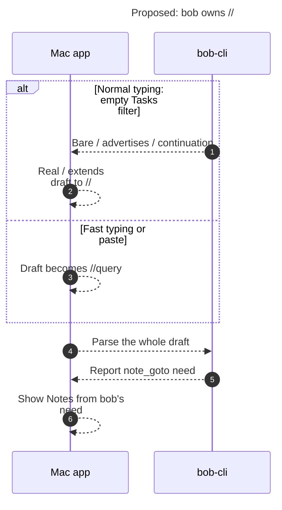

# Diagram proposals: `//` in Bob Mac Capture: Go To Notes

Proposals for the swarm linker, not a report. Each diagram restates only what the source
report says.

```yaml
source: research:202611/note_goto_double_slash/note_goto_double_slash__final.md
producer: research.4t.image
check: "mmdc 12.0.0 with the PDF-mirroring config and Puppeteer no-sandbox rendered 1 of 1 Mermaid diagrams; the deliberately broken diagram returned nonzero"
```

## note-goto-grammar-handoff

```yaml
anchor: |-
  router (focus is in the filter field); fast typing and paste go through the grammar.
question: |-
  How do typing and paste keep bob in charge of syntax?
illustrates: |-
  Normal-cadence typing and fast typing or paste converge on the draft, while bob advertises the continuation key and reports the note_goto need that selects Notes.
caption: Normal typing and paste converge on the draft; bob reports note_goto before the Mac app opens Notes.
review: "429x813 px, fit 100%; question, label, arrowhead, reading-order, source, and unique-anchor checks passed; 2 revisions, replacing an over-wide ownership flowchart and shortening the clipped sequence title"
```

Either entry branch can be used. Dashed arrows show the proposed information flow.


