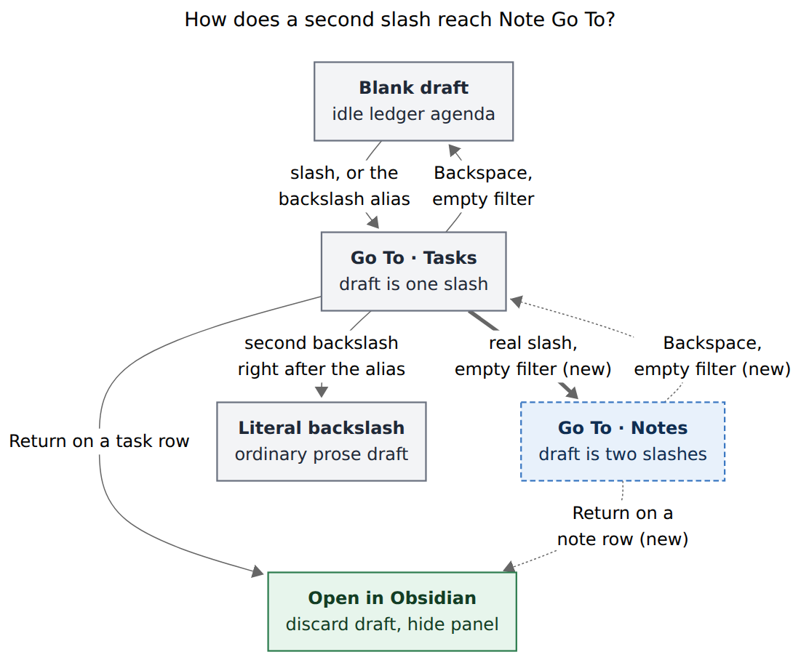

# `//` in Bob Mac Capture: Go To Notes

*Consolidated report · 2026-11-15 · lead researcher merging five independent swarm
reports (`__cdx`, `__cld`, `__grk`, `__mus`, `__gem`, siblings in this directory) plus
the lead's own verification against bob-cli @ `d794e0ba`, bob-mac-capture, bob-plugins,
and a read-only census of `~/bob` on apollo.*

## 1. Verdict

**Build it — all five researchers and the lead agree.** A second real `/` is the right
gesture, most of the machinery already exists, and the request needs exactly three
corrections before implementation:

1. **"All note files" is the wrong set.** The vault holds 7,266 Markdown files; only
   about 3,600–3,800 are notes Bryan would ever jump to. The exclusion policy (§6) is
   the heart of the design, and it is bob's to own.
2. **The second `/` must be a bob grammar token, not a Swift mode.** `//` is ordinary
   capture prose today; a cosmetic app-only change would let a failed search or an
   accidental submit file a junk inbox task, and would violate
   `decisions:mac-capture-is-a-thin-client`. bob claims `//query` as a new `note_goto`
   need; the app renders and dispatches.
3. **The opener already exists.** `obsidian://bob-open-notes` with `line` omitted
   reuses an already-open tab anywhere, never moves the caret, and never writes —
   verified in the plugin's contract. **No bob-plugins change is required for v1**,
   so this is a two-repo change: bob-cli first, then Bob Mac Capture.

The second `\` keeps today's behavior byte-for-byte: `\` on a blank draft aliases to
`/` and arms a one-shot literal; a second `\` types one literal `\`. Only a **real
`/`** enters Notes — exactly as requested, and already how the machinery is wired.

## 2. What exists today (verified)

Every fact below was reported by at least one researcher and re-verified by the lead
against the checkouts and the live vault.

| Fact | Evidence |
| --- | --- |
| `/` Go To is a whole-draft bob token: single line, single token, starts with `/`, **exactly one `/` byte**, token equals the trimmed draft. | `task_goto_query_token`, `src/native/capture_language/tokens.rs:470` (lead re-read) |
| `//`, `/Users/x`, `/r/rust`, `/a b`, `Buy /x` are prose **by test**: the path carve-out is deliberate. | `src/native/capture_language/tests/goto.rs:101`; `tests/cli/capture/task_goto.rs:327` |
| `//` claims nothing live: `capture-parse -- '//'` → `mode: task`, no needs; `capture-complete` → no context. | mus's live probes; consistent with the predicate |
| `\` on a blank draft inserts `/` and arms a one-shot literal (`backslashLiteralArmed`); the immediate second `\` types a literal `\`; other empty-filter `\` presses are consumed. | `CapturePanelModel.swift:831,6113–6124` (lead re-read); `docs/keyboard.md` |
| After `/` opens, **focus moves into the picker filter field**, and `FuzzyQuery` strips one leading sigil — so a second `/` must be intercepted in the key router, not the editor. | `FuzzyMatcher.swift:14–21`, router gates `pickerFilterIsEmpty` / `draftIsBareGotoSigil` (lead re-read) |
| bob already hands keystrokes from a picker back to the draft via `action_continuation_keys` (used by `!`, `+`, `- ^`). `task_goto` responses carry no picker descriptor today; the app decodes descriptors with `decodeIfPresent`. | `capture_complete/engine.rs:279–1679`, `model.rs:967` (lead re-read) |
| The shared note walk excludes dot-dirs plus `.bob`, `.git`, `.obsidian`, `_conflicts`, `_generated`, `_templates` — and nothing else. `[[` results are dominated by `done/` twins today. | `src/native.rs:3–16` (lead re-read); grk/mus probes |
| `NoteIndex::read` parses every heading and block (~300 ms documented) and `[[` completion truncates to `RESULT_LIMIT = 20`. It is the wrong catalog API unmodified. | `capture_links.rs:17`; `capture_complete/shell.rs:46` (lead re-read) |
| `done/` archive = **top-level `done/` only**, exact and case-sensitive; `projects/done/` and `done.md` are not archives. | `src/native/done_archive.rs` (lead re-read) |
| `obsidian://bob-goto-task` **requires `line`** and forces an editing jump — wrong lander for whole notes. | `docs/goto-task-uri.md` (lead re-read in bob-plugins) |
| `obsidian://bob-open-notes`: `lineK` **optional**; an already-open note is reused in any window (main area preferred); else an empty active leaf is used; else a **new far-right tab**; no supplied line → no caret move; never writes. | `docs/open-notes-uri.md` (lead re-read in bob-plugins) |
| Vault census (lead, 2026-11-15): 7,266 `.md` total; 6,868 outside dot-dirs; 1,839 daily satellites `YYYY/YYYYMMDD_*.md`; 1,191 dated dailies; 1,131 `_generated`; 1,281 `ref/`; 192 `lib/` Highlights sidecars; 54 `done/`; 21 `mail/`; 12 `.base`. | Read-only `find` scans; agrees with cld/grk/mus within drift |
| A live In-Progress task already tracks this request. | `bob.md` block `slash-slash-file-search` (mus) |
| Obsidian context: Quick Switcher shows recents when empty, only *deprioritizes* excluded files, and can create on miss; its exclusion setting is vault-global with side effects on Bases and search. | Obsidian help; forum reports (cdx/cld) |

## 3. Critique: is this a good idea?

**Yes.** Four reinforcing reasons, drawn from all five reports:

- **Capture is already the global finder.** `⌘\` reaches today's Pomodoro; `⌘\ \`
  reaches any task. "Open that note" is the missing sibling, and reaching it without
  switching to Obsidian and pressing ⌘O removes a real workflow gap.
- **The doubling idiom is the house grammar.** `[[#` → `[[##` widens heading search to
  the vault; `[[^` → `[[^^` likewise for blocks; `@` → `@@` widens a route to the
  draft. `/` (tasks) → `//` (notes) reads as "go to, one level wider" — the same
  pattern as VS Code Quick Open prefixes.
- **bob can curate better than Obsidian.** bob knows kinds (area, project, notebook,
  album, record, ref, daily, period), status, parents, and area hues; it can hide
  machinery without touching Obsidian's global ignore list.
- **It is cheap.** The picker card, fuzzy matcher, scope state, open URI, and Go To
  lifecycle all exist. The marginal cost is one additive grammar token, one light
  catalog, and one presentation scope.

The honest costs, each with its mitigation:

1. **`//` stops being capturable prose.** Claim only a *leading consecutive* `//`
   single-token draft, so `/Users/x` and `/r/rust` survive. Previously capturable
   whole-draft `//…` tokens become teaching refusals — a deliberate, documented
   behavior break, marked `!` on the release train
   (`decisions:bob-cli-releases-ride-a-daily-train`).
2. **The catalog is huge and noisy.** Short queries like `cash` match ~14 real notes
   and ~151 references by substring (cld's measurement). Exclusions (§6) plus
   kind-aware ranking (§7) are what make the list trustworthy.
3. **Two pickers, one key family.** Distinct captions (`Go To · Tasks` /
   `Go To · Notes`), a footer hint each way, and Backspace peeling one slash keep the
   small language learnable.

**Would I take a different approach?** No. The alternatives were examined from five
directions and all fail the same way: an app-only Swift mode breaks the thin-client
record and leaks junk captures to every other client; reusing `[[` conflates linking
with navigating (and caps at 20 rows); reusing `@` conflates routing with opening; a
new sigil (`?`, ⌘O) abandons the doubling idiom; mixed task-and-note results under one
`/` pollute both ranking contracts; delegating to Obsidian's Quick Switcher requires
focus-switching and inherits its global exclusions. Full-text body search is a
different feature — reserve `///` for it and ship filename/alias navigation now.

## 4. Requirement adjustments (called out)

| # | As requested | Adjusted to | Why |
| --- | --- | --- | --- |
| **R1** | "a second `/` typed" | The claim is a **whole-draft, single-line, single-token** form starting with `//` whose third byte is not `/`. The query may contain further slashes (`//prj/sase`). `/Users/x`, `/r/rust`, `// a b`, `///…`, and multi-item drafts stay prose. | Mirrors `/`'s own claim; preserves the pasted-path carve-out the tests pin; reserves `///` for a future deliberate mode (full-text). |
| **R2** | "search for all note files" | **Living Markdown notes only** (§6): machinery, sidecars, satellites, and attachments never; `done/` deferred to a later attic scope. | 7,266 files would bury the ~3,700 real destinations; a search that surfaces `done/bob_done.md` above `bob.md` feels broken. |
| **R3** | "a second `\` … types a raw `\`" | **No new `\` behavior at all** — the one-shot literal machinery already does this. The work is to *not disturb* it. `\` then a real `/` enters Notes; `\\` stays one literal `\`; `/\` stays consumed. | Verified in the router and panel model; the request's constraint is already satisfied by existing code. |
| **R4** | (implicit: picker opens) | **Empty `//` shows a map, not a dump**: Today, Inbox, then Areas / Projects / Notebooks / Albums in capture-targets order, closing with a "Type to search N more notes" hint row (~180 rows). | The open-task picker is ~464 rows; 3,700 is a wall. Quick Switcher's empty state shows a short useful list for the same reason. |
| **R5** | (unspecified exit) | **Backspace on an empty `//` filter peels one slash back to `/` Tasks**; on empty `/` it returns to the idle agenda. Escape clears, then collapses to a scope-preserving reopen chip. | One rung per key; rescues an accidental double-tap in one keystroke; symmetric ladder. |
| **R6** | (unspecified accept) | Return / Tab / click / ⌘↩ / ⌃↩ **open the note, hide the panel, discard the draft**. Nothing is captured, minted, stashed, or created. A miss leaves Return inert — **no create-on-miss**, a deliberate difference from Quick Switcher. | Navigation never writes — the same contract `/` already has. Creation belongs to capture (`@`, `%n`, records). |
| **R7** | (unspecified transport) | `obsidian://bob-open-notes?count=1&path1=<absolute>` with **no `line`**. | Verified: reuses open tabs, preserves caret and Reading/Source mode, never writes, already a Capture dependency. `bob-goto-task` requires a line and would land in frontmatter; raw `obsidian://open?path=` has no leaf reuse. |
| **R8** | (unspecified naming) | Rename the `/` capsule to **`Go To · Tasks`**; the new scope is **`Go To · Notes`** with scope token `//`. Empty `/` footer teaches **`/ Notes`**; empty `//` footer teaches **`⌫ Tasks`**. | One Go To was unambiguous; two are not. The ladder teaches itself in both directions. |
| **R9** | (unspecified home) | **bob-cli owns the token, catalog, exclusions, kinds, and ranking data; the Mac app owns keys, pixels, and URI dispatch.** Contract first, app second; additive grammar bump; no new `bob capture` subcommand (free-text TEXT would swallow it, per `cli_rules.md`). | `decisions:mac-capture-is-a-thin-client`; every other client gets the feature for free. |

## 5. The keystroke model

*A real second `/` on an empty Task filter enters Note Go To; Backspace steps back one
rung at a time; the second `\` still types one literal backslash and never enters
Notes. Dashed elements are the new mode and its transitions; everything else is
unchanged.*

Rendered size: 733.1 × 606 px; fit scale: 89.0%. Mermaid CLI 12.0.0.

| You type (blank draft) | Draft | Result |
| --- | --- | --- |
| `/` | `/` | Go To · Tasks (unchanged) |
| `\` | `/` (literal armed) | Go To · Tasks (unchanged) |
| `\` `\` | `\` | One literal backslash (unchanged) |
| `/` `/` | `//` | **Go To · Notes** |
| `\` `/` | `//` | **Go To · Notes** — the first key may be the alias; the second must be a real `/`, as requested |
| `/` `\` | `/` | Consumed, as today; `\` never opens Notes |
| `/` `/` `/` | `//` | Third `/` consumed in the picker; `///…` stays prose in the grammar (reserved) |
| `//` ⌫ (empty filter) | `/` | Back to Tasks |
| `/` ⌫ (empty filter) | blank | Idle agenda (unchanged) |
| `/fix` then `/` | `/fix` | Filter text; mode switch happens only on an empty filter |
| fast `//cash` or pasted `//cash` | `//cash` | bob claims it; Notes opens seeded with `cash` |
| `//` + child line, second item, `Buy //x` | — | Prose (whole-draft rule, same as `/`) |
| `\` in `//`, Shift-↩, Option-↩ | — | Consumed |
| ⌃C in `//` | — | Discard without stashing (same as `/`) |

Both entry paths converge on one truth: the draft becomes `//`, bob reports
`note_goto`, and the picker follows the draft. Normal-cadence typing goes through the
router (focus is in the filter field); fast typing and paste go through the grammar.
Neither path lets the app decide syntax.

**Query scope note (cdx dissent, resolved):** cdx wanted `//meeting notes` (spaces)
claimable. The consensus single-token claim matches `/` exactly, and in practice the
picker filter — where all post-entry typing lands — accepts spaces as AND terms
already. Only a *pasted* multi-word draft loses, the same limitation `/` has today.
Widening the claim to rest-of-line is a safe later change if paste matters.

## 6. The catalog: which notes `//` sees

**The rule (cld's formulation, adopted):** `//` lists the documents Bryan writes or
reads as notes. It hides what bob or Obsidian owns as machinery, files that duplicate
a listed note, and attachments that have their own opener. It never hides a real note
for being old or unnamed — no `Untitled`/"tmp" filename heuristics. The rule lives in
one bob module with golden-tested tiers and applies to `//` only; changing the shared
`[[` walker is a separate decision.

Measured against the live vault (counts: lead census + cld's frontmatter scans):

| Tier | What | ≈Count | Why |
| --- | --- | ---: | --- |
| **Hidden** (never listed) | Non-Markdown files; symlinked directories | — | Attachments have their own openers (PDFs → Bob Refs); symlink policy matches existing walkers |
| Hidden | Dot-directories (`.bob`, `.git`, `.obsidian`, `.trash`, …) | ~400 md | Machinery; `.bob/ref-sources` holds preserved render input, not second copies of notes |
| Hidden | Every `_`-prefixed directory: the shared three plus `_meta`, `_zorg_templates` | 1,155 | Measured contents are entirely machinery (975 tag pages, 156 query pages, 13 zorg migration reports, templates, conflict copies) |
| Hidden | Highlights sidecars: `lib/**/<stem>.md` with a same-stem PDF sibling; `xlib/`, `old_lib/`, `lit_review/`, `ref_history/` | ~200 | Each would show an annotated reference twice or resurface superseded snapshots |
| Hidden | Daily satellites `YYYY/YYYYMMDD_{habit,done,poms,events}.md` | 1,839 | All zorg-legacy (newest 2026-05-27, nothing creates them); they would win date queries that should land on the real daily note |
| **Deferred** (hidden in v1; future attic scope) | Top-level `done/` archives (per `done_archive.rs`: never nested `done/` dirs or `done.md`) | 54 | Near-total stem duplication of live notes dominates search today; `/` ⌘X already reaches their tasks; the attic restores findability later |
| **Live** | Areas (inboxes included), projects (closed ones too, demoted not hidden), notebooks, albums, records, bank hub + months, untyped notes, root agent files, `Untitled*.md`, templates outside `_templates` | ~1,050 | The core of the vault; no filename heuristics |
| Live | Reference notes (`ref/`, `type: [[ref]]`) | ~1,290 | Real notes with annotations; ranked behind other kinds at equal score |
| Live | Period notes (weekly, quarterly, yearly, `all_time`) | ~60–90 | bob creates and uses them |
| Live, **date-keyed** | Dated dailies `YYYY/YYYYMMDD.md` | 1,191 | See below |
| Live | `mail/` notes | 21 | Real documents; at 21 files the soft-exclusion gem proposed is premature — revisit if it grows into the hundreds |
| | **Living catalog** | **≈3,600–3,800** | |

**Daily notes are date-keyed (cld's design, adopted):** each daily note matches only
its stem (`20261114`) and ISO date (`2026-11-14`) — never its weekday aliases.
A letter query can never flood with `Sat`/`Mon` hits; `//1114` finds every Nov 14,
newest first; the empty state pins Today. This one rule removes the worst noise source
without an exclusion.

**The `_`-prefix dissent (cdx), resolved:** cdx warned against generalizing "starts
with `_`" beyond the shared three names. The measured vault says every `_` directory
is machinery today, so the generalized rule wins for `//` — but it is documented,
golden-tested, scoped to `//` only, and `_meta`'s fate is on the question list (§11).
A future legitimate `_` folder is a one-line tier change, not a redesign.

**`.base` views (12 files):** cld would include them as kind *View*; everyone else is
Markdown-only. Lean yes — dashboards are genuine jump targets — but it rides on
confirming the opener handles non-Markdown paths, so it is an open question, not v1.

## 7. The picker: intuitive and beautiful

One card, one new scope — no new chrome. Reuse the Go To card's geometry, motion,
focus behavior, and height policy ("filtering never resizes the panel").

- **Scope capsule** `//` + caption **`Go To · Notes`**; `/` renamed **`Go To · Tasks`**.
- **No blink on `/` ⇄ `//`.** The card stays mounted: the scope token animates, task
  rows cross-fade into note rows, drawn from a warm in-memory snapshot (prefetched
  when `/` opens, revalidated on panel show and filtered vault events, never persisted
  or logged). Cold path shows a quiet "Loading notes…" placeholder, not a spinner.
- **Empty filter = a table of contents** (~180 rows): **Today** (today's daily note),
  **Inbox** (`mac_inbox` first), **Areas** (tree order, indented), **Projects** (WIP
  first, status capsules), **Notebooks & Albums**, then one hint row — *"Type to
  search 3,612 more notes"* with bob's real count.
- **Rows say what a note is:** kind glyph (SF Symbols: `tray` inbox,
  `square.stack.3d.up` area, `hammer` project, `book.closed` notebook, `book` ref,
  `calendar` daily/period, `banknote` bank, `envelope` mail, `doc.text` note) tinted
  with the row's **root area hue** (bob already reports hues; the app applies them —
  kind capsules stay quiet, row fills stay native so color never fights selection).
- **Stem as voice, path as whisper:** primary line is the title (frontmatter `title:`
  for refs/records, friendly date for dailies/periods, stem otherwise) with matched
  characters emphasized; secondary line is the parent breadcrumb or `summary:`; the
  vault path is always present, middle-truncated so the basename survives (~204
  basenames are duplicated in the vault). A quiet `aka <alias>` badge explains alias
  hits.
- **Detail strip:** `↩ Opens cash.md in Obsidian — nothing is written`.
- **Footers:** `/` adds a **`/ Notes`** hint chip when empty; `//` shows
  `↑↓ Move · ↩ Open · ⌫ Tasks · esc Clear / Cancel`.
- **Ranking:** AND across whitespace terms; title/stem/alias above path (so `ref/`
  segments cannot flood); date keys for dailies only; ties break by bob's per-row rank
  (areas/projects > notebooks/albums > plain notes > records > periods > refs >
  dailies, then path). The app applies bob's numbers and adds no semantics. **No
  20-row cap anywhere.**
- **Accessibility:** VoiceOver reads kind, title, parent, path, then "opens in
  Obsidian"; scope changes and counts are announced; errors are distinguished
  (*Loading… / No notes match / Couldn't load notes*).

**Deliberately not in v1:** mixed task+note results, content previews, create-on-miss,
a Recent group (see §9), ⌘X archive scope (reserved: consumed in `//` so it can become
the attic later), new global hotkeys, body search, and embeddings.

## 8. Architecture and contract

### bob-cli (ship first)

- **Claim.** `note_goto_query_token` beside `task_goto_query_token`: single item,
  single line, single token equal to the trimmed draft, starts with `//`, third byte
  not `/`. One predicate shared by execution, editor parse, and completion.
  `task_goto_query_token` is untouched (it already rejects `//`).
- **Parse.** `mode: incomplete`, `needs: ["note_goto"]`, one `interactive_placeholder`
  span over the token. The app skips the doomed capture dry-run exactly as for
  `task_goto`.
- **Execute.** Refuse before any other item parser with a teaching error:
  `` `//sase` opens the Go To Notes picker; pick a note to open it in Obsidian — it never captures ``.
- **Complete** (context `note_goto`): full snapshot, no truncation. Rows carry
  `replacement: ""` (decoder compatibility; accept never splices), `note_path`,
  `kind`, `title`, `aliases`, optional `status`/`summary`/`parent_chain`/`date`,
  `hue`, match fields, `group`, `rank`; top level carries `vault_root` and counts.
  The `#` alias must not steal the second slash — golden:
  `rewrite_draft("//", 2)` is a no-op (the existing bail-out fires once `//` reports a
  non-task context).
- **Hand-off descriptor.** `task_goto` responses gain an additive `picker` descriptor
  with `action_continuation_keys: ["/"]` on a **bare** `/` only — the existing
  continuation mechanism (`!`, `+`), so bob stays the authority on which key escalates.
  The Mac router still intercepts `/` in the empty filter (the focus-transfer trap is
  real); both paths converge on the draft `//`.
- **Catalog module** (`native/note_catalog.rs`): the §6 tiers; frontmatter-only reads
  capped ~8 KB (aliases, `title:`, `type:`, status — never headings/blocks); an
  `(mtime, size)`-fingerprinted cache under bob's cache dir so warm runs only stat
  (target <100 ms warm; the walk is always live, so new/renamed notes appear on the
  next `//` with no stale paths); never writes.
- **Docs/tests:** "Going to a note with `//`" in `docs/capture.md` (update the `/`
  table's "`//` → Prose" row); `capture-parse`/`capture-complete` help per
  `cli_rules.md`; goldens for the claim table, prose preservation, the refusal, the
  row shape, and a tier fixture vault (sidecar, satellite, `done/`, `_meta`, daily,
  dot-dir). **Mark the release `!`** — previously capturable `//` drafts now refuse.

### Bob Mac Capture (ship second, macOS CI gated)

- `CapturePickerSource.noteGoto` on the shared card; `NoteGotoPickerIndex` keyed by
  `note_path` (never `replacement`); `FuzzyQuery` with `leadingSigil: "//"` (strip the
  full two-character prefix); generalize the Go To scope-state (session ID +
  generation) so stale responses can never install under the wrong scope.
- Router: `/` on empty task filter escalates (clearing `backslashLiteralArmed`); `\`
  on empty note filter consumed; third `/` consumed; ⌫ on empty filter removes one
  slash; ⌘X consumed (reserved for the attic); IME marked text and key repeat never
  escalate.
- Accept: stale-draft guard → block double-accepts → build
  `bob-open-notes?count=1&path1=<abs>` with `URLComponents` (no `line`) → hide panel,
  discard draft → on dispatch failure keep the picker with "Couldn't open Obsidian".
  No silent fallback to `obsidian://open?path=` (no leaf reuse; would clobber the
  active tab).
- Docs: `task-pickers.md`, `keyboard.md` ("Going to a note from any app"),
  `protocol.md` capability row.

### Compatibility (all additive)

| Mismatch | Result |
| --- | --- |
| Old bob, new app | No descriptor, no `note_goto`: the app must open Notes **only when bob reports it**. `//` stays prose; show a calm "Update bob to search notes" hint, never a junk capture. |
| New bob, old app | `//` parses as `note_goto`; the old app opens no picker; preview shows the teaching error; submit refuses. No junk task is filed. |
| Missing/old plugin | Dispatch fails; picker stays open with the existing error copy — same failure Control-Return already has. |

### Effort

≈2 days: bob-cli ~1 day (predicate, catalog, tiers, cache, goldens, docs); Mac ~1 day
plus the CI loop. Smaller than `/` was, because the card and the URI already exist.
No plugin work unless the landing answer (§11 Q3) chooses the active-leaf lander.

## 9. Where the five reports disagreed, and the resolutions

| Question | Spread | Resolution and why |
| --- | --- | --- |
| **Transport** | bob-open-notes (grk, gem) vs new `bob-goto-note` plugin handler with cursor restore (cld) vs raw `obsidian://open?path=` (mus, cdx) | **bob-open-notes, no `line`.** Lead-verified: optional line, cross-window tab reuse, no caret move, read-only, zero new code. Raw `open?path=` lacks leaf reuse. cld's active-leaf lander + cursor restore is a clean fast-follow if far-right tab accumulation annoys (§11 Q3). |
| **`done/` and satellites** | Include, marked quietly (cdx) vs hide (grk, mus) vs archive scope behind ⌘X (cld, gem) | **Hidden in v1; attic scope later.** They dominate `[[` results today and would win date queries; `/` ⌘X already reaches done *tasks*. cdx's "deceptively incomplete search" worry is met by the documented tier table, the honest count hint row, and the attic follow-up. |
| **⌘X archive toggle in v1** | Yes (cld, gem) vs no (grk) vs leave it native Cut (cdx) vs consume (mus) | **Not in v1; consumed in `//`.** The scope-state generalization is real work, and notes have no urgent "other drawer." Consuming the key reserves it so the attic can claim it without retraining. |
| **`_`-prefixed directories** | All hidden (cld, grk) vs only the shared three (cdx) | **All hidden, for `//` only** — measured contents are pure machinery; documented, golden-tested, with `_meta` on the question list. |
| **`mail/`** | Soft-exclude (gem) vs include (cld, grk, cdx) | **Include** — 21 files is no flood. Revisit (config or tier) if Gmail sync grows it into the hundreds; gem's `note_goto_include_mail` sketch is the ready-made shape. |
| **Daily notes** | Date-keyed live (cld) vs ranked low (grk, mus, gem) vs fully searchable incl. aliases (cdx) | **Date-keyed live** — it deletes the `sat`/`mon` alias flood at zero exclusion cost while keeping `//1114` precise. |
| **Empty-state Recent** | mtime recents (grk, gem) vs `workspace.json` `lastOpenFiles` (cld) vs capture-local open history (cdx) vs none | **None in v1** — lead's addition: bob itself rewrites notes constantly (reconcile, gcal sync, hooks), so mtime ≈ "a machine touched it", not "Bryan read it"; `workspace.json` is undocumented and observed truncated to 0 KB (cld's own risk list). Follow up with capture-local open history (honest, private) or best-effort `workspace.json`. |
| **Query spaces** | Rest-of-line query (cdx) vs single token (others) | **Single token** (§5 note): the filter field takes spaces anyway; symmetry with `/` wins; widen later if pasted multi-word queries matter. |
| **Mode-switch mechanism** | bob-advertised continuation key (cld) vs Swift router intercept (gem) | **Both layers** — they are complementary, not competing: the descriptor keeps bob authoritative; the router is where the keystroke physically lands. |
| **Creating notes on miss** | All five: no | Unanimous; kept, and worth stating because Quick Switcher *does* create. |

## 10. Risks and acceptance checks

- **Fast `//` and races.** Type `//` faster than any picker appears (slow and <350 ms),
  `\` then `/`, Backspace mid-fetch, Escape during hand-off, double accept, hide with
  an open in flight: nothing may open Obsidian late, resurrect a literal arm, or
  capture anything.
- **Hash alias.** Golden that `//` never rewrites to `/#` — if it ever fires, note
  search cannot be typed. (`Buy milk /` keeps its alias; blank-draft slashes are not
  that path.)
- **No writes.** Accepting any row leaves the vault byte-identical (`git status` on
  the Mac vault). Refusal fires before any vault mutation in `bob capture` and dry-run.
- **Caret and view preservation.** An already-open note keeps its caret, scroll, and
  Reading/Source mode (the no-`line` contract); confirm in a split, a background tab,
  and Reading view.
- **Payload and latency.** ~3,700 light rows: measure JSON size and decode time
  (expect well under 1 MB; drop `target` for `vault_root` + relative join if needed).
  Budget: one snapshot per session, warm bob run <100 ms, card swap one frame from
  cache, local filtering p95 <16 ms. Never refetch per keystroke; never cap results.
- **Retained drafts.** A leftover `/fix` plus a typed `/` is `/fix/` — prose, not
  Notes. Mode switch is empty-filter only; the claim is the only other door.
- **Tier drift.** A future folder convention could be silently hidden; the tier table
  is documented and golden-tested, and `bob doctor` could report hidden counts.
- **Unicode/encoding.** Build the URL with components; test spaces, Unicode, `%`, `#`,
  `&` in paths; duplicate basenames must stay distinguishable in rows.

## 11. Open questions for Bryan

1. **`_meta/`** — anything in there you still open? (Recommend: hidden; move it to the
   attic tier instead if so.)
2. **`.base` views** — include the 12 Obsidian Bases as kind *View* once the opener is
   confirmed to handle them? (Lean yes, fast-follow.)
3. **Landing for a not-open note** — bob-open-notes' far-right new tab (v1, zero
   plugin work) is the recommendation; if tab accumulation annoys, the follow-up is
   cld's `bob-goto-note` active-leaf lander with cursor restore (+0.5 day, plugin).
4. **⌘↩** — same as Return in v1 (recommended, parity with `/`), or later "open in
   new tab" for both `/` and `//`?

## 12. Follow-ups (not v1)

- **Attic scope**: ⌘X reveals `done/`, satellites, `ref_history/` — the notes
  equivalent of `/`'s Completed.
- **Recent group** in the empty state (capture-local open history preferred).
- **`//note#heading`** landing, reusing `[[##` heading data.
- **`///`** reserved for full-text search once a content index exists (qmd research).
- **Vim jump polish**: push jump context on line-less opens so `<C-o>` hops back
  (gem's plugin sketch); Option-↩ on ref rows opening the PDF via Bob Refs.
- **Decision record** through `/sase_memory_write` after shipping: *"Note Go To is
  leading slash-slash: live notes only, date-keyed dailies, navigation never writes."*
- **Decide whether `[[` completion adopts the same hidden tier** (today it offers
  `done/` twins and sidecars).

## Sources

- **Five swarm reports**, siblings in this directory (`__cdx`, `__cld`, `__grk`,
  `__mus`, `__gem`), each independently researched 2026-11-15; grk's figures
  (`fig-modes`, `fig-claim`, `fig-catalog`) remain alongside its report.
- **Lead verification (this report):** bob-cli `src/native/capture_language/tokens.rs`,
  `tests/goto.rs`, `tests/cli/capture/task_goto.rs`, `src/native.rs`,
  `src/native/capture_links.rs`, `src/native/capture_complete/{engine,model,shell}.rs`,
  `src/native/done_archive.rs`; bob-plugins `docs/open-notes-uri.md`,
  `docs/goto-task-uri.md`; bob-mac-capture `CapturePanelModel.swift`,
  `CaptureKeyCommandRouter.swift`, `Sources/CaptureCore/FuzzyMatcher.swift`; read-only
  `find` census of `~/bob` (2026-11-15).
- **Memory:** `decisions:mac-capture-is-a-thin-client`,
  `decisions:idle-capture-shows-ledger-agenda`,
  `decisions:capture-sigils-say-where-what-how`,
  `decisions:bob-cli-releases-ride-a-daily-train`, `cli_rules.md`, `obsidian.md`.
- **Prior research:** `research:202610/slash_task_goto_in_obsidian/` (the `/` design
  this nests under).
- **External:** Obsidian Quick Switcher / aliases / URI help; Obsidian forum threads on
  exclusion side effects and `workspace.json` truncation; Apple search-field HIG and
  `NSWorkspace` open contract; VS Code Quick Open prefixes.
- Figure rendered with `@mermaid-js/mermaid-cli@12.0.0`, PDF-mirroring config,
  DejaVu Sans.
