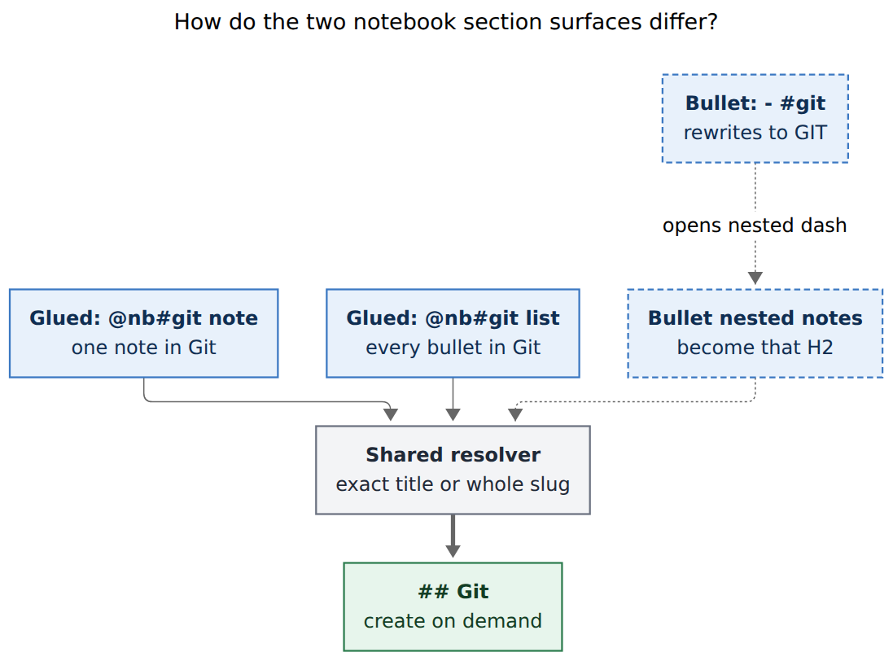
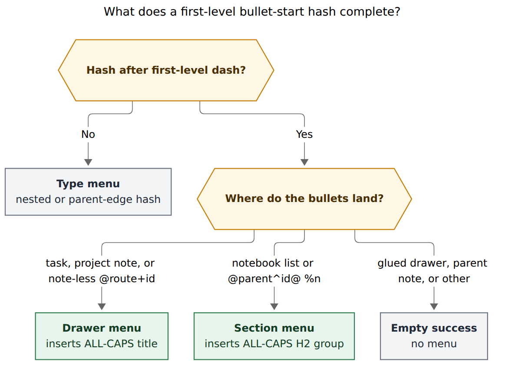

# Notebook H2 section capture: design research

**Researcher:** grk
**Question:** How should Bob target notebook `##` sections from capture, in the same spirit as task drawers, and is the requested plan the right one?

## Bottom line

**Build it, with a narrower shape than the request as written.** Targeting notebook H2s from capture is a good idea. The analog to drawers is real, and the muscle memory already exists. Two of the three requested surfaces already ship. The missing piece is a first-level bullet-start `#` that groups notes under an H2, using the same ALL-CAPS rewrite drawers already taught.

Keep `@nb#section` as the one-item selector. Add `- #section` only where bullets land directly in a notebook: a notebook list (`@nb` then bullets) and a notebook create (`@parent^id@ %n`). Accepting a row rewrites the shortcut to an ALL-CAPS grouping header, opens a nested `  - `, and the writer turns that group into a Title Case `##`. One resolver already owns exact title, whole-slug, near-miss, and quoted create. Reuse it.

Do not add a same-line `- #git Try mergiraf` shorthand, a suffixed `@@nb#`, a vault-wide section catalog, or a second meaning of `#` at a true line start. Project-note capture without `%n` already has this gesture for H2s. The `/` alias already turns `- /` into `- #`.

## Verdict

The request is a good idea. Notebooks are collections of notes optionally grouped under H2s. Capture already files a single note into a section with `@nb#git`. What it cannot do well is *mix* sections while capturing several notes in one draft, or pick those section names while seeding a new notebook. Drawer bullets solved the same problem for tasks. Copy that shape, not a new grammar.

I would not take a different destination model. I would take a stricter gesture model than a free-form "type `#` at the start of a bullet and it means section." `#` already means type, drawer, section, Pomodoro name, and wikilink heading, each by position. The new gesture has to sit in one of those positions, not invent a sixth.

## What already ships

This matters, because the request reads as if notebook section completion is new. It is not.

### Glued `@nb#` is done

On a notebook route, `@nb#` is already a first-class completion field (`CompletionContext::Section`):

- H2s only, document order, never the H1, never H3s, never fenced headings.
- Empty query lists existing sections and does not preselect (`initial_selection: "none"`).
- A nonempty query with no exact title or whole-slug match appends `kind: "notebook_section_create"` (`New section “Title”`).
- Replacement is a selector that round-trips: bare title, hyphen slug, or a quoted `"Title"`.
- Near-miss unquoted slugs offer the quoted create spelling instead of silently prefix-matching.
- `#section^id` keeps the `^id` outside the replacement range.
- List headers keep completing after bullets are typed below them.
- `bob capture-rewrite` already maps `@nb/` to `@nb#` through the `/` → `#` alias.

Evidence: `docs/notebooks.md` Capture, `docs/capture.md` "Notebook notes" and "bob capture-complete", `src/native/capture_complete/candidates.rs` (`notebook_section_candidates`), and `src/native/capture_complete/tests/routes_tasks.rs`.

Commit matching is exact title or whole slug. Missing unquoted near-misses refuse with `notebook_section_near_miss`. Quoted selectors create verbatim. Other missing selectors create a Title Case `##` at EOF. That is the same "menu never decides what exists" rule drawers use (`decisions:capture-sigils-say-where-what-how`).

### Notebook create already seeds H2s from ALL-CAPS bullets

```text
Neovim config notes @dev^nvim@ %n
- SETUP
  - brew install neovim
- KEYMAPS
  - jk for escape
```

writes `dev_nvim.md` with `## Setup` and `## Keymaps`, stamps the nested notes, stages the new route so later items in the same draft can target it, and updates owner catalogs. `is_project_section_title` plus `format_project_section_title` are the same helpers project-note capture uses. A childless ALL-CAPS bullet stays a preamble note.

Evidence: `src/native/capture/notebook_create.rs` (`seed_body`, `seed_sections`), `docs/notebooks.md`.

### Drawer bullets are the pattern to copy

A first-level `- #future-work` under a task, a new project note, or a note-less `@route+id` is a drawer shortcut. Accepting a row inserts the bare ALL-CAPS title (`FUTURE WORK`), and when the token ends its line it also opens `  - ` with `cursor_after` on the nested bullet. The draft then reads like the block it writes. On a new project note the same bullet becomes `## Future Work`. Nested `  - #fix` still types.

Evidence: `decisions:capture-bullets-mirror-the-task-block`, `docs/completion.md`, `src/native/capture_language/drawer_bullet.rs`.

### `/` at bullet start already expands

`Buy milk\n- /` rewrites to `Buy milk\n- #`. `@cash^goog-exit@\n- /` does too. The alias never fires at a true line start, which is why a blank-draft `/` stays Go To. No new alias work is required.

Evidence: `src/native/capture_language/tests/rewrite.rs` (`rewrite_draft_expands_slash_hash_alias`), glossary Capture Alias.

### What does *not* ship

| Draft | Today |
| --- | --- |
| `@nb\n- #` | List bullets are notes, so `#` cannot start one (`drawer_bullet_position`). No menu. |
| `@nb#Ideas\n- #` | Empty success. The header already names the section. |
| `@parent^id@ %n\n- #` | `EditorMode::NotebookCreate` is not an under-task position, so drawer completion does not open. You type ALL-CAPS by hand. |
| `note @nb\n- #` | Empty success / position error. Nested bullets are detail of that one note. |
| `@@nb#git` | Invalid. `@@` stays draft-wide and never takes a place suffix (`decisions:notebook-routes-write-notes`). |
| Same-draft `@dev_nvim#` after a `%n` create in the same capture | Writer stages provisional sections; `capture-complete` reads the file on disk and does not see them. |

That last row is a real reliability gap even for the glued surface that already exists.

## Critique of the request

The request names three gestures. Only one is new.

1. **`#` / `/` at the start of a bullet → complete known notebook sections.** Yes, this is the gap. Scope it. "Start of a bullet" means after a first-level `- ` / `* ` / `+ `, never column 0, never a nested `  - #`.
2. **Good support for project capture syntax and for `@<notebook>`.** Split this. `@parent^id@` without `%n` already completes drawers that become project H2s. `@parent^id@ %n` is the notebook-create hole. `@<notebook>` is the existing-notebook hole. Targeting a *project* with `@proj` still captures tasks. Do not infer "the project's notebook."
3. **`@<notebook>#` completes existing sections and creates new ones.** Done. Polish it (in-draft staging, picker chrome) rather than rebuilding it.

The phrase "capturing new notes to an existing project by targeting it with the `@<notebook>` syntax" is the one wording I would change. Notebooks hang under a project or area; the capture destination is the notebook stem. `@proj` remains tasks. `@nb` remains notes. Destination decides (`decisions:notebook-routes-write-notes`).

### Why a per-bullet leftover selector is the wrong analog

The tempting list form is:

```text
@dev_tools
- #git Try mergiraf
- #linux Use C-x C-e
```

That looks convenient. Drawers rejected the same shorthand (`- #drawer text`) because it cannot survive the bare-title rewrite: once `#git` becomes `GIT`, same-line text is no longer a section name plus a note, it is one ALL-CAPS-ish bullet. Keeping `#git` in the draft until commit would mean the draft does not read like the file, and `#` would mean two different leftover markers (`@nb#git` on the route, `#git` on the bullet).

For one note in one section, the glued form is already short:

```text
Try mergiraf @dev_tools#git
```

or the list header:

```text
@dev_tools#git
- Try mergiraf
- Set rerere
```

The new gesture has to earn its keep by doing something those cannot: **mix sections in one list, and name sections while creating the notebook.**

### Why ALL-CAPS headers, not Title Case

Notebook H2s are Title Case (`## Troubleshooting`). Drawer titles are ALL-CAPS (`FUTURE WORK`). If bullet-start completion inserted `Troubleshooting`, then `- Troubleshooting` with nested notes would have to count as a section. Title Case is ordinary English. `- Git` with a nested command is a plausible note, not a heading.

ALL-CAPS is the structural signal project notes and notebook create already use (`is_project_section_title`). Completion inserts `GIT`. The writer runs `format_project_section_title` and the file shows `## Git`. The live preview already knows how to say **New section**. That is the beautiful path: the draft uses a loud grouping header, the file uses a normal H2, and they share a key.

## Requirement adjustments (called out)

| Request as written | Adjustment | Why |
| --- | --- | --- |
| `#` at the start of a bullet completes notebook sections | Only a first-level `- #` on a **notebook list** or **notebook create** | `#` is already type, drawer, section, Pomodoro, wikilink. Position has to stay unambiguous. |
| `/` should trigger that completion | No new alias. Keep today's `/` → `#` where a `#` menu would open | `- /` already expands. Blank-draft `/` stays Go To. |
| Good support for project capture syntax | `@parent^id@` (project) is done. Teach `@parent^id@ %n` (notebook) the same bullet-start menu | One seal, two products. `%n` is the branch. |
| `@<notebook>` against an existing project | Target the **notebook**. `@proj` stays tasks | Destination decides. Do not search a project's catalog for a default notebook. |
| `@<notebook>#` completes and creates | Treat as polish: in-draft staged sections, Bob-authored picker chrome | The field, create row, and near-miss quoting already exist. |
| Same-line `- #section note` (implied by "start of a bullet") | Refuse leftover text, same as `drawer_bullet_text` | The rewrite to an ALL-CAPS title consumes the bullet. Nest the notes. |
| Create empty sections | Never. Incomplete `- #` needs nested notes, like `empty_drawer_bullet` | Capture never creates an empty drawer; an empty H2 is the same waste. |
| Vault-wide recent sections | Skip in v1 | Drawer recents work because REQUIREMENTS is a vocabulary. Notebook H2s are local (`Git`, `Keymaps`). |
| `@@nb#section` | Still invalid | Decision: `@@` stays draft-wide. Put the place on the item. |
| New CLI `bob capture-notebook-sections` | Do not add it | `capture-complete` and `capture-sections` already back `@route#`. Protocol siblings stay frozen and additive (`cli_rules.md`). |

## Alternatives I would not take

| Alternative | Why not |
| --- | --- |
| Per-bullet leftover `#section` prefix | Two leftover `#` forms, draft does not match the file, same-line shorthand already rejected for drawers |
| Insert Title Case headers | False-positive section detection on ordinary note titles |
| A new sigil (`$`, `§`, `##`) | `#` already means "place inside the destination" when glued. Teach the position, not a character |
| Completing `#` at column 0 | That is an incomplete type marker today. Stealing it breaks `#fix` and `\# Heading` |
| Treating nested `  - #` as a section | Nested `#` types a task everywhere else. Notebooks have no types; keep nested `#` as empty success, not a new menu |
| Opening the drawer menu on notebook create | Mac chrome says "Drawer" / "On this task" / "New drawer". Wrong noun, wrong grouping |
| Inferring a notebook from `@proj` | Destination decides. Catalogs are for browsing, not silent rerouting |
| H3 support | Notebook contract is H2-only. H3s are a `notebook_shape` warning |
| Prefix matching at commit | Drawers and notebook sections both moved to exact match after prefix surprises. Do not go back |

## Recommended design

### Two surfaces, one resolver



Rendered size: 730.7 × 542 px; fit scale: 89.3%. Mermaid CLI 12.0.0.

**Caption:** Glued `@nb#` keeps a selector on one item or on a list header. Bullet-start `#` rewrites to an ALL-CAPS grouping header whose nested notes become that H2. Both call `resolve_notebook_section`.

### When bullet-start `#` opens a menu



Rendered size: 774.3 × 562 px; fit scale: 84.3%. Mermaid CLI 12.0.0.

**Caption:** A `#` after a first-level `- ` opens drawers under a task, notebook H2 groups on a notebook list or notebook create, and nothing otherwise. Nested or parent-edge `#` still types.

Extend `DrawerBulletTarget` with a fourth arm, or a sibling `SectionBulletTarget`, classified from the editor mode *on entry* (the same trick drawers use so a bare `- #` does not clobber the mode with `Incomplete`):

| Entry mode | Bullet-start `#` |
| --- | --- |
| Task, PomodoroTask, ProjectNote, PomodoroProjectNote, note-less SubBullet | Drawer (unchanged) |
| NotebookNote list (`@nb` header, no section, first-level bullets) | **Section group** |
| NotebookCreate (`@parent^id@ %n`) | **Section group** |
| NotebookNote with parent text, NotebookSubNote, `@nb#section` header, glued drawer, Pomodoro note, close, toggle | Empty success |
| Nested `  - #` | Type on tasks; empty success on notebooks |

A notebook list whose header already names a section (`@nb#git\n- #`) is the glued-drawer analog: every bullet already files into Git. Refuse with teaching copy: drop `#git` from the header to mix sections with grouping bullets.

### What a section group writes

After completion the draft looks like the notebook create seed Bryan can already type by hand:

```text
@dev_tools
- GIT
  - Try mergiraf
  - Set rerere
- LINUX
  - Use C-x C-e
- A preamble thought
```

The writer, sharing `seed_body` / list planning:

- First-level ALL-CAPS with nested notes → `## Git` (existing) or create Title Case at EOF, then each nested first-level-of-the-group becomes a stamped top-level note in that section. Nested-of-nested stays detail of that note.
- First-level that is not a section title → a preamble / unsectioned note, nested bullets stay its detail.
- Childless ALL-CAPS (`- GIT` with no nested notes) → still a note titled `GIT`, never an empty H2.
- `- #git leftover` → `section_bullet_text` (same teaching as `drawer_bullet_text`).
- `- #` with no nested notes yet → incomplete, `needs: ["section_notes"]`, live preview calm.

`## Notebooks` stays protected on area and project notes (`notebooks_section_generated`). A notebook file does not carry that catalog; if a selector can only mean it, keep the existing refusal.

Later items in the same draft see staged sections, including groups typed earlier in the list. That is how `%n` create already exposes the new route; completion has to read the same policy instead of only the bytes on disk.

### Completion JSON

Reuse the drawer *shape*, not the drawer *noun*.

Bob returns `context: "notebook_section"` (glued `@nb#`, already `section` — keep that name) and a new `context: "notebook_section_bullet"` for `- #`. Rows use the drawer candidate fields: `group`, `title`, `replacement`, `detail`, `consequence`, `creates`, `refused`, `cursor_after`.

| Group | Contents | Replacement |
| --- | --- | --- |
| `notebook` (maps to today's `task` group slot) | This notebook's H2s, document order, plus same-draft staged titles | Bare ALL-CAPS title (`GIT`), plus `\n  - ` when the shortcut ends the line |
| `new` | One create row for a nonempty query no other row claims | Same ALL-CAPS rewrite. Near-miss unquoted queries use the quoted selector so commit will create, not refuse |

Skip `recent` in v1. Empty query: `initial_selection: "none"`. A row is valid only when committing that literal title reaches the row's intent (existing H2 or create of that key). Otherwise `refused` carries the resolver's reason and Return is a no-op.

Consequences Bob authors, never Swift:

- `Adds after "Use merge" in ## Git`
- `Creates ## Linux`
- `Starts ## Setup in the new notebook`

Glued `@nb#` stays a selector replacement (`git`, `merge-tools`, `"Merge tools"`). That field is a place-name on the route token. The bullet field is a grouping header in the draft. Different replacements, same resolver.

### Beauty: one place menu, Bob-authored chrome

Bob Mac Capture already has a dedicated drawer menu (`CaptureDrawerMenuPresentation`) with the right bones: unselected open, grouped rows, dashed create row, consequence footer, refused rows dimmed. Its nouns are hardcoded in Swift:

- title `"Drawer"`
- group `"On this task"`
- create prefix `"＋ New drawer"`

That is the one thin-client leak this feature should close. Have `capture-complete` send additive picker chrome (`picker.title`, `picker.group_titles`, `picker.new_row_prefix`, `target` caption). The Mac paints one **place menu**. Drawers fill it with today's copy. Notebook section bullets fill it with:

```text
╭─ SECTION · Developer tools (dev_tools) ─────────────────────╮
│ ON THIS NOTEBOOK                                            │
│   Git                                              12 notes │
│   Merge Tools                                       3 notes │
├─────────────────────────────────────────────────────────────┤
│ ＋ New section LINUX                                        │
├─────────────────────────────────────────────────────────────┤
│ Creates ## Linux                                            │
╰─────────────────────────────────────────────────────────────╯
```

An older app that does not know `notebook_section_bullet` falls through to generic section rows (title, H2 badge). Usable, less beautiful. Compatibility table: "Upgrade the app for the place menu."

Highlight the ALL-CAPS grouping title in the section color family. `drawer_bullet` already maps there; a `notebook_section_bullet` span kind should too. Preview keeps the existing **New section** badge.

### Worked captures

**Mix sections on an existing notebook**

```text
@dev_tools
- #git
  - Try mergiraf
  - Set rerere
- #linux
  - Use C-x C-e
- Remember the catalog is bob-owned
```

**Seed a notebook and file a later note into a staged section**

```text
Neovim config notes @dev^nvim@ %n
- #setup
  - brew install neovim

Try lazy.nvim @dev_nvim#setup
```

The second item's `@dev_nvim#` menu must list `Setup` from the first item's group, even though `dev_nvim.md` is not on disk yet.

**One section, several notes (already ships)**

```text
@dev_tools#git
- Try mergiraf
- Set rerere
```

**One note, one section (already ships)**

```text
Try mergiraf @dev_tools#git
```

**Escape hatch**

```text
@dev_tools
- \# not a section
```

## Reliability rules

These are the drawer lessons, applied.

1. **One resolver.** `resolve_notebook_section` serves the glued menu, the bullet menu, parse diagnostics, dry-run, and commit. A row you can accept is a row you can commit.
2. **Exact match at commit.** Prefix assistance is a menu filter, never a write. Near-miss unquoted slugs refuse. Quoted literals create.
3. **Never empty.** No H2 without a note. Incomplete `- #` is a need, not a write.
4. **Never steal nested `#`.** First-level only.
5. **Never steal list-of-tasks `#`.** `@dev\n- #fix stuff` stays `drawer_bullet_position` on area and project lists.
6. **Stage what you seed.** `insert_staged` already stores provisional sections from ALL-CAPS create bullets. Completion and later items must read that map, including groups added earlier in the same list.
7. **Grammar bump.** Today's grammar is 25 (notebook create). This changes what `@nb\n- #` means, so bump to 26. `schema_version` stays 1. Additive complete context. Mac compatibility row, not a gate that blanks the editor.
8. **ALL-CAPS + nested on a notebook list is a silent meaning change.** Today that shape is a note titled `GIT` with nested detail. After this, it is a section with notes. Preview must show the H2 grouping the moment the nested bullet exists. That is the one behavior break, and it is the point of the feature. Call it in the grammar notes and in the capture guide.

## Implementation sketch

Source of truth is bob-cli. Mac is a thin client. Plugins do not parse capture.

1. **Parse / editor.** Classify notebook list and notebook create as section-bullet positions. Scan first-level `#` with the existing `scan_leading` lexer (same slug and quoted-literal rules). Attach `section` spans, `needs: ["section"]` / `["section_notes"]`, and teaching codes `section_bullet_text`, `section_bullet_position`, `empty_section_bullet`. ALL-CAPS + nested on those positions become section groups, parallel to `finish_execution_drawer_bullets`.
2. **Write.** Notebook list planning reuses `seed_body`'s grouping: section groups append into the resolved H2; preamble bullets stay unsectioned. Nested-of-group notes get `[created::]`; nested-of-note stays unstamped detail.
3. **Complete.** `drawer_bullet_probe` gains a notebook arm, or a sibling probe that wins in those modes and returns empty success instead of falling through to types. Candidate builder lists H2s plus staged titles, then one create row. Replacement is the ALL-CAPS title, continuation identical to drawers.
4. **Staged complete.** `capture-complete` consults `discover_notebook_creates` and in-item grouping bullets when resolving `@nb#` and bullet-start menus. Disk is the base; the draft is the overlay.
5. **Protocol.** Grammar 26. New context `notebook_section_bullet`. Additive picker chrome. Glued `section` context unchanged except it sees staged headings.
6. **Mac.** Generalize `CaptureDrawerMenuPresentation` into a place menu driven by Bob's chrome. Unknown context still renders generic rows.
7. **Docs.** `docs/capture.md` (section bullets, lists, capture-complete), `docs/notebooks.md`, `docs/reference/capture-syntax.md`, `docs/reference/cli/capture-complete.md` via `just docs-gen`, Mac `capture-panel.md` / `protocol.md`. Decision record extending `capture-bullets-mirror-the-task-block` and `notebook-routes-write-notes` (new record, do not edit those in place).
8. **Tests.** Mirror `drawer_bullet.rs` and `capture_complete/tests/drawers.rs`: positions that open, positions that are empty success, continuation `TITLE\n  - `, near-miss refused rows, quoted create, staged section after `%n`, list-header glued `#` still completing, `/` alias unchanged, `@nb\n- #` no longer `drawer_bullet_position`.

No new public subcommand. No `@@` change. No plugin grammar.

## Risks

- **ALL-CAPS list notes.** Anyone who captured an ALL-CAPS notebook title with nested detail will see that capture become a section. Rare, but it is a real break. Grammar 26 plus preview is the mitigation.
- **Acronym Title Case.** `API DESIGN` becomes `## Api Design`. That is already notebook-create and project-note behavior. Do not special-case it here.
- **Mac chrome.** If picker chrome slips, the menu will say "Drawer" on a notebook. Ship Bob-authored strings in the same change.
- **Staged complete.** Easy to implement for `%n` creates and miss in-list groups typed above the cursor. Test both.
- **Record `@eat#`.** Keep the record-create row on collection routes. Notebook section logic stays behind `frontmatter_is_notebook`.

## Recommended solution

Ship **notebook section grouping bullets** as the drawer analog, and treat glued `@nb#` as already done plus staging polish.

1. First-level `- #` on a notebook list or `@parent^id@ %n` opens a section place menu. `/` already gets you there.
2. Accepting a row inserts an ALL-CAPS grouping header and, when needed, a nested `  - `. Nested notes in that group become stamped notes under a Title Case `##`. Childless ALL-CAPS stays a note. Leftover same-line text is refused.
3. `@nb#` keeps today's selector completion and create row, and starts seeing same-draft staged H2s.
4. One resolver, exact commit matching, no empty H2s, no `@@nb#`, no section catalog, no new CLI verb.
5. Grammar 26. Additive `notebook_section_bullet` context. Bob-authored place-menu chrome so the Mac says **Section · On this notebook · New section**, never **Drawer**.

That is the intuitive gesture (same keys as drawers), the reliable one (same resolver as `@nb#`), and the beautiful one (the draft shows the groups, the file shows the H2s, the menu uses notebook nouns).
