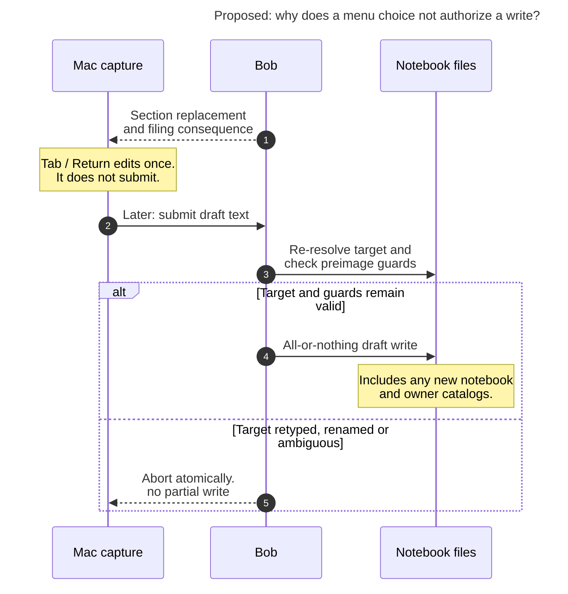

# Diagram proposals: Notebook section groups

Proposals for the swarm linker, not a report. Each diagram restates only what the source
report says.

```yaml
source: research:202611/notebook_section_groups/notebook_section_groups__final.md
producer: research.45.image
check: "mmdc 12.0.0 with the PDF-mirroring config rendered 1 of 1 Mermaid diagrams; pinned CLI with Puppeteer --no-sandbox"
```

## completion-is-not-write-authority

```yaml
anchor: |-
  existing preimage guards and re-resolution at submit time are unchanged. Completion
question: |-
  Why does accepting a completion not authorize a stale write?
illustrates: |-
  Completion state is never write authority: accepting edits the draft, while submit-time re-resolution and preimage guards protect the all-or-nothing write and a retyped, renamed, or ambiguous target aborts atomically.
caption: Accepting a section edits the draft; submit-time re-resolution and preimage guards protect the all-or-nothing write.
review: "818x760 px, fit 79.8%; question, source trace, labels, arrowheads and visual checks passed; 0 visual revisions; 1 parse fix"
```


