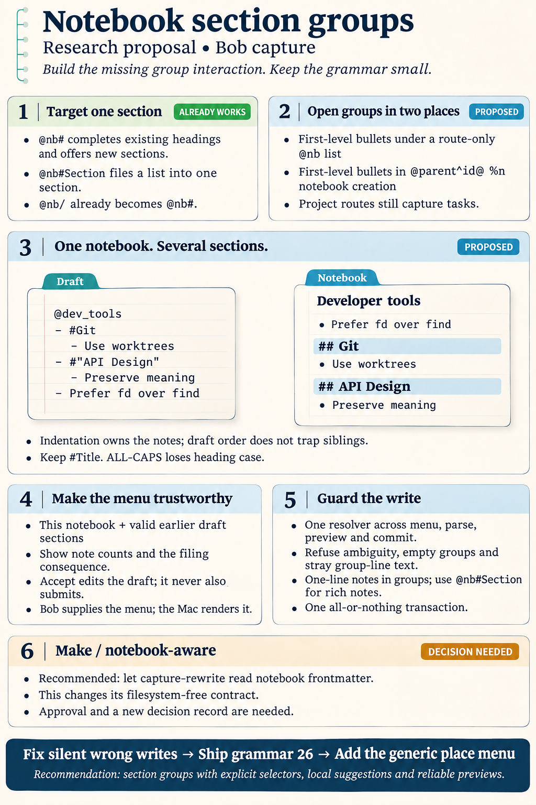
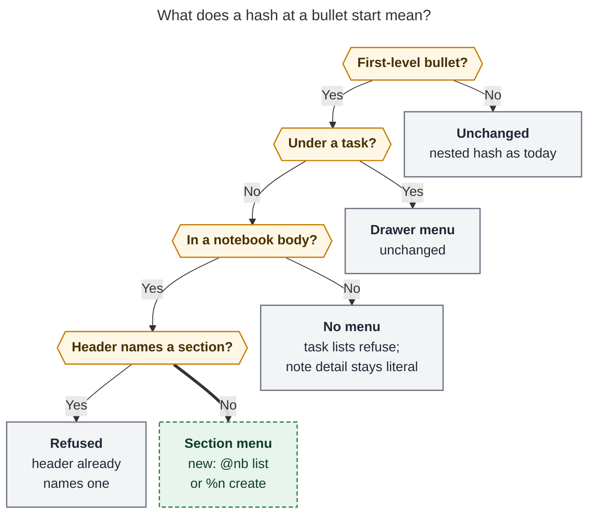
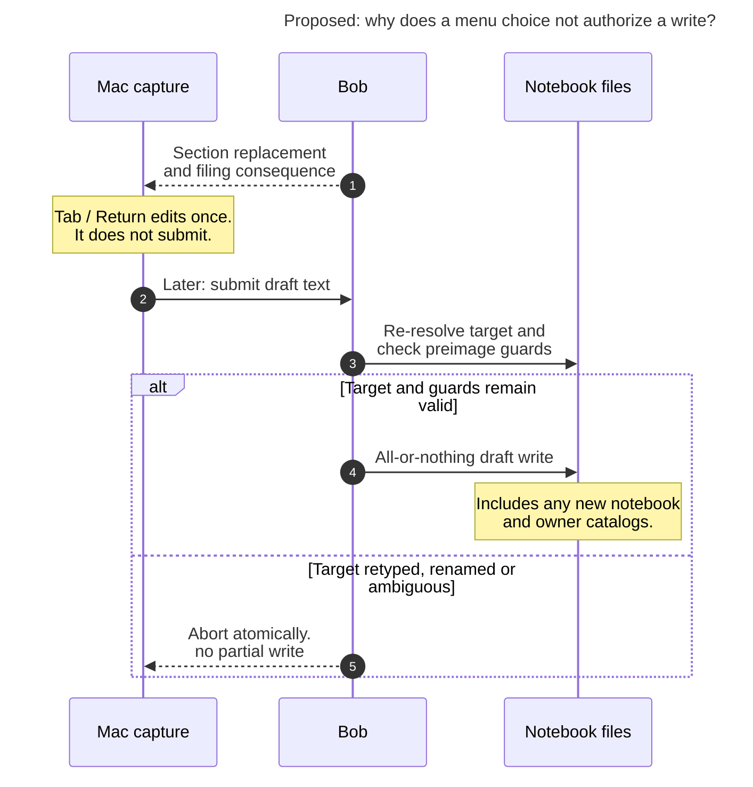

# Notebook section groups: targeting notebook `##` sections from capture bullets

> **Research query:** Capture can already target specific drawers in area and project
> notes; how should we add similar targeting for notebook H2 sections, with `#` (or the `/`
> capture alias) completing known sections at the start of a bullet, good support in project
> capture syntax and when capturing new notes to an existing project with `@<notebook>`, and
> `@<notebook>#` completing existing sections and creating new ones, all designed to be
> intuitive, reliable, and beautiful? Is this a good idea, would a different approach be
> better, which requirement adjustments are justified, and what is the recommended solution?



## Bottom line

**Build it, but as a smaller and stricter feature than the request implies.** About half of
the request already ships. `@nb#` already completes a notebook's real `##` headings, offers a
`New section “…”` row, and creates missing sections on commit. An `@nb#Section` header line
already files every bullet below it into that section, and `@nb/` already rewrites to `@nb#`.
The real gap is **section groups**: a way to spread several notes across several sections of
one notebook in a single list. It matters both when writing to an existing notebook (`@nb`
header plus bullets) and when creating one (`@parent^id@ %n`). Completion and the `/` alias
need to work at that bullet start too.

My five design decisions:

1. **Keep the `#` selector in the draft.** Accepting a row turns `- #gi` into `- #Git` (or
   `- #"API Design"`) and opens a nested `  - ` for the first note. Unlike drawers, it does
   **not** rewrite to an ALL-CAPS title. ALL-CAPS loses notebook titles (verified:
   `API DESIGN` → `## Api Design`, `COC.NVIM` → `## Coc.Nvim`). It would also give ordinary
   ALL-CAPS notes a silent new meaning. This is the main disagreement among the researchers;
   [the disagreements section](#where-the-researchers-disagreed-and-how-i-resolved-it) explains how I settled it.
2. **Section groups open in [exactly two places](#where-a-bullet-start-hash-opens-the-section-menu):** at the first-level bullets of a
   route-only `@nb` list, and in a `@parent^id@ %n` creation draft. Everywhere else a `#`
   at a bullet start keeps or tightens its current meaning.
3. **Fix seven [verified bugs](#bugs-to-fix-regardless-of-the-feature) first.** Several of them are this very slot doing the wrong
   thing silently today: `@nb` plus `- #git` writes a literal `#git` tag note, and the
   drawer menu opens on notebook note bullets.
4. **[One resolver and one staged view](#one-resolver-and-one-staged-view)** back the menu, `capture-parse`, the dry-run, and
   the commit. "Known sections" means this notebook's headings plus sections created
   earlier in the same draft. There are no vault-wide suggestions in v1.
5. **The `/` alias needs Bob to know the route is a notebook.** I recommend letting
   `capture-rewrite` use the same read-only notebook lookup that `capture-parse` already
   performs. This changes a documented contract, so it is flagged for your approval
   ([the slash alias](#the-slash-alias)).

The finished interaction:

```text
@dev_tools                       ← type "- /", which becomes "- #", and the section menu opens
- #Git                           ← "gi" + Return accepted Git; the caret lands on the note below
  - Use worktrees for independent investigations
- #"API Design"
  - Preserve meaning across API versions
- #docker                        ← "＋ New section “Docker”" (created at end of file on commit)
  - Pin base images by digest
- Prefer fd over find            ← a plain sibling: goes to the top region, before the first ##
```

## Is this a good idea

**Yes.** Notebooks are the one destination where `##` sections are the *only* structure:
there are no drawers, types, or lanes. Yet they are also the one destination where a list
draft cannot choose a section for each note. The bullet-start `#` slot in a notebook list is
also not free today. It silently writes an Obsidian tag, both in `@nb` lists ([what exists today](#what-exists-today)) and in `%n`
creation ([bug 2](#bugs-to-fix-regardless-of-the-feature)), so it needs *some* meaning anyway. Giving it the "place" meaning that `#` already has after a
route (`@nb#Section`) is the least surprising choice.

**Be honest about the marginal value.** Mixing sections already works as several
blank-line-separated `@nb#Section` items ([what exists today](#what-exists-today)). For existing notebooks, then, the gain is
ergonomic: no repeated route, plus a menu at the bullet. The larger gain is in **notebook
creation**, where you can sketch the section structure while seeding the notebook, and in
reliability, through bugs 1–3 and 5. That is enough to justify the feature, but not to
justify new sigils, global vocabularies, or a second grammar.

**Risks to manage:**

- **Section sprawl.** Easy sections invite many tiny ones. Guidance (from `cld`): a section
  groups notes *inside one topic*, and a durable subtopic that deserves a summary should be
  a child notebook. Note counts in the menu make sprawl visible.
- **Depth.** Notes inside a group are one line each under the two-level authored grammar.
  This is the same limit drawer notes have (`capture-bullets-mirror-the-task-block`, "Cost").
  The `@nb#Section` header form keeps note-plus-detail depth.
- **Tag-leading notes.** `- #idea try nixos` at a group position becomes a section bullet
  with stray text, so it is refused loudly. `\#idea` keeps the tag. This is a grammar break
  and needs grammar 26.

## What exists today

Everything in this table is verified.

| Draft | Today | Verdict for this feature |
| --- | --- | --- |
| `Note @dev_tools#` | `context: section`: `Git`, `API Design`, and `Shell Shortcuts` in document order. Replacements are `Git`, `api-design`, and `shell-shortcuts` | Done; keep it |
| `Note @dev_tools#gi` | `Git` row plus `New section “Gi”` with replacement `"Gi"` (quoted, because bare `gi` is a near miss) | Done; reduce noise ([one resolver](#one-resolver-and-one-staged-view)) |
| `@dev_tools#git` + bullets, each with detail | Each bullet becomes a stamped note in `## Git` and keeps nested detail | Done; the "rich notes" form |
| Three blank-line-separated items, `@dev_tools#git`, `@dev_tools#"API Design"`, `@dev_tools` | One transaction: `1/3 › Git`, `2/3 › API Design`, `3/3` top region | **Today's workaround** for mixing sections. It works but repeats the route |
| `Note @dev_tools/` | Rewritten to `Note @dev_tools#` (`Typed # for /`) | Done. `gem`'s claim that this needs work is wrong |
| `Neovim notes @dev^nvim@ %n` + `- KEYMAPS` / `  - leader is space` | Seeds `## Keymaps` | Done; keep it as compatibility |
| `%n` + `- API DESIGN` / `- COC.NVIM` (each with a child) | `## Api Design`, `## Coc.Nvim` | ALL-CAPS loses case. This is the key evidence for [decision 1](#bottom-line) |
| `@dev_tools` + `- #` | `context: null`, no menu | **Gap** |
| `%n` + `- #` | `context: null`, no menu | **Gap** |
| `@dev_tools` + `- /`, and `%n` + `- /` | `changed: false` | **Gap.** `grk`'s "no alias work needed" and `mus`/`gem`'s "comes for free" are wrong ([the slash alias](#the-slash-alias)) |
| `@dev_tools` + `- #git` / `  - note one` | **Writes a literal tag note** `- #git [created::…]` with child `note one`. `capture-parse` reports `notebook_note` with no diagnostic | **Gap, silently wrong.** It is *not* refused. `grk`, `gem`, and `mus` said `drawer_bullet_position`, but that is what `@area` lists do |
| `@dev_tools#git` + `- n` / `  - d` / `    - third` | Refused: "capture line 4 must be a column-zero bullet or a two-space nested bullet…" | The authored grammar has **two levels**. This bounds the design ([what a group writes](#what-a-group-means-and-what-it-writes)) |

## Bugs to fix regardless of the feature

Every item below I reproduced myself, except #6 (found by `cdx`, and confirmed in source:
`resolve_notebook_section` uses `.find`, which returns the first match).

| # | Bug | Reproduction | Found by |
| --- | --- | --- | --- |
| 1 | **Drawer menu leaks onto notebook note bullets** | `Parent @dev_tools` / `- #fu` returns `context: drawer`, row `FU`, consequence "Starts FU on the new task". `@@dev_tools` / `A note` / `- #` also returns `drawer`. The lexical `/` alias fires there too. Cause: the engine builds a notebook policy but serves `drawer_bullet_completion_at` from the lexical parse | cdx, cld |
| 2 | **`%n` creation files later siblings into the previous section** | `- KEYMAPS` / `  - leader` / `- plain top note` / `- #lsp` / `  - mason` writes `plain top note` *and a literal `#lsp` tag note* under `## Keymaps`. Cause: `seed_body` writes in strict draft order | cdx, cld |
| 3 | **A bare `@nb#` captures silently with no section** | `Note @dev_tools#` and the header `@dev_tools#` + bullets both commit as top-region notes. They should be incomplete (`needs: ["section"]`) | cdx |
| 4 | **`@@notebook` + a bullet-led item writes a checkbox into a notebook** | `@@dev_tools` / *(blank)* / `- a` / `- b` writes `- [ ] #task - a [created::…]` into `dev_tools.md`, which breaks the "never a checkbox" invariant. `@@dev` does the same in areas (a general bullet-led-item quirk) | **new** |
| 5 | **Sections staged earlier in the same draft are invisible to completion** | After `Neovim notes @dev^nvim@ %n` / `- KEYMAPS` / `  - x`, a later `More @dev_nvim#` returns `context: section` with **no rows**, although commit resolves `#keymaps` | cdx, grk |
| 6 | **Duplicate identical `##` headings resolve silently to the first** | The menu shows one and the write picks the first | cdx |
| 7 | **Wrong noun in the summary line** | `@dev_tools` list prints `list  dev_tools.md · 1 task` | cld |
| 8 | *Incidental:* **notebook `created:` gets a wrong UTC offset** | When the host TZ is UTC, creation at 13:25 UTC wrote `created: 2026-11-11T08:25:22+0000`: New York wall time labelled `+0000`. With `TZ=America/New_York` it is correctly `-0500` | cld (reproduced) |

Bugs 1, 2, 5, 6, and 7 belong in this feature's phase P0. Bug 3 changes what a draft means,
so it ships with grammar 26 in P1. Bugs 4 and 8 are outside this feature's scope and are
tracked as task beads: bug 4 is **`bob-cli-k9`** (filed by this consolidation), and bug 8 is
**`bob-cli-k8`** (filed by `cld`, corroborated here).

## Requirement adjustments

Each adjustment to the request as written is explicitly called out here.

| # | Request as written | Adjusted to | Why |
| --- | --- | --- | --- |
| A1 | "`@<notebook>#` completes existing sections and creates new ones" | **Already ships.** Retarget it to reliability and polish: a staged-draft view (bug 5), an incomplete bare `#` (bug 3), ambiguity refusal (bug 6), notebook menu chrome | Verified in [what exists today](#what-exists-today) (all five researchers agree) |
| A2 | "`#` at the start of a bullet" | Only a **first-level** bullet whose bullets land **directly in a notebook body**: a route-only `@nb` header list, or a `@parent^id@ %n` item. Not under a note (`Text @nb`, `@nb+id`, `@@nb` items), not nested, and not under an `@nb#Section` header | `#` already means a type, drawer, section, Pomodoro name, or wikilink heading, depending on position. The new meaning must occupy one unambiguous position |
| A3 | "an existing project … with `@<notebook>`" | Read as **the notebook** (which may be owned by a project). `@project` still captures tasks, and `^prj` section drawers are unchanged | Destination decides (`notebook-routes-write-notes`). Never infer "the project's notebook" |
| A4 | (implied: copy the drawer behavior) | Accepting a row **keeps `#Title`** and does not rewrite to ALL-CAPS. ALL-CAPS stays accepted in `%n` creation for compatibility but is not inserted or taught. In `@nb` lists, ALL-CAPS stays a plain note | [Disagreements table](#where-the-researchers-disagreed-and-how-i-resolved-it), row 1 |
| A5 | "known notebook sections" | **This notebook's `##` headings + sections introduced earlier in this draft.** No vault-wide recents in v1 | `cld`'s read-only vault survey: 37 notebooks, mostly section-less. Existing headings are largely migration leftovers (`Legacy Notes`, `@FOOTNOTE`), and `last_note` is null everywhere, so a recency gate would suggest nothing |
| A6 | (unstated) | **Groups only:** no same-line `- #git note`, no empty sections, and a bare `- #` is incomplete | The same reasons drawers refuse `- #drawer text` and never create an empty drawer |
| A7 | (unstated) | **Notes in a group are one line in v1.** Rich notes use the `@nb#Section` header | A third authored level is refused today. Adding one meets the reopen condition of `capture-bullets-mirror-the-task-block` and needs its own decision |
| A8 | "`/` should also trigger it" | Requires Bob to know that the header route is a notebook. That means a small, flagged contract change ([the slash alias](#the-slash-alias)) | `capture-rewrite` "never touches the filesystem" |
| A9 | (unstated) | **Grammar 25 → 26, a breaking change** (`!`): `@nb` + `- #…` changes from a literal tag to a section group, a bare `@nb#` becomes incomplete, and `%n` sibling placement changes | Release train rules (`bob-cli-releases-ride-a-daily-train`) |

## Recommended design

### Where a bullet-start hash opens the section menu

The routing for a bullet-start `#`:



*Proposed routing. Where an item's first-level bullets land decides what a `- #` means.
Under a task (a new task, a new project note, or a note-less `@route+id`) it names a drawer,
as today. Directly in a notebook body (a route-only `@nb` list or a `@parent^id@ %n` item)
it opens the new section menu. Under an `@nb#Section` header it is refused, because the
header already chose the section. Elsewhere it opens no menu: area and project task lists
keep their refusal, and a bullet under one notebook note (`Text @nb`, `@nb+id`, an `@@nb`
item) is opaque note detail, which fixes bug 1. "In a notebook body" is decided by Bob's
notebook route lookup, never by the Mac. Rendered:
`notebook_section_groups__final_assets/hash_routing.svg`, 814 × 982 px, fit 80.2%,
Mermaid CLI 12.0.0.*

### What a group means and what it writes

- **A group** is a first-level bullet holding only a section selector (`- #git`,
  `- #"API Design"`) with nested bullets below it. **Each nested bullet is one stamped note**
  (`[created::]`, optional trailing `^id` under the existing `@nb^id` rules) in that `##`
  section. The group line itself is never a note.
- **Ownership is by indentation.** A group owns only its indented children. A following
  unindented sibling is a top-region note (before the first `##`), **whatever its draft
  order**. This also fixes `%n` bug 2.
- **Placement.** Top-region notes go after the last top-region note, and section notes go
  after the last note of their section. Missing sections are created at end of file, in
  first-mention order. Repeated groups for one section merge in source order. Existing
  section order never changes.
- **Refusals** are loud, written by Bob, and teach only the current grammar:
  - `section_bullet_text`: text on the group line.
  - `empty_section_bullet`: a group with no notes.
  - `section_bullet_position`: a `- #` under an `@nb#Section` header ("drop `#git` from
    `@dev_tools` to use section groups").
  - a third-level line under a group note: teach the `@nb#Section` header form instead of
    showing the generic line-shape error.
  - `notebook_section_near_miss`: unchanged.
  - new `notebook_section_ambiguous`: duplicate headings.
- **A bare `- #`** is incomplete (`needs: ["section"]`). It is never "any section", never a
  fallback to the top region, and never written.
- **The escape** `- \#git` keeps a literal tag note.
- **ALL-CAPS.** In `%n` creation, an ALL-CAPS bullet with children still seeds a Title Case
  `##` (compatibility; now with correct sibling placement). In `@nb` lists it remains an
  ordinary note with detail. Completion never inserts ALL-CAPS for notebooks.
- **One transaction.** The whole draft is still one guarded, all-or-nothing write. That
  write covers the notebook, any new notebook, and owner `## Notebooks` catalogs. The
  existing preimage guards and re-resolution at submit time are unchanged. Completion
  state is never write authority.

[The write-authority sequence diagram](#figure-completion-is-not-write-authority) traces one
section choice from menu acceptance to a later submit, showing why completion state is never
write authority for the all-or-nothing write.

<div id="figure-completion-is-not-write-authority">



_Accepting a section edits the draft; submit-time re-resolution and preimage guards protect the all-or-nothing write._

</div>

### One resolver and one staged view

**Invariant** (`cdx`): splicing any enabled completion replacement at Bob's range and then
dry-running the draft must reach exactly the section and action the row advertised. The
draft text alone is enough. There is no hidden menu state, so CLI use, paste, and later
edits all behave the same.

- **Resolver.** Extend `resolve_notebook_section` to return `Existing`, `Create`, `NearMiss`,
  or **`Ambiguous`**. Matching precedence:
  - exact title, compared case-insensitively;
  - then a unique whole slug;
  - a quoted selector is exact;
  - never a prefix or fuzzy match at write time.

  Keep the notebook near-miss threshold at **edit distance 2**. Do not align it with the
  drawers' distance of 1: a UI reuse is no reason to change a matching policy (`cdx`,
  `cld`).
- **Staged view.** Completion and parse read disk **plus valid earlier operations in this
  draft, in source order**: sections seeded by an earlier `%n` item and groups earlier in
  the same list. Each entry carries its provenance (on disk, earlier in this draft, new).
  Later or failed operations never become selectable phantom sections. `notebook_policy_for_draft`
  already discovers creates. The fix is to make section candidates read that policy instead
  of calling `read_target` on disk alone (bug 5).
- **Optional refinement** (`cld` R9): when creating from an unquoted slug, keep the capitals
  the user typed. Today `#API-keys` creates `Api Keys`; with R9 it would create `API Keys`.
  All-lowercase input would still become Title Case. It is small and lossless, but it changes
  `@nb#` too, so it needs your approval ([open question 3](#open-questions-for-bryan)).

### The completion menu

The menu is the "beautiful" part.

**What accepting a row inserts:**

- **Existing section:** the title-preferring selector. That is the bare `#Git` when the bare
  title round-trips, otherwise the quoted `#"API Design"`. If no nested child follows, `\n  - `
  is added and `cursor_after` puts the caret on the first note. If the group already has
  children, only the selector is replaced. The glued `@nb#` keeps today's compact
  replacement (bare title, then slug, then quoted). Drawers already set the precedent of a
  different replacement per position. Here the group line stands in for the heading, so it
  should read like the heading, and an exact title cannot collide by slug.
- **New section:** `#docker`, which creates `## Docker`. A near-miss query gets the quoted
  spelling (`#"Gi"`), so the create row commits as a create rather than being refused.

**Mock (existing notebook, query `gi`):**

```text
 Section · 📓 Developer tools · dev
 IN THIS NOTEBOOK
   Git                                            8 notes
 ──────────────────────────────────────────────────────
 ＋ New section “Gi”                      did you mean Git?
 Adds after “Use worktrees…” in ## Git
 ↑↓ select   Tab/Return choose   Esc close
```

During `%n` creation the caption reads `📓 New notebook · Nvim · dev`. Earlier groups appear
under **Earlier in this draft**. On an empty query, a calm "Type a section name" hint
replaces an empty list.

**Rules** (merged from `cdx`, `cld`, and `grk`):

1. **Opening.** A bare `#` opens with **no selection**, matching the drawer menu.
2. **Ranking.** An empty query shows document order. A typed query ranks exact, then
   prefix, then substring matches, with document order as the tie-breaker. The create row
   is always last.
3. **Create row.** It is **hidden while the query is a strict prefix of an existing
   title or slug**, so no `New section “Tr”` appears while you type toward Troubleshooting.
   It is **never preselected** just because it is the only row. An edit-distance near miss
   still shows it, with "did you mean …".
4. **Accepting.** Tab or Return edits the draft once and never also submits. Escape keeps
   the typed text. Undo reverts the acceptance as one edit.
5. **Refused and failed rows.** Refused rows (ambiguous duplicates, or a heading the lexer
   cannot spell) are dimmed and show Bob's reason. If the notebook cannot be read, the
   menu shows a bounded error and **no** create row, because a failed read is not evidence
   of an empty notebook.
6. **Stale results.** Keep the active row by candidate identity, not by index. Drop late
   replies for an outdated draft or caret.
7. **Accessibility.** VoiceOver announces the destination, title, whether the section exists
   or is new, and any refusal. Color, dashes, and icons only reinforce the words.

**Chrome stays with Bob.** The Mac's drawer menu hard-codes `Drawer`, `On this task`, and
`＋ New drawer`. `capture-complete` should instead send additive `picker` chrome: title,
group titles, new-row prefix, and target caption. The Mac then paints one generic **place
menu**: drawers get today's copy, and notebooks get **Section · In this notebook · ＋ New
section**. This removes a thin-client leak instead of adding a second hard-coded menu
(`grk`, `cld`). All counts and consequence lines come from Bob's scan, never from Swift.

**Highlighting and preview.** Color the group selector with a `notebook_section` span in
the section color family, like `@nb#Section`. Group the batch preview by destination
(`cld`):

```text
📓 4 notes → Developer tools
   › Git                 Use worktrees for independent investigations
   › API Design          Preserve meaning across API versions
   › Docker  New section Pin base images by digest
   · top                 Prefer fd over find
```

Keep the CLI's `📓 Note → Title › Section` lines, and fix the summary noun (bug 7).

### The slash alias

For the `/` alias, Bob must know the route is a notebook.

`/` → `#` fires "wherever a `#` menu would open". But `capture-rewrite` is documented as
*purely lexical: it never opens the vault, never reads the clipboard, never touches the
filesystem*, and in a lexical parse `@dev_tools` and `@dev` are indistinguishable. That is
why `@dev_tools` + `- /` stays literal today, and why `Parent @dev_tools` + `- /` wrongly
fires the alias (into a drawer position). For the `%n` case the seal is lexical, so that part
is easy. For `@nb` lists, three options exist:

| Option | How | Pros | Cons |
| --- | --- | --- | --- |
| **B. Notebook-aware rewrite (recommended)** | When `capture-rewrite` evaluates a bullet-start `/`, it builds the same memoized `notebook_policy_for_draft` that `capture-parse` already builds on every call: a lexical preflight, then one frontmatter read per candidate route, against the configured vault | Exact: it fires only where the section menu will open, and it also stops today's over-fire on notebook note detail. No Mac change and no extra round trip | Changes the documented "never touches the filesystem" contract. That contract was evidence V4 in `notebook-routes-write-notes`, so it needs a new decision record. `capture-parse`, also described as "lexical and read-only", already set the precedent |
| A. Lexical over-fire (`cld`) | Fire at any first-level bullet start under a whole-line route-only `@route` header | No contract change. It follows the accepted precedent that a spaced `.` after a notebook route may become `&` | On `@area` lists `- /` becomes `#` with no menu, and the commit refuses (loud; Undo restores). Under `Text @nb` the `#` quietly lands in note detail, as it does today |
| C. Semantic typing assist (`cdx`) | `capture-complete` (which already reads the vault) validates a typed-`/` request and returns the alias edit | The rewrite stays strictly lexical | New protocol field, Mac-side arbitration between two alias sources, and an extra round trip per `/` |

If you want to keep the rewrite strictly filesystem-free, take **A**. Its failure modes are
loud on task lists and already exist under notes. **C** is the most work for the same result
as B.

### Protocol versioning and records

- **`capture-complete`** gets a new context, `notebook_section_bullet`, using the drawer row
  shape: `group`, `title`, `replacement`, `detail`, `consequence`, `creates`, `refused`,
  `cursor_after`, `note_count`, plus additive `picker` chrome. The glued form keeps
  `context: section`, gains the staged view, and reuses `notebook_section_create`. A new
  context name (`grk`) is safer than overloading `section`: an older app that would apply a
  continuation edit it does not understand instead simply shows no menu, and the typed text
  still commits correctly.
- **`capture-parse`** gets a `notebook_section` span (`notebook: true`, `title`,
  `section_action: existing|create`), the diagnostics listed in [what a group writes](#what-a-group-means-and-what-it-writes), and
  `needs: ["section"]` for a bare `- #` and a bare `@nb#`.
- **`capture` JSON** is unchanged in shape: per-note `notebook.section` and
  `notebook.section_action` already exist.
- **Grammar 26** ships through the release train as a `!` commit. Add a Mac compatibility row
  and gate the place menu on the advertised context. Do not add a new CLI verb or any `@@`
  change.
- **Records.** Write a new decision, for example `notebook-section-groups`: "In a notebook
  body, a first-level `- #Section` bullet files its nested notes into that `##`; the
  selector stays in the draft; one resolver; no empty sections." It extends
  `notebook-routes-write-notes` and `capture-bullets-mirror-the-task-block`. If you approve B,
  add a second record that lets `capture-rewrite` read notebook frontmatter. Update the
  glossary entries for Notebook and Task Drawer. All of these are memory edits, which go
  through `/sase_memory_write` at implementation time; none are made here.

### Phases and acceptance

| Phase | Repo | Scope | Size |
| --- | --- | --- | --- |
| P0 | bob-cli | Bugs 1, 2, 5, 6, 7. Notebook-aware classification before the drawer probe; `seed_body` sibling placement; staged-view section candidates; the `Ambiguous` outcome; the list noun. Regression tests for every row in [what exists today](#what-exists-today) and [the bugs table](#bugs-to-fix-regardless-of-the-feature) | S |
| P1 | bob-cli | Grammar 26: group parsing for `@nb` lists and `%n`; writer grouping; bare `#` incomplete (bug 3); parse spans and diagnostics; the `\#` escape; docs (`docs/capture.md`, `docs/notebooks.md`, `docs/reference/capture-syntax.md`) | M |
| P2 | bob-cli | The `notebook_section_bullet` context, title-preferring replacement and continuation, create-row rules, `picker` chrome, and the `/` alias (B or A). Regenerate `capture-complete` docs | M |
| P3 | bob-mac-capture | Generalize the drawer menu into the place menu, the section-group highlight span, the grouped preview, and compatibility gating. Watch the exact-SHA macOS CI run to green | S–M |
| P4 | memory | Decision record(s) and glossary updates ([protocol and records](#protocol-versioning-and-records)) | S |

**Decisive acceptance checks.** Each one runs through parse, complete, dry-run, and commit,
and asserts that all four agree.

- **Round trip.** Every enabled row, spliced in and dry-run, reaches its advertised section
  and action.
- **Positions.** The menu opens for an `@nb` list and for `%n`. There is no menu under
  `Text @nb`, `@nb+id`, or `@@nb` items, or on nested bullets. `@nb#Section` + `- #` is
  refused. `@area` + `- #` keeps its refusal. Task and project drawer menus are
  byte-identical to before.
- **Shape.** Siblings go to the top region regardless of order. Repeated groups merge.
  Empty groups, same-line text, and a third level are refused with teaching copy. `\#` stays
  literal.
- **Text.** Mixed case, acronyms, emoji, non-Latin titles, smart quotes, escaped quotes,
  CRLF/BOM, fenced `##`, and `#Section^id` all survive.
- **Staging.** Sections from earlier `%n` items and earlier groups appear in the menu.
  Sections from later or failed items do not.
- **Alias.** A typed `/` and a typed `#` converge on the same menu. Pasted `/` stays
  literal. Doubled `//`, Undo, and Escape behave as today.
- **Transaction.** Dry-run bytes equal commit bytes. A retyped, renamed, or ambiguous target
  aborts atomically.

## Where the researchers disagreed and how I resolved it

| Question | Positions | Resolution |
| --- | --- | --- |
| **What does acceptance insert?** | ALL-CAPS bare title, like drawers: `cld`, `grk`. Keep the `#` selector: `cdx`, `mus`, `gem` | **Keep `#Title`.** (1) ALL-CAPS loses notebook titles, and I verified the case loss on `API DESIGN` and `COC.NVIM`. Notebook headings are topic names (`coc.nvim`, `2024 taxes (2023 tax year)`), not a small work vocabulary like `REQUIREMENTS`. `cld`'s own design needs a quoted `- #"…"` fallback for such headings, so it has two spellings anyway. (2) The drawer principle "the draft reads like the block it writes" does not transfer: the notebook file holds `## Git`, not `- GIT`, so `- GIT` is no closer to the file than `- #Git`. (3) `#Title` is the same selector grammar as `@nb#Title`, with the same resolver and the same highlight. The cost is two container spellings across Bob. It is softened because the gesture is identical (`- #` or `- /`, then menu, Return, nested caret), and each spelling mirrors its own destination's selector |
| **Do ALL-CAPS bullets with children in `@nb` lists become sections?** | Yes (breaking): `cld`, `grk`. No: `cdx`, `mus`, `gem` | **No.** Notebook notes are freeform, and `- TIL` or `- IMPORTANT` with detail is plausible content. Making it structural is a silent meaning change, whereas the explicit `#` costs one keystroke. `%n` keeps ALL-CAPS for compatibility |
| **What does `@nb` + `- #git` do today?** | Refused (`drawer_bullet_position`): `grk`, `gem`, `mus`. Written as a literal tag: `cdx`, `cld` | **A literal tag**, verified with a real write. The refusal only applies to `@area` lists |
| **`/` alias** | Free or one allow-list line: `grk`, `mus`, `gem`. Lexical over-fire: `cld`. Semantic assist: `cdx` | **B (notebook-aware rewrite)**, a new option based on the `capture-parse` precedent. A is the fallback ([the slash alias](#the-slash-alias)) |
| **Which sections does the menu suggest?** | Vault recents: `gem`, and `cld` gated to 90 days. Local only: `cdx`, `grk`, `mus` | **This notebook plus this draft.** `cld`'s survey shows global suggestions would be junk today. Revisit once captured sections accumulate stamped notes |
| **Do `@@nb` items support groups?** | Yes: `gem`, `mus`. No: `cdx`, `cld` | **Not in v1.** `@@` stays a draft-wide declaration with no outline meaning. Bullet-led `@@nb` items currently write a checkbox (bug 4), so the minimal fix is to refuse them and teach the `@nb` header. Whether a bullet-led item under `@@` should mean "a list" is a separate, cross-destination decision |
| **Note detail inside groups** | One line: `cld`. Preserve detail, maybe with a third level: `cdx`. Nested-of-nested stays detail: `grk`, `mus` | **One line in v1.** A third level is refused today (verified), so `grk`'s and `mus`'s shape is not possible without a grammar change. Reopen it through the drawer decision's own reopen condition |
| **Create-row noise** | Hide on a strict prefix: `cld`. Never preselect: `cdx` | **Both.** They are complementary |
| **Completion context name** | One shared `notebook_section`: `cld`. `section` plus a `placement` field: `cdx`. A new `notebook_section_bullet`: `grk` | **`grk`'s.** It is additive and safe for older apps |
| **Does `@nb/` need alias work?** | Needs work: `gem`. Already works: `cdx`, `cld`, `grk` | **Already works** (verified) |

## Alternatives rejected

| Alternative | Why not |
| --- | --- |
| Rewrite to ALL-CAPS like drawers | It loses case and gives ordinary notes a new meaning ([disagreements](#where-the-researchers-disagreed-and-how-i-resolved-it)) |
| Same-line `- #git Try mergiraf` | The group title and note text would compete for one line. Drawers rejected the same shorthand, and `Try mergiraf @dev_tools#git` already exists |
| `- ## Git` or bare `## Git` lines in the draft | The heading is shown exactly as written, but this is a new line class in the authored grammar, and a `/` alias cannot fire at a line start. Reopen it if `#Title` feels wrong in practice |
| `@@nb#section`, a new sigil, or a modal "section" command | It reverses the 2026-10-31 removal of suffixed `@@` forms (`notebook-routes-write-notes`) or adds a concept for no gain |
| A vault-wide section catalog shared with drawers | Topics and work structure would pollute each other's menus, and today's data is mostly junk headings |
| Section groups for area and project lists | List bullets there *are* tasks. Areas keep tasks in `## Tasks`, and `@area#Section` headers already exist |
| Global or AI-inferred filing | It makes placement unpredictable, and the request does not need it |

## Open questions for Bryan

1. **The `/` alias.** Approve **B** (the rewrite reads notebook frontmatter like
   `capture-parse` does, with a new decision record)? Or keep the rewrite filesystem-free
   and accept **A**'s loud over-fire on area lists?
2. **ALL-CAPS in `%n`.** Keep it as permanent compatibility (my default), or plan to retire
   it once `#Title` groups ship?
3. **[R9](#one-resolver-and-one-staged-view).** Should creating from an unquoted slug keep typed capitals (`#API-keys` →
   `API Keys`) in both `@nb#` and groups?
4. **A third level.** Is one-line group notes acceptable for v1, with `@nb#Section` headers
   for rich notes?

## Recommended solution

Ship **notebook section groups** as the notebook counterpart of drawer bullets: the same
gesture, but each container keeps its own destination's selector.

1. **[P0](#phases-and-acceptance), fix what is silently wrong:**
   - notebook-aware classification before the drawer probe (bug 1);
   - `%n` sibling placement (bug 2);
   - staged sections visible to completion (bug 5);
   - ambiguous duplicate headings refused (bug 6);
   - the "tasks" noun (bug 7).

   Bugs 4 and 8 are tracked separately as `bob-cli-k9` and `bob-cli-k8`.
2. **Grammar 26.** In a notebook body (a route-only `@nb` list or a `@parent^id@ %n` item),
   a first-level `- #Section` bullet files its nested one-line notes into that `##`.
   Plain siblings go to the top region, new sections are created at end of file, and
   repeated groups merge. No same-line text, no empty sections, and a bare `#` or bare
   `@nb#` is incomplete. `\#` keeps a tag. ALL-CAPS stays a compatibility path in `%n` only.
3. **One resolver and one staged view** (disk plus earlier draft operations) serve the
   menu, parse, preview, and commit. Matching is exact title, then a unique whole slug, then
   a quoted exact title. Near misses at distance 2 are refused, and duplicates are refused
   as ambiguous.
4. **[One menu](#the-completion-menu), with Bob-authored chrome.**
   - Contents: this notebook's sections, then sections from earlier in the draft, then one
     `＋ New section` row. The create row is hidden on prefix queries and never preselected.
   - Accepting inserts `#Git` or `#"API Design"` and moves the caret to the nested note.
   - The Mac's drawer menu becomes a generic place menu that renders Bob's notebook copy,
     counts, and consequences.
   - The preview is grouped by section.
5. **[The `/` alias](#the-slash-alias)** via a notebook-aware `capture-rewrite` (B, pending your approval), or
   the lexical fallback (A).
6. **Record it.** A new decision record (`notebook-section-groups`) and glossary updates.

This keeps the grammar teachable ("`#` after `@nb` or at a notebook bullet names a
section"), keeps the Mac thin, and turns today's silent wrong writes into a guided,
previewed, all-or-nothing capture.

## How this report was built

*Lead researcher's consolidated report · 2026-11-11 · merges the `cdx`, `cld`, `grk`, `mus`, and
`gem` reports (siblings in this directory) with new probes and source reading · bob-cli at
`01c8e822` (capture grammar 25)*

- **Inputs.** All five registered reports were read through `sase artifact read`. So were
  the governing decision records (`notebook-routes-write-notes`,
  `capture-bullets-mirror-the-task-block`, `capture-sigils-say-where-what-how`,
  `mac-capture-is-a-thin-client`), the glossary entries for Notebook, Task Drawer, and
  Capture Alias, and V4 of `research:202611/bob_notebooks/bob_notebooks.md`.
- **My own probes.** I ran the installed `bob 0.5.0` (grammar 25, built 2026-11-11 11:09 UTC)
  against a synthetic scratch vault. I used `capture --dry-run`, real writes into
  throwaway copies, `capture-complete`, `capture-rewrite`, and `capture-parse`. The binary
  predates only the two newest commits (album registry, record parse spans), and neither
  touches notebook capture. One caveat: `capture-parse` resolves notebook routes against
  the *configured* vault, a read-only frontmatter lookup it does by design. Its notebook
  classification of `@dev_tools` therefore reflects a real notebook of that name.
- **Source reading** covered `capture_language/{notebook,drawer_bullet,rewrite}.rs`,
  `capture_complete/{engine,candidates}.rs`, `capture_notebooks.rs`, `capture_parse.rs`,
  and `capture_project_note.rs`.
- **Not done.** I ran no macOS build or visual check. Mac claims come from the researchers'
  source reading (`cdx`, `cld`, `grk`).

## Source map

- **bob-cli** (`01c8e822`):
  - `src/native/capture_language/notebook.rs`: `resolve_notebook_section` at lines 188–270,
    with first-match `.find`, threshold 2, and Title Case creates.
  - `capture_language/drawer_bullet.rs`: `classify_target` at lines 160–200, which has no
    notebook arm.
  - `capture_language/rewrite.rs`: `expand_hash_alias` at lines 1295–1387, which uses the
    lexical `completion_field_at`.
  - `capture_complete/engine.rs`: lines 98–120 build the notebook policy; lines 466–472
    contain the lexical drawer-bullet probe.
  - `capture_complete/candidates.rs`: `notebook_section_replacement` at lines 339–383.
  - `capture_notebooks.rs`: `notebook_policy_for_draft` at lines 26–60.
  - `capture_parse.rs`: lines 131–141, where parse builds the notebook policy from the
    configured vault.
  - `capture_project_note.rs`: `format_project_section_title` at line 220.
- **Help contracts:** `bob capture-rewrite --help` ("purely lexical … never touches the
  filesystem"); `bob capture-parse --help` (notebook routes report `notebook_note`).
- **Memory:** `decisions:notebook-routes-write-notes`,
  `decisions:capture-bullets-mirror-the-task-block`,
  `decisions:capture-sigils-say-where-what-how`, `decisions:mac-capture-is-a-thin-client`;
  glossary entries Notebook, Task Drawer, and Capture Alias.
- **Prior research:** `research:202611/bob_notebooks/bob_notebooks.md` (V4 and the accepted
  `.`→`&` over-fire).
- **Mac** (via researchers' source reading): `CaptureDrawerMenuPresentation.swift`
  (hard-coded drawer copy), `CompletionRowContent.swift` (generic `section` rows, with no
  distinct create-row rendering), and `CaptureNotebookPresentation.swift` (the existing
  `New section` badge).
- **Sibling reports:** `notebook_section_groups__{cdx,cld,grk,mus,gem}.md`. `grk`'s figures
  remain in `notebook_h2_section_capture__grk_assets/` and show its ALL-CAPS variant, which
  this report does not adopt.
