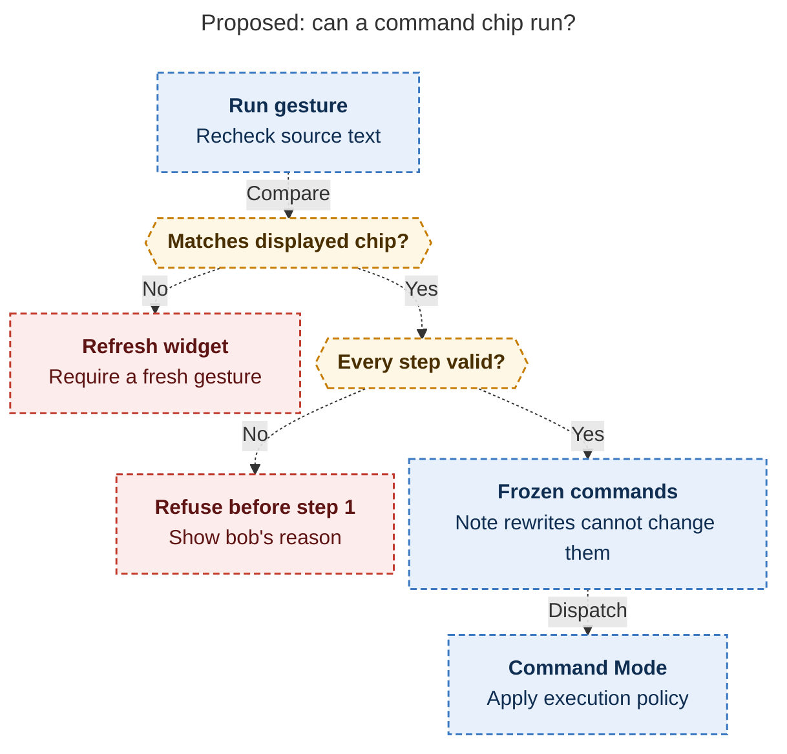
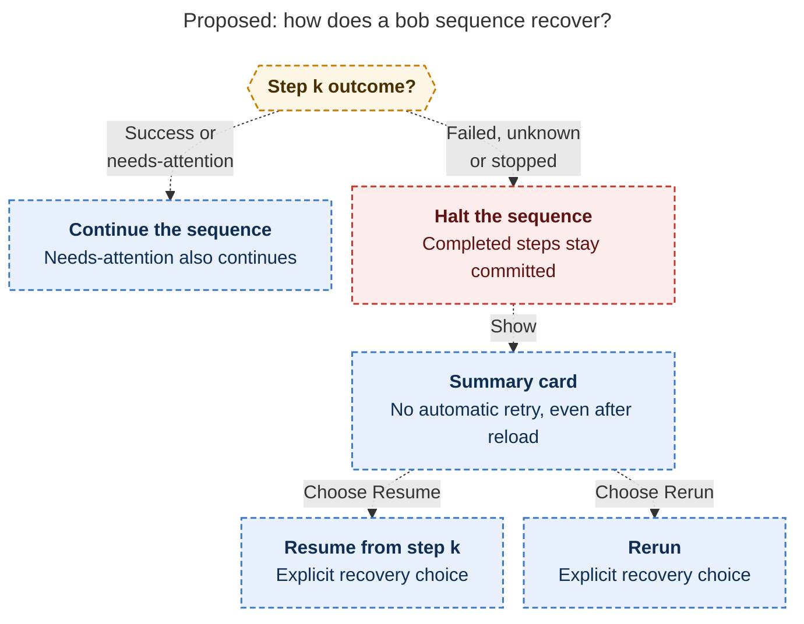

# Diagram proposals: Command chips: one-gesture bob runs from Obsidian notes

Proposals for the swarm linker, not a report. Each diagram restates only what the source
report says.

```yaml
source: research:202611/obsidian_command_chips/obsidian_command_chips__final.md
producer: research.5k.image
check: "mmdc 12.0.0 with the PDF-mirroring config and Puppeteer --no-sandbox rendered 2 of 2 Mermaid diagrams"
```

## activation-integrity

```yaml
anchor: |-
  activation the source is re-resolved and compared with what the widget represents; a
question: |-
  What prevents stale or invalid chip text from starting a run?
illustrates: |-
  At activation, stale widgets refresh and require a fresh gesture, whole-chip validation refuses invalid steps before step 1, and accepted runs keep an immutable argv sequence.
caption: "Stale widgets require a fresh gesture; invalid chips refuse before step 1; accepted command arguments stay fixed while Command Mode applies execution policy."
review: "659.1x938 px, fit 95.2%; question, labels, arrowheads, reading order, source trace and visual checks passed; 1 visual revision; no parse fixes"
```



## sequence-recovery

```yaml
anchor: |-
  Partial success is visible and honest: completed steps stay committed; Resume and
question: |-
  How does a command-chip sequence proceed or recover after a step outcome?
illustrates: |-
  Command Mode sequences continue on needs-attention, halt on failed, unknown or stopped, and keep completed steps committed while Resume and Rerun remain distinct explicit choices.
caption: "Failed, unknown, or stopped steps halt; completed work remains, and Resume or Rerun requires an explicit choice even after reload."
review: "676.1x764 px, fit 96.5%; question, labels, arrowheads, reading order, source trace and visual checks passed; 1 visual revision; no parse fixes"
```



