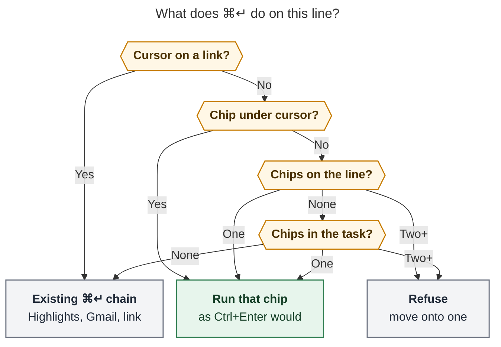

# Command chips: run bob from a note in one gesture

_Researcher `cld` · 2026-11-19 · spans bob-plugins (bob-copy-chips, bob-command-mode,
bob-navigation-hotkeys, bob-ledger-tools), the Bob vault, chezmoi, and bob-cli memory and
docs._

## Bottom line

- **Build it.** Make it the second chip kind in the copy-chip plugin, renamed now to
  **`bob-chips`**. Don't build a new plugin, and don't put it inside Command Mode.
  - `bob-chips` owns the syntax, the rendering, the cursor rule, and authoring for both
    chip kinds.
  - Bob Command Mode stays the only component that parses bob argv and runs bob.
  - Bob Navigation Hotkeys keeps owning `⌘↵`.
- **Syntax.** Use a `run:` code span whose text is a real bob command line. Several
  commands are joined with `&&`:

  ```markdown
  `run: bob task reconcile`
  `run[Morning sync]: bob tick -a`
  `run: bob gcal sync -n 2 && bob gkeep pull && bob gmail sync`
  ```

  That payload is byte-for-byte what Command Mode's sequence **Copy** and the pager's
  `Y` already produce, and what a terminal accepts. Running a command once in the sheet
  therefore gives you the chip text for free.
- **A click or `⌘↵` runs the chip the way `Ctrl+Enter` runs a row in the sheet.**
  Previews are skipped, and `&&` steps run as one Command Mode sequence that halts at the
  first failure. I add three guards:
  - the binary's `confirm` gate still asks (2 of 107 catalog commands);
  - chips never run from mail, reference, or conflict-copy notes;
  - clicking a chip that is already running opens its output instead of starting a second
    run.
- **`⌘↵` is already a dispatcher.** The vault binds `Meta+Enter` to a chain: Highlights,
  then Gmail, then the link under the cursor. Command chips go first in that chain,
  behind a "the link under your cursor wins" check. The chip is chosen in this order: the
  chip under the cursor, then the line's only command chip, then the task's only command
  chip. Anything ambiguous is refused, never guessed.
- **The hint has two parts.** The chip that `⌘↵` would run gets an "armed" accent with no
  reflow, and a muted `⌘↵ Run` keycap appears at the end of the cursor line. The keycap
  is the same component family as the shipped `⌘↵ Gmail` hint. Both appear only when the
  key would actually run that chip.
- **Vault adoption is small and partly gated.**
  - Two GTD rows convert now: the sync trio and `task reconcile`.
  - The Bank row converts once `bob bank import -D` (bead bob-cli-no.2) reaches the Mac.
  - The sync row becomes `run: bob tick -a` when bead bob-cli-nc lands, on or after
    11-26.
  - `bob gcal ack -n 7` cannot be a command chip, because its walk needs a TTY.
  - The agent prompts stay copy chips.

## What exists today (evidence)

### Bob Copy Chips (shipped today, `bob-copy-chips` 0.4.0)

`plugins/bob-copy-chips/` renders `` `copy: …` `` / `` `copy[LABEL]: …` `` code spans as
pills and `bob-copy` fences as cards. It has one pure grammar module (`020-grammar.js`)
pinned by conformance vectors and a round-trip property test. Rendering is split between
a Live Preview `ViewPlugin` over the syntax tree (`050`) and a Reading-view
post-processor that swaps `<code>` for a real `<button>` (`060`). Other pieces:

- a shared cursor rule, `chipAt` (`065`);
- feedback handling: glyph swap, live region, never-silent failure (`030`);
- the `Mod+Shift+Y` make-or-edit card (`081`–`083`);
- a frozen, never-throwing `api.copyChips` v1.

It is `isDesktopOnly: false`, and its research set reliability rules R1–R14. Everything a
command chip needs for parsing, rendering, accessibility, Vim safety, and authoring is
already written and tested once.

### Bob Command Mode already defines what "Ctrl+Enter" means

- **`Ctrl+Enter` is `force`.** In the sheet, `activateRow(row, {force: true})` sends a
  report row to the output pager. Every other row goes to
  `runner.run(argv, {skipGuards: true})`, so both the `preview-first` and the `confirm`
  gates are bypassed (`170-sheet.js` around L476–515; the guards are in `060-runner.js`
  L121–129).
- **Sequences already exist.** `Ctrl+M` marks steps, and `cmRunSequence` runs them one at
  a time with `skipGuards: true` (`065-sequence-runner.js`). A sequence halts on
  `failed`, `unknown`, or `stopped` and continues on `attention`. It finishes with one
  summary card offering Output, Copy (`bob a && bob b`), Rerun, and Resume from k.
- **The engine already handles the hard parts.**
  - Writers run one at a time, behind a guard that saves every open note first.
  - Identical in-flight argv is deduplicated (`findDuplicate`).
  - Runs are recorded host-locally.
  - The status-bar chip shows `N/M` for a running sequence.
  - A plugin reload adopts orphaned runs.
- **Typed input is tokenized by `cmTokenizeBobArgv`.** It handles quotes and backslashes
  and has no shell (`175-args-vim.js`). `cmResolveTypedBobArgv` applies catalog aliases
  and the exclusions, then requires a catalog entry. `cmQuoteArg` writes POSIX single
  quotes, and the tokenizer reads them back. Copy and parse therefore already round-trip.
- **The API is incomplete for chips.** `api.commandMode` v1 exposes `run`, `preview`,
  `openOutput`, `onRunFinished`, `catalog`, and `lastRun` (`080-api.js`). It has **no
  sequence runner, no run-started signal, and no way to open the review or confirm
  card**. Those gaps are the only engine work a chip needs.

### The catalog (`bob __catalog --protocol 1`, bob 0.5.0 on apollo)

- **107 entries and 50 excluded paths.** Policies break down as:
  - 55 `reads/run` (54 of them reports);
  - 26 `preview-first` writers or syncs;
  - 24 `run` writers;
  - only **2 `confirm`**: `task archive` ("has no dry run") and `nightly`.
- **The GTD commands:**
  - `gcal sync`, `gkeep pull`, `gmail sync`, `bank import`, `gcal ack`, and `tick` are
    `preview-first`;
  - `task reconcile` is `run`.

### `⌘↵` is taken, and it is already a dispatcher

- **The binding.** The vault's `.obsidian/hotkeys.json` binds `Meta+Enter` to
  `bob-navigation-hotkeys:open-reference-pdf-in-highlights`. `Meta` is used on purpose:
  `Mod` would claim `Ctrl+Enter` on Linux, and Bob uses `Ctrl+Enter` to close tasks.
- **The chain.** `openReferencePdfInHighlightsOrLink` (`677-plugin-ref-pdf-open.js`)
  tries a Highlights target, then `bob-mail`'s `api.mailOpen.openAtCursor(view)`, then
  `delegateOpenLinkInNewTab()`. A command chip is a fourth link in this chain, plugged in
  the same way the Gmail step is.

### The cursor-line keymap hint already exists

bob-ledger-tools draws a display-only `⌘↵ Gmail` chip at the end of the cursor line when
`⌘↵` would open an email (`142k-gmail-open-hint.js`, `271i-plugin-gmail-open-hint.js`).

- It shows `M-↵ Gmail` off macOS.
- A capability flag (`mailGmailOpenKeymap`) keeps it from advertising a gesture that is
  not live.
- The Highlights hints derive the real keycap from Obsidian's hotkey manager
  (`getHighlightsCommandHotkey` + `formatHighlightsHotkey` in `677d-highlights-hints.js`).

The command-chip hint should be the same component, with the same truthfulness rule.

### The vault rows (`~/bob/gtd_daily.md`, open rows only)

| Line | Row | Bob command text today | Command chip? |
| --- | --- | --- | --- |
| 17 | `#pre #sync` Run … | `` `gcal sync -n 2` `` + `` `gkeep pull` `` + `` `gmail sync` `` | **Yes, now**, as one 3-step chip; later `bob tick -a` (bob-cli-nc) |
| 18 | `#pre` **Bank** | `` `bob bank import ~/Downloads/*.qfx && rm ~/Downloads/*.qfx` `` | **After bob-cli-no.2**, as `bob bank import -D ~/Downloads/*.qfx` (`rm` can never run) |
| 23 | `#pre #init` Run … | `` `task reconcile` `` | **Yes, now** |
| 27 | `#pre #terminal` **Ack external events** | `` `bob gcal ack -n 7` `` | **No.** `gcal ack --help`: "Explicit walks such as `-n` and `-a` need a TTY" |
| 25, 26, 28–31 | period reviews | agent prompts already inside `copy[...]:` chips | **No.** They are prompts for an agent, not commands to run |

- **No other open recurring task holds a bob command.** I checked `recur.md`, `dev.md`,
  and every other non-archive note.
- **Open non-recurring tasks name bob commands as feature ideas** (for example
  "Add `-D|--delete` option to `bob bank import`!" in `bob.md`). Those must never become
  run buttons.

### In-flight work this feature must coordinate with

- **bob-cli-no** (bank import `-D`, in progress).
  - `.1` already makes bob expand `~` and globs itself, so the pattern needs no shell.
  - `.2` adds `-D`.
  - `.3` turns the bank card's footer into a button that calls
    `api.commandMode.preview([...])`. That button is a bespoke, preview-first command
    chip.
- **bob-cli-nc** (snoozed to 2026-11-26) switches the sync row to `bob tick -a`. `tick`
  is in the catalog: `syncs`, `preview-first`, with a 7200 s budget.
- **bob-cli-nn** (ready): plain-text task surfaces (pickers, the Task Card title, the Mac
  agenda) show raw `copy[...]:` source. Command chips add a second source form to that
  problem.
- **The vimrc comment for `gy`** was edited at 21:54 UTC today. It now says `gy` copies
  "the line's only chip, or the task's only chip". The shipped cursor rule (`065-cursor.js`
  at bob-plugins `3968f0d`) has **no task fallback**. Either work is in flight or the
  comment is ahead of the code. Either way, the shared resolver proposed below gives `gy`
  and `⌘↵` the same task fallback.

### Syntax collision census (all 135,979 inline code spans in the vault)

I scanned every `.md` file outside `lit_review/`, `xlib/`, `.git/`, and `.obsidian/`, and
outside fenced blocks:

| Prefix | Spans | Where |
| --- | --- | --- |
| `run:` | **0** | — |
| `run[` | 1 | `.bob/` |
| `bob:` | 11 | all in `.bob/ref-sources` |
| `cmd:` | 1 | `code/` |
| `bob ` (bare command) | **2,437** | 2,070 in `.bob/`, 118 in daily notes, 103 in `ref/`, 67 in `done/`, 57 at the root |

Auto-detecting `` `bob …` `` spans as run buttons is therefore out of the question. Most
of them are prose, documentation, or history. `run:` is collision-free.

## Is this a good idea?

**Yes, with honest expectations.**

Why it is worth building:

- **It removes the busywork from GTD rows that say "Run X".** Today those rows mean: read
  the row, press `:`, retype or fuzzy-find, then press `Ctrl+Enter`. During the morning
  `]s` walk this becomes `]s` → `⌘↵` → `⌃↵`: land, run, complete.
- **It generalizes a pattern that is already being hand-built.** The bank card's
  command-preview button (bob-cli-no.3) is a one-off command chip. FOR THIS NOTE rows and
  palette `Bob: <title>` commands are other partial answers.
- **Both halves are mature and tested.** Copy-chip rendering shipped today with e2e
  coverage. The Command Mode engine already has guards, receipts, sequences, history, and
  the status chip. A command chip is mostly glue plus a few new API members.
- **It reaches beyond GTD.** Project and area notes can carry their own maintenance
  verbs, such as `run: bob plugins sync`, `run: bob notebooks sync`, or
  `run: bob periods brief yesterday` (a report that opens the output pager).

What argues for caution:

- **The flagship use case is shrinking.**
  - The Mac's `*/5 bob tick` cron already runs gcal, gmail, refs, projects, and tasks on
    a schedule.
  - bob-cli-nc will fold the three-command sync row into `bob tick -a`.
  - The `Run task reconcile` row may become redundant, because tick's `tasks` step
    reconciles every 15 min. Whether to retire it is Bryan's call.

  So bulk chips matter less than the request implies. They are still worth supporting
  because the engine already does sequences, and `&&` costs one tokenizer rule.
- **Writes move one click away, inside notes that sync to three hosts.**
  - A copy chip's worst case is a clobbered clipboard.
  - A command chip's worst case is a network sync or a vault rewrite started by a stray
    click in a hover preview.

  Every guard in the design exists for this reason.
- **Skipping previews becomes a habit.** 26 commands are `preview-first` because the
  binary considers their writes consequential. Bryan asked for `Ctrl+Enter` semantics,
  and the design honors that. It keeps the guarded path one modifier away (Shift+Click)
  and keeps the binary's two `confirm` commands confirming.
- **`⌘↵` gains a fourth meaning.** It already means Highlights, Gmail, or link depending
  on the line. A precise precedence rule plus a truthful hint keeps that understandable.

### Would I take a different approach?

I compared these alternatives against the recommendation:

| Alternative | Verdict | Why |
| --- | --- | --- |
| Auto-run any `` `bob …` `` code span | **Reject** | 2,437 existing spans, most of them prose or history; turning documentation into run buttons is unsafe and noisy |
| `` `bob: gcal sync` `` prefix (implicit `bob`) | Reject | The text is not a valid shell command, so it fails the copy-to-terminal round-trip and the sequence Copy round-trip. It also reads like a label, not an action |
| A task field `[run:: bob tick -a]` | Reject | It only works on task lines, renders as Dataview field text, and is not a visible button. bob-cli would have to grow a contract for it, with no gain |
| An `obsidian://bob-run?...` link | Reject | Same failures as the copy-chip research found for links: URL-encoding, inconsistent rendering of custom schemes, and Jump-to-Link exposure. It is also externally invocable, a bad property for a run verb |
| Build it inside `bob-command-mode` | Reject | It would duplicate the copy-chip scanner, Live Preview widget, Reading post-processor, cursor rule, and author card. Two plugins would then decorate the same inline-code nodes. Command Mode is also desktop-only |
| A separate `bob-command-chips` plugin | Reject | It has the same duplication problem, and its cursor rule would drift from `gy`'s |
| "ON THIS LINE" rows in the Command Mode sheet only (no chip) | **Complement, not substitute** | It keeps the action away from the instruction and needs `:` first. Worth adding later (see follow-ups) |
| **A `run:` chip kind in a renamed `bob-chips`** | **Recommend** | One grammar, one renderer, one cursor rule, one author card. The engine stays the single owner of argv semantics |

## Requirement adjustments (called out)

The original asks are: a command chip modeled on the copy chip, an optional rename to
`bob-chips`, `Ctrl+Enter`-like bulk runs, `<cmd+enter>` on a single-chip line or task
with a visible hint, adoption in recurring tasks, and a glossary term. I keep all of them
and adjust them as follows.

| # | Adjustment | Why |
| --- | --- | --- |
| **A1** | **Command chips need an explicit `run:` prefix. Each step must start with the word `bob`.** Existing `` `bob …` `` spans are never upgraded automatically. | The collision census (0 vs 2,437). A shell-valid payload round-trips with sequence Copy, pager `Y`, and a terminal. |
| **A2** | **"Bulk" means `&&` only.** The steps form one Command Mode sequence that halts at the first failed, unknown, or stopped step; an `attention` outcome continues. `;`, `\|\|`, `\|`, redirects, `$(…)`, backticks, and env assignments are refused with "command chips run bob, not a shell". | These are exactly the engine's existing sequence semantics, so there is no new runner. Note that `&&` here follows Command Mode's outcome classes, not raw exit codes. |
| **A3** | **A click or `⌘↵` uses `Ctrl+Enter` semantics, except that the binary's `confirm` gate still applies.** `task archive` and `nightly` open Command Mode's review card, where `Ctrl+Enter` confirms. | A click (in Reading view, hover previews, embeds, or Tasks results) is a lower-intent gesture than typing a command and pressing `Ctrl+Enter`. The cost is 2 of 107 commands and none of the GTD rows. |
| **A4** | **`⌘↵` is `Meta+Enter`, and command chips go first in its existing chain.** The chain becomes: link under cursor (skip to the old chain) → chip under cursor → the line's only command chip → the task's only command chip → Highlights → Gmail → link opener. Two or more candidates at a level refuse with "N command chips here · move onto one" and do **not** fall through. | An authored action beats an inferred target. A link under the cursor is even more explicit, so it wins. This causes no regression today, because no line holds a command chip yet. |
| **A5** | **"Current task" means the task's block**: the nearest enclosing task line plus its indented descendants. The fallback applies only when the cursor line holds no command chip. | It makes "or the current task" precise. The same rule gives `gy` the task fallback the vimrc comment already promises. |
| **A6** | **Chip kinds never compete.** `gy` and `Mod+Y C` see only copy chips; `⌘↵` and the run commands see only command chips. | A row with one copy chip and one command chip stays unambiguous for both gestures. |
| **A7** | **Command chips never run in `mail/`, `ref/`, `ref_history/`, `.bob/`, or `_conflicts/`.** There they render with a copy glyph, and a click copies the command. | Those folders hold text Bryan did not author (emails, clipped and rendered references, agent chats) or stale conflict copies. This report becomes a reference note full of `` `run:` `` examples once `bob ref create` ingests it. |
| **A8** | **Running a chip never touches its task.** `⌃↵` still completes the row. | Keeps `decisions:task-status-is-derived` and the walk-advance decisions intact. A successful run is not proof the chore is done (the Bank row, for example, needs reconciling afterwards). |
| **A9** | **Add Shift+Click: "Open in Command Mode".** A single step opens its preview; a sequence or a `confirm` step opens the review card. | It is the guarded path, one modifier away, and it mirrors the sheet, where `Shift+Enter` previews. |
| **A10** | **Rename `bob-copy-chips` to `bob-chips` now**, with `api.copyChips` v1 unchanged and a migration guard. | The plugin has been in production for about 10 hours. It has 6 dependents (below). The rename will never be cheaper. |
| **A11** | **Adoption covers 2 rows now and 2 gated rows.** `gcal ack -n 7` is excluded (TTY). The agent prompts stay copy chips. | From the row inventory above. "Every row with a bob command" would produce a broken chip for the TTY-only walk. |

## The design

### Syntax and grammar

```text
run [ "[" LABEL "]" ] ":" [ " " ] COMMANDLINE           (inside any CommonMark code span)
COMMANDLINE = STEP { "&&" STEP }
STEP        = "bob" ARG*                                  (tokenized exactly like the Command Mode sheet)
```

- **The prefix and label.** `run` is lowercase and first. The label rules are
  copy-chip's: one line, `\]` and `\\` escapes, trimmed, and blank means no label. The
  outer code-span rules (any backtick run, table `\|`) come from the shared grammar
  module, so R1–R5 carry over unchanged.
- **Command Mode, not `bob-chips`, interprets COMMANDLINE**, through a new pure
  `api.commandMode.resolve(text)` (see the API section).
  - It splits on unquoted `&&` tokens.
  - It requires the token `bob` at the start of each step.
  - It tokenizes with `cmTokenizeBobArgv`, applies the catalog aliases and exclusions,
    and requires a catalog entry, the same rule typed sheet input follows.

  `bob-chips` never learns bob's argv rules, the same thin-client stance as
  `decisions:mac-capture-is-a-thin-client`.
- **The payload is literal.** There is no variable interpolation, no shell, and no `~` or
  glob expansion by the plugin. Bob expands what it chooses to; `bank import` already
  does. Use quotes for spaces, exactly as in the sheet.
- **Things that are never command chips:**
  - a blank COMMANDLINE;
  - a step not starting with `bob`;
  - an empty step (`&& &&`, or a trailing `&&`);
  - a shell metacharacter token;
  - an unbalanced quote or a trailing escape.

  These render **unavailable**, never as plain code that silently fails to run. The
  `run:` prefix is an explicit authoring act, so the user deserves a reason.

| You type | You see (Live Preview, cursor elsewhere) |
| --- | --- |
| `` `run: bob task reconcile` `` | ▶ `bob task reconcile` (monospace pill) |
| `` `run: bob gcal sync -n 2 && bob gkeep pull && bob gmail sync` `` | ▶ `bob gcal sync -n 2 › gkeep pull › gmail sync` |
| `` `run[Morning sync]: bob tick -a` `` | ▶ Morning sync (text-font pill) |
| `` `run: bob gcal synk` `` | ⊘ `bob gcal synk`, dimmed, with a dashed border; tooltip "bob has no command `gcal synk`" |
| `` `run: bob task move x` `` | ⊘, dimmed; tooltip "Refused: Use Ctrl+Shift+M, which moves tasks through the editor" (bob's own reason) |
| (same chip inside `ref/…`) | ⧉ copy glyph; a click copies the command line |

An unlabeled face is the literal command line, except that each ` && bob ` is drawn as a
faint ` › `. That matches how Command Mode's RECENT row draws a sequence, so the same
sequence looks the same in the sheet and in a note.

### What a run does

| Chip contents | Click or `⌘↵` | Shift+Click |
| --- | --- | --- |
| One `reads` report (`bob plan`) | Runs and opens Command Mode's output pager, streaming, as `Ctrl+Enter` on a report row does | Same |
| One `run` or `preview-first` writer | Runs now with `skipGuards`; the usual outcome toast; the chip shows live state | Opens the sheet in that command's preview stage (`api.commandMode.preview`) |
| One `confirm` writer (`task archive`, `nightly`) | Opens the review card (**A3**) | Same |
| Two or more steps | Runs one Command Mode sequence: the status chip shows `N/M`, and one summary card offers Output, Copy, Rerun, and Resume from k. If any step is `confirm`, the review card opens first | Opens the review card with the steps marked |
| A chip that is already running | Opens that run's output (never a second run) | — |

- **Runs are recorded like any other run.** Their records carry `trigger: "chip"` and,
  optionally, `source: {path, line}`. The pager can then say where a run came from, and
  RECENT lists chip runs beside sheet runs, since they share one history.
- **Writers keep the engine's guards.** They save every open note first and run one at a
  time.

### Look and live states ("beautiful")

Same pill geometry as copy chips (hairline border, `--radius-s`, `0 .45em`, `.92em`, theme
variables only, `box-decoration-break: clone`) so the two kinds read as one family. The
glyph slot is fixed-width, so **no state change ever reflows the line.** One principle
governs the glyph:

> **The glyph always tells you what a click will do.** ▶ runs, ⧉ copies, ⊘ does nothing,
> and the spinner means a click opens the live output.

| State | Glyph (Lucide via `setIcon`) | Pill | Tooltip (first line) |
| --- | --- | --- | --- |
| Ready | `play` in `--text-faint`; accent on hover | neutral | "Run now · 3 steps · stops at the first failure · previews skipped" |
| Armed (it is the `⌘↵` target) | `play` in `--interactive-accent` | accent border | same, plus "· ⌘↵" |
| Queued (a writer is waiting) | dashed ring (as on the status chip) | neutral | "Queued behind another writer" |
| Running | spinning ring (as on the status chip) | step segments: done in muted green, current in normal ink with a 2 px accent underline filling left to right, upcoming faint | "Step 2 of 3 · Keep pull · 0:14 — click for output" |
| Completed | `check` in `--color-green` for 1.6 s, one pulse in `--bob-yank-flash-bg`, then back to Ready | — | "Completed 14:02 · 21 s" |
| Needs attention | `alert-circle` in `--color-orange`, kept until the next run | — | outcome summary from Command Mode's adapter |
| Failed, unknown, or stopped | `alert-triangle` in `--text-error`, kept until the next run; the failed step's segment in error ink | — | "Failed at step 1 · gcal sync — see output" |
| Unavailable | `ban`, dimmed, dashed border | — | bob's own reason (unknown, excluded, host) |
| Copy-only (A7 folders, mobile, Command Mode off) | `copy` | neutral | "Command chips run on desktop with Bob Command Mode — click copies" |

- **Reduced motion.** The spinner becomes a static ring with an elapsed clock in the
  tooltip, and the pulse and the underline fill are dropped.
- **Accessibility.** Reading view uses a real `<button>`. Its accessible name is
  "Run: bob gcal sync -n 2, then bob gkeep pull, then bob gmail sync". The shared polite
  live region announces "Running", "Completed", and "Failed: …".
- **Print and PDF export** show the face as inline code.
- **Run state lives in the plugin, not in the widget.** It is keyed by the step
  signature, which is the same argv key the engine deduplicates on. This is
  load-bearing: `task reconcile` can rewrite the very note that holds its chip, and Live
  Preview then rebuilds every widget. A widget-held spinner would vanish mid-run.

```text
Live Preview, cursor on the sync row (armed):

☐ Run ▶ bob gcal sync -n 2 › gkeep pull › gmail sync                      ⌘↵ Run
      ╰ accent border + accent ▶, no reflow                               ╰ muted keycap, Gmail-hint family

The same row while running step 2:

☐ Run ◌ bob gcal sync -n 2 › gkeep pull › gmail sync                      ⌘↵ Output
           ───────────────── ━━━━━━━━━━
           done (muted green)  running (accent fill)       hover: "Step 2 of 3 · Keep pull · 0:14"
```

### Gestures

| Gesture | Where | Effect |
| --- | --- | --- |
| Click, tap, or Enter/Space on a focused chip | Live Preview, Reading view, embeds, hover previews, Tasks and Dataview results | Run (see "What a run does") |
| **`⌘↵`** (`Meta+Enter`) | Editor, any Vim mode | Run the chip chosen by the cursor rule below |
| Shift+Click | wherever a click works | Open in Command Mode (preview or review card) |
| Alt+Click | Live Preview | Edit in the chip card (unchanged from copy chips) |
| `Mod+Shift+Y` | Editor | Make, convert, or edit a chip, either kind |
| Palette "Run command chip at cursor" (`bob-chips:run-at-cursor`) | Editor | The same as `⌘↵`, for hosts or users without the binding |
| Cursor into the span | Live Preview | Reveal the source (standard) |

Drags never run: the copy-chip rule applies (primary button, release inside the chip,
under 4 px of movement).

### `⌘↵` and the cursor rule



_Figure 1. "Chip" here means command chip; copy chips are invisible to this rule (A6).
In a note where chips may not run (A7), the whole check is skipped and `⌘↵` behaves
exactly as it does today. Rendered 726 × 682 px (fit 89.9%) with mermaid-cli 12.0.0._

- **Ownership.** Navigation Hotkeys keeps owning the key. Its dispatcher calls
  `bob-chips`'s `api.commandChips.runAtCursor(view)` first, the same way it calls
  `api.mailOpen.openAtCursor`.
- **Return values.** `runAtCursor` returns `{handled: true}` for a run or a refusal and
  `{handled: false}` to fall through.
- **One resolver for every gesture.** The resolver is the copy-chip `chipAt`, generalized
  with a `kind` filter and a task-block fallback, so `gy` and `⌘↵` can never disagree
  about "which chip".
- **"Task block" is defined in the resolver.** It is the nearest line at or above the
  cursor that is a task line at an indentation less than or equal to the cursor's, plus
  every following line indented deeper than it. A chip on the task line therefore serves
  its drawer bullets, and a single chip in a child bullet serves the task line.

### The hint: making `⌘↵` discoverable without lying

The requirement says the hint should appear "somehow, when a supported line is
selected". The design has two coordinated cues:

1. **The armed chip.** When the cursor's line or task resolves to exactly one ready
   command chip, that chip takes the accent border and an accent ▶. It is a pure color
   change, so the text never shifts.
2. **The end-of-line keycap**, `⌘↵ Run`, muted, at the end of the cursor line. It reads
   `⌘↵ Output` while the target is running. It is the same component family as
   `⌘↵ Gmail` (class names, placement, muting, and its Live Preview-only rule).
   - **It is required, not optional.** When the cursor is inside the chip, the source is
     revealed and there is no widget to arm. When the target sits on another line of
     the task, the eye needs a cue on the line it is reading.

The hint shows **only when every one of these holds**:

- the `⌘↵` command has a live binding, read from `app.hotkeyManager`;
- Navigation Hotkeys advertises the chip step (`api.metaEnter.commandChips === 1`, or an
  equivalent capability flag, as `mailGmailOpenKeymap` does for Gmail);
- the note allows runs (A7);
- Command Mode is loaded;
- the chip resolves to ready.

The keycap glyphs come from the binding itself (`formatHighlightsHotkey`), so a host that
binds something else shows the truth. An ambiguous or unavailable target shows **no**
keycap: never advertise a refusal.

**Optional follow-up:** the walker footer's `s` member could add `⌘↵ run` to its hint
slot when `]s` lands on a row with a ready chip. That is the moment the gesture matters
most.

### Where command chips never run

| Context | Behavior |
| --- | --- |
| `mail/`, `ref/`, `ref_history/`, `.bob/`, `_conflicts/` (by the source note's path, including when embedded or hover-previewed elsewhere) | Copy-only chip (⧉) |
| Mobile, or Command Mode disabled or absent | Copy-only chip; the click Notice says why |
| Catalog not loaded yet (startup) | Ready, but resolved again on click; if that still fails, a Notice (never silent) |
| Host-restricted entry (catalog `hosts`) | Unavailable, "macOS only" |
| Source mode | Raw Markdown (copy-chip rule); `⌘↵` still works through the resolver |

### Authoring

- **One card for both kinds.** `Mod+Shift+Y` keeps its card and gains a **Kind** row:
  `( Copy )  ( Run )`.
- **The kind is predictable.**
  - Converting a plain span whose text resolves as a bob command line defaults to
    **Run**. A typed `task reconcile` without `bob` offers "Add `bob`".
  - Everything else defaults to **Copy**.
  - There is no silent switching while typing.
- **In Run, validation is live and per step, from `api.commandMode.resolve`.** Each step
  shows:
  - its catalog title;
  - an effect badge (`reads`, `writes`, or `syncs`);
  - its policy, with "preview skipped" when relevant;
  - its host availability.

  Unknown or excluded steps block saving and show bob's reason. A host restriction warns
  but allows saving, because a Mac-only chip may be authored on athena.
- **The rest of the card is unchanged:** the Preview row uses the real renderer, the
  exact Markdown row, a single undo step, the stale guard, and `q`/`Esc`/`Ctrl+[` per
  `decisions:q-and-ctrl-bracket-mirror-esc`.
- **Optional:** the sequence summary toast and the pager gain a "Copy chip" action that
  copies `` `run: …` `` ready to paste. Running a command once in the sheet then becomes
  the fastest way to author its chip.

### Reliability contract (additions to copy-chip R1–R14)

| # | Rule | Prevents |
| --- | --- | --- |
| C1 | `bob-chips` never tokenizes bob argv; `api.commandMode.resolve` does, sharing the sheet's code | Chip and sheet disagreeing about a command |
| C2 | Only `bob` runs: spawned directly, no shell, never with a program name taken from the note | Arbitrary execution from synced text |
| C3 | Excluded and unknown commands render unavailable with bob's reason; runs re-resolve at click time | Runs refused only after a click, or stale verdicts |
| C4 | Run state is keyed by step signature in a plugin store, not in widgets | Spinners vanishing when a run rewrites its own note |
| C5 | A click on a running chip opens the output; the engine dedup and the sequence "already running" check stay authoritative | Double runs from double clicks |
| C6 | `confirm` always asks; preview-first is skipped only by an explicit run gesture | Low-intent clicks running no-dry-run maintenance |
| C7 | The no-run folders (A7) are checked against the *source* note path, including embeds and hover previews | A reference note embedded in a daily note becoming live |
| C8 | Hints show only when the key would act; keycaps come from the real binding | Advertising gestures that do nothing |
| C9 | Rendering, hovering, and resolving never spawn `bob`; only run gestures do | Background process storms in long notes (R12 budget) |
| C10 | Running never edits the chip's task | Bypassing derived status and walk decisions |

## Plugin placement and the rename

**Decision: rename `bob-copy-chips` to `bob-chips` (display name "Bob Chips") in the
first phase, with no behavior change in that phase.** Command chips then land as a
second kind.

Why one plugin:

- **One shared scanner** over inline-code syntax nodes (R12's CPU budget is paid once).
- **One set of exclusion rules:** links, wikilinks, tables, frontmatter, Dataview `=` and
  `$=`, and multi-line spans.
- **One Reading-view post-processor** deciding what each `<code>` becomes. Two plugins
  replacing the same element is a race.
- **One cursor resolver**, so `gy` and `⌘↵` can't disagree.
- **One authoring card**, and one set of vectors and e2e harness.

Why rename now: the id appears in only these places, all of them touched on 2026-11-19.

1. `~/bob/.obsidian/community-plugins.json`
2. `~/bob/.gitignore` (`.obsidian/plugins/bob-copy-chips/`, line 83)
3. chezmoi `home/dot_config/bob/config.yml` `plugins.sync`, then `chezmoi apply` on
   athena, apollo, and the Mac
4. `~/bob/obsidian_vimrc.md`: the two `exmap … obcommand bob-copy-chips:…` lines
5. bob-navigation-hotkeys `src/641-plugin-copy-card.js` (the C-row API lookup)
6. Docs and tests:
   - bob-plugins `docs/bob-copy-chips.md`, `nav.yml`, `index.md`, and
     `develop/plugin-apis.md`;
   - `scripts/*copy-chips*` and `docs-inventory.mjs`;
   - the bob-cli `glossary:copy-chip` strand ("See `docs/bob-copy-chips.md`");
   - a `mkdocs.yml` `redirect_maps` entry for the mounted
     `reference/plugins/bob-copy-chips.md` → `reference/plugins/bob-chips.md`, since
     published URLs must be preserved.

Migration safety:

- **Keep the API surface.** `api.copyChips` v1 stays byte-compatible. Navigation Hotkeys
  looks up `plugins["bob-chips"] ?? plugins["bob-copy-chips"]` for one release.
- **Guard against double rendering.** On load, `bob-chips` checks whether
  `bob-copy-chips` is still enabled. If it is, it disables it
  (`app.plugins.disablePluginAndSave`) and shows one Notice. This covers a host whose
  Obsidian rewrites `community-plugins.json` before reloading, which the copy-chip epic
  already met. Without the guard, two plugins would decorate the same spans.
- **Deployed folders stay behind.** `bob plugins sync` never deletes a stale deployed
  folder, and plugin folders are vault-ignored. Each host keeps an inert
  `.obsidian/plugins/bob-copy-chips/` until someone removes it. The adopt phase lists
  the removal for each host.
- **Version continuity.** `bob-chips` starts at `0.5.0`, continuing copy-chip history.

## Cross-plugin API

**`bob-command-mode`: additive `api.commandMode` v1 members.** This follows the
`preview()` precedent: consumers feature-detect with `typeof`.

| Member | Contract |
| --- | --- |
| `resolve(text)` | Pure and synchronous over the cached catalog. Returns `{ok, steps: [{argv, entryId, title, effect, policy, presentation, unavailable}], reason?, at?}`. It splits `&&`, requires `bob`, and tokenizes, aliases, and excludes exactly like typed sheet input. Never throws |
| `runSequence(steps, opts)` | Wraps `commandModeRunSequence`. Settles the summary; never rejects |
| `review(steps)` | Opens the sheet with the steps marked and the review card shown (the guards are listed). Serves `confirm` chips and Shift+Click on sequences |
| `run(argv, {onStarted})` / `onRunStarted(cb)` / `activeRuns()` | Lifecycle for live chip state, plus a `bob-command-mode:run-started` workspace event beside `run-finished` |
| `onCatalogChanged(cb)` | Lets chips re-resolve when the catalog (re)loads |
| run option `trigger: "chip"`, `source: {path, line}` | Provenance in run records |

**`bob-chips`: new `api.commandChips` v1**, frozen and never-throwing, beside the
unchanged `api.copyChips`:

| Member | Contract |
| --- | --- |
| `chipAt({lines, line, ch, kind})` | The shared resolver (A5, A6) |
| `runAtCursor(view)` | Promise of `{handled, outcome?}`, for the `⌘↵` dispatcher |
| `hintAt(view)` | `{target, keycap}` or `null`, for any other surface (for example a walker footer hint) |

**`bob-navigation-hotkeys`:** add the chip step at the head of
`openReferencePdfInHighlightsOrLink`, with the link-under-cursor exception, plus a
capability flag. Update `docs/highlights.md` and `docs/bob-navigation-hotkeys.md`, which
describe the chain.

**No bob-cli code change is required.** Possible bob-cli follow-ups are listed below.

## Vault adoption

These edits apply to the open rows of `gtd_daily.md` only. Never edit Done & Canceled
history.

- **Recurrence carries the change forward.** Each recurring row regenerates from its
  current text, so editing the open instance is enough for every future occurrence.
- **Follow the vault rules.** Check `git status` first, commit only your own files, and
  run `bob task reconcile` afterwards to prove the row text stays unchanged.

| Row | Today | Becomes | Gate |
| --- | --- | --- | --- |
| 17 `#sync` | ``Run `gcal sync -n 2` + `gkeep pull` + `gmail sync` `` | ``Run `run: bob gcal sync -n 2 && bob gkeep pull && bob gmail sync` `` | None (the steps now halt on a gcal failure; acceptable for a week) |
| 17 `#sync`, later | (the above) | ``Run `run: bob tick -a` `` | bob-cli-nc's soak check (≥ 2026-11-26). Add a coordination note to nc so it writes the chip form |
| 18 **Bank** | ``on the Mac: `bob bank import ~/Downloads/*.qfx && rm ~/Downloads/*.qfx` `` | ``on the Mac: `run: bob bank import -D ~/Downloads/*.qfx` `` | bob-cli-no.2 landed **and** the Mac's `bob bank import --help` shows `-D` (the daily release train). On athena or apollo, bob refuses "no files match" harmlessly |
| 23 `#init` | ``Run `task reconcile` `` | ``Run `run: bob task reconcile` `` | None. Bryan may instead retire the row once tick soaks |
| 27 Ack | `` `bob gcal ack -n 7` `` | **Unchanged.** Optionally `` `copy: bob gcal ack -n 7` `` for the terminal | The walk needs a TTY |
| 25, 26, 28–31 | agent prompts in `copy[...]:` chips | **Unchanged** | They are prompts, not commands |

**Click semantics on the Bank row.** A click on the converted Bank chip imports and then
deletes, with no preview. That is Bryan's requested `Ctrl+Enter` semantics, and the
`-D` gate keeps it safe: it deletes only files whose whole batch was recorded and that
are unchanged since bob read them. The bank card's own button (bob-cli-no.3) stays the
preview path, and so does Shift+Click on the chip.

Also update the `gy` comment and add a `⌘↵` line to the chip block in
`obsidian_vimrc.md`. No new mapping is needed, because `⌘↵` works in every Vim mode.

## Glossary term and docs

**New strand `glossary:command-chip`** (add it through `/sase_memory_write`, gated by a
plan decision, as `glossary:copy-chip` was). Draft:

> **Command Chip** (aka run chip, `run:` chip)
>
> Authored one-gesture bob run in an Obsidian note: an inline code span that starts with
> `run:` (or `run[LABEL]:`) whose text is one bob command line, or several joined by
> `&&`, each starting with `bob`. The `bob-chips` plugin renders it as a pill with a ▶
> glyph. A click, or `⌘↵` (Meta+Enter) when the cursor's line, or failing that its task,
> holds exactly one command chip, runs it through [[command-mode]]'s engine the way
> `Ctrl+Enter` runs a sheet row: previews are skipped, `confirm` commands still ask, and
> `&&` steps run as one sequence that halts at the first failure. Shift+Click opens it in
> Command Mode instead. The chip shows live run state; a muted `⌘↵ Run` keycap marks the
> line whose chip `⌘↵` would run. Payloads are literal: no shell, no variables, and only
> bob runs. Unknown or excluded commands render dimmed with bob's reason, and chips in
> mail, reference, and conflict notes only copy. Running a chip never completes its
> task. Not a [[copy-chip]], a Command Mode RECENT row, or a shell snippet. See
> `docs/bob-chips.md`.

**Related strand edits:**

- `glossary:copy-chip`: the plugin name, the task fallback, kinds never competing, and
  the docs path.
- `glossary:command-mode`: name command chips as an engine client beside
  `api.commandMode`.

**Optional decision record:** `decisions:command-chips-run-like-ctrl-enter`. Its claim
would bundle A2, A3, A6, A7, and C2. These are policies a later agent could easily erode,
for example by adding `;` support or running in `ref/`. Offer it as a plan decision.

**Docs:**

- In bob-plugins:
  - `docs/bob-chips.md`: a Command chips section covering the grammar, states, gestures,
    the cursor rule, and the no-run folders;
  - `bob-command-mode.md`: the API members and the "Copy chip" action;
  - `bob-navigation-hotkeys.md` and `highlights.md`: the `⌘↵` chain;
  - `copy-card.md`: the plugin name.
- In bob-cli:
  - `docs/guides/run-bob-from-obsidian.md`: a "Run a command chip" section;
  - `docs/guides/run-morning-review.md`: the `]s` → `⌘↵` → `⌃↵` flow.

## Tests

- **Vectors.** Add a `run` group to the shared vector file:
  - `chips`: labeled, multi-step, quoted args, a table `\|`, and a double backtick run;
  - `not_chips`: no `bob`, a trailing `&&`, `;`, `|`, `$(`, an unbalanced quote, a blank
    payload.

  The round-trip property test covers sequence Copy text → `resolve` → the same argv.
- **Command Mode parity.** `resolve(text)` must equal the sheet's typed resolution for
  every single-step vector, and `cmSequenceCopyText(steps)` must parse back to the same
  steps.
- **Units:**
  - the resolver: kinds, the task block, ambiguity, and links under the cursor;
  - the state store surviving a decoration rebuild;
  - the dispatcher order: chips before Highlights and Gmail, the link exception, and no
    fall-through on ambiguity;
  - hint truthfulness: no binding, a no-run folder, Reading view, and a running target.
- **Real-Obsidian e2e** (CDP harness in a scratch vault under `xvfb-run`, using **a stub
  `bob` via the `bobPath` setting**, never the live vault):
  - click runs a single step, and a sequence halts on a stub failure;
  - `⌘↵` works on the line and on a task child bullet, and refuses an ambiguous line;
  - clicking a running chip opens the output;
  - a run that rewrites its own note keeps the spinner;
  - a `confirm` command opens the review card;
  - a `ref/` note gives the copy-only state;
  - with Command Mode disabled, a click copies;
  - drags don't run;
  - Vim mode switches work;
  - the CPU budget holds for 200 chips.

## Phases

| Phase | Repo | Size | Content |
| --- | --- | --- | --- |
| 1 `rename` | bob-plugins, chezmoi, vault, bob-cli docs config | medium | `bob-copy-chips` → `bob-chips` with no behavior change: the migration guard, the dual lookup in Navigation Hotkeys, the redirect, the vimrc, the allowlist, `.gitignore`, `community-plugins.json`, and the per-host folder cleanup list |
| 2 `engine` | bob-plugins (`bob-command-mode`) | medium | `resolve`, `runSequence`, `review`, the lifecycle members and events, `onCatalogChanged`, and `trigger`/`source` provenance. Optional "Copy chip" action |
| 3 `chips` | bob-plugins (`bob-chips`) | large | The `run:` grammar on the shared scanner, the Live Preview and Reading renderers, the state store and live states, click and Shift+Click, the no-run and copy-only modes, vectors, the perf test, and e2e with the stub bob |
| 4 `keymap` | bob-plugins (`bob-chips`, `bob-navigation-hotkeys`) | medium | The kind-filtered resolver with the task fallback (shared with `gy`), `runAtCursor`, the dispatcher head step, the capability flag, the armed chip and keycap hint, and the palette command |
| 5 `author` | bob-plugins (`bob-chips`) | medium | The Kind row, per-step validation, conversion defaults, and "Add `bob`" |
| 6 `adopt` | vault, bob-cli memory and docs, beads | medium | The GTD rows (gated as in the table), the vimrc comments, the glossary strands, the optional decision record, and bob-cli guides. Coordination notes on bob-cli-nc, bob-cli-no, and bob-cli-nn |

Every bob-plugins phase follows that repo's rules:

- edit `src/` fragments of at most 1000 lines;
- run `npm run build`, `npm test`, `npm run validate`, and `npm run docs:check`;
- bump the version once per phase;
- commit, then `bob plugins sync`, never passing `-F` on your own.

## Risks and open questions for Bryan

1. **Should clicking run writers without a preview?** You asked for `Ctrl+Enter`
   semantics, and this design implements them. If a misclick ever bites, the cheapest
   switch is to swap click and Shift+Click (click previews, Shift+Click runs). The
   grammar doesn't need to change.
2. **Should the `confirm` exception (A3) stay?** It affects only `task archive` and
   `nightly`. Drop it if you'd rather have pure `Ctrl+Enter` parity.
3. **Should the no-run folder list be configurable?** v1 hard-codes `mail/`, `ref/`,
   `ref_history/`, `.bob/`, and `_conflicts/`, and makes them copy-only.
4. **Should `Run task reconcile` be retired** once `bob tick` has soaked, rather than
   converted?
5. **Do Linux hosts use `Meta+Enter` in Obsidian?** If the Super key is captured by the
   window manager there, the palette command is the fallback. The hint derives its
   keycap from the real binding, so it never lies either way.

## Discovered follow-ups (recorded here; the lead decides whether to file them)

- **The vimrc `gy` comment promises a task fallback that `065-cursor.js` lacks.** Phase 4
  fixes this by construction. If it is in flight elsewhere, it should share the
  resolver.
- **The catalog cannot express "this flag needs a TTY".** `gcal ack -n` and `-a` fail
  only at run time when run from Command Mode or a chip. A catalog field such as
  `tty_flags`, or an excluded pseudo-path, would let both refuse up front (bob-cli).
- **bob-cli-nn should cover `run:` faces too.** Pickers, the Task Card title, and the Mac
  agenda will otherwise show raw `` `run: bob …` `` source. The corroboration belongs on
  that bead.
- **`bob plugins sync` has no notion of retired ids.** After the rename, stale
  `bob-copy-chips/` folders stay on every host.
- **The Command Mode sheet could accept typed `a && b` as a sequence**, using the same
  `resolve`. Sheet, chip, and terminal would then share one syntax for bulk runs.
- **The walker footer's `s` hint slot could show `⌘↵ run`** on rows with a ready chip.

## Method and evidence

- **Read:** the copy-chip epic `bob-cli-ni` and its plan (`plan:202611/copy_chips.md`),
  the copy-chip research report (`research:202611/obsidian_copy_chips/obsidian_copy_chips.md`),
  the `glossary:command-mode` and `glossary:copy-chip` strands, and the `obsidian.md` and
  `docs.md` memory notes.
- **Inspected in bob-plugins** (`3968f0d`):
  - `bob-copy-chips` `src/020`–`090` and `styles.css`;
  - `bob-command-mode` `020`, `040`, `056`, `060`, `065`, `080`, `095`, `170`, and `175`;
  - `bob-navigation-hotkeys` `490`, `641`, `677`, and `677d`;
  - `bob-ledger-tools` `142k` and `271i`;
  - docs `bob-command-mode.md`, `bob-copy-chips.md`, `highlights.md`,
    `bob-navigation-hotkeys.md`, and `bob-mail.md`.
- **Ran:**
  - `bob __catalog --protocol 1` (bob 0.5.0: 107 entries, 50 excluded) and
    `bob gcal ack --help` / `bob tick --help`;
  - a read-only scan of the vault's 135,979 inline code spans;
  - reads of `gtd_daily.md`, `recur.md`, `dev.md`, `.obsidian/hotkeys.json`,
    `community-plugins.json`, and `obsidian_vimrc.md` (including its 21:54 UTC commit).
- **Checked beads and plans:** bob-cli-no (`plan:202611/bank_import_delete.md`),
  bob-cli-nc, and the recent bead list.
- **Figure 1** was rendered with mermaid-cli 12.0.0 using the research-PDF configuration.

## Recommended solution

1. **Rename now.** `bob-copy-chips` becomes **`bob-chips`** in a behavior-neutral first
   phase. `api.copyChips` v1 stays, a guard disables any still-enabled `bob-copy-chips`,
   and a docs redirect preserves the published URL.
2. **Add the `run:` chip kind** with the grammar
   `` `run[LABEL]: bob … && bob …` ``.
   - The payload is a shell-valid bob command line, the same text Command Mode's
     sequence Copy produces.
   - Command Mode's new `api.commandMode.resolve` parses it, so the chip and the sheet
     cannot disagree.
   - Only bob runs, never a shell.
3. **A click and `⌘↵` run the chip exactly as `Ctrl+Enter` in the sheet would.** A single
   report opens the pager; a writer runs now; `&&` steps run as one halting sequence with
   the existing summary card.
   - Three guards: `confirm` commands still review, chips in `mail/`, `ref/`,
     `ref_history/`, `.bob/`, and `_conflicts/` only copy, and a running chip's click opens
     its output.
   - Shift+Click is the guarded path into Command Mode.
4. **`⌘↵` gains a first step in Navigation Hotkeys' existing dispatcher.** A link under
   the cursor keeps today's chain. Otherwise the order is: the command chip under the
   cursor, then the line's only command chip, then the task block's only command chip.
   Ambiguity refuses without falling through; with no chip, the old chain runs as today.
   `gy` uses the same kind-filtered resolver.
5. **Make it discoverable and beautiful, without reflow or lies.**
   - The targeted chip arms with an accent.
   - A muted `⌘↵ Run` keycap (`⌘↵ Output` while running) sits at the end of the cursor
     line, in the `⌘↵ Gmail` family.
   - Live run states (queued ring, step-segment progress, check, attention, and failure)
     live in a plugin store, so they survive the run rewriting its own note.
   - The glyph always says what a click will do.
6. **Adopt carefully.**
   - Convert the GTD sync row now (a 3-step chip, then `run: bob tick -a` with
     bob-cli-nc).
   - Convert `task reconcile` now.
   - Convert the Bank row once `-D` reaches the Mac.
   - Leave `gcal ack -n 7` and the agent prompts alone.
   - Add `glossary:command-chip`, update the copy-chip and command-mode strands, and
     consider the `decisions:command-chips-run-like-ctrl-enter` record.
7. **Ship it in six phases:** rename, engine, chips, keymap, author, adopt.
