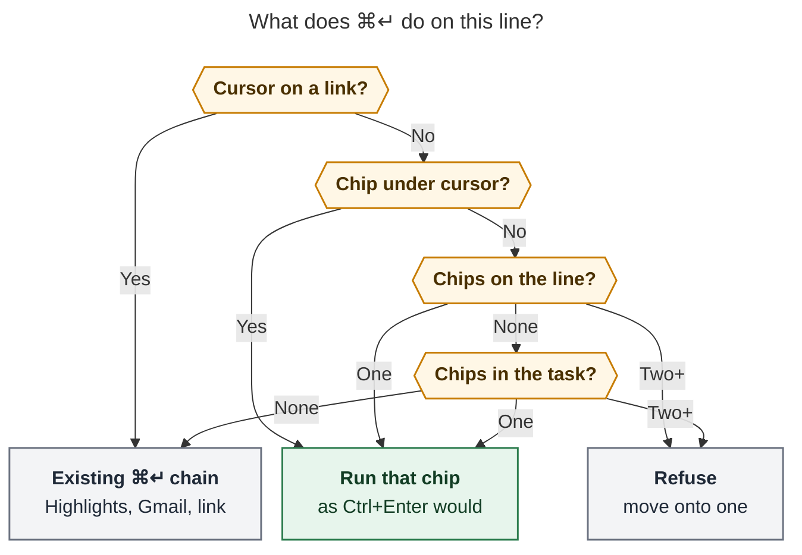

# Command chips: one-gesture bob runs from Obsidian notes

Consolidated report · lead researcher · 2026-11-19. Merges five independent swarm
reports (`obsidian_command_chips__cdx.md`, `__cld.md`, `__grk.md`, `__mus.md`,
`__gem.md`, all in this directory) plus the lead's own verification against bob-cli
master, bob-plugins HEAD (`2f1e016`), the live `~/bob/gtd_daily.md`, the installed
`bob 0.5.0`, and the current bead graph. Research only: no product code, vault task, or
memory note was changed.

## Bottom line

**Build it.** All five researchers independently concluded command chips are a good
idea in a narrow, explicit form, and independently converged on the same architecture:

- A **second chip kind** on the copy-chip chassis — one plugin owns grammar, rendering,
  cursor rule, and authoring for both kinds. **Rename the plugin to `bob-chips`** in a
  behavior-neutral first phase (lead call; 3–2 split, resolved below).
- Syntax: `` `run: bob task reconcile` `` / `` `run[LABEL]: …` `` inline spans and a
  `bob-run` fence (one command per line). Every step starts with the literal word
  `bob`. Plain `` `bob …` `` spans — ~2,400 of them in the vault — stay inert forever.
- **Bulk = one chip, many steps**: quote-aware `&&` inline, or fence lines. Steps run
  as one existing Command Mode sequence (halt on failed/unknown/stopped, continue on
  needs-attention). Never a shell: `;`, `|`, `||`, redirects, `$( )`, and non-`bob`
  steps are refused with a reason.
- Execution goes **exclusively through Bob Command Mode** via new additive
  `api.commandMode` members. Click or `⌘↵` has **Ctrl+Enter semantics**: run now,
  preview-first skipped, with the engine's save-all, single-writer queue, dedup,
  receipts, toasts, pager, and status chip intact. The binary's two `confirm` commands
  (`task archive`, `nightly`) still ask. Shift+Click is the guarded path (preview /
  review card).
- `⌘↵` (**Meta+Enter**) composes into bob-navigation-hotkeys' existing dispatcher —
  never a second binding, never the editor's Ctrl+Enter (which completes tasks). A
  cursor-exact link keeps today's behavior; otherwise chip under cursor → line's only
  chip → task block's only chip; ambiguity refuses and never falls through.
- Discoverability: the targeted chip takes an **armed accent** and a muted
  **`⌘↵ Run` end-of-line keycap** appears on the cursor line — the same component
  family as the shipped `⌘↵ Gmail` hint, with the keycap read from the real binding so
  it never lies.
- Adoption now: the GTD **sync row** (one 3-step chip) and **`task reconcile`**. The
  **Bank row** converts as `run[Import bank files]: bob bank import -D ~/Downloads/*.qfx`
  as soon as the daily release train carries `-D` to the Mac — **`-D` landed in bob-cli
  master today** (bob-cli-no.2 closed; lead verification). `gcal ack -n 7` stays a
  terminal instruction (needs a TTY). The six agent prompts stay copy chips.
- Add `glossary:command-chip` (draft below), update the copy-chip and command-mode
  strands, and offer a `decisions:` record as a plan toggle.

## Is this a good idea?

**Yes, with honest expectations.** The payoff is the morning `]s` walk: rows that say
"Run X" become land → `⌘↵` (run) → `⌃↵` (complete), with run history, partial-failure
recovery, and output in the engine Bryan already trusts. The pattern is also already
being hand-built piecemeal — the bank card's weekly-import button (bob-cli-no.3, in
progress) is a bespoke one-off command chip — so a general, uniform surface replaces
drift.

Honest caveats, raised mainly by cld and confirmed by the lead:

1. **The flagship use case is shrinking.** The Mac's `*/5 bob tick` cron already covers
   gcal/gmail/refs/projects/tasks; bob-cli-nc (snoozed to 2026-11-26) will fold the
   sync trio into `bob tick -a`, and tick's tasks step may make the `task reconcile`
   row redundant. Command chips remain worth building — the Bank row, `bob tick -a`
   itself, and project/area maintenance verbs (`run: bob plugins sync`,
   `run: bob periods brief yesterday`) are durable users — but the "bulk" requirement
   matters less than the request implies. It still costs little: the sequence engine
   exists and `&&` is one tokenizer rule.
2. **Writes move one click away inside notes that sync to three hosts.** A copy chip's
   worst case is a clobbered clipboard; a command chip's worst case is a network sync
   or vault rewrite from a stray click in a hover preview. Every guard below exists for
   this reason, and the danger of the naive version — any `bob`-looking span becoming a
   button — is the single most important thing the design refuses.
3. **Run ≠ done.** A successful sync is evidence the sync ran, not that the chore is
   complete (the Bank row still needs its reconcile-and-balance steps). Running a chip
   never completes, freshens, or advances its task or the walk; `⌃↵` keeps that job.
   This keeps `decisions:task-status-is-derived` and the walk decisions intact.

No researcher recommended a fundamentally different approach. Alternatives were
unanimously rejected: auto-running bare `` `bob …` `` spans (census: ~2,400 collisions,
mostly prose/history), Meta Bind/Buttons/Templater-style frameworks (YAML/JS
indirection, no catalog semantics), `obsidian://` links (encoding, externally
invocable), a separate command-chip plugin or chips inside Command Mode (duplicate
scanner/renderer/authoring; two plugins decorating the same spans), and
chips-as-sheet-bookmarks that only prefill (fails the one-keystroke goal, mus's own
assessment).

## What exists today (merged evidence baseline)

All five reports verified these independently against bob-plugins (`3968f0d`; HEAD is
now `2f1e016` with no copy-chips changes since), bob-cli, and the vault:

- **Copy chips** (`bob-copy-chips` 0.4.0, shipped 2026-11-19, `isDesktopOnly: false`):
  pure grammar module with conformance vectors, Live Preview ViewPlugin + Reading-view
  real `<button>` post-processor, `bob-copy` fence cards, shared `chipAt` cursor rule,
  never-throwing frozen `api.copyChips` v1, `Mod+Shift+Y` make-or-edit card with stale
  guard, drag/click discrimination, reliability rules R1–R14. Everything a command chip
  needs for parsing, rendering, accessibility, and authoring is written and tested once.
- **Command Mode** (`bob-command-mode` 0.2.0, desktop-only) already owns the hard part:
  catalog handshake (`bob __catalog` protocol 1: **107 entries** — 79 `run`,
  26 `preview-first`, 2 `confirm` — plus **50 exclusions** and 14 aliases), shell-free
  `spawn`, `cmTokenizeBobArgv` quote/escape tokenizer, alias + exclusion resolution,
  save-all-before-writers, single-writer serialization, in-flight dedup, host-local run
  records, output pager, outcome toasts, status-bar `N/M` chip, reload adoption of
  orphaned runs. **Sheet `Ctrl+Enter` = `force: true` → `skipGuards: true`** (bypasses
  preview-first and confirm). The sequence runner (Ctrl+M marks) runs steps in order
  with `skipGuards`, halts on failed/unknown/stopped, continues on needs-attention, and
  ends with one summary card (Output / Copy as `a && b` / Rerun / Resume from k).
- **`api.commandMode` v1 gaps** (the only engine work chips need): no sequence
  execution, no pure text→argv resolution, no run-started/step events, no way to open
  the review/confirm card. The tokenizer treats `&&` as an ordinary argv token today
  (cdx probe), so a quote-aware list splitter must be added engine-side.
- **`⌘↵` is taken and is already a dispatcher.** Vault `hotkeys.json` binds
  `Meta+Enter` (deliberately not `Mod+Enter`, which would steal Ctrl+Enter on Linux) to
  `bob-navigation-hotkeys:open-reference-pdf-in-highlights`, which chains Highlights →
  Gmail (`api.mailOpen.openAtCursor`) → open-link-in-new-tab. Editor **Ctrl+Enter
  completes tasks/Pomodoros/walk rows and must not be touched.**
- **The hint pattern exists.** bob-ledger-tools paints a muted `⌘↵ Gmail` capsule at
  the cursor line end when `⌘↵` would open an email, with a capability flag and the
  keycap derived from the live binding; the Highlights status hints do the same with
  stale-async protection.
- **Prefix census** (three independent scans, 29k–138k spans depending on method, same
  conclusion): `run:` has **0 collisions** vault-wide; `cmd:` has 1; bare `` `bob …` ``
  has ~190 live prose uses (~2,400 including `.bob/` and history). Executability must
  be opt-in via an explicit prefix.
- **GTD inventory** (confirmed live by the lead, 2026-11-19): the sync row
  (`gcal sync -n 2` + `gkeep pull` + `gmail sync`, note the informal `+` and missing
  `bob` words), the Bank row (`bob bank import ~/Downloads/*.qfx && rm …` plus a Wells
  Fargo link and `[[bank]]`), `Run task reconcile`, the `#terminal` ack row
  (`bob gcal ack -n 7` — `ack.rs` hard-refuses explicit walks off a TTY), and six
  period-review agent prompts already inside `copy[…]:` chips. No other open recurring
  task in the vault holds a bob command; open feature-idea tasks that *mention* bob
  commands must never become buttons.

## Lead calls on the five disagreements

### 1. Rename to `bob-chips`: yes, now (behavior-neutral phase)

cld, grk, and gem say rename the id now; cdx and mus say keep `bob-copy-chips` and
rename only the display name, because the id is the vault folder, allowlist key, API
owner, and vimrc target, and `bob plugins sync` never prunes old folders.

**Call: rename now.** Bryan's instinct points this way, the plugin is days old with
exactly one in-tree API consumer, and every touchpoint (community-plugins.json, vault
`.gitignore`, chezmoi `plugins.sync`, two vimrc `obcommand` lines, the navigation C-row
lookup, docs/nav/inventory, the `glossary:copy-chip` strand, a mkdocs redirect for the
published URL) was already touched this week and is enumerated in cld's and gem's
reports. The id will never be cheaper to fix, and an id that says "copy" becomes a
small lie in every lookup once half the feature runs commands. The dissenters' risks
are real and get explicit mitigations: `api.copyChips` v1 stays byte-stable, consumers
look up `plugins["bob-chips"] ?? plugins["bob-copy-chips"]` for one release, on load
`bob-chips` disables a still-enabled `bob-copy-chips` with one Notice (the
double-decoration guard), and the adopt phase lists per-host removal of the stale
deployed folder. Version continues at 0.5.0. Do the rename as its own phase with no
behavior change, so any migration fault is isolated.

### 2. Prefix and fence: `run:` / `run[LABEL]:` and `bob-run`

Four of five chose `run:` (grk chose `cmd:`). The census makes both collision-safe;
`run:` wins because it names the verb (pairing `copy:` / `run:`), reads as natural
English on a GTD row, and had literally zero vault hits. Fence language: **`bob-run`**
(cdx, mus) over `bob-cmd` (grk, gem) for verb symmetry with the inline prefix and with
`bob-copy`. Label rules, escapes, longer-backtick runs, and table-pipe handling are the
copy-chip grammar verbatim.

### 3. Every step starts with the literal word `bob`

cdx, cld, and mus require it; gem would strip it tolerantly (today's GTD rows omit it).
**Call: require `bob`.** The payload is then byte-for-byte what Command Mode's sequence
Copy and the pager's `Y` already produce and what a terminal accepts — running a
command once in the sheet yields the chip text for free, and the chip text pasted into
a terminal just works. It also makes "this is an action, not prose" visually explicit.
The cost lands only at authoring time, where the card offers one-click "Add `bob`" when
converting a span that lacks it (cld's design). The parser strips the token before
catalog resolution; `bob-chips` never learns argv semantics (the
`mac-capture-is-a-thin-client` posture, cited by four reports).

### 4. Bulk: quote-aware `&&` inline, plus fence lines — overruling mus

mus would ban `&&` entirely (fence-only sequences), arguing shell confusion and
failure attribution. The other four accept `&&` because it is exactly the engine's own
sequence-copy format with exactly the engine's existing semantics. **Call: allow it**,
with the discipline the reports agree on: `&&` splits only outside quotes/escapes; a
trailing operator or empty step invalidates the chip; `;`, `|`, `||`, redirects,
backgrounding, `$( )`, env prefixes, and non-`bob` programs are refused with "command
chips run bob, not a shell"; and docs say plainly that `&&` follows Command Mode's
outcome classes (needs-attention continues), not raw exit codes. The plugin never
expands `~` or globs — bob does that itself where it chooses to (`bank import`
explicitly does, for shell-free callers; verified in the installed 0.5.0 help text).
One visual chip = one action; three separate chips on a line are three actions and
`⌘↵` refuses rather than collecting them.

### 5. Policy: Ctrl+Enter parity, with the `confirm` exception — overruling mus

mus would honor full catalog policy (preview-first chips open the sheet at preview),
making `⌘↵` a "request". That is safer but defeats the request: Bryan asked for
Ctrl+Enter semantics, and the daily sync trio is preview-first — a chip that always
detours through the sheet saves one keystroke over typing `:`. The other four give
clicks and `⌘↵` **run-now semantics** (`skipGuards`), and three of them carve out the
binary's two `confirm` commands (`task archive`, `nightly` — "has no dry run"), which
still open the review card because a click in a hover preview is a lower-intent gesture
than typed-argv-plus-Ctrl+Enter. **Call: run-now with the confirm exception**, costing
zero GTD rows, plus **Shift+Click = open in Command Mode** (preview for a single step,
review card for sequences) as the always-available guarded path. This is called out as
a deliberate requirement adjustment, and if a misclick ever bites, the cheapest switch
is swapping click and Shift+Click without touching the grammar.

### 6. Cursor rule: under-cursor wins, then line, then task block

The request says "current line (or the current task as a fallback) contains a single
command chip". cdx reads that strictly (even a caret inside one chip of two refuses);
cld/grk/gem/mus extend the shipped copy-chip `chipAt` order: **chip under cursor →
line's only command chip → task block's only command chip; two or more candidates with
the cursor on none refuses and never falls through.** **Call: under-cursor wins** — it
matches the motor memory `gy` already trained, it is strictly more capable, and one
shared kind-filtered resolver keeps `gy` and `⌘↵` from ever disagreeing (the current
vimrc `gy` comment already promises a task fallback that `065-cursor.js` lacks; this
work closes that gap by construction). A cursor-exact **link** wins before any chip
(the Bank row keeps its Wells Fargo and `[[bank]]` behavior when the caret is on them);
chip kinds never compete (`gy` sees only copy chips, `⌘↵` only command chips). "Task
block" = the nearest enclosing task line plus its indented descendants, excluding
nested tasks and their subtrees; a child task never borrows its parent's chip.

_Figure 1 (carried from the cld report). "Chip" means command chip only; copy chips are
invisible to this rule. Converging arrows mean "any". In a no-run context (see below)
the whole check is skipped and `⌘↵` behaves exactly as today. Rendered 726 × 682 px
(fit 89.9%) with mermaid-cli 12.0.0 under the PDF config._

## The design (consolidated)

### Syntax

| You type | You see (Live Preview) |
| --- | --- |
| `` `run: bob task reconcile` `` | ▶ `bob task reconcile` (monospace pill) |
| `` `run[Sync inboxes]: bob gcal sync -n 2 && bob gkeep pull && bob gmail sync` `` | ▶ Sync inboxes · 3 (text-font pill, quiet step count) |
| `bob-run` fence, optional label, one `bob …` per line | titled card: glyph, label, `N steps`, Run button, numbered monospace steps |
| `` `run: bob gcal synk` `` | ⊘ dimmed, dashed border; tooltip "bob has no command `gcal synk`" |
| `` `run: bob task move x` `` | ⊘ dimmed; tooltip carries bob's own exclusion reason |

Unlabeled faces show the literal command line with each ` && bob ` drawn as a faint
` › ` (matching how the sheet's RECENT row draws a sequence). Malformed-but-prefixed
spans render **unavailable with a reason**, never as silently inert code — the `run:`
prefix is an explicit authoring act. Payloads inside copy chips, frontmatter, ordinary
fences, tables of examples, and generated stores never parse as command chips. With the
plugin off, everything still reads as plain inline code.

### What a run does

| Chip contents | Click or `⌘↵` | Shift+Click |
| --- | --- | --- |
| One `reads` report | Runs and opens the streaming output pager (sheet parity) | Same |
| One `run` / `preview-first` writer | Runs now (`skipGuards`); usual toast; live chip state | Opens the sheet at that command's preview |
| One `confirm` writer | Opens the engine's review card | Same |
| Multiple steps | One Command Mode sequence: status chip `N/M`, one summary card (Output / Copy / Rerun / Resume from k); a `confirm` step forces the review card first | Review card with steps marked |
| Already running | Opens that run's live output — never a second run | — |

Runs are recorded in the shared history with `trigger: "chip"` and optional
`source: {path, line}` provenance, so RECENT and the pager can say where a run came
from. Writers keep every engine guard (save-all, single-writer queue, dedup). At
activation the source is re-resolved and compared with what the widget represents; a
stale widget refreshes and requires a fresh gesture, and an accepted run executes an
immutable argv sequence even if step 1 rewrites the note. A synchronous in-flight latch
plus the engine's dedup swallow key repeats and double clicks.

### Look, states, and the hint

Same pill geometry, theme variables, and fixed-width glyph slot as copy chips — **no
state change ever reflows the line** — with one governing principle (cld): *the glyph
always tells you what a click will do.* ▶ runs (Lucide `play`, `cursor: pointer`),
⧉ copies, ⊘ does nothing, a spinner means "click opens live output". States: ready →
armed (accent ▶ + accent border when it is the `⌘↵` target) → queued (dashed ring) →
running (spinner; sequences show done/current/upcoming step segments) → completed
(green check ~1.6 s + yank-flash pulse) / needs-attention (orange, kept until next run)
/ failed (error ink, kept until next run) → unavailable (dimmed, dashed, bob's reason).
Reduced motion drops the spinner/pulse; Reading view uses real `<button>`s with full
accessible names and the shared polite live region; print/PDF exports show plain inline
code. **Run state lives in a plugin store keyed by the argv signature, not in the
widget** — load-bearing, because `task reconcile` can rewrite the very note that holds
its chip and Live Preview rebuilds every widget mid-run.

The hint has two coordinated parts, shown only when every condition holds (live
binding read from `app.hotkeyManager`, capability flag on the dispatcher, note allows
runs, Command Mode loaded, target resolves ready): the **armed chip** accent, and a
muted **`⌘↵ Run`** keycap at the end of the cursor line (`⌘↵ Output` while running;
the target's label when the chip sits on another line of the task) in the `⌘↵ Gmail`
component family. Keycap glyphs come from the actual binding, so a rebound or missing
hotkey never advertises a false `⌘↵`. Ambiguous or unavailable targets show no keycap:
never advertise a refusal. Only one contextual `⌘↵` hint ever shows — the shared
resolver decides, so "Open PDF" and "Run" capsules can't stack.

### Where chips never run

- **No-run folders** (cld's rule, adopted): in `mail/`, `ref/`, `ref_history/`,
  `.bob/`, and `_conflicts/` — judged by the *source* note's path, including embeds and
  hover previews — command chips render with a copy glyph and a click copies the
  command line. These folders hold text Bryan did not author, and this very report
  becomes a `ref/` note full of `run:` examples once ingested.
- Mobile, or Command Mode absent/disabled: copy-only face with the reason; copy chips
  keep full mobile behavior, and the plugin stays `isDesktopOnly: false` with
  desktop-only modules loaded only by the command engine path.
- Rendering, hovering, scrolling, parsing, query rendering, and export never spawn
  bob; only explicit run gestures do.

### Authoring

`Mod+Shift+Y` keeps one card for both kinds, gaining a Kind row (Copy | Run). The kind
is predictable, never silently switched: editing an existing chip keeps its kind;
converting a plain span whose text resolves as a bob command line defaults to Run (with
"Add `bob`" offered); everything else defaults to Copy. In Run, validation is live and
per step via the engine's pure `resolve`: catalog title, effect badge, policy (with
"preview skipped" noted), host availability; unknown/excluded steps block saving with
bob's reason, host restrictions warn but allow (a Mac-only chip may be authored on
athena). Serializer picks inline vs fence by length; one undo step; stale-write guard;
`q`/`Esc`/`Ctrl+[` per `decisions:q-and-ctrl-bracket-mirror-esc`. A natural follow-on
(not required for v1): a "Copy as chip" action on the sheet's sequence summary and
pager, making a run-once-in-the-sheet the fastest way to author its chip.

### Reliability contract (merged)

Copy-chip R1–R14 carry over. Command chips add, numbered as in the cld/grk reports:

1. Only `api.commandMode` tokenizes argv and spawns bob — one engine, no drift, no
   shell, never a program name taken from note text.
2. Whole-chip validation before step 1: malformed syntax, non-`bob` steps, exclusions,
   unknown entries, free-text `capture`, unavailable hosts refuse up front with bob's
   reason; click-time re-resolution guards stale verdicts.
3. `skipGuards` is explicit and documented; `confirm` always asks; authored Markdown
   can never supply `entryId`, `effect`, `policy`, paths, or arbitrary run options.
4. Run state survives decoration rebuilds (plugin store, argv-signature key).
5. Duplicate activation opens the live run; engine dedup stays authoritative.
6. Partial success is visible and honest: completed steps stay committed; Resume and
   Rerun stay distinct; nothing auto-retries, including after reload.
7. No-run folders are checked against the source path, embeds included.
8. Hints appear only when the key would act, with real keycaps.
9. Rendering has no side effects and never writes the vault.
10. Running never touches the chip's task, its status, or the walk.
11. Vault text is an attack surface and the docs say so: explicit prefix, catalog
    validation, policy floor, no shell, desktop-only execution, host-local receipts.

No global transaction isolation is promised across a sequence: the engine serializes
writers and orders the sequence's steps, but unrelated work may interleave — changing
that would be a separate engine decision.

## Architecture and API

Three owners, same split in all five reports:

- **`bob-chips`** (renamed; mobile-capable) — grammar, Live Preview/Reading rendering,
  fence cards, cursor rule, states, authoring, for both kinds. New frozen
  `api.commandChips` v1 beside the unchanged `api.copyChips` v1: `chipAt({…, kind})`
  (the shared kind-filtered resolver with the task-block fallback), `runAtCursor(view)`
  → `{handled, outcome?}` for the dispatcher, `hintAt(view)`, plus `face(line)` helpers
  on both namespaces for bob-cli-nn's plain-text surfaces.
- **`bob-command-mode`** — the only component that parses bob argv and spawns bob.
  Additive, feature-detected members (version bump or `typeof` detection per the
  `preview` precedent): pure `resolve(text)` over the cached catalog (splits quote-aware
  `&&`, requires `bob`, tokenizes/aliases/excludes exactly like typed sheet input;
  never throws), `runSequence(steps, opts)` wrapping the existing sequence runner,
  `review(steps)` to open the sheet's review card, run-started/step lifecycle
  (`onRunStarted` / `onRunState` / `activeRuns`) beside `onRunFinished`,
  `onCatalogChanged`, and `trigger`/`source` provenance on run records. The existing
  undocumented `skipGuards`/`trigger` options on `run` get documented.
- **`bob-navigation-hotkeys`** — keeps owning `⌘↵`. Its dispatcher gains the chip step
  per Figure 1, calling `api.commandChips.runAtCursor` with feature detection, plus a
  capability flag the hint checks. A palette command (`bob-chips:run-at-cursor`) covers
  hosts without the binding; an optional vimrc `g!` mapping pairs with `gy` (Linux
  window managers may capture Super+Enter — the palette command and truthful keycap are
  the fallback). No new default hotkey is registered anywhere.

**No bob-cli code change is required for v1.** Candidate bob-cli follow-ups discovered:
a catalog way to express "this flag needs a TTY" (so `gcal ack -n` can refuse up front
in the sheet and chips alike), and a sheet that accepts typed `a && b` via the same
`resolve` so sheet, chip, and terminal share one bulk syntax.

## Vault adoption (gates verified by the lead, 2026-11-19)

Edit open recurring rows only; recurrence regenerates from current text, so editing the
open instance carries every future occurrence. Never touch Done & Canceled history.
Deploy compatible plugins before converting notes, and run `bob task reconcile`
afterward to prove row text survives.

| Row | Today | Becomes | Gate |
| --- | --- | --- | --- |
| `#sync` | `` Run `gcal sync -n 2` + `gkeep pull` + `gmail sync` `` | `` Run `run[Sync inboxes]: bob gcal sync -n 2 && bob gkeep pull && bob gmail sync` `` | None now. When bob-cli-nc lands (soak check ≥ 2026-11-26) the row becomes `` `run: bob tick -a` `` — add a coordination note so nc writes the chip form |
| **Bank** | `` `bob bank import ~/Downloads/*.qfx && rm ~/Downloads/*.qfx` `` | `` on the Mac: `run[Import bank files]: bob bank import -D ~/Downloads/*.qfx` `` | **`-D` landed in bob-cli master today** (bob-cli-no.1/.2 closed; installed 0.5.0 has glob expansion but not yet `-D`). Gate: the Mac's `bob bank import --help` shows `-D` after the next release train. The `rm` never runs through chips; `-D`'s digest-gated delete replaces it. The bank card's own button (no.3, in progress) stays the preview path |
| `#init` | `` Run `task reconcile` `` | `` Run `run: bob task reconcile` `` | None — or retire the row once tick soaks (Bryan's call) |
| Ack | `` `bob gcal ack -n 7` `` | **Unchanged** (optionally a copy chip for the terminal) | The explicit ack walk needs a TTY; Command Mode spawns with stdin ignored. A `-l`/JSON chip would inspect, not acknowledge — don't fake it |
| Period prompts (×6) | `copy[…]:` agent prompts | **Unchanged** | They are prompts to an agent; the embedded `bob periods show …` spans are instructions, not actions |

No other open recurring task in the vault holds a bob command (`recur.md`, `dev.md`
checked by two researchers). Also update the vimrc `gy` comment and add a `⌘↵` line to
the chip block in `obsidian_vimrc.md`.

## Requirement adjustments, called out explicitly

1. **Combine under one plugin and rename the id to `bob-chips` now**, as a
   behavior-neutral phase with a migration guard, dual lookup, and docs redirect
   (resolving the request's "I'll let you make that call").
2. **"Bulk commands" means a Command Mode sequence of bob commands** — `&&` or fence
   lines inside *one* chip. Shell programs, pipelines, interpolation, interactive TTY
   sessions, and parallel execution are out of v1.
3. **The editor chord is `⌘↵` (Meta+Enter) composed into the existing dispatcher** —
   semantic parity with the sheet's Ctrl+Enter, physical reuse of the vault's `⌘↵`.
   The editor's Ctrl+Enter (task completion) is untouched; no new default hotkey.
4. **Run-now skips preview-first but the binary's two `confirm` commands still review**
   (a deliberate softening of pure parity; costs zero GTD rows). Shift+Click is the
   guarded path.
5. **Under-cursor wins before the single-chip line/task rule** (extending the literal
   request to match the shipped copy-chip resolver); ambiguity refuses, never guesses,
   never falls through; cursor-exact links keep today's behavior.
6. **Adoption converts semantically eligible rows, not every `bob` substring**: two
   rows now, the Bank row on the release-train gate, the TTY walk and agent prompts
   never. The Bank row's `rm` is replaced by `-D`'s safer digest-gated delete and that
   change is documented, not silently dropped.
7. **Success never completes the task** — walk and status decisions stay intact.
8. **Chips never run in mail/reference/conflict/internal notes, on mobile, or without
   Command Mode** — they degrade to copy with a stated reason.

## Glossary term (proposed draft — add via the plan's memory decision)

New strand `glossary:command-chip` (aliases: `run chip`, `bob-run`; do not claim
`chip`, which Copy Chip already uses):

> **Command Chip** — An authored one-gesture bob run in an Obsidian note: an inline
> code span starting with `run:` or `run[LABEL]:` whose payload is one bob command
> line — or several joined by `&&`, each starting with `bob` — or a `bob-run` fence
> holding one command per line. The `bob-chips` plugin renders it as a quiet pill with
> a ▶ glyph (fences as titled sequence cards). A click, or `⌘↵` (Meta+Enter) when the
> chip is under the cursor or is the only command chip on the cursor's line or its
> task, runs it through [[command-mode]]'s engine the way Ctrl+Enter runs a sheet row:
> previews are skipped, the binary's `confirm` commands still ask, and multiple
> commands run as one sequence that halts at the first failure. Shift+Click opens it in
> Command Mode instead; a muted `⌘↵ Run` keycap marks the line whose chip `⌘↵` would
> run. Payloads are literal — no shell, no variables, only bob runs — and are validated
> against bob's catalog; unknown or excluded commands render dimmed with bob's reason.
> Chips in mail, reference, and conflict notes only copy, and running a chip never
> completes its task. Not a [[copy-chip]], a Command Mode RECENT row, or a shell
> snippet. See `docs/bob-chips.md`.

Related edits: `glossary:copy-chip` (plugin name, task fallback, kinds never
competing), `glossary:command-mode` (name chips as an engine client). **Recommended
plan toggle:** a `decisions:` record bundling the load-bearing safety policy (explicit
prefix; catalog-legal argv only; dispatch through Command Mode with `skipGuards`;
confirm floor; no shell; no-run folders; run ≠ done) — these are exactly the rules a
later agent could erode one convenience at a time.

## Phases

| Phase | Repo(s) | Content |
| --- | --- | --- |
| 1 rename | bob-plugins, chezmoi, vault, bob-cli docs config | `bob-copy-chips` → `bob-chips`, no behavior change: migration guard, dual lookup, mkdocs redirect, vimrc/allowlist/`community-plugins.json`/`.gitignore`, per-host stale-folder cleanup list |
| 2 engine | bob-plugins (command-mode) | `resolve` (quote-aware `&&`, `bob` required), `runSequence`, `review`, run-started/step lifecycle, `onCatalogChanged`, `trigger`/`source` provenance, documented `skipGuards` |
| 3 chips | bob-plugins (bob-chips) | `run:`/`bob-run` grammar on the shared scanner, renderers, state store and live states, click/Shift+Click, no-run and copy-only modes, vectors, perf budget, e2e with a stub bob |
| 4 keymap | bob-plugins (bob-chips, navigation) | Kind-filtered resolver with task fallback (shared with `gy`), `runAtCursor`, dispatcher head step + capability flag, armed chip + keycap hint, palette command |
| 5 author | bob-plugins (bob-chips) | Kind row, per-step validation, conversion defaults, "Add `bob`" |
| 6 adopt | vault, bob-cli memory/docs, beads | GTD rows per the gated table, vimrc comments, glossary strands, optional decision record, run-bob/morning-review guides; coordination notes on bob-cli-nc, no.3, nn |

Every bob-plugins phase follows that repo's rules (fragments ≤1000 lines, `npm run
build`/`test`/`validate`/`docs:check`, version bump, commit, `bob plugins sync`, never
`-F` unprompted). Acceptance evidence should cover the merged matrix: grammar vectors
(including sequence-Copy round-trip), resolver parity with `gy`, exact argv/policy
parity with sheet Ctrl+Enter, all old `⌘↵` targets regression-tested, the
self-rewriting-note spinner case, drag/double-press suppression, hint truthfulness
under rebinding, mobile/engine-off degradation, and adoption diffs that change only the
intended spans while repeat/status fields survive.

## Open questions for Bryan (none block the design)

1. Click runs writers with no preview — as requested. If a misclick ever bites, the
   cheap reversal is swapping click and Shift+Click; the grammar never changes.
2. Keep the `confirm` exception, or drop it for pure Ctrl+Enter parity? (Affects only
   `task archive` and `nightly`.)
3. Retire the `task reconcile` row once `bob tick` has soaked, instead of converting?
4. Ship the optional vimrc `g!` (run) beside `gy` (yank)?
5. Hard-coded no-run folder list OK for v1?
6. Decision record: yes/no as an ACE toggle on the epic (recommended yes — this
   feature runs writers).

## Discovered follow-ups (for the lead plan to file or carry)

- **bob-cli-nn** (plain-text faces, READY) should cover `run[…]:` faces too; pickers,
  Task Card titles, and the Mac agenda will otherwise show raw source.
- The **vimrc `gy` comment promises a task fallback `065-cursor.js` lacks** (still true
  at bob-plugins HEAD `2f1e016`); phase 4's shared resolver closes it.
- **Catalog TTY metadata** so `gcal ack -n` refuses up front everywhere.
- **`bob plugins sync` has no retired-id notion**; stale folders linger post-rename.
- Optional: sheet accepts typed `a && b` via `resolve`; walker-footer `⌘↵ run` hint on
  `]s` landings with a ready chip; "Copy as chip" on the sequence summary.

## Provenance

Inputs: the five swarm reports in this directory (each lists its own pinned evidence;
cdx/cld/grk verified bob-plugins at `3968f0d`, the catalog at bob 0.5.0/protocol 1, and
independent vault censuses; grk's two rendered figures ship alongside its report).
Lead verification on 2026-11-19: `sase bead read bob-cli-no bob-cli-nc bob-cli-nn`
(no.1/.2 closed, no.3 in progress; nc snoozed to 2026-11-26; nn ready), bob-plugins
HEAD `2f1e016` with no copy-chips changes since `3968f0d`, live `~/bob/gtd_daily.md`
open rows, and `bob bank import --help` on the installed 0.5.0 (bob-side `~`/glob
expansion present; `-D` not yet shipped). Figure 1 re-rendered and measured under the
PDF-mirroring config with mermaid-cli 12.0.0.
