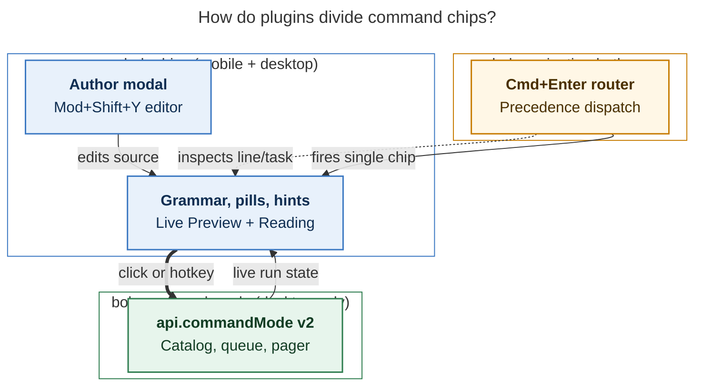
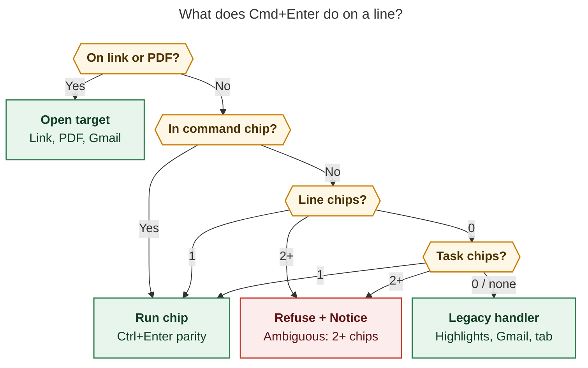

# Obsidian Command Chips (`bob-chips`)

*Research & Architecture Design · November 2026*

## Executive Summary

Adding **command chips** to Obsidian is a **high-value, natural next step** for Bob—especially for recurring checklists like `~/bob/gtd_daily.md`, where daily workflows currently sit as inert inline code (`Run \`gcal sync -n 2\` + \`gkeep pull\` + \`gmail sync\`` and `Run \`task reconcile\``) that force a manual round-trip through Command Mode (`:`) or a terminal.

The core insight from auditing `bob-copy-chips`, `bob-command-mode`, `bob-navigation-hotkeys`, `bob-ledger-tools`, `bob-cli`, and the live `~/bob/` vault is that **command chips are UI-shaped like copy chips, hotkey-shaped like `<cmd+enter>` contextual actions, and execution-shaped like `bob-command-mode`**. Trying to stuff all three into one plugin—or conversely duplicating CodeMirror 6 chip decorators inside `bob-command-mode`—would create brittle overlap.

### Headline Recommendations

1. **Rename `bob-copy-chips` → `bob-chips` (Yes, do the rename), but delegate execution cleanly to `bob-command-mode`.**
   - `bob-chips` owns all in-note interactive chip parsing, CodeMirror 6 Live Preview pills/cards, Reading View rendering, cursor-reveal semantics, `<cmd+enter>` inline hint capsules, and the `Mod+Shift+Y` authoring modal—remaining **`isDesktopOnly: false`** so copy chips keep working on mobile while command chips degrade gracefully.
   - `bob-command-mode` stays **`isDesktopOnly: true`** and the sole owner of `bob __catalog` validation, shell-free subprocess spawning, single-writer save-all guards, detached run receipts, status-bar run pill, sequence halting, live output pager, and outcome toasts, via an additive **`api.commandMode` v2** contract.
2. **Adopt `run:` / `run[LABEL]:` inline (with quote-aware `&&` for inline bulk sequences) and ```` ```bob-cmd ```` fenced cards.**
   - Across 29,002 live non-fenced inline code spans in `~/bob/`, bare `` `bob ...` `` collides 187 times with prose documentation (making auto-detection unsafe), and `` `cmd:` `` collides once; **`run:`** has **0 collisions**, pairs directly as an action verb with `copy:`, and replaces existing prose like ``Run `task reconcile` `` verbatim.
   - Unquoted `&&` inline mirrors Command Mode sequence short-circuit semantics (and Command Mode's own `[Copy]` button output); fenced ```` ```bob-cmd Title ```` blocks list one command per line for multi-step runbooks.
3. **Wire `<cmd+enter>` through `bob-navigation-hotkeys`'s existing `Meta+Enter` router, never a second competing hotkey.**
   - `~/bob/.obsidian/hotkeys.json` already binds `Meta+Enter` to `bob-navigation-hotkeys:open-reference-pdf-in-highlights` (which cascades through Highlights PDFs, `bob-mail` threads, and `editor:open-link-in-new-leaf`).
   - Extending that single dispatcher with explicit precedence (**cursor-exact link/PDF > cursor-exact command chip > single chip on line > single chip in owning task > legacy Highlights/Gmail/link fallback**) prevents collisions on multi-link tasks like `gtd_daily.md:18` and preserves `Ctrl+Enter` exclusively for `task-status-cycler`.
4. **Match Command Mode `<ctrl+enter>` semantics—with one safety adjustment and live report streaming.**
   - Command chips bypass `preview-first` pauses (essential so `gcal sync`, `gkeep pull`, and `gmail sync` run in one gesture) and stream `presentation === "report"` commands straight into the Output Pager. **Adjustment:** keep explicit confirmation for the catalog's two `confirm`-policy destructive commands (`task-archive` and `nightly`) unless `Shift+Click` or explicitly confirmed, because trackpad clicks and task-fallback hotkeys fire far more easily by accident than typing in Command Mode.
5. **Signal `<cmd+enter>` availability using Bob's proven end-of-line capsule (`⌘↵ Run` / `⌘↵ <label>`), paired with an `.is-cmd-armed` accent ring on the target chip.**
6. **Migrate only safe, non-TTY recurring tasks in `~/bob/gtd_daily.md` today—keep `bob gcal ack -n 7` in `#terminal` and wait on `^d-delete-bank` for `bank import`.**
   - Unify `gtd_daily.md:17` from three separate commands into **one bulk chip** (`` `run[Sync all]: gcal sync -n 2 && gkeep pull && gmail sync` ``) so `<cmd+enter>` works unconditionally on that line, and convert line 23 to `` `run: task reconcile` ``.

---

## Critique of the Proposal & Justified Requirement Adjustments

The user prompt invites critique of the overall plan and explicit callouts for justified requirement adjustments. Overall, **embedding runnable Bob commands as first-class chips inside Markdown notes is an excellent idea**: recurring checklists stop acting as passive documentation and become one-keystroke runbooks, while remaining human-readable plaintext with plugins turned off.

Six sharp edges in the naive interpretation of the requirements require explicit adjustments:

| # | Original Requirement | Critique / Risk Found in Code & Vault | Justified Adjustment |
| --- | --- | --- | --- |
| **A1** | Migrate existing recurring tasks in `~/bob/gtd_daily.md` that contain `bob` commands | Auditing `gtd_daily.md` exposed two blockers: (1) Line 27 runs `bob gcal ack -n 7`, which **hard-fails off a TTY** (`src/native/gcal/ack.rs:152` exits 2: `"an explicit ack walk needs a TTY"`); Command Mode ignores stdin. (2) Line 18 chains `bob bank import ~/Downloads/*.qfx && rm ~/Downloads/*.qfx`, using a shell operator + `rm`; Command Mode forbids shells. Also lines 25–31 mention `bob periods show ...` *inside* `copy[...]` agent prompts. | **Scope rule:** Only non-TTY, shell-free `bob` commands become runnable chips. Keep `gcal ack -n 7` in `#terminal`; defer `bank import` until `^d-delete-bank` (`bob bank import -D`) lands; never parse inside `copy:` payloads; convert lines 17 & 23 immediately. |
| **A2** | Run commands cleanly just like `<ctrl+enter>` in Command Mode | In `bob-command-mode`, `Ctrl+Enter` uses `force: true` (`skipGuards: true`), bypassing both `preview-first` (`gcal sync`, `gmail sync`, `gkeep pull`, `bank import`) and `confirm` (`task-archive`, `nightly`). Meanwhile `api.commandMode` v1 (`080-api.js`) lacks sequence execution, catalog resolution, and live Output Pager opening for `report` commands (`sheet.runReport`). | Bypass `preview-first` and intermediate sequence review by default, **and** extend `api.commandMode` v2 to stream `report` commands into the pager; **retain** the confirmation dialog on `confirm`-policy commands (`task-archive`, `nightly`) by default (overridable via `Shift+Click` / setting) to protect against accidental clicks or fallback keypresses. |
| **A3** | Support bulk commands like Command Mode sequences | In `gtd_daily.md:17`, three commands currently appear separately (`gcal sync` + `gkeep pull` + `gmail sync`). Three separate inline chips on one line would break the `<cmd+enter>` single-chip rule on that exact line. | Represent bulk commands inside **one chip**: inline via unquoted `&&` (mirroring Command Mode's halt-on-error sequence runner and `[Copy]` export format) or fenced via multi-line ```` ```bob-cmd ````, and collapse `gtd_daily.md:17` into one bulk chip. |
| **A4** | `<cmd+enter>` runs when current line (or task fallback) has a single command chip | `Meta+Enter` is already mapped in `~/bob/.obsidian/hotkeys.json:242-249` to `bob-navigation-hotkeys:open-reference-pdf-in-highlights` (which falls through to `bob-mail` and new-tab link opening). `gtd_daily.md:18` has two links *plus* a command on one line. Also, Linux treats `Meta` as `Super` (often intercepted by WMs), unlike macOS `Cmd`. | Fold command-chip dispatch into `openReferencePdfInHighlightsOrLink` with cursor-exact link precedence before line/task chip lookup; refuse `2+` chips with an explicit Notice; expose a dedicated `bob-chips:run-cursor-chip` command for Vim (`obsidian_vimrc.md`) / Linux fallback (`<M-CR>` or palette). |
| **A5** | Plaintext task surfaces readability (`gtd_daily.md` + `]s` walk) | Per `bob-cli-nn`, raw chip syntax (`copy[last-week prompt]: ...` and soon `run[Sync all]: ...`) leaks verbatim into `]s` review toasts, Task Cards, pickers, and Bob Mac Capture unless stripped to its display face. | Ship a pure `face(line)` helper on `api.commandChips` (and `api.copyChips`) plus shared vector coverage for `bob-cli-nn` so labeled chips display cleanly everywhere (`Sync all`, `task reconcile`). |
| **A6** | Rename `bob-copy-chips` → `bob-chips` cleanly across hosts | `bob plugins sync` deploys listed IDs (`~/.config/bob/config.yml:235`) and never prunes removed `.obsidian/plugins/<old-id>` folders; if both `bob-copy-chips` and `bob-chips` remain enabled during rollout, both decorate `copy:` spans twice. | Include an explicit multi-host migration plan (`bob-plugins`, `chezmoi`, `~/bob/.obsidian/community-plugins.json`, `~/bob/.gitignore`, `~/bob/obsidian_vimrc.md`, and manual removal of old `bob-copy-chips/` on `mac`, `athena`, `apollo`), while keeping `api.copyChips` v1 compatibility in `bob-navigation-hotkeys`. |

---

## Codebase & Vault Audit

Direct inspection of `bob-plugins`, `bob-cli`, and the live `~/bob/` vault establishes every technical constraint below:

### 1. Live Vault Scan (`~/bob/`)

- **Inline code span prefix collisions (29,002 non-fenced spans scanned):**
  - `` `bob ...` ``: **187 hits** (mostly prose documentation in `bob.md`, `2026.md`). Auto-treating bare `` `bob ...` `` spans as executable would turn documentation into traps.
  - `` `cmd:` ``: **1 hit** (`code/avante_goose/creating_codecompanion_adapters.md:79` bare `` `cmd:` ``, though empty payloads are already excluded).
  - `` `run:` ``: **0 hits**.
  - `` `bob:` ``: **0 hits**.
  - `` `$ ` `` / `` `exec:` ``: **0 hits**.
- **Recurring task inventory across `~/bob/`:**
  - `recur.md` (lines 9, 13, 16) contains no `bob` commands.
  - Only **`~/bob/gtd_daily.md`** contains recurring tasks with `bob` commands or prompt snippets:
    - **Line 17 (`#pre #sync`):** ``- [?] #task #gtd #pre #sync Run `gcal sync -n 2` + `gkeep pull` + `gmail sync` ...`` — 3 catalogued commands without leading `bob` word.
    - **Line 18 (`#pre #browser`):** ``- [?] #task #gtd #pre #browser **Bank**: [Wells Fargo](...) ... on the Mac: `bob bank import ~/Downloads/*.qfx && rm ~/Downloads/*.qfx` · in [[bank]] ...`` — mixes external link + wikilink + `&& rm` shell chain + Mac-specific glob (`src/native/bank/cli.rs:231` expands `~` and `*` without a shell; `bob.md:75` `^d-delete-bank` tracks adding `-D|--delete`).
    - **Line 23 (`#pre #init`):** ``- [?] #task #gtd #pre #init Run `task reconcile` ...`` — 1 catalogued command (`task-reconcile`, `policy: "run"`), omits `bob`.
    - **Line 27 (`#pre #terminal`):** ``- [?] #task #gtd #pre #terminal **Ack external events**: run `bob gcal ack -n 7` · a ack · n note · s skip ...`` — `src/native/gcal/ack.rs:152` hard-rejects explicit walks (`-n`, `-a`) off a TTY with exit code 2.
    - **Lines 25, 26, 28–31 (`copy[...-week/quarter/year prompt]`):** Existing copy chips whose nested backticks contain `` `bob periods show ...` `` for agent prompts; must remain literal copy payloads.
- **Rendered Task Views:** `dash.md` (`960-1001`), `rotten.md`, `crowded.md`, `blocked.md`, and daily notes embed ```` ```tasks ```` query blocks alongside direct file editing in Live Preview / Source / Reading views.

### 2. Command Catalog & Engine (`bob-cli` + `bob-command-mode`)

- **`bob __catalog --protocol 1`:** Exposes **107 entries** (`run`: 79, `preview-first`: 26, `confirm`: 2 [`task-archive`, `nightly`]), **50 exclusions** (e.g. `capture`, `gmail send`, `gcal login`, `task move`), and **14 aliases** (e.g. `gmail pull` → `gmail sync`, `task-status-hooks`/`mark-next-tasks` → `task reconcile`).
- **`hosts` field in catalog:** `160-sheet-rank.js:400-401` checks `entry.hosts` and marks host mismatches `"Unavailable here"`, though currently all 107 catalog entries report `hosts: []`.
- **Single vs. sequence `<ctrl+enter>` in `bob-command-mode`:**
  - Single commands (`170-sheet.js:495-515`) run with `force: true` (`skipGuards: true`); `presentation === "report"` calls `sheet.runReport` so the **Output Pager** opens immediately while streaming, whereas `action`/`inline` run in the background with single-writer serialization (after `saveAllMarkdown`), detached receipts, a status-bar chip (`.bob-cmd-chip`) appearing after 400 ms, and outcome toast cards.
  - Sequence execution (`177-sheet-sequence.js:705`, `065-sequence-runner.js`, `095-plugin-sequences.js`, `115-sequence-toast.js`) runs sequentially with `skipGuards: true`, halts on `failed`/`unknown`/`stopped`, continues on `completed`/`attention`, suppresses per-step toasts, updates the status-bar chip as `N/M · title · clock`, and posts one summary card (`Output`, `Resume from k` / `Rerun`, `Copy` joining steps with ` && `).
- **Current `api.commandMode` v1 (`080-api.js`) gaps:** Exposes only `version`, `run`, `openOutput`, `preview`, `onRunFinished`, `catalog`, and `lastRun`. It lacks sequence execution, catalog/alias command string parsing/resolution, live report streaming for `run()`, and intermediate running/step-progress events. Note also `175-args-vim.js:92-101` (`cmResolveTypedBobArgv`) expects `bob` already stripped, whereas raw runner paths (`060-runner.js:285-288`) only strip leading `"bob"` when no catalog entry matched; command chips must handle *both* `task reconcile` and `bob task reconcile` consistently.

### 3. Existing Chip, Hotkey, and Hint Infrastructure

- **`bob-copy-chips`:** Desktop + mobile (`isDesktopOnly: false`), provides grammar (`020-grammar.js`), cursor-overlap reveal in Live Preview (`050-live-preview.js`), Reading post-processor (`060-reading.js`), shared cursor rule (`065-cursor.js`), fenced widget (`080-fence.js`), `Mod+Shift+Y` / `Alt+Click` author modal (`081-083`), and `api.copyChips` v1 consumed by `bob-navigation-hotkeys/src/641-plugin-copy-card.js`. Also has pending follow-ups `bob-cli-nm` and `bob-cli-nn`.
- **`bob-navigation-hotkeys` (`677-plugin-ref-pdf-open.js`):** Owns `openReferencePdfInHighlightsOrLink` bound to `Meta+Enter` in `~/bob/.obsidian/hotkeys.json:242-249`. Also provides `findOwningTaskLine(lines, line)` (`070-recommended-roll-batch.js:444`) and Highlights gutter/status hints (`677d-highlights-hints.js`). `bob-mail` separately binds `<M-CR>` / `<M-Enter>` in Vim normal mode (`bob-mail/src/050-plugin.js:261`).
- **`bob-ledger-tools` (`142k-gmail-open-hint.js` / `271i-plugin-gmail-open-hint.js`):** Established Bob's exact visual convention for `<cmd+enter>` line availability: a muted, non-selectable capsule (`⌘↵ Gmail` on macOS, `M-↵ Gmail` elsewhere; `font-size: 0.8em; border-radius: 999px; background: color-mix(in srgb, var(--text-muted) 12%, transparent)`) attached at `cursorLine.to` only in Live Preview when the active line (or a child/Task Link hop) qualifies.

---

## Architecture Comparison: Rename to `bob-chips` vs. Alternatives

| Option | Ownership Split | Strengths | Weaknesses / Risks | Verdict |
| --- | --- | --- | --- | --- |
| **A. Rename `bob-copy-chips` → `bob-chips` + delegate to `api.commandMode` v2** | `bob-chips` (`isDesktopOnly: false`) owns syntax, widgets, cursor reveal, authoring, and `⌘↵` hints; `bob-command-mode` (`isDesktopOnly: true`) owns execution, catalog, queue, pager, status chip, and toasts. | Zero duplication of CM6 `ViewPlugin`, `MarkdownPostProcessor`, cursor-rule logic, or `Mod+Shift+Y` modal; preserves mobile copy chips; preserves single-writer process safety and Command Mode history; aligns with `bob.md:72`. | Requires clean multi-repo rename (`bob-plugins`, `chezmoi`, `~/bob/.obsidian/community-plugins.json`, `.gitignore`, `obsidian_vimrc.md`) and removing stale `bob-copy-chips/` directories across hosts. | **Recommended** |
| **B. Keep `bob-copy-chips`; build command chips inside `bob-command-mode`** | `bob-copy-chips` owns `copy:`/`bob-copy`; `bob-command-mode` adds its own CM6 `ViewPlugin`, Reading processor, and authoring modal for command chips. | Zero rename churn in `chezmoi`, `hotkeys.json`, or `obsidian_vimrc.md`. | Two CM6 plugins scanning all inline code spans on every edit; two styling systems & authoring hotkeys; copy card / `bob-cli-nn` face helpers split; fights explicit intent in `bob.md:72`. | Rejected |
| **C. New 3rd plugin `bob-command-chips`** | Separate chip plugin calling `bob-command-mode`. | Avoids renaming `bob-copy-chips`. | Worst of both options: adds a third plugin to build/deploy/enable *and* duplicates the entire `bob-copy-chips` parsing/rendering stack while still depending on `bob-command-mode`. | Rejected |

**Why boundary discipline matters:** Keeping execution inside `bob-command-mode` guarantees that clicking a command chip obeys the exact same safety invariants as typing `:` in Command Mode—every open Markdown buffer saves first (`commandModeSaveAllMarkdown`), concurrent writes serialize behind running tasks, detached runs survive Obsidian restarts, and one status-bar `bob` pill tracks everything.



*Caption: `bob-chips` stays UI-only and mobile-compatible by routing execution exclusively through `bob-command-mode`'s `api.commandMode v2` (solid thick arrow marks the primary execution bridge; dashed arrow shows read-only cursor inspection).* *(Measured SVG: 399.3 × 990.7 px; fit 90.1%.)*

---

## Recommended Feature Design: Intuitive, Reliable, Beautiful

### 1. Concrete Markdown Grammar (Single & Bulk)

Extending `bob-copy-chips`'s battle-tested prefix grammar keeps both chip families effortless to learn and degrades cleanly in plain Markdown:

- **Inline Single Command:**
  - Unlabeled: `` `run: task reconcile` ``
  - Labeled: `` `run[import QFX]: bank import -D ~/Downloads/*.qfx` ``
  - Longer backtick fences wrap payloads containing backticks: `` ``run[show]: periods show `now` `` `` (Obsidian strips outer matching backticks cleanly before passing code-span content).
- **Inline Bulk Sequence:**
  - Separate commands with unquoted `&&` (outside `'...'`, `"..."`, and `\` escapes):
    `` `run[Sync all]: gcal sync -n 2 && gkeep pull && gmail sync` ``
  - Why `&&` beats `;`: `bob-command-mode` sequences **halt on failure** (`failed`/`unknown`/`stopped`/`unavailable`), matching POSIX `&&` semantics and matching Command Mode toast `[Copy]` output (`115-sequence-toast.js`). Unquoted `;`, `|`, `>`, `<`, and `$()` trigger an inline diagnostic rather than guessing.
- **Fenced Multi-Command Card:**
  - ```` ```bob-cmd ```` or ```` ```bob-cmd Morning Sync ```` (accept `bob-run` as an optional reader alias or standardize strictly on `bob-cmd` alongside `bob-copy`—recommending **`bob-cmd`** for crispness and symmetry with `bob-copy` and Glossary `command chip`).
  - One command per non-empty line, mirroring how `bob-copy` elevates multi-line text out of inline spans into structured cards.
- **Prefix Normalization & Tolerant Parsing:**
  - Compare prefix choices across `~/bob`'s 29,002 non-fenced code spans:

| Syntax Candidate | Vault Collisions | Symmetry with `copy:` | Plain-Text Readability | Verdict |
| --- | --- | --- | --- | --- |
| `` `run:` `` / `` `run[Label]:` `` | **0 / 29,002** | **Exact verb pair** (`copy:` / `run:`) | Natural English (`run: task reconcile`) | **Recommended** |
| `` `cmd:` `` / `` `cmd[Label]:` `` | 1 / 29,002 | Noun matches `"command chip"` & `bob-cmd` | Clear; slightly more jargon in prose | Viable alternative if noun parity preferred |
| `` `bob:` `` / `` `bob[Label]:` `` | 0 / 29,002 | Explicit binary scope | Avoids colliding with non-Bob `run:` prose, slight `bob:` stutter if `bob ` included | Viable alternative if future non-Bob prose collides |
| Bare `` `bob ...` `` | **187 / 29,002** | None | Prose mentions turn into live triggers | **Rejected (unsafe)** |
| `[Label](bob:...)` links | — | Breaks Copy Chip precedent (`bob-cli-ni`) | URL-encoding, breaks `inline_code_spans` tag masking, collides with link openers | **Rejected** |

- **Leading `bob` stripping:** Because Bryan naturally writes *both* `task reconcile` (`gtd_daily.md:23`) and `bob bank import ...` (`gtd_daily.md:18`), the parser tolerantly strips an optional leading `bob` token from each step so `` `run: task reconcile` `` and `` `run: bob task reconcile` `` resolve identically via `api.commandMode.resolve()`.
- **Label rules:** Mirror `copy[LABEL]:` strictly (non-empty trimmed payload after `:`; non-empty label inside `[...]` without newlines or nested unescaped `]`; bare `run:` with empty command renders untouched as plain code).

### 2. Visual Language & Micro-Interactions ("Beautiful")

Command chips must look unmistakably **from the same family as Copy Chips**, while signalling **"this executes a command, not a clipboard copy"** at a single peripheral glance:

- **Inline Command Pill (`.bob-chip.bob-cmd-chip`):**
  - **Shape & typography:** Shared `--radius-s` inline baseline-aligned pill matching `.bob-copy-chip`'s height, padding, and reduced-motion rules. Unlabeled pills render the normalized command (dropping redundant `run:`) in `var(--font-monospace)`; labeled pills render the clean label in `var(--font-text)` (`is-labeled`).
  - **Chromatic & iconic distinction:**
    - Copy chips stay quiet muted neutral (`var(--background-secondary)` + clipboard SVG icon).
    - Action/write command chips get a restrained accent tint (`background: color-mix(in srgb, var(--interactive-accent) 9%, var(--background-secondary))` with a crisp hairline `1px solid color-mix(in srgb, var(--interactive-accent) 26%, var(--background-modifier-border))`) and a **12px play triangle (`▶`)** SVG glyph.
    - Read-only / `report` command chips use a softer slate/info hairline (`var(--text-muted)` / subtle document-stream glyph or `▶` + tiny muted `report` badge in tooltip) so you intuitively feel reads vs. writes.
    - Bulk inline chips append a compact tabular counter pill right inside the chip: e.g. `▶ Sync all  3` (`.bob-cmd-chip-count` using `font-variant-numeric: tabular-nums`), rather than dumping 60 chars of `&&` chains onto a checklist line.
    - **Armed state (`.is-cmd-armed`):** Whenever the active cursor equips `<cmd+enter>` for a specific chip (directly on the line OR via owning-task fallback!), that chip receives a subtle outer focus ring (`box-shadow: 0 0 0 1px color-mix(in srgb, var(--interactive-accent) 48%, transparent)`), visually connecting cursor → target.
    - **Invalid / Unknown / Excluded / Mobile-unavailable (`is-invalid` / `is-desktop-only`):** Muted dashed hairline border + `⚠` (or `○` on mobile) + exact hover tooltip (`"Excluded in Command Mode: capture"` / `"Shell operators aren't supported"` / `"Command chips require desktop"`). Clicking opens an explanatory Notice (or Author modal on syntax typos) rather than failing silently.
  - **Live In-Situ State Transitions:** Subscribed to `api.commandMode.onRunState` keyed by run/sequence ID launched from that chip:
    - **Queued:** dashed border pulse (matching Command Mode's `.bob-cmd-chip.is-queued`).
    - **Running:** replaces `▶` with the 11px CSS border-spinner (`@keyframes bob-cmd-spin`) and updates bulk counters live (`▶ Sync all` → `⟳ Sync all · 2/3`). **Re-clicking an actively running chip opens Command Mode's live Output Pager instead of double-spawning!**
    - **Settled:** brief (`~1.8s`) green `✓` (`--color-green`) on `completed`, amber `!` (`--color-orange`) on `attention`, or crisp red `✕` (`--color-red`) on `failed`/`unknown` (persisting a subtle red dot/tooltip until re-run so errors never silently vanish!).
- **Fenced Sequence Card (```` ```bob-cmd Morning Sync ````):**
  - Shares `.bob-copy-fence`'s crisp card container (`header` + `body`) and Command Mode toast's step semantics (`115-sequence-toast.js`):
    - **Header:** Glyph (`▶` or live spinner), Title (`Morning Sync` / `Command sequence`), tabular metadata (`3 steps · writes`), and compact right-aligned buttons: **`Run`** (mutates to **`2/3…`** while active, click to open Output), **`Copy`** (copies `a && b && c` to clipboard), and **`Fold`** (for blocks > 6 steps).
    - **Body:** Numbered step rows (`1  bob gcal sync -n 2`, `2  bob gkeep pull`, `3  bob gmail sync`) rendered with syntax-clean monospace args and subtle right-side per-step status dots (`✓ 1.4s`, `⟳`, `✕`, `○ skipped`) wired directly from `onRunState`!
    - **Cursor interaction:** Clicking card prose focuses/edits inside Author modal (`Alt+Click` / `Edit`); placing the cursor inside the raw fence dissolves to Markdown source just like `bob-copy` fences.
- **Cursor Reveal & Safe Clicking:**
  - Identical to `bob-copy-chips` (`050-live-preview.js`): whenever selection overlaps `[chip.from, chip.to]`, the widget dissolves immediately into raw Markdown so Vim motions (`ci\``, `f:`, etc.) edit naturally. Clicking a rendered chip outside cursor selection never moves the caret inside it; `Alt+Click` opens the Author modal; `Shift+Click` forces preview/confirmation in Command Mode as an explicit look-before-leaping escape hatch.

### 3. `<cmd+enter>` Dispatch Precedence & Fallback Rules

Currently, `~/bob/.obsidian/hotkeys.json:242-249` maps `Meta+Enter` to `bob-navigation-hotkeys:open-reference-pdf-in-highlights`, whose handler `openReferencePdfInHighlightsOrLink()` (`677-plugin-ref-pdf-open.js:82-116`) resolves:
1. Reference PDF / reading task / managed PDF embed → Highlights
2. Gmail link / Task Link / Gmail task (`api.mailOpen.openAtCursor`) → `bob-mail`
3. Fallback → `editor:open-link-in-new-leaf`

Extending this single router (`resolveCmdEnterTarget(ctx)`) rather than adding a second `Meta+Enter` binding resolves every collision cleanly:

1. **Cursor-exact link or ref PDF wins first:** If the caret sits directly inside a `[[wikilink]]`, `[Markdown link](url)`, Highlights target, or Gmail link (`gtd_daily.md:18`'s `[Wells Fargo](...)` or `[[bank]]`), `<cmd+enter>` preserves existing link-open behavior.
2. **Cursor-exact command chip:** If the caret sits inside a command chip span (in reveal mode) or inside a `bob-cmd` fence, `<cmd+enter>` runs that chip—even if multiple chips share the line or task.
3. **Current line single command chip:** Scan the cursor's physical line for runnable/known command chips:
   - **Exactly 1:** Run it (`Ctrl+Enter` parity).
   - **2 or more:** Refuse with an explicit Notice (`"Line has 2 command chips — move the cursor onto one to run it"`). Never guess!
4. **Owning-task fallback (`findOwningTaskLine`):** If the line has **0** command chips (and no line-level Highlights/Gmail target already matched at step 1/line-level check? Note subtle ordering: check line-level Highlights/Gmail target *before* jumping out to a parent task's chip, OR check owning-task chip only when line itself isn't a ref PDF/Gmail Task Link):
   - Use `bob-navigation-hotkeys`'s existing `findOwningTaskLine(lines, cursorLine)` (`070-recommended-roll-batch.js:444`) to locate the enclosing `#task` header line, and scan **that task's block** (the `#task` line plus indented non-subtask child lines/fences, stopping at the next sibling/less-indented item or nested sub-`#task`).
   - Why scan *both* parent and non-subtask children? It covers **both** natural layouts: (a) cursor rests on a child note bullet under `- [?] #task ... \`run: ...\``, and (b) cursor rests on `- [?] #task Morning Sync` whose bulk ```` ```bob-cmd ```` block sits indented directly beneath it!
   - **Exactly 1 chip in task block:** Run it!
   - **2 or more chips in task block:** Refuse with an explicit Notice (`"Task has N command chips — move the cursor onto one to run it"`).
   - **0 chips (or not inside a task):** Fall seamlessly through to Highlights / `bob-mail` / `editor:open-link-in-new-leaf`.

*(Implementation boundary check: `resolveHighlightsTargetAtCursor` itself already checks owning-task ref notes as a fallback; putting line-level Highlights/Gmail checks above task-level command-chip fallback ensures a Reading Task Link on a plain child line still opens Highlights rather than accidentally triggering a sibling chip on an ancestor task!)*



*Caption: Every branch evaluates strictly top-to-bottom (`Yes` exits early; converging `Run chip` and `Refuse + Notice` paths activate on **any** incoming branch). Cursor-exact targets always beat fallback rules, and 2+ ambiguous chips never guess.* *(Measured SVG: 794.2 × 954 px; fit 82.2%.)*

**macOS vs. Linux Keymap Reality:**
- On macOS, Obsidian maps `Meta+Enter` cleanly to `⌘↵` (`bob-ledger-tools` renders `⌘↵ Gmail`).
- On Linux (`athena`/`apollo`), `Meta` corresponds to `Super`, which window managers commonly intercept. Exposing a standalone palette command `bob-chips:run-cursor-chip` (alongside the shared `Meta+Enter` chain in `bob-navigation-hotkeys`) lets `obsidian_vimrc.md` bind a clean Linux/Vim fallback (e.g. `gx` or `<M-CR>` if not captured by `bob-mail`) without duplicating handler logic.

### 4. Making `<cmd+enter>` Availability Unmistakable

Requirement: *"Make sure we make it clear that this keymap is available for this functionality somehow when a supported line is selected."*

Borrowing directly from **`bob-ledger-tools` (`142k-gmail-open-hint.js`)** ensures Obsidian looks unified rather than inventing yet another visual widget style:

1. **Cursor-Line End-of-Line Capsule (Live Preview):**
   - Rendered **only on the active cursor line** (`cursorLine.to`, `side: 1`, `aria-hidden="true"`, non-selectable) whenever the exact same `resolveCmdEnterTarget(ctx)` decision tree says `<cmd+enter>` will execute a command chip!
   - **Label adapts smoothly to context:**
     - If the targeted chip sits visibly on the current line (pill mode): **`⌘↵ Run`** (or **`⌘↵ Run · 3`** for bulk, or configured shortcut label via `app.hotkeyManager`—e.g. `M-↵` on Linux if rebound!).
     - If the cursor is *inside* the raw chip (reveal mode) OR on a **fallback** child line / parent line where the target chip sits elsewhere in the task: **`⌘↵ Sync all`** or **`⌘↵ task reconcile`** (capped cleanly at ~22 chars + `…`), so Bryan immediately sees *which* command `<cmd+enter>` will fire before pressing it!
     - If the chip itself is **actively running**, the capsule reflects live status: **`⌘↵ Output`** (pressing `<cmd+enter>` or clicking opens the live Output Pager!).
     - If the cursor moves onto a link (`[[bank]]`), an ambiguous `2+`-chip line, or Reading View without active CM6 cursor selection, the command-chip capsule **does not lie**—it steps aside cleanly.
2. **Paired `.is-cmd-armed` Ring on the Chip Widget:**
   - When the cursor-line capsule arms a chip (especially across lines in fallback mode!), adding `.is-cmd-armed` highlights the targeted chip with a gentle accent border ring so eye tracking from cursor → armed chip is instantaneous.
3. **Coexistence with `⌘↵ Gmail` and Highlights:**
   - Precedence stays deterministic because **one pure resolver** decides `<cmd+enter>` target priority. Two competing `⌘↵` pills never stack at the end of the same line!

### 5. Authoring & Command Mode Ergonomics

Extending `bob-copy-chips`'s **`Mod+Shift+Y`** modal (`081-author-model.js`–`083-author-command.js`) creates a zero-friction authoring loop:

- **Unified Chip Modal (`bob-chips:make-or-edit` / `Mod+Shift+Y` / `Alt+Click`):**
  - Top mode toggle: **`[ Copy | Command ]`** (smart-defaults to `Command` when cursor is inside a `run:`/`bob-cmd` chip, or when selected text matches `api.commandMode.resolve`; otherwise keeps `Copy`).
  - **Command Field with Catalog Autocomplete:** Suggests `bob __catalog` subcommands and descriptions inline as you type (powered by `api.commandMode.catalog()`).
  - **Real-Time Validation Pill inside the Modal Footer:** Runs `api.commandMode.resolve(commands)` on every edit, catching typos, unknown commands, `confirm`-policy warnings (`"Requires confirmation when clicked"`), TTY issues (`"⚠ Requires an interactive TTY"` when someone drafts `gcal ack -n 7`), or exclusions (`"✕ Excluded: capture"`) **before** saving to Markdown.
  - **Format Toggle (`Inline` vs. `Fence`):** Converts single commands (`run: ...` / `run[Label]: ...`), `&&` inline sequences, and multi-line ```` ```bob-cmd ```` cards round-trip in a single undoable CodeMirror transaction.
- **Bonus Ergonomics:** Add a **`Copy as command chip`** action in `bob-command-mode`'s sheet / sequence summary toast (`Copy` exports raw CLI `&&`; a secondary `Chip` copy or shortcut exports `` `run[Title]: ...` `` ready to paste into any checklist!).

### 6. Execution Semantics & `api.commandMode` v2 Contract

To deliver genuine `<ctrl+enter>` parity without duplicating Command Mode internals, add four additive capabilities to `bob-command-mode` (`080-api.js`) while leaving `version: 1` methods completely intact:

```js
// Proposed additive api.commandMode v2 surface (plugins["bob-command-mode"].api.commandMode)
{
  version: 2,
  // Existing v1 methods preserved verbatim:
  run(argv, opts),
  openOutput(runId),
  preview(argv, previewOpts),
  onRunFinished(callback),
  catalog(),
  lastRun(),

  // New v2 methods for bob-chips (and future sibling callers):
  resolve(inputOrSteps),
  // -> { ok, steps: [{ raw, argv, entry, excludedReason, hostAllowed, errors }], hostsAllowed, warnings }

  executeChipRun(spec, opts = {}),
  // spec: { label?, steps: string[] | string[][], source: { path, line, chipKind } }
  // opts: {
  //   trigger: "chip-click" | "chip-hotkey",
  //   force: true,            // skips preview-first (Ctrl+Enter parity)
  //   respectConfirm: true,   // STILL asks confirmation card on `confirm`-policy entries (`task-archive`, `nightly`)
  //   openReports: true,      // single `report` commands open Output Pager immediately (`sheet.runReport` parity)
  //   skipPreviewOnShift: false
  // }
  // -> Promise<{ ok, kind: "single"|"sequence", runId?, sequenceId?, alreadyRunningRunId? }>

  onRunState(callback),
  // Fires on: { kind: "queued"|"started"|"step"|"settled", runId, sequenceId?, stepIndex?, totalSteps?, outcome?, durationMs? }
  // Returns unsubscribe().

  isDesktopAvailable(),
}
```

**Why `api.commandMode` v2 matters for reliability:**
- **Single-writer guarantees:** Clicking a write chip saves all dirty Markdown notes (`commandModeSaveAllMarkdown`) and queues cleanly behind any in-flight write (`run` / `sequence`).
- **Live report parity:** Single `report` commands (`bob stats`, `bob freshness`, `bob periods show`) open Command Mode's live-tailing **Output Pager** automatically instead of making Bryan hunt for a finished toast `[Output]` button.
- **Safety without annoyance:** `preview-first` commands (`gcal sync`, `gkeep pull`, `gmail sync`, `bank import`) execute immediately like `Ctrl+Enter`; only the 2 `confirm`-policy commands (`task-archive`, `nightly`) prompt first unless overridden (`Shift+Click` toggles preview/force intentionally).

And on `bob-chips` itself, export **both**:
- `api.copyChips` (`version: 1`, unchanged for `bob-navigation-hotkeys` Copy Card `C` row + `bob-cli-nm`)
- `api.commandChips` (`version: 1`: `parse`, `scanLine`, `scanTaskBlock`, `resolveCmdEnterAction`, `runAtCursor`, `face(line)`, plus `api.copyChips.face(line)` for `bob-cli-nn`).

---

## Vault Migration: Concrete Diffs for `~/bob/gtd_daily.md`

Auditing every recurring task across `~/bob/` showed that only `gtd_daily.md` needs migration. Updating the live open `[?]` rows under `### Blocked` propagates cleanly to every future recurrence generated by `obsidian-tasks`, leaving past `[x]` history intact:

| Line | Tag / Chore | Before | Proposed Change & Rationale |
| --- | --- | --- | --- |
| **17** | `#pre #sync` | ``- [?] #task #gtd #pre #sync Run `gcal sync -n 2` + `gkeep pull` + `gmail sync`  [repeat:: every day when done]...`` | ``- [?] #task #gtd #pre #sync `run[Sync all]: gcal sync -n 2 && gkeep pull && gmail sync`  [repeat:: every day when done]...``<br/>*Turns 3 fragments into **one** bulk command chip so both click and `<cmd+enter>` run the full sequence sequentially; clean `Sync all` label after `bob-cli-nn` `face()` lands.* |
| **18** | `#pre #browser` **Bank** | ``... on the Mac: `bob bank import ~/Downloads/*.qfx && rm ~/Downloads/*.qfx` · in [[bank]] ...`` | **Wait for `^d-delete-bank` (`bob bank import -D`).** Today `&& rm` violates shell-free Command Mode. Once `-D` ships, upgrade to: ``on the Mac: `run[import QFX]: bank import -D ~/Downloads/*.qfx` `` *(cursor anywhere else on line 18 runs `import QFX` on `<cmd+enter>`; cursor on `[Wells Fargo]` or `[[bank]]` opens the link)*. |
| **23** | `#pre #init` | ``- [?] #task #gtd #pre #init Run `task reconcile`  [repeat:: every day when done]...`` | ``- [?] #task #gtd #pre #init `run: task reconcile`  [repeat:: every day when done]...``<br/>*Crisp unlabeled command chip (`▶ task reconcile`). Zero ambiguity.* |
| **27** | `#pre #terminal` **Ack external events** | ``- [?] #task #gtd #pre #terminal **Ack external events**: run `bob gcal ack -n 7` · a ack · n note · s skip ...`` | **Do NOT convert as-is.** `bob gcal ack -n 7` hard-fails off a TTY (`src/native/gcal/ack.rs:152`). Leave `#terminal` inline code untouched (or add an optional companion preview chip `` `run[preview ack queue]: gcal ack -l -n 7` `` only if helpful). |
| **25–26, 28–31** | `#periods` review prompts | ``copy[last-week prompt]: ... (`bob periods show last-week` ...)`` | **Leave untouched.** Copy payloads contain `bob` commands inside LLM prompt strings and must remain literal text. |

---

## Proposed Glossary Term: `command chip`

Draft matching `sase/memory/glossary/copy-chip.md` style, cross-links, and formatting conventions (`just docs-gen` compiles `sase/memory/glossary/command-chip.md` → `docs/reference/glossary.md#command-chip`):

```markdown
# Command Chip

*Requested · project*

aka run chip, bob-cmd, command fence

Authored click-to-run `bob` commands in an Obsidian note: an inline code span that
starts with `run:` (or `run[LABEL]:`, joining multiple sequential commands with
unquoted `&&`) or a `bob-cmd` fence with one command per line. The `bob-chips` plugin
renders the span as a playable accent pill and the fence as a titled sequence card, and
delegates execution on desktop to [[command-mode]] (`api.commandMode`), skipping
`preview-first` pauses like `Ctrl+Enter` in the sheet while still prompting for
`confirm` commands and opening live output for reports. Payloads run shell-free and are
validated against `bob __catalog`; an unlabeled chip displays its normalized command in
monospace, while a labeled chip displays its label (and bulk count) in the UI font. With
the plugin off, every chip still reads as inline code or a fenced code block.

`Mod+Shift+Y` (or Alt+Click in Live Preview) opens the Chip Author modal to make,
convert, validate, or edit a command chip; clicking a running chip opens its output
pager. `<cmd+enter>` executes the chip on the cursor line—or in the enclosing `#task`
block as a fallback—when exactly one command chip matches and the cursor is not on a
link or PDF; Live Preview displays a muted `⌘↵` hint capsule beside active supported
lines.

Not a [[copy-chip]], an arbitrary bash shell runner, or a terminal TTY host (commands
that require a TTY or interactive confirmation remain excluded or prompt before
running). See `docs/bob-chips.md`.
```

*(Also update `sase/memory/glossary/copy-chip.md` and `command-mode.md` in the implementation pass to swap `bob-copy-chips` → `bob-chips` and cross-link `[[command-chip]]`.)*

---

## Plugin Rename & Implementation Roadmap

Because `bob plugins sync` does not uninstall old plugin directories, the rename must be staged carefully alongside `chezmoi` and `~/bob`:

### Rename Checklist (`bob-copy-chips` → `bob-chips`)

1. **`bob-plugins` repo:**
   - Move `plugins/bob-copy-chips/` → `plugins/bob-chips/`; update `manifest.json` (`id: "bob-chips"`, `name: "Bob Chips"`, keeping `isDesktopOnly: false`).
   - Refactor CSS base classes (`.bob-chip` shared base + `.bob-copy-chip` / `.bob-cmd-chip`) and `src/` modules cleanly (`020-grammar.js`, `025-cmd-grammar.js`, `045-cmd-dom.js`, etc.).
   - Update `scripts/docs-inventory.mjs` (`PURPOSES`, `PAGE_DESCRIPTIONS`), `docs/bob-copy-chips.md` → `docs/bob-chips.md` (add redirect/rename note for existing URLs), `docs/nav.yml`, and all copy-chip test/E2E scripts (`npm run build`, `npm run validate`, `npm test`, `npm run docs:check`).
   - Update `bob-navigation-hotkeys/src/641-plugin-copy-card.js` to read `plugins["bob-chips"] ?? plugins["bob-copy-chips"]` (graceful deploy skew window).
2. **`chezmoi` + `~/bob` vault:**
   - Update `~/.config/bob/config.yml` source (`plugins.sync`: `bob-copy-chips` → `bob-chips`).
   - Update `~/bob/.obsidian/community-plugins.json` (`"bob-copy-chips"` → `"bob-chips"`).
   - Update `~/bob/.gitignore` (`.obsidian/plugins/bob-chips/`).
   - Update `~/bob/obsidian_vimrc.md:89-90` (`bob-copy-chips:make-or-edit` / `copy-on-cursor-line` → `bob-chips:*`, plus optional `<M-CR>`/`gx` mapping for `bob-chips:run-cursor-chip`).
   - Deploy `bob plugins sync` across `mac`, `athena`, and `apollo`, then manually `rm -rf ~/bob/.obsidian/plugins/bob-copy-chips` on each machine (preventing duplicate `copy:` decoration).

### Recommended Phased Delivery

- **Phase 1 — Foundation, Rename & Single/Bulk Inline Execution:**
  - Add `api.commandMode` v2 (`resolve`, `executeChipRun`, `onRunState`, `isDesktopAvailable`) in `bob-command-mode`.
  - Rename `bob-copy-chips` → `bob-chips`; implement `run:` / `run[Label]:` inline grammar (`&&` sequence parsing + `bob` stripping + shell-op refusal), inline Live Preview & Reading pills with live spinner/flash states, and mobile fallback.
  - Extend `bob-navigation-hotkeys`'s `Meta+Enter` router (`openReferencePdfInHighlightsOrLink`) + add `.bob-cmd-open-hint` (`⌘↵`) capsule and `.is-cmd-armed` chip ring.
  - Execute full `bob-plugins` rename & host cleanup.
- **Phase 2 — Fenced Sequence Cards, Author Modal Autocomplete, Vault & Glossary:**
  - Add ```` ```bob-cmd ```` fenced cards with per-step status dots and `[Run]`/`[Copy]`/`[Fold]` controls.
  - Extend `Mod+Shift+Y` Author Modal with Copy/Command toggle, catalog autocomplete, real-time `resolve()` diagnostics, and inline↔fence conversion.
  - Migrate `~/bob/gtd_daily.md` lines 17 & 23, add `sase/memory/glossary/command-chip.md` via `/sase_memory_write` + `just docs-gen`, and update `bob-copy-chips` / `command-mode` docs.
- **Phase 3 — Cross-Surface Polish & Blocked Follow-Ups (`bob-cli-nn` + `^d-delete-bank`):**
  - Export `face(line)` on `api.commandChips` + `api.copyChips` and coordinate `bob-cli-nn` so `]s` walk toasts, pickers, Task Cards, and Mac Capture render chip labels (`Sync all`) cleanly instead of raw syntax.
  - Upgrade `~/bob/gtd_daily.md:18` to `` `run[import QFX]: bank import -D ~/Downloads/*.qfx` `` as soon as `^d-delete-bank` ships.
  - Verify live chip interaction inside Obsidian ```` ```tasks ```` query blocks (`dash.md`, `rotten.md`, `blocked.md`).

---

## Summary of Recommended Solution

Build command chips by **evolving `bob-copy-chips` into `bob-chips`** as a unified, mobile-safe UI & chip-authoring plugin using **`run:` / `run[LABEL]:` (inline, unquoted `&&` for bulk) and ```` ```bob-cmd ```` fences**, powered underneath by **`bob-command-mode`'s `api.commandMode` v2** (preserving single-writer safety, shell-free catalog validation, sequence execution, status bar, pager streaming, and outcome toasts, while guarding `confirm`-policy commands). Dispatch **`<cmd+enter>` through `bob-navigation-hotkeys`'s existing `Meta+Enter` precedence chain** with one shared pure resolver driving both execution and an active-line **`⌘↵ Run` / `⌘↵ <label>` capsule + `.is-cmd-armed` chip ring**, then convert `gtd_daily.md:17` and `gtd_daily.md:23` right away while intentionally holding line 18 (`bank import -D`) and keeping line 27 (`gcal ack -n 7`) in `#terminal`.
