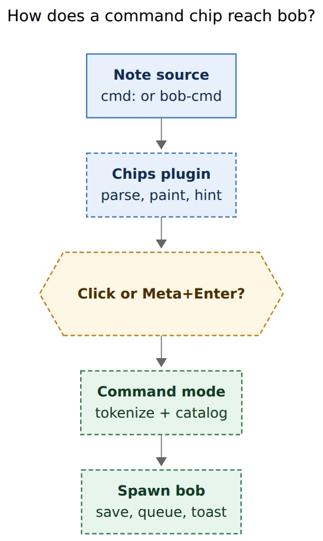
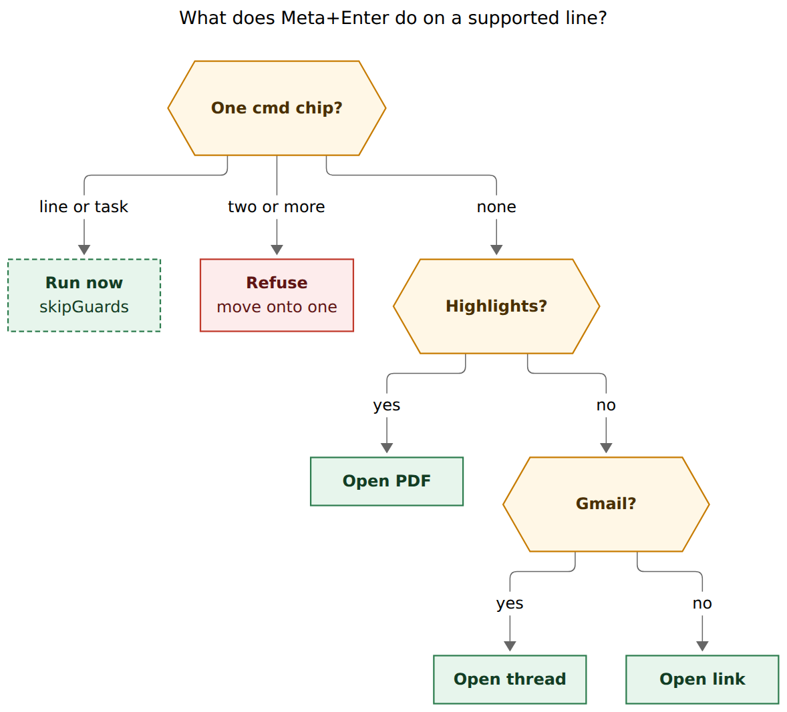

# Command chips in Obsidian: independent design (grk)

> **Research query:** How should Bob add an Obsidian "command chip" inspired by copy chips, so Bryan can run `bob` commands — including bulk sequences — from notes the way command mode's Control+Enter runs them now, with Meta+Enter on a supported line or task, GTD adoption, a glossary term, and a design that is intuitive, reliable, and beautiful? Critique the plan, call out justified requirement adjustments, and end with a recommended solution.

**Date:** 2026-11-19 · **Researcher:** grk · Independent swarm report. Does not consult peer `__cdx` / `__cld` / `__mus` / `__gem` drafts.

## Bottom line

**Yes — build command chips. Treat them as a second chip *kind* on the copy-chip chassis, dispatched through Bob Command Mode, hooked into the existing Meta+Enter resolver.** The request is a real daily-walk pain: the open `gtd_daily.md` PRE row `Run gcal sync -n 2 + gkeep pull + gmail sync` is already a three-step command-mode sequence written as three inert code spans, and `Run task reconcile` is a one-word chore Bryan types into `:` every morning. Copy chips solved the *select-and-copy* failure; command chips solve the *leave-the-note-and-retype* failure for the same chores.

The original framing needs several load-bearing adjustments, called out below. The ones that would make this a bad idea if ignored:

1. **Do not bind the editor's Control+Enter.** That chord already completes tasks, Pomodoros, PRE/POST walk rows, and Task Card rolls. Recurring GTD chores use Control+Enter to *check the row off* after the work. Command chips must use the vault's **Meta+Enter** (`Cmd+Enter` on macOS, Super+Enter on Linux), composed into the Highlights dispatcher that already owns that key.
2. **Do not spawn a shell, and do not spawn `bob` from the chips plugin.** Command mode is the only Obsidian runner: catalog, exclusions, save-every-open-note, writer queue, sequences, toasts, pager, status chip. A chip is a render-and-dispatch surface, the same thin-client split as `decisions:mac-capture-is-a-thin-client`.
3. **Do not convert every backtick that mentions `bob`.** Open GTD rows mix four different things: command-mode argv, agent-prompt copy chips, a Mac shell one-liner with a glob and `rm`, and an interactive TTY queue (`gcal ack`). Only the first class becomes a command chip.
4. **Bulk lives inside one chip.** Meta+Enter requires a *single* command chip on the line (task line as fallback). Three separate pills on the sync row would be ambiguous. Encode `gcal sync -n 2 && gkeep pull && gmail sync` as one chip; that `&&` is already how command mode copies a sequence.

**Recommended product:** rename `bob-copy-chips` → **`bob-chips`** (id and display name) while the plugin is hours old; add `cmd:` / `bob-cmd` beside `copy:` / `bob-copy`; run through `api.commandMode` with the same `skipGuards` path Control+Enter uses in the sheet; show a Highlights-style status-bar keycap whenever the cursor rule resolves exactly one command chip.

## Is this a good idea

**Yes in its narrow form.** The narrow form is: an authored, catalog-legal `bob` argv (or a sequence of them) lives next to the chore it belongs to, and one obvious gesture runs it through the engine Bryan already trusts.

Reasons it is worth building:

1. **The corpus already exists, on the hottest path in the vault.** Open `gtd_daily.md` PRE chores that are literally "run these bob commands" are walked with `]s` every morning. Today Bryan either retypes them in command mode (`:` then fuzzy find, or typed argv, then Control+Enter) or selects fragile inline code. Copy chips removed selection for prompts; command chips remove retyping for the commands themselves.
2. **Command mode already did the hard part.** Catalog handshake, excluded paths (credentials, free-text capture, long-running notifiers), `cmTokenizeBobArgv`, aliases, preview-first / confirm / run policies, `skipGuards` for Control+Enter, in-order sequences that halt on failed/unknown/stopped, save-all-markdown before writers, host-local run history, outcome toasts, the status-bar run chip. A chip that bypassed that engine would duplicate it badly.
3. **The copy-chip chassis is the right widget.** Code-span storage, Live Preview decorations, Reading post-processor, fence cards, make-or-edit, cursor rule, `api.copyChips` v1, quiet pill CSS, byte-exact source reads. Command chips need all of that with a second prefix and a different activation. Two plugins scanning every visible code span would pay the CPU budget twice.
4. **The keymap the request wants already has a "supported line" pattern.** Highlights paints a status-bar chip with the vault's real Meta+Enter keycap when a PDF/Gmail/link target resolves, and mutes or hides it otherwise. Command chips should steal that *pattern*, and the same key, rather than invent a third chord.

**No in its expansive form.** A general "button that runs a command from a note" is Meta Bind / Buttons / Templater JS: YAML fences, command ids, inline JavaScript, split definition and use. That is the shape copy-chip research already rejected, and it is worse here because the payload *writes the vault and hits the network*. Scope creep that would sink v1: interpolating `{date}`, running arbitrary Obsidian command ids, spawning `/bin/zsh`, auto-completing the GTD task on success, a protocol handler, Publish interactivity.

Would I take a different approach? Only at three margins, all folded into the design below: compose Meta+Enter rather than register a new default; keep execution inside command mode; classify GTD rows instead of converting every `bob` span. I would still build the chip.

## Requirement adjustments

Explicitly called out.

| # | Original | Adjusted | Why |
| --- | --- | --- | --- |
| A1 | "command chip" inspired by copy chips | **Second chip kind** on the copy-chip grammar (`cmd:` / `bob-cmd`), visually distinct (terminal glyph, `cursor: pointer`) | Shared scanner, authoring, cursor rule; a click-to-run pill that looks like a click-to-copy pill would fire writers by accident |
| A2 | Rename `bob-copy-chips` → `bob-chips` (optional) | **Do the id + display rename in this epic** | Plugin shipped today (v0.4.0); one consumer (`api.copyChips` in navigation's Copy card C row). Leaving the id as `bob-copy-chips` names the family after the safer verb |
| A3 | Run like command mode Control+Enter | **Same *semantics* (`skipGuards: true`, sequence start without the review card). Different *chord* in the editor: Meta+Enter** | Editor Control+Enter is task/Pomodoro/PRE complete (`task-status-cycler`, walk, Task Card). On Mac, command mode's Control+Enter is Control, not Cmd |
| A4 | Cmd+Enter when the line (or task) has a single command chip | **First hop of the existing Meta+Enter dispatcher** (`open-reference-pdf-in-highlights`). Palette command with **no registered default**. Vault keeps the Meta+Enter binding | A plugin default of `Mod+Enter` would claim Control+Enter on Linux (`docs/highlights.md`). Highlights already documents this trap |
| A5 | Make the keymap obvious on a supported line | **Status-bar hint chip + in-pill tooltip, both showing the live keycap from `hotkeys.json`** (Highlights' `formatHighlightsHotkey`) | Walker footer is the `]s` family, not cursor context. A keycap that appears only when the cursor rule is `ready` is the pattern Bryan already has |
| A6 | Support bulk commands | **One chip, many steps:** inline `&&` (command mode's own sequence copy format) or a `bob-cmd` fence, one argv per line. Meta+Enter still requires a *single* chip | Two pills on a line is the copy-chip ambiguous case. GTD already writes three commands on one row |
| A7 | Use chips in recurring tasks that contain `bob` commands | **Convert only catalog-legal, non-interactive, non-shell argv.** Keep agent-prompt copy chips. Leave the bank glob+`rm` line as a copy chip. Leave `gcal ack` as prose/code | See [GTD adoption](#gtd-adoption). Blind conversion would hang on TTY ack or send `*.qfx` as a literal filename |
| A8 | (unstated) | **Chips never spawn a shell and never expand globs.** `~` may expand via the existing `cmExpandHome` helper; `* ? [` in a token refuses with a Notice | Command mode `spawn(bobPath, argv)` has no shell. The bank row's `&& rm` is a Mac terminal one-liner |
| A9 | (unstated) | **Refuse excluded catalog paths, free-text `capture`, unfinished quotes, and missing command-mode plugin.** Feature-detect `api.commandMode` | Same refusals as typed command mode. Capture stays the capture panel |
| A10 | (unstated) | **Do not auto-complete the GTD task after a successful run** | Completing a PRE chore is a human judgment (did sync look right?). Control+Enter still checks the row off. Two-step: Meta+Enter runs, Control+Enter done |
| A11 | Glossary term "command chip" | **Add `glossary:command-chip`** (aliases: `cmd chip`, `bob-cmd`). Leave Copy Chip's alias `chip` alone in v1 | Stealing `chip` would make the just-shipped copy-chip strand wrong |
| A12 | (unstated) | **Literal argv, no interpolation.** Leading `bob` is stripped per step. Command-mode aliases apply | Matches copy-chip A4 and `cmApplyCatalogAliases` |
| A13 | Click implied by "chip" | **Click = run-now (same `skipGuards` as Meta+Enter). Alt+Click = edit (parity with copy chips). Shift+Click = open the command-mode preview** | A pill that does not activate on click fights the copy-chip motor memory. Distinct glyph + keycap tooltip carry the danger |
| A14 | (plugin shape) | **`bob-chips` stays `isDesktopOnly: false`.** Command kind degrades with a Notice when command mode is absent (mobile, plugin off) | Copy chips already work off-desktop. Command mode is desktop-only and is the runner |

## Prior art

Community "run a command from a note" is a solved-looking problem with the wrong artifact.

| Option | Verdict | Why |
| --- | --- | --- |
| **Meta Bind buttons** (`BUTTON[id]` / `meta-bind-button` YAML, action `type: command`) | Reject as the product | Runs an *Obsidian command id*, not `bob` argv. Authoring is a settings template or a YAML fence. Definition splits from the note that needs it. Copy-chip research already rejected this kit for a one-verb feature; running writers makes the YAML worse, not better |
| **Buttons** (`shabegom/buttons`) | Reject | Block-shaped, id-indirected, author pointed people at Meta Bind. Templater-inside-button mutates the button source on click |
| **Templater / DataviewJS / JS Engine** | Reject | JS in notes, load-order bugs, the opposite of "easy to type" |
| **Command mode palette rows `Bob: <title>`** | Complementary | Already runs no-arg `run` policy entries from the palette. Does not put the argv *on the GTD line* or support the three-command sync bulk |
| **Copy chips of the shell one-liner** | Complementary, keep for the bank row | Byte-exact copy into a Mac terminal is the right tool when the line needs a glob and `rm` |
| **OS snippet expanders** | Complementary | Fine for typing `gcal sync` anywhere; they do not travel with the note or help the `]s` landing |

The lesson from copy-chip prior art still holds: **prefixed inline code is how this vault already teaches "plugin widget"** (Dataview `` `= …` ``, Meta Bind `` `BUTTON[…]` ``, copy `` `copy: …` ``). Command chips should stay in that family.

## Bob-internal evidence

This is the ledger the design hangs on. Every claim below is from the linked `bob-plugins` checkout, bob-cli catalog, vault `gtd_daily.md`, or the approved copy-chips epic `bob-cli-ni` / `plan:202611/copy_chips.md`.

### Copy chips, hours old

- Plugin `bob-copy-chips` 0.4.0, `isDesktopOnly: false`, fragment build, `api.copyChips` v1 frozen and never-throwing: `parse`, `scanLine`, `serialize`, fence helpers, `chipAt`, `copy`, `copyChip`, `flash`.
- Grammar: `` `copy:` `` / `` `copy[LABEL]:` `` plus `bob-copy` fences. Cursor rule: chip under cursor, else the only chip on the line, else the fence, else ambiguous, else none.
- Gestures: click copies, `gy` yanks, `Mod+Y` then `C` copies from the Copy card, `Mod+Shift+Y` make-or-edit, Alt+Click edits.
- Six open GTD agent prompts are already labeled copy chips (`last-week` / `last-quarter` / `last-year`). Those payloads *mention* `bob periods show …` as instructions for an agent. They are copy chips on purpose.
- Follow-ups already filed: phase-3 picker (`bob-cli-nm`), plain-text faces (`bob-cli-nn`). Command chips should not block those.

### Command mode is the runner

- Sheet: Enter runs with guards, Shift+Enter previews, **Control+Enter sets `force: true` → `skipGuards: true`**, Ctrl+M marks sequence steps. Confirm card Run button is labeled `Run ⌃↵` and only Control+Enter confirms.
- Sequences: two or more marks; Enter shows one review card if any step is `confirm` or `preview-first`; Control+Enter / **Run all** starts immediately. Steps run with `skipGuards: true`. Halt on failed / unknown / stopped; needs-attention continues. Copy joins steps with ` && `.
- `api.commandMode` v1: `run(argv, opts)` already forwards `runOpts` (so `skipGuards: true` works today), `preview`, `openOutput`, `onRunFinished`, `catalog`, `lastRun`. **`runSequence` is implemented on the plugin (`commandModeRunSequence`) and is not on the public API.** Command chips need it added additively, feature-detected.
- Tokenizer `cmTokenizeBobArgv` already handles quotes and escapes. `cmResolveTypedBobArgv` applies catalog aliases and exclusions. Reuse these; do not write a second argv parser.
- Catalog policies for the GTD-relevant commands: `gcal-sync`, `gkeep-pull`, `gmail-sync` are **PreviewFirst** writers (Control+Enter is exactly "skip the preview"); `task-reconcile` is **Run** with an optional dry-run; `bank-import` is PreviewFirst; `gcal-ack` is PreviewFirst **and reads unbuffered stdin** (`src/native/gcal/ack.rs`). Exclusions cover credentials, free-text capture, Gmail compose/send, long-running `pomodoro notify`. `gcal ack` is *not* excluded — a chip that skipGuards it would hang a detached spawn. Adoption must not chip it until the catalog grows a `tty` flag or a non-interactive mode.
- Command mode is desktop-only, Linux and macOS. Win32 is refused.

### Meta+Enter is already a context-sensitive dispatcher

Vault `hotkeys.json` binds **Meta+Enter** to `bob-navigation-hotkeys:open-reference-pdf-in-highlights`. The command has **no plugin default**, because a `Mod+Enter` default would steal Control+Enter on Linux. Today the hop order is: Highlights PDF → Gmail thread via `api.mailOpen` → Obsidian "open link in new tab". A status-bar chip shows `Highlights` plus the live keycap when a target resolves, hidden off macOS / Reading view / no editor. That is the affordance the request is asking for.

Control+Enter in the editor remains: complete task, complete Pomodoro, complete PRE/POST landing, Task Card recommended roll (with a Cmd+Enter *alias on the card only*).

### Vault measurements (2026-11-19, `~/bob/**/*.md` excluding `.git` / `.obsidian` / `lit_review` / `xlib`)

| Kind | Count |
| --- | ---: |
| Inline code spans (single-backtick, same line) | 138,430 |
| Spans starting `copy:` / `copy[` | 21 |
| Spans starting `bob ` | 2,472 |
| Spans starting `cmd:` / `cmd[` | **1** (`code/avante_goose/creating_codecompanion_adapters.md`, literal `cmd:`) |

`cmd:` is collision-free at vault scale. A `bob:` prefix would sit next to thousands of documentation spans that already start with `bob `. Copy-chip research used the same census to pick `copy:` over `copy>>`; the same method picks `cmd:`.

## The design

### Syntax

Same code-span contract as copy chips, second prefix.

| You type | You see | Meta+Enter / click |
| --- | --- | --- |
| `` `cmd: task reconcile` `` | ▶ `task reconcile` (monospace pill) | `bob task reconcile` via command mode, `skipGuards` |
| `` `cmd[sync]: gcal sync -n 2 && gkeep pull && gmail sync` `` | ▶ sync (text-font pill) | one sequence, three steps, halt-on-fail |
| a ` ```bob-cmd morning sync ` fence, one argv per line | titled card with **Run** | same sequence |

```markdown
- [?] #task #gtd #pre #sync Run `cmd[sync]: gcal sync -n 2 && gkeep pull && gmail sync`
- [?] #task #gtd #pre #init Run `cmd: task reconcile`
```

Rules:

- Prefix `cmd` is lowercase and first, optional `[LABEL]`, colon, optional space, then payload. Empty / whitespace-only payload is never a chip (copy-chip R14).
- Each step is one command-mode argv string. Optional leading `bob` is stripped. `cmTokenizeBobArgv` + `cmApplyCatalogAliases` + `cmFindEntryForArgv` + `cmExcludedReason` decide legality.
- Inline bulk: split on ` && ` (spaces required, matching command mode's sequence copy text). A fence splits on non-empty lines. Do not treat GTD's informal `+` as a separator — `+` is a capture session operator.
- Longer backtick runs hold payloads that contain backticks. Table `\|` unescape matches copy chips.
- With the plugin off, the span still reads as code that says what it is.

Rejected prefixes: `bob:` (documentation collision), `run:` (vague), `exec:` (shell-flavored), copy-chip `copy:` (wrong verb).

### Look

Quiet family resemblance, *different verb*. Steal copy-chip tokens (`--background-secondary`, `--background-modifier-border`, `--interactive-accent`, `--radius-s`, hairline pill, `.92em`, `box-decoration-break: clone`).

- **Glyph:** Lucide `terminal` (or `play`) in the same fixed-width slot copy chips use for `copy`. Never 📋, never a generic ⚙ that could pass for copy.
- **Cursor:** `pointer`. Copy chips keep `cursor: copy`.
- **Rest:** copy chips are fully quiet. Command chips take a *slightly* stronger rest border (`color-mix` toward accent at ~15%) so a scan of a GTD line can tell the verbs apart without reading the glyph.
- **Tooltip:** unlabeled: `⌘↩ run now` (live keycap) plus the argv; labeled: face, then the argv preview with `⏎` / ` && ` separators, truncated at 120 characters in the tooltip only.
- **Success:** glyph → check, yank-flash pulse, `aria-live` "Ran `gcal sync`". The command-mode toast and status chip still appear for the run itself — those are the *outcome* (completed / attention / failed). The pill only acknowledges *dispatch*. Failures to dispatch (ambiguous, excluded, no command mode) Notice immediately, copy-chip style.
- **Print / PDF:** face as inline code, no Run chrome.
- **Fence card:** header glyph + label + `N commands` + **Run**; body is the argv lines in monospace. Clicking the body selects; only Run / Meta+Enter dispatches.

Beautiful here means: the pill looks inevitable on a GTD line, the keycap is visible before you press it, and a copy chip and a command chip can share a sentence without being twins.

### Cursor rule

Copy-chip `chipAt`, with a command-kind filter and one extra fallback the request asked for:

1. A **command** chip under the cursor wins.
2. Else the only **command** chip on the cursor line. (Copy chips on that line do not count.)
3. Else the `bob-cmd` fence the cursor is inside.
4. Two or more command chips on the line with the cursor on none: **ambiguous** — `"N command chips on this line · move onto one"`. Do not guess, do not fall back.
5. Zero command chips on the line: **owning task line** (the `- [?] #task` line that owns the cursor, including when the cursor is on a child bullet). If that line has exactly one command chip, use it. If it has two or more, ambiguous. If it has none, none.
6. Frontmatter, fences that are not `bob-cmd`, invalid input: none.

Publish this as `api.commandChips.chipAt`, mirroring `api.copyChips.chipAt`, so Meta+Enter, the status-bar hint, `g!`, and the palette command can never disagree.

### Activation

| Gesture | Effect |
| --- | --- |
| Click / tap the pill, or the fence **Run** button | `skipGuards` run (Control+Enter semantics) |
| Meta+Enter (vault binding, composed into Highlights command) | same, if cursor rule is `ready` |
| Palette **Run command chip on cursor line** | same |
| Optional vimrc `g!` → that palette command | Vim-normal parity with `gy` for copy |
| Alt+Click / `Mod+Shift+Y` on a command chip | make-or-edit card, kind = command |
| Shift+Click | `api.commandMode.preview(argv)` (or first step, with a Notice if bulk) |
| Control+Enter | **unchanged** — completes the task / walk row |

Dispatch path:

1. Parse steps from source (never from `innerText`).
2. For each step, `cmResolveTypedBobArgv`. Any excluded / unknown / unfinished / glob / shell token refuses the *whole* chip with one Notice; nothing starts.
3. One step: `api.commandMode.run(argv, { skipGuards: true, trigger: "chip" })`.
4. Two or more: `api.commandMode.runSequence(steps, { skipGuards: true, trigger: "chip" })` — the Control+Enter sequence path, no review card.
5. Outcome toasts, pager, and the command-mode status chip behave as they do for a sheet Control+Enter. The pill only flashes dispatch.

<div id="figure-run-path">



_The chips plugin parses and paints; Bob Command Mode is the only spawn path, using the same skipGuards engine as Control+Enter in the sheet. Rendered 365×612 px, fit 100%._

</div>

### Affordance: "this keymap is available"

When `commandChips.chipAt` is `ready` in a Markdown editor (Source or Live Preview):

- A status-bar chip appears: glyph + face (truncated) + the live Meta+Enter keycap. Clicking it runs (cached target, so a blurred editor does not re-resolve — Highlights already does this).
- Hidden in Reading view, with no editor, and when the cursor rule is `none` or `ambiguous`.
- On Linux it still shows (Highlights' chip is macOS-only because Highlights itself is). Keycap comes from the vault binding, so Linux reads Super+Enter, Mac reads ⌘↩.
- While this hint is visible, it **replaces** the Highlights hint, because Meta+Enter will run the command rather than open a PDF. GTD sync rows have no Highlights target; reading tasks have no command chip. Document the rare overlap: command chip wins.

In-pill tooltip always includes the same keycap, even when the status-bar chip is off (Reading view). That covers mouse-only discovery.

Do not put this on the walker footer. The footer answers "where am I in `]s` / `]w` / `]n` / `]b`". Mixing a cursor-scoped Run hint into that slot would lie when the walk family is `s` and the cursor is on a command chip in another note.

### Authoring

Extend the existing Mod+Shift+Y card with a **Kind** segmented control: Copy | Command. Defaults:

- Cursor already in a `cmd:` / `bob-cmd` → Command, edit in place.
- Cursor in `copy:` / `bob-copy` → Copy.
- Selection / plain code span whose text `cmResolveTypedBobArgv` accepts → default Command.
- Otherwise Copy (clipboard prefill stays the copy-chip behavior).

Kind = Command: live preview of the pill, Markdown row, and a resolved-steps row (`bob gcal sync -n 2`, `bob gkeep pull`, …) or a red inline error (`excluded: capture`, `unfinished quote`, `glob needs a shell`). Enter disabled while invalid. Same keys as copy chips, including `decisions:q-and-ctrl-bracket-mirror-esc`.

Converting the GTD `` `gcal sync -n 2` `` span is one gesture: cursor in the span, Mod+Shift+Y, Kind already Command, Enter.

### Command-mode API additions

Additive, feature-detected, namespace version stays 1 if the new methods are optional (copy the `preview` precedent: consumers test `typeof api.commandMode.runSequence === "function"`).

- `runSequence(steps, opts) → { ok, id, outcome, stoppedAt, results, reason? }`, never rejects. Wraps `commandModeRunSequence`. `opts.skipGuards` default true for chip/sequence-start parity with Control+Enter; sheet review card remains the place that *doesn't* skip.
- Optionally export `resolve(text)` as a pure wrapper around `cmResolveTypedBobArgv` so the chips plugin does not reach into command-mode internals. If that feels like too much API, the chips plugin may call `catalog()` and duplicate *nothing* — it should still import tokenizer behavior by asking command mode, not by copying 80 lines.

`run(argv, { skipGuards: true, trigger: "chip" })` already works. Document `skipGuards` and `trigger` on `api.commandMode.run`; they are live today and unnamed in `docs/develop/plugin-apis.md`.

## Plugin placement: the rename call

**Rename `bob-copy-chips` to `bob-chips` in this epic** (folder, `manifest.json` `id` and `name`, chezmoi `plugins.sync` allowlist, vault `community-plugins.json`, `.gitignore` if needed, navigation C-row lookup, glossary Copy Chip's plugin sentence, vimrc comments).

Why now:

- The plugin is on 0.4.0, landed today. One in-tree consumer.
- Command chips are a second *kind*, not a copy-chip feature. An id that says "copy" will calcify a lie in every `app.plugins.plugins["…"]` lookup.
- Two plugins both decorating prefixed code spans would double the Live Preview CPU work copy-chip R12 just budgeted.

Keep `api.copyChips` v1 **byte-stable** on the new plugin (navigation's C row keeps working with a one-line id fallback: try `bob-chips`, then `bob-copy-chips`). Add `api.commandChips` v1: `parse`, `scanLine`, `serialize`, `chipAt`, `run(chip) → Promise<{ok, reason?, runId?, sequenceId?}>`, `flash`.

Rejected placements:

- **New `bob-command-chips` plugin.** Second scanner, second allowlist row, second make-or-edit card.
- **Widgets inside `bob-command-mode`.** Command mode is already the runner and is desktop-only; copy chips must stay mobile-capable. Mixing CM6 decorations into the sheet plugin also couples reload of the runner to widget bugs.
- **Navigation Hotkeys.** Owns keys and cards, not inline widgets. It *does* own Meta+Enter: command chips **feature-detect** `api.commandChips` there, the same way the Copy card feature-detects `api.copyChips`.
- **Keep the old id, change only the display name.** Cheap, and wrong within a month.

Chezmoi: one allowlist swap. Vault: enable `bob-chips`, drop `bob-copy-chips` from `community-plugins.json` after sync. One-release lookup fallback covers hosts that have not reloaded yet.

## Keymap composition

<div id="figure-dispatch">



_A single command chip on the cursor line or owning task runs through command mode. Otherwise today's Meta+Enter chain is unchanged. Rendered 785×712 px, fit 83.2%._

</div>

Implementation sketch, all in navigation's existing `openReferencePdfInHighlightsOrLink`:

1. If `api.commandChips?.version >= 1` and `chipAt` is `ready`, call `commandChips.run(chip)` and return.
2. If `ambiguous`, Notice the copy-chip-style reason and return (do not fall through — falling through would open a link inside the same line).
3. Else today's Highlights → Gmail → open-link chain.

Register **no** new default hotkey. The palette command `bob-chips:run-on-cursor-line` exists for vimrc / command palette. Adopt-phase vimrc, after the `gy` block:

```vim
" g! runs the command chip on the cursor line (one chip, or the one under the cursor).
exmap bob_run_chip obcommand bob-chips:run-on-cursor-line
nnoremap g! :bob_run_chip<CR>
```

`g!` is optional. Meta+Enter is the required affordance. I would ship `g!` because this vault is Vim-normal first and `gy` / `g!` is a memorable pair (yank / run).

## GTD adoption

Re-read `gtd_daily.md` at implement time. Convert **open** rows only (same rule as copy-chip adopt). Do not touch Done & Canceled history.

### Convert to command chips

| Open row (2026-11-19) | Today | Proposed |
| --- | --- | --- |
| `#sync Run \`gcal sync -n 2\` + \`gkeep pull\` + \`gmail sync\`` | three inert spans, informal `+` | one labeled chip `` `cmd[sync]: gcal sync -n 2 && gkeep pull && gmail sync` `` |
| `#init Run \`task reconcile\`` | one inert span | `` `cmd: task reconcile` `` |

Those four argv are catalog entries. Three of the sync steps are PreviewFirst writers; Control+Enter-style `skipGuards` is exactly the "I mean it, run the morning sync" gesture. `task reconcile` is policy Run.

### Keep as copy chips

The six period-review agent prompts already converted by `bob-cli-ni.6`. Running `bob periods show last-week` from Obsidian would print a path; the chore is "launch an agent with this prompt". Different verb, already shipped.

### Keep as copy chips (or labeled copy of a *shell* line)

`#browser **Bank**: … on the Mac: \`bob bank import ~/Downloads/*.qfx && rm ~/Downloads/*.qfx\``

This needs glob expansion and `rm`. Command mode will not do either. Wrap the whole one-liner as `` `copy[bank import]: bob bank import ~/Downloads/*.qfx && rm ~/Downloads/*.qfx` `` so `gy` puts it on the clipboard for the Mac terminal. That is copy chips' original job.

### Leave as prose / inline code (v1)

`#terminal **Ack external events**: run \`bob gcal ack -n 7\` · a ack · n note · s skip`

`gcal ack` is an unbuffered TTY queue. A detached command-mode spawn has no keyboard. Chipping it with `skipGuards` would start a writer that cannot finish. Follow-up: catalog `tty` metadata, or a non-interactive ack mode, *then* a command chip. Until then the existing span is honest.

### Other recurring files

`recur.md` open rows (cash snapshot, salary, meds) contain no `bob` argv. No conversion.

**Do not auto-run these on schedule.** Recurring `[repeat::]` is the Tasks engine; the chip is a manual gesture on the due row. Nightly cron stays chezmoi/cronctl.

## Reliability contract

Copy-chip R1–R14 still apply to parsing, source reads, embeds, Vim, CPU budget, and never writing the vault on render. Command chips add:

| # | Rule | Prevents |
| --- | --- | --- |
| C1 | Only `api.commandMode` spawns `bob` | A second runner drifting from catalog / save / queue |
| C2 | `skipGuards` is explicit and named in docs | Chips silently growing a third policy |
| C3 | Whole-chip validation before step 1 | Sync that pulls Keep after a failed `gcal sync` because step 2 started anyway — sequences already halt, but a glob on step 3 must refuse *before* step 1 |
| C4 | No shell, no glob expansion, no pipes, no `rm` | `*.qfx` as a literal path; deleting files from a note |
| C5 | Exclusions and free-text capture refuse | `cmd: capture buy milk` creating tasks from a chip |
| C6 | Interactive / TTY commands are not v1 chips | Hung `gcal ack` under the status chip |
| C7 | Ambiguous never falls through to Highlights | Meta+Enter opening a URL that shares the line with two chips |
| C8 | Missing command-mode plugin Notices, pill stays inert | Click that looks successful and does nothing |
| C9 | Render never writes; only command mode's writer path writes, after save-all | Surprise edits riding vault-sync |
| C10 | Duplicate in-flight sequence: same "already running" Notice as the sheet | Double Meta+Enter starting two morning syncs |

## Phases

| Phase | Scope |
| --- | --- |
| 0 · Rename | `bob-copy-chips` → `bob-chips`; allowlist; community-plugins; `api.copyChips` lookup fallback; docs inventory |
| 1 · Grammar + paint | `cmd:` / `bob-cmd` in the shared scanner; LP + Reading widgets; fence Run card; vectors next to `copy-chips-vectors.json`; CPU budget still green on a long daily note |
| 2 · Run path | `api.commandChips.run`; command-mode `runSequence` + documented `skipGuards`; Meta+Enter hop; status-bar hint; palette command; Shift+Click preview |
| 3 · Author + adopt | Kind toggle on Mod+Shift+Y; vimrc `g!`; convert the two open GTD command rows; copy-chip the bank one-liner; glossary `command-chip`; command-mode and navigation docs |
| Later | Catalog `tty` flag; optional complete-on-success; vault-wide "run a chip…" picker (rides copy-chip phase 3); `bob-cli-nn` faces for command chips on pickers |

Ship 0–3 as one epic. Phase 0 first so consumers never see a command-chip API on an id named copy.

## Critique of the plan as given

The plan is directionally right and locally dangerous in four places.

1. **"Like Control+Enter" in the same sentence as "Cmd+Enter in the editor"** is two chords. In command mode, Control+Enter is Control on every host. In the editor, Control+Enter completes work. The fix is semantic equality, physical inequality, and composing Meta+Enter.
2. **"Recurring tasks that contain bob commands"** over-includes. Half of the `bob` strings in `gtd_daily.md` are agent prompts (already copy chips) or a shell pipeline. Converting those would look like adoption and behave like a bug.
3. **Bulk as "multiple chips"** fights the requested Meta+Enter rule (single chip). Bulk as `&&` inside one chip agrees with both the request and command mode's sequence copy format.
4. **Rename is the right call, and it is cheaper today than next month.** I would not wait for a "bob-chips v2".

A smaller alternative I considered and rejected: palette-only `Bob: Morning sync` as a command-mode sequence saved in RECENT. That helps athena/apollo terminals already in the sheet; it does not put the argv on the GTD line `]s` lands on, and it does not show a keycap on that line.

## Recommended solution

Build **command chips as a kind of Bob Chip**, in a renamed `bob-chips` plugin, executed exclusively by Bob Command Mode's Control+Enter (`skipGuards`) path, activated in the editor by the vault's existing **Meta+Enter** binding as the first hop of the Highlights dispatcher, with a Highlights-style status-bar keycap when the cursor rule resolves exactly one chip.

v1 syntax: `` `cmd:` `` / `` `cmd[LABEL]:` `` / `bob-cmd` fences. v1 bulk: ` && ` or one argv per fence line. v1 GTD: one `sync` sequence chip and one `task reconcile` chip on the open rows; bank line becomes a copy chip; ack stays prose; period prompts stay copy chips.

v1 glossary: `glossary:command-chip` with aliases `cmd chip`, `bob-cmd`. Optional decision record (recommended, because this one *runs writers*): "command chips are code spans whose payload is catalog-legal bob argv; they dispatch through command mode with skipGuards; they never spawn a shell." Copy-chip's decision was turned off by a reviewer; this one is the safety claim and is worth asking again.

## Open questions for Bryan

None block the design. Two change the adopt phase:

1. **`g!` in the vimrc** beside `gy` — ship it, or Meta+Enter only?
2. **Bank line as a copy chip** of the shell one-liner — agreed, or leave the raw span?

Decision-record and glossary-command-chip should be ACE reviewer toggles on the epic, same shape as `bob-cli-ni`.

## Method and sources

Independent read of:

- Epic `bob-cli-ni` and `plan:202611/copy_chips.md`; prior research `research:202611/obsidian_copy_chips/obsidian_copy_chips.md` (shared input, copy-chip design).
- Linked `bob-plugins`: `bob-copy-chips` grammar/API/CSS; `bob-command-mode` runner, sequences, sheet Control+Enter, `cmTokenizeBobArgv`, public API; navigation Highlights Meta+Enter + hint chip; plugin API docs.
- bob-cli catalog `src/native/catalog/table.rs` policies for `gcal-sync`, `gkeep-pull`, `gmail-sync`, `task-reconcile`, `bank-import`, `gcal-ack`; `gcal/ack.rs` stdin.
- Vault `~/bob/gtd_daily.md` open rows; prefix census over vault Markdown.
- Glossary `copy-chip`, `command-mode`; decisions `mac-capture-is-a-thin-client`, `q-and-ctrl-bracket-mirror-esc`, `code-copy-reads-render-time-catalog`.
- Web: Meta Bind / Buttons / Templater command buttons (rejected shape).

Nothing was implemented in product repos. Figures rendered with `@mermaid-js/mermaid-cli@12.0.0`, PDF-mirroring config, DejaVu Sans.

### Figure index

| File | Reader question | Fit |
| --- | --- | --- |
| `obsidian_command_chips_dispatch__grk.{svg,png}` | What does Meta+Enter do on a supported line? | 785×712 px, 83.2% |
| `obsidian_command_chips_runpath__grk.{svg,png}` | How does a command chip reach bob? | 365×612 px, 100% |
