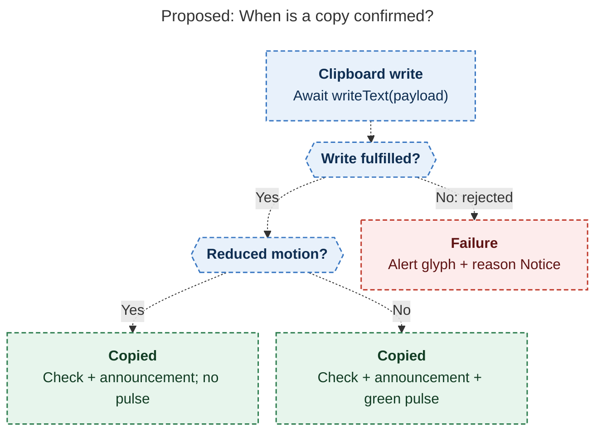

# Diagram proposals: Copy chips in Obsidian: consolidated design and recommendation

Proposals for the swarm linker, not a report. Each diagram restates only what the source
report says.

```yaml
source: research:202611/obsidian_copy_chips/obsidian_copy_chips__final.md
producer: research.5g.image
check: "mmdc 12.0.0 with the PDF-mirroring config and Puppeteer --no-sandbox rendered 1 of 1 Mermaid diagrams"
```

## clipboard-confirmation

```yaml
anchor: |-
  shown only after fulfillment; failures return `{ok: false, reason}` and show a
question: |-
  When does copy feedback indicate success, and what changes on failure or reduced motion?
illustrates: |-
  The proposed clipboard contract shows success only after fulfillment, failures return a reason and show a Notice, and reduced motion keeps the glyph swap without the pulse.
caption: "The proposal confirms copying only after clipboard fulfillment; failures show a reason, and reduced motion retains the check without a pulse."
review: "700.8x676 px, fit 93.2%; question, source trace, labels, arrows and visual checks passed; 0 revisions; batch found 1 chart and exited 0; broken-chart rejection verified"
```


