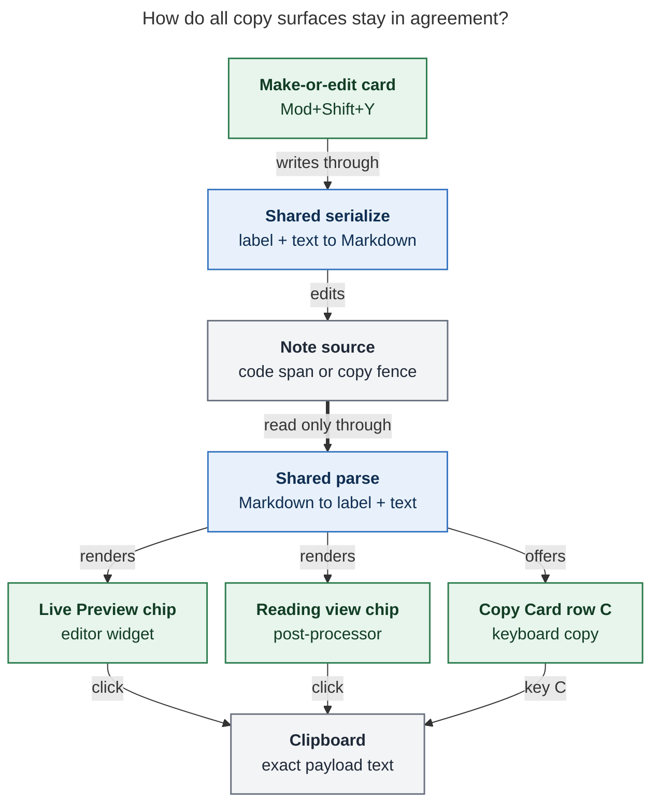

# Copy chips: one-click "copy this text" in Obsidian

**Date:** 2026-11-19 · **Researcher:** cld · **Evidence:** bob-plugins at `36d4801`, a read-only scan of the Bob vault
(7,368 Markdown notes, about 135k inline code spans outside fences), the vault's installed plugins, hotkeys, linter
config and vimrc, `~/.config/bob/config.yml` (`copy.templates`), Clip Link's source (`kanade2511/clip-link-obsidian`
at `8dd1ecd`), Copy Inline Code's issue tracker, and the community plugin pages and forum threads listed under
[Sources](#sources).

## TL;DR

- **Build it, but make it a chip, not a button.** A *copy chip* is a small inline pill with a copy icon. Click or tap it
  and its text lands on the clipboard. It sits inside a sentence, a list item, or a table cell the way a link does.
  Full-width buttons, the Meta Bind and Buttons approach, are the wrong size for notes.
- **The chip is an inline code span with a `copy:` prefix.** This is the most important decision in the report.

  | You type | You see | Click copies |
  | --- | --- | --- |
  | `` `copy: sase memory read glossary` `` | ⧉ `sase memory read glossary` | `sase memory read glossary` |
  | `` `copy[Zoom]: https://zoom.us/j/123456789` `` | ⧉ Zoom | `https://zoom.us/j/123456789` |
  | a ` ```copy [Weekly status email] ` fence | a titled card with a **Copy** button | the fence body, byte-exact |

  Markdown already delimits and escapes code spans, so the plugin never has to guess where the text ends. Bob's parsers
  already mask code spans, and so do Obsidian's tag, link and field parsers, Dataview and Tasks. A `#tag`,
  `[due:: …]`, `📅` date or `[[link]]` inside the copied text stays inert. Without the plugin (on GitHub, on the Bob
  site, or with the plugin disabled) the chip falls back to readable code that you can still copy by hand.
- **Easy to type:** the syntax is six characters (`` `copy: ``) and needs no autocomplete. One hotkey,
  **Mod+Shift+Y** ("Make or edit copy chip", a sibling of Cmd+Y's Copy Card), covers the rest:
  - It wraps the selection, or offers the clipboard when nothing is selected.
  - It takes an optional label.
  - It picks the inline chip or the block form for you, and picks a backtick fence that fits the text.
  - It rewrites an existing chip in place, as one undo step.
  - A second Mod+Shift+Y commits, the same way a second Cmd+Y copies on the Copy Card.
- **Keyboard parity (an added requirement):** the Cmd+Y Copy Card gains a **`C` (Chip)** row. With the cursor on a
  chip, `Cmd+Y C` copies its text. A click-only feature would be second-class in a Vim-mode vault.
- **Beautiful means quiet.** At rest the chip is a hairline pill. On hover the border tints to the accent colour and
  the cursor becomes `copy`. After a click the icon turns into a green check and the chip pulses in the same green as
  Bob Vim Yank Flash. Successful copies show no toast, and its width never changes. Failures always say so. It uses
  only theme variables, so light, dark and custom themes all work.
- **Reliable by construction.** One grammar module does all parsing and serializing, pinned by conformance vectors.
  The Reading view and Live Preview cannot disagree about what a chip copies. The design closes every class of bug
  in the prior-art trackers: `&` copied as `&amp;`, double backticks, only the first span on a line working, tab
  indents, embeds, and a Vim-mode crash.
- **Where it lives:** a new, small `bob-copy-chips` plugin with a versioned `api.copyChips` v1. Bob Navigation Hotkeys
  uses that API for the Copy Card row.
- **Requirement changes, all flagged in [§3](#3-requirement-adjustments-called-out):**
  - chips instead of buttons
  - an optional label
  - literal text only (no template variables)
  - keyboard parity
  - multi-line text through a `copy` fence, while code stays in ordinary fences
  - explicitly **not for secrets**
  - a vault-wide snippet picker deferred to a later phase

---

## 1. What you asked for, and the job behind it

You asked for a button or link that copies text you choose when you create it. The button should be easy to create
by typing, and intuitive, reliable and beautiful to use.

The underlying job is to **get a specific piece of text onto the clipboard, exactly, in one gesture, from the note
where it already makes sense.** Typical payloads:

- **Commands you run elsewhere.** This vault is full of them. Of the ~135k inline code spans outside fences, 8,196
  begin with the word `sase`, 4,022 with `bob`, 378 with `git` and 313 with `gh`.
- **Values you paste into forms or chats:** meeting links, account or confirmation numbers, addresses, tracking IDs.
- **Multi-line prose:** email replies, status templates, and above all prompts for agents. Prompt pasting is common
  enough that the "Prompt Block Copy" plugin exists only to do it.

Copying any of these by hand in Live Preview is fiddly. Dragging a selection reveals the Markdown source under the
cursor, so you either grab stray backticks or miss the edge of the text. On a phone it's worse.

## 2. Is this a good idea?

**Yes, with a narrower primitive than "button" and two guard-rails.**

Why it is worth building:

- **The need recurs, and the market agrees.** The community directory has at least ten single-purpose copy plugins:
  Copy Inline Code (20k downloads), Copy Text Protocol (3k), Clip Link, Fast Copier, Alt-Click to Copy, Prompt Block
  Copy, Callout Copy Buttons, Copy Link Button and others. A 2022 forum thread asks for exactly your feature and never
  gets a working answer: its Buttons + Templater attempt made every button copy the *last* text on the page.
- **It's cheap for Bob.** bob-plugins already has every pattern this needs:
  - CodeMirror 6 Live Preview widgets: 44 source fragments call `registerEditorExtension`, 39 of them in Bob Ledger
    Tools
  - Reading-view post-processors
  - a standard `navigator.clipboard.writeText` → `{ok, reason}` pattern, used in 10 fragments
  - versioned cross-plugin APIs
  - Obsidian end-to-end scripts (`scripts/obsidian-*-e2e.cjs`)
  - Live Preview CPU budgets (`cpu-work-perf-support.cjs`)
  - a Copy Card to extend
- **It completes an existing family.** Cmd+Y copies facts *about* a note: its path, name and block ID. Copy chips copy
  content the note holds *for you*.

Where the original framing would go wrong:

1. **"Button" is the wrong primitive.**
   - Meta Bind-style buttons are YAML code blocks plus an `` `BUTTON[id]` `` reference. That is heavy to author, and
     the payload sits away from where it's used.
   - Meta Bind has no copy action at all. Its 14 action types include `command`, `open`, `inlineJS` and
     `updateMetadata`, but nothing that copies. Copying needs `inlineJS` plus the JS Engine plugin.
   - A full button breaks the flow of prose and lists. A chip is the right size.
2. **A mouse-only feature won't get used in a Vim-mode vault.** It needs a keyboard path. Today `` yi` `` yanks the
   whole span, `copy:` prefix included, so a chip still needs a payload-only copy key.
3. **Text you type everywhere doesn't belong in a note.** Your email address or home address goes in macOS Text
   Replacements, Raycast snippets or Espanso. Those work in every app without opening Obsidian. Chips are for text
   that belongs *in context*: the runbook command next to its explanation, the Zoom link in the project note, the
   prompt in the research note.
4. **Secrets.** The vault is plain text and git-synced across athena, apollo and the MacBook. A copy chip makes it
   tempting to paste a password next to its explanation. Don't. Chips are for non-secret text. Put passwords in a
   password manager.

## 3. Requirement adjustments (called out)

| # | Original | Adjusted | Why |
| --- | --- | --- | --- |
| A1 | "button/link" | **Inline chip** for one line, **titled card** for multi-line | A chip fits inside prose, lists and tables. A card is the right size only for blocks of text. |
| A2 | "configurable text" | **Text plus an optional label.** Without a label the chip shows its text. | Long URLs and prompts need a short face. Short commands read best as themselves. |
| A3 | (not stated) | **Literal text only. No `{date}`-style variables in v1.** | What the file says is what gets copied, which keeps chips predictable. Copy Card `copy.templates` and Templater already cover dynamic text. |
| A4 | (not stated) | **Keyboard parity:** `Cmd+Y C` copies the chip under the cursor | Bryan works in Vim mode. A click-only feature would be second-class. |
| A5 | (not stated) | **Multi-line through a ` ```copy ` fence.** Code stays in ordinary fences. | Obsidian already puts a Copy button on every code fence. Don't rebuild it. Use `copy` fences for words (emails, prompts) and code fences for code. |
| A6 | (not stated) | **Readable without the plugin** | Notes are read on GitHub, the Bob site, other devices and exported PDFs. |
| A7 | (not stated) | **Exactness contract:** the clipboard gets exactly the text the chip says it holds, byte for byte | This is what "reliable" means here. It mirrors the Copy Card rule that "preview and clipboard never disagree". |
| A8 | implied | **Not a secret store** | Plain text in git on three hosts and a remote. |
| A9 | "easy by typing" | **A short syntax you can remember plus one make-or-edit hotkey.** No autocomplete trigger. | An autocomplete has nothing to suggest, because the text is new. The Slash commands core plugin is off in this vault. |
| A10 | (scope) | **Defer** the vault-wide snippet picker, the `bob` CLI and Mac Capture integration, and rich-text copy | They're valuable later, but each doubles the contract surface. |

## 4. The decision that matters: where the text lives

Most of the "intuitive, reliable, beautiful" outcome follows from one choice: **which Markdown construct holds the
label and the text?** I compared eight options against seven criteria.

| Approach (prior art) | Example source | Label ≠ text | Multi-line | Raw readability | Without plugin | Parse robustness |
| --- | --- | --- | --- | --- | --- | --- |
| **Code span + `copy:` prefix (recommended)** | `` `copy[Zoom]: https://…` `` | ✅ | via `copy` fence | high | readable code | **high**: Markdown delimits and escapes it |
| Custom-scheme link (Clip Link) | `[Zoom](clip: https://…)` | ✅ | ❌ | medium | raw text / broken link | **low** (see below) |
| `obsidian://` URI (Copy Text Protocol) | `[Zoom](<obsidian://copy?text=https%3A%2F%2F…>)` | ✅ | percent-encoded | **low** | a link that opens Obsidian | high |
| Button block (Meta Bind / Buttons) | YAML block + `` `BUTTON[id]` `` | ✅ | ✅ | low (YAML, id indirection) | YAML code | medium; Meta Bind has no copy action |
| Copy icon on *all* inline code (Copy Inline Code, Fast Copier) | none | ❌ | ❌ | n/a | n/a | medium (see trackers) |
| Code fence (Obsidian's built-in Copy; Prompt Block Copy) | ` ```text ` | ❌ | ✅ | high | ✅ | high |
| Callout `> [!copy] Label` | blockquote | ✅ | ✅ | high | blockquote | medium: is the copied text raw or rendered? `>` prefixes must be stripped |
| OS text expander (Raycast, Espanso, macOS) | n/a | n/a | ✅ | n/a | n/a | high, but outside the note |

Why the alternatives lose:

- **Custom-scheme links are fragile.** In Clip Link's source:
  - Live Preview clicks are caught by a `window` `pointerdown` listener in the capture phase.
  - That listener re-parses the clicked line with `/\[([^\]]*)\]\(([^)]*)\)/g`, so a `)` in the text truncates it.
  - In Reading view the plugin's own comment says "Obsidian's renderer leaves unknown schemes as raw text". The plugin
    therefore walks DOM text nodes and rewrites them with another regex.
  - The `clip: text` form (with a space) isn't a valid CommonMark link destination, so GitHub won't render it as a
    link either.
- **`obsidian://` URIs render reliably,** because Obsidian treats them as ordinary links. But percent-encoding makes
  the source unreadable, and you can't type it by hand. Registering a global clipboard-writing protocol would also let
  any web page or app overwrite your clipboard with one link. That's a small risk, but nothing we need.
- **Icons on every code span** are noise at this vault's scale (~135k spans). The keyboard case is already partly
  covered by `` yi` ``. Copy Inline Code's tracker shows how much tuning the approach needs: requests for hover-only
  icons, "remove extra space when hidden", "exclude files" and "disable in callouts".
- **Callouts** are pretty, but their body is Markdown. It's unclear whether a copy should take the raw text or the
  rendered text, and the `>` prefixes must be stripped.

Why code spans win:

1. **Markdown delimits the text, so no new parser is needed.** CommonMark code spans take any backtick run length.
   Text containing backticks uses a longer fence, so nothing needs escaping and no regex has to guess.
2. **The text is inert to every other parser in this vault.** Obsidian, Dataview, Tasks and Bob's own task parsers
   (through Bob Ledger Tools' "inline-code mask") all ignore code spans. A copied `#tag`, `[due:: 2026-12-01]` or
   `[[link]]` can't become a real tag, field or link. With link syntax it could.
3. **It follows community convention.** Dataview (`` `= …` ``) and Meta Bind (`` `BUTTON[…]` ``) both put plugin
   syntax inside inline code. Obsidian users already read "prefixed code span = plugin widget".
4. **It degrades well.** Without the plugin it reads `copy[Zoom]: https://…`, which still says what it is.
5. **It works in every Obsidian context.** Live Preview, Reading view, embeds, hover previews and PDF export all
   expose code spans, through the syntax tree or as `<code>` elements.

**Collision check (measured).** In the vault, 3 of ~135k inline spans start with `copy:`. All three are in
`.bob/ref-sources/`, a hidden folder Obsidian doesn't index. Two are a bare `` `copy:` `` and one documents a
JavaScript object key. Rule G3 below (the text must not be blank) removes the bare ones. The second would render as a chip, which is
harmless and rare. No span starts with `copy[`. Dataview's `=` prefix appears 133 times and can't collide.

## 5. The design



*Figure 1. Every surface reads a chip only through one parser, and the authoring card writes only through its inverse.
The chip you see, the Markdown in the file and the text on the clipboard therefore can't drift apart. Shared
conformance vectors pin both directions. (Rendered with mermaid-cli 12.0.0 at 663 × 1022 px, 87% fit.)*

### 5.1 Grammar (v1)

**Inline chip.** A CommonMark code span, with any backtick run length, whose *content* matches the pattern below.
Content means the text after CommonMark's own normalization: line endings become spaces, and one space is stripped
from each side when both sides have one.

```text
copy [ "[" LABEL "]" ] ":" [ " " ] TEXT
```

- **G1.** The literal `copy` must be lowercase and come first. Anything else is ordinary inline code.
- **G2.** `LABEL` is optional. It must be non-blank, is trimmed, and can't contain `]` or a newline. With a label the
  chip shows the label. Without one it shows `TEXT`.
- **G3.** `TEXT` is everything after the colon and one optional space, kept verbatim, and it must not be blank. This
  stops `` `copy:` `` and `` `copy: ` `` from becoming chips. Inner and trailing spaces are kept.
- **G4.** Text containing backticks uses a longer fence: ``` ``copy: run `bob plan` first`` ```. Text that *ends* in a
  backtick needs space padding: ``` `` copy: ends in ` `` ```. Writing these by hand is unusual. The make-or-edit card
  always gets them right.
- **G5.** Inline chips are single-line by definition. The card sends multi-line text to the block form.

**Block chip.** A fenced block (backticks or tildes, any length) whose info string starts with the word `copy`:

````text
```copy [Weekly status email]
Hi team —
Here is where things stand this week:
```
````

- **G6.** The label is the rest of the info string. Write it in square brackets so it matches the inline form. Bare
  text after `copy ` is also accepted.
- **G7.** `TEXT` is the fence body exactly as Obsidian hands it to a code-block processor. Line endings are normalized
  to `\n`, list indentation is removed per CommonMark, and there is no trailing newline.
- **G8.** If Obsidian can't supply the info string, the card falls back to the label `Copy · N lines`. Obsidian's
  `getSectionInfo` "may also return null in many circumstances", per the API docs.
- **G9.** The serializer picks a fence longer than any fence-like run inside the text.

**Round trip.** For every label and text the card accepts, `parse(serialize(label, text))` must return exactly that
label and text. Pin this with a JSON vector file plus a property test over random strings. bob-plugins already pins
walker footers to shared conformance vectors the same way.

### 5.2 Look: quiet at rest, clear when used

Anatomy of an inline chip:

```text
  Dial in with ╭─────────╮, host key ╭──────────────╮, then run ╭──────────────────────────────╮.
               │ ⧉ Zoom  │           │ ⧉ 4821 0937  │           │ ⧉ sase memory read glossary  │
               ╰─────────╯           ╰──────────────╯           ╰──────────────────────────────╯
                labelled: text font  unlabelled: monospace       long text wraps like inline code
```

- **Shape.** A hairline border (`--background-modifier-border`), a `--radius-s` corner and a `--background-secondary`
  fill. The padding is `0 .45em` and the font size is `0.92em`. Line height is inherited so lines don't jump.
- **Typography.** A labelled chip shows its label in the *text* font: it names a thing, like a link. An unlabelled chip
  shows its text in the monospace font, because it *is* the literal text, like inline code.
- **Icon.** The Lucide `copy` icon (Obsidian's built-in `setIcon`) in `--text-faint`, the same size as a glyph.
- **Wrapping.** Long unlabelled chips wrap across lines like inline code, with `box-decoration-break: clone`, so each
  line fragment keeps its own rounded border. Wrapping never truncates the text you'll copy.
- **Tooltip** (desktop hover). It reads "Click to copy". Labelled chips add a preview of the text on a second line,
  with `⏎` for newlines and a cut after 120 characters plus "…(N chars)". The preview is there so a label never hides
  what you're copying.

| State | Look |
| --- | --- |
| Rest | Hairline pill, faint icon |
| Hover / keyboard focus | Border tints toward `--interactive-accent`, the icon takes the accent colour, cursor is `copy` |
| Press | Scales to 97% for 80 ms |
| **Copied** | Icon becomes a `check` in `--color-green` for 1.2 s. The fill pulses once (600 ms) in `--bob-yank-flash-bg`, the same green as Bob Vim Yank Flash, so a click-copy and a Vim yank look alike. **The width doesn't change and no toast appears.** |
| Failed | Icon becomes `alert-triangle` in `--text-error`, plus a Notice: `Copy failed: <reason>` |
| Editing | When the cursor touches the chip, Live Preview shows the raw `` `copy[…]: …` `` source, as it does for links |
| Reduced motion | No pulse or scale. The icon swaps only. |

A CSS sketch, using only theme variables:

```css
.bob-copy-chip {
  border: 1px solid var(--background-modifier-border);
  background: var(--background-secondary);
  border-radius: var(--radius-s);
  padding: 0 .45em; font-size: .92em; cursor: copy;
  -webkit-box-decoration-break: clone; box-decoration-break: clone;
}
.bob-copy-chip:hover, .bob-copy-chip:focus-visible {
  border-color: color-mix(in srgb, var(--interactive-accent) 45%, var(--background-modifier-border));
}
.bob-copy-chip .bob-copy-chip-icon { color: var(--text-faint); }
.bob-copy-chip:hover .bob-copy-chip-icon { color: var(--interactive-accent); }
.bob-copy-chip.is-copied .bob-copy-chip-icon { color: var(--color-green); }
.bob-copy-chip.is-copied { animation: bob-copy-pulse 600ms ease-out; }
@keyframes bob-copy-pulse { from { background: var(--bob-yank-flash-bg, rgba(80,200,120,.35)); } }
@media (prefers-reduced-motion: reduce) { .bob-copy-chip.is-copied { animation: none; } }
```

**Block card.** A titled card, not a code block:

```text
╭──────────────────────────────────────────────────────────╮
│ ⧉  Weekly status email                       [  Copy  ]  │
├──────────────────────────────────────────────────────────┤
│ Hi team —                                                │
│ Here is where things stand this week:                    │
│ • …                                                      │
│ ░░░░░░░░░░░░░░░░░░░░░░░░░░░░░░░░░  Show all 14 lines ▾    │
╰──────────────────────────────────────────────────────────╯
```

- **Body.** Rendered in the **text font**, with line breaks kept (`white-space: pre-wrap`), because copy blocks hold
  prose. Markdown inside is shown literally, so `**bold**` appears as typed, because that's what gets copied.
- **Folding.** Bodies longer than 8 lines fold behind a fade and a **Show all N lines** toggle. The fold state lasts
  for the session and is never written to the file.
- **Copying.** The header row and the **Copy** button copy. Clicking the body doesn't, so you can still select part of
  the text. After a copy the button reads "Copied ✓". It has a fixed minimum width, so the header doesn't shift.

### 5.3 Interaction

- **Click or tap** copies. It never moves the cursor into the chip and never reveals the source. In code, the widget
  returns `ignoreEvent() → true` and `mousedown` calls `preventDefault`. A drag that starts on a chip selects text as
  usual and doesn't copy.
- **To edit,** do what you do with links: move the cursor into the chip from the keyboard (any Vim motion) and the
  source appears. Or press **Mod+Shift+Y** on it to open the card in edit mode. Don't add a special mouse gesture for
  editing. Links don't have one either, and a modifier-click would collide with Obsidian's multi-cursor clicks.
- **Keyboard copy.** In Bob Navigation Hotkeys, the Cmd+Y Copy Card gains a **`C` — Chip** row:
  - The row shows when the cursor is on a chip, or when the cursor line holds exactly one chip.
  - It previews the label and text, so the preview and the clipboard still never disagree.
  - `C` joins the reserved keys `P A F N I`. Your only template key today is `t`, so nothing collides.
  - A palette command, "Copy chip on cursor line", lets the vimrc `exmap` it.
- **Accessibility.** Reading-view chips are real `<button type="button">` elements, focusable and triggered with
  Enter or Space. Their `aria-label` is "Copy Zoom", or "Copy: ‹text›" for unlabelled chips, and "Copied" is announced
  through a polite live region.
- **Feedback policy.** Success is shown in place, because you'll copy often and toasts would be noise. Failure always
  shows a Notice, because a silent failure means you paste the wrong thing.

### 5.4 Authoring: making "easy by typing" real

There are three paths, cheapest first.

1. **Type it.** `` `copy: `` plus your text. Obsidian auto-pairs the backtick by default, and the chip renders as soon as the
   cursor leaves it. The syntax names itself, which makes it easy to remember.
2. **Mod+Shift+Y: Make or edit copy chip.** One hotkey, chosen to sit next to Cmd+Y. Neither the vault's
   `hotkeys.json` nor any bob-plugin binds it today.

   | Context | The card opens with | Enter does |
   | --- | --- | --- |
   | One-line selection | Text = selection, focus on **Label** | Replaces the selection with an inline chip |
   | Multi-line selection | Text = selection, focus on **Label** | Replaces those lines with a `copy` block, indented to the list column |
   | Cursor on a chip or `copy` block | Label and text filled in from the chip | Rewrites it in place |
   | Nothing selected | Text = the clipboard's plain text, pre-selected so typing replaces it | Inserts at the cursor |

   The card's rules:
   - **Preview.** It shows the chip as it will render, with the exact Markdown it will write in a small faint line
     underneath. The preview teaches the syntax, so path 1 becomes natural.
   - **Keys.**
     - Enter commits, Shift+Enter adds a newline to the text, and Tab moves between fields.
     - A second Mod+Shift+Y commits too, the same way a second Cmd+Y copies on the Copy Card.
     - **Esc, `q` and `Ctrl+[` close** it, per the `q-and-ctrl-bracket-mirror-esc` decision. `q` types only inside
       the fields.
   - **Validation** happens inline: "labels can't contain ]" and "nothing to copy".
   - **The fence** for backticks or multi-line text is chosen by the serializer.
   - **Writes.** One undo step, touching only the replaced range.
3. **Vim.**
   - Add `exmap bob_copy_chip obcommand bob-copy-chips:make-or-edit` to `obsidian_vimrc.md`, beside the existing
     `bob_*` exmaps.
   - Map a visual-mode key to it, so you can select with `viW` and then press the key.
   - Check that the selection survives the exmap call.

Rejected authoring idea: **an autocomplete trigger** (EditorSuggest). There's nothing to suggest, because the text is
new. Obsidian's Slash commands core plugin is off in this vault.

### 5.5 Reliability contract

Each rule below answers a real failure, most of them from Copy Inline Code's 18 issues (shown in brackets).

| # | Rule | Prevents |
| --- | --- | --- |
| R1 | One grammar module parses and serializes for every surface. Vectors plus a round-trip property test pin it. | Live Preview and Reading view disagreeing |
| R2 | Read the source slice or `textContent`, never `innerHTML` | ["Copying text with '&' bug"], ["Code contents being copied as html"] |
| R3 | Accept any backtick run length | ["double (or triple) backtick code blocks don't copy correctly"] |
| R4 | Every chip on a line works on its own | ["When a line have two or more inline code, I can only copy the first"] |
| R5 | Indent-agnostic: tabs, lists, blockquotes, callouts, tables | ["plugin stops working when the line is indented with a TAB"], ["…code blocks within blockquotes"] |
| R6 | Works in embeds, hover previews and PDF export, because the post-processor covers them | ["Copy button does not appear with Embedded Notes"]. The 2022 forum's Buttons approach also failed in `![[embeds]]`. |
| R7 | Vim-safe: rebuild decorations from editor state only, never mutate the DOM outside widgets, keep no state across mode switches | ["Crash with vim keybinding when switching from insert to normal mode"] |
| R8 | Rendering and clicking never write the vault. Only the card writes, as one undo step. | Surprise edits through git sync on three hosts |
| R9 | Clipboard writes return `{ok, reason}` (the shape bob-plugins already uses), and a failure always shows a Notice | Silently pasting stale clipboard contents |
| R10 | A click is not an edit: the widget ignores editor events, and drags don't copy | Clicks that reveal the source instead of copying |
| R11 | Doesn't fight other plugins: different prefixes from Dataview (`=`, `$=`), no change to task-line parsing, decorations don't overlap Bob Ledger Tools marks | ["Harmonizing Copy Inline Plugin with DataView Plugin"] |
| R12 | Live Preview scans only inline-code syntax nodes in the visible viewport, and stays within the bob-plugins CPU budget harness | Lag in long daily notes |
| R13 | Labels and text are inserted with `textContent` only. No `obsidian://` handler in v1. | Markup injected through synced notes. Other apps writing to your clipboard. |
| R14 | Inside a table row, the serializer escapes `\|` and the parser unescapes it. Covered by vectors. | Chips splitting table cells |

### 5.6 Where it lives

- **A new `bob-copy-chips` plugin**, built the committed source-fragment way with a `src/fragments.json`.
  - Not Bob Ledger Tools: that plugin is ledger-specific, already at v1.140, and growing. Copy chips are generic.
  - Not Bob Navigation Hotkeys: it owns keys and cards, not rendering.
  - Set `isDesktopOnly: false`. `navigator.clipboard.writeText` inside a tap works on mobile, and Copy Inline Code and
    Clip Link both ship for mobile. Still, verify on a device.
- **`api.copyChips` v1:**
  - `parse(source)` and `serialize({label, text, form})`
  - `chipAt(editor, pos)`, used by the Copy Card's `C` row and the make-or-edit card
  - `copy(text) → Promise<{ok, reason?}>`

  Bob Navigation Hotkeys uses this API. Without it, the `C` row stays hidden, as other versioned APIs degrade.
- **Shipping:**
  - Add the id to `plugins.sync` in `~/.config/bob/config.yml`, then `bob plugins sync`.
  - Add a `docs/bob-copy-chips.md` page with the generated facts and commands blocks, and pass `npm run docs:check`.
  - Extend `docs/copy-card.md` for the `C` row.
- **Tests:**
  - grammar vectors and round-trip properties
  - view tests for both surfaces
  - an `obsidian-copy-chips-e2e.cjs` covering click, keyboard, embed, Vim-mode switches and the card
  - a Live Preview CPU budget case on a long daily note

## 6. Alternatives I'd reject, and the stop-gap question

- **Install Clip Link or Copy Text Protocol now.** Both put *their* syntax into your notes: `[x](clip: …)` or
  percent-encoded `obsidian://copy` links. You would migrate those later. Clip Link's regex parsing is fragile, as
  shown in §4. Copy Text Protocol's source can't be read or typed by hand.
- **Meta Bind buttons.** They're heavy (YAML plus an id), need `inlineJS` plus the JS Engine plugin just to copy, and
  are the wrong size for prose.
- **Make every inline code span copyable.** That's ~135k spans of icon noise, and Vim already handles the keyboard
  side with `` yi` ``. Make copyability an explicit act, with a chip.
- **If you want relief this week anyway:** Copy Inline Code with hover-only icons is the only stop-gap that writes
  **no new syntax**, so it leaves nothing to migrate. You can uninstall it the day chips ship.

## 7. Risks and open questions for Bryan

1. **Mobile.** Do you use Obsidian on an iPhone or iPad? Tapping works either way. Mobile has no hover tooltip, so a
   labelled chip's hidden text is only visible in the source or the card.
2. **Hotkey.** Is Mod+Shift+Y right? Y is already the copy/yank key, which is why I chose it.
3. **Block body font.** I recommend the text font (prose) for `copy` fences. Code belongs in ordinary fences, which
   already have Obsidian's Copy button.
4. **Semi-sensitive values,** such as account numbers. The label can act as a mask, for example
   `` `copy[Acct ••••4821]: …` ``, but the text is still plain in git. If masking matters, a later `copy*` variant
   could hide the tooltip preview. It still isn't a secret store.
5. **Decision record.** If you accept this design, consider recording a decision such as "Copy chips are code spans;
   payload is literal". That would stop a later agent from reopening the rejected link or button syntaxes. It's your
   call, made through the memory-write flow.

## 8. Phased plan

| Phase | Scope | Size |
| --- | --- | --- |
| 1 · MVP | Grammar module, vectors and round-trip tests. Live Preview widget, Reading-view post-processor, `copy` fence card. Clipboard writes with feedback, CSS, docs, end-to-end tests, CPU budget. | medium |
| 2 · Authoring and keyboard | Mod+Shift+Y make-or-edit card. Copy Card `C` row through `api.copyChips` v1. "Copy chip on cursor line" command, vimrc exmap. | medium |
| 3 · Optional, after a month of use | Vault-wide **"Copy a snippet…"** fuzzy picker over every chip and copy block, which turns chips into a snippet library. Possibly a `bob` CLI listing plus a Bob Mac Capture snippet mode, to copy without focusing Obsidian (a cross-repo contract). Rich-text (`text/html`) copy for blocks. A per-note opt-out. | each small to medium |

## 9. Recommended solution

**Build *copy chips* as a new `bob-copy-chips` plugin, with this design:**

1. **Syntax:** `` `copy: text` `` and `` `copy[Label]: text` `` for inline chips, and a ` ```copy [Label] ` fence for
   multi-line text. The text is literal, there are no variables, and it must not be blank. One shared grammar module,
   pinned by conformance vectors and a round-trip property test, parses and writes every surface.
2. **Look:** a quiet hairline pill with a Lucide copy icon.
   - Labels use the text font and bare text uses monospace.
   - On hover the border tints to the accent colour and the cursor is `copy`.
   - On copy the icon becomes a green check and the chip pulses in the Bob Vim Yank Flash green, with no toast and no
     change in width.
   - Failures always show a Notice.
   - Multi-line text renders as a titled card that folds after 8 lines.
3. **Interaction:**
   - Click or tap copies, and never reveals the source or moves the cursor.
   - Moving the cursor in with the keyboard edits the chip, as with links.
   - `Cmd+Y C` copies the chip under the cursor.
4. **Authoring:** typing `` `copy: `` is enough. **Mod+Shift+Y** makes or edits a chip:
   - It wraps the selection or uses the clipboard, and takes an optional label.
   - It chooses the inline or block form and the fence.
   - It previews the exact Markdown and commits as one undo step.
   - It closes with Esc, `q` or `Ctrl+[`.
5. **Guard-rails:** no secrets, no `obsidian://` clipboard handler, nothing written on render or click, and every
   failure surfaced.
6. **Order:** ship Phase 1 and Phase 2 together, live with them, then decide on the vault-wide snippet picker.

This gives you what you asked for: a link-like thing that copies text you chose, and that is easy to create by typing.
It also stays readable without the plugin, inert to every other parser in the vault, reachable from the keyboard, and
consistent with how Bob already looks and behaves.

## Sources

- Copy Inline Code: [plugin page](https://community.obsidian.md/plugins/copy-inline-code) (20k downloads, v2.1.0) and
  its GitHub issue tracker, `ozavodny/obsidian-copy-inline-code-plugin`, read with `gh issue list`.
- Copy Text Protocol: [plugin page](https://community.obsidian.md/plugins/copy-text-protocol), with the
  `obsidian://copy?text=` syntax and the "Paste clipboard as copy-protocol link" command.
- Clip Link: [plugin page](https://community.obsidian.md/plugins/clip-link). Source read in a local checkout of
  `kanade2511/clip-link-obsidian` at `8dd1ecd`, `src/main.ts`.
- Prompt Block Copy: [plugin page](https://community.obsidian.md/plugins/prompt-block-copy).
- Fast Copier: [plugin page](https://community.obsidian.md/plugins/fast-copier).
- Alt-Click to Copy: [plugin page](https://community.obsidian.md/plugins/alt-click-to-copy).
- Callout Copy Buttons: [plugin page](https://community.obsidian.md/plugins/callout-copy-buttons).
- Copy Link Button: [plugin page](https://community.obsidian.md/plugins/copy-link-button).
- Meta Bind: [button guide](https://www.moritzjung.dev/obsidian-meta-bind-plugin-docs/guides/buttons/) and button
  action reference (14 action types, none of them copy).
- Buttons: [plugin stats page](https://obsidianstats.com/plugins/buttons) (v0.9.13, `copy` type in 0.5.0).
- Forum: ["I want to make a button to copy text I specify to the clipboard"](https://forum.obsidian.md/t/i-want-to-make-a-button-to-copy-text-i-specify-to-the-clipboard/50005)
  (2022; every button copied the last text, and copying failed in embeds).
- Forum: ["Code block copy button"](https://forum.obsidian.md/t/code-block-copy-button/22365) and
  ["Simple way to copy inline code"](https://forum.obsidian.md/t/simple-way-to-copy-inline-code/34723).
- Obsidian API: [`MarkdownPostProcessorContext.getSectionInfo`](https://docs.obsidian.md/Reference/TypeScript+API/MarkdownPostProcessorContext/getSectionInfo)
  ("may also return null in many circumstances") and
  [`registerMarkdownCodeBlockProcessor`](https://docs.obsidian.md/Reference/TypeScript+API/Plugin/registerMarkdownCodeBlockProcessor).
- Local evidence:
  - bob-plugins `36d4801`: `docs/copy-card.md`, the Copy Card's reserved keys, the `--bob-yank-flash-bg` style,
    clipboard writes in 10 fragments, and the Live Preview decoration and e2e/perf harness patterns.
  - The vault: installed plugins, `hotkeys.json`, `core-plugins.json` (Slash commands off), the linter config (only
    `add-blank-line-after-yaml` enabled), `obsidian_vimrc.md` exmaps, and the counts of inline-code prefixes and
    leading words.
  - `~/.config/bob/config.yml`: `copy.templates` uses key `t`, and `plugins.sync` is the deploy list.
  - The decisions memory record `q-and-ctrl-bracket-mirror-esc`.
