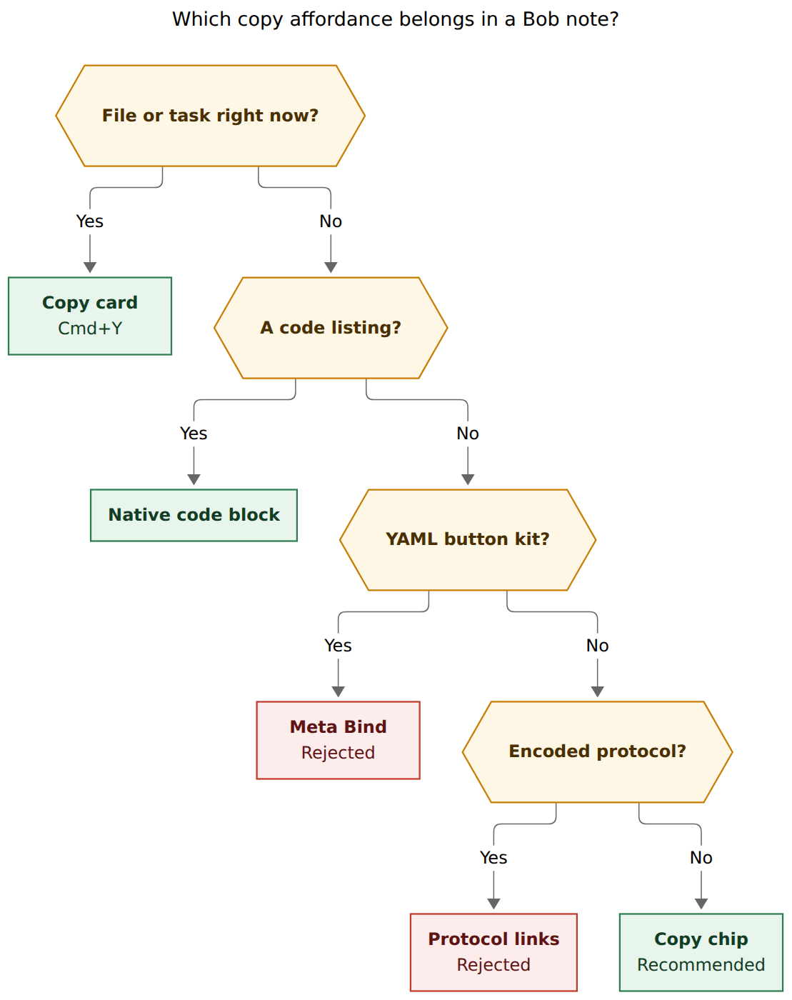
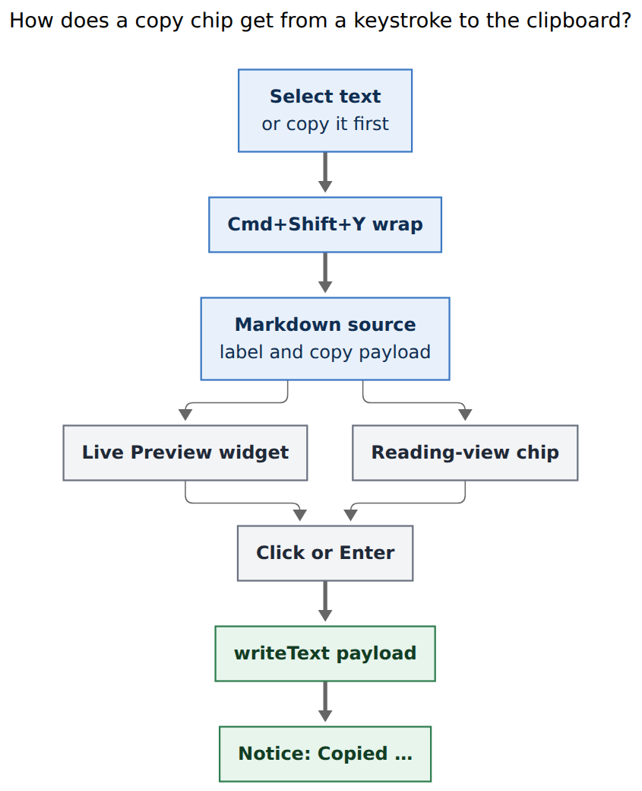
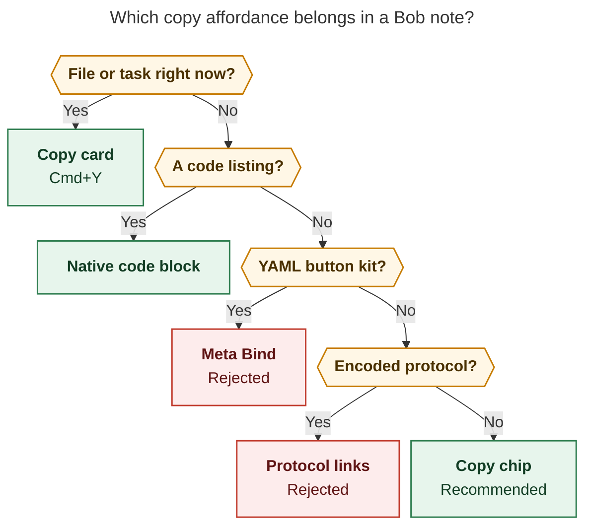
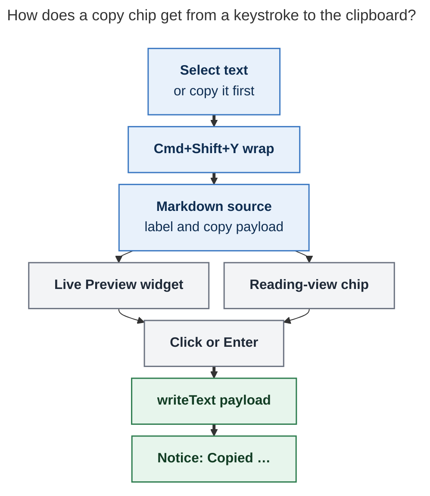

# In-note copy chips for Obsidian

> **Research query:** How should Obsidian grow a button or link that copies
> configurable text, created easily by typing, and designed so it is intuitive,
> reliable, and beautiful? Is the idea sound, would a different approach be
> better, which requirement adjustments are justified, and what solution should
> be built?

*Researcher `grk` · 2026-11-19 · Independent swarm report. Nothing was
implemented or deployed.*



**Figure 1.** Which copy affordance belongs in a Bob note? Live file or task
context uses the Copy card. A code listing uses Obsidian's native copy button.
YAML button kits and encoded protocol links are rejected. A labeled snippet in
the note becomes a copy chip. Rendered 738.73 × 934 px; fit 88.4%.



**Figure 2.** How a copy chip gets from a keystroke to the clipboard. Wrap or
paste produces markdown. Live Preview and Reading view render a chip. A click
writes the payload and shows the same `Copied …` notice the Copy card uses.
Rendered 562.609 × 694 px; fit 100.0%.

## Bottom line

- **Yes, build it — as a copy chip, not as a general-purpose button kit.** The
  request is real. Bob already copies *live context* with `Mod+Y` (the Copy
  card: path, block ID, `copy.templates`). It has no first-class way to put a
  *named, authored payload* in a note and click it. Those are different jobs
  ([E1](#evidence)). Cheat sheets, contact lines, meeting URLs, Gmail queries,
  and account numbers want the second job.
- **Do not install a community plugin, and do not adopt Meta Bind or Buttons.**
  The vault's enabled community plugins are a short, curated list: Dataview,
  Tasks, Templater, Metadata Menu, Jump to Link, Linter, relative line numbers,
  vimrc-support, plus the ten Bob plugins ([E2](#evidence)). Copy Text Protocol
  is the closest off-the-shelf product and still fails the typing, beauty, and
  fidelity tests ([E3](#evidence)). Meta Bind buttons are YAML fences whose
  copy action is inline JavaScript plus JS Engine ([E6](#evidence)). The
  Buttons plugin's own author tells people to use Meta Bind ([E5](#evidence)).
- **Recommended shape:** a new settings-free plugin `bob-copy-chips` in
  `bob-plugins`. Authoring is ordinary Markdown. Inline chips are
  `[Email](copy:bryan@example.com)` (angle-bracket the URL when the payload
  has spaces). Multiline payloads are a `bob-copy` fence. Creation is
  `Mod+Shift+Y`: wrap the selection, or paste the clipboard as a chip. The
  widget is a Bob pill, not a Bootstrap button. Click copies the exact source
  payload; the notice shows what landed, the way the Copy card already does
  ([E14](#evidence)).
- **The creation path is the feature.** A GUI button builder is the opposite of
  "easy to create by typing." A wrap/paste command plus readable Markdown is
  how this stays fast.

## Critique of the plan

### Is this a good idea

Yes, with a tight scope. The useful product is **opt-in, labeled, click-to-copy
text sitting in a note**. It is a good idea because:

1. **It fills a hole the Copy card cannot.** `Mod+Y` copies *this file, this
   task, this template over live variables* ([E1](#evidence)). An address on a
   contact note, a Zoom URL, or a `gog` query is authored once and reused from
   Reading view. Those values do not belong in `copy.templates`.
2. **Reading view and the mouse need an affordance.** In Vim, `yi`` already
   copies inline code. That is fast in Live Preview and useless once the note
   is being *read*. A chip is a control, not a selection task.
3. **Label and payload want to diverge.** A 200-character meeting URL behind
   the word "Zoom", or a Gmail search behind "Last receipt", is the case native
   code blocks and inline code both fail. Configurable-at-creation means the
   label is chosen when the chip is born.
4. **Bob already has the visual language.** Dependency and relation chips are
   clickable pills in Live Preview and Reading view, with `mousedown`
   `preventDefault` so the editor does not swallow the click ([E10](#evidence),
   [E11](#evidence)). Copy chips should look like those, not like a foreign
   button theme.
5. **The maintenance pattern already exists.** `bob-vim-yank-flash` is a small,
   settings-free plugin for one clipboard-adjacent job, with a real-Obsidian
   e2e harness ([E12](#evidence)). Copy chips should follow that shape.

It is a *bad* idea if it becomes "buttons in notes": YAML, JavaScript actions,
command runners, Templater hooks, or a builder modal. That is Meta Bind's
product, it is not easy to type, and it is a security and styling tax this
vault does not pay today ([E2](#evidence), [E6](#evidence), [E19](#evidence)).

Risks, and how the design contains them:

- **Live Preview click versus edit.** Interactive widgets in LP default toward
  "click to reveal source." Copy must win on the chip itself, edit must win on
  the surrounding line. Relation chips already solve this with a widget
  `mousedown` guard ([E11](#evidence)). Callout Copy Buttons documents the
  failure mode when you skip that work: Markdown copy does not work in Live
  Preview callouts ([E15](#evidence)).
- **A new Markdown dialect.** Every custom fence or sigil is a linter, PDF,
  and git tax. The dialect must remain valid Markdown that still reads when
  the plugin is off.
- **Payload hidden behind a label.** A chip that copies something you cannot
  see is how you paste the wrong secret. Hover always shows the exact payload.
  Copy never executes it.
- **Collision with capture `%c`.** `%c` already means *read the clipboard into
  a capture* ([E9](#evidence)). A note-local copy control must not reuse `%`.
- **Jump to Link.** `mrj-jump-to-link` is enabled and hotkeyed ([E17](#evidence)).
  A chip that is still an `<a href="copy:…">` may show up in that jumper. v1
  must not let activating it try to open a `copy:` URL in the OS.

### Would I take a different approach

I would take a different *metaphor* and a different *authoring* path from a
literal reading of "button/link":

- **Chip, not button.** Bob's interactive inline objects are chips (plan
  counts, dependency pills, relation pills). A primary-colored rectangle would
  look like a stranger in the vault. Native Obsidian's own copy control is the
  small Lucide `copy` glyph on code blocks ([E7](#evidence)), which is the
  glyph to reuse.
- **Wrap/paste, not a builder.** Meta Bind's Button Builder and YAML fence are
  how you *don't* create these by typing ([E6](#evidence)). Copy Text
  Protocol's "paste clipboard as copy-protocol link" command is the right
  *gesture* with the wrong *source format* ([E3](#evidence)).
- **Do not make every inline code span a copy target in v1.** Easy Copy, Copy
  Inline Code, and "only copy" all do click-or-double-click on `` `code` ``
  ([E8](#evidence)). That is a tempting zero-syntax slice, and it is the wrong
  v1: Bryan already yanks with Vim, accidental copies while placing the cursor
  are expensive, and it cannot do label ≠ payload. Keep it as a later,
  separate command ("copy inline code at cursor") if it is still wanted.

I would not start from `{!payload!}`, from `obsidian://copy?text=…` as the
authored form, or from a `> [!copy]` callout. Those are discussed under
[Alternatives considered](#alternatives-considered).

## Requirement adjustments

Each row is a change to the request. The original wording is on the left.

| # | You asked | I recommend | Why |
| --- | --- | --- | --- |
| **A1** | A button or link | A **copy chip** (inline pill) plus a **copy card** for multiline fences | Buttons imply a general action kit. Bob already has chips and a Copy card. The control copies; it does not navigate or run commands. |
| **A2** | Configurable text at creation | **Label and payload are independent.** When they match, the chip shows the payload. When they differ, the chip shows the label and the tooltip shows the payload. | The interesting case is a short name over a long or ugly string. |
| **A3** | Easy to create by typing | **`Mod+Shift+Y` wraps the selection** (or pastes the clipboard as a chip if there is no selection), and the resulting Markdown is also typeable by hand. No builder modal. | A wrap is one chord, sibling to `Mod+Y`. YAML is the slow path ([E6](#evidence)). |
| **A4** | *(unstated: one syntax)* | **Two syntaxes only:** inline `[label](copy:payload)` and fence `bob-copy`. | Inline covers the 90% case. Fences keep multiline payloads byte-exact without URL encoding. A third dialect (callout, `{! !}`, inline fields) is not worth it. |
| **A5** | *(unstated: where it lives)* | New plugin **`bob-copy-chips`**, settings-free, desktop *and* mobile. | Navigation Hotkeys already owns the Copy card and is a large mixin tree ([E13](#evidence)). Yank-flash is the precedent for a small clipboard plugin ([E12](#evidence)). |
| **A6** | *(unstated: dynamic text)* | **Static payload.** No `{date}`, no Templater, no live variables. | Live substitution is the Copy card's job (`copy.templates`, `{path}`, `{block_id}`). Mixing the two would make a chip copy a different string than its tooltip. |
| **A7** | *(unstated: hidden payload)* | **Never hide the payload.** Tooltip always shows it. A fence always shows a preview. | Hidden copy is how the wrong secret is pasted. Notes are not a password manager. |
| **A8** | *(unstated: click-to-copy inline code)* | **Out of v1.** A later "copy inline code at cursor" command can exist without new syntax. | See [Would I take a different approach](#would-i-take-a-different-approach). |
| **A9** | *(unstated: protocol interop)* | **Author `copy:`. Also honour `obsidian://copy?text=` on click** so a pasted Copy Text Protocol link still works. | Interop is a reader concern. Encoding is not an authoring concern. |
| **A10** | *(unstated: errors)* | Failed clipboard writes keep a visible notice and never fail silently. Empty payloads refuse to wrap. | Same contract as the Copy card ([E14](#evidence)). |
| **A11** | *(unstated: capture grammar)* | **Do not add a capture sigil, and do not reuse `%`.** | `%c` already reads the clipboard *into* a capture ([E9](#evidence)). This feature writes the clipboard *from* a note. |

## What already exists in Bob

This feature has three neighbors. They should stay neighbors, not merge.

| Neighbor | What it copies | How you invoke it |
| --- | --- | --- |
| **Copy card** (`Mod+Y`) | Path, absolute path, file name, note name, block ID, `copy.templates` over those variables | Filter-less key card in Navigation Hotkeys |
| **Native code-block copy** | The fenced body, as rendered | Obsidian's own copy glyph on ``` fences ([E7](#evidence)) |
| **PDF / Refs code copy** | Exact block bytes from bob's render-time catalog | `bob ref code` and the Mac Copy card on a Highlights PDF ([E16](#evidence)) |
| **Capture `%c`** | *(the other direction)* clipboard → vault | Capture directive ([E9](#evidence)) |
| **Vim yank** | The motion's text | `yi``, `yap`, … plus yank-flash |

Copy chips sit in the empty cell: **authored payload, in the note, click to
copy.** They must not grow into a second Copy card, a second `%c`, or a second
code-block copy button.

The clipboard write itself is a solved ten-line problem:
`navigator.clipboard.writeText`, then `Notice(formatCopiedNotice(value))`, else
a visible failure ([E14](#evidence)). Reuse that contract. Do not invent a
second notice language.

## Prior art

### Closest product: Copy Text Protocol

[Copy Text Protocol](https://community.obsidian.md/plugins/copy-text-protocol)
(plugin id `copy-text-protocol`, jldiaz, ~3k downloads, v1.1.6) registers
`obsidian://copy?text=` and copies on click. It ships a command that turns the
clipboard (or the selection, as the label) into a Markdown link, and a
Ctrl/Cmd-hover preview of the payload ([E3](#evidence)).

That is the right *gesture* (wrap/paste) and the wrong *artifact*:

- The source is URL-encoded. `[Show git log](<obsidian://copy?text=git%20log%20--oneline>)`
  is not something you type, and it is ugly in git diffs.
- In Live Preview a Markdown link is still a link: follow-with-modifier, not
  "this is a button."
- The look is a hyperlink, not a chip.
- It is another community plugin in a vault that does not take those lightly
  ([E2](#evidence)).

Honour `obsidian://copy?text=` as a *reader* so those links still copy. Do not
author them.

### Tiny inline: `{!payload!}`

[phoopee3/copy-text-to-clipboard](https://github.com/phoopee3/copy-text-to-clipboard)
turns `{!text!}` into a button. The author's write-up is explicit Figma envy:
click the swatch, get the hex ([E4](#evidence)). One GitHub star, no label ≠
payload, not valid Markdown, no Bob styling. The Figma insight is worth
keeping. The delimiter is not.

### Button kits: Buttons, then Meta Bind

[shabegom/buttons](https://github.com/shabegom/buttons) is the historical
"buttons in Obsidian" plugin. In February 2024 the author pinned an issue
titled "Meta Bind is better" and told people to migrate ([E5](#evidence)).
Copy-to-clipboard on Buttons was already a Templater/`navigator.clipboard`
hack; a 2022 forum thread shows multiple buttons on one note collapsing to
the last payload because Templater runs at note load ([E19](#evidence)).

[Meta Bind](https://www.moritzjung.dev/obsidian-meta-bind-plugin-docs/guides/buttons/)
replaced it with ` ```meta-bind-button ` YAML fences, a Button Builder, inline
`BUTTON[id]` references, and an action catalog (command, open, insert,
Templater, `inlineJS`, …). There is **no first-class copy action**. Copy is
`inlineJS` calling `navigator.clipboard.writeText`, and `inlineJS` requires
the JS Engine plugin plus Meta Bind's JavaScript setting ([E6](#evidence)).
That is a general application runtime inside notes. It is the opposite of
"easy to create by typing," and it would be the largest plugin expansion this
vault has ever taken for a one-verb feature.

### Click-to-copy existing markup

Several plugins copy *what is already on the page*:

| Plugin | Gesture | Payload |
| --- | --- | --- |
| Obsidian core | Hover copy glyph on a fence | Code-block body ([E7](#evidence)) |
| [Easy Copy](https://github.com/Moyf/easy-copy) | Command at cursor | Inline code, bold, highlight, heading/block links ([E8](#evidence)) |
| [Copy Inline Code](https://github.com/ozavodny/obsidian-copy-inline-code-plugin) | Click a glyph on `` `code` `` | Inline code; hover-only icon option |
| [only-copy / Inline Code Copy](https://github.com/lspzc/obsidian-only-copy) | Click in Reading, double-click in LP | Inline code and bold |
| [Callout Copy Buttons](https://github.com/alythobani/obsidian-callout-copy-buttons) | Buttons on callouts | Callout Markdown or plain text; Markdown copy fails in LP ([E15](#evidence)) |

These prove two things. First, **Obsidian still has no native "copy this
inline span" control**, which is why the request exists. Second, **Live
Preview needs a different click than Reading view** unless you own the
widget. Double-click in LP is a workaround for not owning the widget. Bob
should own the widget.

### Native code blocks

A fenced block already has a copy button in Live Preview and Reading view
([E7](#evidence)). For a runbook command that *should* look like code, that is
enough. A copy chip is for when you do *not* want a code listing: a compact
labeled control in a paragraph or a definition list.

## The design

### Syntax

**Inline (the default):** a Markdown link whose destination uses the `copy:`
scheme.

```markdown
[Email](copy:bryan@example.com)
[Address](<copy:123 Main Street, Apt 4>)
[bryan@example.com](copy:bryan@example.com)
```

Rules:

- The link text is the **label**. The scheme-specific part is the **payload**.
- Spaces and most punctuation live inside `<…>` (CommonMark autolink-style
  destinations). Percent-encode only `)` and characters that would break the
  destination. The wrap command does this; typed simple payloads need none.
- When label equals payload, the chip shows the payload once.
- Newlines are illegal inline. Use a fence.
- Without the plugin the source still reads as "Email" plus a curious URL.
  It does not create a wiki note, a graph node, or a Metadata Menu field.

Do **not** use `[[copy:…]]`. Wikilinks would become unresolved notes and
pollute backlinks.

Do **not** use `[copy:: payload]`. That is an inline field; Metadata Menu is
installed and would treat it as a property, and two chips on one note would
collide ([E2](#evidence)).

**Block (multiline):** a Bob fence, matching `bob-stats-strip` / `bob-plan`.

````markdown
```bob-copy Address
123 Main Street
Apt 4
```
````

The info-string after `bob-copy` is the label (optional; default `Copy`). The
body is the payload. Copy the body with a single trailing newline stripped if
present — the CommonMark fence-body convention, and the same "no extra
trailing newline" stance the PDF code catalog takes ([E16](#evidence)). Tabs,
spaces, and interior blank lines are preserved.

### Creation by typing

This is the part to get right. Ranked by how a new instance is born:

1. **`Mod+Shift+Y` wrap / paste** (the everyday path).
   - Nonempty selection → wrap as `[selection](copy:payload)`, encoding as
     needed. If the selection is already a `copy:` or `obsidian://copy` link,
     leave it (do not double-wrap).
   - Empty selection + nonempty clipboard → insert `[label](copy:clipboard)`
     with the label selected, so typing a name and hitting Tab/Escape finishes.
     Guess a label only for obvious shapes (a `mailto:`-like email, an
     `https://` URL → host, otherwise the first 24 characters).
   - Empty selection + empty clipboard → insert `[|](copy:)` with the label
     placeholder selected.
   - Visual-mode Vim uses the same command; do not overload
     `bob-vim-surround`'s `c` delimiter (`ysc` would wrap with the letter `c`).
2. **Type the Markdown.** `[Email](copy:` is memorable after one wrap. An
   EditorSuggest on `](copy:` is optional sugar, not v1.
3. **Type a fence.** `` ```bob-copy `` plus a label, same as every other Bob
   fence.

A palette command `Wrap as copy chip` (id `bob-copy-chips:wrap`) is the
command the hotkey runs. A second command `Copy chip at cursor` copies
without wrapping, for Source mode.

That is "easy to create by typing": one chord around existing text, or a
typed link whose magic word is `copy:`.

### Look

Steal from dependency chips, not from Meta Bind's `primary` / `destructive`
styles ([E10](#evidence)).

**Inline chip**

```text
  ┌──────────────────┐
  │ ⧉  Email         │
  └──────────────────┘
```

- Inline-flex pill, `border-radius: 999px`, padding `0.1em 0.5em`, gap
  `0.3em`, `font-family: var(--font-interface)`, size `0.85em`.
- Background `var(--background-secondary)`, border
  `color-mix(in srgb, var(--text-muted) 30%, transparent)`, text
  `var(--text-normal)`.
- Glyph: Obsidian's Lucide `copy` (the same icon as the native code-block
  button), not 📋. After a successful copy the glyph becomes Lucide `check`
  for 800 ms and the border uses `var(--interactive-accent)`. Respect
  `prefers-reduced-motion: reduce` (no transform, instant glyph swap).
- Tooltip: `Copy "payload"` with newlines shown as `⏎`, truncated at 60
  characters in the tooltip only — the clipboard still gets the full string.
  Same 60-character preview cap the Copy card uses
  (`COPY_CARD_NOTICE_VALUE_LIMIT`).
- Focus: `outline: 2px solid var(--interactive-accent)` on
  `:focus-visible`. The chip is `role="button"` with
  `aria-label="Copy <label>"`.

**Fence card**

```text
┌─ Address                          [⧉ Copy] ─┐
│ 123 Main Street                             │
│ Apt 4                                       │
└─────────────────────────────────────────────┘
```

- Compact card, `border-radius: 6px`, secondary background, interface-font
  label, monospace payload, no line numbers, no syntax highlighting.
- The Copy control on the right is the same pill as the inline chip.
- Long payloads scroll inside a max-height (~8 lines), they do not inflate
  the note the way a raw code block does.

Do not use theme hex colors. Do not add a settings tab for "button color."
Beauty here is restraint: one glyph, one pill, Bob's existing tokens.

### Click model

| Surface | Chip click | Click on the source line | Keyboard |
| --- | --- | --- | --- |
| **Live Preview**, cursor elsewhere | Copies. `mousedown` `preventDefault` so the cursor does not jump into the source. | Reveals Markdown, standard LP | Tab to the chip, Enter copies |
| **Live Preview**, cursor on the source | Source is visible (standard LP reveal). Wrap command still works. | Edit | — |
| **Reading view** | Copies. Never follows `copy:` as a URL. | n/a | Enter on focus copies |
| **Source mode** | No widget | Edit | `Copy chip at cursor` |
| **Mobile Reading** | Tap copies | n/a | — |

Parse the payload from the **source**, never from `innerText`. Rendered text
can fold whitespace, drop trailing spaces, and rewrite glyphs. The PDF code
catalog exists because the rendered layer is a liar ([E16](#evidence)); the
same rule applies here.

Register `obsidian://copy` as a protocol handler so a leftover Copy Text
Protocol link still copies when followed. Do not register a system-wide
`copy:` OS protocol.

Jump to Link ([E17](#evidence)): exclude `copy:` and `obsidian://copy`
destinations from the jumper, or map activation to the same copy function.
Opening them as URLs is the bug. Prove this in e2e; do not guess.

### Clipboard contract

Identical to the Copy card ([E14](#evidence)):

1. Snapshot the payload string at click (already parsed).
2. `navigator.clipboard.writeText(payload)`.
3. On success: `Copied <preview>` notice, check glyph.
4. On missing API or rejection: `Couldn't copy` notice, chip stays put.
5. Never write the vault. Never mint a block ID. Never run the payload.

Newlines stay on the clipboard. The notice and tooltip show `⏎`.

### Where it lives

**New plugin `bob-copy-chips`** under `bob-plugins/plugins/bob-copy-chips/`.

| Why a new plugin | Why not the alternatives |
| --- | --- |
| Yank-flash set the precedent for a small, settings-free clipboard plugin ([E12](#evidence)) | Navigation Hotkeys already has the Copy card plus a large mixin tree ([E13](#evidence)) |
| Ledger-tools is the chip *renderer* for plan/deps/relations, not a copy authoring surface | Putting wrap+widget+fence in ledger-tools couples unrelated jobs |
| One plugin to disable is the rollback | Meta Bind / Copy Text Protocol / Buttons are foreign runtimes ([E2](#evidence)–[E6](#evidence)) |

Implementation sketch (not a plan, a size check):

- `main.js` fragments: parse, clipboard write, wrap command, LP `WidgetType` +
  `ViewPlugin`, Reading post-processor, `bob-copy` code-block processor,
  protocol handler, styles.
- Reuse the Copy card notice helper's rules (60-char preview, `⏎`), duplicated
  rather than imported across plugins — Bob plugins do not share a runtime
  package.
- `desktop: false` in the manifest.
- Docs page `docs/copy-chips.md`, cross-linked from the Copy card page:
  "authored payloads live on copy chips; live context lives on the Copy card."
- e2e: `scripts/obsidian-copy-chips-e2e.cjs` in the existing xvfb/CDP harness,
  covering wrap, LP click, Reading click, fence body, failed write, and
  Jump-to-Link exclusion.

`bob plugins sync` deploys it like the others. No chezmoi, no `copy.templates`
change, no capture-grammar change, no Mac Capture work. Mac Capture remains a
thin client of `bob` and does not render vault widgets
(`decisions:mac-capture-is-a-thin-client`).

## Alternatives considered

| Option | Verdict | Why it loses |
| --- | --- | --- |
| Install Copy Text Protocol | Reject as authoring; honour as a reader | Encoding, hyperlink look, extra community plugin ([E3](#evidence)) |
| Install Meta Bind and write YAML copy buttons | Reject | YAML, JS Engine, no native copy action, largest plugin expansion in the vault ([E6](#evidence)) |
| Revive Buttons + Templater | Reject | Unmaintained, author says migrate, Templater-at-load copies the last payload ([E5](#evidence), [E19](#evidence)) |
| `{!payload!}` delimiter | Reject | Invalid Markdown, no label, 1 star ([E4](#evidence)) |
| `> [!copy]` callout | Reject as v1 syntax | Block-only, `>` prefixes, LP copy already known-broken in that family ([E15](#evidence)). A CSS-styled callout can wait. |
| Click-to-copy every `` `inline code` `` | Reject as v1; maybe a later command | No label, fights caret placement, Vim already yanks this ([E8](#evidence)) |
| Native code block only | Keep for actual code | Too large, looks like code, no label ([E7](#evidence)) |
| DataviewJS buttons | Reject | Opposite of typing; JS in notes |
| `[copy:: field]` inline fields | Reject | Metadata Menu / Dataview property, one key per note ([E2](#evidence)) |
| `[[copy:payload]]` wikilink | Reject | Unresolved notes, graph noise |
| Capture sigil / `%copy` | Reject | `%c` is the opposite direction ([E9](#evidence)) |
| Put it in Navigation Hotkeys | Reject | Copy card lives there; this is rendering + wrap, and the tree is already large ([E13](#evidence)) |
| Dynamic `{date}` chips | Reject | Copy card templates already do live substitution ([E1](#evidence)) |

The Figma "click the swatch" feel *is* the right UX. The chip *is* that
swatch. The `{! !}` plugin had the right envy and the wrong dialect.

## Reliability and tests

Must-hold invariants:

1. **Preview equals clipboard.** The tooltip string (full, not truncated) is
   the string `writeText` receives.
2. **Source equals payload.** Parsing reads the editor document or the
   Reading-view section's Markdown, not the DOM's `innerText`.
3. **Copy never writes the vault.**
4. **Empty and broken destinations do not copy.** They show a reason.
5. **A click on the chip does not move the LP caret into the source.**
6. **`q` / `Ctrl+[` / Escape are irrelevant** (no modal). The chip is not a
   card. Do not steal those keys.
7. **Without the plugin, the note remains readable Markdown.**

Test layers, matching yank-flash and the decay card ([E12](#evidence)):

- Node unit tests for parse/encode/wrap (no Obsidian).
- xvfb + CDP e2e: wrap a selection, click in LP, click in Reading, copy a
  fence body including an interior blank line, refuse an empty payload, show
  the failure notice if `writeText` is stubbed to reject, and confirm Jump to
  Link does not open `copy:`.

## Out of scope

- Running commands, opening notes, inserting templates, or evaluating JS.
- A settings tab, color picker, or per-chip CSS class.
- Making every inline code span copy-on-click.
- Mac Capture, Highlights PDF code copy, and `copy.templates`.
- A capture grammar change.
- Password-manager features (hidden payloads, auto-clear clipboard).
- Publishing / third-party Markdown previewers rendering the chip.

## Recommended solution

Build **`bob-copy-chips`**, a small Bob plugin that does one verb.

**Authoring**

- Inline: `[Email](copy:bryan@example.com)` and
  `[Address](<copy:123 Main Street, Apt 4>)`.
- Multiline: ` ```bob-copy Address ` with the body as the payload.
- Create with `Mod+Shift+Y` (command `bob-copy-chips:wrap`): wrap a
  selection, or paste the clipboard as a chip. The Markdown is also typed by
  hand. No YAML, no builder.

**Rendering**

- Live Preview: `WidgetType` pill, `mousedown` guarded, same tokens as
  dependency chips, Lucide `copy` glyph.
- Reading view: post-processor replaces `copy:` and `obsidian://copy` links
  with the same pill; `bob-copy` fences become compact cards.
- Source mode: raw Markdown plus `Copy chip at cursor`.

**Copy**

- `writeText` of the source payload, then the Copy card's `Copied …` notice.
- Tooltip always shows the payload. Failures stay on screen. Nothing is
  executed.

**Place in the family**

- `Mod+Y` — Copy card — *this* file, *this* task, live templates.
- `Mod+Shift+Y` — copy chip — *this* authored snippet, in the note.
- Native fence copy — *this* is actually code.
- `%c` — clipboard *into* a capture.

That is the intuitive, reliable, and beautiful version of the request: not a
button framework, a chip you type.

## Evidence

| # | Fact | Source |
| --- | --- | --- |
| **E1** | The Copy card (`Mod+Y`, command `copy-active-file-path`) copies path / absolute path / file name / note name / block ID and `copy.templates`. Preview and clipboard are snapshotted together. It does not author in-note payloads. | bob-plugins `docs/copy-card.md`; `src/101-copy-card-model.js`; bob-cli `docs/reference/plugins/copy-card.md` |
| **E2** | Enabled community plugins in `~/bob/.obsidian/community-plugins.json`: Dataview, Tasks, Templater, Metadata Menu, Jump to Link, Linter, relative line numbers, vimrc-support, and the ten Bob plugins. No Meta Bind, Buttons, Copy Text Protocol, Easy Copy, or Copy Inline Code. | `~/bob/.obsidian/community-plugins.json` and `plugins/` listing, 2026-11-19 |
| **E3** | Copy Text Protocol authors `[label](obsidian://copy?text=…)` links, URL-encodes payloads, wraps from clipboard/selection, and previews on Ctrl/Cmd-hover. ~3k downloads, v1.1.6. | [community plugin page](https://community.obsidian.md/plugins/copy-text-protocol) |
| **E4** | `{!text!}` becomes a copy button. Author cites Figma click-to-copy. 1 GitHub star. Label always equals payload. | [jasonlawton.com write-up](https://jasonlawton.com/plugins/copy-text-to-clipboard/); [phoopee3/copy-text-to-clipboard](https://github.com/phoopee3/copy-text-to-clipboard) |
| **E5** | Buttons' author pinned "Meta Bind is better" (2024-02-01) and pointed users at Meta Bind. | [shabegom/buttons#208](https://github.com/shabegom/buttons/issues/208) |
| **E6** | Meta Bind buttons are `meta-bind-button` YAML fences plus a Button Builder. Actions include command, open, insert, Templater, `inlineJS`. `inlineJS` requires JS Engine and Meta Bind's JavaScript setting. No first-class copy action. | [Buttons guide](https://www.moritzjung.dev/obsidian-meta-bind-plugin-docs/guides/buttons/); [inlineJS reference](https://www.moritzjung.dev/obsidian-meta-bind-plugin-docs/reference/buttonactions/inlinejs/) |
| **E7** | Obsidian core paints a copy glyph on fenced code blocks in Live Preview and Reading view. It does not paint one on inline code. | Core editor behavior; community plugins exist specifically to fill the inline gap ([E8](#evidence)) |
| **E8** | Easy Copy copies at-cursor inline code and other markup. Copy Inline Code adds a clickable glyph on `` `code` ``. only-copy uses click in Reading and double-click in LP. | [Moyf/easy-copy](https://github.com/Moyf/easy-copy); [ozavodny/obsidian-copy-inline-code-plugin](https://github.com/ozavodny/obsidian-copy-inline-code-plugin); [lspzc/obsidian-only-copy](https://github.com/lspzc/obsidian-only-copy) |
| **E9** | Capture `%c` / `%c<N>` *reads* the clipboard into a capture item. `%` is the directive sigil. A unknown `%copy` is `unknown_directive`. | bob-cli `docs/capture.md` (Directives / Clipboard) |
| **E10** | Dependency chips are inline-flex pills using `--background-secondary`, `color-mix` borders, 999px radius, hover lift, `:focus-visible` outline, `prefers-reduced-motion`. | bob-plugins `plugins/bob-ledger-tools/styles.css` (`.bob-dep-chip`) |
| **E11** | Relation chips are a CodeMirror `WidgetType` whose DOM `mousedown` handler detects interactive targets so LP clicks do not fall through as caret moves. | bob-plugins `plugins/bob-ledger-tools/src/153-relation-widget.js` |
| **E12** | `bob-vim-yank-flash` is a small settings-free plugin with an xvfb/CDP e2e (`scripts/obsidian-vim-yank-flash-e2e.cjs`). | bob-plugins `docs/bob-vim-yank-flash.md`; `docs/develop/validation.md` |
| **E13** | bob-plugins currently ships ten plugins. Navigation Hotkeys' `src/` is a large mixin tree that already includes the Copy card (`101-copy-card-*.js`, `641-plugin-copy-card.js`). | bob-plugins `README.md` ("ten custom Obsidian plugins"); `plugins/bob-navigation-hotkeys/src/` listing |
| **E14** | Copy card writes with `navigator.clipboard.writeText(row.value)` and reports `Copied <value>` via `formatCopiedNotice`; unavailable clipboard returns `{ ok: false, reason: "clipboard is unavailable" }`. Image zoom uses the same write-and-toast pattern. | `src/641-plugin-copy-card.js`; `src/207a-image-zoom-origin.js` |
| **E15** | Callout Copy Buttons: Markdown copy is unavailable in Live Preview callouts and in nested Reading-view callouts. | [plugin page](https://community.obsidian.md/plugins/callout-copy-buttons); [alythobani/obsidian-callout-copy-buttons](https://github.com/alythobani/obsidian-callout-copy-buttons) |
| **E16** | PDF code copy reads bob's render-time catalog, never the PDF text layer or a second Markdown parse, because rendered layers disagree on whitespace and glyphs. | `decisions:code-copy-reads-render-time-catalog` |
| **E17** | Jump to Link is enabled and hotkeyed (`mrj-jump-to-link:activate-jump-to-link`). | `~/bob/.obsidian/community-plugins.json`; `~/bob/.obsidian/hotkeys.json` |
| **E18** | Templater is installed. Navigation Hotkeys only keeps its new-note trigger on; it is not an in-note button runtime. | `docs/templater-trigger.md`; plugin list in [E2](#evidence) |
| **E19** | Forum, 2022-12-19: Buttons + Templater `navigator.clipboard.writeText` on several buttons on one note copies only the last payload, because Templater expands at load. | [I want to make a button to copy text I specify to the clipboard](https://forum.obsidian.md/t/i-want-to-make-a-button-to-copy-text-i-specify-to-the-clipboard/50005) |
| **E20** | bob-cli ignores unknown top-level config keys; `copy.templates` is documented as Copy-card-only. No change is required there for in-note chips. | bob-cli `docs/reference/configuration.md` (`copy.templates`) |

## Open questions

These do not block the recommendation. They are implementation choices for
whoever builds it.

1. **Default hotkey.** `Mod+Shift+Y` is the obvious sibling of `Mod+Y`. Confirm
   it is free in `~/bob/.obsidian/hotkeys.json` before shipping a default
   binding; if it collides, ship the command unbound and recommend the chord
   in the docs.
2. **Jump to Link behavior.** Exclude versus "activate copies." Exclusion is
   safer; activation-copies is nicer. Measure in e2e.
3. **Linter.** Obsidian Linter is enabled. A one-note fixture should prove it
   does not rewrite `copy:` destinations or angle-bracket URLs. If it does,
   add an ignore or a rule exception rather than changing the dialect.
4. **Later, not v1:** a "copy inline code at cursor" command, and CSS for a
   `[!copy]` callout if fence cards are not enough for some notes.

## Appendix: diagram source

Mermaid CLI `@mermaid-js/mermaid-cli@12.0.0`, PDF-mirroring config (strict,
neutral, DejaVu Sans). Approach figure 738.73 × 934 px, fit 88.4%. Lifecycle
figure 562.609 × 694 px, fit 100.0%.




