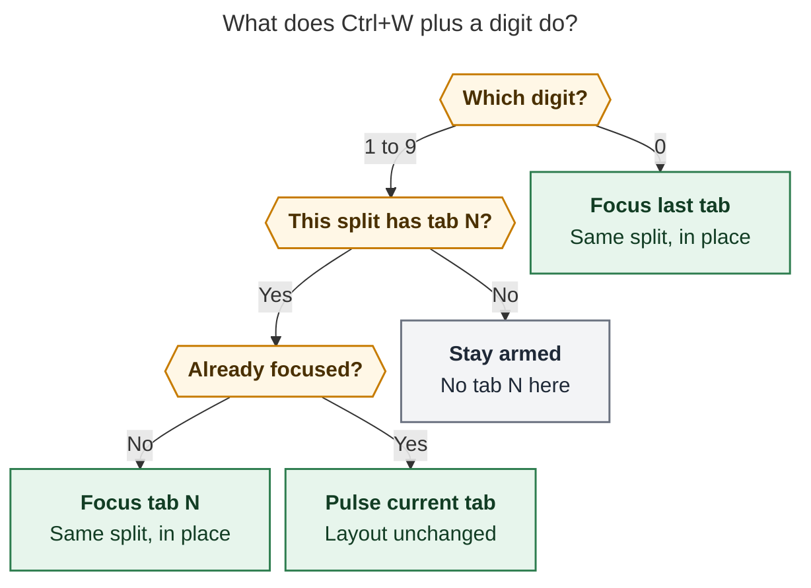
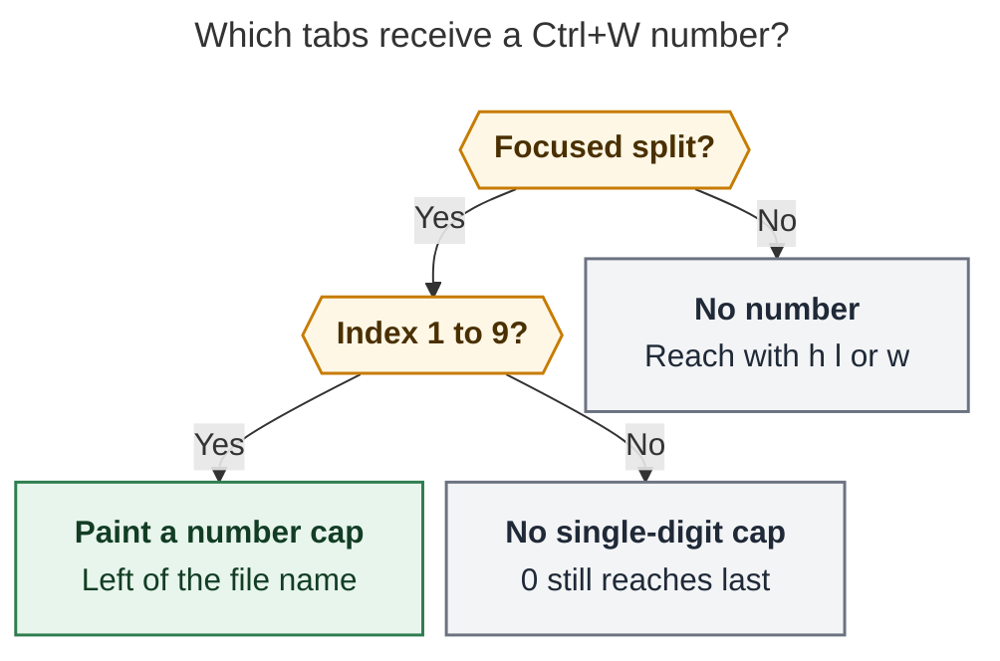

# Ctrl+W N should jump the focused split's Nth tab, with instant title-bar hints

> **Research query:** How should Bob add `<ctrl+w>N` keymaps that jump to the Nth
> Obsidian tab, with N taken from a hint next to each file name in the tab title
> bar, while keeping that tab in the same vertical window? Is the request a good
> idea, would a different approach be better, which requirement adjustments are
> justified, and what is the recommended solution?

## Bottom line

**Build it, as the second half of the shipped Ctrl+W window prefix — with five
required adjustments.** Digits are already reserved on that prefix
(`plan:202611/obsidian_ctrl_w_window_prefix.md`, `docs/window-keys.md`). Native
Obsidian already binds Mod+1–8 / Mod+9, but those chords have no hints, they
use Cmd on the Mac, and they can act on a sidebar group. The new verbs belong
on the prefix Bryan just learned, painted with the same theme-native key-cap
language as the window ring.

The request as written is slightly too global and slightly too late. Number
**only the focused main-area split**, left to right, and jump **in place**.
Paint the numbers at **arm (0 ms)** on that split's tab titles, not after the
300 ms window card, and never as always-on chrome. Do not reparent, do not
mutate the title string, and do not spend the digit keys on numbered splits.

## Verdict: good idea

The daily layout in `~/tmp/screenshots/20261115_171818.png` is the whole
argument. Left split: pinned `20261115`, pinned `dash`, active `sase_blog`.
Right split: `sase_blog_contents`. Window keys now move *between* those
columns. Nothing in the prefix yet jumps *along* a column. Bob already has
in-group tab verbs (`move-tab-left` / `move-tab-right`, pin, close-others),
and Obsidian already has Mod+1–8, but neither is a Vim-shaped, hinted,
main-area-only jump.

This is the natural next chord:

| Family | Keys | Unit |
| --- | --- | --- |
| Focus a split | `h` `l` `w` | column |
| Move a tab across splits | `H` `L` | tab, reparented |
| Split | `v` | new column |
| **Jump a tab in this split** | **`1`–`9` `0`** | **tab, in place** |

Pinned daily + dash on the left make positional numbers muscle memory: after a
week, `Ctrl+W 1` is today, `Ctrl+W 2` is dash, `Ctrl+W 3` is the task note,
without looking. Hints exist so the first week, and any crowded day, stay
honest.

I would not solve this with a community plugin, a vimrc `gt` map, a modal, or
always-on CSS counters. Those each fail a requirement the prefix already
satisfies: work outside the editor, show a truthful hint, stay in Bob's visual
language, and refuse to close or clone a note.

## Critique of the stated plan

The request is three sentences:

1. `<ctrl+w>N` jumps to the Nth Obsidian tab.
2. N comes from a hint next to each file name in the tab title bar.
3. The jumped-to tab stays in the same vertical window it occupied before the
   chord.

Those are the right *family* of requirements. Three readings of them are
wrong, and one of them is the reading I almost took.

**"Nth Obsidian tab" is not a global index.** Numbering every leaf in the
window 1–N would paint `4` on `sase_blog_contents` while the left split shows
`1 2 3`. Pressing `4` would then *leave* the current column. Window keys
already leave the column (`h` `l` `w`). Digit keys should stay inside it.
Native go-to-tab and the Tab Numbers plugin both number **the active tab
group**, not the whole window. Match that.

**"Remaining in the same vertical window" is a no-reparent rule, not a
global-jump rule.** `H`/`L` already move a tab into the neighbouring split.
`N` must never do that. The destination leaf stays in its `WorkspaceTabs`
parent. Combined with per-split numbering, the user also stays in the current
column. That is the intended product: jump along the bar you are looking at.

**Hints that appear only on the 300 ms card are too late.** Fluent `Ctrl+W l`
is 150–250 ms and never sees the card. Fluent `Ctrl+W 3` is the same speed,
but unlike `l` it is not spatial. You cannot press `3` until you know which
tab is `3`. The numbers have to be on the titles at arm, in the same 90 ms
fade as the ring. The card can *repeat* them as chips; it cannot be the only
place they live.

**Always-on numbers would fight the layout.** The screenshot's tab bar is
already the densest chrome on screen: pin, icon, title, close, extra-tabs
chevron, new-tab, the new focused-split underline. Permanent 1–9 badges on
every split duplicate across columns, steal title width, and go stale the
moment a tab is dragged. The prefix *is* the reveal gesture. Use it.

**Digits were reserved for "numbered splits" in the window-prefix phase-2
table.** That reservation should be retired. Two or three columns make
numbered splits redundant with `h`/`l`/`w`. Numbered *tabs* are what the
screenshot is missing. Vim counts (`Ctrl+W 3 l`) would eat the same keys and
should stay out of this family.

## Called-out requirement adjustments

These change the request. Each is required for the design below.

| # | Adjustment | Why |
| --- | --- | --- |
| A1 | **Number and jump only the focused main-area split.** Other splits stay unnumbered. | Native go-to-tab and Tab Numbers are already per-group. Global numbers would either duplicate (`1` on every bar) or steal focus into the other column. `h`/`l`/`w` already change columns. |
| A2 | **`N` focuses in place. It never reparents.** | This is the "same vertical window" rule. `H`/`L` remain the only keys that move a tab. |
| A3 | **Hints paint at arm (0 ms), armed-only, on the focused split's titles.** | You cannot type a number you cannot see. The 300 ms card is the window-key teacher, not the tab-index teacher. Always-on numbers clutter the bar. |
| A4 | **`1`–`9` are honest positions; `0` is last.** Do not copy Chrome/Obsidian's `9` = last. | If the ninth title shows `9`, `9` must land there. `0` covers "last tab" once there are ten or more. Native Mod+9 stays last on the *native* chord. |
| A5 | **Paint a key-cap in the icon slot. Do not mutate the title text. Do not use CSS counters.** | Title mutation breaks tooltips and file names. CSS `counter()` on tab headers painted every tab as `0` after Obsidian 1.8.4. Flow-layout badges shift the bar and can overflow a tab that was visible. |
| A6 | **Retire "numbered splits" and Vim counts from the digit keys.** | The screenshot has two columns and three left tabs. Digits are worth more on tabs. A later `g` then digit could number splits if that ever matters. |
| A7 | **Do not record a Bob `Ctrl+O` jump.** | Same contract as the other window keys. Vim `gt` does not touch the jumplist. Each tab keeps its own cursor. |

Not required, and not in v1: `t` / `T` for next / previous tab in the focused
split. Native Ctrl+Tab already exists. Add it later if the prefix feels
one-sided.

## Recommended solution

### What you type

After `Ctrl+W` (same arming gate as today: main window, main-area leaf, Vim
normal/visual with an empty buffer, or a non-editable view):

| Keys after `Ctrl+W` | Action | Behavior |
| --- | --- | --- |
| `1`–`9` | Focus tab N in this split | 1-indexed, left to right, including pinned tabs, empty tabs, PDFs, reading view, images. Never wraps. Never leaves the split. Never reparents. |
| `0` | Focus the last tab in this split | Same tab as `N` when there are N ≤ 9 tabs. The way to reach tab 10+ without a two-key sequence. |
| held Ctrl | accepted | `Ctrl+W Ctrl+3` equals `Ctrl+W 3`, same as `Ctrl+W Ctrl+L`. |
| a missing index | stay armed | Edge bump on the tab bar plus "no tab 5". Same contract as a blocked `h`. |
| the current tab's index | success | Prefix disarms, destination header pulses. Layout unchanged. |

Shifted digits (`!` `@` …) are not aliases. Numpad digits count. Meta/Alt
still cancel and pass through.

### What you see at 0 ms

On the **focused** split only, each of the first nine tab headers grows a
16×16 rounded key-cap in the **icon slot**, immediately left of the file
name:

```text
[1] 20261115   [2] dash   [3] sase_blog*
                                    sase_blog_contents
```

- Current tab: accent fill, `--text-on-accent`, matching the existing `⌃W`
  badge.
- Other numbered tabs: `--background-secondary`, `--text-muted`, 1 px
  `--background-modifier-border`.
- Unfocused split: no numbers. Its selected title is already on the minimap
  with an `h` / `l` cap.
- Pinned tabs keep the pin glyph; the number sits between pin and title, or
  overlays the file icon when there is no pin.
- The cap is `pointer-events: none`, `flex-shrink: 0`, interface-adjacent
  monospace 10 px / weight 650, 4 px radius (key-cap, not a purple circle).
- Fade in 90 ms with the ring; `prefers-reduced-motion` skips the fade.
- Disarm removes every cap. Unload removes every cap.

The file name string is never rewritten. Tooltips, drag, pin, and close stay
Obsidian's.

### What you see at 300 ms

The existing window card stays the window-key teacher. Add one chip row
**inside the active minimap pill**, not a third column of `1`–`9` rows that
would crowd `h`/`l`/`H`/`L`:

```text
┃ [1] 20261115  [2] dash  [3] sase_blog  ┃ │ sase_blog_contents [l]│
```

The current chip is accent. Overflow past nine collapses to `+N`. The FOCUS /
TAB grid is unchanged. Footer still says `esc · q cancel`.

A successful jump pulses the destination header (~220 ms, same as the
window-key destination pulse) and may show a one-line receipt
(`tab 2 · dash`). No `Notice` for the happy path.

### What the executor does

Reuse the live snapshot's focused split. Resolve tab N from **visual order**:
`group.children`, the same order as the tab bar, not `iterateRootLeaves`
order (the current snapshot filters `iterateRootLeaves` by parent; the spike
must prove those match, and the model should sort by `children` anyway).

Then, and only then:

1. `group.selectTab(leaf)` so the header selects even if focus is slow.
2. `workspace.revealLeaf(leaf)` so a deferred or overflowed leaf actually
   loads (`focusWorkspaceLeaf` in `630-plugin-vim-link-and-leaves.js` already
   does this; `focusWindowPrefixLeaf` today only calls `setActiveLeaf` and
   should gain the same reveal).
3. `workspace.setActiveLeaf(leaf, { focus: true })`.

Never `removeChild` / `insertChild`. Never `openFile`. Never
`duplicateLeaf`. The leaf's parent before and after must be the same
`WorkspaceTabs`. The main-area leaf count must be unchanged. Undo history,
cursor, scroll, folds, pin, view mode, and back/forward history survive
because the leaf never moved.

Do not dispatch through native `workspace:goto-tab-N`. Those commands follow
the last-interacted group, which can be a sidebar, and they treat `9` as
last. Slightly Better Tab Commands exists because that targeting surprises
people. Bob's planner already knows the main-area focused split.

### Palette commands

No default hotkeys, same as the window verbs:

- Go to tab 1 … Go to tab 9
- Go to last tab

Each routes through `planWindowPrefixKey` / `executeWindowPrefixPlan` so a
blocked index shows the same reason as the prefix. Native Mod+1–8 remain
untouched.

## Why this is the beautiful version

Prior art is useful and the wrong look.

| Approach | What it gets right | Why Bob should not ship it |
| --- | --- | --- |
| Native Mod+1–8, Mod+9 = last | Per-group, 1-indexed, no extra plugin | No hints. Cmd on macOS, so it is not the Ctrl+W family. Can hit a sidebar group. `9` = last lies if a ninth title is showing. |
| Tab Numbers (`j4ckofalltrades/obsidian-tab-numbers`) | Per-active-split, hold-modifier reveal, injects a badge, uses `leaf.tabHeaderEl` | Hold-Ctrl false-positives on Ctrl+S / insert-mode Ctrl+W / the prefix itself. Default purple 18 px circle. Inserts *before the close button*, far from the name on a wide tab, and takes flow space so titles shift. Only numbers markdown/canvas/pdf plus a fragile empty-leaf scan. |
| Tab Selector "show tab shortcuts" | Letter hints, `setActiveLeaf(leaf, { focus: true })` | 2 rem labels *below* the bar, not next to the name. Opens a hidden modal. Letters, not N. Index-maps leaves to headers by DOM position. |
| CSS `counter()` on `.workspace-tab-header` | Zero JS | Forum reports every tab as `0` after Obsidian 1.8.4. Always on. Both splits numbered. No jump executor. |
| EasyMotion-style letters on every tab in every split | Scales past nine, home-row | Cross-split jump, extra alphabet, fights `N` as stated. |

Bob's version should look like the window prefix that already shipped: theme
variables only (`--interactive-accent`, `--text-on-accent`,
`--background-secondary`, `--text-muted`, `--background-modifier-border`,
`--shadow-s`), 8 px grid, no emoji, no settings, key-caps rather than
circles, and a painter that can be screenshot in light and dark.

The icon-slot overlay is the beauty constraint that matters most. A flow
badge (Tab Numbers) pushes `sase_blog` toward the extra-tabs chevron the
moment you arm. An overlay *under* the bar (Tab Selector) is a second, louder
layer. Covering or occupying the 16 px icon the eye already treats as "start
of tab" puts N next to the name with no layout shift. Spike that. If the icon
slot clips the cap, fall back to a `position: absolute` pill on
`.workspace-tab-header-inner` that still does not change flex widths.

## Implementation path

All product code stays in **bob-plugins**, plugin `bob-navigation-hotkeys`.
This is not a bob-cli, capture, or Mac Capture change. Do not install Tab
Numbers into the vault.

The window-prefix machine already has the right seams:

| Piece | Today | Tab jump |
| --- | --- | --- |
| Pure model `266-window-prefix-model.js` | `h l w H L v`, unmapped printable digits | Add `planWindowPrefixGotoTab`; put `0`–`9` in `WINDOW_PREFIX_KEY_TABLE` with group `tabs`; view model grows `tabHints: [{ key, leafId, label, current, overflow }]` |
| Live adapter `267-window-prefix-actions.js` | Snapshot by `iterateRootLeaves`; `focusWindowPrefixLeaf` = `setActiveLeaf` | Sort each split's leaves by `group.children`; execute `selectTab` + `revealLeaf` + `setActiveLeaf`; invariant: parent unchanged, leaf count unchanged |
| Painter `473-window-hint-view.js` | Pure overlay, no workspace access | Keep it pure. A thin adapter in the prefix mixin maps `tabHints` onto `leaf.tabHeaderEl` / `.workspace-tab-header-inner-icon` and calls `showTabHints` / `hideTabHints`. Overlay-on-rects is the fallback if injection fires `layout-change`. |
| Prefix `687-plugin-window-prefix.js` | Digits are unmapped printable ("‹3› isn't a window key") | Map them. Paint tab hints in `showArmed` (0 ms). While armed, a `layout-change` whose snapshot *signature* (split ids + leaf ids in order) is unchanged refreshes caps instead of cancelling — title edits and our own injection must not disarm. |
| Commands `688-plugin-window-prefix-commands.js` | six window verbs | nine goto-tab commands plus last-tab |
| Docs `docs/window-keys.md` | key table, Linux, scope | new rows, the no-reparent line, Linux still `keep` |
| Tests | model / actions / prefix / hint-view / e2e / preview | decision-contract vectors below; preview states with 1 / 3 / 9 / 10 tabs, light and dark; e2e `--only tabs` on athena |

Fragment budget: prefer extending `266` / `267` / `473` / `687` / `688`. Split
only if a file would pass 1000 lines. Test exports follow
`721-window-prefix-actions-exports.js`.

Linux `linux_ctrl_w = keep` still applies: if Close tab already handled
Ctrl+W, the prefix stays idle and digits never run. macOS is unchanged
(Ctrl+W unbound; Cmd+W still closes; Cmd+1–8 still native).

Window motions still do not record `Ctrl+O`. v1 still does not close a note.

### Decision contract (acceptance vectors)

`*` is the focused tab, `'` the selected tab of an unfocused split, `!` a
pin. `|` is a split. These are unit-planner and real-Obsidian e2e vectors.

```text
Jump in group:     [ A  B*  C ]              1 → [ A* B  C ]
Jump current:      [ A  B*  C ]              2 → [ A  B*  C ]     (pulse, disarm)
Jump last of three:[ A  B*  C ]              3 → [ A  B  C* ]
Jump last alias:   [ A  B*  C ]              0 → [ A  B  C* ]
Missing index:     [ A  B*  C ]              9 → unchanged, stay armed, "no tab 9"
Pins count:        [ P!  Q!*  R ]            1 → [ P!* Q!  R ]
Empty and PDF:     [ (empty)*  doc.pdf ]     2 → [ (empty)'  doc.pdf* ]
Does not cross:    [ A  B* ] | [ C' ]        1 → [ A* B ] | [ C' ]
Does not steal:    [ A  B* ] | [ C' ]        3 → unchanged, stay armed
Does not reparent: [ A  B* ] | [ C' ]        2 → [ A  B* ] | [ C' ]
                   (parent of B unchanged; C still alone on the right)
Sole tab:          [ A* ]                    1 → pulse; 2 → stay armed
After v:           [ A' ] | [ A* ]           1 → pulse on the right copy
                   (each split's 1 is its own first tab)
```

Insertion / close / pin stay out of this family. `H`/`L` tests remain the
authority for reparenting.

### Spike (athena, existing CDP harness)

Do this before painting badges. The window-prefix e2e already has spike /
prefix / visual groups; add `--only tabs` probes:

1. `leaf.tabHeaderEl` and `.workspace-tab-header-inner-icon` exist on
   Obsidian 1.15.1 for markdown, empty, reading view, PDF, and image leaves.
2. Occupying the icon slot does **not** fire a `layout-change` that the
   prefix would treat as foreign. If it does, use a fixed overlay on title
   rects and never mutate the header tree.
3. `group.children` order equals the visible tab-bar order, including pins
   and an overflowed extra-tabs menu.
4. `selectTab` + `revealLeaf` + `setActiveLeaf` focuses a deferred background
   tab and an overflowed tab without cloning it.
5. Stacked-tabs mode: either number the stacked headers correctly or declare
   stacked layouts out of v1 with a dimmed card line.
6. Native `workspace:goto-tab-1` targeting: confirm it can follow a sidebar
   group, which is why Bob must not call it.

If (2) fails, the overlay fallback is still "next to each file's name" as
long as the pill is pinned to the title's left edge, not dumped under the
bar.

## Alternatives I considered and rejected

**Use native Mod+1–8 and ship only the badges.** Closest to Tab Numbers.
Rejected: Bryan's new muscle memory is `Ctrl+W`, native is Cmd on the Mac,
hold-modifier badges fire on every Cmd/Ctrl chord, and native targeting is
the wrong group. Keep native chords as they are; do not make them the
feature.

**Global unique numbers across all splits.** Satisfies a literal reading of
"Nth Obsidian tab" and of "the tab remains in its window" (focus-in-place
into the other column). Rejected: the hint would live on a bar you are not
looking at, `4` would duplicate the job of `l`, and two splits with three
plus one tabs is exactly the screenshot. Cross-split travel stays `h`/`l`/`w`
then a digit.

**Letter hints (`a s d f`) on every visible tab.** Scales past nine, home
row. Rejected: the request is `N`, digits are reserved, and pinned daily/dash
make positions worth memorising. Letters are a fine overflow follow-up, not
v1.

**vimrc `nnoremap Ngt` / plugin `gt`.** Real Vim. Dead in reading view and
PDFs, no hint, and this vault already documented that a vimrc `<C-w>` map
never fires because the prefix owns Ctrl+W.

**A Tab Selector-style modal.** Searchable, works for twenty tabs. Heavier
than a prefix suffix, hides the titles the request wants to hint, and Return
vs hint-key is a new decision. Command Mode already searches notes.

**Always-on quiet numbers.** Some people want them. They make the screenshot
noisier every hour of the day for a chord used a few times an hour. No
settings in this plugin. If Bryan later asks for persistent numbers, it is a
CSS class the armed painter already knows how to paint.

**`9` = last, only badge 1–8.** Matches native and Tab Numbers. Rejected
because the hint would have to omit `9` or lie. Honest `1`–`9` plus `0` =
last is the prefix's privilege: we own both the key and the cap.

## Risks

- **Header mutation vs `layout-change`.** If injecting a cap cancels the
  prefix, the feature is unusable. Spike item 2; overlay fallback is
  designed.
- **`iterateRootLeaves` order ≠ tab-bar order.** Numbering would lie. Sort by
  `group.children`.
- **Overflowed tabs.** Caps cannot paint on a header that is in the extra
  menu. Those tabs remain jumpable by memorised index; `0` still reaches the
  last. A `+N` on the chevron is a polish follow-up.
- **Ten or more tabs.** v1 does not invent two-key sequences. `0` is the
  escape hatch. A later EasyMotion layer can reuse the same painter.
- **Stacked tabs.** Unknown on 1.15.1 without the spike. Do not guess.
- **Tab Numbers installed later.** Two badge systems would stack. Docs should
  say Bob owns armed tab numbers; leave Tab Numbers disabled in this vault.

## Recommended phases

1. **Spike** the six probes above on athena against Obsidian 1.15.1.
2. **Model + executor:** `0`–`9` plans, `children`-order snapshot, in-place
   focus with parent/count invariants, unit vectors.
3. **Hints:** 0 ms icon-slot caps, card chips, pulse, preview harness in
   light/dark at 1 / 3 / 9 / 10 tabs and two splits (only the focused bar
   numbered).
4. **Prefix + commands + docs + e2e:** map digits, refresh-on-same-signature,
   palette commands, `docs/window-keys.md`, `--only tabs` on the real
   screenshot layout `[ 20261115!  dash!  sase_blog* ] | [ sase_blog_contents' ]`.

Ship it as a nav patch bump on top of 2.83.1. No decisions-memory edit
(`window_prefix_record = no` still holds unless Bryan asks). No
`hotkeys.json` edit.

## Figures

**Reader question:** What happens when the armed prefix receives a digit?

**Caption:** Digits 1–9 focus that tab of the focused split in place; 0
focuses the last tab; a missing index stays armed; the current tab pulses.



Rendered size: 706.7 × 736 px; fit scale: 92.4%. mermaid-cli 12.0.0, PDF
configuration.



**Reader question:** Which tabs receive a number cap?

**Caption:** Only the focused split is numbered 1–9 left to right; other
splits stay unnumbered and are reached with h, l, or w; tabs past nine have
no single-digit cap, and 0 still reaches last.



Rendered size: 569.3 × 538 px; fit scale: 100%. mermaid-cli 12.0.0, PDF
configuration.



## Sources

Independent design research, 2026-11-16. No product code was changed. Peer
reports from this swarm were not read.

- Epic and plan: bead `bob-cli-m0`, `plan:202611/obsidian_ctrl_w_window_prefix.md`
  (digits reserved for later; layout-only family; two-tier hint; Linux
  `keep`; `selectTab` already a move-canary API).
- Shipped prefix: `docs/window-keys.md`; model
  `plugins/bob-navigation-hotkeys/src/266-window-prefix-model.js`; adapter
  `267-window-prefix-actions.js` (`iterateRootLeaves`, `selectTab`,
  `setActiveLeaf`); painter `473-window-hint-view.js` (no workspace access);
  prefix `687-plugin-window-prefix.js`; leaf focus with `revealLeaf` in
  `630-plugin-vim-link-and-leaves.js`; focused-split underline in
  `styles.css`; e2e `scripts/obsidian-window-prefix-e2e.cjs`.
- Prior window-prefix research:
  `research:202611/obsidian_ctrl_w_window_prefix/obsidian_ctrl_w_window_prefix.md`
  (phase-2 table listed `1`–`9` as numbered *splits*; this report retires
  that).
- Screenshot: `~/tmp/screenshots/20261115_171818.png` (inspected this turn).
- Official tab shortcuts: Obsidian Help "Tabs" — Mod+1 first, Mod+2–8
  positions, Mod+9 last, Ctrl+Tab next, scoped to a tab group.
- Tab Numbers plugin source, `gh:j4ckofalltrades/obsidian-tab-numbers`
  (per-active-split, hold-modifier, `tabHeaderEl` injection before the close
  button, 1–8 only).
- Tab Selector source, `gh:namikaze-40p/obsidian-tab-selector`
  (`TabShortcutsModal`: floating labels below headers, letter hints,
  `setActiveLeaf`).
- Forum "Show tab numbers" CSS counters, including the 1.8.4 "every tab is
  0" breakage.
- Obsidian API: `Workspace.setActiveLeaf(leaf, { focus: true })`,
  `Workspace.revealLeaf` (1.7.2, deferred leaves), `WorkspaceTabs.selectTab`
  (unofficial, already used by the prefix executor).
- Figures rendered this turn with mermaid-cli 12.0.0 under the PDF
  configuration (706.7 × 736 px / 92.4% fit and 569.3 × 538 px / 100% fit;
  both reviewed as PNG).
