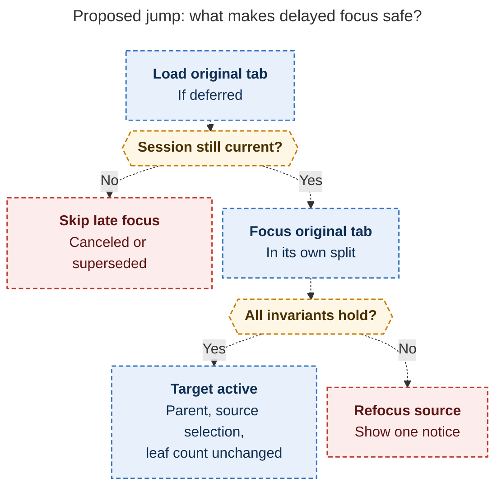

# Diagram proposals: `Ctrl+W N`: numbered tab hints and an in-place jump for the Obsidian window prefix

Proposals for the swarm linker, not a report. Each diagram restates only what the source
report says.

```yaml
source: research:202611/obsidian_ctrl_w_numbered_tab_jump/obsidian_ctrl_w_numbered_tab_jump__final.md
producer: research.4y.image
check: "mmdc 12.0.0 with the PDF-mirroring config rendered 1 of 1 Mermaid diagrams; Puppeteer --no-sandbox; broken syntax correctly rejected"
```

## delayed-focus-safety

```yaml
anchor: |-
  A canceled or superseded async load must never apply late focus
question: |-
  How does a delayed tab load avoid stealing focus, and what happens if focus checks fail?
illustrates: |-
  The executor loads the original leaf before focusing, prevents canceled or superseded loads from applying late focus, and refocuses the source on failed active-target, parent, source-selection or leaf-count checks.
caption: Only a current session may apply focus after loading; failed focus or layout checks restore source focus and show one notice.
review: "552.27×906 px, fit 98.5%; question, source tracing and PNG visual checks passed; 0 revisions"
```


