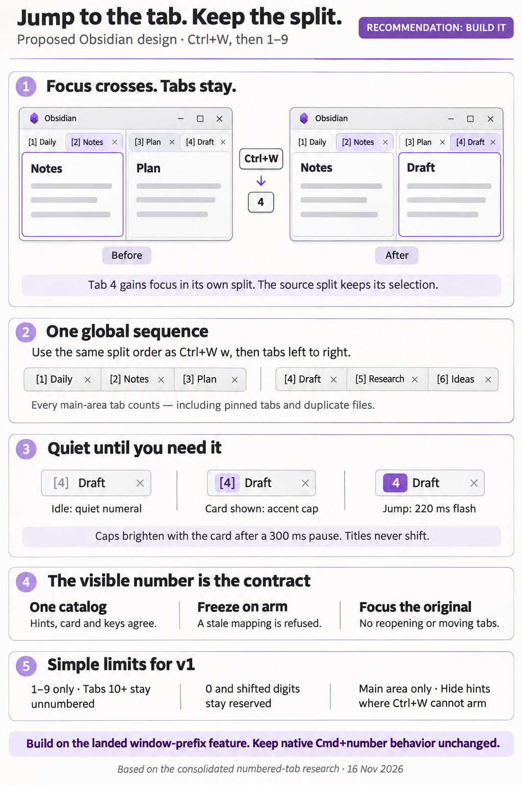
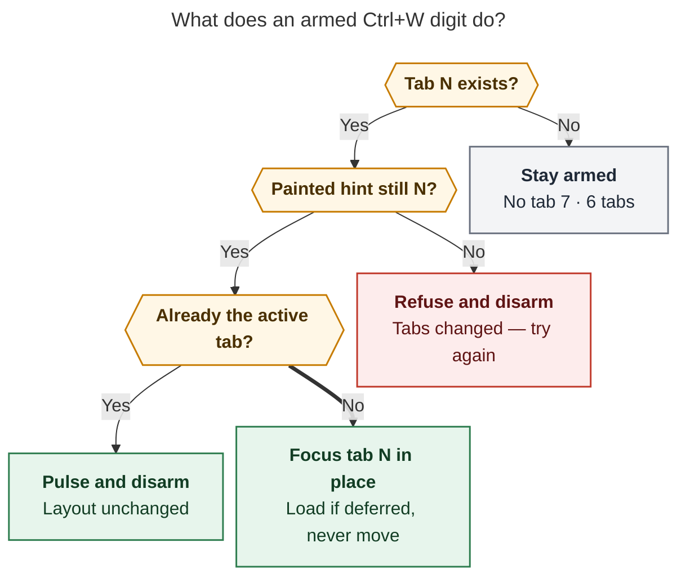
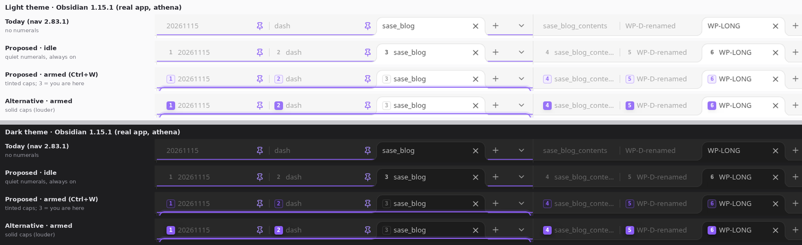
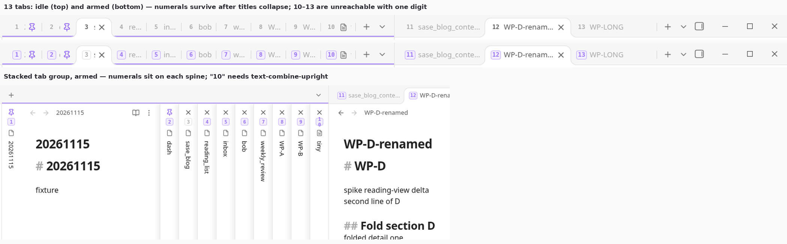
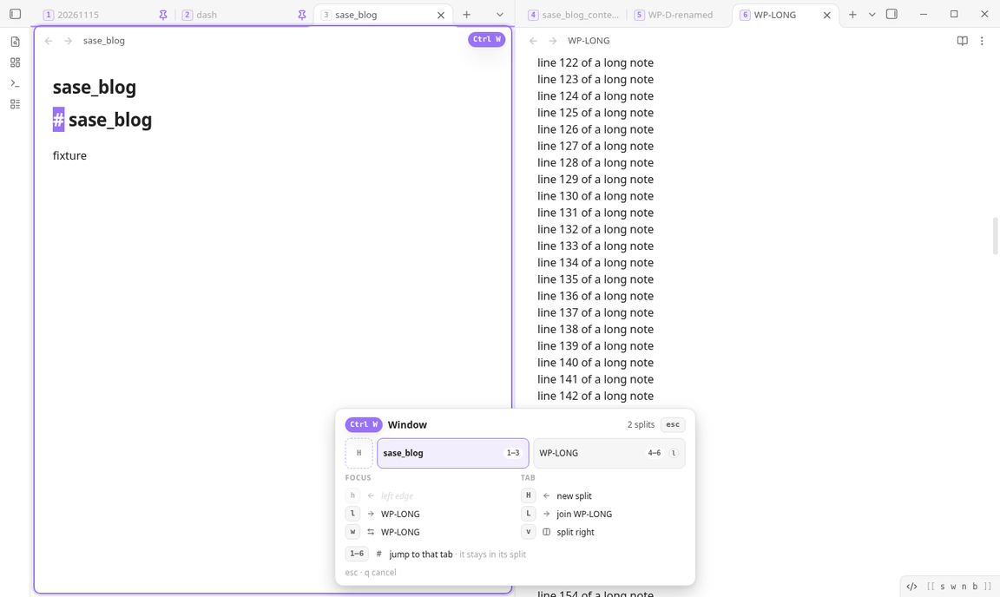
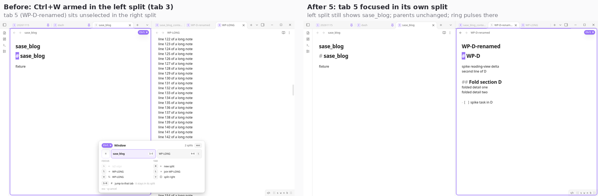
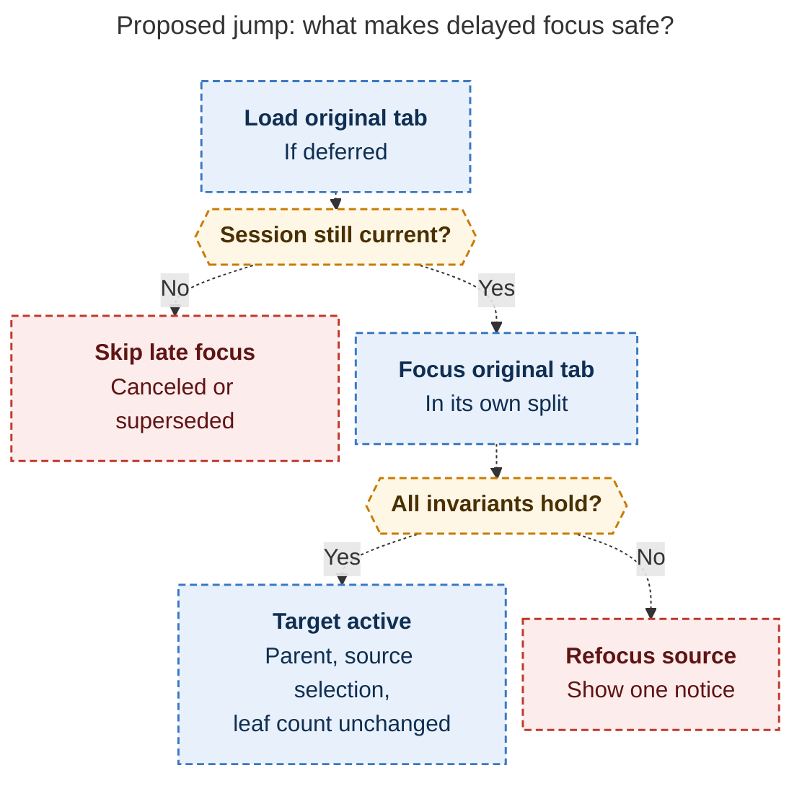

# `Ctrl+W N`: numbered tab hints and an in-place jump for the Obsidian window prefix

> **Research query:** Building on the recently added `<ctrl+w>` split-window keymaps (epic
> `bob-cli-m0`), how should `<ctrl+w>N` keymaps be designed to jump to the `N`th Obsidian
> tab, with `N` shown as a hint beside each file's name in the tab title bar and the target
> tab remaining in its own vertical window, so the feature is intuitive, reliable, and
> beautiful? Is this plan a good idea, would a different approach be better, which
> requirement adjustments are justified, and what solution is recommended?



## Bottom line

**Build it. All five researchers independently said yes**, and the implementation risk
is low: the jump primitive is the safest in the whole prefix family — focusing a leaf
that already exists, with no reparenting and nothing to roll back.

The consolidated recommendation:

1. **Number all main-area tabs globally, 1–9, in reading order** — splits in the same
   order `Ctrl+W w` already cycles, then tabs left to right inside each split. Tabs past
   nine are unnumbered; `0` and shifted digits stay reserved; `9` never means "last".
2. **[Show each number as a quiet, always-visible numeral in the tab's icon slot](#the-numerals)**,
   before the title, stamped as a `data-bob-tab` attribute plus a CSS `::before` so the
   tab bar never shifts. The numerals brighten into accent key caps when the `Ctrl+W`
   card appears; they hide wherever the prefix cannot arm.
3. **[A digit focuses tab N where it lives](#the-jump-executor)**: hint-is-truth check, `loadIfDeferred`,
   `setActiveLeaf(leaf, {focus: true})`, invariant checks. The tab is selected inside
   its own split, keyboard focus crosses to it, and nothing moves, closes, or reopens.
4. **[One pure numbering function drives the painted hints, the card, and dispatch](#reliability-rules)**, so
   what you see is always what you get; stale mappings are refused, never substituted.

The headline conflicts between the five reports — global versus per-split numbering, and
persistent versus armed-only hints — are [resolved below](#conflict-resolutions) with reasons. Both resolutions
go with the majority (`cdx`/`cld`/`gem`) and against `grk`/`mus`, because the request's
own wording and the strongest empirical evidence (`cld`'s [real-Obsidian probe](#verified-foundation)) support
them.

## Requirement adjustments called out

1. **Adjustment — hints are [persistent quiet numerals](#the-numerals), not armed-only.** They brighten
   with the card; the bar never shifts.
2. **Adjustment — `N` is limited to 1–9.** No `9` = last, no multi-digit entry; `0` and
   shifted digits reserved (`⇧N` is the designed future "bring tab N here").
3. **Clarification — [numbering is global](#conflict-resolutions) across main-area splits in `Ctrl+W w` reading
   order**, and "remaining in the same vertical window" means the jump never reparents:
   keyboard focus crosses splits, the tab does not move. Sidebars, popouts, hover
   editors, and the phone layout are excluded, matching the existing prefix boundary.
4. **Adjustment to the m0 plan — digits are repurposed from the "numbered splits"
   reservation to tabs.** With two or three columns, `h`/`l`/`w` already reach any split
   in one or two keys; tabs are the scarce target. Post-prefix Vim counts (`Ctrl+W 3 l`)
   are permanently given up — deliberate, and all five reports accept it.
5. **Adjustment — numerals render only where they can work**: two or more main-area
   tabs, and a host where the prefix can arm. On Linux under the accepted
   `linux_ctrl_w = keep` decision, Obsidian's Close tab owns `Ctrl+W`, so numerals stay
   hidden there (and appear on their own if Bryan ever rebinds it).
6. **Clarification — every main-area tab counts**: pinned tabs, duplicate files, PDFs,
   Canvas, graph, and empty tabs, each numbered by position. Identity is the leaf, never
   the file name; two tabs on the same note are distinct targets.

## Conflict resolutions

### Global numbering across splits (not per-split)

`grk` and `mus` argued for numbering only the focused split, matching native `Mod+1…8`
and the Tab Numbers community plugin. The consolidated design rejects that, for three
reasons:

1. **The request's own clause demands it.** "The tab we jump to should remain in the
   same vertical window it was in" only has teeth when a jump can target a tab in
   *another* split; under per-split scope the clause is vacuously true. The request is
   asking for cross-split reach without cross-split movement.
2. **Per-split `Ctrl+W N` duplicates what already exists.** Native `Mod+1…8` is already
   a group-local Nth-tab jump; the real gap (probe-verified) is "that unselected tab
   over in the other split", which currently takes two gestures from the wrong side.
   Global numbering closes the gap; per-split numbering re-ships the status quo with
   hints.
3. **Vim agrees.** An Obsidian tab (leaf) is the closest analogue of a Vim window, and
   `N CTRL-W w` numbers windows globally in reading order. tmux's `prefix 0–9` with a
   persistent status-line index is the same shape.

`grk`'s legitimate concerns survive in the design: digits never *move* a tab (`H`/`L`
remain the only movers), the split order is exactly the order `w` cycles so digits and
window keys never disagree, and a same-split jump behaves identically to the per-split
reading.

### Persistent quiet numerals (not armed-only)

`grk` and `mus` wanted hints painted only while the prefix is armed. Three facts decide
against that:

1. **Measured reflow.** Inserting a numeral costs each title 21 px (`cld`, probe). An
   armed-only inline hint slides every title sideways on *every* `Ctrl+W`, including the
   fluent `Ctrl+W l` that never needs a number — the exact flicker the m0 two-tier hint
   design was built to avoid.
2. **Plan-before-press.** You cannot type a number you cannot see. Armed-only hints
   force a stop-and-read pause into every jump, killing the fluent 150–250 ms chord
   (`gem`).
3. **Precedent.** tmux and Emacs winum keep the index permanently beside the name; that
   is already how Bryan reads numbered targets.

The clutter objection is answered with restraint rather than absence: a bare
`--text-faint` tabular-numeral digit (no box, no pill) in the already-reserved icon
slot, hidden entirely wherever the gesture cannot work. `grk`'s armed-only overlay
remains the documented fallback if Bryan dislikes the idle digits after living with
them.

### Overflow: 1–9 only, and the numeral never lies

Four different overflow answers appeared: `9` = last (`mus`), `0` = last (`grk`), a
`0`-prefixed exact-number chooser (`cdx`), and plain 1–9 with everything else reserved
(`cld`, `gem`). The consolidated rule: **a visible numeral must be the truth.** `9` =
last lies whenever a ninth tab shows a `9`; multi-digit entry needs a timeout or
terminator that breaks one-action-per-arm. So: tabs 10+ carry no numeral, the card says
"N more unnumbered", and `0`/`⇧digit` stay reserved. Bryan's actual layouts hold about
four tabs; if double-digit tab counts become routine, `cdx`'s `0 → number → Enter`
chooser is the designed escalation path (it also covers clipped tab strips), with
`grk`'s `0` = last as the lighter alternative.

## Verified foundation

The decisive evidence base is `cld`'s probe of **real Obsidian 1.15.1 on athena**
(scratch vault, CDP, nav plugin 2.83.1 from `bob-plugins@0e16e30`), corroborated by
`cdx`'s API/source inspection and this consolidation's own reads of the shipped code:

| Fact | Why it matters |
| --- | --- |
| The shipped prefix consumes a digit as unmapped ("5 isn't a window key"); adding digits is purely additive. | No existing chord regresses. |
| Native `workspace:goto-tab-1…8` / `goto-last-tab` (`Mod+1…9`) are **group-local** and unhinted; `goto-tab-3` from the right split lands on the right split's third tab. | The one gap: nothing reaches an *unselected* tab in *another* split in one gesture. |
| `workspace.setActiveLeaf(leaf, {focus: true})` on an unselected tab in another split selects it **inside its own split** (`leaf.parent` unchanged), focuses its editor, and leaves the source split's selection alone. | The entire jump is one public API call. |
| Background-tab scroll survives plain tab switching (3028 px kept). | No scroll save/restore machinery needed. |
| `leaf.tabHeaderEl` / `tabHeaderInnerTitleEl` exist per leaf; header DOM order equals `group.children` order; markdown tabs hide their icon slot (`display:none`); `.workspace-tab-header-inner::before` is unused by Obsidian. | The hint has a free, stable slot before the title. |
| A `data-` attribute stamped on `.workspace-tab-header-inner` survives rename, `openFile`, `onLayoutChange()`, and pin toggles. | Attribute + `::before` is a durable, node-free hint technique. |
| An injected 16 px numeral shifts titles by 21 px. | Armed-only inline hints would jolt the whole bar on every `Ctrl+W`. |
| `WorkspaceTabs.selectedTab` is `undefined` in 1.15.1; `currentTab` is a numeric index. | The shipped executor's `selectedTab` reads are dead code ([side finding below](#recorded-side-finding-in-the-shipped-executor)). |
| `leaf.loadIfDeferred` is a function; deferred background tabs after a restart are the common jump target. | The executor must load before focusing. |
| `snapshotWindowPrefixLayout()` returns `null` when the active leaf is outside the root split (`267-window-prefix-actions.js:450`). | Hint enumeration must be decoupled from arming, or numerals vanish when focus visits a sidebar. |
| `normalizeWindowPrefixKeydown` recovers keys from `event.code` only for `KeyA–Z` and `BracketLeft`; digits resolve via `event.key` alone. | The probe showed Chromium reports `key: "3"` under held Ctrl, so digits work — but a `Digit1–9`/`Numpad1–9` fallback (`mus`, `gem`) is cheap insurance and should be added. |
| Vim's own `N CTRL-W w` goes to window N, numbered top-left to bottom-right; tmux prints a persistent index beside each window name; Bryan's tmux status line and the sase TUI already use numbered jump targets daily. | Global reading-order numbers with persistent hints are his existing idiom, not an invention. |

The `bob-cli-m0` epic is `IN_PROGRESS` with all six phases closed and a `.land` agent
assigned: this feature must be built on the **landed** tree, and the digit keys it uses
were explicitly "reserved for later" by the m0 plan.

## Recommended design

### Keys

| Keys after `Ctrl+W` | Action | Behavior |
| --- | --- | --- |
| `1`–`9` (numpad too; held Ctrl accepted, so `Ctrl+W Ctrl+3` works) | **Focus tab N** | Selects tab N inside its own split and focuses it; loads it first if deferred; never moves it. Ring jumps to the destination split and pulses; the numeral flashes solid ~220 ms. No `Ctrl+O` jump record. |
| digit of the current tab | success no-op | Ring pulse, prefix disarms. |
| digit with no tab | blocked | Stays armed; card shows at once; "No tab 7 · 6 tabs" (shipped blocked-key contract). |
| `0`, `⇧1`–`⇧9` | reserved | Unmapped in v1 ("`0` isn't a window key"); `⇧N` is the designed future "bring tab N here". |
| `Esc` / `Ctrl+[` / `q`, Meta/Alt chords | unchanged | Existing cancel and pass-through paths; `Ctrl+W Cmd+3` still runs native `goto-tab-3`. |

A digit is recognized by `event.key ∈ 1–9` regardless of Shift state (AZERTY works),
with a `Digit1–9`/`Numpad1–9` `event.code` fallback for robustness. US `Shift+3` yields
`#`, which stays unmapped.

**Decision contract** (planner unit vectors and e2e signature checks; `*` focused, `'`
selected in an unfocused split, `!` pinned, superscripts are numerals):

```text
Numbers:            [ A¹  B²* ] | [ C³'  D⁴ ]
Across, selected:   [ A  B* ] | [ C'  D ]    3 → [ A  B' ] | [ C*  D ]
Across, unselected: [ A  B* ] | [ C'  D ]    4 → [ A  B' ] | [ C  D* ]
Same split:         [ A  B* ] | [ C' ]       1 → [ A*  B ] | [ C' ]
Pinned are tabs:    [ P!  B* ] | [ C' ]      1 → [ P!*  B ] | [ C' ]
Already here:       [ A  B* ] | [ C' ]       2 → unchanged; pulse; disarm
No such tab:        [ A  B* ] | [ C' ]       7 → unchanged; stays armed
Past nine:          13 tabs                  numerals 1–9 only; card: "4 more unnumbered"
```

**Reader question:** What happens when the armed prefix receives a digit?

**Caption:** A digit is validated against the global catalog, then against the painted
hint, then against the active tab: a missing number stays armed, a stale mapping is
refused rather than substituted, the current tab's digit is a successful pulse, and
otherwise the target tab is focused in its own split.



Rendered size: 676 × 834 px; fit scale: 96.6%. mermaid-cli 12.0.0, PDF configuration.



### The numerals

| State | When | Look |
| --- | --- | --- |
| **Idle** | Always, under the gates | A bare digit in a fixed ~16 px box before the title (the tab's normally hidden icon slot; on PDF/Canvas tabs, just before the icon): monospace ~10.5 px / 600, `tabular-nums`, `--text-faint`; each split's selected tab uses `--text-muted`, matching how Obsidian tones titles. No box, no fill. |
| **Armed, 0–300 ms** | `Ctrl+W` pressed | Unchanged — only the shipped ring and `⌃W` badge appear, so fluent `Ctrl+W l` paints exactly what it paints today. |
| **Lit** | With the card (300 ms pause, a blocked/unmapped key, reduced motion, or "Show window keys") | Tinted accent key caps (`--interactive-accent` text on a ~12 % accent tint, 1 px inset ring); the current tab gets a hollow neutral cap — "you are here". Only color/background/shadow transition (~90 ms); nothing moves. |
| **Flash** | Digit accepted | Destination cap fills solid accent ~220 ms (yank-flash timing) while the ring jumps to its split and pulses; then back to idle. |

Lighting at the card tier (rather than 0 ms) keeps fluent motions paint-free and makes
the lit caps arrive with the card that explains them; the idle digits are already
readable, so lighting is emphasis, not information. It is a one-constant change if Bryan
prefers instant lighting (`gem` and `cdx` preferred 0 ms — [flagged as an open question](#open-questions-for-bryan)).

Real-Obsidian mocks of the candidate states, from `cld`'s probe (light and dark, Bryan's
actual layout):



*The recommended idle (row 2) and lit (row 3) states in real Obsidian 1.15.1. Numerals
cost each title 21 px; the solid-cap variant (row 4) is reserved for the 220 ms jump
flash so "solid" always means "this is where you just went".*



*Crowded bars are where numbers earn their place: titles collapse to `re…` but the
numerals stay legible. Stacked groups use `text-orientation: upright`; two-digit
numerals never occur.*

**Where numerals do not appear:** fewer than two main-area tabs; hosts where the prefix
cannot arm (checked through `app.hotkeyManager`, re-checked on `layout-change`); phone
layout, popouts, sidebars, hover editors; tabs 10+.

**DOM technique:** stamp `data-bob-tab` (and `aria-keyshortcuts="Control+W 3"`) on
`.workspace-tab-header-inner` and paint via CSS `::before` — no injected nodes to leak,
nothing that can steal clicks or drags, and the attribute provably survives renames,
`openFile`, layout changes, and pin toggles. Fallbacks, in order: `gem`'s injected
`order: -2` span inside the header inner (if `::before` proves limiting), then `grk`'s
absolute overlay on title rects (if header mutation misbehaves). If headers are
undetectable (canary), render no numerals and dim the card row ("tab numbers
unavailable") — digits still work through the planner.

### The card



*Real-Obsidian mock of the card changes: each split pill's count bubble becomes its
numeral range (a bare `3` bubble next to a tab numbered `3` is ambiguous — the probe hit
exactly that collision), and one full-width tabs row is added under the FOCUS/TAB grid.*

- Pills: monospace ranges `1–3`, `4–6` with `aria-label="tabs 1 to 3"`.
- Tabs row: cap `1–N` · "jump to that tab" · faint "it stays in its split"; with >9 tabs
  "`1–9` · 4 more unnumbered"; dimmed "only tab" with a single tab; a blocked digit
  nudges this row and writes to the existing `aria-live` line.
- The FOCUS/TAB grid itself is unchanged — no nine duplicate rows.

### The jump executor



*Probe-verified cross-split jump: `target.parent` unchanged, source split's selected tab
unchanged, editor focused.*

1. **Freeze the mapping at arm; restamp at arm.** The prefix already cancels on foreign
   `layout-change` / `active-leaf-change`, so the numbers on screen are the numbers
   dispatch uses.
2. **Hint-is-truth check at dispatch** (one DOM read of `data-bob-tab`): if the painted
   number no longer matches the resolved target — a drag reorder racing the keypress —
   refuse with "Tabs changed — try again"; never select whoever now holds that ordinal.
   This matters because the shipped `runWindowPrefixMappedKey` re-snapshots at dispatch:
   recomputing `N` against a fresh list could silently retarget (`cdx`).
3. `await leaf.loadIfDeferred?.()`, then `workspace.setActiveLeaf(leaf, {focus: true})`.
   `revealLeaf` / `scrollIntoView` are **not** added mechanically — the probe showed
   `setActiveLeaf` suffices for selection and focus; the e2e adds header
   `scrollIntoView` only if a clipped tab strip demonstrably needs it.
4. **Verify invariants:** active leaf is the target, `leaf.parent` unchanged,
   cross-split source selection unchanged, main-area leaf count unchanged. On failure,
   refocus the source leaf and show one notice. No scroll save/restore (probe: scroll
   survives). A canceled or superseded async load must never apply late focus (session
   token).
5. Never `openFile`, `getLeaf(true)`, `duplicateLeaf`, detach, or reparent — activating
   the original leaf is what preserves pin, undo history, folds, cursor, scroll, view
   mode, and per-tab history. Respect each view's normal focus behavior (no forced
   editor focus on PDF/Canvas). No Bob `Ctrl+O` jump record.

[The delayed-focus safeguard diagram](#figure-delayed-focus-safety) traces the proposed executor's path: load a deferred tab, focus it only while its session is current, and refocus the source if an invariant fails.

<div id="figure-delayed-focus-safety">



_Only a current session may apply focus after loading; failed focus or layout checks restore source focus and show one notice._

</div>

**Selection reads:** use `group.children[group.currentTab]` with `getMostRecentLeaf`
fallback — never `selectedTab` (dead in 1.15.1; [side finding below](#recorded-side-finding-in-the-shipped-executor)).

### Reliability rules

1. One pure function (`windowPrefixTabOrder` / catalog) drives the stamp, the card's
   ranges and row, palette descriptions, and dispatch, with parity tests asserting the
   stamped leaf ids equal the planner's targets across every fixture.
2. Hint enumeration is decoupled from arming: the stamper enumerates the main area even
   when focus sits in a sidebar (the strict snapshot returns `null` there); the existing
   arming gate still governs the gesture itself.
3. Stamps refresh on `layout-change`, `active-leaf-change`, `file-open`, plugin load,
   and arm, coalesced to one animation frame; repaints are idempotent (reattach, never
   duplicate); unload removes every attribute, class, and subscription.
4. Changing focus never renumbers; opening/closing/moving tabs renumbers only between
   gestures. The leaf's stable identity and its positional number are different things.

## Implementation sketch

Everything lives in `bob-plugins`, plugin `bob-navigation-hotkeys`, under the fragment
rules (hand-edited fragments ≤ 1000 lines, committed source build, never hand-edit
`main.js`). No bob-cli, capture-grammar, or Mac Capture change. Coordinate with
`bob-cli-m0.land`: build on the landed tree, ship as a nav minor bump, deploy with
`bob plugins sync`.

| Piece | Where |
| --- | --- |
| Tab catalog, digit planner (`focus-tab` plans with reasons `already-here`, `no-such-tab`, `tab-numbers-unavailable`), digit normalization (+`Digit`/`Numpad` fallback), view model (`tabs` row, per-split `tabRange`) | `266-window-prefix-model.js` |
| Main-area snapshot decoupled from `activeLeaf`; group order from `group.children`; `focus-tab` executor with hint-is-truth, `loadIfDeferred`, invariants; `children[currentTab]` selection fix | `267-window-prefix-actions.js` |
| Numerals stamper mixin: `data-bob-tab` + `aria-keyshortcuts`, visibility gates (tab count, hotkey-owner check), lit/flash classes, unload cleanup | new fragment (~200 lines), e.g. `689-plugin-window-tab-numbers.js` |
| Restamp at arm, lit class with the card, dispatch digits, flash on success, nudge on blocked digits | `687-plugin-window-prefix.js` |
| Pill ranges, tabs row, nudge target | `473-window-hint-view.js` |
| Palette commands `window-focus-tab-1…9` ("Focus tab N", no default hotkeys — m0's "every verb is a command" rule; `mus` dissented but the house rule wins, and it makes a later `Cmd+N` rebind a one-line `hotkeys.json` edit) | `688-plugin-window-prefix-commands.js` |
| Idle/lit/here/flash states, stacked `text-orientation: upright`, reduced-motion overrides, theme variables only (4.5:1 contrast target in light and dark) | `styles.css` |

**Tests** (the m0 pattern): unit vectors for every decision picture plus the digit
normalization matrix (plain, numpad, AZERTY shift-digit, held Ctrl, `#`, `0`, Meta);
stamp/planner and card/dispatch parity; stamper gates, idempotence, and cleanup with
`ElementStub`; preview-harness states (pill ranges, tabs row, >9 tabs, single tab,
blocked nudge) in light and dark; real-Obsidian e2e on athena (`--only tabs`):
cross-split jump with byte-identical layout signature except selection marks, held-Ctrl
digit, same-tab pulse, out-of-range digit, **deferred tab after an app reload**, stacked
group, Linux-default hidden numerals, and screenshots of idle/lit/flash.

**Size:** roughly a third of `bob-cli-m0`; one small epic of three phases — (1) pure
model, (2) stamper + executor + wiring + styles + commands, (3) e2e + previews + docs
(`docs/window-keys.md` digits row, Linux note) + sync. The only spike-grade unknown is
visual: confirm the icon-slot numeral and stacked-spine rendering against themes in the
existing scratch-vault harness before polishing CSS.

### Recorded side finding in the shipped executor

`267-window-prefix-actions.js` reads `group.selectedTab` in its selected-leaf resolver,
move executor, and diagnostics (lines 183, 635, 640, 695–696, 735 at `0e16e30`), but in
Obsidian 1.15.1 `selectedTab` is `undefined` and `currentTab` is a number, so those
branches are dead and a failed move's rollback never reselects the destination split's
previous tab. Low impact; `cld` recorded it as a `DISCOVERED ISSUE:` note on the
in-progress `bob-cli-m0` epic. Fold the `children[currentTab]` fix into phase 2 of this
work.

## Open questions for Bryan

1. **Always-on quiet numerals (recommended) or armed-only?** Always-on costs 21 px per
   tab but never shifts the bar; armed-only keeps idle titles wider but slides every
   title on every `Ctrl+W`.
2. **Light the caps with the card at 300 ms (recommended) or instantly at 0 ms?**
   (`cld` vs `gem`/`cdx`; a one-constant change either way.)
3. **Should `Ctrl+W ⇧N` ("bring tab N here") ship after v1 settles?** It completes the
   lowercase-focuses / Shift-takes-along symmetry and is designed, not built.
4. **What should `0` eventually mean?** Reserved (recommended), last tab (`grk`), or the
   exact-number chooser (`cdx`) if >9-tab layouts become routine. "Previous tab", if
   wanted, belongs on `p` (Vim's `CTRL-W p`).
5. **Rebind native `Cmd+1…9` to the global numbering?** Recommended no — keep the
   group-local native behavior; the palette commands make it a one-line edit later.

## Provenance

> **Research question:** Building on the shipped `Ctrl+W` window prefix (epic
> `bob-cli-m0`), how should Bob add `<ctrl+w>N` keymaps that jump to the `N`th Obsidian
> tab, with `N` taken from a hint rendered next to each file's name in the tab title bar
> and the target tab staying in its vertical window? Is the plan a good idea, which
> requirement adjustments are justified, and what is the recommended solution?
>
> Consolidated from five independent reports (`cdx`, `cld`, `grk`, `mus`, `gem` — the
> sibling `obsidian_ctrl_w_numbered_tab_jump__<suffix>.md` files) plus the lead
> researcher's own verification in `bob-plugins@0e16e30` and the `bob-cli-m0` bead.

- **Input reports** (moved beside this file): `obsidian_ctrl_w_numbered_tab_jump__cdx.md`
  (API/source inspection, gesture-freeze and chooser design, acceptance matrix),
  `…__cld.md` (real-Obsidian 1.15.1 probe on athena — the evidence backbone — plus the
  visual system and figures reused above), `…__grk.md` (per-split counter-position,
  icon-slot beauty constraint, spike list), `…__mus.md` (Tab Numbers prior-art
  deep-dive, normalizer catch), `…__gem.md` (hazard analysis: index drift, reflow,
  numeric-filename collision, multi-digit key-eating; CSS blueprint).
- **Lead verification this turn:** `bob-plugins@0e16e30` —
  `normalizeWindowPrefixKeydown` digit handling (no `Digit`/`Numpad` fallback today),
  `selectedTab`/`currentTab` usage lines, `snapshotWindowPrefixLayout` null-on-sidebar,
  `docs/window-keys.md:94` digit reservation; bead `bob-cli-m0` (IN_PROGRESS, six
  phases closed, `.land` assignee).
- **Figure:** `digit-contract.{mmd,svg,png}` rendered this turn with mermaid-cli 12.0.0
  under the PDF configuration (676 × 834 px, 96.6 % fit, PNG reviewed). `grk`'s
  `digit-jump.*` / `hint-scope.*` figures illustrate the per-split alternative and are
  preserved beside its report; `cld`'s four probe PNGs are reused above.
- Shared upstream sources are cited in full inside each suffixed report: the m0 plan and
  prior consolidated research, Obsidian API declarations and help, Pane Relief, Tab
  Numbers, Tab Selector, emacs-winum, nvim-window-picker, Vim `windows.txt`, MDN
  keyboard-event semantics, and WCAG contrast guidance.
