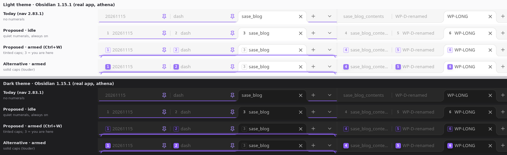
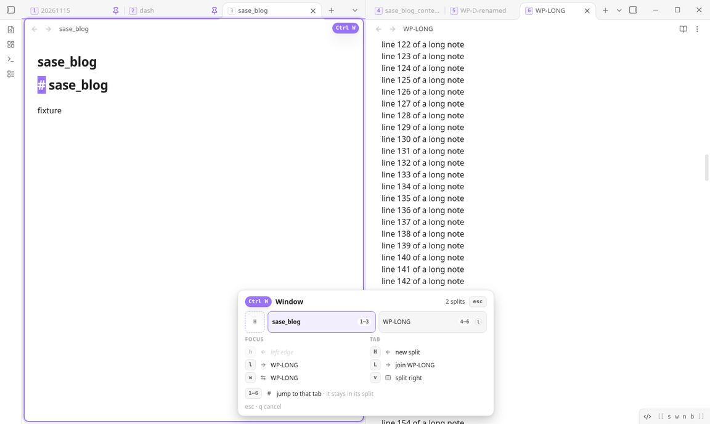
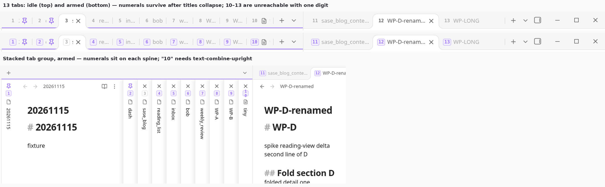

# `Ctrl+W N`: jump to the Nth Obsidian tab by the numeral on its tab (cld)

> **Research query:** Building on the shipped `Ctrl+W` window prefix (epic `bob-cli-m0`),
> add `<ctrl+w>N` keymaps that jump to the `N`th Obsidian tab. `N` comes from a hint
> rendered next to each file's name in the tab title bar, and the tab you jump to stays in
> the vertical split it was already in. Design it to be intuitive, reliable, and
> beautiful. Is this a good idea? Would a different approach be better? Which requirement
> adjustments are justified? End with a recommended solution.

## Bottom line

**Build it.** It fills the one gap the window prefix left open. Today you can reach the
*selected* tab of a neighbouring split (`h`/`l`/`w`), and Obsidian's own `Cmd+1…8`
reaches tab N *of the focused split only*. Nothing reaches "that unselected tab over in
the other split" in one gesture. `Ctrl+W 5` does: it focuses tab 5 wherever it lives,
selecting it inside its own split and never moving it.

The idea is also more Vim-native than it looks. In Obsidian a tab (a leaf) is the closest
thing to a Vim window, and Vim's own `N CTRL-W w` means "go to Nth window (windows are
numbered from top-left to bottom-right)". `Ctrl+W N` is that command with the count
written after the prefix.

The design I recommend:

1. **Numbering.** One global sequence across all main-area tabs: splits in the same
   reading order `Ctrl+W w` already cycles, then tabs left to right inside each split.
   Only `1`–`9` get numerals. `0` stays reserved.
2. **Hint placement and visibility.** The numeral sits in front of the title, in the
   tab's own (normally hidden) icon slot. **It is always visible as a quiet digit**, much
   like a line number or a tmux window index, and it lights up as an accent key cap when
   the `Ctrl+W` card appears. Because the numeral never appears or disappears, the tab bar
   never shifts.
3. **What the jump does.** It focuses the tab where it lives: the tab is selected in its
   own split, its editor gets focus, and its scroll position survives. The ring jumps to
   that split and pulses, and the pressed numeral flashes solid for 220 ms.
4. **What the card adds.** Its split pills show their numeral range (`1–3`, `4–6`)
   instead of a bare tab count, and one new row reads
   `1–6  # jump to that tab · it stays in its split`.

I checked all of this in real Obsidian 1.15.1 on athena (scratch vault, CDP probe; see
[Evidence](#evidence-gathered-for-this-report)). The checks covered the tab-header DOM,
the group-local scope of the native Go-to-tab commands, how focus and scroll behave on a
cross-split jump, and screenshots of every candidate visual in light and dark.



*Figure 1. Real Obsidian 1.15.1, Bryan's layout (`[ 20261115! dash! sase_blog* ] |
[ sase_blog_contents WP-D WP-LONG ]`). Row 2 is the recommended idle state and row 3 the
recommended lit state; `3` is hollow because it is the tab you are on. Row 4 is the
louder alternative. Numerals cost each title 21 px, which is why `sase_blog_contents`
now ellipsizes in its 153 px tab.*

## What exists today (verified)

| Fact | Evidence |
| --- | --- |
| The shipped prefix (nav **2.83.1**) consumes a digit and says **"5 isn't a window key"**. Adding digits is purely additive; no current behaviour regresses. | Real-Obsidian probe: `Ctrl+W 5` → message line `5 isn't a window key`. |
| The m0 plan reserved digits for **"numbered splits"** (`j k J K s c o p x = < >` and digits "reserved for later"). This feature repurposes them for tabs; see [Adjustment 5](#requirement-adjustments-called-out). | `plan:202611/obsidian_ctrl_w_window_prefix.md`, key table and "Out of scope". |
| Obsidian's native `workspace:goto-tab-1…8` (`Mod+1…8`) and `goto-last-tab` (`Mod+9`) are **group-local**. With `[20261115 dash sase_blog] \| [sase_blog_contents WP-D WP-LONG]`, `goto-tab-3` from `WP-D` lands on `WP-LONG`, the right split's 3rd tab, not the global 3rd. With fewer than N tabs it does nothing. | Probe: `goto-tab-1` from `sase_blog` → `20261115`; from `WP-D` → `sase_blog_contents`; `goto-tab-3` from `WP-D` → `WP-LONG`; `goto-last-tab` from `sase_blog` → `sase_blog`. Default hotkeys read from `hotkeyManager.getDefaultHotkeys`. |
| Tab-header DOM: `.workspace-tab-header > .workspace-tab-header-inner > [icon, title, status, close]`. Markdown and empty tabs hide the icon (`display:none`). PDF, canvas, and similar tabs show it. Obsidian already uses `.workspace-tab-header-inner::after` (the divider), so `::before` is free. | Probe `outerHTML`; Obsidian's `app.css` read from the athena `obsidian.asar`. |
| Tab metrics: `--tab-width: 200px`, `--tab-max-width: 320px`, `--header-height: 40px`, title 13 px (`--font-ui-small`), inactive title color `--text-faint`, active `--text-muted`. Tabs shrink (`flex: 1 1 0; min-width: 0`), and titles ellipsize first. | `app.css`, probe rects. |
| `leaf.tabHeaderEl`, `tabHeaderInnerTitleEl`, and `tabHeaderInnerIconEl` exist on every main-area leaf. The header DOM order equals `group.children` order. | Probe: `domIndexMatches: true` for all 13 tabs. |
| **`WorkspaceTabs.selectedTab` is `undefined` in 1.15.1; `currentTab` is a numeric index.** The selected tab is `group.children[group.currentTab]`. | Probe `typeof` checks. See [Side finding](#side-finding-in-the-shipped-executor). |
| `workspace.setActiveLeaf(leaf, {focus: true})` on an *unselected* tab in another split selects it **inside its own split** (`leaf.parent` unchanged), focuses its CodeMirror editor, and leaves the source split's selected tab alone. | Probe: right split `WP-LONG → WP-D`, left still `sase_blog`, `activeElement = .cm-content`. |
| Plain tab switching keeps scroll. A background note scrolled to 3028 px came back at 3028 px whether reached through `setActiveLeaf` or `selectTab` followed by `setActiveLeaf`. (The spike's "selectTab resets scroll" applies only to a *reparented* leaf.) | Probe `jump-background-scroll`. |
| A numeral stamped as an attribute on `.workspace-tab-header-inner` survives a file rename, opening a different file in the leaf, `onLayoutChange()`, and pin toggles. The header element is stable per leaf. | Probe `stamp-and-survive`. |
| Inserting a 16 px numeral moves the title 21 px (16 px cap, 3 px margin, 2 px flex gap). | Probe `titleShiftPx: 21`. |
| `leaf.loadIfDeferred` is a function. Deferred background tabs after a restart are the common case for "jump to a tab I haven't looked at". | Spike verdict on `bob-cli-m0.1` plus probe. |

## Is this a good idea?

**Yes, with the adjustments below.** Here is why it earns a place in the family:

- **It completes the window prefix.** `h`/`l`/`w` reach *splits*. `H`/`L`/`v` *rearrange*
  tabs. A key that reaches *any visible tab directly* is the missing verb, and it fits the
  family's admission rule (A7: a key joins only if it is layout-safe) because it never
  changes layout.
- **It beats the native shortcut on exactly the axis that matters.** `Cmd+N` is
  group-local and shows no numbers, so with two splits "the dash tab" is `Cmd+2` from the
  left and unreachable from the right. A global, visible number is one gesture from
  anywhere.
- **It is house-native.** Bryan's tmux status line shows `1 › main 2 › zsh 3 › chez 4 ›
  ace` (screenshot `20261116_061710.png`), and the sase TUI's JUMP bar uses digit caps.
  Numbered, always-visible targets are already his idiom.

The concerns are real, and each has a mitigation:

| Concern | Mitigation |
| --- | --- |
| **Renumbering.** Opening a tab on the left shifts every number on the right. | The numerals are always visible, so a shift is seen, not remembered. Numbers are restamped at arm time, and dispatch refuses if what you see is not what it would do ([Reliability](#reliability-rules)). |
| **Tab-bar clutter and width.** Each numbered tab loses 21 px of title. | Quiet digits (`--text-faint`, the same weight as an inactive title). Only tabs 1–9 are numbered. No numerals with fewer than two tabs, or on a host where `Ctrl+W` cannot arm. Trim the cap to 14 px if titles feel tight. |
| **Digits were reserved for numbered splits.** | With at most three splits, `h`/`l`/`w` already reach any split in one or two keys. Tabs are the scarce target. See Adjustment 5. |
| **Two keystrokes versus the native one chord.** | It is the price of global reach. Optional palette commands let Bryan bind `Cmd+1…9` to the global numbering if he ever wants one chord. I do not recommend that by default. |
| **Linux.** Under the reviewer's `linux_ctrl_w = keep` decision, `Ctrl+W` still closes the tab on Linux, so numerals would advertise a key that cannot work. | Numerals render only where the prefix can arm ([Where numerals do not appear](#where-numerals-do-not-appear)). |

What I would *not* do: numbers that appear only while `Ctrl+W` is held or armed (the
"Tab Numbers" community plugin's model), per-split numbering, or letter hints. The
reasons are in [Alternatives](#alternatives-considered).

## Prior art

| System | What it does | Lesson for Bob |
| --- | --- | --- |
| **Vim** `N CTRL-W w` (and `CTRL-W [count] {arg}` through `:wincmd`) | Go to window N; windows are numbered top-left to bottom-right. Vim 9.1 `windows.txt`. | Global reading-order numbering *is* the Vim model. Each Obsidian tab corresponds to a Vim window. |
| **Vim** `{count}gt` | Go to tab page N. | Vim's tabs are layouts, not leaves, so `gt` is the wrong analogy for Obsidian tabs. |
| **tmux** `prefix 0–9` | Select window N. The index is always printed in the status line beside the name. | Prefix + digit, with a persistent number beside the name: the exact shape requested. Bryan uses it daily. |
| **Emacs winum** | Numbers every window in the mode line by default (`winum-auto-setup-mode-line` is `t`), and `M-1…` jumps. | Precedent for persistent per-window numerals in each window's own title area. |
| **nvim-window-picker / ace-window** | Transient hint letters in the statusline or winbar (or big floating letters) after invoking the picker. | Transient letters suit pick-once flows. Letters would collide with Bob's window keys. |
| **Obsidian native** `Mod+1…8`, `Mod+9` | Group-local Nth tab or last tab. No visible numbers. | The status quo this feature improves on. Leave it untouched. |
| **"Tab Numbers" plugin** (j4ckofalltrades, 0.1.6) | Holding `Ctrl`/`Cmd` shows inline circular badges 1–8 on the *active split only*. Badges are `display:none` until held, and each split has its own sequence. | Proves the badge-in-tab placement works in real Obsidian. Its reveal-on-hold inline badge shifts titles on every reveal, and per-split numbers repeat. Avoid both. |
| **Browsers** `Cmd+1…8` / `Cmd+9` = last | Nth tab, no visible numbers. | `9 = last` makes sense only when numbers are invisible. With visible numerals, the numeral is the truth. |

## Requirement adjustments (called out)

Each item is labelled **Adjustment** (changes the request), **Clarification** (picks one
reading of an ambiguous request), or **Addition** (a small extra the design needs).

1. **Adjustment: the numerals are always visible as quiet digits, not only while armed.**
   They brighten into key caps when the `Ctrl+W` card appears.
   - The request says only that `N` comes from a hint next to the file name.
   - Showing numbers only while armed forces a 21 px title shift across the whole tab bar
     on *every* `Ctrl+W`, including the fluent `Ctrl+W l` that never needs a number. It
     also stops you choosing your target before you press.
   - Always-visible digits never move anything and advertise the feature. They also match
     tmux and winum.
   - Fallback if Bryan dislikes them: [Alternative B](#alternatives-considered).
2. **Clarification: numbering is global and follows reading order.**
   - Splits come left to right, then top to bottom: the same order as `Ctrl+W w`, so `w`
     and the digits never disagree.
   - Within a split, tabs go left to right in tab-bar order. Pinned tabs are ordinary
     tabs.
   - Only main-area tabs in the main window count. Sidebars, popouts, and hover editors
     do not.
3. **Clarification: only `1`–`9` are numbered.**
   - Tabs past nine show no numeral, so the bar never shows a number you cannot type.
   - The card row says "4 more unnumbered".
   - `0` stays reserved (candidates are listed in [Open questions](#open-questions-for-bryan)).
4. **Clarification: the numeral goes before the title, in the tab's own icon slot.**
   - Markdown tabs already hide that slot. On PDF and canvas tabs the numeral sits just
     before the icon.
   - "Next to the name" then reads like tmux's `3 sase_blog`, and the numeral is the last
     thing to disappear in a crowded bar (Figure 4).
5. **Adjustment to the m0 plan's reservations: digits mean tabs, not numbered splits.**
   With one to three splits, `h`/`l`/`w` reach any split quickly. If many-split layouts
   ever become common, numbered splits can be revisited on a different key then.
6. **Clarification: edge outcomes.**
   - The number of the tab you are on is a successful no-op: the ring pulses and the
     prefix disarms.
   - A number with no tab is *blocked*. The prefix stays armed, the card shows at once,
     and the row nudges with "No tab 7 · 6 tabs". This follows the shipped
     blocked-key contract.
7. **Adjustment: numerals do not render where they cannot work.** That means fewer than
   two main-area tabs, a host whose Obsidian hotkeys own `Ctrl+W` (Linux under `keep`),
   the phone layout, popouts, and sidebars.
8. **Adjustment to the shipped card.**
   - Each split pill's count bubble becomes its numeral range (`1–3`, `4–6`). A bare `3`
     bubble next to a tab numbered `3` is ambiguous; the probe showed exactly that
     collision.
   - The card gains one full-width tabs row.
9. **Addition: palette commands "Focus tab 1"…"Focus tab 9"** (`window-focus-tab-1…9`)
   with no default hotkeys. This follows m0's "every verb is a command" rule and makes a
   later `Cmd+N` rebind a one-line `hotkeys.json` change.
10. **Reserved for later, designed now: `Ctrl+W ⇧N` = "bring tab N here"** (move it into
    the focused split). Lowercase focuses and Shift takes the tab along, exactly like
    `h`/`H` and `l`/`L`. It gives the card a symmetric TAB-column partner later. It is
    not in v1 because the request explicitly wants the jumped-to tab to stay put.

## The design

### Numbering rule

```text
order  = windowPrefixReadingOrder(splits)   // the order Ctrl+W w already cycles
number = 1 + index of the tab in (order.flatMap(split => split.children))
shown  = number <= 9
```

The live adapter already builds this from `iterateRootLeaves`, grouped by
`leaf.parent`. Tab order inside a split comes from `group.children` (the probe confirmed
it matches header DOM order). One pure function, `windowPrefixTabOrder(snapshot)`,
drives four things: the numerals stamp, the card's pill ranges, the card row, and
dispatch. No two of them can disagree.

### Keys and decision pictures

| Keys after `Ctrl+W` | Action | Behavior |
| --- | --- | --- |
| `1`–`9` (also numpad; held `Ctrl` accepted, so `Ctrl+W Ctrl+3` works) | **Focus tab N** | Selects tab N **inside its own split** and focuses it. Loads it first if deferred. Never moves it. The ring jumps to that split and pulses; the numeral flashes. No receipt and no `Ctrl+O` jump record (A9). |
| `⇧1`–`⇧9` (`! @ #`…) | *reserved* | v1 treats them as unmapped ("`#` isn't a window key"). Later: bring tab N here. |
| `0` | *reserved* | Unmapped in v1. |

Notation follows the m0 contract. `*` is the focused tab, `'` is an unfocused split's
selected tab, `!` is pinned, and superscripts are the numerals.

```text
Numbers:            [ A¹  B²* ] | [ C³'  D⁴ ]
Across, selected:   [ A  B* ] | [ C'  D ]    3 → [ A  B' ] | [ C*  D ]
Across, unselected: [ A  B* ] | [ C'  D ]    4 → [ A  B' ] | [ C  D* ]      (D shown in its own split)
Same split:         [ A  B* ] | [ C' ]       1 → [ A*  B ] | [ C' ]
Pinned are tabs:    [ P!  B* ] | [ C' ]      1 → [ P!*  B ] | [ C' ]
Already here:       [ A  B* ] | [ C' ]       2 → unchanged; ring pulse; disarm
No such tab:        [ A  B* ] | [ C' ]       7 → unchanged; stays armed; "No tab 7 · 3 tabs"
Past nine:          13 tabs                  numerals 1–9 only; card says "4 more unnumbered"
```

Every line doubles as a planner unit vector and an e2e signature check. In each case the
layout signature stays the same except for the `*`/`'` marks; parents never change.

Key normalization, added to `normalizeWindowPrefixKeydown`:

- A digit is recognized by `event.key ∈ 1–9`, whatever the Shift state, so AZERTY
  (digits on Shift) works.
- Numpad digits come through `event.key` too, with `Numpad1–9` as a fallback.
- With `Ctrl` held, Chromium still reports `key: "3"`. On Linux `Ctrl+3` is the native
  `Mod+3`, but the pushed catch-all `Scope` routes it to Bob first, the same mechanism
  spike finding 4(c) proved for `Ctrl+L`.
- `Shift+3` on a US layout yields `#`, which is unmapped.
- `Cmd`+digit cancels and passes through, as every Meta chord already does, so
  `Ctrl+W Cmd+3` runs native `goto-tab-3`.

### The numerals: quiet when idle, lit with the card

| State | When | Look |
| --- | --- | --- |
| **Idle** | Always, under the [gates](#where-numerals-do-not-appear) | A bare digit in a fixed 16×16 box before the title: monospace 10.5 px/600, `tabular-nums`, `--text-faint`. The selected tab of each split uses `--text-muted`, matching how Obsidian already tones titles. |
| **Armed, 0–300 ms** | `Ctrl+W` pressed | Unchanged. Only the shipped ring and `⌃W` badge appear, so a fluent `Ctrl+W l` paints exactly what it paints today: no new flash. |
| **Lit** | With the card (300 ms pause, or immediately on a blocked or unmapped key, under reduced motion, or from "Show window keys") | Tinted key caps: `--interactive-accent` text on a 12 % accent tint with an inset 1 px ring at 45 % accent, the same language as the minimap's active pill. **The tab you are on gets a hollow neutral cap** (`--text-faint` with a `--background-modifier-border` ring), meaning "you are here", the way dimmed rows read in the card. Only color, background, and shadow transition (90 ms), so nothing moves. |
| **Flash** | Digit accepted | The destination cap fills solid accent with `--text-on-accent` and a 3 px halo for 220 ms (yank-flash timing), while the ring jumps to its split and pulses. Then everything falls back to idle. |

Why light up at the card tier and not at 0 ms? The numerals are already readable while
idle, so the lit state is emphasis, not information. Waiting for the 300 ms hesitation
keeps fluent window motions free of any new paint. It also means the lit caps arrive
together with the card that explains them. If Bryan prefers instant lighting, it is a
one-constant change. With the arm-only fallback (Alternative B), lighting *must* happen
at 0 ms.

The solid-cap variant (Figure 1, row 4) is the most legible at a glance but loud with six
or more tabs. I recommend keeping solid for the 220 ms flash only, so "solid" always
means "this is where you just went".

### The card



*Figure 2. A real-Obsidian mock of the proposed card, made by mutating the shipped card's
DOM: the pill bubbles are numeral ranges and one row is added. The numerals in the tab
bar are lit.*

- **Pills.** Each pill's count bubble becomes its range in monospace: `1–3`, `4–6`, or a
  single `4`, with `aria-label="tabs 1 to 3"`. A range carries the count and also tells
  you which digits live where.
- **Tabs row.** It sits under the FOCUS/TAB grid and spans both columns. It shows a cap
  `1–N`, a Lucide `hash` glyph, the target text "jump to that tab", and a faint "· it
  stays in its split".
  - With more than nine tabs: `1–9 · 4 more unnumbered`.
  - With a single tab the row is dimmed: "only tab".
  - A blocked digit nudges this row and writes "No tab 7 · 6 tabs" to the existing
    `aria-live` line.
- **Summary.** The card's `aria-label` gains "1 to 6 jump to tab". Each tab header gets
  `aria-keyshortcuts="Control+W 3"`.

Copy table (the model owns these strings):

| Situation | Copy |
| --- | --- |
| Row, available | `1–6` · `jump to that tab` · `it stays in its split` |
| Row, more than 9 tabs | `1–9` · `jump to that tab` · `4 more unnumbered` |
| Row, one tab | dimmed: `only tab` |
| Digit with no tab | `No tab 7 · 6 tabs` (stays armed) |
| Stale numerals at dispatch | `Tabs changed — try again` (disarm, like "Layout changed") |
| Numerals unavailable (canary) | row dimmed: `tab numbers unavailable` |

### Motion and feedback


*Figure 3. The same leaf objects before and after `Ctrl+W 5`. The probe confirmed
`target.parent` was unchanged and the left split's selected tab stayed `sase_blog`. The
220 ms solid flash on the `5` cap is specified above but is not visible in this capture:
a CSS specificity clash in my probe let the "you are here" rule win.*

- The ring moves to the destination split and pulses. This reuses the shipped
  `presentWindowPrefixSuccess` path, which the probe drove directly.
- The destination numeral flashes solid for 220 ms.
- No receipt pill, because the screen already changed (same rule as `h`/`l`/`w`).
- Under `prefers-reduced-motion`, the flash is a plain 220 ms color hold with no halo,
  the card appears at 0 ms, and the lit caps appear with it.

### Crowded and stacked tab bars



*Figure 4. With ten tabs in a 650 px split, titles collapse to `re…` and `in…`, and the
pinned tabs to nothing, yet the numerals stay legible. This is where numbers earn their
place. The probe numbered all 13 tabs to show the limit; the design numbers only 1–9.
In stacked groups the numeral sits at the top of each spine. Use
`text-orientation: upright` there; two-digit numerals never occur, because only 1–9 are
shown.*

### Where numerals do not appear

- **Fewer than two main-area tabs.** Nothing to choose between.
- **Hosts where `Ctrl+W` cannot arm.** If an Obsidian hotkey owns physical `Ctrl+W`
  (Linux's default Close tab under `keep`), the numerals stay hidden. Check through
  `app.hotkeyManager` (the spike confirmed `getHotkeys`/`getDefaultHotkeys`), resolving
  `Mod` per platform, and recheck on `layout-change`. If Bryan later rebinds Close tab on
  Linux, the numerals appear on their own.
- **Phone layout** (tab headers are hidden), **popout windows**, **sidebars**, **hover
  editors**. The CSS is scoped to `.workspace .mod-root`, and the stamper writes only
  main-window root leaves.
- **Tabs 10 and up.**

### Reliability rules

1. **One numbering function.** `windowPrefixTabOrder` feeds the stamp, the card, and
   dispatch. A parity test asserts that the leaf ids stamped as numerals equal the
   planner's target for each digit across every fixture.
2. **Restamp at arm, dispatch from the armed snapshot.** The prefix already cancels on
   any `layout-change` or `active-leaf-change` it did not cause, so the numbers you are
   looking at are the numbers dispatch uses.
3. **The hint is the truth.** Before focusing, read the target header's
   `data-bob-tab` attribute. If it is not `N`, refuse with "Tabs changed — try again".
   It is one DOM read and closes the last stale-stamp gap (for example a drag reorder
   racing the keypress).
4. **Focus, never move.** Call `await leaf.loadIfDeferred?.()`, then
   `workspace.setActiveLeaf(leaf, {focus: true})`. Afterwards verify that `activeLeaf`
   is the target, `leaf.parent` is unchanged, and, for cross-split jumps, the source
   split's selected tab is unchanged. On failure, refocus the source leaf and show one
   notice. No scroll save or restore is needed (verified: 3028 px kept).
5. **Read selection correctly.** Use `group.children[group.currentTab]`, falling back to
   `getMostRecentLeaf(group)`, never `selectedTab`
   ([side finding](#side-finding-in-the-shipped-executor)).
6. **Canary.** Feature-detect `leaf.tabHeaderEl` and its `.workspace-tab-header-inner`.
   If they are missing, fall back to the header at the same index in
   `group.tabHeaderEls` or the DOM (verified to match `children` order). If both are
   missing, render no numerals and dim the row ("tab numbers unavailable"). Digits then
   still work: they target the planner's tab N, and the card names it.
7. **Idempotent stamp, clean exit.**
   - Stamp on `layout-change`, `active-leaf-change`, `file-open`, plugin load, and arm,
     coalesced to the next animation frame. It costs one attribute write per tab.
   - On unload, remove every `data-bob-tab` and `aria-keyshortcuts` attribute and the
     body classes.
   - Stamp an attribute plus a CSS `::before`, never an injected element. Pseudo-elements
     cannot steal clicks or drags and leave no nodes to leak. The probe confirmed the
     attribute survives renames, `openFile`, layout changes, and pin toggles. Note that
     `attr()` reads from the element that owns the pseudo-element, so the attribute must
     sit on `.workspace-tab-header-inner`, not on the header.

## Alternatives considered

| # | Alternative | Verdict | Why |
| --- | --- | --- | --- |
| A | **Always-on quiet numerals, lit with the card** | **Recommended** | No layout shift, no new flash on fluent keys, plan-before-press, discoverable, matches tmux and winum. Costs 21 px per tab. |
| B | Arm-only inline numerals (the "Tab Numbers" plugin's reveal model) | Fallback | Every `Ctrl+W`, even `Ctrl+W l`, slides all titles 21 px and back (measured). Numbers must appear at 0 ms, so the bar flickers on fluent use. You cannot pick a target until you have pressed `Ctrl+W`. |
| C | Arm-only "hanging tags" overlaid just below each tab | Fallback 2 | Zero shift, but it covers the view header (back/forward buttons and title) and is not "next to the file name". |
| D | Per-split numbering | Rejected | That is native `Cmd+N` again. Numbers repeat across splits, so you must first hop to the right split before the digit means anything. |
| E | Letter hints (Vimium, ace-window, nvim-window-picker) | Rejected | Letters collide with `h l w v q H L` and the reserved `j k J K s c o p x`. Letters assigned per invocation are not learnable positions. The request asks for N. |
| F | Vim-faithful `Ctrl+W 3 w` (count then `w`) | Rejected | It costs an extra key, and digits-as-counts would block every future counted verb. Side note: a Vim habit of typing `w` after the digit just moves the cursor one word, which is harmless. |
| G | Digits = numbered splits (m0's reservation) | Rejected | It solves a problem `h`/`l`/`w` already solve; see Adjustment 5. |
| H | Two-digit narrowing for 10+ tabs (type `1`, then candidates 1 and 10–19 highlight) | Deferred | Pretty, but it adds latency to tab 1 whenever there are 10 or more tabs. Revisit only if Bryan routinely keeps more than nine tabs open. |
| I | Rebind `Cmd+1…9` to the global numbering | Optional, not default | The palette commands make it a one-line `hotkeys.json` edit. The group-local native behavior is long-standing muscle memory. |

## Side finding in the shipped executor

`267-window-prefix-actions.js` reads `group.selectedTab` in three places:

- `windowPrefixSelectedLeaf` tries `selectedTab`, then `currentTab` as a leaf.
- `executeWindowPrefixMove` reads `sourceGroup.selectedTab ?? sourceLeaf` and
  `targetGroup?.selectedTab ?? null`.
- The invariant diagnostics read it too.

In Obsidian 1.15.1, `selectedTab` is `undefined` and `currentTab` is a **number**, so the
first two branches of `windowPrefixSelectedLeaf` are dead code. Selection still resolves
correctly through the `getMostRecentLeaf` fallback. The real effect: when a join fails
and rolls back, the destination split's previously selected tab is never reselected.
This is low impact, since it only happens on a failed move. I recorded it as a
`DISCOVERED ISSUE:` note on the in-progress epic `bob-cli-m0` rather than as a separate
task, per the task-bead policy for issues causally tied to an active epic. The tab-number
feature should read `group.children[group.currentTab]` from day one.

## Implementation sketch

Everything lives in `bob-plugins/plugins/bob-navigation-hotkeys`, follows the fragment
rules (each hand-edited fragment ≤ 1000 lines, registered in `src/fragments.json`), and
adds no bob-cli, capture-grammar, or Mac Capture change.

| Piece | Where | Notes |
| --- | --- | --- |
| Tab order, digit planner, view-model row, pill ranges | `266-window-prefix-model.js` (538 lines today, about 680 after) | `windowPrefixTabOrder`, `planWindowPrefixTab(snapshot, n)` → `{action: "focus-tab", targetLeafId, targetSplitId, number, crossSplit}` or `noop` with reasons `already-here`, `no-such-tab`, `tab-numbers-unavailable`. One key-table entry covers digits 1–9. `buildWindowPrefixViewModel` gains `tabs: {count, numbered, overflow}` and per-split `tabRange`. |
| Digit normalization | same fragment | `key` 1–9 with any Shift state, `Numpad1–9` fallback, held Ctrl allowed, Meta cancels and passes through; `0` and Shift symbols stay unmapped. |
| Snapshot and executor | `267-window-prefix-actions.js` | Snapshot reads the selected tab via `children[currentTab]` and adds a `tabNumbers` capability. Executor adds a `focus-tab` path: hint-is-truth check, `loadIfDeferred`, `setActiveLeaf`, invariants, and refocusing the source leaf on failure. |
| Numerals stamper and gates | **new** `689-plugin-window-tab-numbers.js` (`BobNavigationHotkeysWindowTabNumbersMixin`, installed in `690`) | Stamps `data-bob-tab` and `aria-keyshortcuts`, toggles `body.bob-wp-tab-numbers` (visible) and `body.bob-wp-tabs-lit`, runs the flash helper, the hotkey gate, and unload cleanup. About 200 lines. |
| Prefix wiring | `687-plugin-window-prefix.js` | Restamp at arm, add the lit class on card show, remove it on disarm, dispatch digits, flash on success, nudge on blocked digits. |
| Painter | `473-window-hint-view.js` | Pill bubble shows the range, plus the tabs row and its nudge target. |
| Palette | `688-plugin-window-prefix-commands.js` | `window-focus-tab-1…9`, "Focus tab N", no hotkeys. Blocked commands show a Notice. |
| Styles | `styles.css`, new `/* Window tab numbers */` block (about 70 lines) | Idle, lit, here, and flash states; stacked `text-orientation: upright`; reduced-motion overrides; everything from theme variables. |
| Exports | `720-window-prefix-exports.js` | New pure helpers for tests. |

**Tests.**

- *Unit* (`node --test` house style):
  - Numbering order: one, two, and three columns; a nested horizontal split; pinned tabs;
    13 tabs; a single tab.
  - Every decision picture as a planner vector.
  - The digit normalization matrix: plain, numpad, AZERTY Shift-digit, `Ctrl`+digit,
    `Shift+3` → `#`, `0`, Meta.
  - Parity between the stamp and the planner, and between the card row and dispatch.
  - The stamper with `ElementStub`: gates, idempotence, cleanup.
  - The prefix state machine with fake timers: the lit class at 300 ms, a blocked digit
    stays armed, the flash on success.
- *Preview harness* (`scripts/preview-window-prefix.cjs`), new states:
  - pill ranges and the tabs row;
  - more than nine tabs;
  - a single tab (dimmed row);
  - a blocked `7` nudge.
- *Real Obsidian on athena*: a new `--only tabs` e2e group.
  - `Ctrl+W 5` focuses a right-split unselected tab with every parent unchanged (signature
    check), and `Ctrl+W Ctrl+5` does the same.
  - A same-tab digit pulses only; an out-of-range digit leaves the layout byte-identical
    and the prefix armed.
  - **After an app reload**, a deferred background tab loads and focuses.
  - Numerals behave correctly in a stacked group.
  - With Linux default hotkeys, numerals are hidden.
  - Light and dark screenshots of the idle, lit, and flash states.

**Docs and rollout.** Add a digits row to `docs/window-keys.md`, plus the pictures above,
a short "Tab numerals" section, and the Linux note. Add one sentence to the nav manifest
description and bump the minor version. Run `npm run build`, `npm run build:check`, and
`npm test`, then `bob plugins sync`.

**Size.** Roughly a third of `bob-cli-m0`. It fits one small epic of three phases:

1. **model**: pure numbering, planner, keys, and view model.
2. **live**: stamper, executor path, prefix wiring, painter, CSS, and commands.
3. **acceptance**: the e2e `tabs` group, preview states, docs, sync.

## Open questions for Bryan

1. **Always-on quiet numerals (recommended) or arm-only?** Always-on costs 21 px per tab
   but never shifts the bar. Arm-only keeps titles wider while idle but slides every
   title on every `Ctrl+W`.
2. **When do caps light: with the card at 300 ms (recommended) or instantly?**
3. **Lit cap style: tinted (recommended) or solid?** Solid is kept for the jump flash
   either way.
4. **What should `0` mean eventually?** Options: reserved (recommended for v1), the tenth
   tab, or the previous tab. If "previous tab" is wanted, I would put it on `p` (Vim's
   `CTRL-W p`) and keep `0` free.
5. **Should `Cmd+1…9` be rebound to the global numbering?** Recommended: no; keep the
   native group-local behavior and use `Ctrl+W N` for global reach.
6. **Should `Ctrl+W ⇧N` ("bring tab N here") ship after v1 settles?** Recommended: yes.
   It is designed above and completes the lowercase-focuses / Shift-takes-along symmetry.

## Evidence gathered for this report

- **Real-Obsidian probe (this research).** Obsidian 1.15.1 (athena snap, the same build
  as the m0 acceptance) with nav 2.83.1 from `bob-plugins@0e16e30`. It ran in an owned
  scratch vault built by the committed `obsidian-window-prefix-e2e.cjs` fixture builder,
  under `xvfb-run`, at a 1440×860 viewport with the left sidebar collapsed. It never
  touched `~/bob`, and the scratch tree was deleted afterwards.
  - Checks: tab-header DOM and leaf/group keys; native goto-tab scope and default
    hotkeys; cross-split `setActiveLeaf` selection, focus, and parent; background-tab
    scroll preservation; attribute survival across rename, `openFile`, layout change, and
    pin; title-shift measurement; 13-tab and stacked layouts; digit behavior in the
    shipped prefix.
  - Mocks: candidate CSS states in light and dark, the card mutated to show the proposed
    pill ranges and tabs row, and a real `presentWindowPrefixSuccess` ring after a
    cross-split focus.
  - Figures 1–4 are crops of those captures.
- **Obsidian `app.css`** extracted from athena's `obsidian.asar` (tab-header rules and
  `--tab-*` variables).
- **Shipped code read:**
  - `266-window-prefix-model.js`, `267-window-prefix-actions.js`,
    `473-window-hint-view.js`, `687-plugin-window-prefix.js`,
    `688-plugin-window-prefix-commands.js`;
  - the `styles.css` window-prefix block, `docs/window-keys.md`, and
    `scripts/preview-window-prefix.cjs` (rendered locally for reference);
  - the m0 visual-acceptance screenshots on athena.
- **Planning context:**
  - `bob-cli-m0` and its phase notes, especially the `bob-cli-m0.1` SPIKE VERDICT and the
    `bob-cli-m0.6` acceptance;
  - `plan:202611/obsidian_ctrl_w_window_prefix.md`;
  - `research:202611/obsidian_ctrl_w_window_prefix/obsidian_ctrl_w_window_prefix.md`
    (prior consolidated research, read through `sase artifact read`).
- **Vault configuration (read-only):** `~/bob/.obsidian/hotkeys.json` has no `goto-tab`
  or `Ctrl+W` overrides, so native `Mod+1…9` is live. `~/bob/obsidian_vimrc.md` carries
  the "`<C-w>` belongs to bob-navigation-hotkeys" comment.
- **Bryan's screenshots:** `~/tmp/screenshots/20261115_171818.png` (the two-split
  layout) and `20261116_061710.png` (tmux status line with window indices).
- **Prior art:**
  - Vim 9.1 `windows.txt` (`CTRL-W w` with count; `:wincmd` "CTRL-W [count] {arg}") and
    `tabpage.txt` (`{count}gt`);
  - `gh:j4ckofalltrades/obsidian-tab-numbers@56ad6f8` (README, `styles.css`,
    `src/core/TabNumbers.ts`, opened through `sase repo open`);
  - [emacs-winum](https://github.com/deb0ch/emacs-winum) and its
    [MELPA readme](https://melpa.mirrorservice.org/winum-readme.txt);
  - the [nvim-window-picker README](https://github.com/s1n7ax/nvim-window-picker/blob/main/README.md);
  - the [Tab Numbers community listing](https://community.obsidian.md/plugins/tab-numbers).

## Recommended solution

Ship **`Ctrl+W 1`–`9` = focus tab N where it lives**, as an additive extension of the
shipped window prefix in `bob-navigation-hotkeys`:

1. **Number every main-area tab globally** in `Ctrl+W w` order: splits left to right and
   top to bottom, then tabs left to right. Only 1–9 are numbered; `0` and `⇧digit` are
   reserved, the latter for "bring tab N here".
2. **Show each number as a quiet, always-visible digit in the tab's icon slot**, before
   the title. Stamp it as a `data-bob-tab` attribute plus a CSS `::before`, so the bar
   never shifts. Light the digits into tinted accent caps when the card appears, with the
   current tab hollow ("you are here"). Hide them where `Ctrl+W` cannot arm and when
   there is only one tab.
3. **On a digit, focus without moving.** Run the hint-is-truth check, then
   `loadIfDeferred`, then `setActiveLeaf(leaf, {focus: true})`, then verify invariants.
   The tab is selected inside its own split, the other split is untouched, and scroll and
   undo survive because the leaf never leaves its parent. The ring pulses at the
   destination and the numeral flashes solid for 220 ms. The current tab's digit is a
   pulse-only success. A missing tab stays armed with "No tab 7 · 6 tabs".
4. **Teach it in the card.** Pill bubbles become numeral ranges (`1–3`, `4–6`), and one
   row reads `1–6  # jump to that tab · it stays in its split`. Add palette commands
   "Focus tab 1…9" with no hotkeys.
5. **Build it the way m0 was built:**
   - one pure numbering function drives the stamp, the card, and dispatch, with parity
     tests;
   - a stamper mixin in a new `689-…` fragment;
   - real-Obsidian e2e on athena, including the deferred-tab-after-reload case;
   - preview states, `docs/window-keys.md`, a minor version bump, and `bob plugins sync`.

   Fold in the `selectedTab` → `children[currentTab]` fix while there.

This meets the request as stated: `N` comes from a hint beside each file name, and the
target stays in its own split. It changes three things: the hint is persistent rather
than transient, numbering stops at nine, and digits are taken back from the "numbered
splits" reservation. Each change keeps the tab bar still, keeps what you see equal to
what happens, and keeps the feature in the calm, theme-native language the window prefix
already speaks.
