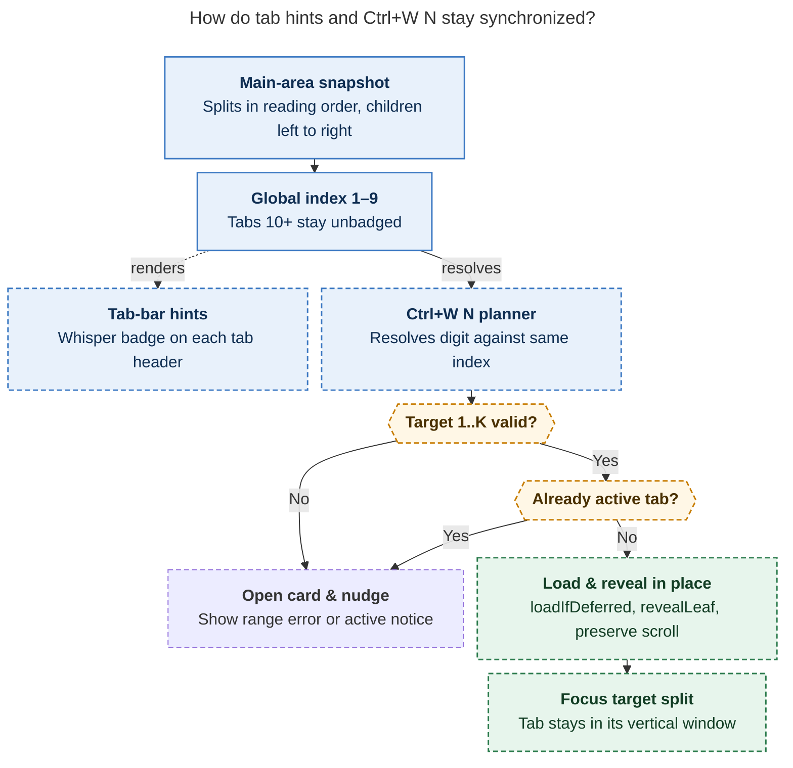

# `<ctrl+w>N` Tab Jump & Tab-Bar Hints for Obsidian Splits

> **Research question:** How should Bob extend the `<ctrl+w>` window prefix (`bob-cli-m0`) to support `<ctrl+w>N` — jumping to the `N`th Obsidian tab as determined by hints rendered next to each file's name in Obsidian's tab title bar while keeping that tab in its existing vertical window — so the feature is intuitive, reliable, and beautiful? Is this plan a good idea, what should change, and what is the recommended implementation?

## Bottom line

**Build it — with four crisp design commitments.** Adding `<ctrl+w>N` directly closes the largest remaining keyboard gap after `bob-cli-m0`: `Ctrl+W h`/`l`/`w` can only focus whichever tab is *already selected* in the neighbouring split, and Obsidian's built-in `Cmd+1..9` is unbadged and trapped inside the *active* split. With global cross-split tab hints (`1`–`9` in visual reading order across main-area splits), jumping from the right split (`sase_blog_contents`) straight to a background tab in the left split (`20261115` or `dash`) becomes one fluid `<ctrl+w>1` or `<ctrl+w>2` gesture, leaving that tab right where it sits.

To make it **intuitive, reliable, and beautiful** rather than flickery or fragile, make four deliberate adjustments to the naive version of the prompt:

1. **Global main-area `1–9` only (single-digit, no multi-digit timeout):** Number tabs `1`–`9` across all main-area vertical splits in spatial reading order; leave tabs `10+` unbadged rather than adding a `10+` prefix timeout that lags or swallows `<ctrl+w>1j` Vim motions, and never alias `9` to "last tab" when >9 tabs exist.
2. **Whisper-quiet persistent numerals that elevate on `Ctrl+W` (zero reflow):** Render fixed-width `tabular-nums` micro-badges permanently whenever ≥2 main-area tabs exist, then brighten them into `--interactive-accent` keycaps at `0 ms` when `Ctrl+W` arms. Armed-only badges either force a pause before you know `N` or cause every tab header to jump sideways on `Ctrl+W`.
3. **Anchor the badge at the tab header's leading edge (`[1] 📌 20261115`):** Putting plain text before the title collides visually with date-named daily notes (`1 20261115`), and putting it after the title runs into Obsidian's `margin-right: auto` gap on short tabs (`dash`) or crowds the `×` close button. A distinct leading micro-keycap keeps icons glued to titles, buffers digits from date notes, and survives narrow tab truncation.
4. **One pure reading-order model drives both DOM badges and `<ctrl+w>N` dispatch:** Never paint badges with CSS counters while dispatching via `iterateRootLeaves()`. Decouple main-area snapshotting from `activeLeaf` so badges do not vanish when focus visits a sidebar, and activate targets with `loadIfDeferred()` + `revealLeaf()` + `setActiveLeaf(..., { focus: true })` while preserving scroll and never recording a `Ctrl+O` jump.

---

## What the existing implementation and vault establish

Inspection of the shipped `bob-cli-m0` implementation in `bob-plugins@0e16e30` (`bob-navigation-hotkeys` v2.83.1), the live vault configuration, and Bryan's screenshot (`~/tmp/screenshots/20261115_171818.png`) establishes the exact starting baseline:

- **Live layout and workflow (`~/tmp/screenshots/20261115_171818.png`):** Main Obsidian window on macOS, default light theme (`~/bob/.obsidian/appearance.json` has no custom theme, four CSS snippets), `vimMode: true` (`~/bob/.obsidian/app.json`). Two main-area splits sit side by side:
  - Left split: pinned `20261115` (pin icon on the left, no close `×`), pinned `dash` (pin icon on the left, no close `×`), active `sase_blog` (document icon on the left, `×` on the right).
  - Right split: active `sase_blog_contents` (document icon on the left, `×` on the right).
  - Notice two critical layout details directly visible in the screenshot: (1) tab #1 is named **`20261115`** — a pure integer filename; and (2) short tab names like `dash` leave large whitespace before the right edge of the tab, because Obsidian's `.workspace-tab-header-inner-title` absorbs/pushes trailing controls (`×`) to the far right.
- **Vault task intent (`~/bob/bob.md:67`):** `[/] #task Add support for <ctrl+w>N to jump to Nth panel! ... ^ctrl-w-n` (`dependsOn:: bob__ctrl-w-keymaps`). Notice the vault note says `"Nth panel"` while this design request clarifies `"Nth Obsidian tab"` with hints `"rendered next to each file's name in Obsidian's tab title bar"` and `"remaining in the same vertical window"`.
- **Existing `bob-navigation-hotkeys` window-prefix architecture (`bob-plugins@0e16e30`):**
  - `src/266-window-prefix-model.js` (538 lines): pure snapshot normalizer, `windowPrefixReadingOrder(splits)`, planners (`planWindowPrefixFocus`, `planWindowPrefixMove`, `planWindowPrefixSplit`, `planWindowPrefixKey`), `normalizeWindowPrefixKeydown`, `getWindowPrefixArmingVerdict`, `buildWindowPrefixViewModel`.
  - `src/267-window-prefix-actions.js` (775 lines): live `WorkspaceTabs`/`WorkspaceLeaf` adapter (`snapshotWindowPrefixLayout`, `focusWindowPrefixLeaf`, `executeWindowPrefixPlan`, `windowPrefixCaptureScroll`/`RestoreScroll`).
  - `src/473-window-hint-view.js` (787 lines): `createWindowHintHost(doc, { setIcon })` painting the `0 ms` accent ring + `⌃W` badge and `300 ms` non-modal card (`520 px` max width, minimap, 2-column grid, footer nudges/receipts).
  - `src/687-plugin-window-prefix.js` (822 lines): capture-phase `Ctrl+W` arming, `app.keymap.pushScope(scope)` catch-all suffix interception (`WeakSet`-deduped), `windowPrefixSelfCaused` guard, `idle → armed → carded → running → idle` state machine.
  - `src/688-plugin-window-prefix-commands.js` (222 lines): six palette commands (`window-focus-left/right/next`, `window-move-tab-left/right`, `window-keys`) plus the persistent focused-split underline (`bob-wp-multi-split` on `body`, `.workspace-tabs.mod-active` with `.bob-wp-active-split` fallback).
  - `docs/window-keys.md:93-95`: explicitly marked `digits` and `numbered splits` out of scope for v1 and reserved for follow-up design.
- **Obsidian 1.15.1 internal DOM & APIs (`obsidianmd/obsidian-api`, `Fevol/obsidian-typings@release/obsidian-public/1.15.1`):**
  - `WorkspaceLeaf` exposes `tabHeaderEl`, `tabHeaderInnerIconEl`, `tabHeaderInnerTitleEl`, `tabHeaderStatusContainerEl`, `tabHeaderStatusPinEl`, `tabHeaderCloseEl`, `updateHeader()`, `isDeferred`, `loadIfDeferred()`, `pinned`, `getDisplayText()`.
  - `WorkspaceTabs` exposes `children`, `currentTab`, `selectedTab`, `isStacked`, `tabHeaderContainerEl`, `tabHeaderEls`, `selectTab()`, `selectTabIndex()`, `scrollIntoView()`.
  - `Workspace` exposes `iterateRootLeaves()`, `revealLeaf()`, `setActiveLeaf(leaf, { focus: true })`, `rootSplit`, `activeLeaf`.
  - **Key caveat proven in `bob-cli-m0.1`:** `iterateRootLeaves(cb)` aborts early if `cb` returns a truthy value; always use block-body callbacks.

---

## Critique: Is this a good idea?

### Verdict: Yes — it completes split navigation for background tabs

`bob-cli-m0` solved **split-level** focus (`h`/`l`/`w`) and **tab-reparenting** moves (`H`/`L`/`v`), but left a daily gap visible in Bryan's own workspace:

| Need in `20261115 \| dash \| sase_blog \|\| sase_blog_contents` | Existing `bob-cli-m0` + Native Obsidian | With `<ctrl+w>N` + Tab-Bar Hints |
| --- | --- | --- |
| Jump from `sase_blog_contents` to `dash` (background tab in left split) | Two steps (`<ctrl+w>h` then `Cmd+2`, or `Ctrl+0` special-cased for `dash`) | **One gesture:** `<ctrl+w>2` |
| Jump to tab #4 inside a 5-tab split without counting visually | Must visually count tabs and press `Cmd+4` | **See `4`, press `<ctrl+w>4`** |
| Jump to another split's active tab (`sase_blog_contents`) | `<ctrl+w>l` / `<ctrl+w>w` (great) | `<ctrl+w>l` or `<ctrl+w>4` (both work seamlessly) |

Look also at Bryan's daily tmux / TUI habits (e.g., `~/tmp/screenshots/20261116_061710.png`: numbered panes/windows `1 > main  2 > zsh  3 > chez  4 > ace *` and numbered TUI jump keys): ordinal badges paired with `<prefix>N` already match his reflex across tools.

### Five real hazards in a naive implementation

1. **Structural vs. visual index drift (CSS counters vs. `iterateRootLeaves`).**
   A tempting shortcut is rendering tab numbers with pure CSS (`counter-reset` / `counter-increment` on `.workspace-tab-header`) and executing `<ctrl+w>N` by taking the `N`th leaf from `workspace.iterateRootLeaves()`. That **will** silently jump to the wrong tab:
   - CSS counters keep incrementing past 9 (`10`, `11`...) unless hidden with fragile `:nth-child` rules, and a single DOM/selector quirk can include sidebar headers or unrendered panes.
   - Worse, `iterateRootLeaves()` reflects workspace-tree insertion order, whereas after `create-split` + `windowPrefixPutSplitBeside` (`267-window-prefix-actions.js:265`) or nested splits, visual left-to-right order comes from layout geometry (`windowPrefixReadingOrder`).
   - **Rule:** One pure TypeScript/JS tab-index function must drive **both** the DOM badges and `<ctrl+w>N` resolution.

2. **The idle-vs-armed visibility dilemma (flicker, reflow, and forced pauses).**
   Consider what happens if tab numbers are **only** shown after pressing `<ctrl+w>` (like `j4ckofalltrades/obsidian-tab-numbers`, which shows badges only while `Cmd`/`Ctrl` is held):
   - First, `obsidian-tab-numbers` (`src/core/TabNumbers.ts` + `styles.css:1-30`) toggles `display: none` to `display: inline-flex`. Every time the modifier is pressed, every tab header widens by ~22 px and all tab titles jerk sideways.
   - Second, in a multi-split layout with pinned and unpinned tabs, you rarely know offhand whether `sase_blog_contents` is `4` or `5` without looking. If the hint is invisible until `<ctrl+w>` is pressed, **every `<ctrl+w>N` forces a stop-and-read pause** — breaking the fluent 150–250 ms chord flow that `bob-cli-m0` deliberately protected with its two-tier hint!
   - Conversely, bright colored badges on every tab 100% of the time make the tab bar loud. The answer is **both tiers**: whisper-quiet fixed-width numerals in idle (zero reflow, readable before you press `<ctrl+w>`), elevating smoothly to crisp accent keycaps at `0 ms` when `<ctrl+w>` arms.

3. **Numeric filename collision (`1` vs `20261115`) and Obsidian's `flex` tab layout.**
   - In `~/tmp/screenshots/20261115_171818.png`, the very first tab is `20261115`. Rendering plain text `"1 "` directly before the title (`1 20261115`) visually merges into `12026115`.
   - Meanwhile, rendering a badge **after** `.workspace-tab-header-inner-title` fails in two ways: (a) on short titles (`dash`), Obsidian's title layout (`margin-right: auto`) pushes trailing siblings to the far right edge of the tab, ~100 px away from the filename; and (b) on active tabs, it sits immediately beside the `×` close button (`[3] ×`), crowding click targets and looking cluttered, while pinned tabs have no `×` button at all (one of the real bugs in `obsidian-tab-numbers`, which falls back to appending outside `.workspace-tab-header-inner` when `.workspace-tab-header-inner-close-button` is absent!).
   - Rendering a bordered/tinted **micro-keycap** at the **leading edge** of `.workspace-tab-header-inner` (`[1] 📌 20261115`, `[3] 📄 sase_blog ×`) separates the badge from date digits, keeps the pin/file icon paired with the note name, never vanishes behind `text-overflow: ellipsis`, and works identically on pinned and unpinned tabs.

4. **Multi-digit `N ≥ 10` creates a Vim key-eating hazard.**
   If tabs `10`, `11`, `12` are numbered and mapped to `<ctrl+w>10`, `<ctrl+w>11`, `<ctrl+w>12`, then pressing `<ctrl+w>1` becomes ambiguous the moment a 10th tab opens. Waiting for a disambiguation timeout (e.g., 350 ms) breaks `<ctrl+w>1j` (jump to tab 1 and immediately scroll down in Vim): either `j` arrives while the catch-all `Scope` is still popped-deferred and gets swallowed as an unmapped window key, or the plugin attempts to synthesize a `KeyboardEvent('keydown', { key: 'j' })` — which Chromium marks `isTrusted: false`, so Obsidian hotkeys and native editor bindings ignore it. Single-digit `1`–`9` guarantees `0 ms` deterministic dispatch on every jump.

5. **The Vim count reservation trade-off and `"Nth panel"` ambiguity.**
   `bob-cli-m0` reserved `digits` and `numbered splits` for later (`docs/window-keys.md:94-95`), and `getWindowPrefixArmingVerdict` rejects pending Vim counts (`2<ctrl+w>`). Giving `<ctrl+w>1`–`9` direct tab-jump semantics means post-prefix Vim counts like `<ctrl+w>3h` or `<ctrl+w>2w` will not exist under `<ctrl+w>`. That is the right trade in Obsidian: you rarely need "move 3 splits left" in a 2–3 split layout, whereas jumping directly to tab 1–9 happens constantly. Still, this choice is irreversible once muscle memory forms, so it must be deliberate.

---

## Alternatives considered

| Approach | How it works | Strengths | Weaknesses | Verdict |
| --- | --- | --- | --- | --- |
| **A. Global `1–9` main-area tab hints + persistent-quiet / armed-elevated badges** | Reading-order `1`–`9` across all main-area splits; leading keycaps always subtly visible, brightened on `Ctrl+W`; `<ctrl+w>1..9` focuses tab in its split | Solves cross-split + background tab jumps in 1 chord; `0 ms` dispatch; zero reflow; matches tmux/TUI muscle memory | Tabs `10+` are unbadged; claims `<ctrl+w>` digits away from Vim post-prefix counts | **Recommended** |
| **B. Adaptive multi-digit `1–N` (`10`, `11`...)** | Unambiguous digits jump at `0 ms`; ambiguous leading digits (`1` when `totalTabs ≥ 10`) wait ~350 ms or `Enter` | Every open tab has a number even at 12+ tabs | `<ctrl+w>1` suddenly lags 350 ms once 10 tabs open; `<ctrl+w>1j` swallows or mangles `j`; unreliable synthetic key replay | Reject for default; optional future opt-in only |
| **C. Armed-only tab hints (appear on `Ctrl+W`)** | Tab bar untouched while idle; numbers appear only after `Ctrl+W` | Zero idle chrome | Impossible to know `N` before pressing `Ctrl+W` (kills fluent 150 ms `<ctrl+w>2`); causes tab-bar reflow or covers icons | Reject |
| **D. Number *splits* (`"Nth panel"`), not tabs** | Only 1 badge per vertical split (`1 \| 2 \| 3`) | Zero per-tab clutter; fits `bob.md:67` phrasing `"Nth panel"` | Redundant with `h`/`l`/`w` for 2–3 splits; leaves background tabs (`20261115`, `dash`) unreachable | Reject |
| **E. Per-active-split `1–9` (like `Cmd+1..9` + `obsidian-tab-numbers`)** | Each split numbers its own tabs `1..9`; `<ctrl+w>N` jumps inside current split only | Handles >9 tabs per window if split evenly | Cannot jump across splits, defeating `<ctrl+w>` and making "remain in the same vertical window" moot; duplicates `Cmd+1..9` | Reject |
| **F. Fuzzy tab palette (`<ctrl+w>t` / `<ctrl+w>/`)** | Opens a quick-pick list of open tabs | Scales to 30+ tabs | Needs search typing + `Enter`; complementary for Phase 2 overflow, not a substitute for `<ctrl+w>N` | Defer as Phase 2 complement |

---

## Justified requirement adjustments (called out explicitly)

1. **Resolve `"Nth tab"` vs `"Nth panel"` (`bob.md:67`) cleanly in favor of global main-area tabs.** Number all tabs in main-area splits (`rootSplit` in the main window) in visual reading order (`windowPrefixReadingOrder(splits)` left-to-right, top-to-bottom, then `group.children` left-to-right). Exclude sidebars and popout windows.
2. **Scope `N` to single digits `1`–`9` (no `10+`, no `9` = "last tab").** If 12 tabs are open, tabs `1`–`9` carry badges `1`–`9` and tabs `10`–`12` carry no badge. Do not adopt Obsidian/Chrome's "`9` jumps to the last tab" rule, because displaying `9` on tab #12 violates the contract that `N` is determined by the tab-bar hint.
3. **Make tab hints persistently visible in a quiet idle state, brightening at `0 ms` when `<ctrl+w>` is armed.** Gate visibility on `totalMainAreaTabs >= 2` (matching `bob-cli-m0`'s `splitCount >= 2` gate on the focused-split underline), so a single-tab workspace stays spotless.
4. **Place the hint at the leading edge of `.workspace-tab-header-inner` (`[1] 📌 20261115`), not inline-before-title plain text or trailing-after-title.** Styled as a compact `tabular-nums` micro-keycap with `flex: 0 0 auto` and `pointer-events: none`, it never merges with date titles (`20261115`), never gets clipped by ellipsis on narrow tabs, never floats away via `margin-right: auto`, and never blocks drag-and-drop or clicks.
5. **Preserve scroll, load deferred tabs, and keep `Ctrl+O` clean.** Unlike `focusWindowPrefixLeaf()` in `267-window-prefix-actions.js:505` (which only calls `setActiveLeaf`), `<ctrl+w>N` can target background tabs that Obsidian 1.7.2+ deferred (`isDeferred === true`) or scrolled out of a narrow tab strip. Follow `activateWorkspaceLeaf` in `620-plugin-dash-and-vim-jumps.js:83`: `loadIfDeferred()` -> capture scroll -> `revealLeaf()` -> `setActiveLeaf(leaf, { focus: true })` -> `scrollIntoView(index)` if needed -> restore scroll -> assert `leaf.parent` unchanged. Never call `recordJump`.
6. **Decouple tab-bar enumeration from `activeLeaf` in `rootSplit`.** `snapshotWindowPrefixLayout()` currently returns `null` if focus visits a sidebar (`267-window-prefix-actions.js:450`). Add `snapshotWindowPrefixMainArea(workspace)` so tab hints remain stable while clicking in File Explorer or Backlinks, while `<ctrl+w>` arming stays restricted to `activeLeafInRootSplit`.
7. **Integrate gently with the Tier-2 card without bloating the 6-row grid.** Keep the 2×3 FOCUS / TAB grid untouched (`h`/`l`/`w` and `H`/`L`/`v`), annotate each minimap split pill with its numbered range (e.g., `1–3` / `4`, or `1–3` beside the tab count), and add `1–K jump tab` to the card footer (`1–4 jump tab · esc · q cancel`). Pressing an out-of-range digit (e.g., `9` when 4 tabs exist) keeps the prefix armed, opens the card at once, and nudges `"Only 4 tabs (1–4)"`.
8. **Accept `Ctrl+W Ctrl+N` (held Ctrl) and register unhotkeyed palette commands (`window-focus-tab-1`..`9`).** Accept `event.code` `Digit1`–`Digit9` (when `!shiftKey`) alongside `event.key` so held-Ctrl sequences (`Ctrl+W Ctrl+2`) work consistently with `Ctrl+W Ctrl+L`. Also note the one-line departure from reserved Vim `<C-w>` counts in `docs/window-keys.md`.

---

## Recommended design & implementation blueprint

### 1. Single source of truth: pure tab-index model & planner

Extend `plugins/bob-navigation-hotkeys/src/266-window-prefix-model.js` (currently 538 lines; comfortably under the 1,000-line `AGENTS.md` limit) and export new pure helpers in `720-window-prefix-exports.js`:

- **`WINDOW_PREFIX_MAX_TAB_HINTS = 9`**.
- **`buildWindowPrefixTabIndex(snapshot)`**:
  - Normalizes `snapshot`, iterates `windowPrefixReadingOrder(layout.splits)`, then each split's `leaves` in order.
  - Assigns `number = 1..9` (`number <= WINDOW_PREFIX_MAX_TAB_HINTS ? number : null`) to each leaf, producing:
    - `totalTabs`: total main-area leaves.
    - `maxHint`: `Math.min(totalTabs, 9)`.
    - `entries`: `[{ number, leafId, splitId, label, active, selectedInSplit, indexInSplit }]`.
    - `byNumber`: lookup `Map` / array for `1..9`.
    - `splitRanges`: per-split `{ splitId, start, end, label }` (e.g., `"1–3"`, `"4"`, or `null` if all leaves in that split are `> 9`).
- **Key normalization (`normalizeWindowPrefixKeydown`)**:
  - When `!event.shiftKey` and (`"1".."9"` in `key` or `/^Digit([1-9])$/` in `code`), return `{ kind: "mapped", key: digit, inputKey: normalizedKey, consume: true }`. (Accepts held Ctrl; Shift+digit like `!` and `0` stay unmapped unless `0` gets a dedicated message.)
- **Planner (`planWindowPrefixTabJump(snapshot, key)`)**:
  - Validates layout -> checks `layout.capabilities.focus` -> resolves `tabIndex = buildWindowPrefixTabIndex(layout)`.
  - If `number > tabIndex.totalTabs`: returns blocked noop (`reason: "tab-out-of-range"`, `preview: tabIndex.totalTabs === 1 ? "only 1 tab" : \`only ${tabIndex.totalTabs} tabs (1–${tabIndex.maxHint})\``).
  - If `entry.leafId === layout.activeLeafId`: returns blocked noop (`reason: "already-active-tab"`, `preview: \`already on tab ${number}\``).
  - Otherwise returns `{ ok: true, available: true, action: "focus-tab", key: String(number), tabNumber: number, sourceSplitId: source.id, sourceLeafId: layout.activeLeafId, targetSplitId: entry.splitId, targetLeafId: entry.leafId, sameSplit: entry.splitId === source.id, preview: \`tab ${number} · ${entry.label}\`, consequence: null }`.
- **View model (`buildWindowPrefixViewModel`)**:
  - Adds `tabCount: tabIndex.totalTabs`, `maxTabHint: tabIndex.maxHint`, and `tabRange` (`"1–3"`, `"4"`, etc.) onto each split in `model.splits` so the minimap and footer read from the exact same `tabIndex`.

*Figure 1 (verified SVG: 797×1146 px, 77.9% PDF fit). One reading-order snapshot drives both the tab-bar hints and `<ctrl+w>N` target resolution; activation loads deferred views, reveals and focuses the leaf in place, and leaves `leaf.parent` untouched.*



### 2. Live layout adapter & lossless in-place tab activation

In `plugins/bob-navigation-hotkeys/src/267-window-prefix-actions.js` (currently 775 lines):

- **Factor `snapshotWindowPrefixMainArea(workspace)`:**
  - Collect `leaves = windowPrefixRootLeaves(workspace).filter((leaf) => windowPrefixIsInRoot(leaf, rootSplit))`.
  - Group by `windowPrefixLeafParent(leaf)`, and **explicitly order each group's leaves by `group.children.indexOf(leaf)`** when `Array.isArray(group.children)` so tab indices always match visual left-to-right tab order.
  - Keep `snapshotWindowPrefixLayout()` strict (`activeLeaf` must be in `rootSplit`) for prefix arming/execution, while the tab-bar hint controller calls `snapshotWindowPrefixMainArea(workspace)` so sidebar focus never wipes tab numbers.
- **Add `focusWindowPrefixTab(leaf)` for `"focus-tab"` execution:**
  1. Record `beforeParent = windowPrefixLeafParent(leaf)` and `scrollState = windowPrefixCaptureScroll(leaf)` (if not deferred).
  2. If `leaf.isDeferred === true && typeof leaf.loadIfDeferred === "function"`, `await leaf.loadIfDeferred()`.
  3. If `typeof workspace.revealLeaf === "function"`, `await workspace.revealLeaf(leaf)` (brings background/scrolled tabs forward and ensures view mount).
  4. Call `workspace.setActiveLeaf(leaf, { focus: true })`, retrying after `windowPrefixNextFrame()` if needed, and verify `workspace.activeLeaf === leaf`.
  5. If `beforeParent && Array.isArray(beforeParent.children)` and `typeof beforeParent.scrollIntoView === "function"`, call `beforeParent.scrollIntoView(beforeParent.children.indexOf(leaf))` to ensure narrow/stacked tab headers scroll into view.
  6. Restore `scrollState` via `windowPrefixRestoreScroll(scrollState)` (plus one `rAF` pass) if the leaf had already been loaded; verify `windowPrefixLeafParent(leaf) === beforeParent` (proving the tab stayed in its original vertical window).
  7. Never call `recordJump`.

### 3. Aesthetic design: Tab-bar micro-keycaps + two-tier synergy

To avoid bloating `473-window-hint-view.js` (787 lines) or `687-plugin-window-prefix.js` (822 lines) past the 1,000-line ceiling, create a dedicated fragment **`474-window-tab-hints-view.js`** (pure DOM badge painter) and wire lifecycle hooks cleanly from `688-plugin-window-prefix-commands.js` (222 lines) alongside `setupWindowPrefixUnderline()`.

#### Exact DOM placement in Obsidian's tab header

For each main-area leaf when `totalTabs >= 2` and `1 <= number <= 9`:

```html
<div class="workspace-tab-header ..." data-bob-wp-tab="1">
  <div class="workspace-tab-header-inner">
    <span class="bob-wp-tab-hint" aria-hidden="true" data-bob-wp-tab-badge="1">1</span>
    <!-- Obsidian native children: inner-icon, inner-title, status-container, close-button -->
  </div>
</div>
```

- **Why attach inside `.workspace-tab-header-inner` (`leaf.tabHeaderInnerTitleEl.parentElement`)?**
  - `leaf.updateHeader()` updates `tabHeaderInnerIconEl` and `tabHeaderInnerTitleEl.textContent` without wiping custom sibling spans inside `.workspace-tab-header-inner`.
  - Setting `order: -2` in CSS places `.bob-wp-tab-hint` cleanly at the leading edge of the tab even if Obsidian or a theme reorders `.workspace-tab-header-status-container` (`order: -1`) for pinned tabs (`📌 20261115` becomes `[1] 📌 20261115`).
  - `pointer-events: none; user-select: none; flex: 0 0 auto;` guarantees zero interference with drag-reordering, middle-click closing, right-click menus, and narrow tab squeezing.
  - Store rendered badge nodes in a `WeakMap`/`Map` keyed by `tabHeaderEl` and reconcile idempotently on `layout-change`, `active-leaf-change`, `file-open`, and `windowPrefixArmed` transitions (coalesced via `requestAnimationFrame`, plus an immediate synchronous sync when `Ctrl+W` arms so DOM and planner never diverge by one frame). Cleanly remove all `.bob-wp-tab-hint` nodes, `data-bob-wp-tab` attributes, and body classes (`bob-wp-multi-tab`, `bob-wp-armed`) on `onunload()`.

#### Visual typography & states (using Obsidian theme variables only)

```css
/* Persistent whisper-quiet idle state (only when 2+ main-area tabs exist) */
body.bob-wp-multi-tab .workspace-tab-header-inner > .bob-wp-tab-hint {
  order: -2;
  display: inline-flex;
  align-items: center;
  justify-content: center;
  flex: 0 0 auto;
  min-width: 15px;
  height: 15px;
  padding: 0 4px;
  margin-inline-end: 5px;
  border: 1px solid color-mix(in srgb, var(--background-modifier-border) 75%, transparent);
  border-radius: 4px;
  background: color-mix(in srgb, var(--background-primary) 65%, transparent);
  color: var(--text-faint);
  font-family: var(--font-monospace);
  font-size: 10px;
  font-weight: 600;
  font-variant-numeric: tabular-nums;
  line-height: 1;
  pointer-events: none;
  user-select: none;
  transition: color 90ms ease-out, border-color 90ms ease-out,
    background-color 90ms ease-out, box-shadow 90ms ease-out;
}

body.bob-wp-multi-tab .workspace-tab-header.is-active .bob-wp-tab-hint {
  color: var(--text-muted);
}

/* Armed state (0 ms on Ctrl+W): zero reflow, instant accent elevation */
body.bob-wp-multi-tab.bob-wp-armed .workspace-tab-header-inner > .bob-wp-tab-hint {
  border-color: color-mix(in srgb, var(--interactive-accent) 45%, var(--background-modifier-border));
  background: var(--background-primary);
  color: var(--text-normal);
  box-shadow: var(--shadow-s);
}

body.bob-wp-multi-tab.bob-wp-armed .workspace-tabs.mod-active .workspace-tab-header.is-active .bob-wp-tab-hint {
  border-color: color-mix(in srgb, var(--interactive-accent) 30%, transparent);
  color: var(--interactive-accent);
  opacity: 0.72;
}

/* Destination pulse (220 ms after <ctrl+w>N jump, matching yank-flash & ring pulse) */
.workspace-tab-header-inner > .bob-wp-tab-hint.is-pulse {
  border-color: var(--interactive-accent);
  background: var(--interactive-accent);
  color: var(--text-on-accent, #fff);
  box-shadow: 0 0 0 2px color-mix(in srgb, var(--interactive-accent) 24%, transparent);
}
```

How this looks in the screenshot layout (`[1] 📌 20261115  [2] 📌 dash  [3] 📄 sase_blog × | [4] 📄 sase_blog_contents ×`):
- **Idle:** Tiny low-contrast `10 px` monospace caps (`1`, `2`, `3`, `4`) sit calmly beside each tab icon without competing with note titles or date numbers (`20261115`).
- **Armed (`0 ms` on `Ctrl+W`):** Active split gets the accent ring + `⌃W` badge; simultaneously, all tab-bar caps `1`–`4` sharpen in contrast with zero horizontal jump (the currently focused tab `3` dims slightly in accent so your eyes lock immediately onto jump targets `1`, `2`, `4`).
- **Carded (`300 ms` pause or out-of-range digit):** Minimap split pills show their tab ranges (`1–3` and `4`), and the card footer adds `1–4 jump tab · esc · q cancel`. Pressing `9` keeps the prefix armed, reveals the card immediately, and shows `"Only 4 tabs (1–4)"`.

```mermaid
---
title: "How do tab hints evolve across idle, armed, and carded states?"
accTitle: "Visual lifecycle of tab-bar hints with the Ctrl+W prefix"
accDescr: "Idle shows faint fixed-width numbers when two or more tabs exist; Ctrl+W brightens keycaps immediately with zero reflow, and pausing 300 ms opens the card."
config:
  state:
    nodeSpacing: 28
    rankSpacing: 26
---
stateDiagram-v2
  state "Idle (2+ tabs)<br/>Faint numerals in tab bar" as IDLE
  state "Armed (0 ms)<br/>Split ring + bright keycaps" as ARMED
  state "Carded (300 ms or blocked)<br/>Split ranges + footer hint" as CARD
  state "Jumped (220 ms pulse)<br/>Target split and tab pulse" as JUMP

  IDLE --> ARMED: Ctrl+W
  ARMED --> JUMP: digit 1..K
  ARMED --> CARD: 300 ms pause or bad digit
  CARD --> JUMP: digit 1..K
  CARD --> CARD: bad digit nudges footer
  ARMED --> IDLE: Esc, click, blur
  CARD --> IDLE: Esc, click, blur
  JUMP --> IDLE: pulse completes
```

- **Jumped (`<ctrl+w>2` or `<ctrl+w>4`):** Target split's ring pulses for `220 ms` **and** the target tab's badge briefly flashes solid `--interactive-accent` (`220 ms`), giving clear visual confirmation even on same-split jumps (`3 → 2`) without needing a toast.

*Figure 2 (verified SVG: 619×850 px, 100.0% PDF fit). Tab-bar badges remain fixed-width across states so `Ctrl+W` illuminates keycaps at `0 ms` with zero layout shift, while fluent `<ctrl+w>N` bypasses the `300 ms` card completely.*



### 4. Wiring, palette commands, and verification plan

1. **Fragment layout in `plugins/bob-navigation-hotkeys/` (`AGENTS.md` ≤ 1,000-line rule):**
   - `src/266-window-prefix-model.js`: `buildWindowPrefixTabIndex`, `planWindowPrefixTabJump`, digit handling in `normalizeWindowPrefixKeydown` and `planWindowPrefixKey`, `tabRange` / `maxTabHint` in `buildWindowPrefixViewModel`.
   - `src/267-window-prefix-actions.js`: `snapshotWindowPrefixMainArea`, `group.children` ordering, `focusWindowPrefixTab` (`isDeferred`/`loadIfDeferred` + `revealLeaf` + `setActiveLeaf` + `scrollIntoView` + scroll preservation + invariant check that `leaf.parent` did not change).
   - `src/473-window-hint-view.js`: render split tab-range pill (`1–3`) and footer `1–K jump tab` hint in Tier-2 card.
   - `src/474-window-tab-hints-view.js` *(new)*: `createWindowTabHintController(doc)` — pure DOM reconciliation + `is-pulse` helper + unload cleanup.
   - `src/687-plugin-window-prefix.js`: toggle `bob-wp-armed` body class in `armWindowPrefix` / `disarmWindowPrefix`, flush tab hints synchronously before planning, handle `"focus-tab"` in `presentWindowPrefixSuccess` (pulse target tab badge + target split ring).
   - `src/688-plugin-window-prefix-commands.js`: subscribe `layout-change` / `active-leaf-change` / `file-open` / `resize` to refresh tab hints; register `window-focus-tab-1` .. `window-focus-tab-9` palette commands (no default hotkeys).
   - `src/fragments.json` & `src/720-window-prefix-exports.js`: register `474` and export new pure helpers; run `npm run build` and `npm run build:check`.
2. **Documentation:** Update `docs/window-keys.md` (adding `1–9` to the key table, tab-bar badge behavior, `10+` boundary, Vim count reservation note, and palette commands) and `docs/bob-navigation-hotkeys.md`, then run `npm run docs:gen`, `npm run docs:inventory:check`, and `npm run docs:check`.
3. **Verification gates:**
   - **Unit (`node --test`):** Add parity tests asserting `buildWindowPrefixTabIndex` agrees 100% with `planWindowPrefixTabJump`, `group.children` order overrides `iterateRootLeaves` order, sidebar focus keeps badges alive, `10+` tabs leave `10+` unbadged, held-Ctrl `Digit1..9` works, out-of-range digit blocks without disarming, and DOM reconciler cleans up completely on unload.
   - **Headless Chromium preview (`scripts/preview-window-prefix.cjs`):** Add light + dark cases for `[1] 📌 20261115  [2] 📌 dash  [3] 📄 sase_blog | [4] 📄 sase_blog_contents`, narrow 70 px tabs, 10+ tabs, idle vs armed contrast, and verify zero width shift between idle and armed!
   - **Real Obsidian 1.15.1 CDP E2E on `athena` (`scripts/obsidian-window-prefix-e2e.cjs`):** Test cross-split `<ctrl+w>2` from right split to background tab in left split (`leaf.parent` unchanged, `20261115` stays in left split!), same-split `<ctrl+w>1`, `<ctrl+w>4` to right split, `<ctrl+w>Ctrl+2`, deferred tab loading after reload, scroll/undo/cursor survival, stacked tabs, sidebar-focus badge persistence, `Scope` stack cleanliness, and visual screenshots of the real `.workspace-tab-header-inner` badges in light & dark themes.

---

## Sources & provenance

- **Codebase (`bob-plugins@0e16e30`):** `plugins/bob-navigation-hotkeys/src/{266-window-prefix-model,267-window-prefix-actions,473-window-hint-view,687-plugin-window-prefix,688-plugin-window-prefix-commands,610-plugin-jumps-and-counted-keys,620-plugin-dash-and-vim-jumps,490-plugin-lifecycle,720-window-prefix-exports}.js`, `plugins/bob-navigation-hotkeys/styles.css`, `docs/window-keys.md`, `scripts/{obsidian-window-prefix-e2e,preview-window-prefix}.cjs`.
- **SASE beads, plans & prior research:** `bob-cli-m0`, `bob-cli-m0.1` (`SPIKE VERDICT`), `plan:202611/obsidian_ctrl_w_window_prefix.md`, `research:202611/obsidian_ctrl_w_window_prefix/obsidian_ctrl_w_window_prefix.md`.
- **Live vault & screenshots:** `/home/bryan/tmp/screenshots/20261115_171818.png`, `/home/bryan/tmp/screenshots/20261116_061710.png`, `/home/bryan/bob/bob.md:67`, `/home/bryan/bob/.obsidian/{app,appearance,hotkeys}.json`.
- **Obsidian APIs & prior art:** `gh:obsidianmd/obsidian-api` (`obsidian.d.ts`), `gh:Fevol/obsidian-typings@origin/release/obsidian-public/1.15.1` (`WorkspaceLeaf.d.ts`, `WorkspaceTabs.d.ts`), `gh:pjeby/pane-relief` (`src/Navigator.ts`, `src/pane-relief.ts`, `src/styles.scss`), `gh:j4ckofalltrades/obsidian-tab-numbers` (`src/core/TabNumbers.ts`, `styles.css`).
