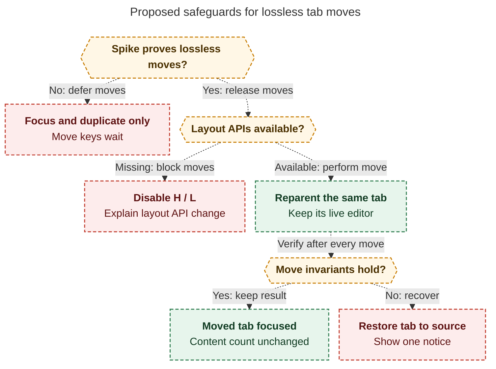
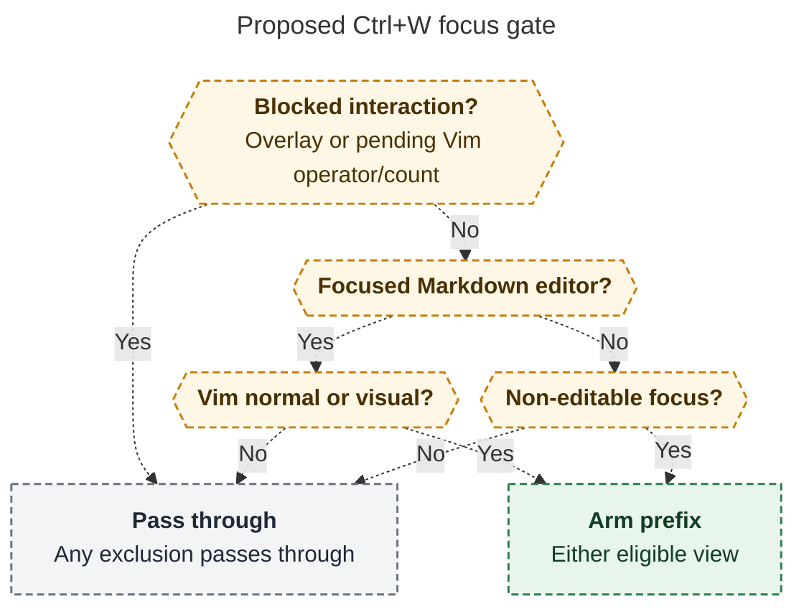

# Diagram proposals: A Ctrl+W window prefix for Obsidian vertical splits

Proposals for the swarm linker, not a report. Each diagram restates only what the source
report says.

```yaml
source: research:202611/obsidian_ctrl_w_window_prefix/obsidian_ctrl_w_window_prefix__final.md
producer: research.4v.image
check: "mmdc 12.0.0 with the PDF-mirroring config rendered 2 of 2 Mermaid diagrams; Puppeteer --no-sandbox"
```

## move-safeguards

```yaml
anchor: |-
  The unofficial surface needed is small
question: |-
  What prevents an unsafe tab move from silently losing editor state?
illustrates: |-
  The spike gates lossless reparenting, the upgrade canary disables H/L when internals are missing, and failed move invariants restore the source tab.
caption: After a successful spike, missing layout APIs (application programming interfaces) disable moves; failed post-move checks restore the source tab.
review: "849.072x938 px, fit 76.9%; question, source trace and visual checks passed; 0 visual revisions"
```



## arming-contexts

```yaml
anchor: |-
  arms the prefix when either: focus is in a Markdown editor
question: |-
  When should a qualifying Ctrl+W arm instead of passing through?
illustrates: |-
  The prefix arms in normal or visual Markdown editors or non-editable views, while blocked contexts and pending Vim operators or counts pass through untouched.
caption: For qualifying keypresses, either eligible view may arm; overlays, pending Vim operators/counts, and other text entry pass through.
review: "661.507x852 px, fit 98.7%; question, source trace and visual checks passed; 1 visual revision"
```


