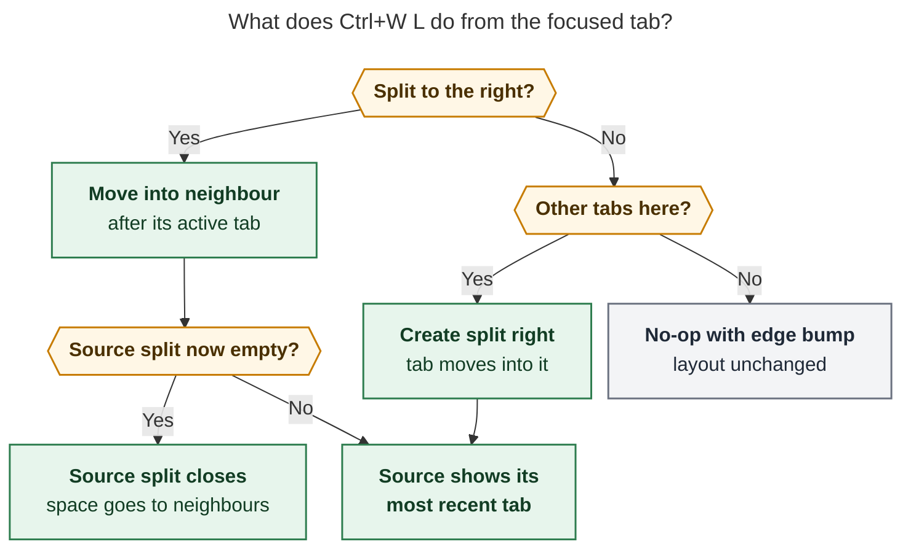

# A `Ctrl+W` window prefix for Obsidian vertical splits — consolidated research

Lead-researcher consolidation, 2026-11-15. Merges five independent reports
(`__cdx`, `__cld`, `__grk`, `__mus`, `__gem`, filed beside this report) plus the lead's
own verification pass over `bob-plugins@master`, the live vault config, and the
supplied screenshot. This is design research; no product code was changed.

**Recommendation in one paragraph.** Build it — all five researchers independently said
yes, and the vault already agrees: `bob.md` carries `^ctrl-w-keymaps` ("Make `<ctrl+w>`
keymaps work to split tabs!", status `[/]`) blocking `^split-tabs` ("Add much better
split tab support"), both filed 2026-11-15. Ship it as a **window-prefix layer in
`bob-navigation-hotkeys`**: a capture-phase `Ctrl+W` listener (the house pattern for
chords Vim would swallow), a pure geometry-based planner, and a two-tier hint — an
instant accent ring on the focused split, then a compact non-modal card after a ~300 ms
pause with a layout minimap and per-key consequence previews. Two deliberate adjustments
to the request, which every report converged on: **`h`/`l` are strictly directional and
never wrap** (`w` / a second `Ctrl+W` is the "other split" toggle), and **`H`/`L` move
the active tab, not the whole group**, creating a split at the edge and collapsing a
split the move empties. The one genuinely open technical risk is the move primitive:
moving the *same* leaf between groups (preserving undo history, cursor, scroll, pin)
relies on unofficial workspace internals, so the first implementation step is a bounded
spike in the existing real-Obsidian CDP harness, not UI code.

---

## 1. What the screenshot and vault establish

`~/tmp/screenshots/20261115_171818.png` (inspected directly): Obsidian on macOS, light
theme, Vim mode on. The main area is one `rootSplit` with two side-by-side tab groups —
left group holds pinned `20261115` and `dash` plus the active `sase_blog` (a task note
with READY pills and Next & In Progress sections); right group holds a single
`sase_blog_contents` tab (an outline being drafted). This is a real daily workflow —
task note beside its draft — not a demo. Two gaps are visible:

1. **No keyboard verbs for columns.** Bob has tab verbs (`move-tab-left/right`,
   `duplicate-current-tab`, `close-tabs-*`, pin) but they all operate within one group.
   Nothing focuses, fills, creates, or collapses a *column*.
2. **The focused split is nearly invisible.** The two tab bars look almost identical;
   only the editor caret says which side owns the keyboard.

Verified vault facts (lead pass): `vimMode: true` in `.obsidian/app.json`; no `<C-w>`
mapping anywhere in `~/bob/obsidian_vimrc.md`; no `workspace:close` override in
`hotkeys.json`, so Obsidian's default Close tab (`Cmd+W` on macOS, `Ctrl+W` on
Linux/Windows) is live.

Terminology (per the official API): a *tab* is a `WorkspaceLeaf`, a *tab group* is a
`WorkspaceTabs`, and groups sit under a `WorkspaceSplit` whose `direction: 'vertical'`
means a vertical divider — children side by side. "Split" in user-facing copy means a
main-area tab group column.

## 2. Verdict: good idea, with two consensus corrections

All five reports endorse the feature: the chord is deeply ingrained Vim muscle memory,
Bob is a keyboard-first vault with Vim always on, and Obsidian's native keyboard support
for splits stops halfway (you can create and focus splits, but rearranging tabs across
groups needs the mouse — the forum request for a native "move tab to group left/right"
command has been open since April 2023).

Two of the stated requirements should change, and every report independently proposed
the same changes:

**Adjustment 1 — `h`/`l` are directional, not "the other split."** With exactly two
columns, "go left"/"go right" and "go to the other split" coincide, so the request's
intent is preserved. But once a third column (or a horizontal split) exists, toggle
semantics on directional keys break spatial memory and fight `H`/`L`. So: `h` focuses
the nearest column strictly to the left, `l` to the right, neither wraps, and at an
edge the key is a visible no-op ("edge bump" + dimmed hint row). The "other split" idea
gets its own keys: **`w`** and **a second `Ctrl+W`** (fast double-tap) cycle to the
next split, wrapping — with two splits this is exactly the requested toggle.

**Adjustment 2 — `H`/`L` move the active tab, not the window/group, and deviate from
Vim on purpose.** In Vim, `<C-w>L` moves a *window* to the far edge. In the screenshot,
moving "the window" would drag the pinned `20261115` and `dash` tabs along — clearly
wrong. The unit Bryan cares about is the tab, and the model is VS Code's "move editor
into left/right group": move into the adjacent column when one exists; create a new
column at the edge when the source group has another tab; collapse the source column
when the move empties it; refuse (visible no-op) when the tab is the sole tab of the
sole column, since that move cannot produce two useful columns. Document the deviation
from Vim in one line so nobody "fixes" it back.

Other called-out adjustments with broad support:

| # | Adjustment | Why |
| --- | --- | --- |
| A3 | **Two-stage hint** (instant ring, card after ~300 ms pause) | An instant card flickers for fluent `Ctrl+W l` typed in ~150–250 ms; an invisible armed state is a trap. Both needs are real; staging serves both. |
| A4 | **The move preserves the actual editor** — same leaf, undo history, cursor, scroll, pin, view mode, back/forward history | "Reliable" includes "my undo still works." This is the quality bar that disqualifies clone-and-reopen prior art (Tab Shifter). |
| A5 | **v1 scope: vertical columns, current window's main area only** | Matches the request and screenshot. Sidebars, popouts, hover editors, and horizontal splits double the test matrix; `j`/`k`/`J`/`K` letters stay reserved. |
| A6 | **Arm outside text entry; pass through in insert mode** | Vim insert-mode `Ctrl+W` must keep deleting a word. But the prefix should also work in reading view, PDFs, and empty tabs — a window key shouldn't die because the focused split isn't an editor. |
| A7 | **Layout-only family in v1: no key closes a note** | Makes the layer safe to explore the moment the hint invites experimentation. `q` cancels (Bob card convention) rather than quitting. See §5 for the close-key dispute. |
| A8 | **Add a persistent focused-split indicator** — a quiet 2 px accent underline on the active group's tab bar whenever ≥2 main-area splits exist | Fixes the screenshot's legibility gap; without it, `h`/`l` act from a split you can't identify. |
| A9 | **Window motions never record a jump** in Bob's `Ctrl+O` history; pinned tabs keep their pin and insert after the destination's pinned prefix; no auto-equalize of widths | Vim doesn't jumplist window switches; a 60/40 layout Bryan dragged on purpose must survive a join. |

## 3. Recommended key table

v1 (the request plus the cheap keys that make it coherent):

| Sequence | Action | Behavior |
| --- | --- | --- |
| `Ctrl+W h` / `l` (also with Ctrl still held) | Focus split left / right | Geometry-based nearest column; no wrap; edge bump at the boundary. Focuses the destination group's *selected* tab. |
| `Ctrl+W H` / `L` | Move current tab left / right | Join the adjacent column (insert after its active tab, respecting pinned prefix), or create a column at the edge when another tab remains behind; collapse an emptied source; sole-tab-sole-column is a no-op. Focus follows the tab. |
| `Ctrl+W w` / second `Ctrl+W` | Other / next split | Wraps. The two-split toggle. |
| `Ctrl+W v` | Split right showing the same note | Public `duplicateLeaf(leaf, 'split', 'vertical')` — Vim's `<C-w>v`. The answer when "move" is refused for a lone tab. |
| `Esc` / `Ctrl+[` / `q` | Cancel | Bob's card-close convention. No layout change. |

Phase 2 (designed, deferred): `j`/`k` row focus, `p` previous split, `=` equalize
widths, `<`/`>` resize with counts, `x` exchange columns, `c` (close tab *or*
non-destructive merge — see §5), `o` merge-all/only, `1`–`9` numbered splits, Vim
counts. Phase 3: `J`/`K`, popout windows. Vim has ~40 `<C-w>` commands; the admission
rule that prevents scope creep is A7: a key joins the family only if it changes layout.

Key normalization (consensus): read `event.key`; ignore modifier-only keydowns (Shift
pressed for `H` must not cancel); treat held-Ctrl suffixes as their plain forms; never
swallow Cmd/Meta chords (cancel and pass through, so `Cmd+S` still saves); ignore
`event.repeat` and IME composition; an unmapped printable suffix is consumed and
explained in the card — it must never leak into the note as an edit or a Vim command;
pass through when a Vim operator or count is pending.

## 4. Mechanism: capture-phase prefix, not vimrc

Four of five reports (cdx, cld, grk, gem) recommend a capture-phase `keydown` listener
owning a small prefix state machine. One (mus) proposed vimrc `nnoremap <C-w>… :obcommand …`
wiring, claiming Obsidian's bundled Vim supports `<C-w>` leaders natively since 0.14
(secondhand, from community notes). The source-level evidence goes the other way:
upstream `replit/codemirror-vim` defines `{ keys: '<C-w>', type: 'idle', context: 'normal' }`,
and its matcher returns a **full** match before any partial match — so after
`nmap <C-w>l …`, the bare `<C-w>` fully matches the idle entry, the key buffer clears,
and the `l` just moves the cursor. cld and gem independently cited the exact lines, and
the `saberzero1/motions` 0.17.0 release notes describe fixing precisely this bug. The
`nunmap <C-w>` workaround exists but depends on the Vim build Obsidian bundles. Whether
Obsidian's *bundled* copy was patched is unverifiable without runtime inspection (spike
item), but it doesn't change the decision, because the vimrc route fails the request on
independent grounds: it is dead outside CodeMirror editors (reading view, PDFs, empty
tabs), it cannot drive a context-aware hint (`displayChord` renders raw keys in a
status-bar span, and JavaScript vimrc commands are disabled in this vault), and
vimrc-support's own worked example maps `<C-w>h` to the *wrong native command*.

The capture-listener pattern is already the house solution — `bob-navigation-hotkeys`
registers at least six capture-phase listeners on `window` and `document` with `WeakSet`
dedupe precisely because CodeMirror Vim swallows chords before Obsidian's dispatcher
(verified at `610-plugin-jumps-and-counted-keys.js`), and `bob-vim-surround` uses the
same approach.

**Arming gate.** `Ctrl+W` (Ctrl held, no Meta/Alt/Shift, not a repeat, not composing)
arms the prefix when either: focus is in a Markdown editor whose Vim mode is normal or
visual (via the existing `getCurrentVimMode`, which reads `cm.state.vim` with a
vimrc-plugin fallback — resolve from the *focused* editor, since a global "last mode"
can be stale after switching leaves); or focus is non-editable (no input, textarea, or
contenteditable) and not inside a modal, prompt, menu, suggestion popup, Command Mode,
or the Task/Copy cards. Everything else passes through untouched — insert/replace mode
word-delete, the `:` prompt, search fields. On Linux this deliberately takes `Ctrl+W`
from Obsidian's Close-tab default *in armed contexts only* (see §5). Use physical
`Ctrl`, never `Mod`, so macOS keeps `Cmd+W`.

While armed: consume the next keydown; one action per arm; serialize operations (a
`Ctrl+W` during an async move waits); cancel on `Esc`/`Ctrl+[`/`q`, outside click,
window blur, modal opening, or layout invalidation — and because the card makes the
armed state visible from ~300 ms on, no silent expiry timeout is needed while the user
is reading. Capture the source leaf when the prefix opens and revalidate it before
executing; if the layout changed meanwhile, dismiss with "Layout changed — try again"
rather than moving a different tab. Register palette commands for every verb (no
default hotkeys), so actions stay reachable, remappable, and accessible without the
prefix. Figure 2 in §6 shows the full lifecycle.

## 5. Disputes between the reports, resolved

**Where the code lives.** cld argued for a new `bob-vim-windows` plugin; cdx, grk, gem,
and mus put it in `bob-navigation-hotkeys`. The lead verified cld's size concern — nav's
`src/` really is ~118k lines — but recommends **nav** anyway: it already owns every tab
verb, the battle-tested Vim-mode helpers, the leaf-switch guard, the card/key-cap CSS
tokens, and the unit + CDP e2e harnesses a new plugin would have to duplicate or
import; the monorepo deploys as one `bob plugins sync` regardless, so a separate plugin
buys little release isolation in practice; and the fragment build keeps the feature
modular anyway (four new fragments: layout model, actions, prefix, hint — each ≤1000
lines per `AGENTS.md`, registered in `src/fragments.json`, `npm run build` +
`build:check`). cld's dissent is noted as the fallback if Bryan prefers a cleanly
removable experiment.

**The move primitive.** The deepest technical disagreement. Options, worst to best:

1. *Reopen by file path* (Tab Shifter's `openFile` + `detach`): rejected unanimously —
   loses undo/cursor/scroll/history, markdown-only, flashes on reload, and Bob's
   leaf-switch guard exists precisely because `openFile` into another leaf can clobber
   it.
2. *Clone view state* (`createLeafInParent` + `setViewState(getViewState())` +
   `detach`, grk's and mus's preference): mostly public API, preserves pin/mode/cursor
   — but the new leaf is a different editor instance, so **undo history dies**, which
   fails A4.
3. *In-place reparent* (`source.removeChild(leaf)` → `target.insertChild(i, leaf)` →
   `target.selectTab(leaf)` → `recomputeChildrenDimensions()` → `onLayoutChange()` →
   `setActiveLeaf(leaf, {focus: true})` → `requestSaveLayout()`; cld's and gem's
   preference, cdx's conditional): the same leaf object moves, so everything survives —
   but `removeChild`/`insertChild`/`selectTab` are unofficial internals.

Resolution: **spike first, prefer reparent**. The unofficial surface needed is small
(four methods plus `containerEl` geometry), and nav *already ships* `parent.children`
mutation + `selectTab` + `recomputeChildrenDimensions` for same-group tab reordering
(verified at `630-plugin-vim-link-and-leaves.js`), so this extends existing house
practice rather than opening a new dependency class. When creating a column at an edge,
use `createLeafBySplit(leaf, 'vertical', before)` to make the group with a placeholder
leaf, move the real tab in, then detach only the known placeholder — the new group is
never empty, so it never collapses mid-operation. After every move, verify invariants
(`leaf.parent === target`, leaf occurs exactly once, source collapsed or still
populated, active leaf is the moved leaf, total content-leaf count unchanged); on
failure, restore the leaf to its source group and show one notice. If the spike shows
reparenting is unsafe on current Obsidian, **ship the focus/duplicate subset first**
and put the clone-with-lost-undo question to Bryan explicitly — do not silently ship a
lossy move as if it satisfied the contract.

**Close keys.** grk wanted `c`/`q` close in v1 (on Linux the prefix shadows the one-key
Close tab, so a replacement is owed); cld wanted a strictly layout-only family where
Vim's "close" keys become non-destructive merges; cdx and the lead side with
layout-only for v1. Bryan's daily Obsidian is the Mac, where `Ctrl+W` is free and
`Cmd+W` still closes; on Linux, closing stays reachable via `Cmd/Ctrl`-menu, `\<`/`\>`/`\\`
sibling-close maps, and the palette. Defer the choice between "close" and
"non-destructive merge" semantics for `c`/`o` to phase 2 — it is the one real product
question in the phase-2 set (flagged for Bryan in §9). If Linux becomes a daily driver,
show a one-time first-run notice there.

**Hint timing.** gem said 180 ms, cld 300 ms, grk 350 ms, cdx "next paint", mus
keydown + timeout. Resolution: instant tier at 0 ms, card at **300 ms**, one named
constant, no setting (Bob's no-settings style). `prefers-reduced-motion` shows the card
immediately with no animation.

**Navigation source of truth.** mus leaned on native `editor:focus-left/right`
commands; others on a geometry engine. Resolution: **own the geometry** (~40 lines):
snapshot main-area leaves via `iterateRootLeaves` filtered to the active leaf's
container, group by `parent`, use `containerEl.getBoundingClientRect()`; the left
neighbour is the group whose right edge abuts the current group's left edge with
vertical overlap; tie-break by horizontal distance, then vertical overlap, then
recency. Never trust `getLeavesOfType` iteration order (Tab Shifter's admitted bug);
never use `getAdjacentLeafInDirection` (the community typings flag it "potentially
does not work"). Native commands remain a fallback and the IDs get verified in the
spike. The pure snapshot/planner is unit-testable with fixtures and handles
mouse-created nested layouts without walking the tree.

## 6. The decision contract, as pictures

An asterisk marks the active tab; these worked examples double as acceptance tests:

```text
One group:            [ A  B* ]            L → [ A ] | [ B* ]
Two groups, join:     [ A  B* ] | [ C ]    L → [ A ] | [ C  B* ]
Last tab out:         [ A* ] | [ C  B ]    L → [ C  B  A* ]     (left split closes)
Only one tab total:   [ A* ]               L → unchanged; hint: "Only tab — v duplicates into a new split"
```



*Figure 1 (carried from the cld report). `L` joins the right neighbour, creates a split
at the edge when another tab stays behind, or does nothing when the tab is already
alone at the edge; a split the move empties closes itself, and `H` mirrors all of it.
The emptied-but-surviving source shows its most recently used tab
(`getMostRecentLeaf`), not an arbitrary index neighbour. (Verified render:
mermaid-cli 12.0.0, PDF configuration, 828×720 px, 78.8% fit.)*

```mermaid
---
title: "How does the Ctrl+W prefix arm, hint, and finish?"
accTitle: "Ctrl+W prefix lifecycle"
accDescr: "Ctrl+W arms the prefix with an instant cue; hesitation reveals the hint card; a mapped key runs its action, and Escape, an unmapped key, a click, or losing focus cancels."
config:
  state:
    nodeSpacing: 30
    rankSpacing: 30
---
stateDiagram-v2
  state "Idle<br/>keys pass through" as IDLE
  state "Armed<br/>focus ring and badge" as ARMED
  state "Hint card shown<br/>live preview" as HINT
  state "Action runs<br/>flash or bump" as ACT
  IDLE --> ARMED: Ctrl+W outside insert mode
  ARMED --> HINT: 300 ms pause or unmapped key
  ARMED --> ACT: mapped key
  HINT --> ACT: mapped key
  ARMED --> IDLE: Esc, click, blur
  HINT --> IDLE: Esc, click, blur
  HINT --> HINT: unmapped key nudges card
  ACT --> IDLE: layout saved
```



*Figure 2 (carried from the cld report). Fluent `Ctrl+W l` goes from Armed straight to
the action, so the card never paints; a pause or a wrong key brings up the card, and
the armed state is never invisible. (Verified render: mermaid-cli 12.0.0, PDF
configuration, 647×778 px, 100% fit.)*

## 7. The hint (the "beautiful" requirement)

The card is the feature; if the verbs work but the hint is a `Notice("h l H L")`, the
request has failed. Design synthesis (cld's staging + grk's card language + gem's
minimap-and-consequences, all building on Bob's Copy card conventions):

- **Tier 1, 0 ms:** a 2 px `var(--interactive-accent)` ring on the focused group plus a
  small `⌃W` key-cap badge. No backdrop, no dimming, no focus or caret change.
- **Tier 2, 300 ms:** a non-modal floating card, bottom-center above the status bar,
  `min(520px, 92vw)`, built entirely from Obsidian theme variables
  (`--background-primary`, `--shadow-l`, `--background-modifier-border`, key chips in
  the existing `bob-key-card` style) so light/dark themes and CSS snippets carry over.
  It never takes focus; screen-reader support is an `aria-live` status region, not a
  focus-trapped dialog.
- **Layout minimap:** one pill per column at real width ratios, labelled with the
  selected note's basename and a tab count (`sase_blog · 3`), the active column in
  accent; an arrow where `l` would land, a dashed ghost column where `H`/`L` would
  create one, 40% opacity on a column a move would remove. For many columns show
  neighbours plus "3 of 5" instead of shrinking pills into unreadability.
- **Key rows,** grouped FOCUS / MOVE / SPLIT, requested keys first: key cap + short
  verb phrase naming the real target ("L ⇥ join sase_blog_contents"). Unavailable rows
  stay visible, dimmed, with the reason ("at left edge", "only tab here"); a
  layout-changing consequence ("closes this split") is a small amber chip —
  information, not alarm, because nothing is lost. Pressing a dimmed key nudges its row
  and keeps the prefix armed (Copy-card contract).
- **One table drives everything:** each key's entry holds label, availability, preview
  copy, and plan function; dispatch and the card both read it, and a unit test asserts
  the card's plan equals the plan dispatch would run. The hint can never promise one
  thing while the handler does another.
- **Motion:** 120 ms fade-and-rise in; destination ring pulses once (~200 ms, the
  yank-flash timing) after focus or a move; an edge bump is a 160 ms inner glow on the
  bumped side. All reduced to plain fades (and zero delay) under
  `prefers-reduced-motion`. No toasts for routine success; a move may show one brief
  receipt ("Moved to left split · right split closed").

Alongside the prefix, the **persistent focused-split underline** (A8) ships: 2 px
accent on the active group's tab bar whenever the main area has ≥2 groups (verify
whether `.workspace-tabs.mod-active` exists in the spike; otherwise toggle a class from
`active-leaf-change`).

## 8. Phase 0 spike, tests, and rollout

**Spike (~half a day, athena, existing CDP harness — `scripts/obsidian-*-e2e.cjs` runs
real Obsidian in a scratch vault under `xvfb-run`; never the live vault).** It must
confirm or rule out:

1. Cross-group reparent (`removeChild`/`insertChild`/`selectTab`) keeps the same editor:
   type → move → `u` undoes; cursor, scroll, folds, pin, back/forward history survive;
   PDF and reading-view leaves render after the move.
2. Removing a group's last tab collapses the group and redistributes width; the layout
   survives an app reload (`workspace.json`).
3. `createLeafBySplit(leaf, 'vertical', before)` argument order for left placement.
4. The capture listener beats Obsidian's `Mod+W` close on Linux, and insert-mode
   `Ctrl+W` still deletes a word.
5. Whether the bundled vim.js retains the idle `<C-w>` entry (settles the mus-vs-cld/gem
   dispute for the record); native `editor:focus-*` command IDs; the `mod-active` class.

**Tests.** Unit (Obsidian-free fixtures, house `node --test` harness style): planner
vectors (one/two/three columns, nested horizontal split, pinned tabs, lone tab at an
edge, sidebar focus), hint/dispatch parity, key normalization (held Ctrl, Shift-only
keydown, Cmd pass-through, IME, repeat), arming gates per focus context. E2E: the §6
worked examples, undo survival, `Esc` leaves layout identical, unmapped key changes
nothing, Task Card open ⇒ prefix passes through. Preview harness renders the card in
light/dark at 1–3 columns and narrow widths. **Upgrade canary:** feature-detect the
internals at load; if missing, dim the `H`/`L` rows with "Obsidian layout API changed"
— fail visibly, never move a tab in an unknown way.

**Rollout.** Fragments + `styles.css` in nav → `npm run build` + `build:check` → docs
section in `docs/bob-navigation-hotkeys.md` (read `sase/memory/docs.md` first) →
`bob plugins sync` → close `bob#^ctrl-w-keymaps`, unblocking `bob#^split-tabs`. Add one
comment to `obsidian_vimrc.md` that `<C-w>` belongs to the plugin so nobody adds a
vimrc map that never fires. After shipping, record a `decisions` memory
("`Ctrl+W` is a layout-only window prefix; insert-mode word-delete preserved; tabs move
as live objects") via `/sase_memory_write` — not during this research. No bob-cli,
capture-grammar, or Mac Capture change is involved.

## 9. Open questions for Bryan

1. **Linux `Ctrl+W`:** in normal mode and non-text views the prefix shadows Close tab
   on Linux hosts. Recommend accepting (daily driver is the Mac; `Cmd+W` untouched);
   revisit a `c` close key in phase 2 if Linux use grows.
2. **If the spike rules out lossless reparent:** ship the focus/duplicate subset and
   wait, or accept clone semantics with lost undo for `H`/`L`? Recommend wait.
3. **Phase-2 `c`/`o` semantics:** Vim-faithful close vs. cld's non-destructive merge
   ("close" = merge this split's tabs into the neighbour). Recommend merge, keeping the
   layout-only guarantee.
4. **Hint delay 300 ms with no setting** — agree? (One-line constant either way.)

## 10. Recommended solution

1. **Phase 0:** the §8 spike; decide reparent vs. wait from evidence.
2. **Phase 1:** window-prefix layer in `bob-navigation-hotkeys` — four fragments
   (pure layout model, actions/executor with invariant checks, prefix state machine,
   ring + card + minimap hint), keys `h l H L w v` + second-`Ctrl+W` + `Esc`/`Ctrl+[`/`q`
   cancel, palette commands for every verb, the focused-split underline, unit + e2e +
   preview coverage, docs, `bob plugins sync`.
3. **Phase 2:** `j`/`k`, `p`, `=`, `<`/`>` with counts, `x`, non-destructive `c`/`o`,
   numbered splits.
4. **Phase 3:** `J`/`K` and popout windows.

This meets every stated requirement — `h`/`l` reach the other split (directionally),
`H`/`L` move the current tab with create-and-collapse exactly as asked, and the hint is
immediate, truthful, theme-native, and precise about consequences — while changing the
two things all five researchers independently flagged: the "other split" toggle gets
its own key, and the family never destroys content. The decisive release condition is
that a moved tab is the *same* tab, with its undo history intact; if that cannot be
proven, the move keys wait rather than lie.

## Sources and provenance

- Peer reports consolidated: `obsidian_ctrl_w_window_prefix__{cdx,cld,grk,mus,gem}.md`
  (this directory), each read through its registered SASE artifact reference.
- Lead verification (this turn): the screenshot `~/tmp/screenshots/20261115_171818.png`;
  `bob-plugins@master` via the linked checkout — plugin roster, nav `src/` line count
  (118,356), `AGENTS.md` fragment rules, capture-listener and
  `isVimNormalModeEditor`/`getCurrentVimMode` usage in `610-…`, same-group
  `parent.children`/`selectTab`/`recomputeChildrenDimensions` mutation in `630-…`,
  `475-leaf-switch-guard.js`, tab command registrations in `490-…`, and the
  `scripts/*-e2e.cjs` / `*-harness.cjs` suites; the vault's `obsidian_vimrc.md` (no
  `<C-w>`), `.obsidian/hotkeys.json` (no `workspace:close` override), `app.json`
  (`vimMode: true`), and `bob.md:65,115` (`^ctrl-w-keymaps` → `^split-tabs`).
- Upstream evidence cited by the peer reports (inspected in their audited external
  checkouts): `obsidianmd/obsidian-api@879c936` (`createLeafBySplit`, `duplicateLeaf`,
  `getMostRecentLeaf`, `iterateRootLeaves`, deferred leaves),
  `obsidian-typings@release/obsidian-public/1.15.1` (`WorkspaceParent.insertChild/removeChild`,
  `WorkspaceTabs.selectTab/currentTab`, `setDimension`, the `getAdjacentLeafInDirection`
  caveat), `replit/codemirror-vim@c3131c4` (the `<C-w>` idle/insert entries and
  full-over-partial matching), `esm7/obsidian-vimrc-support@1ff5d97` (`nunmap` routing,
  README examples), `jsrozner/obsidian-tab-shifter@23fe914` (clone-and-detach caveats),
  `pjeby/pane-relief` (ordered-close, CSS maximize), plus the Obsidian forum thread
  "Add command to move current tab to tab group to the right/left/above/below" and the
  `saberzero1/motions` 0.17.0 release notes.
- Figures 1–2 carried from the cld report and re-rendered this turn with
  mermaid-cli 12.0.0 under the PDF configuration (828×720 px / 78.8% fit and
  647×778 px / 100% fit; both reviewed as PNG).
