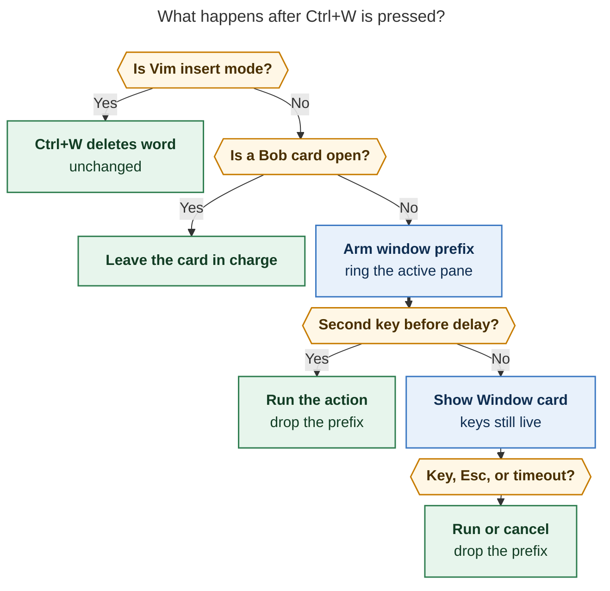
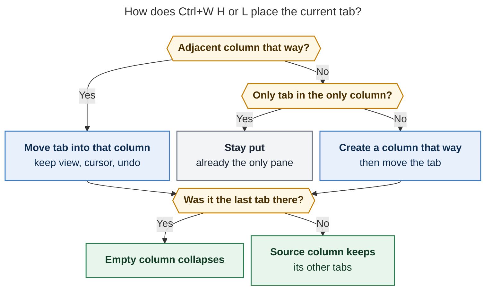

# Vertical splits should get a Vim-style Ctrl+W prefix, owned by Navigation Hotkeys

Independent research by **grk**, 2026-11-15. No other report or researcher findings from this swarm were consulted. This is a design recommendation, not an implementation.

**Recommendation:** yes, build this, and treat it as a first-class *window prefix* rather than four ad-hoc hotkeys. Put it in `bob-navigation-hotkeys`. Make `<C-w>` a short-lived normal-mode prefix with a delayed which-key card, directional `h`/`l` (and later `j`/`k`), send-to-column `H`/`L`, and `w` as the true “other pane” key. Do not make both `h` and `l` aliases for “the other split.” Steal `Ctrl+W` from Linux’s Close-tab default and put close on `c`. Keep insert-mode `<C-w>` as word-delete.

The motivating layout is already on screen: a main-area vertical split with `sase_blog` (plus the daily note as a sibling tab) on the left and `sase_blog_contents` on the right (`~/tmp/screenshots/20261115_171818.png`). Bob can already open, duplicate, pin, and reorder tabs. It cannot talk about *columns*. That is the gap.

## Verdict

This is a good idea. It matches how Bryan already drives Obsidian (Vim normal mode, vault `obsidian_vimrc.md`, Navigation Hotkeys as the keyboard layer) and it matches a daily two-column writing layout that native Obsidian leaves keyboard-hostile.

I would not take a different *product* approach (a third-party pane plugin, a leader-key menu, or `Ctrl+h`/`Ctrl+l` as immediate focus keys). I would take a different *keymap* approach than the letter of the request: `h`/`l` should be directional, and `w` / a second `Ctrl+W` should be “the other column.” That is the Vim meaning, it scales past two columns, and it still gives a no-think toggle for the screenshot layout.

## What the screenshot is asking for

The capture is not a sidebar plus an editor. It is two `WorkspaceTabs` groups under the main `rootSplit`:

- Left column: tabs `20261115`, `sase_blog` (focused).
- Right column: tab `sase_blog_contents`.
- Each column has its own tab bar, its own editor, its own line numbers.
- The workflow is “project note beside its outline,” not “one note in many tabs.”

Bob already has *tab* verbs for this surface (`move-tab-left` / `move-tab-right` on `Ctrl+Shift+,/.`, `duplicate-current-tab` on `Alt+T`, pin via `\\s`, close-left/right/others via `\<` `\>` `\\` in the vimrc). None of those verbs create, focus, fill, or collapse a *column*. The new feature is a column model, with tabs as the things that live in columns.

## What exists today

Evidence is from bob-plugins `63ff165`, CodeMirror-vim `c3131c4`, obsidian-api `879c936`, tab-shifter `23fe914`, vimrc-support `1ff5d97`, and the live vault config on this host.

### Native Obsidian

- `workspace.getLeaf('split', 'vertical')` creates a leaf to the **right** of the active leaf ([API comment](https://docs.obsidian.md/Reference/TypeScript+API/Workspace/getLeaf('split'))).
- `createLeafBySplit(leaf, direction, before)` can place that new leaf on the left when `before` is true.
- `createLeafInParent(parent, index)` inserts a leaf into an existing tab group.
- `iterateRootLeaves` walks **main-area** leaves only, which is the right universe. `iterateAllLeaves` would drag in sidebars.
- `getMostRecentLeaf(rootSplit)` is the right way to focus “that column” when the column’s current tab is not the workspace active leaf.
- Desktop leaves are always children of `WorkspaceTabs`, and those tab groups are children of `WorkspaceSplit` (`obsidian.d.ts` around the `WorkspaceLeaf.parent` / `WorkspaceTabs.parent` declarations).
- Native commands already exist and are **unbound** in this vault: `editor:focus-left` / `focus-right` / `focus-top` / `focus-bottom`, `workspace:split-vertical` / `split-horizontal`. They are a fine fallback, a poor source of truth: they do not know about Bob’s leaf-switch guard, deferred tabs, or the overlay’s availability model.
- Default Close current tab is `Mod+W`: `Cmd+W` on macOS, **`Ctrl+W` on Linux**. Bryan’s `hotkeys.json` does not override `workspace:close`, so Linux still owns that chord.

### CodeMirror Vim, which Obsidian actually ships

```text
{ keys: '<C-w>', type: 'operatorMotion', ... context: 'insert' }  // delete previous word
{ keys: '<C-w>', type: 'idle', context: 'normal' }               // ignore C-w in normal mode
```

That pair is in `codemirror-vim` `packages/codemirror-vim-core/vim.js` (the “ignore C-w in normal mode” comment is in the source). The bundled test `normal_ctrl_w` asserts the buffer and cursor do not change. There are **no** `<C-w>h` / `<C-w>l` window maps. Real Vim’s window prefix was deliberately stubbed out.

So today, in normal mode, `<C-w>` is a dead editor key. Depending on event order it is also Linux Close-tab. Either way the chord is wasted, and it is the exact chord Vim users will hammer when they see the screenshot layout.

Insert-mode `<C-w>` is live and useful. Any design that registers `Ctrl+W` as a global Obsidian hotkey will destroy word-delete. That is a hard constraint.

### Bob Navigation Hotkeys already has the mechanical pieces

`src/630-plugin-vim-link-and-leaves.js` and `src/620-plugin-dash-and-vim-jumps.js` already:

- clone a leaf’s `getViewState()` (including pin),
- create a new tab leaf,
- `setViewState` onto it,
- reorder `parent.children` and the DOM,
- `recomputeChildrenDimensions` + `onLayoutChange`,
- `revealLeaf` / `setActiveLeaf({ focus: true })` / `leaf.focus()`,
- `loadIfDeferred()` before focusing a background tab,
- skip pinned leaves when closing siblings,
- register Vim maps through `window.CodeMirrorAdapter.Vim` once the adapter exists, and reinstall them if vimrc-support replaces the adapter.

`src/475-leaf-switch-guard.js` exists because opening a file in another leaf can clobber the destination with the source buffer. A window *move* must not go through `openFile` if `setViewState` (or a reparent) will do.

`registerVimMappings()` currently maps only `\\s` to pin. That is the insertion point for `<C-w>`.

The vault vimrc (`~/bob/obsidian_vimrc.md`) has no `<C-w>` maps. JavaScript vimrc commands are intentionally disabled, so overlay logic cannot live in the vimrc. Keep it in the plugin.

### Community plugins are the wrong product, and useful as warnings

**Tab Shifter** (`jsrozner/obsidian-tab-shifter`) is the closest existing “send tab to the other group” implementation. It is also a list of things not to copy:

- Markdown-only.
- Does not exclude sidebars (author’s own TODO).
- Creates a split only to the right.
- Trusts `getLeavesOfType` iteration order instead of geometry.
- Implements “move” as *create empty leaf, `openFile`, `detach` source* — losing cursor, ephemeral state, undo, pin, and leaf identity.
- No prefix, no hint, no Vim.

**Pane Relief** is a large pane-history / focus-lock / numbered-pane plugin Bryan does not run. Its `ordered-close` idea (focus a neighbour, then detach) is worth stealing for `c`. Its Alt+1…9 “nth pane” model is the wrong language for a two-column writing layout.

**Neokeys** and **which-key.nvim** prove the overlay: a prefix is tolerable only when a delayed, labelled card appears, and experts can still chord through it before the card paints. which-key’s `<C-w>` preset is the UX this feature is aiming at. Do not add those plugins; draw the card in Bob’s `bob-key-card` language.

**vimrc-support** documents `nmap <C-w>h :obcommand workspace:split-horizontal` as a *worked example*. That example maps “go left” onto “create a stacked split.” It is a perfect illustration of why `obcommand` of native split/focus IDs, without a layout model, will teach the wrong keys.

## Critique of the request

The request is directionally right and underspecified in four places that will make the feature feel broken if we implement it literally.

### 1. `h` and `l` should not both mean “the other split”

The request says `<C-w>h` and `<C-w>l` “navigate to the other (i.e. not currently focused) split.” In the screenshot’s two-column layout that is true of *one* of them at a time: from the left, `l` is the other column; from the right, `h` is. Making both keys toggle is a 2-column shortcut that:

- fights `H`/`L`, which are directional send,
- wraps in a 3-column layout in a way no one can predict,
- leaves no key that means “go left even if I am already left” (a no-op with a dimmed hint is the right answer).

**Adjustment A1.** `h`/`l` are directional and do not wrap. `w`, and a second `Ctrl+W` while the prefix is live, is “other / next column” and *does* wrap. In the screenshot, `Ctrl+W w` and `Ctrl+W Ctrl+W` always hop between `sase_blog` and `sase_blog_contents`. That is the no-think key the request is reaching for.

### 2. Stealing `Ctrl+W` without a close key is a Linux regression

On macOS, Close tab is `Cmd+W`; `Ctrl+W` is free. On Linux (apollo/athena), Close tab *is* `Ctrl+W`. Bryan uses both families of machines. A prefix that only maps `h`/`l`/`H`/`L` silently removes the one-key close he has on Linux.

**Adjustment A2.** `c` (and `q` as a Vim synonym) closes the current tab, using the same detach path as native close, then focuses an adjacent main-area leaf in that column, else the neighbouring column (Pane Relief’s ordered-close). Document that Linux Close-tab becomes a two-key Vim chord. Do not rebind `Mod+W` on macOS. Do not use `Mod` in our default hotkey; use `Ctrl` so Mac keeps `Cmd+W`.

### 3. A prefix without a hint is a trap; a modal hint is the wrong shape

“Show a good hint when `<ctrl+w>` is pressed” is the difference between a power-user feature and a chord people are afraid to touch. Two existing Bob surfaces are tempting and both wrong as the *primary* hint:

- **Copy card / Task card / Decay card** are `Modal`s. They steal focus, dim the workspace, and fight the next `setActiveLeaf`. Fine for destinations. Wrong for a window prefix you fire twenty times an hour.
- **Bracket-mode status chip** is always on, already crowded (`[[ s w n b ]]`, Highlights, vim mode, word counts), and cannot show a layout miniature.

**Adjustment A3.** Immediate, non-modal feedback: an accent ring on the active leaf the moment the prefix arms. Delayed which-key **card** (not a Modal) after ~350 ms if no second key has arrived. Keys work during the delay. Escape / `Ctrl+[` / click-outside / timeout cancel. Join the `bob-key-card` visual family so it looks like Copy card’s cousin, not a foreign which-key theme.

### 4. “Window” in Obsidian is a tab in a column, not a Vim window

Vim’s `H`/`L` move a window to the far edge as a full-height pane. Obsidian’s unit is a **tab** inside a **tab group** inside a **split**. The screenshot has two tabs in the left column. Sending “the window” must mean sending **the current tab**, leaving `20261115` behind when `sase_blog` goes right.

**Adjustment A4.** Define the model as *columns of tab groups in the main area of the current window*. `H`/`L` send the current tab to the adjacent column in that direction, creating the column when missing. If that tab was the last in its group, Obsidian collapses the empty group and the split is gone. If it is the only tab in the only column, `H`/`L` are no-ops with the hint “already the only pane” — creating a split and moving the last tab into it would collapse back to one pane.

Do not send tabs into the left or right sidebar. Do not hop into popout windows. Do not treat hover editors as columns.

## Is this a good idea?

Yes, with those adjustments.

**Why it earns a place in Bob**

- The chord is already in Bryan’s fingers. CodeMirror is throwing it away.
- The layout in the screenshot is a real writing setup, not a demo. Opening an outline beside a project note is how that pair of files wants to be used.
- Navigation Hotkeys is already the tab/leaf owner. Adding columns there is cohesion, not a new plugin.
- The overlay can be *better* than Vim’s, because we can draw the actual two-column layout with note names, and dim keys that would no-op.

**Why not a different approach**

| Approach | Why it loses |
| --- | --- |
| Bind `editor:focus-left` / `focus-right` in `hotkeys.json` | No send, no create, no destroy, no hint, and they can land in sidebars. |
| vimrc `nmap <C-w>h :obcommand …` | No overlay (JavaScript vimrc is disabled), easy to map the wrong native command, insert mode still fine but Linux close still fights the chord. |
| Install Tab Shifter / Pane Relief / Neokeys | Extra community plugins, worse move semantics, no Bob key-card, sidebar bugs. |
| Immediate `Ctrl+h` / `Ctrl+l` | Collides with existing `Ctrl+h` nowhere, but `Ctrl+j`/`Ctrl+k` are already next/prev *section header*. A prefix keeps those. |
| Leader (`\w`, Space) | Bryan’s `\` is already close-tabs / pin. Space is a motion. `<C-w>` is the one chord that *wants* to mean windows. |

**Cost**

- Linux users lose one-key Close tab. Mitigate with `c`/`q` and a migration notice the first time the prefix arms.
- A prefix state can swallow a following `h` that was meant as “left motion” if the user chords slowly. Mitigate with a visible ring, a 1.2 s timeout before the card, and Escape.
- Unofficial layout internals (`parent.children`, `containerEl` geometry, empty-group collapse) can drift across Obsidian versions. Mitigate with a public-API happy path (`createLeafInParent` + `setViewState` + `detach`) and a geometry-based column model that does not trust iteration order.

## Recommended keymap

All chords are **normal mode** (and with Vim off, any non-input context). Insert, replace, and visual leave `<C-w>` alone. Bob modals (Task Card, Copy card, Command Mode, image zoom, pickers) own their keys; the prefix does not arm.

| Key after `<C-w>` | Action | Notes |
| --- | --- | --- |
| `h` / `l` | Focus column left / right | No wrap. Dimmed at that edge. |
| `j` / `k` | Focus row down / up | Same engine, stacked splits. Ship in v1 if the spatial model is 2D; otherwise reserve the letters so the card can grow. **Justified extra.** |
| `w` or second `Ctrl+W` | Other / next column | Wraps. This is the request’s “other split.” |
| `H` / `L` | Send current tab left / right | Creates the column when missing; collapses an emptied column. No wrap. |
| `v` | Split right, keep this tab here, clone it there | Vim’s vertical split. Uses the existing duplicate + place-in-new-split path. **Justified extra.** |
| `c` / `q` | Close current tab | Replacement for Linux `Ctrl+W`. Ordered-close onto a neighbour. **Justified extra, required.** |
| `o` | Only this column | Close the *other* main-area columns’ unpinned tabs. **Justified extra.** |
| `Esc` / `Ctrl+[` | Cancel prefix | Same close chord as every Bob card. |
| `=` | Equalize column widths | Nice; defer if it needs unofficial resize APIs. |

Counts (`2<C-w>l`) and hydra (keep the card open) are v2. Arrow keys may alias `h`/`j`/`k`/`l` on the card; they are not required for launch.

Do **not** put `p` on pin (`\\s` already does that; Vim `p` is previous window). Do **not** steal `Ctrl+j`/`Ctrl+k` section jumps.

## Recommended architecture

One feature, three pure layers, all inside `bob-navigation-hotkeys`. Desktop-only behavior even though the plugin itself is not desktop-only: on mobile, the commands no-op with a notice.

```text
layout model  →  actions  →  prefix + hint
(geometry)       (verbs)      (keys + card)
```

### Layout model (pure, unit-tested)

Input: a list of main-area leaves with `getBoundingClientRect()` on `containerEl`, plus which leaf is active.

Output: frozen columns left-to-right. A column is a cluster of tab groups whose left edges agree within a few pixels. Each column names:

- its tab groups and leaves,
- the MRU / selected leaf (`getMostRecentLeaf` inside that column),
- whether it is the active column,
- the note title to paint on the card.

Do **not** trust `getLeavesOfType('markdown')` order (Tab Shifter’s caveat). Do **not** walk sidebars. Nested stacked splits inside a column are one column for `h`/`l`/`H`/`L`; `j`/`k` move inside the column when a 2D model is live.

This file must be Obsidian-free enough to load through `navigation-hotkeys-harness.cjs`, like the Copy-card model.

### Actions (thin plugin methods)

| Verb | Implementation |
| --- | --- |
| Focus | `loadIfDeferred` if needed, then existing `activateWorkspaceLeaf` / `focusWorkspaceLeaf`. |
| Send | Prefer `createLeafInParent(targetTabs, index)` + `setViewState(clone)` + `detach(source)`. Reuse `cloneViewState`. Fall back to that same path if an unofficial reparent of `parent.children` looks too brittle — **do not** `openFile` the source path (leaf-switch-guard exists because that clobbers). |
| Create column | `createLeafBySplit(active, 'vertical', before)` for left, `getLeaf('split', 'vertical')` or `createLeafBySplit(..., false)` for right, then send into the new group. |
| Destroy column | Do not invent this. Detaching the last leaf of a `WorkspaceTabs` is what collapses the split. Assert it in an e2e; if a version stops collapsing, detach the empty parent as a recovery. |
| Close | Ordered-close: pick neighbour, `detach`, focus neighbour. Skip nothing on explicit `c` (pinned tabs are closable; sibling-close already skips pinned, which is a different verb). |
| Only | `closeSiblingTabs` is *same group*. “Only this column” iterates other main-area columns and detaches unpinned leaves. |

Public native commands (`editor:focus-right`, `workspace:split-vertical`) are **fallback only**, when the model cannot see a destination. The overlay’s dimming must use the model, not `executeCommandById`.

### Prefix (keys)

Two arming paths, same state machine:

1. **Vim normal mode.** In `registerVimMappings()`, `unmap` the idle `<C-w>` and `mapCommand('<C-w>', 'action', 'bobWindowPrefix', …, { context: 'normal' })`. This is how `\\s` is installed today, including the “adapter was replaced on vimrc reload” branch.
2. **Vim off / focus not in a CodeMirror Vim map.** A plugin command `window-prefix` with default hotkey `{ modifiers: ["Ctrl"], key: "W" }` — `Ctrl`, never `Mod`. The command refuses to run when `getCurrentVimMode()` is `insert` / `replace` / `visual`, so word-delete survives even if the Obsidian hotkey also fires.

Once armed:

- add `bob-window-prefix-active` on the active leaf’s `containerEl` (the ring),
- push an Obsidian `Scope` *and* a capturing `keydown` on the workspace container (Vim can eat keys before Scope; capture is the belt),
- start `hintDelay` (350 ms) and `prefixTimeout` (1200 ms before the card, 5000 ms after),
- on a mapped key: run the verb, drop the prefix, remove the ring,
- on unknown key: flash the card (or the ring) and keep the prefix armed, like Copy card’s dimmed-row nudge — do not insert the character,
- on Escape / `Ctrl+[` / timeout / click-outside: drop the prefix, no notice.

`getCurrentVimMode()` already exists in `src/610-plugin-jumps-and-counted-keys.js` and already consults both `cm.state.vim` and vimrc-support’s `currentVimStatus`.



*Caption: Insert mode keeps word-delete. Normal mode arms a prefix that runs the next key immediately, paints a hint card after a short delay, and cancels on Escape or timeout.*



*Caption: Send the current tab to the adjacent column, creating that column when missing, collapsing an emptied column, and refusing a no-op move of the only pane.*

## The hint, specifically (this is the “beautiful” part)

The card is the feature. If the verbs work and the card is a `Notice("Window: h l H L")`, we will have failed the request.

**Immediate (0 ms).** The active leaf gets a 2 px `var(--interactive-accent)` ring via a class on `leaf.containerEl`. No backdrop. No cursor move. This is the “I am in a prefix” signal for people who never wait for the card.

**Delayed (~350 ms).** A non-modal floating card, `position: fixed`, bottom-center of the current window (`min(520px, 92vw)`), `var(--background-primary)`, `var(--shadow-l)`, 4 px accent bar on the left (Command Mode toast language), `bob-key-card` key chips (Copy card language).

Contents, top to bottom:

1. Header: columns icon, title **Window**, subtitle `Ctrl+W`.
2. **Layout strip** — one pill per column, left to right, labelled with the selected note’s basename and a tab count when `> 1` (`sase_blog · 2`). The active pill uses `color-mix(in srgb, var(--interactive-accent) 12%, transparent)` and an accent border. This is the miniature of the screenshot, and it is what makes the card Bob-like rather than a generic which-key dump.
3. Groups:
   - **Focus** — `h` left, `l` right, `w` other.
   - **Move** — `H` send left, `L` send right.
   - **Pane** — `v` split right, `c` close, `o` only this.
4. Footer: `Esc cancel · Ctrl+[ same`.

Unavailable rows stay visible, at 0.45 opacity, with a reason (`already leftmost`, `already the only pane`, `no other column`). Pressing a dimmed key nudges that row, announces the reason on `aria-live`, and does not drop the prefix — Copy card’s dimmed-row contract.

Motion: 120 ms fade-and-rise. `prefers-reduced-motion: reduce` skips the delay *and* the animation and shows the card immediately (the ring is enough motion for everyone else). Pointer click on the card does nothing to the keys; click outside cancels.

Do not steal editor focus. Screen-reader support is the live region plus the ring, not `role=dialog` with focus trap.

A first-run `Notice` on Linux only, once per host, can say that Close tab is now `Ctrl+W` then `c`. After that, silence.

## Where the code should live

New fragments next to the existing leaf mixins, all under `plugins/bob-navigation-hotkeys/src/`:

| Fragment | Job |
| --- | --- |
| `xxx-window-layout-model.js` | Pure column clustering. |
| `xxx-window-actions.js` | Focus / send / create / close / only. |
| `xxx-window-prefix.js` | Arm, timers, Scope, capturing keydown, Vim action. |
| `xxx-window-hint.js` | Ring + card painter, idempotent DOM like the bracket-mode indicator. |

Wire:

- `registerVimMappings()` for `<C-w>`,
- `onload` command `window-prefix` (and palette-only commands for each verb, no default hotkeys, so the inventory stays honest),
- `styles.css` for ring + card,
- docs: `docs/bob-navigation-hotkeys.md` (new hotkeys go to the plugin reference; see docs memory),
- **not** the vault vimrc, except perhaps a comment that `<C-w>` is owned by the plugin,
- **not** `hotkeys.json` in the vault as source of truth (hosts differ; the plugin default is `Ctrl+W`).

A decision record is justified once this ships: *Ctrl+W is a window prefix in normal mode; insert-mode word-delete is preserved; Linux close moves to `c`.* Do not write that record from this research turn.

No bob-cli change. No capture change. No Mac Capture change.

## Testing

The leaf-switch-guard tests in `scripts/test-navigation-leaf-switch-guard.cjs` are the template: a fake workspace, `navigation-hotkeys-harness.cjs`, Node’s test runner.

Must-have unit tests (Obsidian-free model + prefix reducer):

- two columns → `l` from left focuses right, `h` from left is unavailable,
- `w` from either column focuses the other,
- `L` from a two-tab left column sends only the active tab; left still has the sibling,
- `L` from a one-tab left column in a two-column layout sends and collapses left,
- `L` from the only tab in the only column is a no-op,
- `H` with one column and two tabs creates a left column,
- insert-mode events never arm the prefix,
- a mapped key before 350 ms never paints the card,
- Escape after the card paints drops the prefix without an action,
- dimmed-key nudge does not drop the prefix.

Must-have plugin tests with a stub `WorkspaceTabs` / `createLeafInParent` / `setViewState` / `detach`:

- send preserves cloned view state (pin, mode, cursor eState),
- send never calls `openFile`,
- close focuses a neighbour,
- sidebars are absent from the column list even if they host markdown.

E2E (the existing `scripts/obsidian-redo-history-e2e.cjs` style, if the suite can open a split): ring class present after `<C-w>`, card present after delay, `<C-w>l` focuses the right editor, insert-mode `<C-w>` still deletes a word.

## Documentation and rollout

- Plugin reference: a short **Window prefix** section with the keymap table, the Linux close change, and a still of the card (or a diagram of the layout strip).
- Do not add vimrc maps that duplicate the plugin; they would fire without the hint and fight the idle unmap.
- First-run Linux notice, then never again.
- `bob plugins sync` as usual after the fragment build; this is not a CLI release-train item.

## Risks to name in the implementation plan

1. **Event-order fight** between CodeMirror Vim, Obsidian `Mod+W`, and our capture listener. Acceptance: in normal mode `<C-w>l` never closes a tab; in insert mode `<C-w>` never arms the prefix.
2. **Empty-group collapse** is undocumented. Acceptance: moving the last tab of a column leaves a single remaining column, not a blank “No file is open” pane (that is a known native split bug with pinned leaves; skip pinned sources or unpin-on-send? Prefer: send a pinned tab still pinned; if native split-on-pinned creates empty panes, create the destination with `createLeafBySplit` only when the source is unpinned, otherwise `createLeafInParent` on a newly created group).
3. **Deferred tabs** (Obsidian 1.7+). Always `loadIfDeferred` before focus. The existing activate path already does.
4. **Popout windows.** Prefix is per-window. Do not walk another window’s `rootSplit`.
5. **Fragment size.** New files, each ≤ 1000 lines, mixin-installed like the other nav mixins.

## What I would not do

- I would not implement *only* `h`/`l`/`H`/`L` and call the hint a `Notice`.
- I would not make `h` and `l` both toggle.
- I would not register `Mod+W`.
- I would not route send through `openFile`.
- I would not install Tab Shifter or Which-key.
- I would not put this in `bob-command-mode` (that sheet runs `bob`; this is workspace geometry).
- I would not auto-open `*_contents` beside a note. Tempting, given the screenshot, and a different feature. If it happens later, it should *use* this column model (`L` or “open in other column”), not a one-off.

## Recommended solution

Ship a **Window prefix** in `bob-navigation-hotkeys`:

1. A geometry-based main-area **column model**.
2. Verbs: focus (`h`/`l`/`w`), send (`H`/`L`, create and collapse as specified), split-clone (`v`), close (`c`/`q`), only (`o`).
3. A Vim-normal `<C-w>` prefix that does not arm in insert mode, with an immediate accent ring and a delayed `bob-key-card` layout hint.
4. Palette commands for every verb; default hotkey only on the prefix, and only `Ctrl+W`.
5. Tests around the model, the prefix reducer, and “send does not `openFile`.”
6. Plugin-reference docs and a one-time Linux close-tab migration notice.

That is intuitive (Vim keys plus a picture of the actual split), reliable (public create/setViewState/detach, leaf-switch-guard respected, insert mode preserved), and beautiful (ring + layout strip + dimmed reasons in the key-card language Bob already has).
