# Wiki-link completion in Bob's free-form prompts

*Researcher `grk` · 2026-11-21. Independent research for the five-researcher swarm. I read bob-cli (`capture_links.rs`, `capture-complete`, `note_catalog`, `log-recall.md`, intention writers), bob-plugins (intention card editor, work-summary prompt, log-recall band, record-card link stage, task-wikilink picker), Bob Mac Capture (`wikilink-completion.md`, `CompletionRowContent.swift`), glossary and decisions (`mac-capture-is-a-thin-client`, `q-and-ctrl-bracket-mirror-esc`, `relation-card-tab-accepts-ctrl-d-hides`), and Obsidian's `AbstractInputSuggest` plus QuickAdd's prompt suggester. I did not read this swarm's other reports.*

> **The request.** Support Obsidian link completion in any free-form text input prompt shown to the user (intentions, work log, and the rest). Trigger on typing `[[`. Lead the design so it is intuitive, reliable, and beautiful. Critique the plan; call out justified requirement changes; end with a recommended solution.

## Bottom line

Do it. Completing `[[` in Bob's prose prompts is the missing half of a feature that already exists everywhere else Bryan types Markdown: the markdown editor, Mac Capture, and the painted intention / record cards that already render those links as clickable internals.

Do not attach it to every `<input>`. Build one shared `wikiLink.attach` kit — a sibling of Log Recall — and opt in the fields that **write Markdown into the vault**. Trigger on `[[`. Rank from Obsidian's `metadataCache` with Bob's existing `MatchKind` order. Paint a compact Bob popover, not core's suggest chrome and not a `bob capture-complete` spawn per keystroke.

Four requirement changes are load-bearing:

1. **Membership is "vault Markdown prose", not "any prompt".** Block IDs, relation labels, mail, Command Mode, copy-chip payloads, and picker filters stay literal.
2. **One attach API, then a short allowlist.** A per-prompt one-off will drift the way Esc/`q`/`Ctrl+[` used to.
3. **Local catalog, shared ranker.** `NoteIndex::read` is ~300 ms on disk and is why shell completion already defers wikilinks. Prompts must feel like the editor.
4. **The open popover owns Enter and Tab.** Host submit stays one Esc-layer away. Log Recall hides while the caret is inside `[[`, matching Mac Capture's rule that summaries containing `[[` never complete as `work_log`.

---

## 1. Critique: is this a good idea?

Yes, with the shape below. The request as written is one good product move glued to a scope that would make it ugly and unreliable.

### 1.1 The good idea

Bryan already types `[[links]]` in these fields, and Bob already treats them as links:

- The [Intention](glossary) contract stores "trimmed, non-empty one-line Markdown strings (`[[links]]` allowed)".
- The intention card paints those strings through `MarkdownRenderer` and decorates them as `internal-link`s with unresolved styling (`bob-ledger-tools` `296b-plugin-intention-card-dom.js`).
- `bob periods` rewrite/repair retargets `[[old#^x]]` inside `intentions`, `summary`, and `reflection` when notes move to `done/` (`src/native/intentions/repair.rs`).
- Record-card **text** values are parsed with `recordSheetWikilinkSpans`; record-card **link** fields already try to suggest notes.
- Mac Capture already completes `[[`, `[[#`, `[[#^`, aliases, embeds, and Bob's vault-wide `[[##` / `[[^^` from `bob capture-complete`.
- Capture Work Log completion **turns itself off** when the summary contains `[[` (`work_log_completion_ignores_summaries_with_wikilinks`), and note/heading wikilinks keep completing on those lines. The engine is already waiting for a UI on the Obsidian prompt side.

The hole is mechanical: Obsidian's native `[[` suggest is an `EditorSuggest` on the markdown editor. Bob's prompts are HTML `<input>` / `<textarea>` inside modals. Typing `[[sase` in "What did you get done?" or in an intention stage is currently just characters.

That is a daily papercut, not a speculative feature. The painted card will show a clickable link after save; the editor that produced it should complete the same way the note editor does.

### 1.2 Where "any free-form prompt" overreaches

Taken literally, the request would fire `[[` completion in:

| Surface | Why it is the wrong place |
| --- | --- |
| Block ID prompt | The value is `^id`, not a note |
| Relation label card | The value is a label key; `=` already aliases `~` |
| Bank category / account / emoji slot | Controlled vocabularies |
| Command Mode sheet | `bob` argv, not Markdown |
| Mail To / Subject / search | Email, not vault links |
| Copy-chip author | Literal payload; rendering never interpolates |
| Picker filter boxes | Query, not prose |
| Theme / notebook rename | Identifiers |

`q` already types only in text controls ([`q-and-ctrl-bracket-mirror-esc`](decisions)). Wiki-link completion is a second meaning layered on those controls. Spreading it onto identifier fields trains a false trigger and fights existing choosers.

QuickAdd's community suggester (`[[` / `[[#` / `[[#^` / `#` inside *its* prompts) is the existence proof that this pattern belongs in **Markdown-collecting prompts**, not in every dialog.

### 1.3 Approaches I would not take

**Spawn `bob capture-complete` on each keystroke.** The JSON contract is excellent and Mac Capture is the right thin client of it ([`mac-capture-is-a-thin-client`](decisions)). Plugin prompts are not that client. `capture_complete/shell.rs` documents the reason: wikilinks return `None` before `NoteIndex::read` (~300 ms vault scan). Mac Capture already pays process orchestration and can debounce against a warmed `bob`. An intention stage that hitch-hits 300 ms on `[[` will feel broken next to Log Recall, which ranks a cached catalog locally. Disk `NoteIndex` also misses unsaved buffers that `metadataCache` already has — and those are the notes Bryan just created and now wants to link.

**Use `AbstractInputSuggest` as the product chrome.** Obsidian 1.4.10 added it for settings inputs. It is the right *API family* (popover on an `<input>`), and the wrong *object*. `getSuggestions(query)` sees the whole field, `setValue` replaces the whole field, the popup is core suggest styling, and it does not participate in Bob's Esc ladder, `q`/`Ctrl+[`, Log Recall, or key-based selection. Mid-string `[[` inside "Wired the [[sas" lexer" needs a replacement range, not a whole-value overwrite.

**Embed a mini CodeMirror so native `EditorSuggest` fires.** Native suggest is delightful in notes. Inside a property-card stage it inherits Vim, `==`, `q`, IME, and focus restoration. The intention editor's contract is already "stage keys stay text". A second editor is a reliability tax for a visual win we can get from a popover.

**A Create-note row.** Native Obsidian offers one. Bob prompts must not. The intention card already refuses to create missing dailies; a work-log unlink that also mints `[[New Project]]` is a surprise write outside the prompt's job. Unmatched `[[query]]` stays typed. Clicking it later in the painted card is how Obsidian creates notes.

**Per-prompt implementations.** Record card already grew a local one: `recordCardLinkCandidates` walks `vault.getMarkdownFiles()`, substring-matches path or basename, caps at 30, paints 12 basename-only rows, and ignores aliases, headings, blocks, recents, and living/archive tiers. Docs promise more than the function delivers. That is the future of every one-off.

I would still take this feature over leaving `[[` dead in prompts, over asking Bryan to hop to the note editor to build a link, and over teaching a second sigil.

---

## 2. What exists today

### 2.1 Three completion worlds

Bob already has three link-completion engines. The prompt feature has to join them, not invent a fourth ranking story.

| World | Trigger | Catalog | Ranker | UI |
| --- | --- | --- | --- | --- |
| Markdown editor | `[[` | `metadataCache` | Core recents + fuzzy | Core suggest |
| Mac Capture draft | `[[`, `[[#`, `[[#^`, `[[##`, `[[^^`, `((` | `bob capture-complete` `NoteIndex` | `MatchKind` in `capture_links.rs`, living notes first, limit 20 | Completion rows: context label, match emphasis, path, badges |
| Obsidian prompts | none, except record **link** kind | `getMarkdownFiles()` substring | first 30 paths | basename buttons |

Mac Capture row language is the beauty bar to copy, not core's flat file list:

- Note / alias: primary `AI`, secondary `Artificial Intelligence.md`, badge `Alias`
- Heading: primary `Design`, secondary `sase.md`, badge `H3`
- Block: primary `^goog-exit`, secondary `sase.md`, preview badge

(`CompletionRowContentTests.swift` locks that contract.)

### 2.2 Prompt surfaces that write Markdown

These are the hosts. All of them are HTML fields. None of them get native `[[`.

| Host | Field | Today | `[[` belongs |
| --- | --- | --- | --- |
| Intention card editor | intention `<input>`, summary `<input>`, reflection `<textarea>` | Enter saves; reflection Shift+Enter newline | Yes, inline |
| Work Summary prompt (`block-id-prompt`) | one-line work log | Log Recall `work`, Enter unlinks | Yes, inline |
| Task Link Lane / lane-release | work summary | Log Recall `work` | Yes, inline |
| Task Card schedule-review | reason + summary | Log Recall schedule/work | Yes, inline |
| Rotten keep / batch keep | reason | Log Recall `rotten` | Yes, inline |
| Cancel reason, successor inline cancel | reason | Log Recall `cancel` | Yes, inline |
| Record card **text** / list items | Markdown-ish strings | wikilink spans on paint only | Yes, inline |
| Record card **link** kind | whole value is a note | crude always-on list | Yes, field picker (upgrade) |
| Copy chip, Command Mode, mail, block ID, relation label, bank, emoji, picker filters | not vault Markdown | existing choosers | No |

Log Recall is the interaction template: host owns the input, preview, submit, and Esc; a controller attaches, fills, and fail-opens. `logRecall.attach({ inputEl, kind, bandHost, density, arrowKeys, ownKeys })` already returns `handleKeydown`, `backOut`, `isRecalling`, `setKind`, `detach`. Wiki-link completion should be the same shape, not a new modal.

### 2.3 Key contracts the new popover must not break

- Intention stages: Enter saves (reflection: Enter save, Shift+Enter newline, Ctrl+Enter save-and-close). Esc / `q` / `Ctrl+[` is a ladder: cancel stage, then discard retry, then close (`intention-card.md`).
- Work Summary: Enter unlinks; `Ctrl+[` synthesizes Escape; Log Recall `ownKeys: true` claims Ctrl+N/P and arrows.
- Log Recall: never claims Enter, Tab, IME, or Shift/Alt/Meta. First Esc restores the draft; second Esc is the host.
- Relation card: Tab accepts, selection is by key, navigation never refetches ([`relation-card-tab-accepts-ctrl-d-hides`](decisions)).
- `q` types in text controls; `Ctrl+[` never does.

The only coherent layering is: **wiki-link popover, then Log Recall, then the host.**

### 2.4 Why Mac Capture is not a copy-paste

Mac Capture is a thin client of `bob`. That decision exists because capture grammar used to be reimplemented in Lua and drifted. Wiki-link completion in *prompts* is not capture grammar. The bytes that land are ordinary Obsidian wikilinks. What clicking them resolves through is `metadataCache.getFirstLinkpathDest`, which the intention card already uses. Ranking can still match Mac Capture (`MatchKind`: exact alias/stem/path, then prefix, word-boundary, acronym, substring; living before archive before hidden). The catalog should be the cache the click will use.

Bob extras worth keeping because Bryan already types them in Capture and they are also core Obsidian:

- `[[#` / `[[#^` current note (pass `currentPath`)
- `[[note#` / `[[note#^` target note
- `[[note\|alias` — but do not complete while the caret is inside the alias (already `None` in `capture_links.rs`)
- `[[##` / `[[^^` vault-wide heading/block (core: "typing `[[##` will suggest headings from anywhere")
- `![[` embeds: the `!` sits outside the `[[` field

Defer `((` task wikilinks. That picker is a full vault-task modal that can mint block IDs. A one-line work log does not want Add-block-ID inside Unlink. Users who need a task link can type `[[note#^id]]` once block completion exists.

---

## 3. Requirement adjustments

Each change is a narrowing of the request, not a new product.

| Request as written | Problem | Adjustment |
| --- | --- | --- |
| Any free-form text prompt | Identifier and search fields; false triggers | Membership rule: the field writes Markdown into the vault |
| Trigger is typing `[[` | Correct for prose; record **link** kind is the whole value | Prose: inline popover on `[[`. Link-kind fields: always-on picker over the same engine |
| Implement it in each prompt | Record-card already drifted | `wikiLink.attach` on navigation-hotkeys (sibling of `logRecall`), hosts opt in |
| Implicitly "like Obsidian" | Core Create-note, whole-field suggest, recents-only ranking | Recents on empty `[[`; MatchKind once a character is typed; no Create row; living notes before `done/` |
| Implicitly "like Mac Capture" | 300 ms `NoteIndex`; capture grammar; `((` modal | Same row language and MatchKind; local cache; no per-keystroke `bob`; defer `((` |
| Beauty as a coat of paint | Core suggest in a Bob card looks borrowed | Property-card chrome, log-recall motion, Mac Capture row anatomy |

---

## 4. Recommended solution

### 4.1 Product rule

> If a Bob-owned field writes Markdown that Obsidian will parse as `[[wikilinks]]`, typing `[[` completes notes the way the editor and Mac Capture already do. Other fields stay literal.



*Complete wiki-links only in fields that write Markdown into the vault. Identifier and search fields stay literal. Record link-kind fields reuse the same engine as an always-on picker.*

Rendered size: 622.3 × 538 px; fit scale: 100%.

### 4.2 Architecture

A new `wikiLink` namespace on `bob-navigation-hotkeys.api` (root version stays 3; feature-detect the member):

```js
wikiLink.attach({
  inputEl,          // host <input> or <textarea>
  currentPath,      // note that [[#heading]] resolves against
  bandHost,         // optional mount; default a popover under the field
  density,          // "roomy" (5–8 rows) | "dense" (3)
  ownKeys,          // true for standalone modals; false for picker pipelines
  mode,             // "inline" (default) | "field" (record link kind)
})
```

Returns `{ handleKeydown, backOut, isOpen, detach }` — the Log Recall shape, so Work Summary can call wiki-link first:

```js
if (wiki.handleKeydown(event)) return;
if (logRecall.handleKeydown(event)) return;
// host Enter / Esc
```

**Catalog.** `app.vault.getMarkdownFiles()` plus `metadataCache.getFileCache` for aliases, headings, and blocks. Classify living / archive / hidden with a JS port of `note_catalog/tiers.rs` (`done/`, satellites, `old_lib` / `ref_history` / `lit_review`, library roots). Empty `[[` pins `workspace.getLastOpenFiles()` that still exist, then living notes. Fail-open: missing cache, mobile, or a thrown matcher paints nothing and the field stays a normal input.

**Ranker.** Port `MatchKind` from `capture_links.rs` (exact alias → stem → path, then prefix, word-boundary, acronym, substring; living before archive). Shared fixtures, same idea as `tests/fixtures/log_recall/vectors.json`, so Rust Mac Capture and JS prompts cannot silently diverge. Limit 8 visible rows in prompts (Work Log already caps phrases at eight); do not dump 20.

**Replacement.** Mid-string. Replacement covers the inner wikilink from after `[[` through the unclosed end (or through the existing inner end if `]]` is already present and the caret is in the target). Insert `insert_target` (path without `.md`), plus `|alias` when the match is an alias, plus `]]` when the closer is missing. Caret lands after `]]` for a finished note, or after `#` / `#^` when the row is a heading/block continuation — Mac Capture's `cursor_after`. Do not complete inside inline code, after `]]`, or in the alias component.

**Do not spawn `bob` for candidates.** Writes still go through the host (`bob periods update`, unlink, Task Card). Completion is a read of the same cache the painted link will use.



*Rank locally from Obsidian's metadata cache with Bob's MatchKind order. Spawning capture-complete per keystroke and using AbstractInputSuggest as chrome are rejected.*

Rendered size: 831.8 × 590 px; fit scale: 78.5%.

### 4.3 Keys



*The wiki-link popover claims keys first while the caret is inside `[[`. Log Recall claims next. The host prompt keeps submit and close.*

Rendered size: 566.0 × 490 px; fit scale: 100%.

While the popover is open:

| Gesture | Result |
| --- | --- |
| ↑ / ↓, Ctrl+N / Ctrl+P | Move selection by **key** (path + kind + heading/block id), no wrap; edge bump like Log Recall |
| Tab or Enter | Insert the selected row; popover closes; prompt stays open |
| Esc / Ctrl+[ | Close popover, leave `[[query` typed |
| Backspace through `[[` | Close popover |
| Typing / paste | Filter; IME composition ignored |
| Click a row | Insert, no submit |
| Hover | No selection (Log Recall rule) |

`q` types. The popover is not a panel; it is a completion list on a text control.

When the popover is closed, every host key is unchanged. When the caret is inside `[[`, the USED BEFORE band hides — the same suppression Mac Capture already applies to `work_log` when the summary contains `[[`.

### 4.4 Beauty

Copy three existing Bob surfaces, not a fourth look:

1. **Chrome** from property cards / Log Recall: 120 ms fade-in, 24 px rows, left accent bar on the selected row, `color-mix` fill, uppercase header, keycaps, reduced-motion opacity bump instead of a jump.
2. **Rows** from Mac Capture: context label (`Note` / `Heading` / `Block`), primary line with match emphasis (`bob-log-recall-match` weight), secondary vault-relative path truncated from the middle, badges (`Alias`, `H2`, block preview, quiet `done/` capsule for archive).
3. **Header / footer** from the task-wikilink picker, scaled down: glyph `[[`, title follows context (`Notes` / `Headings` / `Blocks`), count, footer `↑↓ · ⇥/↵ insert · esc leave [[`. Empty state: `No matching notes — keep typing or esc`. Never a Create row.

Anchor the popover under the field for one-line inputs (Work Summary, intention). On the reflection textarea, pin it under the caret line if cheap; otherwise under the field. Do not try to highlight the in-progress `[[token]]` inside a native `<input>` — that is a contenteditable rewrite, deferred.

Work-log and intention previews should Markdown-render the draft summary once a complete `[[note]]` is present, so the unlink preview shows a link rather than raw brackets. That is a small host polish on top of the kit, not a kit requirement.

VoiceOver: combobox + listbox, `aria-activedescendant` on the selected key, live region announcing `Note 2 of 8: sase`. Same discipline as the task-wikilink picker.

### 4.5 Reliability checklist

- UTF-16 vs UTF-8: JS index math is UTF-16; wikilink scans must be code-unit honest and never split a surrogate. Prefer a small scanner with tests, not a regex that eats `[[` inside `` `code` ``.
- `isComposing` ignored (Log Recall already does this).
- Selection by key survives a rerank.
- `currentPath` is required for `[[#`; intention editor passes the subject path; work-log prompts pass the task's note.
- Unsaved notes appear because `metadataCache` includes them.
- Archived notes sort last and wear a quiet badge; hidden library paths stay out.
- Mobile / missing API: attach is a no-op. Intention cards are already desktop-only.
- Host preview still follows `input` events after a splice (Log Recall dispatches one `input` on fill).
- No vault writes from the kit. Add-block-ID is out of scope.

### 4.6 Upgrade the record-card link stage

`recordCardLinkCandidates` becomes a `mode: "field"` consumer of the same engine. Always-on list, whole-value insert of `[[insert_target]]` (or path if the schema stores a path — keep whatever `recordPickLink` writes today). Aliases, headings, and block anchors then match the docs that already claim they are preserved. Do not leave a second ranker in ledger-tools.

### 4.7 What not to ship in v1

- `((` task wikilinks and Add-block-ID from a prompt
- `#tag` completion (QuickAdd has it; Bob prompts have not asked)
- Markdown `[label](url)` completion
- Create-note
- Contenteditable overlay to style the in-progress token
- Mac Capture non-draft `NSTextField`s (cancel-reason, if any). The main capture editor already completes `[[`. Revisit those fields only if a later pass finds a prose `NSTextField` without the editor.

---

## 5. Phasing

A single epic, three landings. bob-cli ranking fixtures can land first without a CLI change.

1. **Kit + two hosts.** `wikiLink.attach` with note + alias completion. Intention stages and Work Summary. Key layering tests against Log Recall and the intention Esc ladder. Shared `MatchKind` vectors.
2. **Headings, blocks, Bob extras.** `[[#`, `[[note#`, `[[#^`, `[[##`, `[[^^`. Empty-query recents. Preview Markdown for a complete link in Work Summary and the intention stage.
3. **Allowlist sweep.** Task Link Lane, lane-release, schedule/rotten/cancel reasons, record text + list items, then replace record **link** kind. Each host is an attach call and a key-order test, not a new picker.

Docs: a plugin reference page (sibling of Log Recall) plus a sentence on intention-card and block-id-prompt. No capture-grammar bump. No `!` CLI break.

---

## 6. Open questions for the implementing plan

These are small enough to decide in the plan, not here:

- Whether empty-`[[` recents should also pin the current note's parent / backlinks. Recents plus MatchKind is enough for v1.
- Whether archive rows are omitted until the query has three characters. Living-first already deprioritizes them.
- Whether reflection (multi-line) wants Shift+Enter to keep inserting newlines while the popover is open. Recommended: popover claims unshifted Enter only; Shift+Enter stays newline.

---

## Recommended solution

Ship **inline `[[` completion as a Log-Recall-shaped `wikiLink.attach` kit** on Bob Navigation Hotkeys, catalogued from `metadataCache`, ranked with Bob's `MatchKind`, painted like Mac Capture rows inside property-card chrome. Opt in every vault-Markdown prose field, starting with intentions and the work-log prompt. Hide Log Recall while `[[` is open. Let Enter/Tab insert without submitting. Leave identifier fields, Create-note, `((`, and per-keystroke `bob capture-complete` out.

That is the design I would implement. It is the same speech act Bryan already performs in the editor and in Mac Capture, on the surfaces that already store and render those links, without teaching a fourth completion language.
