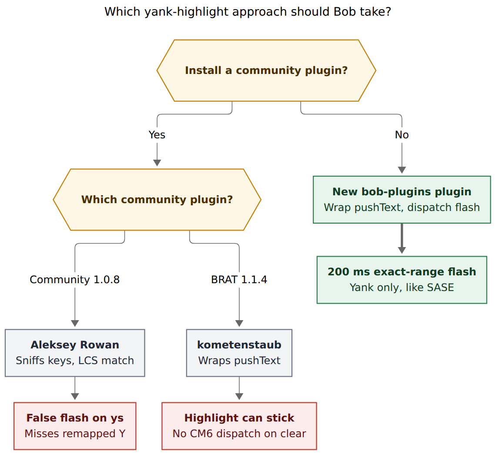
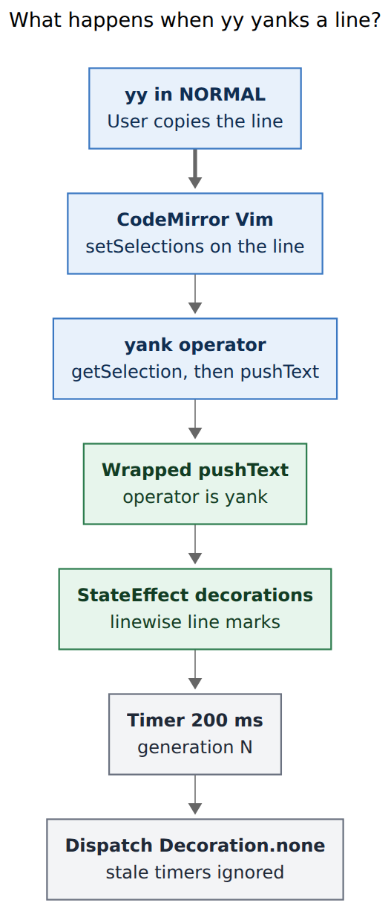

# Obsidian vim yank highlight

> **Research query.** Start highlighting the text that vim normal-mode
> motions copy in Obsidian (for example `yy` copying the current line),
> matching the SASE prompt-input widget. Help decide the best way to
> implement this. Critique the plan. Is it a good idea? Would a different
> approach be better? Call out justified requirement changes. End with a
> recommended solution.
>
> Independent swarm report from researcher `grk`. I did not read peer
> reports.

**Baselines.** SASE prompt yank flash
(`src/sase/ace/tui/widgets/_yank_highlight.py`,
`_vim_normal_operator_exec.py`,
`tests/ace/tui/widgets/test_prompt_yank_highlight.py`,
`docs/reference/tui/prompt-modes.md`); CodeMirror Vim yank operator and
`RegisterController.pushText`
(`replit/codemirror-vim` `packages/codemirror-vim-core/vim.js`);
community plugins `aleksey-rowan/obsidian-vim-yank-highlight` 1.0.8 and
`kometenstaub/obsidian-vim-yank-highlight` 1.1.4; Bob's
`bob-vim-surround` and vault `obsidian_vimrc.md`; Neovim
`vim.hl.on_yank` and VSCodeVim `vim.highlightedyank`.

**Figures.** Mermaid CLI `@mermaid-js/mermaid-cli@12.0.0`. Approach SVG
759.6 × 698 px, fit 85.9%. Flash SVG 350.7 × 814 px, fit 100.0%.

## Bottom line

**Build it, as a 200 ms exact-range yank flash in a new Bob plugin.
Do not install either community plugin.**

The SASE prompt already does the right product: after a completed `y`
operator, paint the copied span in success ink for 200 ms, then clear
it with a generation-guarded timer. Empty yanks stay dark. Delete and
change copy to the register and stay unflashed. Visual `y` flashes,
because the selection is gone the instant the yank lands.

Obsidian can do the same thing. CodeMirror Vim selects the operator
range, then calls `pushText(register, 'yank', text, linewise, blockwise)`
while that selection is still live. Wrap that one method, read
`listSelections()`, dispatch CodeMirror 6 decorations, clear with a
real `EditorView` update. That is the SASE contract, ported onto the
engine Obsidian actually runs.

The two existing Obsidian plugins miss that contract. Aleksey Rowan's
community plugin infers yanks by watching keys that contain `y` or `Y`,
then longest-common-substring-matches the yank register against the
viewport. It will flash Bob Vim Surround's `ys` motions. kometenstaub's
plugin uses the right hook and then mutates `this.decorations` without
dispatching, so the timeout only wins if the cursor moves.

**Recommended design, in one sentence:** a tiny `bob-vim-yank-highlight`
plugin, sibling to `bob-vim-surround`, that wraps
`CodeMirrorAdapter.Vim.getRegisterController().pushText`, paints the
live yank ranges for 200 ms in success-green, and clears through a
dispatched CodeMirror 6 `StateEffect`.

## Is this a good idea?

Yes. `yy` is the most common silent vim command. The buffer does not
change, the cursor does not move, and the only proof that the line
landed in the register is a later `p`. A short flash is the standard
answer in Neovim (`vim.hl.on_yank`, default 150 ms, `IncSearch`), in
VSCodeVim (`vim.highlightedyank.duration` default 200 ms), and in the
SASE prompt Bryan already uses.

Four facts from the current Bob stack make the gap concrete.

1. **The SASE prompt already trained the eye.** `_flash_yank(start, end)`
   runs only for operator `y`, converts locations to absolute offsets,
   skips empty spans, bumps a generation counter, and layers
   `yank.flash` on top of search and Jinja overlays
   (`_yank_highlight.py`, `test_prompt_yank_highlight.py`). `dw` and
   `cw` have an explicit non-flash test. `yy` and `Vj y` flash whole
   lines. That is the behaviour Bryan asked to bring to Obsidian.

2. **CodeMirror Vim will not grow this itself.** Upstream issue
   [replit/codemirror-vim#121](https://github.com/replit/codemirror-vim/issues/121)
   has been open since April 2023. The maintainers chose to stay close
   to stock vim defaults. Aleksey Rowan, who later wrote the community
   plugin, told them the right hook is `pushText` / the yank operator,
   not key sniffing.

3. **Bob already lives on that Vim object.** `bob-vim-surround` calls
   `window.CodeMirrorAdapter.Vim.defineOperator` for `ys`/`cs`/`ds`.
   Task Status Cycler and Navigation Hotkeys map more NORMAL keys
   through the same adapter. The vault vimrc sets
   `clipboard=unnamedplus` through `obsidian-vimrc-support`. A yank
   flash belongs in that family, not in a CSS snippet and not in a
   third-party plugin that does not know about `ys`.

4. **Neither community plugin is installed, and installing one would
   fight Bob.** The vault currently has `bob-vim-surround`,
   `obsidian-vimrc-support`, and `obsidian-relative-line-numbers`. It
   does not have `vim-yank-highlight` or `yank-highlight`. Surround's
   `ys{motion}{delimiter}` is a daily operator. Any highlighter that
   treats "command contains the letter y" as a yank will lie on
   surround.

This is a good idea as a confirmation flash for completed yanks. It is
a poor idea as a generic "anything that copies" highlighter, and it is
a poor idea as "make Obsidian's vim engine preview pending motions the
way SASE tints `y/foo`".

## Critique of the request as written

The request is the right product with the right reference implementation.
Four readings of it would make the work worse. Each is a justified
requirement change.

### 1. Flash completed yanks, not every motion that copies

**Adjustment (required).** Restrict the overlay to CodeMirror Vim
operator `'yank'`. Leave `d`, `c`, `x`, `s`, `D`, and `C` unflashed.

The request says "the text that vim normal-mode motions copy" and
gives `yy` as the example. Delete and change also write the unnamed
register. SASE copies those to the clipboard too, and its tests still
require `dw` / `cw` to leave `_yank_flash_span` empty. Neovim's
`TextYankPost` fires for deletes; the usual config still filters to
operator `y`.

A delete flash paints a hole. A change flash is overwritten by insert
mode in the same keystroke. `yy` is invisible without a flash. Those
are different problems. Match SASE: yank only.

### 2. Post-yank flash in v1, not operator-pending live tint

**Adjustment (required for v1).** Do not try to tint the region while
the operator is still pending (`y` then `iw`, or `y/foo`).

SASE's prompt has two layers that are easy to conflate:

- **Pending operator-search preview.** While typing `y/foo`, the exact
  span is tinted green, with a readout such as `yank 42 chars · 3 lines`
  (`docs/reference/tui/prompt-modes.md`, `_prompt_search_operator.py`).
- **Completed yank flash.** After the operator commits, `_flash_yank`
  paints `yank.flash` for 200 ms.

The example in the request is `yy`, a completed command. The flash is
what Neovim, VSCodeVim, vim-highlightedyank, and both Obsidian
community plugins implement. The live tint is possible in SASE because
sase owns the vim engine and knows the pending motion range. CodeMirror
Vim does not expose pending operator ranges. Building that preview
means reimplementing motions against a closed `operators` table.

Ship the flash. Treat operator-pending tint as a later, separate
research question.

### 3. Exact live ranges, never inferred text

**Adjustment (required).** The highlight range is the CodeMirror
selection that exists at `pushText(..., 'yank', ...)` time, plus the
`linewise` / `blockwise` flags that call already receives. Do not
search the document for the yank register contents. Do not sniff
`vim-keypress` for the letter `y`.

Aleksey Rowan's plugin does both of those inferences
(`src/main.ts` `onVimKeypress`, `src/markViewPlugin.ts`
`longestCommonSubstring`). That is why remapped `nnoremap Y y$` missed
highlights until `Y` was special-cased (issue #3), why Cyrillic
`yiw` maps still miss, and why `ys` will flash. kometenstaub already
proved the alternative in 2022: wrap `pushText` and keep only
`args.at(1) === 'yank'` (changelog 1.1.3, "only make deco on yank, not
pushText").

CodeMirror Vim documents the guarantee we need:

> An operator acts on a text selection. It receives the list of
> selections as input. The corresponding CodeMirror selection is
> guaranteed to match the input selection.

The yank operator then calls `cm.getSelection()` and `pushText` before
it returns `endPos` and the cursor is restored (`vim.js` around
2902–2914 and 2185–2198). The selection is live for the duration of
the hook.

### 4. Own the plugin; 200 ms; success-green; no settings tab

**Adjustment (recommended).** Home this in `bob-plugins` as
`bob-vim-yank-highlight`, duration 200 ms, success-green overlay, no
settings tab.

Duration alignment:

| System | Default |
| --- | ---: |
| SASE prompt `_YANK_FLASH_SECONDS` | 200 ms |
| VSCodeVim `vim.highlightedyank.duration` | 200 ms |
| Neovim `vim.hl.on_yank` | 150 ms |
| Aleksey Rowan CSS animation | 500 ms |
| kometenstaub setting | 2000 ms |
| vim-highlightedyank | 1000 ms |

200 ms is a flash, not a linger. It matches the reference Bryan named
and the VSCodeVim default. kometenstaub's two seconds trains the eye
to ignore the overlay.

Colour: SASE uses the theme success background, theme foreground, and
bold (`Style(color=app_theme.foreground, bgcolor=app_theme.success,
bold=True)`). In Obsidian that is `--color-green` mixed at about 35%
over the line, not `--text-highlight-bg` (search/==highlight==) and
not `--link-unresolved-decoration-color` (Aleksey Rowan's choice).
Give the CSS a `--bob-yank-flash-bg` variable so a snippet can retune
it without a settings tab.

`bob-vim-surround` already ships with no settings tab and no palette
commands. Copy that shape.

## What the SASE prompt actually does

The mixin is small and is the spec.

```python
_YANK_FLASH_SECONDS = 0.2

def _flash_yank(self, start, end):
    start_offset = self._absolute_offset(start)
    end_offset = self._absolute_offset(end)
    if end_offset <= start_offset:
        return
    self._yank_flash_span = (start_offset, end_offset)
    self._yank_flash_generation += 1
    generation = self._yank_flash_generation
    if self._yank_flash_timer is not None:
        self._yank_flash_timer.stop()
    self._refresh_yank_overlay()
    self._yank_flash_timer = self.set_timer(
        _YANK_FLASH_SECONDS,
        lambda: self._clear_yank_flash(generation),
    )
```

Call sites in `_execute_charwise_operator` / `_execute_linewise_operator`
fire only when `op == "y"` and the copied text is non-empty. Linewise
`yy` flashes `(row, 0)` through `(row, len(line))`, so the trailing
newline of a linewise register does not paint a phantom next line.
A later yank stops the previous timer. A stale callback whose
generation no longer matches is ignored. Large buffers skip the overlay
the same way Jinja highlighting does.

Tests pin the contract we should copy:

- `yw`, `yiw`, `yf)`, `2Y` flash exact charwise/linewise spans
- `yy` and `Vj y` flash full lines
- visual `vh y` flashes the selection
- expiry clears only the overlay
- rapid re-yank replaces the flash
- `yank.flash` stacks above search and Jinja
- `dw` / `cw` do not flash
- empty `yy` does not flash
- single-line vim widgets leave the hook inert

Obsidian does not need SASE's overlay-byte cap. Markdown notes are
small relative to that ceiling. Keep the empty-span skip and the
generation guard.

## Why the community plugins are the wrong install



*Install neither community plugin. A new bob-plugins plugin that wraps
CodeMirror Vim `pushText` and dispatches a 200 ms flash is the path
that matches SASE.*

### Aleksey Rowan (`vim-yank-highlight` 1.0.8)

In the community plugin browser. Desktop-only. About 6,400 downloads.
Last release December 2023.

Detection: on `vim-command-done` plus the next `vim-keypress`, if the
accumulated keys contain `"y"` or `"Y"`, treat that as a yank
(`src/main.ts`). Range: take `getRegister("yank").keyBuffer[0]`, compute
the longest common substring with the viewport plus a trailing newline,
then pick the occurrence nearest the cursor (`src/markViewPlugin.ts`).

That design was a reaction to not wanting to monkey-patch
`codemirror-vim`. It costs:

- **`ys` false positive.** Bob Vim Surround's add operator is `ys`.
  The command buffer contains `y`. The plugin will flash whatever LCS
  finds, including the surround target.
- **Remap holes.** `nnoremap Y y$` did not flash until `Y` was
  hard-coded (issue #3). Cyrillic `yiw` maps still do not.
- **Wrong range on duplicate text.** LCS plus nearest-cursor is a
  guess. Two identical words, `yi(` targeting a later pair, folded
  regions, and linewise yanks that end with a newline are all
  commented as known trouble in the source.
- **O(viewport × yank) LCS** on every suspected command.
- **CSS line-gap hack.** `.ovy-highlight` pads by an approximate
  fraction of `--line-height` because `Decoration.mark` does not fill
  the line box. The author documents this as finicky.

Aleksey Rowan later told the CodeMirror Vim maintainers that hooking
`pushText` is the better design, and pointed at kometenstaub as the
proof. Use that advice. Do not install the plugin he wrote to avoid
it.

### kometenstaub (`yank-highlight` 1.1.4)

Not in community plugins. BRAT or manual only. Last release July 2022.
README known limitation: "The highlight timeout only works if the
cursor is moved after it, otherwise it stays highlighted."

The hook is right. `around(window.CodeMirrorAdapter.Vim.getRegisterController(),
{ pushText })` and `args.at(1) === 'yank'`. At that moment
`editor.getCursor('from')` / `'to'` is the yanked span for ordinary
operator yanks.

The paint is wrong:

- `makeYankDeco` assigns `this.decorations = Decoration.set(...)` and
  later `this.decorations = Decoration.none` inside `setTimeout`.
  CodeMirror 6 reads decorations from the plugin value during a
  transaction. Mutating the field without `view.dispatch` does not
  redraw. Moving the cursor happens to dispatch, which is why the
  README reads like a feature.
- One range from `getCursor('from')`/`'to'`. Visual-block yanks are
  several selections (`vim.js` `makeCmSelection` mode `'block'`).
- `:yank` calls `pushText` without selecting the lines. The hook
  would paint the cursor, not the ex range.
- Default timeout 2000 ms.
- Wraps only if `app.vault.getConfig('vimMode')` is true at `onload`.
  A vim-mode toggle after load never installs the hook.
- Uses the active `MarkdownView`, so a yank issued from a non-active
  editor pane (rare in Bob, possible with command palette) paints the
  wrong view.

Keep the hook. Rewrite the paint.

## Recommended implementation



*CodeMirror Vim selects the line, the yank operator pushes text, the
Bob plugin paints those live ranges, and a generation-guarded 200 ms
timer clears the overlay with a real dispatch.*

### Home

New plugin `plugins/bob-vim-yank-highlight/` in bob-plugins.

| Fact | Value |
| --- | --- |
| ID | `bob-vim-yank-highlight` |
| Shape | Hand-edited `main.js` + `styles.css` + `manifest.json`, same as `bob-vim-surround` |
| Settings tab | None |
| Palette commands | None |
| Desktop only | No |
| Deploy | `bob plugins sync` |

Do not fold this into `bob-vim-surround`. Surround owns `ys`/`cs`/`ds`.
Yank flash owns the `'yank'` operator. They share the Vim adapter and
nothing else. Do not fold it into Navigation Hotkeys; that plugin
already yanks *file paths* (`yank-absolute-path` and friends), which
must never flash the editor.

### Hook

On layout-ready and on `active-leaf-change`, the same retry pattern
`bob-vim-surround.registerVimMappings` uses:

1. Resolve `window.CodeMirrorAdapter.Vim`.
2. Take `vim.getRegisterController()`.
3. Wrap `pushText` once. Save the original on the plugin instance and
   restore it in `onunload`.

```javascript
function wrappedPushText(registerName, operator, text, linewise, blockwise) {
  if (operator === "yank" && registerName !== "_") {
    this.flashYankFromActiveEditor(linewise, blockwise);
  }
  return originalPushText.apply(thisController, arguments);
}
```

The black-hole register `"_` is a no-op in upstream `pushText` already;
guarding it keeps a future wrap from painting a discarded yank.

`defineOperator('yank', fn)` cannot wrap. `defineOperator` replaces the
closed-over `operators.yank` function and the original is not exported
(`vim.js` 2949–2951). Reimplementing yank is how you lose visual-block
and named registers. Wrap `pushText` instead.

`obsidian-vimrc-support` does not wrap `pushText`. It polls
`getRegister('yank').keyBuffer` for clipboard sync (`main.ts`
`captureYankBuffer`). The two hooks compose. Bryan's
`set clipboard=unnamedplus` stays in the vimrc.

### Ranges

From the editor that owns the yank:

```javascript
const cm = view.editor.cm.cm; // CodeMirror 5 adapter
const ranges = cm.listSelections();
```

Convert with `cm.indexFromPos`. Then:

| Yank kind | Decoration |
| --- | --- |
| Charwise | `Decoration.mark` per non-empty range |
| Linewise | `Decoration.line` on each line from `min.line` through `max.line - 1` when head is column 0 of the next line, otherwise through `max.line` |
| Blockwise | `Decoration.mark` per `listSelections()` range |

Linewise CodeMirror Vim expands the selection so `head` is the start of
the following line (`vim.js` 2156–2158). Painting that exclusive end
with `Decoration.mark` highlights a phantom newline. SASE already
avoids that by flashing through `len(last_line)`. `Decoration.line`
fills the line box, which also removes Aleksey Rowan's padding hack
for the `yy` case that motivated the request.

Skip the flash when every range is empty and the yank is not linewise.
That covers a cursor-only `:yank` miss without inventing a line range
from the register text. Operator `yy` always has a non-empty line
selection first.

### Paint and clear

Use a CodeMirror 6 `StateEffect` + `StateField` provided as
`EditorView.decorations`, registered with `registerEditorExtension`.
Bob Ledger Tools already loads `Decoration` / `ViewPlugin` /
`StateEffect` this way for blocked-reason marks. Ephemeral yank
overlays fit `StateEffect` better than a `ViewPlugin` field mutated
from outside.

```javascript
view.dispatch({
  effects: setYankHighlight.of(decorationSet),
});
```

Clear the same way with `Decoration.none`. That is the fix for
kometenstaub's stuck highlight.

Timer: 200 ms, generation counter copied from SASE. A new yank stops
the previous timer. A stale callback whose generation does not match
returns. Also clear on `docChanged`, on view destroy, and on plugin
unload.

Stack the yank class above search matches in CSS (`z-index` or later
decoration precedence) the way SASE appends `yank.flash` last in
`_build_highlight_map`.

### CSS

```css
.cm-editor .bob-yank-flash {
  background-color: var(--bob-yank-flash-bg, color-mix(in srgb, var(--color-green) 35%, transparent));
}
```

Line decorations get the class on `.cm-line`. Mark decorations get it
on a wrapping span. One class, two decoration kinds. A vault snippet
may override `--bob-yank-flash-bg`. Do not reuse `--text-highlight-bg`;
that token already means `==highlight==` and search.

### Tests

Follow `scripts/test-vim-surround.cjs`: stub `obsidian`, stub
`CodeMirrorAdapter.Vim.getRegisterController()`, drive `pushText`.

Minimum cases, named after SASE's tests:

- `pushText('"', 'yank', 'one ', false, false)` with a charwise
  selection `0–4` records a mark decoration on that span
- `pushText(..., 'yank', 'bbb\n', true, false)` on line 1 records a
  line decoration on that line only
- `pushText(..., 'delete' | 'change', ...)` records nothing
- empty charwise yank records nothing
- second yank replaces the first and the first timer is ignored
- unload restores the original `pushText`
- a fake surround operator that never calls `pushText` records nothing

Add the new file to `package.json` `"test"`. No vault writes.

### Live Preview

Source mode is the contract. Live Preview is best-effort.

`Decoration.mark` on a heading or widget-replaced range can vanish
inside a Live Preview replacement. `Decoration.line` on `yy` still
paints the line wrapper for ordinary list and paragraph lines, which
is the motivating case. If a heading `yy` is invisible in Live
Preview, that is a follow-up (a `EditorView.layer` of
`RectangleMarker`s, the same primitive CodeMirror uses to draw
selections over widgets). Do not block v1 on it.

### What this plugin will not do

- Flash path-yank commands (`yank-absolute-path`, …). Those never
  call Vim `pushText`.
- Flash `ys` / `cs` / `ds`. Surround is a different operator.
- Preview pending motions or `y/foo`.
- Highlight put, undo, or redo.
- Persist the overlay (`highlightedyank_highlight_duration = -1`).
- Depend on `obsidian-vimrc-support`. Clipboard bridging stays there.

## Alternatives considered

**Install Aleksey Rowan.** Fastest path to a flash, and it is already
in the community browser. It will false-fire on Bob Vim Surround and
guess ranges. Rejected.

**Install kometenstaub via BRAT.** Right hook, abandoned paint, two
second linger, not in community plugins. Cherry-pick the hook.
Rejected as an install.

**Wait for `codemirror-vim` issue 121.** Open since 2023 with an
explicit "stick to defaults" answer. Obsidian vendors its own copy
anyway. Rejected as a plan.

**Vimrc-only mapping.** `obsidian-vimrc-support` can run `exmap` and
clipboard sync. It cannot dispatch CodeMirror 6 decorations. Rejected.

**Wrap `defineOperator('yank')` by reimplementing yank.** The original
function is not exported. Visual-block, named registers, and `:yank`
would regress. Rejected.

**Fold into `bob-vim-surround`.** Different operator, different
failure mode, surround already fights CodeMirror's built-in `y` for
the `ys` chord (`SURROUND_OPERATOR_KEYS = "<A-b>s"` with a comment
that plain `ys` cannot win). Keep the plugins apart. Rejected.

**Flash every register write.** Matches a literal reading of "motions
copy". Conflicts with SASE tests and paints deleted holes. Rejected.

## Implementation sketch for the implementing agent

1. Add `plugins/bob-vim-yank-highlight/{manifest.json,main.js,styles.css}`
   modelled on `bob-vim-surround`.
2. Register a `StateEffect`/`StateField` editor extension that provides
   decorations.
3. Retry-wrap `getRegisterController().pushText` on layout and leaf
   change; restore on unload.
4. On `'yank'`, read `listSelections()`, classify linewise/blockwise
   from the `pushText` arguments, dispatch decorations, start a 200 ms
   generation-guarded timer.
5. CSS class `bob-yank-flash` with `--bob-yank-flash-bg` defaulting to
   35% `--color-green`.
6. `scripts/test-bob-vim-yank-highlight.cjs` covering the SASE cases
   above; add it to `npm test`.
7. Docs page `docs/bob-vim-yank-highlight.md` and inventory regen.
8. `bob plugins sync` from bob-plugins.

Manual acceptance in the vault, source mode first: `yy`, `3yy`, `yw`,
`yiw`, `y$`, `Y`, visual `v`/`V` then `y`, `"ayy`, `ysiw)` (must not
flash), `dw` (must not flash), rapid `yy` on two lines, `u` after a
yank (flash already gone). Then the same in Live Preview on a
paragraph, a list item, and a heading.

## Recommended solution

Ship **Bob Vim Yank Highlight**: a new, settings-free bob-plugins
plugin that wraps CodeMirror Vim `pushText` for operator `'yank'`,
paints the live selection ranges for **200 ms** in **success-green**,
and clears through a dispatched CodeMirror 6 `StateEffect` with a
SASE-style generation guard.

**v1 contract**

- Flash completed yanks: `yy`, `Y`, `yw`, `yiw`, `ytx`, `yf)`, `y$`,
  counted yanks, visual `y`, named-register yanks such as `"ayy`.
- Do not flash delete, change, surround, path-yank commands, or empty
  yanks.
- Linewise uses `Decoration.line`. Charwise and blockwise use
  `Decoration.mark`.
- Source mode is required to look right. Live Preview is best-effort.
- Duration 200 ms. Colour `--bob-yank-flash-bg`. No settings tab.

That is the SASE prompt flash, on the Vim adapter Bob already wraps,
without taking on SASE's pending-operator preview or either community
plugin's bugs.

## Sources

- SASE `src/sase/ace/tui/widgets/_yank_highlight.py` — 200 ms flash,
  generation guard, success style, empty-span skip.
- SASE `src/sase/ace/tui/widgets/_vim_normal_operator_exec.py` — yank
  is the only operator that calls `_flash_yank`; delete/change copy
  without flashing.
- SASE `tests/ace/tui/widgets/test_prompt_yank_highlight.py` — exact
  spans for `yw`/`yiw`/`yy`/`Vj y`/`vh y`; non-flash for `dw`/`cw`
  and empty `yy`.
- SASE `docs/reference/tui/prompt-modes.md` — operator table and the
  separate operator-search pending tint.
- `replit/codemirror-vim` `packages/codemirror-vim-core/vim.js` —
  `pushText`, yank operator, `setSelections` before operators, linewise
  head at next-line column 0, closed `defineOperator`.
- [replit/codemirror-vim#121](https://github.com/replit/codemirror-vim/issues/121)
  — upstream declined a built-in yank highlight; Aleksey Rowan later
  recommended hooking `pushText`.
- `aleksey-rowan/obsidian-vim-yank-highlight` `src/main.ts`,
  `src/markViewPlugin.ts`, `styles.css`, issue #3.
- `kometenstaub/obsidian-vim-yank-highlight` `src/main.ts`, README
  timeout limitation, changelog 1.1.3 yank-only filter.
- `esm7/obsidian-vimrc-support` `main.ts` clipboard polling of the
  yank register.
- `bob-plugins` `plugins/bob-vim-surround/main.js` — Vim adapter
  retry, `ys` operator, no settings tab.
- Vault `~/bob/obsidian_vimrc.md` — `set clipboard=unnamedplus`;
  `~/bob/.obsidian/plugins/` has no yank-highlight plugin.
- Neovim `vim.hl.on_yank` default timeout 150 ms, higroup `IncSearch`,
  `on_visual` true.
- VSCodeVim `vim.highlightedyank.duration` default 200 ms
  ([VSCodeVim/Vim#3129](https://github.com/VSCodeVim/Vim/pull/3129)).
