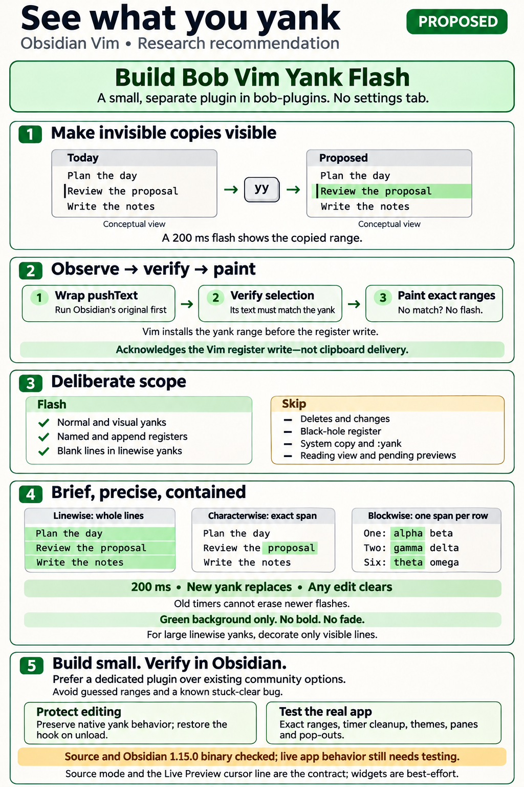
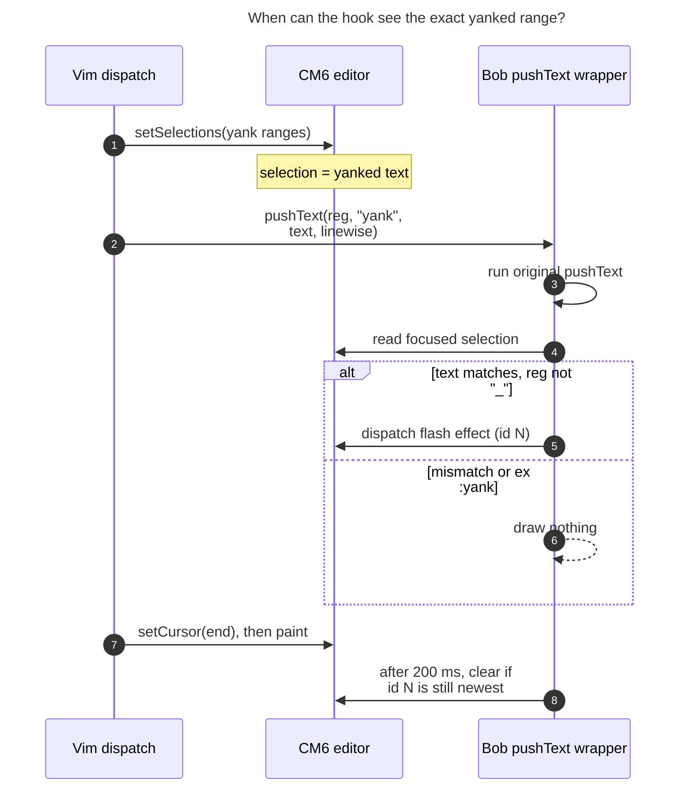

# Flashing Vim yanks in Obsidian: consolidated research and recommendation

> **Research query:** What is the best way to highlight the text that Vim normal-mode
> motions copy in Obsidian (for example `yy` on the current line), the way the SASE
> project's prompt input widget (`sase-org/sase`) does? Is this a good idea, would a
> different approach be better, and which requirement adjustments are justified? End
> with a recommended solution.



## Bottom line

- **Build it.** In Obsidian's Vim mode a yank gives almost no feedback. `yy` leaves the
  text and the cursor where they were. Obsidian's own patched yank prints "N lines
  yanked" only above two lines. The extent of `yi(`, `yap`, `y/foo<CR>` or `3yw` shows
  up only at paste time, often in another app, because the vault vimrc sets
  `clipboard=unnamedplus`. A 200 ms flash fixes that. Bryan already relies on the same
  behaviour in [the SASE prompt](#the-sase-prompt-yank-flash-contract), and it matches the standard in Neovim and VSCodeVim.
- **[Don't install either community plugin.](#prior-art-and-options)** Aleksey Rowan's _Vim Yank Highlight_ guesses
  both *whether* a yank happened (the key buffer contains a `y`) and *where* (longest
  common substring against the viewport). That fires on Bob Vim Surround's `ys`, lands on
  the wrong copy of repeated text such as `- [ ]`, and does O(viewport × yank) work.
  kometenstaub's plugin uses the right hook but never dispatches its clear, so the flash
  sticks until something else redraws.
- **[Recommended build](#recommended-design):** a new, settings-free `bob-vim-yank-flash` plugin in
  `bob-plugins`, as follows.
  - **Hook.** Wrap the Vim register controller's `pushText` and act only when
    `operator === "yank"`.
  - **Range.** At that instant the editor's live CodeMirror 6 (CM6) selection *is* the
    yanked range, for normal-mode and visual yanks alike. Before painting, check that the
    selection's text equals the pushed text, and paint nothing if it doesn't.
  - **Paint.** Draw a CM6 decoration for 200 ms: whole-line backgrounds for linewise
    yanks, marks for charwise and blockwise ones.
- **Requirement changes I'm making** ([requirement adjustments](#requirement-adjustments-explicitly-called-out), each flagged): flash visual-mode yanks too;
  flash yanks only, never deletes or changes; skip the black-hole register; paint whole
  lines for linewise yanks (blank lines included); background colour only, no bold;
  clear the flash on any edit; no settings tab; an explicit out-of-scope list.

## Critique of the plan

### Is it a good idea

Yes. Benefits:

- **It fills a real gap.** Text objects, searches and counts (`yi(`, `yap`, `y/foo<CR>`,
  `3yw`) have extents that are easy to misjudge. With `clipboard=unnamedplus`, a mistake
  surfaces only after pasting somewhere else.
- **It keeps habits consistent.** The same short flash appears in Neovim
  (`vim.hl.on_yank`), the SASE prompt, and VSCodeVim.
- **It is cheap and isolated.** One small plugin; its toggle is the rollback.

Risks and how the design contains them:

- **It patches Vim internals.** That's unavoidable: there's no public yank event ([What Obsidian provides](#what-obsidian-provides), item 5).
  Contain it: feature-detect, *wrap* rather than replace, verify before drawing, restore
  on unload, and add a real-Obsidian e2e test that fails loudly when an upgrade breaks
  the hook.
- **A wrong flash is worse than none.** Hence exact native ranges, the text-equality
  check, and "draw nothing" on any doubt.
- **It must not become clipboard confirmation.** The flash acknowledges a Vim register
  write. Clipboard delivery belongs to vimrc-support and happens later, asynchronously.
- **It must not grow.** No settings tab, no per-mode options, no clipboard changes.

### Would I take a different approach

Not fundamentally. All five reports independently
converged on hooking `pushText` plus a CM6 decoration, and the source and binary checks
in [What Obsidian provides](#what-obsidian-provides) support that. My main refinements:

- the [text-equality check](#choosing-the-editor-and-checking-the-range);
- [re-checking the controller's identity](#the-hook) after a vimrc reload;
- [clearing on edits](#state-timing-and-clearing);
- [painting only visible lines](#ranges-to-decorations).

### Requirement adjustments explicitly called out

| # | Change to the request | Why |
| --- | --- | --- |
| **R1** | **Also flash visual-mode yanks** (`v…y`, `V…y`, `<C-v>…y`, visual `Y`), not only "normal-mode motions" | SASE does; Neovim's `on_visual` defaults to true; in Obsidian the selection vanishes on `y`, so the flash is the only confirmation; the hook covers it for free |
| **R2** | **Yank operator only.** No flash for `d`, `c`, `x`, `s`, `D`, `C`, even though `unnamedplus` copies them | Matches SASE's tests and common Neovim configs; deleted text has nothing to flash; flashing every `dd` would be noise |
| **R3** | **Skip the black-hole register** (`"_y`); **do** flash named, append and `"+` registers | Nothing is stored for `"_` (upstream `pushText` returns early, but the wrapper still runs, so it must filter it itself); the register choice changes where text goes, not which text |
| **R4** | **Linewise yanks paint whole line boxes, blank lines included.** This departs from SASE, which paints text only and skips empty spans | Obsidian uses proportional fonts and hides markup in Live Preview, so text-only paint looks ragged and leaves gaps between lines; whole lines match what was copied and how `V` looks; `yy` on a blank line deserves feedback |
| **R5** | **Background only, no bold** (SASE uses bold) | Bold changes glyph widths in Obsidian and can re-wrap lines for 200 ms |
| **R6** | **Exact native ranges or nothing.** No text search, no key sniffing; verify the selection's text against the pushed text | A plausible but wrong flash is worse than none, and repeated rows (`- [ ]`) are common in Bob's task notes |
| **R7** | **One 200 ms constant, no settings tab, no fade in v1.** Colour overridable through the CSS variable `--bob-yank-flash-bg` | SASE parity; the plugin toggle is the off switch; avoids settings sprawl and motion |
| **R8** | **Clear the flash on any document change** (and on plugin unload / editor destroy), in addition to the timer | New behaviour, not in SASE; avoids painting stale or wrongly mapped positions (`yyP`) |
| **R9** | **Drop SASE's large-buffer cutoff; decorate only visible lines instead** | The cutoff exists because Textual rebuilds the whole map; CM6 renders the viewport, so bounding the work per view is enough |
| **R10** | **Out of scope:** ex `:yank`, Cmd/Ctrl+C, Bob's path-yank commands, Reading view, SASE's pending-operator tint (`y/foo` live preview), clipboard-success feedback | None of these is a Vim operator yank over the buffer; the text check rejects `:yank` automatically (it pushes text without setting a selection) |
| **R11** | **Source mode and the cursor line in Live Preview are the contract;** rendered widgets (tables, embeds, folded or replaced ranges) are best-effort | Live Preview reveals markup on the cursor's line, where most yanks happen; block widgets aren't `.cm-line` elements and marks can disappear inside replaced ranges. Don't unfold or scroll to show a flash |

## The SASE prompt yank flash contract

Verified at `sase-org/sase` `7cc41d8` (`_yank_highlight.py`,
`_vim_normal_operator_exec.py`, `_vim_visual_ops.py`,
`tests/ace/tui/widgets/test_prompt_yank_highlight.py`).

| Aspect | SASE behaviour |
| --- | --- |
| Trigger | Only the `y` operator. `_execute_charwise_operator` and `_execute_linewise_operator` call `_flash_yank` after storing the register |
| Visual yanks | **Flash.** `_apply_visual_operator` routes `y` through the same execute functions; `test_visual_charwise_yank_flashes_selection` asserts it |
| Deletes / changes | Never flash (`test_delete_and_change_do_not_flash`), even though they also copy |
| Region | Exact copied span. Linewise flashes `(first_row, 0)`–`(last_row, len(last_line))`, i.e. the text without the final newline (`yy` on `bbb` gives span `(4, 7)`) |
| Empty span | No flash (`test_empty_line_yank_does_not_flash`) |
| Duration | `_YANK_FLASH_SECONDS = 0.2`; no fade |
| Re-yank | A new yank replaces the flash. A generation counter turns stale timers into no-ops |
| Style | Theme foreground on the theme's `success` background, **bold**; drawn above search and Jinja overlays |
| Large buffers | Overlay skipped past `_MAX_OVERLAY_BYTES` / `_MAX_OVERLAY_LINES`, because Textual rebuilds the whole highlight map |
| Clipboard | Delivered asynchronously; the flash doesn't wait for it, so it was never proof of clipboard success |

The portable contract is: **briefly mark exactly what a completed yank copied, change no
editing behaviour, and never let an old timer clear a newer flash.** The bold style and
the size cutoff come from the Textual terminal renderer, not from the requirement.

SASE also has a separate, *pending* operator-search tint: while `y/foo` is being typed,
the region is tinted green. That is a different feature. CodeMirror Vim exposes no
pending-operator range, so it is out of scope here ([R10](#requirement-adjustments-explicitly-called-out)).

## What Obsidian provides

_Verified, not assumed._

Obsidian's Vim mode is `@replit/codemirror-vim` running on CM6. Plugins reach it through
the undocumented `window.CodeMirrorAdapter.Vim`, which Bob Vim Surround and Bob
Navigation Hotkeys already use. Everything below was checked in upstream source at
`c3131c4`. I also checked it, read-only, against the **Obsidian 1.15.0 snap on athena**.
Obsidian is not installed on apollo, where this research ran.

1. **The yank range is installed as the real CM6 selection before the yank operator
   runs**, for both normal-mode motions and visual mode. The dispatcher calls
   `cm.setSelections(cmSel.ranges, …)` and then `operators[operator](…)` (vim.js
   ~2185–2192). Linewise motions first expand to `(first, 0)…(last + 1, 0)`; blockwise
   mode yields one range per row. Obsidian's bundle contains the same lines.
2. **The adapter dispatches that selection synchronously.** In the 1.15.0 bundle,
   `setSelections(t, e)` ends in `this.cm6.dispatch({selection: …})`, and
   `getSelections()` is `state.selection.ranges.map(r => state.sliceDoc(r.from, r.to))`.
   So inside the operator, `EditorView.state.selection` holds the yanked ranges.
3. **The yank operator calls `pushText(registerName, 'yank', text, linewise,
   visualBlock)` while that selection is live.** `text` is `getSelections().join("\n")`
   *before* `pushText` appends a linewise `"\n"`. Only after the operator returns does the
   dispatcher call `exitVisualMode` and `cm.setCursor(endPos)`, and the browser paints
   after that. The yank "selection" itself is never visible.
4. **Obsidian ships a locally patched yank operator.** The 1.15.0 bundle contains
   `// Like Vim's default 'report' option, only report yanks of more than 2 lines
   (upstream always reports)` followed by `if (lineCount > 2) showConfirm(…)`. This
   matters: overriding `yank` through `Vim.defineOperator` would silently drop that patch.
   The `operators` table is private to vim.js's closure, so unloading couldn't restore the
   original either.
5. **There is no native yank event or highlight.** The bundle has no `vim-yank` or
   `highlightYank` strings. Upstream issue
   [replit/codemirror-vim#121](https://github.com/replit/codemirror-vim/issues/121) is
   still **open** (last activity 2023-12-19). The maintainers said they'd "stick with
   defaults as close as possible", possibly adding a config option. In that thread,
   Aleksey Rowan himself says hooking "the pushText/yank handler" is easier than his
   key-listening approach. `vim-keypress` and `vim-command-done` carry keys and reasons,
   never ranges. cdx also found that `vim-command-done` can fire before the operation
   executes.
6. **The register controller is shared, and its identity can change.** It is created
   once at module start-up by `resetVimGlobalState()` (exported only as a testing hook,
   `resetVimGlobalState_`). Its methods live on `RegisterController.prototype` in
   Obsidian's bundle, so a wrapper is an own property that can be cleanly deleted.
   Nothing in `bob-plugins` or vimrc-support calls the reset. However,
   `bob-navigation-hotkeys` (`620-plugin-dash-and-vim-jumps.js`) records that **"the Vim
   adapter object can be replaced on Vimrc reload"**, so the hook must re-check identity
   instead of assuming a single install.
7. **Rendering primitives are available.** `registerEditorExtension`, CM6 `StateField`,
   `StateEffect`, `ViewPlugin`, `Decoration.line` and `Decoration.mark` are all in use
   across Bob's plugins (e.g. `bob-ledger-tools/src/010-load-and-constants.js`).
   `EditorView.findFromDOM` and `--color-green-rgb` (light `8, 185, 78`, dark
   `68, 207, 110`) are present in 1.15.0. Obsidian's internal `editor.addHighlights` /
   `removeHighlights` exist too, but they are undocumented and support marks only, so
   they aren't recommended.

cdx's executable probe ran the real upstream engine in Node and observed the range at
the register write. It covered `yy` → `[0, 11)`, `yw` → `[0, 4)`, `yiw` → `[0, 3)`,
`3yy` → the whole three-line doc, `"ayy` → `[0, 11)`, `"_yy` (hook entered, so the
plugin must filter it), `fy` (no register write) and `y$` → `[0, 10)`. That's evidence
for the interception point, not a live-Obsidian test.



_Figure: Vim sets the yanked range as the editor's selection before it writes the
register, so a `pushText` wrapper can read exact positions with no searching. Steps 1, 2
and 7 are existing Obsidian/CodeMirror Vim behaviour; steps 3–6 and 8 are the proposed
plugin._

**Bob's environment** (from the cld, grk and mus reports; not re-checked by me):

- The vault has `vimMode: true`.
- `obsidian-vimrc-support` 0.10.2 loads `obsidian_vimrc.md` with
  `set clipboard=unnamedplus`. It copies the register to the system clipboard on DOM
  `keyup`/`click`/`focusin`. It reads `getRegister('yank')`, which isn't a valid register
  name, so it falls back to the unnamed register. That's why deletes reach the clipboard
  too.
- No yank-highlight plugin is installed. No Bob plugin calls or wraps `pushText`; I
  confirmed that for `bob-plugins` at `87b28e1`.
- Bob Vim Surround lets `y` pend for `ys`, catches the `s` keydown, and injects
  `<Esc><A-b>s`. The built-in yank never runs for `ys`, so a `pushText` hook won't flash
  on surround.
- `bob plugins sync` copies `manifest.json`, `main.js` and `styles.css` but doesn't enable
  a new plugin. `bob plugins list` only *reads* `community-plugins.json`.

## Prior art and options

| Option | Detects the yank by | Finds the range by | Verdict |
| --- | --- | --- | --- |
| **Aleksey Rowan, _Vim Yank Highlight_** (`vim-yank-highlight` 1.0.8, community listing, desktop-only, last release Dec 2023, several thousand downloads) | `vim-keypress` + `vim-command-done`; fires if the key buffer *contains* `y`/`Y` | Longest common substring of the yank register vs. the viewport, nearest the cursor | **Reject.** False positives on `fy`, `ty`, `ry`, `"yp`, `ys`; wrong copy of repeated text; no blockwise support; misses remaps (issue #3); the full `(n+1)×(m+1)` table can freeze on a large `yG`; needs a line-gap padding hack; handlers stay on old adapters after unload |
| **kometenstaub, _obsidian-vim-yank-highlight_** (`yank-highlight` 1.1.4, BRAT/manual, last commit 2022-07-13) | `monkey-around` wrap of `pushText`, `args[1] === 'yank'` | `editor.getCursor('from'/'to')` inside `pushText` | **Right hook, broken paint.** The range *is* correct for normal-mode `yy` (see [Where the reports disagreed](#where-the-reports-disagreed-and-how-i-resolved-it)). But it sets `ViewPlugin.decorations` without dispatching. The flash appears only because the operator's later `setCursor` triggers an update, and the timed clear waits for the next unrelated update (its README admits the timeout "only works if the cursor is moved"). Also: one range only, active-view only, 2000 ms default, and it only installs if Vim mode was on at load |
| **Better Vim** (`better-vim` 1.2.2) | Wraps `pushText` | Still Rowan's substring search | Not adopted: broad feature bundle that keeps the range problem |
| CSS snippet or vimrc mapping | — | — | Can only *style* a range something else marks; can't detect a yank |
| `Vim.defineOperator('yank', …)` override | Exact (operator gets `cm`, `ranges`, `args`) | Exact | **Fallback only.** Replaces Obsidian's patched yank ([What Obsidian provides](#what-obsidian-provides), item 4); can't be restored on unload; last writer wins |
| `mapCommand('y', …)` to a custom operator | Exact | Exact | The override's costs plus more keymap surface (normal `Y`, visual `Y`); no advantage |
| CM6 update listener spotting the selection→cursor flip | Fragile | Fragile | Can't tell `y` from `d`, `>` or `gu`; reject |
| Notice / status text ("N lines yanked") | — | None | Answers "how much", not "where"; Obsidian already shows it above two lines |
| Upstream yank event in codemirror-vim | Native | Native | Cleanest long-term; worth proposing separately, but don't block on it |
| **New `bob-plugins` plugin wrapping `pushText`** | Semantic: only real yank-operator writes | Live CM6 selection, verified | **Recommended** |

## Where the reports disagreed and how I resolved it

| Question | Positions | Resolution and evidence |
| --- | --- | --- |
| Does SASE flash visual-mode yanks? | gem: no, "visual omission is deliberate"; cdx, cld, grk, mus: yes | **Yes.** `test_visual_charwise_yank_flashes_selection` (`v h y` → span `(1, 3)`); `_apply_visual_operator` calls the same execute functions that flash. gem's premise is wrong |
| Is the exact range available at `pushText` for **normal-mode** yanks? | mus: only for visual yanks; normal-mode `from == to`, so ranges must be recovered heuristically; others: yes | **Yes.** `setSelections` runs before every operator (vim.js 2185) and the adapter dispatches synchronously (upstream `cm_adapter.ts` 280–293; the Obsidian 1.15.0 bundle is identical in effect); cdx's probe saw `yy` → `[0, 11)`. mus's range-recovery heuristics (cursor row ± count, direction from `vim-keypress`) are unnecessary |
| Override `yank` via `defineOperator` instead? | gem/grk: reject; cld: documented fallback; cdx: avoid | **Fallback only.** It drops Obsidian's yank patch and can't be undone |
| Duration | 200 ms (cdx, cld, grk, gem); mus: 250 ms, configurable | **200 ms constant.** SASE parity, VSCodeVim's default; Neovim uses 150. Tune by feel later; a settings tab isn't worth it now |
| Linewise paint | `Decoration.line` (cld, grk); marks (gem, mus); either (cdx) | **Line decorations.** They fill the whole line box, cover blank lines, and avoid the inter-line gaps Rowan hacked around with padding. gem's "column 0 to line length + 1" mark would paint a phantom newline |
| Fade | Hold-then-fade keyframes (cld); CSS `transition` (gem); no fade (cdx; SASE has none) | **No fade in v1.** A `transition` can't run because the decorated element is removed on clear. A keyframe animation on insert works if wanted later, gated by `prefers-reduced-motion` |
| Edits during the 200 ms | Clear (cdx, grk); map through edits (cld); keep (mus) | **Clear on any document change.** Mapping misbehaves: on `yyP` a mapped line decoration at the insertion point moves onto the *pasted* line. The paste itself is feedback, so clearing loses nothing |
| Which editor to paint | Active `MarkdownView` (gem, kometenstaub); focused DOM editor (cld); a `handleKey` scope stack (cdx); "the yanking adapter" (mus) | **The focused `.cm-editor` (pop-out aware) plus text verification.** Keys come from the focused editor, and the check turns a wrong guess into "no flash". A `handleKey` wrapper is a feasible upgrade if misses show up: `multiSelectHandleKey` calls back through the exported `vimApi.handleKey`. It adds complexity v1 doesn't need |
| Colour | Green, the "success" colour (cld, grk); accent (gem, mus) | **Green**, `rgba(var(--color-green-rgb), 0.35)` (SASE uses its theme's success colour), overridable through `--bob-yank-flash-bg`. Never `--text-highlight-bg`, which already means `==highlight==` and search |
| Large yanks | Cap at ~500 line decorations (cld); decorate only visible lines (cdx); SASE-style cutoff (mus) | **Decorate only visible lines.** A cap misses `ygg` from deep in a note, where the visible lines are past the cap. A `ViewPlugin` that intersects with `view.visibleRanges` is correct and bounded |
| Where it lives | New plugin (all five prefer); fallbacks: fold into surround (cld, gem) or a nav-hotkeys fragment (mus) | **New plugin `bob-vim-yank-flash`.** It gets its own toggle as a kill switch and contains its own failures. I chose "flash" over "highlight" because "highlight" is overloaded in Bob (Markdown `==highlight==`, reference Highlights PDFs) |

## Recommended design

### Home and shape

- **Location:** `plugins/bob-vim-yank-flash/` in `bob-plugins`, with a hand-edited
  `main.js`, `styles.css` and `manifest.json` in the shape of `bob-vim-surround`.
- **Manifest:** `isDesktopOnly: false`, `minAppVersion` `1.8.7`.
- **Size:** well under the 1,000-line fragment limit, so no `fragments.json`.
- **Settings and commands:** no settings tab and no palette commands.
- **Release steps:** a docs page plus `npm run docs:gen` / `docs:check`; add the test
  file to `npm test`; `bob plugins sync`; then enable it once in the vault, because sync
  doesn't enable plugins.

### The hook

- **Install.** On `onLayoutReady` and on every `active-leaf-change`, resolve
  `window.CodeMirrorAdapter.Vim.getRegisterController()`. If its `pushText` isn't already
  our wrapper (check a marker property, as navigation-hotkeys does with
  `bobNavigationJumpBridge`), wrap it. This re-check covers the vimrc-reload replacement
  noted in item 6 of [What Obsidian provides](#what-obsidian-provides).
- **Order inside the wrapper.** Call the original first, with `this` and `arguments`
  intact, and return its result. Then, only for `operator === "yank"` and
  `registerName !== "_"`, call the flash routine inside `try/catch`. A cosmetic failure
  must never break or alter a yank.
- **Timing.** The selection is still live after the original `pushText` returns, because
  the operator hasn't returned yet.
- **Unload.**
  - If `rc.pushText` is still our wrapper, restore it: `delete` the own property when the
    method came from the prototype, otherwise put back the saved function.
  - If another wrapper has been installed on top of ours, leave ours in its chain and
    make it inert through an `active` flag. Never restore a stale function over someone
    else's wrapper.

### Choosing the editor and checking the range

- **Pick the editor.** Take the focused element from `activeDocument`, which keeps
  pop-out windows working. Find its closest `.cm-editor`, then call
  `EditorView.findFromDOM`. Ex commands typed in Vim's prompt still resolve, because the
  prompt panel sits inside the editor's DOM.
- **Check the text.** Compute
  `state.selection.ranges.map(r => state.sliceDoc(r.from, r.to)).join("\n")` and require
  it to equal the `text` argument. That equals the adapter's `getSelection()` byte for
  byte, including blockwise joins and the pre-normalization linewise text. A wrong view,
  an ex `:yank`, a future internal change, or a stray `pushText` all turn into "no flash".
- **Capture.** Store the ranges as plain `{from, to}` offsets, plus the `linewise` flag
  and a sequence id. Don't keep the text or log it.

### Ranges to decorations

- **Charwise** (`yw`, `yiw`, `y$`, `yf)`, `y}`): one `Decoration.mark` per non-empty
  range.
- **Blockwise** (`<C-v>…y`): one mark per selection range, one per row. This comes free
  from the live selection.
- **Linewise** (`yy`, `3yy`, `Y`, `yj`, `yap`, `Vjy`): one `Decoration.line` per covered
  line.
  - The last covered line is `lineAt(to)`, minus one line when `to > from` and `to` sits
    at that line's start. The selection ends at `(last + 1, 0)` except at the end of the
    document, where positions clip to `doc.length`.
  - An empty last line at the end of the document still gets `lineAt(from)`.
  - Build line decorations only for lines that intersect `view.visibleRanges`, rebuilding
    on viewport changes.

### State timing and clearing

- **State.** A `StateField` holds the current flash, `{id, linewise, ranges}` or `null`,
  per editor. A `StateEffect` sets it, or clears it *only if* its `id` is still the
  newest. That is the CM6 version of SASE's generation counter.
- **Edits.** The field drops the flash on `tr.docChanged` ([R8](#requirement-adjustments-explicitly-called-out)).
- **Rendering.** A `ViewPlugin` turns the field into decorations, so it can intersect
  with visible ranges.
- **Dispatch.** Dispatch synchronously from the wrapper. That's safe: it runs from a
  keydown handler rather than inside a CM6 update, and an effects-only transaction
  changes neither the document nor the selection. The `try/catch` covers the odd case.
- **Timer.** Start it on the view's own window (`view.dom.ownerDocument.defaultView`,
  for pop-outs). Skip the clear when `view.dom.isConnected` is false.
- **Re-yanks** replace the flash immediately, and repeated identical yanks flash again.

### Style

```css
.bob-yank-flash,
.cm-line.bob-yank-flash-line {
  background-color: var(--bob-yank-flash-bg, rgba(var(--color-green-rgb), 0.35));
}
```

Check contrast in light and dark themes and against active search matches. In CM6,
higher-precedence mark decorations wrap lower ones, so if the flash hides behind a search
mark (or the reverse), adjust the extension's `Prec` rather than adding `!important`.

### Sketch

The following is illustrative, not tested. It merges cld's sketch with the refinements
above.

```js
const { Plugin } = require("obsidian");
const { StateEffect, StateField } = require("@codemirror/state");
const { Decoration, EditorView, ViewPlugin } = require("@codemirror/view");

const FLASH_MS = 200;
const MARKER = "bobVimYankFlash";
const lineDeco = Decoration.line({ class: "bob-yank-flash-line" });
const markDeco = Decoration.mark({ class: "bob-yank-flash" });

// {id, linewise, ranges} sets a flash; {id, clear: true} clears it only if still newest.
const setFlash = StateEffect.define();
const flashField = StateField.define({
  create: () => null,
  update(value, tr) {
    if (value && tr.docChanged) value = null; // R8: never paint stale offsets
    for (const e of tr.effects) {
      if (!e.is(setFlash)) continue;
      if (!e.value.clear) value = e.value;
      else if (value && value.id === e.value.id) value = null;
    }
    return value;
  },
});

function buildDecorations(view) {
  const flash = view.state.field(flashField, false);
  if (!flash) return Decoration.none;
  const doc = view.state.doc;
  const out = [];
  for (const r of flash.ranges) {
    if (!flash.linewise) {
      if (r.to > r.from) out.push(markDeco.range(r.from, r.to));
      continue;
    }
    const last = r.to > r.from && doc.lineAt(r.to).from === r.to ? r.to - 1 : r.to;
    for (const vis of view.visibleRanges) {
      const from = Math.max(r.from, vis.from);
      const to = Math.min(last, vis.to);
      for (let pos = from; pos <= to; ) {
        const line = doc.lineAt(pos);
        out.push(lineDeco.range(line.from));
        pos = line.to + 1;
      }
    }
  }
  return Decoration.set(out, true);
}

const flashView = ViewPlugin.fromClass(
  class {
    constructor(view) { this.decorations = buildDecorations(view); }
    update(u) {
      if (u.viewportChanged || u.docChanged ||
          u.startState.field(flashField, false) !== u.state.field(flashField, false)) {
        this.decorations = buildDecorations(u.view);
      }
    }
  },
  { decorations: (v) => v.decorations },
);

class BobVimYankFlashPlugin extends Plugin {
  onload() {
    this.seq = 0;
    this.active = true;
    this.registerEditorExtension([flashField, flashView]);
    const ensure = () => this.ensureHook();
    this.app.workspace.onLayoutReady(ensure);
    this.registerEvent(this.app.workspace.on("active-leaf-change", ensure));
    this.register(() => { this.active = false; });
  }

  ensureHook() {
    const vim = window.CodeMirrorAdapter && window.CodeMirrorAdapter.Vim;
    const rc = vim && typeof vim.getRegisterController === "function"
      ? vim.getRegisterController() : null;
    if (!rc || typeof rc.pushText !== "function" || rc.pushText[MARKER]) return;
    const hadOwn = Object.prototype.hasOwnProperty.call(rc, "pushText");
    const original = rc.pushText;
    const plugin = this;
    const wrapped = function (registerName, operator, text, linewise) {
      const result = original.apply(this, arguments); // Obsidian's yank semantics first
      if (plugin.active && operator === "yank" && registerName !== "_") {
        try { plugin.flash(String(text == null ? "" : text), !!linewise); } catch (_) {}
      }
      return result;
    };
    wrapped[MARKER] = true;
    rc.pushText = wrapped;
    this.register(() => {
      if (rc.pushText !== wrapped) return; // someone wrapped us: stay inert, never clobber
      if (hadOwn) rc.pushText = original; else delete rc.pushText;
    });
  }

  flash(text, linewise) {
    const doc = window.activeDocument || document;
    const el = doc.activeElement;
    const editorEl = el && typeof el.closest === "function" ? el.closest(".cm-editor") : null;
    const view = editorEl ? EditorView.findFromDOM(editorEl) : null;
    if (!view) return;
    const { state } = view;
    const selected = state.selection.ranges.map((r) => state.sliceDoc(r.from, r.to)).join("\n");
    if (selected !== text) return; // provenance check: wrong view, :yank, drift => no flash
    const ranges = state.selection.ranges.map((r) => ({ from: r.from, to: r.to }));
    if (!linewise && ranges.every((r) => r.from === r.to)) return;
    const id = ++this.seq;
    view.dispatch({ effects: setFlash.of({ id, linewise, ranges }) });
    const win = view.dom.ownerDocument.defaultView || window;
    win.setTimeout(() => {
      if (!view.dom.isConnected) return;
      try { view.dispatch({ effects: setFlash.of({ id, clear: true }) }); } catch (_) {}
    }, FLASH_MS);
  }
}

module.exports = BobVimYankFlashPlugin;
module.exports.__test = { buildDecorations, flashField, setFlash };
```

**Fallback, only if an Obsidian upgrade makes the text check fail permanently** (the e2e
test will show it): override `Vim.defineOperator('yank', …)`. Re-implement the operator
body, including Obsidian's ">2 lines" report through `cm.openNotification`, and flash the
`ranges` argument directly. Document that unloading can't restore Obsidian's original.

## Verification plan

**Unit tests** (`node --test`, stubbing `obsidian` and small CM6 doubles the way
`scripts/test-vim-surround.cjs` does):

- **Line arithmetic:**
  - `yy` mid-document, on a blank line, and on the last line with and without a trailing
    newline;
  - `3yy` across a blank line;
  - a linewise range larger than the visible ranges (only visible lines decorated);
  - charwise multi-line, blockwise multi-range, and empty charwise (no flash).
- **Selection text:** the computed text matches `getSelection()` semantics, including the
  blockwise `"\n"` join.
- **Effect ids:** a stale clear never clears a newer flash, and a document change clears
  the flash.
- **Hook lifecycle:**
  - the wrapper is installed once and re-installed when the controller's identity
    changes;
  - the original is restored, or the wrapper stays inert when it has been wrapped over;
  - `"_` and `operator !== "yank"` are ignored;
  - exceptions are swallowed and the original's return value is passed through.

**Real-Obsidian e2e.** Extend the existing CDP harness
(`scripts/obsidian-startup-smoke.cjs` / `obsidian-*-e2e*.cjs`, which accepts
`--obsidian-bin`) with a scratch vault and profile, never the live vault. It must run
where Obsidian is installed: athena's snap or the Mac, not apollo. Drive keys, then
assert `.bob-yank-flash` / `.bob-yank-flash-line` immediately and again after more than
200 ms.

| Group | Cases | Expected |
| --- | --- | --- |
| Must flash | `yy`, `3yy`, `yw`, `y$`, `yiw`, `yi(`, `yap`, `yb` (backward), `yG`, `ygg` from deep in a note, `Y`, `"ayy`, `"Ayy`, `Vjy`, `vey`, `<C-v>jly` (two marks), `yy` on a blank line, repeated identical `yy` | Exact native ranges; linewise as whole lines |
| Must **not** flash | `dd`, `dw`, `cw<Esc>`, `x`, `"_yy`, `:y<CR>`, `fy`, `ty`, `ry`, `"yp`, `ysiw)` (surround still works), path-yank commands | No flash class anywhere |
| Behaviour unchanged | Obsidian's "3 lines yanked" still appears for `3yy`; register and clipboard text unchanged; cursor ends where it did without the plugin; `p`, dot-repeat, macros, undo unchanged | Identical to plugin-disabled |
| Lifetime | Second yank within 200 ms; no input after a yank (flash still clears); `yyp` / `yyP`; tab switch; split pane; pop-out window; plugin disable (original `pushText` restored) | No stuck or misplaced flash |
| Geometry | Repeated rows, emoji / UTF-16 surrogates, tabs, wrapped lines, folded sections, Live Preview paragraph / list / heading / link | Correct spans; widget content best-effort ([R11](#requirement-adjustments-explicitly-called-out)) |

Run the e2e case as part of the Obsidian upgrade smoke check, so a broken hook shows up
as a failed check instead of a silently missing flash. Then do a short manual pass with
Bryan's real theme and plugin set, light and dark, on the Mac.

## Risks and open questions

**Confidence: high** in the following.

- The value of the feature and the SASE contract (verified at `7cc41d8`).
- The ordering that makes the hook exact. It's verified in upstream source and the
  1.15.0 bundle, and cdx's probe observed it.
- The weaknesses of the community plugins (source-verified).
- The case against a `defineOperator` override (the patch is verified in the binary).

**Moderate** until the e2e passes on a real build:

- that Live Preview looks right;
- the pop-out and split-pane paths;
- focus-based editor resolution in unusual embedded editors (canvas cards, embeds), where
  the text check limits the damage to a missing flash.

**Risks:**

- **Undocumented internals.** `window.CodeMirrorAdapter` and `getRegisterController` are
  undocumented, though in long use (`pushText`'s signature has been stable since about
  2014). Bob already depends on the adapter. The text check plus the e2e test turn
  breakage into a visible failed check, not wrong behaviour.
- **Bob's Mac build is unverified.** I checked the athena snap only.
- **Mobile is untested.** Vim mode there needs a hardware keyboard.

**Open questions for Bryan:**

- **Colour:** keep SASE's green "success" colour, or prefer Obsidian's accent colour?
  It's a one-line CSS variable either way.
- **Surround:** is a separate plugin fine, or would you rather fold this into
  `bob-vim-surround` to have fewer plugins? Folding it in loses the independent kill
  switch.
- **Upstream:** propose a `vim-yank` signal carrying `cm` and ranges to
  `replit/codemirror-vim`? Optional; Obsidian vendors its own copy anyway.

## Recommended solution

Build **Bob Vim Yank Flash** (`bob-vim-yank-flash`), a new, small, settings-free plugin
in `bob-plugins`:

1. **Detect:** wrap `CodeMirrorAdapter.Vim.getRegisterController().pushText`, running
   the original first. Act only on `operator === "yank"` with a register other than
   `"_`. Install on layout-ready and re-check on every `active-leaf-change`, so a
   replaced controller gets wrapped and no wrapper stacks. Restore on unload, or go inert
   if another plugin has wrapped over ours.
2. **Locate:** read the focused editor's live CM6 selection (pop-out aware). **Flash only
   if its text equals the pushed text**; otherwise draw nothing. Never search the
   document and never sniff keys.
3. **Render:** a per-editor `StateField` plus `ViewPlugin`:
   - `Decoration.line` on each visible covered line for linewise yanks (blank lines
     included);
   - `Decoration.mark` per range for charwise and blockwise yanks;
   - cleared after **200 ms** by an id-guarded effect on the view's own window timer, and
     immediately on any document change.
4. **Style:** background only, `rgba(var(--color-green-rgb), 0.35)`, overridable through
   `--bob-yank-flash-bg`. No bold, no fade in v1.
5. **Scope:** normal and visual yanks, including named registers. No deletes, changes,
   `"_`, `:yank`, system copy, Reading view, or pending-operator preview. Source mode and
   the Live Preview cursor line are the contract.
6. **Ship:**
   - unit tests plus a [real-Obsidian CDP e2e case](#verification-plan) on athena;
   - `npm run build:check`, `npm test`, a docs page with `docs:gen` / `docs:check`;
   - `bob plugins sync`, then enable the plugin once in the vault's
     `community-plugins.json`;
   - add the e2e case to the Obsidian upgrade smoke check.

## Scope and sources

_Lead consolidation of five independent reports (cdx, cld, grk, mus, gem), plus the
lead's own verification against source and the installed Obsidian binary. 2026-11-11.
Scope: Bob's Obsidian Vim mode, the `bob-plugins` monorepo, and parity with the SASE
prompt input's yank flash._

**Constituent reports** (this directory): `obsidian_vim_yank_range_flash__cdx.md`,
`__cld.md`, `__grk.md` (with `obsidian_vim_yank_highlight__grk_assets/`), `__mus.md`,
`__gem.md`.

**Lead verification:**

- `sase-org/sase` `7cc41d8`: `src/sase/ace/tui/widgets/_yank_highlight.py`,
  `_vim_normal_operator_exec.py`, `_vim_visual_ops.py`,
  `tests/ace/tui/widgets/test_prompt_yank_highlight.py`,
  `docs/reference/tui/prompt-modes.md`.
- `replit/codemirror-vim` `c3131c4`: `packages/codemirror-vim-core/vim.js` (operator
  dispatch ~2100–2199, `yank` operator 2902, `RegisterController.pushText` 1475,
  `resetVimGlobalState` 762, `getRegisterController` 814, `handleKey` 897,
  `multiSelectHandleKey` 7094, `clearInputState` 1364),
  `packages/codemirror-vim/src/cm_adapter.ts` (`setSelections` 280, `getSelection` 348),
  `packages/codemirror-vim/src/index.ts` (keydown → `Vim.multiSelectHandleKey`).
- Obsidian 1.15.0 snap on athena, read-only byte greps of `obsidian.asar`: the patched
  yank operator, `setSelections`/`getSelections` adapter bodies,
  `RegisterController.prototype`, `findFromDOM`, `addHighlights`, `--color-green-rgb`,
  and no `vim-yank`/`highlightYank`.
- `kometenstaub/obsidian-vim-yank-highlight` `31e8df9` `src/main.ts`; `esm7/obsidian-vimrc-support`
  `main.ts` (`getRegister('yank')` reads only).
- `bobs-org/bob-plugins` `87b28e1`: `plugins/bob-vim-surround/main.js` (retry hook,
  focused-editor resolution, `ys` injection),
  `plugins/bob-navigation-hotkeys/src/620-plugin-dash-and-vim-jumps.js` (vimrc-reload
  adapter replacement), `scripts/obsidian-startup-smoke-lib.cjs` (`--obsidian-bin`); no
  `pushText` callers.
- `bob-cli` `src/native/plugins/cli.rs` (sync copies the managed files; list reads
  `community-plugins.json`).
- [replit/codemirror-vim#121](https://github.com/replit/codemirror-vim/issues/121), OPEN,
  maintainers' "stick with defaults" stance and Rowan's `pushText` comment.

**From the constituent reports (not re-verified by the lead):** Aleksey Rowan plugin
`914c83c` (`src/main.ts`, `src/markViewPlugin.ts`, `src/util.ts`, issue #3); Better Vim
`fb3120a`; the vault's `app.json`, `community-plugins.json` and `obsidian_vimrc.md`;
Neovim `vim.hl.on_yank` defaults (150 ms, `IncSearch`, `on_visual = true`); VSCodeVim
`vim.highlightedyank` defaults (200 ms, off by default); cdx's Node probe of the upstream
engine.
