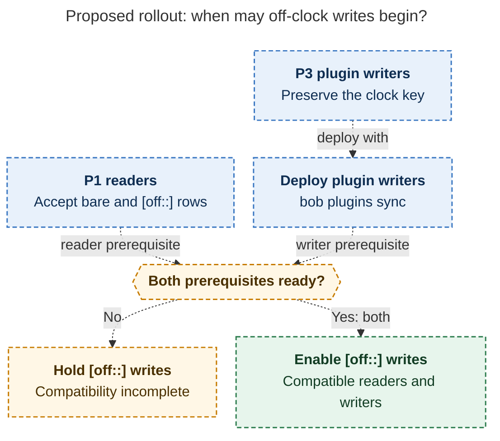

# Diagram proposals: Off-Clock Pomodoros: record the time, count it apart

Proposals for the swarm linker, not a report. Each diagram restates only what the source
report says.

```yaml
source: research:202611/off_clock_pomodoro_stats/off_clock_pomodoro_stats__final.md
producer: research.2z.image
check: "mmdc 12.0.0 with Puppeteer --no-sandbox and the PDF-mirroring config rendered 1 of 1 Mermaid diagrams"
```

## off-clock-write-gate

```yaml
anchor: |-
  until the P3 writers are deployed with `bob plugins sync`.
question: |-
  When may new off-clock writes begin?
illustrates: |-
  P1 must not write `[off::]` until P3 writers are deployed, and P1 readers accept bare and `[off::]` rows.
caption: New off-clock writes wait for compatible readers and deployed plugin writers; both prerequisites are required.
review: "548.809x764 px, fit 100.0%; question, visual, source-trace and unique-anchor checks passed; 0 revisions"
```


