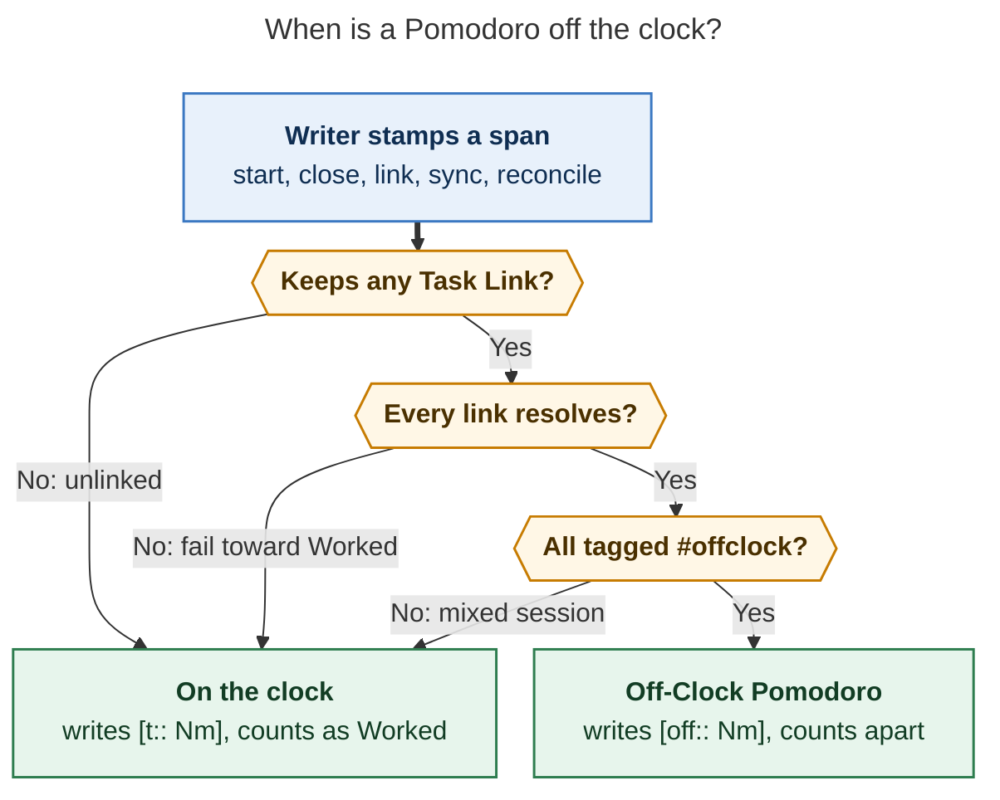

# Off-Clock Pomodoros: keep `#untracked` time, count it apart

Research question: the `bob-cli-f6` epic makes a Google Calendar event tagged
`#untracked` produce a Pomodoro whose time is dropped from every stat. Bryan now
wants that time recorded in a separate group instead. He proposes a `u::` field,
a toggle in `bob stats` and the Stats dash (untracked only, or all time), a
clearer name plus a glossary term, and one rule: a Pomodoro is untracked iff
every one of its Task Links targets an `#untracked` task. This report critiques
the plan, designs the feature, and ends with a recommended solution.

Swarm: `cld` report. I researched this on my own and did not read any peer
report.

## Bottom line

**Yes, do it. Recording this time beats throwing it away, and now is the cheapest
moment: none of it has shipped and no vault data uses it yet.** I would change
four things in the plan as written:

1. **Rename the concept to *off-clock*.** In Bob, "tracked" already means two
   other things: every `#task` row reads `#task · tracked task`, and Stats calls
   days before tracking began `not_tracked`. Once this time is recorded, "untracked"
   is false as well. The word f6 itself uses for this time is *off the clock*
   ("on the calendar, off the clock"; "dashed means off the clock").
   The glossary term becomes **Off-Clock Pomodoro**. The tag becomes `#offclock`,
   and `#untracked` stays a permanent alias.
2. **Yes to a positive ledger key, but spell it `[off:: Nm]` and adopt it for a
   different reason.** The duration is already in the span: all 1,231 closed timed
   rows in the vault have `[t::]` exactly equal to their span. What a key buys is
   *explicitness*. Today, a row that is missing `[t::]` by accident silently leaves
   every stat. With a key, a row is on the clock or off it only because something
   wrote that on purpose. (`[u::]` also works if you prefer one letter.)
3. **Keep the "all links" rule, with four precise edges.** A Pomodoro is off the
   clock exactly when it **keeps at least one counted Task Link** and **every one
   of them resolves to a task tagged `#offclock`**. Anything else stays Worked.
   Writers apply the rule when they write a span, and the row records the result.
   Readers never re-derive it, so history stays stable.
4. **Make the stats toggle a request-wide *clock lens*, owned by bob:**
   `bob stats -k/--clock on|off|all`, labelled **Worked · Off-clock · Logged**.
   bob relabels the metrics itself, so tiles, the Day strip, the focus chart,
   "Where the time went", and the CLI all switch together with almost no client
   logic. Dashed outlines mean off the clock in Stats too.

One gap the request does not mention, which decides whether the feature is
useful at all: **off-clock events rarely get started.** On 2026-10-31,
"Halloween at Aunt Jenny's" (13:30–19:30, six hours) stayed queued under an
unstarted `() — MEET` placeholder, so no design records it. I recommend a
follow-up in which ended off-clock events settle into closed off-clock sessions
on their own (Phase 5). It needs a separate decision.

## What exists today (evidence)

| Fact | Source |
| --- | --- |
| A timed row with `[t:: Nm]` (or the legacy `⏱`) is tracked; a timed row with neither is an "untracked session". `SessionTracking::{Tracked, Untracked, Placeholder}` decides this from the row alone. | `src/native/capture/pomodoro_adjust.rs:763-777`; `decisions:untracked-sessions-omit-t-field` |
| Stats drops untracked sessions completely: `if session.untracked { continue; }` before minutes and counts. Session facts report `0` minutes. Homes attribute 0-minute parts with `untracked: true`. | `src/native/stats/metrics.rs:215-217`; `src/native/stats/session_facts.rs:18`; `docs/pomodoro-homes.md` R5 |
| The f6 reviewer chose `untracked_counts = exclude`: untracked sessions leave minutes, counts, homes, and the Day strip. | `bob-cli-f6` decisions; plan `202611/untracked_calendar_events.md` |
| Writers keep absence as absence: `format_adjusted_range` and `set_ledger_tracking` add or drop `[t::]`. A running row also carries `[t:: Nm]` (its planned length). | `pomodoro_adjust.rs:1021-1083` |
| MEET starts follow the **event run**: the earliest open, not-yet-ended lineup Event Task plus contiguous events *with the same trackedness*. The run decides both span and `[t::]`. | `docs/capture.md` § MEET starts follow the calendar; `src/native/capture/meet_event_run.rs` |
| At close, Event Task links are classified by the clock. Not-started and ended-before events are **moved out** to a new `() — MEET` placeholder, so a closed row keeps only the links it worked. | `tests/fixtures/event_task_close/vectors.json` (`all-deferred-meetings-pin-rust-output`) |
| "Links that count" are already defined once (R3): dedicated Task Link bullets, plain, embedded, or struck. Deferred `[[…]]#` bodies do not count. | `docs/pomodoro-homes.md:118` |
| **Vault data:** 0 `#untracked` tags, 0 closed timed rows without `[t::]`, and 1,231 closed rows whose `[t::]` **equals the span in every case**. | scans of `~/bob` (2026-11-01) |
| **Release state:** the last tag is `v0.4.0` (2026-10-27), with 194 commits since, so f6's `untracked` JSON and CLI surface has not shipped in a tagged release. `f6.6` (plugins) and `f6.8` (Mac) are still IN_PROGRESS. | `git tag`; `sase bead read bob-cli-f6` |
| The JS mirror parses durations through one regex, `DURATION_FIELD_RE = /\[t::…\]/i`. Home chips already treat "no `[t::]`" as untracked with 0 minutes. | bob-plugins `src/010-load-and-constants.js:273`, `src/142-pomodoro-home-chips.js:274-290` |
| The Mac app never parses ledger keys. It decodes bob's `untracked` / `untracked_count` flags and hard-codes the capsule text `"untracked"`. | bob-mac-capture `CaptureAgendaModels.swift:91-114`, `CaptureAgendaView.swift:1120` |
| "Tracked" is already taken twice: `#task · tracked task` (task-tag marks) and the `not_tracked` quality plus "Tracking since …" in Stats. The f6 plan itself added a "naming collision guard" for the second one. | `docs/task-tag-marks.md:32`; `docs/stats.md:310`; plan line 252 |
| Precedent inside Stats for a three-way filter: task metrics take `recurring: exclude \| only \| include`. | `src/native/stats/registry.rs:94` |

## Critique of the plan

### 1. Recording the time separately: a clear yes

- **The current design discards information that the ledger already holds.** The
  span stays on the row, but every reader throws it away. Bryan cannot answer "how
  much time did family and errands take this week?", and the day's record has
  holes exactly where life happened.
- **The governing decision says to reopen it in exactly this case.**
  `untracked-sessions-omit-t-field` lists *"Reopens when: an untracked session
  needs to count as a Pomodoro."* This request is that trigger. It also
  reverses the f6 reviewer choice `untracked_counts = exclude`, so the new record
  must say so explicitly.
- **Professional time trackers do the same.** Toggl Track, Harvest, and Clockify
  record every entry and flag some as *non-billable*. Their reports show billable,
  non-billable, or all, and none of them drops the flagged time. Off-clock is the
  personal-productivity version of non-billable.
- **Root attribution improves.** An off-clock Event Task already carries
  `[root:: love]`. Today that root receives nothing. Afterwards, "Where the time
  went" can show *love 12h · body 4h* in the off-clock view.

### 2. A `u::` field: yes to a positive key, but for a different reason

The proposal justifies `u::` by "this way we still track the duration". However,
**the span already records the duration**: `[t::]` has never differed from the
span on 1,231 closed rows. The real benefits of a positive key are these:

| Benefit | Absence of `[t::]` (f6) | Positive key (`[off:: Nm]`) |
| --- | --- | --- |
| Intent | A hand-written `(**0900-0930**)` or a writer bug silently becomes untracked and leaves Worked | Off-clock exists only where something wrote `off`; a bare row is detectably *unstamped* |
| Reading the vault | `(**1200-1300**) — MEET` looks unfinished | `(**1200-1300** [off:: 60m]) — MEET` explains itself |
| Writers | Two shapes to keep in sync (add/drop `[t::]`) | One rule: *keep the key, update the minutes* |
| Dataview | Cannot `sum()` off-clock time | `sum(rows.off)` works like `sum(rows.t)` |
| Compatibility | — | f6-era readers see "no `[t::]`" and read the row as untracked, so either side can ship first |

The f6 record rejected "`#untracked` on the Pomodoro line" because it would
change the ledger grammar. A key inside the parentheses does not: every parser
already keeps unknown metadata as `rest`, and both the Rust and JS duration
readers change in one place each.

**Spelling.** `t` stands for time. If the concept is *off-clock*,
`[off:: 60m]` reads as English: "60 minutes off". `[u:: 60m]` needs the
glossary. Choose `[off::]`, or keep `[u::]` if one-letter keys matter more to
you. Nothing else in this design depends on the spelling.

### 3. "Untracked iff all task links are `#untracked`": right idea, four edges

The rule is better than f6's MEET-only rule. It makes off-clock a property of
*what you did* (the tasks), which is how homes and root parents already work,
and it generalizes beyond the calendar: a recurring `#offclock` "Walk the dog"
task makes its session off-clock with no special code. Taken literally, though,
it has four holes:

1. **Vacuous truth.** "All links are off-clock" is true when there are no links,
   which would make every unlinked session off-clock. → *Require at least one
   counted link.* Unlinked sessions stay on the clock.
2. **Running MEET lineups.** A running lunch MEET still lists the 13:00 standup
   in its lineup, so "all links" would make the lunch tracked. → *Evaluate the
   links the session **keeps**.* At a start, those are the event run (for a MEET)
   or the lineup. At a close, they are what remains after the clock classes move
   the deferred events out (R3 already ignores deferred `[[…]]#`).
3. **Unresolvable links.** → *A link that cannot be resolved counts as
   on-the-clock.* An error never hides real work; health already counts
   `unresolved_links`.
4. **When it is evaluated.** If the rule were re-derived at read time, every
   reader would need link-to-task-tag resolution, and adding `#offclock` to a
   task later would silently rewrite past days. The f6 record rejected that, and
   the theme decision keeps the same principle: *the ledger is the source of
   truth*. → *Writers stamp the result; `bob task reconcile` repairs closed rows
   on today's note; past days stay frozen.* A `clock_drift` health count shows
   any disagreement.

A consequence to accept on purpose: **a mixed session counts as Worked in
full.** If you link a real task into your lunch MEET, all 60 minutes are Worked.
This is the safe default because it never hides work, and the close output says
so (`MEET 1200-1300 · on the clock: also links Fix the parser`). I considered
splitting minutes per link (`[t:: 30m] [off:: 30m]` on one row) and rejected it:
the ledger would store a derived, heuristic split, and the event run already
keeps MEET sessions uniform in practice.



*Figure 1. A session is off the clock only when it keeps at least one Task Link
and every one of them targets an `#offclock` task; every other case stays
Worked. "Keeps" means the links that remain under the row after a close moves
deferred events out. (Rendered with mermaid-cli 12.0.0 at 649 × 872 px, 100%
fit.)*

### 4. The name: "untracked" breaks once the time is recorded

| Candidate | True once time is recorded? | Collides with | Pairs with "Worked" | Tag / field | Verdict |
| --- | --- | --- | --- | --- | --- |
| untracked | **No** | `#task · tracked task`; Stats `not_tracked` and "Tracking since" | weakly | `#untracked` / `[u::]` | ✗ |
| uncounted | Half: a tile reading "Uncounted 6h" contradicts itself | — | weakly | `#uncounted` / `[u::]` | ✗ |
| personal / life | No: a work lunch or a commute is neither | areas such as `love` and `body` | yes | `#personal` | ✗ |
| away | Mostly, but it describes *where* you were, not *whether it counts* | presence states | yes | `#away` / `[away::]` | runner-up |
| **off-clock** | **Yes**: recorded, but not on the work clock | different JSON payload only (`pomodoro_close.task_links[].clock`) | **on / off** | `#offclock` / `[off::]` | ✓ |

"Off the clock" means time that passes but is not counted as work, which is
exactly this concept. f6 already uses the phrase in its docs and visual language,
so the rename *adopts* existing vocabulary rather than inventing new words.
Accept `#untracked` (and `#off-clock`) forever as aliases, following the CLI
rule's no-hard-rename policy, so a Google event tagged earlier keeps working.

### 5. The unasked question: will the off-clock group have any data?

Tracked work gets recorded because Bryan runs its clock. Off-clock life events
rarely get a `=` at 13:30 and an `x` at 19:30. Today's two sync rules are:

- A Google event **first synced after it ended** gets a closed MEET at birth,
  which f6 splits by trackedness.
- An event synced **in advance** sits under a `() — MEET` placeholder until it is
  started.

Most off-clock events (Halloween, groceries, pickups) are created in advance. If
nobody starts them, the off-clock lens stays nearly empty and gives a false
picture. The fix is natural (the calendar *is* the clock for off-clock time), but
it changes the sync contract, so I list it as Phase 5 with its own decision.

## Design

### Vocabulary: one word on every surface

| Surface | Today (f6) | Proposed |
| --- | --- | --- |
| Concept / glossary | "untracked session" | **Off-Clock Pomodoro** (aka off-clock session, untracked pomodoro) |
| Task or Event Task tag | `#untracked` | `#offclock` (aliases `#untracked`, `#off-clock`; case-insensitive) |
| Google title / description token | `#untracked` | same as the tag; sync always renders the canonical `#offclock` |
| Ledger key | absence of `[t::]` | `[off:: Nm]` |
| Rust | `SessionTracking::{Tracked, Untracked, Placeholder}` | `SessionClock::{On{min}, Off{min}, Unstamped{span}, Placeholder}` |
| JSON flags | `untracked: true`, `tracked: false`, `untracked_count`, `untracked_sessions` | `off_clock: true` (omitted when false), `off_clock: {count, minutes}`, `off_clock_sessions` |
| Stats lens | — | `clock: on \| off \| all`; CLI `-k/--clock` |
| Human labels | — | **Worked · Off-clock · Logged** |
| Visual | dashed = off the clock (Obsidian Event pill, home chip, Mac band) | the same, extended to Stats tiles, bars, and lanes |
| Glyphs | — | `●` on the clock · `◌` off-clock · `◐` logged (both) |

### Ledger representation

```markdown
## Pomodoros

- [x] (**1030-1055** [t:: 25m]) — BUILD          ← on the clock: Worked 25m
	- 🍅 [[bob#^untracked-gcal-event]]
- [x] (**1200-1300** [off:: 60m]) — MEET         ← off the clock: Off-clock 60m
	- 🍅 ~~[[#^lunch-with-kelly]]~~
- [ ] (**1900-2000** [off:: 60m]) — MEET         ← running off-clock (planned 60m)
	- [[#^grocery-store-w]]
```

| Row shape | Reads as | Worked | Off-clock |
| --- | --- | --- | --- |
| `(**S-E** [t:: Nm])` or legacy `⏱ Nm` | on the clock | N | — |
| `(**S-E** [off:: Nm])` | off the clock | — | N |
| `(**S-E**)`, closed (hand-written) | **unstamped**: span minutes, quality `partial`; reconcile stamps it | span | — |
| both keys (malformed) | `[t::]` wins (fail toward Worked); `clock_conflict` health count; reconcile repairs | t | — |
| `()` | placeholder | — | — |

The *unstamped* row restores the pre-f6 meaning ("no key means count the span")
but marks it `partial`. A missing key then can never hide time. Zero rows exist
today, so this is purely defensive.

### Who decides, and when

- **Starts** (capture `=`, link starts, swaps, and Obsidian `se<X>`):
  - A MEET with an event run takes the run's clock, as today.
  - Any other session applies Figure 1 to its lineup. This is new: an
    `#offclock` "Walk the dog" start writes `[off:: 25m]`.
- **Closes** (capture `x…`, Obsidian Ctrl+Enter): apply Figure 1 to the
  **kept** links after clock classes, `#` defers, and `~K` drops. Swap the key
  if it changed, and always update the minutes.
- **Retimes** (`+N`, `++N`, `\p`, `\o`, adjust, shift): keep the key and update
  the minutes. They never re-derive.
- **`bob gcal sync`:** writes `[off:: Nm]` where f6 omits `[t::]`. Past clusters
  still split by clock. A running MEET it creates is off-clock only when every
  current event is.
- **`bob task reconcile`:** for **closed** rows on today's note only, swaps a key
  that disagrees with Figure 1 and stamps unstamped rows. It reports a
  `reclocked` list, following the same pattern as its `🍅` marker repair.
  - It never touches open rows, because their lineup is a forecast; the close
    decides them.
  - It never touches past days.
- **Past days:** frozen. `bob stats` health reports `clock_drift`, the closed
  sessions whose key disagrees with the rule as the tags stand today, so a
  retroactive tag edit is visible but never silent.

A shared vector file, `tests/fixtures/pomodoro_clock/vectors.json`, pins
Figure 1 for Rust and JS: links, task lines with or without the tag, unresolved
links, and the keep set after a close mapped to `on` or `off`. This follows the
`meet_event_run` and `event_task_close` lockstep pattern.

### Stats engine: a clock lens owned by bob

- **Metric parameter.** Pomodoro metrics gain `clock: on | off | all` (default
  `on`), mirroring `recurring: exclude | only | include` on task metrics. A
  metric that sets `clock:` in config is **pinned**, for example
  `family_time: {kind: pomodoro, clock: off, in: [love]}`.
- **Request lens.** `StatsRequest.clock` (default `on`) re-aims every pomodoro
  metric that does **not** pin `clock:`. One rule, no mapping table in clients.
- **bob relabels.** Labels already flow from the report to tiles, Day strip
  facts, the focus selector, and the CLI, so this one change makes every surface
  honest:

  | Metric | `on` | `off` | `all` |
  | --- | --- | --- | --- |
  | `worked` | Worked | Off-clock | Logged |
  | `sessions` | Sessions | Off-clock sessions | Logged sessions |
  | `review_time` and custom pomodoro metrics | *Label* | *Label* · off-clock | *Label* · logged |

  Definitions get the same treatment, for example: "Minutes in closed off-clock
  Pomodoros (`[off:: Nm]`)."
- **JSON (schema 1, additive).**
  - A top-level `clock: {value, label, options: [{value, label, description}]}`
    appears when the report has a lens-eligible metric. The dash draws its
    control from `options`, so copy and order stay bob-owned.
  - Each metric's `parameters.clock` is the effective value.
  - Under `all`, minutes points and `PartSummary` rows add `off_clock`
    (`{value, display}` plus `{dimension: {key: minutes}}`). This is the same
    shape as `apportioned`, so clients draw the dashed share without doing any
    arithmetic.
  - `summary.off_clock: {total, display, share}` supports "of which 1h 30m/day
    off-clock".
  - `sessions[]` facts carry real minutes plus `off_clock: true`, still "facts,
    not metric values".
  - Health renames `untracked_sessions` to `off_clock_sessions` and adds
    `unstamped_sessions` and `clock_drift`.
- **What stays the same.** Everything that iterates a series: typical day,
  rolling median, prior windows, grouping, and quality. The lens only changes
  which sessions feed the series.
- **Goldens.** Add M-vectors with one off-clock row in the fixture vault:
  - `worked` is unchanged under `on`.
  - `off` shows only that row.
  - `all` sums both, with `off_clock` parts.
  - An unstamped row is `partial`.

### `bob stats`

```text
bob stats [overview] [-b DIR] [-c] [-f human|json|csv] [-g auto|day|week|month] [-k on|off|all] [-o N] [-r RANGE]

  -k, --clock <WHICH>   Which Pomodoro time to count [default: on]
                          on   Worked: on-the-clock Pomodoros only
                          off  Off-clock: Pomodoros whose tasks are all #offclock
                          all  Logged: both together
```

The options stay alphabetical (`-a -b -c -f -g -h -k -o -r`), and `-k` is free.
Human output:

```text
$ bob stats -k off
Stats · Oct 4 – Oct 31 · ◌ off the clock
  Off-clock    ▁ ▂  ▆ ▁   █ ▃   38m/day    ▲ 2.1× vs Sep 6 – Oct 3
  Reviewed     ▅▆▇▅▆▇█▆▅▆▇▆▅▆   61/day     ≈ same
  …
$ bob stats show worked -k all
Logged · Oct 4 – Oct 31 · ◐ worked + off-clock
  4h 55m/day   ◌ 38m/day off-clock (13%)
  root parent  ● bob 41h 10m · ● sase 30h 05m · ● love 12h 00m ◌ · …
```

With color on, rows use the metric's hue and the `◌` / `◐` lens glyphs. Under
`NO_COLOR` the glyphs drop, as today. CSV gains no columns: the lens is a request
input, and the `metric` column keeps its id.

### Stats dash

- **Control.** A three-segment control sits right after the range chips:
  `● Worked │ ◌ Off-clock │ ◐ Logged`. It is drawn from `report.clock.options`
  and hidden when that is absent (older bob). It is a keyboard stop, and **`c`
  cycles it**, alongside the free `j k h l t` keys. Choosing a segment refetches
  with `-k`: the cache key is the argument list, so lens caches never collide.
  The bars morph across the change exactly as they do on a range change.
- **Off-clock view.** Pomodoro tiles, the focus chart, the window bars, and
  "Where the time went" draw each hue as a **dashed outline over a light tint of
  the same hue**, so *love* stays love's color. The header label adds
  "· off the clock". Root rows read, for example,
  `love · 12h 00m · 60% · sessions 9`.
- **Logged view.** Every bar, lane segment, and root row shows its worked part
  solid and its off-clock part as a dashed tail from bob's `off_clock` map. This
  reuses the panel's existing "lighter tint for the apportioned share" idea. The
  tile reads `LOGGED 4h 55m/day` with a faint `◌ 38m off-clock` line.
- **Accessibility.** Aria sentences name the lens, for example: "Time by root
  parent, off the clock, Oct 4 – Oct 31: love 12h (60%) …". Under
  `forced-colors` the dashes survive, because border style is not a color, so
  the meaning holds without hue. Reduced motion disables the morph, as today.

### Day strip

The strip **follows the same device-remembered lens** as the dash. The plugin
already remembers the bars view per device. In the default `on` lens the strip
is byte-for-byte today's strip. In `off` or `all`, three things change:

- The first fact's label comes from bob (`OFF-CLOCK`, `LOGGED`), with the lens
  glyph painted before it.
- The lanes use the dashed treatment.
- The meta reads `so far · 14:05 · ◌`.

There is one lens setting everywhere, so the strip and the dash never disagree.
A `Cycle Stats clock` command toggles the lens from any note. Optional polish
for the `on` lens: when D has off-clock time, the WORKED fact's tooltip adds
"Off the clock: 1h 30m (not counted)", so the time can be discovered without
being counted.

### Other surfaces

- **Pomodoro homes (R5).** Off-clock sessions attribute **real minutes** with
  `off_clock: true` instead of 0 minutes. Obsidian home chips are dashed and
  show minutes, with the tooltip "love · 60m off the clock". The shared
  `pomodoro_homes` vectors change accordingly.
- **Agenda (`capture-pomodoros --tasks`).** `completed_summary.count` and
  `minutes` stay Worked, and `off_clock: {count, minutes}` replaces
  `untracked_count`. Event rows and items use `off_clock: true`. The Mac title
  line can add a dashed `◌ 1h` chip.
- **`bob pomodoro --worked`.** Unchanged: the menu-bar `[WORKED Nm]` counts only
  time on the clock.
- **`bob gcal list` and `sync`.** The VAULT column reads
  `task · MEET · off-clock`, and JSON uses `off_clock`.
- **Obsidian Event rows.** The f6.6 mark (Lucide `timer-off` plus a dashed
  outline) reads "off-clock".
- **Mac capture.** The capsule copy becomes "off-clock". Keys decode with an
  `untracked` fallback through `decodeIfPresent`.
- **Plan budget (optional, adjacent).** Links to `#offclock` tasks should not
  spend `plan.max_links` (13 in Bryan's config). A lunch is a commitment, not
  planned work.

### A day with this design

1. Bryan types "Lunch with Kelly @love #offclock" in Google Calendar.
   `bob gcal sync` writes the Event Task with a dashed `timer-off` mark and
   queues it under `() — MEET`.
2. At 11:58, `=` starts `(**1200-1300** [off:: 60m]) — MEET`. The Mac Now card
   shows a dashed "off-clock" pill.
3. At 13:00, `x` completes the lunch, defers the standup to a fresh placeholder,
   and closes the row with `[off:: 60m]`, because its only kept link is
   `#offclock`.
4. The Day strip still reads `WORKED 4h 10m`. On the dash, `c` switches to
   **Off-clock** (love 1h) and then to **Logged** (`5h 10m`, with love's
   segment drawn dashed).

## Alternatives considered

| Alternative | Why not |
| --- | --- |
| **Status quo (f6): exclude off-clock time everywhere** | Throws away recorded data; the governing decision's own reopen trigger has fired. |
| **Minimal change: keep "no `[t::]` = untracked" and let Stats read the span into a separate group** | Viable and cheapest, but meaning-by-absence stays fragile: a hand-typed or buggy row silently moves into the off-clock group, and the ledger is not self-describing. Choose this only if writer changes must be avoided. |
| **Derive off-clock at read time from links and tags** | Was already rejected by f6. It also gets running MEETs wrong, because their lineups still hold future events, and makes past stats change whenever a tag changes. |
| **Split minutes per link (`[t:: 30m] [off:: 30m]` on one row)** | Stores a derived, heuristic split in the ledger and needs two keys per row. The "mixed counts as Worked" rule plus a close notice is simpler and honest. |
| **A separate `## Off the clock` ledger section** | Splits one day's ledger, breaks the one-running-session guard and MEET placeholders, and touches every parser. |
| **Read off-clock time straight from `## Events` spans** | Covers calendar events only, cannot know attendance, and creates a second source of truth. Settling events into the ledger (Phase 5) keeps one source. |
| **Built-in `off_clock` and `logged` metrics instead of a lens** | Clients would have to hard-code a worked → off_clock → logged mapping for lanes, panels, and the Day strip. Custom metrics would get no off-clock view. Useful as *pinned* custom metrics on top of the lens. |
| **Off-clock as an area property (`clock: off` in `love.md`)** | Elegant later, but it couples counting to the note tree and was not requested. Revisit if most `#offclock` tasks share a few areas. |

## Requirement adjustments (explicit)

1. **Rename:** "untracked" becomes **off-clock**. The tag becomes `#offclock`,
   with `#untracked` kept as a permanent alias; the glossary term is
   **Off-Clock Pomodoro**. *Why:* "tracked" already means two things in Bob, and
   the time is now recorded.
2. **Field:** `[u:: Nm]` becomes `[off:: Nm]`. *Why:* it reads as English and
   matches the name. `[u::]` is an acceptable fallback.
3. **Rule:** "iff all task links are `#untracked`" gains four edges:
   - at least one counted link (no vacuous truth);
   - the rule applies to the links the session **keeps** (R3, after a close
     moves deferred events out);
   - an unresolved link counts as on the clock;
   - writers and today's reconcile stamp the result, and past days stay frozen.
4. **Toggle:** a request-wide **clock lens** (`-k/--clock on|off|all`) labelled
   Worked · Off-clock · Logged. bob relabels the metrics, the device remembers the
   lens, and the Day strip follows it.
5. **Reverses f6's reviewer decision** `untracked_counts = exclude`: off-clock
   sessions count, but only in their own group and never in Worked.
6. **New, flagged for a separate decision:** ended off-clock events settle into
   closed off-clock sessions (Phase 5). Without this, the off-clock group will
   be sparse.

## Draft memory text (for the implementing plan, not written here)

Memory edits need authorization through `/sase_memory_write`. These are drafts
for the plan's memory decisions.

**Glossary strand: Off-Clock Pomodoro** (aka off-clock session, untracked
pomodoro, untracked session)

> A [[pomodoro]] whose time Bob records but keeps out of Worked. Its timespan
> carries `[off:: Nm]` where an ordinary session carries `[t:: Nm]`:
> `- [x] (**1200-1300** [off:: 60m]) — MEET`. A session is off-clock exactly when
> it keeps at least one [[task-link]] and every one targets a task tagged
> `#offclock` (legacy `#untracked`). An unlinked session, an unresolved link, or
> any on-clock link keeps the whole session on the clock. Writers decide when they
> write the span — capture starts and closes, `bob gcal sync` for an `#offclock`
> [[event-task]], and `bob task reconcile` for today's closed rows — and readers
> trust the row. Stats count its minutes apart: `bob stats -k off` and the
> [[stats-dash]]'s Off-clock view show them alone, while `-k all` (Logged) adds
> them to Worked. It is drawn dashed everywhere. Not a `()` placeholder, an
> unlinked Pomodoro, or a Stats day that is `not_tracked`.

**Decision record: Off-Clock Pomodoros Are Recorded And Counted Apart**
(`off-clock-pomodoros-count-apart`). It supersedes
`untracked-sessions-omit-t-field` in full and updates the partial-supersession
note on `synced-meetings-link-by-phase`.

- *Claim:* a timed row with `[off:: Nm]` is an Off-Clock Pomodoro. Writers stamp
  it per the kept-links rule. Stats exclude it from Worked and show it under the
  `off` and `all` clock lenses. A bare closed span counts as Worked (`partial`).
- *Why:* it recovers recorded time, makes intent explicit, and its reopen
  trigger fired.
- *Rejected:* absence-as-meaning, read-time derivation, per-link split, separate
  metrics.
- *Cost:* both mirrors (Rust, JS) learn one key and one shared vector file;
  mixed sessions count as Worked; history is frozen at write time.
- *Reopens when:* minute-level per-task clocking is needed, or off-clock moves to
  an area property.

The `glossary:event-task` strand's sentence about `#untracked` changes to
`#offclock` with "counts apart".

## Rollout

Two facts make now the cheapest moment: no vault rows exist, and the last
release (v0.4.0, Oct 27) predates f6.

| Phase | Repo | Scope |
| --- | --- | --- |
| P1 `clock-key` | bob-cli | `SessionClock`; parse and write `[off::]`; tag aliases (gcal title, description, and generic task tag); Figure 1 at starts, closes, link gestures, and sync; reconcile repairs today's closed rows; homes real minutes; agenda `off_clock`; JSON renames; `pomodoro_clock` vectors; docs (vault-format, capture, gcal, pomodoro-homes); decision and glossary. |
| P2 `stats-clock-lens` | bob-cli | `clock:` parameter, `-k/--clock`, relabel table, `clock` / `off_clock` JSON, health counts, human and CSV output, M-vectors, `docs/stats.md`. |
| P3 `plugins-off-clock` | bob-plugins | Generalize `DURATION_FIELD_RE` to `t\|off` keys; key-preserving `\p`, `\o`, Ctrl+Enter; closers apply the copied vectors; dashed chips with minutes; the `#offclock` mark; the Stats dash control (`c`) and rendering; the Day strip lens; the `Cycle Stats clock` command. **Re-scope the in-flight f6.6 to this before it lands.** |
| P4 `mac-off-clock` | bob-mac-capture | Decode `off_clock` with an `untracked` fallback; "off-clock" capsule copy; a dashed `◌` chip on the title line. **Fold into f6.8.** |
| P5 `calendar-settles-off-clock` *(separate decision)* | bob-cli | When an `#offclock` Event Task has ended and is still queued under an unstarted placeholder, sync or reconcile writes a closed `[off:: Nm]` MEET for its span (`[/]`, `🍅` link), trimmed so it never overlaps a closed on-clock session. This partly supersedes "sync never starts or closes" in `synced-meetings-link-by-phase`. |

**Compatibility.** A `[off::]` row read by an f6-era reader still counts as
"untracked" (no `[t::]`), which is the same meaning. An f6-era writer keeps
`[off::]` as opaque metadata, but its minutes can go stale after an old-plugin
retime. That is a lockstep-window risk only; `bob plugins sync` deploys both
halves together.

## Risks and open questions

- **Mixed sessions count as Worked in full.** This is intended; the close output
  names the on-clock link.
- **Overlapping sessions.** Overlapping on-clock and off-clock sessions add up
  to more than wall-clock time under Logged. This is rare (f6 already allows two
  overlapping MEETs), and Logged is defined as the sum of sessions.
- **Lens surprise.** A device-wide lens changes the Day strip on every note. The
  lens glyph in the strip's label and meta keeps it from being mistaken for
  Worked.
- **Relabel completeness.** No surface may ever print "Worked" for off-clock
  minutes. Golden tests should assert labels under each lens.
- **Open for Bryan:**
  1. Off-clock (recommended), away, or keep "untracked"?
  2. `[off::]` or `[u::]`?
  3. Approve P5 (calendar settling)?
  4. Exempt off-clock links from `plan.max_links`?
  5. Should `done` and `created` exclude completed `#offclock` Event Tasks?
     (I suggest no for now; it is a separate question about tasks.)
  6. Should the strip follow the lens, or always show Worked?

## Recommended solution

Adopt the **Off-Clock Pomodoro**:

1. Rename the concept to off-clock, with `#offclock` as the tag and
   `#untracked` / `#off-clock` as permanent aliases.
2. Record off-clock rows with a positive key, `[off:: Nm]`. A bare closed span
   counts as Worked with `partial` quality.
3. Decide the key with one rule, stamped by writers: **at least one kept Task
   Link, and every one targets an `#offclock` task**. Unresolved and mixed
   sessions stay Worked. Reconcile repairs today's closed rows; past days stay
   frozen and drift is reported.
4. Give Stats a bob-owned **clock lens**, `-k/--clock on|off|all`, labelled
   **Worked · Off-clock · Logged**. bob relabels the metrics so every surface
   follows, and dashed means off the clock throughout.
5. Ship it as P1–P4 now, re-scoping f6.6 and f6.8 before they land, while
   nothing is released and no vault rows exist. Then decide P5 (calendar
   settling) so the off-clock group has data.

## Sources

- bob-cli at `ab32d58a`:
  - `src/native/capture/pomodoro_adjust.rs`
  - `src/native/stats/{index,metrics,session_facts,registry,cli,request}.rs`
  - `docs/{stats,capture,gcal,pomodoro-homes,task-tag-marks,task-status-hooks,plan}.md`
  - `docs/reference/vault-format.md`
  - `tests/fixtures/event_task_close/vectors.json`
- Plan `202611/untracked_calendar_events.md` and bead `bob-cli-f6` (decisions,
  phase states).
- Memory: `decisions:untracked-sessions-omit-t-field`,
  `decisions:synced-meetings-link-by-phase`,
  `decisions:event-task-links-close-by-the-clock`,
  `decisions:pomodoro-theme-is-one-component`; glossary `pomodoro`,
  `task-link`, `event-task`, `stats-dash`, `day-strip`, `root-parent`;
  `cli_rules.md`.
- bob-plugins (`1d66ffd`): `src/010-load-and-constants.js`,
  `src/020-time-and-pomodoro.js`, `src/142-pomodoro-home-chips.js`,
  `src/236-plugin-stats-data.js`, `src/239-plugin-stats-chart-render.js`.
- bob-mac-capture: `Sources/CaptureCore/CaptureAgendaModels.swift`,
  `Sources/BobMacCapture/CaptureAgendaView.swift`.
- Vault scans of `~/bob` on 2026-11-01:
  - every closed `[t::]` row compared with its span;
  - tag counts;
  - the Events sections for 2026-10-30 through 11-01;
  - `~/.config/bob/config.yml` (`plan.max_links: 13`).
- Industry precedent, from general knowledge and not re-verified in this
  session: Toggl Track, Harvest, and Clockify billable / non-billable reporting.
