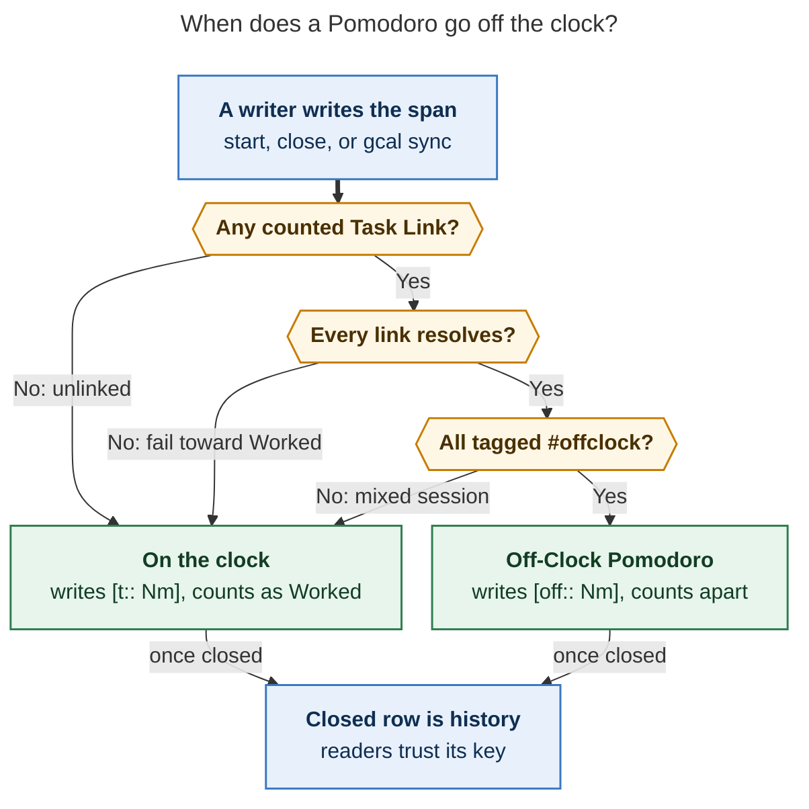

# Off-Clock Pomodoros: record the time, count it apart

Lead report · 2026-11-01 · merges five independent reports
([cdx](off_clock_pomodoro_stats__cdx.md), [cld](off_clock_pomodoro_stats__cld.md),
[grk](off_clock_pomodoro_stats__grk.md), [mus](off_clock_pomodoro_stats__mus.md),
[gem](off_clock_pomodoro_stats__gem.md)) with my own checks of bob-cli `ab32d58a`,
bob-plugins `1d66ffd`, bob-mac-capture, the `bob-cli-f6` bead and plan, memory, and the
live `~/bob` vault.

**Request.** `bob-cli-f6` makes a Google Calendar event tagged `#untracked` produce a
Pomodoro that every stat ignores. Bryan wants that time recorded as its own group
instead. His proposal has five parts:

- a `u::` field;
- a toggle in `bob stats` and the Stats dash (untracked only, or all time);
- a better name;
- a new glossary term;
- the rule "untracked iff all of its Task Links target `#untracked` tasks".

This report critiques that plan, designs the feature, and ends with a recommended
solution. It is a design proposal; I changed no product code and no memory.

---

## Bottom line

**Yes, build it, and build it now.** All five reports agree that dropping this time is a
mistake. The accepted decision anticipated this request; its "Reopens when" clause
reads: *"An untracked session needs to count as a Pomodoro."* The timing is also good.
f6 landed today, nothing has shipped since `v0.4.0` (Oct 27), and the plugin and Mac
phases of f6 are still open, so changing course is as cheap now as it will ever be.

I would ship it with six changes to the plan as written:

1. **Call it an Off-Clock Pomodoro.** The time is recorded now, so "untracked" is no
   longer true. "Tracked" also already means two other things in Bob. "Off the clock"
   is the phrase f6 itself uses, and its dashed visual style already means it.
2. **Use a positive ledger key, `[off:: Nm]`, as the exact counterpart of `[t:: Nm]`.**
   Adopt it to make intent explicit, not to keep the duration. The span already holds
   the duration: on all 1,232 closed rows in the vault, `[t::]` equals the span.
3. **Keep the "all links" rule, with four precise edges.** The session needs at least
   one counted link. Unresolved links fail toward Worked. The rule applies to the links
   the session actually keeps. Writers apply it when they write a span, and closed rows
   are frozen.
4. **Make the toggle one three-way stats clock owned by bob.** Its views are
   **Worked · Off-clock · Total**, selected with `bob stats -k/--clock`. bob relabels
   the metrics, so every surface switches together. Worked stays the default
   everywhere.
5. **Leave the glanceable work signals alone.** The Day strip, the menu bar, and
   `bob pomodoro --worked` still mean "how much did I work". Off-clock time gets a
   quiet dashed hint there, not a new fact.
6. **Make sure the off-clock group gets data.** An `#untracked` event that nobody starts
   never becomes a session. Today's only tagged event (19:00 groceries) is still parked
   under an unstarted `() — MEET`. Decide separately whether ended off-clock events
   settle into closed sessions on their own.

---

## 1. What is true today (verified)

| Fact | Evidence | Why it matters |
| --- | --- | --- |
| A timed row with `[t::]` (or the legacy ⏱) is tracked. A timed row with neither is "untracked". `()` is a placeholder. | `src/native/capture/pomodoro_adjust.rs:759-777` (`SessionTracking`) | This one-line classifier is the seam to change. |
| Before f6, readers counted a bare timed row by its span, with `Partial` quality. f6.1 retired that path. | f6 plan, "one page" and phase 1; `decisions:untracked-sessions-omit-t-field` ("retiring the span-estimate fallback") | Bare rows have meant two different things in two weeks. |
| Stats drops untracked rows (`if session.untracked { continue; }`). Session facts and homes report 0 minutes for them, but `range_minutes` is still indexed. | `stats/metrics.rs:215-218`, `stats/session_facts.rs:18-25`, `stats/index.rs:586-612`, `pomodoro_homes/session.rs` | The engine already has the minutes and throws them away. |
| **Vault (my scan):** 1,232 closed timed rows, all with `[t::]`, and `[t::]` equals the span in **every** row. There are 0 bare closed rows and no `[u::]` or `[off::]` fields anywhere. | `grep` + parser over `~/bob/20*/YYYYMMDD.md` | No migration is needed. "Keeping the duration" is not a real reason for a key. |
| **One `#untracked` Event Task already exists:** "Grocery Store w/ Abby", 1900-2000, `[root:: love]`, queued under `- [ ] () — MEET`. | `~/bob/2026/20261101.md:27,93-94` | f6 is live in the vault. If that MEET starts on current code, it will write a bare row tonight. |
| Bryan's original backlog task reads: *"Add support for #untracked event tag to specify that a pomodoro should NOT be created for that event!"* | `~/bob/bob.md:71` | His first instinct was no session at all. This request swings to counting the time, which raises the data-sparsity question (§6.2). |
| The f6 epic has phases .1–.5 and .7 CLOSED, and .6 (plugins) and .8 (Mac) IN_PROGRESS. bob-plugins has **no** f6 commits yet. | `sase bead read bob-cli-f6`; `git log` in bob-plugins | The plugin's writers have not been taught "untracked" yet, so re-scoping them is cheap. |
| The plugin writer `durationMetadata` **always** writes `[t:: Nm]` and keeps any other metadata as-is. | bob-plugins `020-time-and-pomodoro.js:543-556` | Until f6.6 lands, an Obsidian retime silently re-tracks a bare row. With a positive key, the same retime gives a *detectable* `[t::] [off::]` conflict instead. |
| 119 older daily notes have a Pomodoros heading that uses Dataview to sum `task.t`. | `## Pomodoros (= … sum(… task.t) …)` in the vault | Bryan has used Dataview sums over the key. `[off::]` allows `sum(rows.off)` in the same way. |
| The Mac app never classifies sessions. It decodes bob's `untracked_count` and flags, and only tokenizes the ledger headline for highlighting. | bob-mac-capture `CaptureAgendaModels.swift:91-114`, `CapturePomodoroLineTokens.swift:318` | A new key costs Swift almost nothing (check the highlighting only). |
| "Tracked" is already in use twice: `#task · tracked task` and the Stats `not_tracked` quality / "untracked points". | `docs/task-tag-marks.md:32`; f6 plan "naming collision guard" | This supports renaming the concept. |
| The dash header already has an **"All"** range chip (`7D 4W 3M 1Y All`). The dash fetches `stats show -a -f json`, cached by argv, and the Day strip shares the page's default cache entry. | `237-plugin-stats-models.js:7-13`; `236-plugin-stats-data.js:252-290` | The third view must not be called "All". The dash's clock choice must not leak into the strip's request. |
| `bob stats` uses the short flags `a b c f g h o r`, so `-k` and `-t` are free. The built-in `worked` has `direction: up`. | `stats/cli.rs:346-414`; `stats/registry.rs:458-470` | `-k/--clock` is available. Off-clock views need a *neutral* direction. |
| Pomodoro metrics have no clock or tracking parameter. Task metrics already use a three-way `recurring: exclude\|only\|include`. | `stats/registry.rs:38-52, 94` | There is precedent for a three-way filter. |

---

## 2. Critique: is this a good idea?

**Yes.** The f6 design keeps Worked clean but discards the record, which leaves three
real gaps:

- **Life-area time is invisible.** An off-clock Event Task already carries
  `[root:: love]` or `[root:: body]`, yet that root receives 0 minutes. Bryan cannot ask
  "how much time went to family this week?"
- **The day has holes where life happened.** That makes capacity planning and weekly
  review misleading.
- **The record and the totals disagree.** The ledger says lunch ran 1200–1300, but no
  total includes it.

Professional time trackers solve the same problem by recording every entry and flagging
some as non-billable. Toggl, Harvest, and Clockify all report billable, non-billable, or
both. Off-clock is the personal version of non-billable.

**What the plan gets wrong, or leaves unsaid:**

| Plan item | Problem | Fix |
| --- | --- | --- |
| "`u::` task property … so we still track the duration" | The duration already lives in the span (1,232/1,232 rows match). The key belongs on the **Pomodoro row**, not the task, because a session can link several tasks. | Adopt a row key for *explicit intent*, not for duration (§4). |
| "Untracked iff all task links are `#untracked`" | Taken literally it is **true for an unlinked session**, which would push every unlinked work session off the clock. A running MEET's lineup also still lists future events. And re-deriving the rule at read time would rewrite history whenever a tag changes. | Use four edges and stamp the result at write time (§5, Figure 1). |
| "Show just untracked time and all time" | A binary "include untracked" switch cannot express "untracked only". | One three-way clock (§6). |
| Name "untracked pomodoro" | Becomes false once the time is counted, and collides with two existing uses of "tracked". | Off-Clock Pomodoro (§3). |
| (unstated) | **Sparsity.** Off-clock events rarely get a `=` start and an `x` close, so the new group may stay nearly empty. | Decide separately whether ended off-clock events settle on their own (§6.2). |
| (unstated) | **Overlap.** f6 deliberately allows overlapping closed MEETs (one tracked, one not). "All time" can therefore exceed the time that actually passed. | Call the sum **Total**, define it as a sum of sessions, and report overlaps (§6.2). |

**What stays the same.** The accepted principle *"writers decide when they write a span;
readers only look at the row"* survives intact. So does the reviewer choice
`untracked_counts = exclude`: off-clock sessions still never enter Worked or Sessions.
This design adds a second clock; it does not loosen the first.

---

## 3. Where the reports disagreed, and how I resolved each

| Question | cdx | cld | grk | mus | gem | **Resolution** |
| --- | --- | --- | --- | --- | --- | --- |
| Name | Supplemental | Off-clock | Off-clock session | keep "untracked session"; off-clock in UI only | Off-Clock | **Off-Clock Pomodoro** |
| Tag | keep `#untracked` | `#offclock` + alias | keep | keep | keep | **`#offclock`, with `#untracked` as a permanent alias** (separable; §3.1) |
| Ledger | exclusive `[u::]` | exclusive `[off::]` | no key (bare span) | no key | bare span + optional `[u::]` | **Exclusive positive key `[off:: Nm]`** (§4) |
| Bare closed timed row | legacy estimate | Worked, `partial` | off-clock | off-clock | off-clock | **Off-clock by span**, flagged `unstamped`; writers never produce one again (§4) |
| When the rule runs | managed writes; frozen at close | writes + today's reconcile | span writes only | writer heuristic + lint | start/link/adjust | **Start, close, and gcal writes; retimes keep the key; closed rows frozen; drift reported** (§5) |
| Stats mechanism | new metric IDs + `--time` | request lens with relabel | `--clock` + `clocks` summary, refetch | `--time-scope`, compute both, no refetch | `tracking:` param + formula total | **Request lens + pinned `clock:` param + per-view totals in one `clock` object; refetch** (§6) |
| Third view's label | Recorded / All | Logged | All / Occupied | All | Combined / Total | **Total**: "All" is already a range chip, "Occupied" is false under overlap, and "Logged" brushes against *Work Log* |
| Day strip | stays regular | follows the lens | Worked + dashed hint | tracked only | — | **Worked + dashed hint** |
| Sequencing | readers before writers | re-scope f6.6/.8 now | follow-up after f6 | additive follow-up | 5 phases | **Amend now**: f6.6 has not committed, and it must rewrite these writers anyway |

### 3.1 Name and tag

**Off-Clock Pomodoro** wins on every test:

- It is *true* once the time is recorded: the time passes but stays off the work clock.
- It pairs with Worked as on the clock / off the clock.
- It avoids both "tracked" collisions.
- f6 already speaks this language. The plan's slogan is "on the calendar and off the
  clock", and dashed outlines plus the `timer-off` icon already mean off the clock on
  three surfaces.

The alternatives each fail a test:

- **Supplemental** (cdx) is accurate but abstract, and it hints at "extra, secondary".
- Keeping **untracked** (mus) would make a tile read "Untracked: 6h", which contradicts
  itself.
- **Personal** or **life** is wrong for a work lunch or a commute.

**Tag (recommended, separable).** Make `#offclock` the canonical tag. Accept `#untracked`
and `#off-clock` as permanent aliases, case-insensitive, in Google titles and
descriptions and on any task. Sync renders the canonical spelling. Then the whole rule
reads in one vocabulary: *"a Pomodoro is off-clock iff every counted Task Link targets
an `#offclock` task."*

The CLI rules forbid hard renames, so `#untracked` keeps working forever. The vault
holds exactly one tagged task today, so the rename costs almost nothing. **If Bryan
prefers to keep typing `#untracked`, the rest of the design is unchanged.** In that
case keep the key as `[u::]`, because matching the tag matters more than which letter
the key uses.

---

## 4. Ledger representation: one positive key per timed row

```markdown
## Pomodoros

- [x] (**1030-1055** [t:: 25m]) — BUILD          ← Worked 25m
	- 🍅 [[bob#^fix-sync]]
- [x] (**1200-1300** [off:: 60m]) — MEET         ← Off-clock 60m
	- 🍅 ~~[[#^lunch-with-kelly]]~~
- [ ] (**1900-2000** [off:: 60m]) — MEET         ← running off-clock (planned 60m)
	- [[#^grocery-store-w]]
```

| Row shape | Reads as | Worked | Off-clock | Health |
| --- | --- | --- | --- | --- |
| `(**S-E** [t:: Nm])` or legacy ⏱ | on the clock | N | — | — |
| `(**S-E** [off:: Nm])` | off the clock | — | N | — |
| `(**S-E**)` closed, no key | f6-era off-clock (keeps f6's accepted meaning) | — | span | `unstamped_sessions` |
| both keys | malformed (typically an old writer retiming a new row) | `t` (fail toward Worked) | — | `clock_conflicts` |
| `()` | placeholder | — | — | — |

**Why a key instead of a bare span.** grk and mus argued that the span already holds the
duration and that the f6 decision rejected changing the grammar. The first point is
correct and is the reason I reject Bryan's *rationale*. The key still wins on its own
merits:

1. **Intent is explicit.** A row is off the clock only because a writer said so. A
   deleted `[t::]` or a hand-typed span becomes a visible `unstamped` row instead of
   time that silently moves.
2. **Failures stay visible.** Today's plugin writer always appends `[t::]` (verified).
   On a bare row that silently re-tracks it. On an `[off::]` row it produces a conflict
   that health can see.
3. **The ledger explains itself, and Dataview can sum it.** `(**1200-1300** [off:: 60m])`
   needs no glossary, and `sum(rows.off)` works just as `sum(rows.t)` already does in
   119 of Bryan's notes.
4. **It matches Bryan's mental model.** f6 began from "which Pomodoros should receive a
   `t::`". His proposal extends that to "`t::` or `u::`".
5. **It is cheap.** The f6 rejection was about `#untracked` *on the Pomodoro line*.
   A Dataview field inside the parentheses is already kept as opaque metadata by every
   parser. Rust changes one function (`duration_field_value`), JS changes one regex
   (`DURATION_FIELD_RE`), and Swift does not classify at all.

**Why the bare row keeps f6's meaning** (and not cld's "Worked, `partial`"): f6 writers
are live. If tonight's grocery MEET is started before this lands, it will be written
bare, and flipping such rows to Worked would misfile them. Reading bare rows as
off-clock-by-span, with an `unstamped` health count, keeps f6-era rows correct. Any
managed write that touches such a row stamps it. No vault-wide migration is needed:
there are 0 such rows today, and at most a handful will appear before the fix.

**Writer rules.**

- Every timed row carries exactly one key. Retimes (`+N`, `\p`, `\o`, adjust, shift,
  split) keep the key and update the minutes.
- Switching class moves the **recorded number**, not a recomputed span.
  `set_ledger_tracking` must not re-derive minutes from the span (cdx).
- `t::` + `off::` is never written. A writer touching such a row drops both and writes
  exactly one key.

---

## 5. The classification rule



*Figure 1. A session goes off the clock only when it counts at least one Task Link and
every one of them resolves to an `#offclock` task. An unlinked, unresolved, or mixed
session stays Worked. Once the row closes, its key is history. (Rendered with
mermaid-cli 12.0.0 at 649 × 1048 px; fit 85.2%.)*

Formally, let **K** be the session's *counted* Task Links. A session is off-clock iff
K ≠ ∅, every link in K resolves to exactly one task, and every such task carries a
standalone `#offclock` (or alias) tag on its own line.

**Which links count in K.**

- *Counted:* dedicated Task Link bullets, whether plain, struck/done, or embedded
  (`docs/pomodoro-homes.md` R3 and the glossary `task-link`). A worked link that is also
  carried to a later session still counts for this one.
- *Not counted:* deferred `[[…]]#` bodies, mentions, LINKS relations, LINKED FROM
  entries, and Depends-On links.
- *Tag matching:* a nested tag such as `#offclock/foo` does not qualify, and neither
  does a tag inherited from a parent or an area. Generalize `line_has_untracked_tag`
  into one task-level helper; do not write a second scanner.

**When the rule runs.**

| Moment | Behavior |
| --- | --- |
| **Start** (capture `=`, link starts, swaps, Obsidian `se<X>`) | A MEET with an event run uses the run, as f6 already does. Future lineup events are queue, not participation. Any other session applies the rule to its lineup, which is new: an `#offclock` "Walk the dog" start writes `[off:: 25m]`. |
| **Link or unlink on an open row** | May refresh the key provisionally. Correctness does not depend on it, because open rows never count. |
| **Close** (capture `x…`, Obsidian Ctrl+Enter) | The final decision. Apply the rule to the links that remain *after* the by-the-clock classification moves deferred events out. Swap the key if the class changed and always update the minutes. |
| **`bob gcal sync`** | Writes `[off:: Nm]` wherever f6 omits `[t::]`. Past clusters still split by clock. |
| **After close** | Frozen. Later tag edits do not rewrite history. Drift is *reported*: sync's existing once-only `kept_untracked` message, plus a stats health `clock_drift` count. To fix a row, hand-swap the key; readers trust the row. |

**Consequences to accept deliberately.**

- **A mixed session is Worked in full.** If Bryan links a real task into lunch, all 60
  minutes count as work, and the close output says why ("on the clock: also links Fix
  the parser"). The `#offclock` task's home receives its share of *Worked* minutes. Do
  not split minutes per link; that would store a guess in the ledger.
- **Open rows follow the rule; closed rows follow the row.** That is the precise sense
  in which the requested "iff" holds. It is guaranteed at every managed write, not at
  every keystroke of a raw edit.

**Rejected:** re-deriving at read time (f6 rejected it, and every reader would need link
resolution), and cld's "reconcile re-clocks today's closed rows" (it fights hand
overrides, and "readers trust the row" would only become true after midnight). Shared
vectors in `tests/fixtures/pomodoro_clock/vectors.json` pin the rule for Rust and JS,
following the `meet_event_run` lockstep pattern.

---

## 6. Stats: a second clock, not a junk drawer

Off-clock is a **filter over sessions**, not a bucket. Lunch rooted at `love` should
group under `love` once you look at the off-clock time. Putting it in an "Untracked"
home would hide the very question this feature answers: *where did the off-clock time
go?*

### 6.1 Engine and `bob stats`

- **Pinned parameter.** Pomodoro metrics gain `clock: worked | off-clock | total`
  (default `worked`), mirroring `recurring:` on task metrics. Setting it pins the
  metric, for example `family_time: {kind: pomodoro, clock: off-clock, in: [love]}`.
- **Request lens.** `bob stats` and `bob stats show` gain `-k, --clock
  <worked|off-clock|total>` (default `worked`). The CLI values match the UI labels
  exactly, and the hidden aliases are `on`, `off`, `untracked`, and `all`. The lens
  re-aims every Pomodoro metric that does not pin `clock:`.
  - It does **not** touch task, checklist, or journal metrics.
  - It does **not** touch formula metrics or their inputs. A formula keeps its meaning
    whatever the UI shows, which settles cdx's "don't reinterpret Worked" concern.
  - gem's formula `total_time = worked + off_clock` is rejected, because formulas have
    no homes and "Where the time went" needs them (grk).
- **bob relabels, so no surface ever prints "Worked" for lunch:**

  | Metric | `worked` | `off-clock` | `total` |
  | --- | --- | --- | --- |
  | `worked` | Worked | Off-clock | Total |
  | `sessions` | Sessions | Off-clock sessions | Total sessions |
  | `review_time` / custom | *Label* | *Label* · off-clock | *Label* · total |
  | direction | as configured | **neutral** | **neutral** |

  More off-clock time is neither good nor bad, so trend marks stay neutral. They never
  show a celebratory ▲.
- **Human output.** With no off-clock time in the window, output is byte-identical to
  today. Otherwise the default view adds one dim line, `◌ 1h 30m off-clock ·
  bob stats -k off-clock`, so the feature can be discovered. Under `-k total` the
  headline breaks down as `8h · 6h 30m worked + 1h 30m off-clock`. CSV appends a `clock`
  column, and metric IDs stay stable.
- **JSON (schema 1, additive).**
  - A top-level `clock: {value, label, options: [{value, label, description, minutes,
    display}]}`. This combines cld's options with grk's compact totals, so one object
    draws the whole segmented control, including each view's total, with no extra
    fetch.
  - `parameters.clock` on each metric.
  - Under `total`, points and parts carry an `off_clock` sub-share, so clients draw the
    dashed part without doing arithmetic.
  - `sessions[]` carry real minutes plus `clock`, and the `worked` view omits off-clock
    rows. That ends the papercut of 0-minute lunches in drill-downs.
  - Health gains `off_clock_sessions`, `unstamped_sessions`, `clock_conflicts`,
    `clock_drift`, and `overlap_minutes`.
  - Keep emitting `untracked*` keys for one release, because closed f6.7 already decodes
    `untracked_count`.
- **History coverage (cdx).** Days before the feature existed have *unknown*, not zero,
  off-clock time. Use the existing `not_tracked` quality and a "Tracking since"
  adoption date for the off-clock and total series, so typical-day medians are not
  dragged to 0 by years without data.
- **Homes.** Off-clock sessions attribute **real minutes** with `off_clock: true`
  instead of 0 parts. The shared `pomodoro_homes` vectors change to match.

### 6.2 Two honesty traps

- **Overlap.** gcal can write a tracked and an untracked closed MEET over the same time
  (decision text: "two closed MEETs may overlap"). Total is therefore a **sum of
  sessions**, not elapsed time. Report `overlap_minutes` with a row drill-down. Never
  label Total as occupied time, free time, or a share of the day. Do not quietly
  subtract one class from the other, because that invents a precedence rule (cdx).
- **Sparsity: the off-clock group needs data.** Off-clock time is recorded only when a
  session exists. Two pieces of evidence point the same way: today's `#untracked` event
  sits unstarted under `() — MEET`, and Bryan first wanted no Pomodoro at all for such
  events. Without help, the Off-clock view will mostly show the lunches Bryan
  remembered to start.
  - f6 already writes **closed** MEETs straight from calendar spans when an event is
    first synced after it ended, so the precedent exists.
  - **Proposal (separate decision, Phase 5):** an `#offclock` Event Task that has ended
    while still queued under an unstarted placeholder settles into a closed
    `[off:: Nm]` MEET for its span. The span is trimmed so it never overlaps a closed
    on-clock session.
  - This partly supersedes "sync never starts or closes" in
    `synced-meetings-link-by-phase`, so it needs its own record.
  - The calendar is a fair clock for life context. It is not proof of attendance, and
    the record should say so.

### 6.3 The Stats dash

```text
STATS   7D  4W  3M  1Y  All   ‹ ›   ☐ vs prior   ⊞ Table
        [ ● Worked 6h 30m ][ ◌ Off-clock 1h 30m ][ ◐ Total 8h ]
```

- **Control.** A labelled radio group (segmented control) sits under the range chips,
  drawn entirely from `report.clock.options`. Each segment shows its own total, so the
  control explains itself and shows that off-clock time exists before anyone clicks.
  - The control is hidden when `clock` is absent, because an older bob gives an honest
    absence, not fake zeros.
  - Arrow keys and Space work as for any radio group, and one free key cycles the
    views.
  - The choice is remembered on this device **for the dash only**.
- **Fetching.** Choosing a view refetches with `-k`. The cache key is the argv, so
  switching back is instant, and the other two views can be prefetched when idle. Bars
  morph exactly as they do on a range change.
- **Off-clock view.** Tiles, focus chart, window bars, and "Where the time went" draw
  each root's **own hue as a dashed outline over a light tint**, so `love` stays love's
  color. The header adds "· off the clock". This is the payoff view:
  `love 12h · body 4h · job 1h` — finally an answer to "am I making time for the people
  and body I care about?"
- **Total view.** Each bar, lane segment, and root row is solid for Worked with a dashed
  tail for Off-clock, taken from bob's `off_clock` sub-shares. Hover and focus give
  exact values: `Thu 29 · 8h total · 6h 30m worked · 1h 30m off-clock`.
- **Copy and accessibility.**
  - Comparisons in the off-clock and total views are neutral ("45m more than the prior
    period").
  - Empty windows say "No off-clock time in this window", not a zero chart.
  - Aria sentences name the view.
  - Under `forced-colors` the dashes survive, because border style is not color.
  - Reduced motion turns off the morph.
  - The look follows f6's rule: *dashed means off the clock, everywhere*.

### 6.4 Surfaces that stay on Worked

| Surface | Behavior |
| --- | --- |
| **Day strip** | The WORKED fact and both lanes are unchanged, and the strip keeps the default request (it shares the page's default cache entry). When the day has off-clock time, a quiet dashed `◌ +1h off-clock` appears under WORKED; clicking it opens the dash in the Off-clock view with the day pinned. Rejected: following a device-wide lens (cld), because the strip would change meaning on every note, and a sixth fact (the strip already folds at narrow widths). |
| **Menu bar / `bob pomodoro --worked`** | Worked only, unchanged. |
| **Agenda `completed_summary`** | Its count and minutes stay Worked. An additive `off_clock: {count, minutes}` replaces `untracked_count` after one release. The Mac title line may add a dashed `◌ 1h` chip. |
| **Obsidian home chips** | Dashed, now **with minutes**; the tooltip reads `love · 60m off the clock`. |
| **Event rows and Mac capsules** | f6's dashed `timer-off` mark and capsule stay. The copy changes from "untracked" to "off-clock". |

---

## 7. Requirement adjustments (explicit)

1. **Rename** "untracked pomodoro" to **Off-Clock Pomodoro**. The recommended tag is
   `#offclock`, with `#untracked` (and `#off-clock`) as permanent aliases; the tag
   rename is separable.
2. **`u::` becomes `[off:: Nm]` on the Pomodoro row, not on the task.** It is mutually
   exclusive with `[t::]`, and its justification is explicit intent, not storing the
   duration. Keep `[u::]` only if the tag stays `#untracked`.
3. **"Iff all task links"** gains four edges: at least one counted link; unresolved
   links fail toward Worked; the rule applies to the links the session keeps (the event
   run at start, what remains after deferral at close); and it is stamped at writes,
   with closed rows frozen and drift reported.
4. **Mixed sessions count as Worked in full.** There is no per-link minute split.
5. **The toggle becomes a three-way clock**, **Worked · Off-clock · Total**, with Worked
   as the default and metric IDs unchanged. The third view is "Total", not "All",
   because "All" is already a range chip and Total is a sum of sessions.
6. **The Day strip, menu bar, `--worked`, and agenda minutes stay Worked**, with
   discreet off-clock hints.
7. **This reverses part of f6's accepted decision, deliberately.** Off-clock sessions
   now count on their own clock, and their homes attribute real minutes. A new decision
   record supersedes `untracked-sessions-omit-t-field`; `untracked_counts = exclude`
   still governs Worked.
8. **New, needing its own decision:** ended off-clock events settle into closed
   off-clock sessions (Phase 5). Without it the feature may have little data.

---

## 8. Glossary and decision drafts

These are drafts for the implementing plan. Memory edits need authorization through
`/sase_memory_write`, and decision records are immutable: write a new record and mark
the old one superseded.

**New strand `glossary:off-clock-pomodoro`** (aka off-clock session, untracked pomodoro,
untracked session)

> # Off-Clock Pomodoro
>
> A [[pomodoro]] whose time Bob records but keeps off the work clock. Its timespan
> carries `[off:: Nm]` where a Worked session carries `[t:: Nm]`:
> `- [x] (**1200-1300** [off:: 60m]) — MEET`. A session is off-clock exactly when it
> counts at least one [[task-link]] and every one resolves to a task tagged `#offclock`
> (alias `#untracked`); an unlinked session, an unresolved link, or a single on-clock
> link keeps the whole session Worked. Writers decide when they write the span —
> capture starts and closes, Obsidian gestures, `bob gcal sync` for an `#offclock`
> [[event-task]] — and once a row closes its key is history that readers trust; later
> tag edits are reported, never applied. Worked, Sessions, `bob pomodoro --worked`, and
> the [[day-strip]]'s facts leave it out; the **Off-clock** and **Total** clocks of
> `bob stats -k` and the [[stats-dash]] count it, attributed to [[root-parent]]s like
> any session. Drawn dashed everywhere. Not a `()` placeholder, a Stats day with no
> data (`not_tracked`), or the "tracked task" mark on a `#task` row.

**Strand updates.**

- `glossary:pomodoro`: "representing one work session" becomes "representing one timed
  session, on the clock (`[t::]`) or off it (`[off::]`)".
- `glossary:event-task`: "its `[root::]` attributes no minutes" becomes "its session is
  an Off-Clock Pomodoro, so its `[root::]` attributes off-clock minutes".

**Decision: "Off-Clock Pomodoros Are Recorded And Counted Apart"**
(`off-clock-pomodoros-count-apart`). It supersedes `untracked-sessions-omit-t-field` in
full and adds a note to `synced-meetings-link-by-phase`.

- *Claim:* a timed row with `[off:: Nm]` is an Off-Clock Pomodoro. Writers stamp it by
  the counted-links rule at start, close, and sync, and closed rows are frozen. Stats
  exclude it from Worked and count it under the off-clock and total clocks. A bare
  closed span reads as off-clock and is flagged `unstamped`.
- *Why:* it recovers recorded time and life-area attribution, makes intent explicit,
  and the old record's reopen trigger fired.
- *Rejected:*
  - absence as meaning;
  - read-time derivation;
  - per-link minute splits;
  - separate formula totals;
  - a lens-following Day strip.
- *Cost:*
  - Rust and JS learn one key and share one vector file;
  - mixed sessions count as Worked;
  - history is frozen at write time;
  - Total can double-count overlaps.
- *Reopens when:* per-task minute accounting is needed, or off-clock should come from
  an area property instead of a task tag.

---

## 9. Rollout

| Phase | Repo | Scope |
| --- | --- | --- |
| **P0 · semantics** | memory + bob-cli | Bryan confirms the name, tag, and key. Write the decision record and glossary, and pin `pomodoro_clock` vectors: unlinked, mixed, unresolved, deferred-at-close, a future lineup event, bare, and conflict cases. |
| **P1 · clock key** | bob-cli | Replace `SessionTracking` with `SessionClock {Worked{min}, OffClock{min}, Unstamped{span}, Conflict, Placeholder}`. Parse and write `[off::]` with the tag aliases. Apply the rule at start, close, and sync, and keep the key on retimes. Homes get real minutes, the agenda gets `off_clock`, and health gets the new counts. Update docs: vault-format, capture, gcal, pomodoro-homes. |
| **P2 · stats clock** | bob-cli | The `clock:` param, `-k/--clock`, the relabel and direction table, the JSON `clock` object and `off_clock` sub-shares, session facts, CSV, the coverage date, goldens (Worked unchanged; off-clock alone; total sums with sub-shares; `unstamped`), and `docs/stats.md` with the regenerated CLI reference. |
| **P3 · plugins** (re-scope **f6.6** before it lands) | bob-plugins | `DURATION_FIELD_RE` learns `t\|off`. Retimes keep the key, and Ctrl+Enter closes apply the copied vectors. Home chips become dashed with minutes, and the `#offclock` mark renders. Add the dash clock control and rendering, and the Day strip hint. |
| **P4 · Mac** (fold into **f6.8**) | bob-mac-capture | Decode `off_clock` with an `untracked` fallback. Copy changes to "off-clock", plus the optional `◌` chip. Compile per the repo's AGENTS.md. |
| **P5 · calendar settles off-clock** *(separate decision)* | bob-cli | Ended `#offclock` events still parked under an unstarted placeholder become closed `[off::]` MEETs, trimmed so they never overlap an on-clock session. |

**Lockstep.** An old plugin retiming an `[off::]` row would append `[t::]`. So P1 must
not *write* `[off::]` until the P3 writers are deployed with `bob plugins sync`. Ship
the P1 readers first: they read bare and `[off::]` rows alike, so either half can deploy
first without losing data. bob-cli still ships only on its daily release train.
New JSON keys need no `!`. Changes to the meaning of existing fields do: homes parts
moving from 0 to real minutes, and Worked-view `sessions[]` dropping off-clock rows.
Mark those commits with `!`, even though the f6 fields they change have not been
released yet.

---

## 10. Risks and open questions for Bryan

1. **Name and tag:** `Off-Clock` + `#offclock` + `[off::]` (recommended), or keep
   `#untracked` + `[u::]`?
2. **Phase 5:** should ended off-clock events settle on their own? I recommend yes, under
   its own record; without it the Off-clock view will be thin.
3. **Plan budget:** should Task Links to `#offclock` tasks be exempt from
   `plan.max_links`? A lunch is a commitment, not planned work (cld).
4. **Task metrics:** should completing an `#offclock` Event Task count in Done or
   Created? I suggest leaving that question for later.
5. **Mixed sessions** count fully as Worked. The close output must say why, or it will
   surprise.
6. **Relabel completeness:** goldens must assert every label under every view; one stray
   "Worked" over lunch minutes would undo the trust this design is meant to build.

---

## Recommended solution

Adopt the **Off-Clock Pomodoro**:

1. **Record:** every timed Pomodoro row carries exactly one key, `[t:: Nm]` (Worked) or
   `[off:: Nm]` (Off-clock). f6-era bare rows read as off-clock by span and are flagged
   `unstamped`. A row with both keys is a visible conflict.
2. **Classify at write time:** a session is off-clock iff it counts at least one Task
   Link and every one resolves to an `#offclock` task (`#untracked` is a permanent
   alias). Starts, closes, and gcal sync stamp it; retimes keep it; closed rows are
   history and drift is reported. Unlinked, unresolved, and mixed sessions stay Worked.
3. **Count on a second clock:** `bob stats -k worked|off-clock|total` and the dash's
   **Worked · Off-clock · Total** control, which shows each view's total. bob owns the
   values and relabels the metrics. Off-clock and total trends are neutral, homes
   attribute real minutes, and Total is honestly a sum that reports overlaps.
4. **Keep the work signal pure:** the Day strip, menu bar, `--worked`, and agenda
   minutes stay Worked, with a quiet dashed off-clock hint that opens the dash.
5. **Draw it one way:** dashed means off the clock, in the ledger, Event rows, home
   chips, the Mac band, and every Stats view.
6. **Ship now:** settle the semantics, then land the bob-cli phases, re-scoping f6.6
   and f6.8 before they land, so there is one vocabulary and one representation.
   Decide calendar settling next, so the new clock has time to show.

This keeps "Worked" meaning exactly what it means today. It also turns the hours that
f6 would have thrown away into the most human view in Bob's stats: where life went.

---

## Sources

- **Reports merged:** [cdx](off_clock_pomodoro_stats__cdx.md) (Supplemental, `[u::]`,
  overlap and coverage traps, JSON-compat discipline);
  [cld](off_clock_pomodoro_stats__cld.md) (off-clock name, `[off::]`, the relabeling
  lens, sparsity and Phase 5); [grk](off_clock_pomodoro_stats__grk.md) (a clock rather
  than a bucket, compact totals, Day strip hint, write rule);
  [mus](off_clock_pomodoro_stats__mus.md) (default stays byte-identical, keep the
  vocabulary guard, no two-boolean flags); [gem](off_clock_pomodoro_stats__gem.md)
  (stacked bars, mixed-session home shares, life-area payoff).
- **Lead verification (2026-11-01):**
  - **bob-cli `ab32d58a`:** `src/native/capture/pomodoro_adjust.rs:750-810`,
    `src/native/stats/{cli.rs:346-414, registry.rs:36-56,455-635}`, commit `6d39305a`
    (f6.1), and `git tag`/`ls-remote` (latest `v0.4.0`, 2026-10-27, 194 commits since).
  - **bob-plugins `1d66ffd`:** `020-time-and-pomodoro.js:530-556`,
    `010-load-and-constants.js:273`, `142-pomodoro-home-chips.js:274-290`,
    `236-plugin-stats-data.js:252-300`, `237-plugin-stats-models.js:7-13`, and
    `git log` (no f6.6 commits).
  - **bob-mac-capture:** `CaptureAgendaModels.swift:91-114`,
    `CapturePomodoroLineTokens.swift:318`.
  - **Memory:** `sase bead read bob-cli-f6`; `plan:202611/untracked_calendar_events.md`;
    `decisions:untracked-sessions-omit-t-field`; glossary `pomodoro`, `task-link`,
    `event-task`, `stats-dash`, `day-strip`, `work-log`.
  - **Vault scans of `~/bob`:** 1,232 closed timed rows (all `[t::]` = span, 0 bare,
    0 `[u::]`/`[off::]`); `#untracked` occurrences (`bob.md:71`,
    `2026/20261101.md:27`); Event Task linkage for 2026-10-30 to 11-01; heading
    frequencies including 119 Dataview `sum(task.t)` headings.
  - **Docs:** `docs/task-tag-marks.md:28-36`.
- **External precedent:** billable/non-billable reporting in Toggl Track, Harvest, and
  Clockify. This is a structural analogy cited by cdx and cld, not a re-verified product
  claim.
