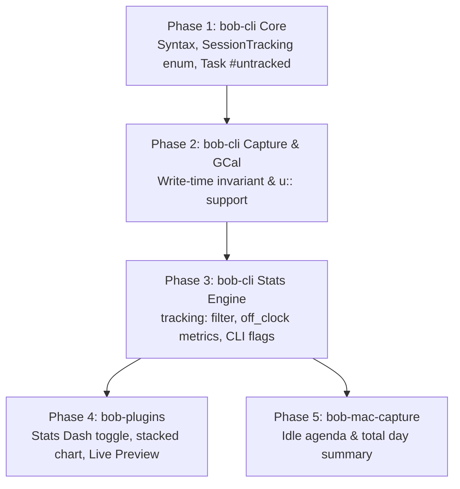

# Off-Clock Pomodoros and Untracked Time Tracking: Architectural Analysis, Critique, and System Design

**Researcher:** `research.2z.gem` (Gemini 3.8 Flash)  
**Date:** 2026-11-01  
**Project:** `bob-cli` / `bob-plugins` / `bob-mac-capture`  
**Artifact ID / Target Path:** `sase/repos/research/202611/off_clock_pomodoros_and_untracked_stats__gem.md`  
**Context:** Bead `bob-cli-f6` (Untracked calendar events), Decision `untracked-sessions-omit-t-field`, Decision `synced-meetings-link-by-phase`.

---

## 1. Executive Summary & Core Verdict

The proposal to track pomodoros linked to `#untracked` tasks as a separate, distinct dimension of time—rather than discarding them entirely from time accounting—is **a major conceptual improvement**. 

In the initial implementation under epic `bob-cli-f6` (guided by Decision `untracked-sessions-omit-t-field`), untracked sessions (such as lunch, gym, school pickups, or doctor visits) were placed "on the ledger, off the clock." While this prevented non-work calendar events from inflating Bryan's work metrics (`Worked`, velocity, deep work streaks), it created an artificial information vacuum: 2 to 4 hours of daily commitments vanished from all aggregations, reports, and root parent distributions. Bryan could not see total accounted waking hours, nor could he analyze time spent on vital life areas (`[root:: love]`, `[root:: body]`, `[root:: family]`).

However, the user's specific proposal contains several design tensions that require thoughtful refinement:
1. **The Naming Paradox:** Calling something an *"untracked pomodoro"* once it has an explicit duration property, is indexed by the stats engine, aggregates into metrics, renders in charts, and provides UI toggles is an oxymoron. We propose adopting the term **Off-Clock Pomodoro** (or **Off-Clock Session**), preserving `#untracked` as the task/input tag. This formalizes the distinction between *On-Clock (Work/Focus)* and *Off-Clock (Life/Calendar/Auxiliary)* time.
2. **The `u::` Property vs. Bare Spans:** Introducing `[u:: Nm]` as the untracked counterpart to `[t:: Nm]` is grammatically valid in Dataview and provides a clean separation for naive readers. However, making `[u:: Nm]` strictly required introduces unnecessary ledger clutter and redundancy with timespans (`**1200-1300**`). We recommend a **hybrid representation**: Bob tooling writes `[u:: Nm]` when explicit duration is needed or recorded, but all readers gracefully treat bare timed spans `(**1200-1300**)` lacking duration fields as off-clock sessions defaulting to their span length (`range_minutes`).
3. **The Link Invariant ("iff all links have `#untracked`"):** In formal logic, an empty set of links is vacuously true (`all([]) == true`), which would erroneously classify unlinked work pomodoros as untracked. Furthermore, resolving links across files at read time violates Bob's proven architectural principle: *"Writers decide trackedness when they write a span; readers only look at the row."* We refine this invariant into an **authoring-time contract enforced by writers** (`bob capture`, `bob gcal sync`, Obsidian plugin gestures): when a pomodoro has links, it is written with `[u::]` (or bare span) if and only if all linked tasks carry `#untracked`; if any linked task is tracked, the session is promoted to on-clock (`[t::]`). Unlinked sessions remain governed by explicit row syntax.
4. **Visual & Dashboard Integration:** In `dash_stats.md` and CLI `bob stats`, we recommend a 3-way lens: **Work (default)**, **Off-Clock**, and **All (Combined)**. On the Stats Dash focus chart, "All" should render as an elegant **stacked bar chart** (solid base for Work, dashed-outline translucent cap for Off-Clock), perfectly honoring Bob's cross-surface design system rule: *"Dashed means off the clock, everywhere."*

---

## 2. Critique of the Proposed Plan

### 2.1 Why Tracking Off-Clock Time Is a Good Idea

In personal knowledge and task management systems, time tracking generally suffers from an "all-or-nothing" dichotomy: either an activity is tracked as "productive work" or it is completely ignored. 

In Bob, Pomodoros are the fundamental unit of temporal accounting. Prior to `bob-cli-f6`, all timed Pomodoros were assumed to be tracked work sessions. Epic `bob-cli-f6` introduced `#untracked` Google Calendar events and stripped `[t::]` from their corresponding Pomodoro rows (`(**1200-1300**) — MEET`). This solved the problem of work stat pollution, but introduced three significant shortcomings:
1. **Blind Spots in Life Area Balance:** A key architectural strength of Bob is root parent attribution (`[root:: NOTE]`). Bryan attributes calendar events to areas such as `body` (dentist, gym), `love` (lunch with partner, date night), `family` (toddler class), or `admin` (car repair). Under the `bob-cli-f6` model, these sessions attributed 0 minutes. As a result, `dash_stats` could not show how much time Bryan devoted to health, relationships, or home life.
2. **Loss of Day Completeness:** Looking at a daily summary that shows "3h 15m Worked" on a day where Bryan had 3 hours of personal commitments leaves him wondering where the rest of his day went. Tracking off-clock time restores a complete picture of the day without distorting productivity metrics.
3. **Reopening Decision `untracked-sessions-omit-t-field`:** The decision record explicitly anticipated this moment:
   > *"Reopens when. An untracked session needs to count as a Pomodoro, or `[t:: 0m]` should mean something other than a bug."*
   The user's request is the exact catalyst identified when that decision was accepted.

### 2.2 Critique of the Proposed Mechanisms

#### A. Nomenclature: "Untracked Pomodoro" vs. "Off-Clock Pomodoro"
The user notes: *(which should maybe be named something else, since the time will technically still be tracked after this change?)*.

This observation is spot-on. If an entity has a duration property (`u:: 60m`), is parsed into an index, has metrics calculated for it, is displayed on dashboards, and is reported in weekly summaries, it is **tracked**. Continuing to call the *session* "untracked" leads to confusing UX copy:
- *"Total Untracked Time: 2h 15m"* (Wait, if it's untracked, how do you know it was 2h 15m?)
- *"Showing stats for untracked pomodoros"* (Self-contradictory).

**The Solution:**
- Keep `#untracked` as the **tag on tasks and calendar events**. Users are already accustomed to tagging `#untracked` in Google Calendar and Obsidian tasks. It means: *"Keep this task off my work productivity clock."*
- Name the session concept **Off-Clock Pomodoro** (or **Off-Clock Session**).
- Contrast it directly with **On-Clock Pomodoro** (or **Tracked Pomodoro** / **Work Pomodoro**).
- This aligns directly with Bob's established mantra: *"On the ledger, off the clock."*

#### B. The Duration Property: `[u:: Nm]` vs. Alternatives
The user suggests: *using the `u::` task property for untracked pomodoro (this way we still track the duration of each pomodoro somehow).*

Let us compare four syntax choices for ledger rows:

| Syntax Option | Example | Pros | Cons | Verdict |
| :--- | :--- | :--- | :--- | :--- |
| **Option 1: Strict `u::`** | `- [x] (**1200-1300** [u:: 60m]) — MEET` | Explicit; distinct Dataview key `u` vs `t`; legacy tools ignoring `u` see 0 tracked minutes. | Redundant when duration equals span; adds ledger noise; invalidates clean `(**1200-1300**)` syntax just introduced. | Acceptable, but too rigid alone. |
| **Option 2: Bare Span (Span Inference)** | `- [x] (**1200-1300**) — MEET` | Beautifully minimal; zero new syntax; 100% backward compatible with `bob-cli-f6`. | Cannot represent sessions where duration differs from span (e.g. 45m spent during 60m slot). | Elegant, but lacks duration override capability. |
| **Option 3: `[t:: Nm]` with tag** | `- [x] (**1200-1300** [t:: 60m] #untracked) — MEET` | Reuses existing `t::` field. | Breaks third-party / Dataview queries summing `t`; violates Decision `untracked-sessions-omit-t-field`. | **Rejected**. |
| **Option 4: Hybrid (Recommended)** | `(**1200-1300**)` by default, `(**1200-1300 [u:: 45m]**)` when overridden | Cleanest visual ledger; full backward compatibility; explicit override when duration != span. | Parsers must check for `u::` first, then fall back to span duration. | **Recommended Solution**. |

**Evaluation of `[u:: Nm]`:**
Using `u::` is an excellent Dataview-compliant choice because Dataview indexes `[key:: value]` as page/task metadata. In Dataview queries, `item.t` remains purely work minutes, while `item.u` holds off-clock minutes. A simple Dataview expression `sum(rows.t)` will never accidentally count `u`. 

However, forcing `[u:: 60m]` on every single calendar event clutters the daily file unnecessarily. Therefore, we recommend:
- `[t:: Nm]` -> **On-Clock (Work)** session with duration `Nm`.
- `[u:: Nm]` -> **Off-Clock (Auxiliary)** session with explicit duration `Nm`.
- `(**HHMM-HHMM**)` (neither `t::` nor `u::`) -> **Off-Clock (Auxiliary)** session with implicit duration = span minutes (`range_minutes`).

#### C. The Link Invariant: "iff all task links have `#untracked`"
The user requests: *A pomodoro should be untracked iff all of its task links correspond with tasks that have the `#untracked` tag.*

We must carefully examine the logical and architectural edge cases of this statement:

1. **The Empty Set (Unlinked Sessions):**
   In formal logic, $\forall x \in \emptyset : P(x)$ is vacuously true. If Bob evaluated "all task links have `#untracked`" on an unlinked Pomodoro (`- [ ] (**0900-0930 [t:: 30m]**) — BOB`), it would evaluate to true! That would break all unlinked deep work sessions.
   *Adjustment:* An unlinked Pomodoro is governed strictly by its authored row syntax (`[t::]` is on-clock; `[u::]` or bare span is off-clock).
2. **Mixed Task Links (Tracked + Untracked):**
   Suppose a Pomodoro links two tasks:
   - `- [ ] #task Discuss Q4 roadmap` (Tracked)
   - `- [ ] #task Team lunch #untracked` (Untracked)
   Because not *all* links are `#untracked`, the Pomodoro must be **On-Clock (Tracked)**. If any portion of the session involves work that belongs on the clock, the session is tracked. 
   *Question:* How should minutes be apportioned? In `pomodoro_homes`, minutes are split among task links. Should the `#untracked` task receive tracked minutes? 
   *Recommendation:* In a mixed session, the session is on-clock. The `#untracked` task's home receives its apportioned share of *on-clock* minutes, because the user explicitly chose to combine work and lunch into a tracked work session.
3. **Write-Time Invariant vs. Read-Time Derivation:**
   In Decision `untracked-sessions-omit-t-field`, Bob rejected deriving trackedness at read time because:
   - It requires resolving wikilinks across arbitrary files on every single parse.
   - If an external note is deleted, renamed, or unindexed, the session's trackedness changes or becomes undefined.
   - It prevents manual overrides on the ledger row.
   *Adjustment:* The invariant must be **maintained at write time by authoring tools**:
   - When `bob capture` starts, links, or adjusts a session, or when `bob gcal sync` writes an event run, it inspects the linked tasks:
     - If all linked tasks carry `#untracked`, it writes `[u::]` (or bare span).
     - If any linked task lacks `#untracked`, it writes `[t::]`.
   - Readers remain fast and local: they read the Pomodoro line (`[t::]`, `[u::]`, or bare span) without needing to resolve external block links.

---

## 3. Architecture & Data Model

### 3.1 Ledger Syntax Specification

Under the recommended design, column-0 items in `## Pomodoros` are parsed as follows:

```markdown
## Pomodoros

- [x] (**0900-1000** [t:: 60m]) — DEEP WORK
  - 🍅 [[#^task-feature-auth]]
  - 🍅 [[#^task-feature-tests]]
  ← On-Clock (Tracked): 60m work time.

- [x] (**1200-1300**) — MEET
  - 🍅 [[#^lunch-with-kelly]]
  ← Off-Clock (Untracked): 60m off-clock time (inferred from span).

- [x] (**1500-1600** [u:: 45m]) — ERRANDS
  - 🍅 [[#^groceries]]
  ← Off-Clock (Untracked): 45m off-clock time (explicit override).

- [x] (**1700-1730** [t:: 30m]) — CHORES
  - 🍅 [[#^water-plants]]
  - 🍅 [[#^check-mail]]
  ← On-Clock (Tracked): Even though these are chores, neither has #untracked, so it's on-clock.
```

### 3.2 Parser State Machine (`SessionTracking`)

In `src/native/capture/pomodoro_adjust.rs` (and mirrored in `bob-plugins` and `bob-mac-capture`), the `SessionTracking` enum and parser should be updated:

```rust
#[derive(Debug, Clone, Copy, PartialEq, Eq)]
pub(crate) enum SessionTracking {
    /// On-clock work session with recorded minutes from [t:: Nm] or stopwatch.
    Tracked { minutes: u64 },
    /// Off-clock session with explicit [u:: Nm] duration override.
    OffClockExplicit { minutes: u64 },
    /// Off-clock session with duration inferred from the timespan.
    OffClockSpan,
    /// Un-timed placeholder: `()`.
    Placeholder,
}
```

The parsing precedence for a timed row `(**HHMM-HHMM ...**)` is:
1. Does it contain `[t:: <duration>]` or the legacy stopwatch? -> `SessionTracking::Tracked { minutes }`.
2. Does it contain `[u:: <duration>]`? -> `SessionTracking::OffClockExplicit { minutes }`.
3. Does it have a valid `HHMM-HHMM` span? -> `SessionTracking::OffClockSpan` (duration computed via `range_minutes`).
4. Otherwise -> Range-less row / `Placeholder`.

### 3.3 Generalizing `#untracked` to All Task Kinds

Currently, `#untracked` is recognized primarily on Event Tasks in `## Events`. 
To satisfy the user's requirement (*"A pomodoro should be untracked iff all of its task links correspond with tasks that have the `#untracked` tag"*), `#untracked` must become a general-purpose task tag across the vault.

- **On Any Task:**
  `- [ ] #task Pick up dry cleaning #untracked [root:: errands]`
  `- [ ] #task Water the vegetable garden #untracked [root:: home]`
  `- [ ] #task Read sci-fi novel #untracked [root:: leisure]`
- **Task Parsing:**
  In `src/native/stats/index.rs`, `IndexedTask` already indexes `tags: Vec<String>`. A helper method:
  ```rust
  impl IndexedTask {
      pub(crate) fn is_untracked(&self) -> bool {
          self.tags.iter().any(|t| {
              t.eq_ignore_ascii_case("untracked") || t.eq_ignore_ascii_case("#untracked")
          })
      }
  }
  ```
- **Live Preview Mark:**
  In `bob-plugins`, when any `#task` carries `#untracked`, it renders with the quiet, dashed-outline `#untracked` badge, visually signaling that working on this task will not count toward work pomodoros.

### 3.4 Home Attribution & Root Parent Apportionment

In `src/native/pomodoro_homes/session.rs`, off-clock sessions should no longer assign `0` minutes to their home parts. Instead:
- If a session is on-clock (`Tracked`), its minutes are attributed to its task homes as `on_clock` minutes.
- If a session is off-clock (`OffClockExplicit` or `OffClockSpan`), its minutes are attributed to its task homes as `off_clock` minutes.
- This allows the home engine to calculate both:
  - `work_minutes` per root parent / area.
  - `off_clock_minutes` per root parent / area.

---

## 4. Metrics Engine & CLI Design (`bob stats`)

### 4.1 Metric Spec Enhancement: The `tracking:` Filter

In Bob's metric configuration (`~/.config/bob/config.yml` and `src/native/stats/metrics.rs`), the `pomodoro` metric kind should gain an optional `tracking:` property:

```yaml
# config.yml
metrics:
  worked:
    kind: pomodoro
    measure: minutes
    tracking: tracked      # default: only on-clock sessions
    label: Worked

  off_clock:
    kind: pomodoro
    measure: minutes
    tracking: untracked    # only off-clock sessions
    label: Off-clock
    color: violet

  total_time:
    kind: pomodoro
    measure: minutes
    tracking: all          # on-clock + off-clock combined
    label: Total time
    color: blue
```

Valid values for `tracking`:
- `tracked` (default): Evaluates only sessions where `SessionTracking::Tracked`.
- `untracked`: Evaluates sessions where `SessionTracking::OffClockExplicit` or `SessionTracking::OffClockSpan`.
- `all`: Evaluates all closed timed sessions regardless of tracking status.

### 4.2 Built-in Metrics Catalog Updates

The built-in metric registry (`src/native/stats/registry.rs`) should introduce:
1. `worked`: (Unchanged) `kind: pomodoro, measure: minutes, tracking: tracked`.
2. `off_clock`: `kind: pomodoro, measure: minutes, tracking: untracked, label: "Off-clock", unit: minutes`.
3. `total_time`: `kind: formula, formula: "worked + off_clock", label: "Total time", unit: minutes`.
4. `off_clock_sessions`: `kind: pomodoro, measure: count, tracking: untracked, label: "Off-clock sessions", unit: count`.

### 4.3 CLI Flags and Ergonomics

To support quick toggling on the CLI:

```bash
# Default overview: shows Worked, Reviewed, Done, etc. (On-clock focus time)
bob stats

# Overview switched to show Off-Clock time
bob stats -T untracked
# (or)
bob stats --tracking untracked

# Overview switched to show Combined (All) time
bob stats -T all
# (or)
bob stats --with-untracked

# Detail view of off-clock time over the last 4 weeks
bob stats show off_clock -r 4w -c

# Detail view of total combined time
bob stats show total_time -r 7d
```

#### CLI Flag Definitions:
- `-T, --tracking <MODE>`: Selects tracking mode filter for Pomodoro metrics in the view. Choices: `tracked` (default), `untracked`, `all`.
- `--with-untracked`: Alias for `-T all`.
- `--untracked-only`: Alias for `-T untracked`.

### 4.4 JSON Schema Evolution (`StatsReport`)

The JSON contract emitted by `bob stats -f json` remains backward-compatible while exposing the new capabilities:

```json
{
  "ok": true,
  "schema_version": 2,
  "tracking_mode": "tracked",
  "metrics": [
    {
      "id": "worked",
      "label": "Worked",
      "unit": "minutes",
      "tracking": "tracked",
      "summary": { "headline": { "value": 220, "display": "3h 40m" } }
    },
    {
      "id": "off_clock",
      "label": "Off-clock",
      "unit": "minutes",
      "tracking": "untracked",
      "summary": { "headline": { "value": 105, "display": "1h 45m" } }
    }
  ],
  "sessions": [
    {
      "date": "2026-11-01",
      "time_range": "1200-1300",
      "minutes": 60,
      "minutes_display": "1h",
      "tracking": "untracked",
      "property": "span",
      "name": "MEET",
      "homes": {
        "untracked": true,
        "parts": [{ "label": "love", "share": 100, "minutes": 60 }]
      }
    }
  ],
  "health": {
    "homes": {
      "untracked_sessions": 2,
      "untracked_minutes": 105
    }
  }
}
```

---

## 5. UI & UX Design: Stats Dash & Obsidian Integration

The user asked to make this feature **intuitive, reliable, and beautiful**. Here is the design for `dash_stats.md` in Obsidian and Bob Mac Capture.

### 5.1 Obsidian Stats Dash (`dash_stats.md`)

#### A. Header Controls: The Tracking Segmented Pill
In the `bob-stats-header`, next to the range chips (`7d`, `4w`, `all`), add a segmented control:

```
╭─────────────────────────────────────────────────────────────────────────────╮
│ Stats    [ 7d ] [ 4w ] [ 1y ] [ Custom… ]  ‹ ›  ☐ vs prior   [ ⊞ Table ]     │
│          ─────────────────────────────────────────                          │
│          Mode: [ ● Work ] [ ╌ Off-clock ] [ ◒ Combined ]                    │
╰─────────────────────────────────────────────────────────────────────────────╯
```

- **Keyboard Focus & Access:** Arrow keys cycle modes; focus key `tracking-mode`.
- **State Persistence:** Stored in session view state `statsViewStateFor(sourcePath).trackingMode`.

#### B. The Focus Chart: Stacked Bar Visualization
When the user selects **Combined (All)** mode and focuses on the time metric:
- Each daily bar becomes a **stacked bar**:
  - **Lower Bar (Solid):** Work / On-Clock time, colored with the primary metric hue (e.g., orange or blue).
  - **Upper Bar (Dashed Cap):** Off-clock time, rendered with a translucent tint and a **dashed border** (`stroke-dasharray: 3 3`).
- **Visual Meaning:** Immediately communicates that the day had $X$ hours of focused work plus $Y$ hours of scheduled off-clock life commitments, reaching total accounted time.
- **Tooltip Interaction:** Hovering over the bar shows:
  ```
  Thu Oct 29 · 5h 45m total
  ● Work: 3h 45m (65%)
  ╌ Off-clock: 2h 00m (35%) · Lunch (60m), Dentist (30m), Gym (30m)
  ```

```
Focus Chart (Combined Mode):

 6h ┤             ┌╌╌╌╌╌┐
    │             ┆ 2h  ┆  ← Off-clock (dashed outline, translucent)
 4h ┤   ┌╌╌╌╌╌┐   ├─────┤
    │   ┆ 1h  ┆   │     │
 2h ┤   ├─────┤   │ 4h  │  ← Work (solid fill)
    │   │ 3h  │   │     │
  0 ┴───┴─────┴───┴─────┴────
         Mon       Tue
```

#### C. "Where the Time Went" Panel: Life Area Breakdown
When the tracking mode is toggled to **Off-clock**:
- The context panel switches to displaying the off-clock root parents:
  - `love`: 1h 15m (Lunch with Kelly, Coffee)
  - `body`: 45m (Gym workout)
  - `admin`: 30m (Dentist appointment)
  - `family`: 30m (School run)
- Bryan can finally answer: *"Am I dedicating enough time to health and family outside of work?"*
- Clicking on any root row expands the contributing sessions, exactly like the work panel, linking directly to the line in that day's daily note.

### 5.2 Cross-Surface Visual Harmony

Bob's core aesthetic rule from `bob-cli-f6` is:
> *"Dashed means off the clock, everywhere: the Obsidian Event time pill and `#untracked` mark, the Obsidian home chip of an untracked session, and the Mac band's untracked rows and rail capsules all use a dashed outline. One visual word, three surfaces."*

Our design strictly reinforces this rule:
1. **In Daily Note Ledger:** Off-clock session home chips render with a dashed outline.
2. **In Event Tasks:** `#untracked` badge renders as a dashed capsule.
3. **In Stats Dash:** 
   - Off-clock sparklines are drawn with dashed SVG strokes.
   - Off-clock chart bars have dashed borders.
   - The segmented control displays `╌ Off-clock`.
4. **In Mac Capture Day Rail:** Off-clock event capsules keep their dashed outline.

---

## 6. SASE Glossary Term Specification

Below is the proposed memory strand to be added to `sase/memory/glossary/off-clock-pomodoro.md` via `/sase_memory_write`.

```markdown
---
name: Off-Clock Pomodoro
description: A Pomodoro ledger session attributed outside core focus/work accounting.
aliases:
  - "off-clock pomodoro"
  - "untracked pomodoro"
  - "off-clock session"
  - "untracked session"
  - "auxiliary pomodoro"
---

# Off-Clock Pomodoro

An **Off-Clock Pomodoro** (historically called an *untracked pomodoro*) is a column-0
Pomodoro checkbox item under `## Pomodoros` in a canonical daily note whose time is
attributed outside core focus/work productivity accounting ("on the ledger, off the
clock").

### Syntax and Duration

1. **Implicit Span Duration (Default):** A timed Pomodoro row with neither `[t::]`
   nor `[u::]`:
   `- [x] (**1200-1300**) — MEET`
   Its duration is inferred from the timespan (60 minutes).
2. **Explicit Duration Override:** A timed Pomodoro row with an inline `[u:: Nm]`
   property:
   `- [x] (**1200-1300** [u:: 45m]) — MEET`
   Records an exact off-clock duration of 45 minutes.

An on-clock (tracked work) Pomodoro always carries `[t:: Nm]` or the legacy stopwatch.

### Derivation and Task Link Invariant

A Pomodoro with child task links is classified as an Off-Clock Pomodoro if and only
if **all** of its linked tasks carry the `#untracked` tag (or it has an explicit `[u::]`
property). 

If any linked task does not carry `#untracked` (i.e. is an on-clock task), the
session is an on-clock session and Bob's authoring tools write `[t:: Nm]`.

Unlinked sessions (0 task links) are governed by the row's explicit duration syntax:
`[t::]` is on-clock; `[u::]` or a bare timespan is off-clock.

### Stats and Attribution

Off-clock sessions do not contribute to core work metrics (`Worked`, focus streaks,
pomodoro velocity). Instead, they feed the separate `off_clock` and `total_time`
metric families in `bob stats` and the `dash_stats.md` dashboard. 

Their duration is apportioned to their linked tasks' root parents (`[root:: NOTE]`),
enabling visibility into time spent across personal and life areas (`body`, `love`,
`family`, `admin`).

### Visual Contract

Across all Bob surfaces (Obsidian Live Preview, reading view, Stats Dash, and Bob
Mac Capture), off-clock sessions, event capsules, and chips are styled with a
**dashed outline** (`border: 1px dashed` / `stroke-dasharray: 3 3`).
```

---

## 7. Decision Record Proposal

To formally accept this policy change across repositories, a new decision record should be created under `sase/memory/decisions/off-clock-pomodoros-track-separately.md`, updating and superseding the relevant portions of `decisions:untracked-sessions-omit-t-field`.

### Draft Record

```markdown
# Off-Clock Pomodoros Track Separately

**Applies to.** `bob-cli`, `bob-plugins`, `bob-mac-capture`, and the vault.

**Claim.** A timed ledger row with `[t:: Nm]` is an **on-clock (work) session**; a timed
row with `[u:: Nm]` or a bare span without either is an **off-clock session** ("on the
ledger, off the work clock"). Off-clock sessions are excluded from core `Worked` minutes
and work velocity, but are tracked and aggregated under a separate `off_clock` metric
family and apportioned to their linked tasks' `[root::]` parents. A session with task
links is off-clock if and only if all linked tasks carry `#untracked`. CLI `bob stats`
and Obsidian `dash_stats.md` provide a 3-way lens (`tracked`, `untracked`, `all`) to view
work time, off-clock time, or combined total time.

**Why.** Decision `untracked-sessions-omit-t-field` completely erased untracked sessions
from stats to prevent calendar lunch/dentist appointments from polluting focus work
numbers. However, this created a blind spot: 2–4 daily hours vanished, and area balance
for personal roots (`love`, `body`, `family`) was lost. Allowing off-clock time to be
tracked in a dedicated category preserves the purity of work metrics while giving a
complete, truthful accounting of the full day.

**Supersedes in part.** `decisions:untracked-sessions-omit-t-field`.

**Rejected alternatives.**
- *Lumping untracked sessions into `Worked`.* Destroys focus metrics and historical
  comparability.
- *Strictly requiring `[u:: Nm]` on all untracked rows.* Unnecessary noise; bare spans
  `(**1200-1300**)` already represent 60m cleanly.
- *Deriving trackedness from links dynamically at read time.* Unstable, slow, and
  violates the principle that writers decide trackedness and readers only inspect the
  row.

**Cost.** Adds `off_clock` metric family and CLI flags; updates stats JSON schema;
requires stacked-bar logic in `bob-ledger-tools`.

**Reopens when.** The distinction between work focus time and personal calendar time is
abandoned.
```

---

## 8. Implementation Roadmap & Phasing Plan

To implement this design cleanly across the three repositories without breaking CI or existing workflows, we recommend the following 5 phases:



### Phase 1: `bob-cli` Core Parser and Model
- Update `src/native/capture/pomodoro_adjust.rs`:
  - Enhance `SessionTracking` to recognize `Tracked { minutes }`, `OffClockExplicit { minutes }`, and `OffClockSpan`.
  - Add `[u:: Nm]` extraction in `duration_field_value` or a dedicated `off_clock_field_value`.
  - Ensure `set_ledger_tracking(ledger, tracked)` formats `[u::]` or bare span when untracked, and `[t::]` when tracked.
- Update `src/native/stats/index.rs`:
  - Update `PomodoroSession` to carry `tracking: SessionTracking`.
  - Add `is_untracked()` to `IndexedTask` to detect `#untracked` on any task.

### Phase 2: Capture & GCal Sync Invariant Enforcement
- Update `src/native/capture/pomodoro_start.rs` and `pomodoro_link.rs`:
  - When linking tasks to a session, verify whether all linked tasks are `#untracked`.
  - If all linked tasks are `#untracked`, set session tracking to off-clock.
  - If any linked task is tracked, promote the session to on-clock (`[t::]`).
- Update `src/native/gcal/sync.rs`:
  - Ensure past and current untracked MEET clusters write off-clock format (`(**HHMM-HHMM**)` or `[u::]`).

### Phase 3: Stats Engine, Metrics Catalog, and CLI
- Update `src/native/stats/metrics.rs` and `compute.rs`:
  - Add `tracking: MetricTrackingFilter` (`Tracked`, `Untracked`, `All`) to `MetricSpec::Pomodoro`.
  - In `evaluate_pomodoros`, filter sessions based on `metric.tracking`.
- Update `src/native/stats/homes.rs`:
  - Apportion off-clock session minutes to task homes under an off-clock bucket so root parent breakdowns work for both modes.
- Update `src/native/stats/cli.rs`:
  - Add `-T, --tracking <tracked|untracked|all>`, `--with-untracked`, and `--untracked-only` flags to `bob stats`.
  - Register `off_clock`, `total_time`, and `off_clock_sessions` in builtin metric catalog.
  - Update JSON serialization.

### Phase 4: `bob-plugins` (Obsidian UI)
- In `plugins/bob-ledger-tools/src/237-plugin-stats-models.js` and `238-plugin-stats-block.js`:
  - Add `trackingMode` (`tracked`, `untracked`, `all`) to stats view state.
  - Add mode toggle control to `bob-stats-header`.
  - In `bob-stats-chart`, implement stacked bar rendering for `all` mode.
  - In context panels, show off-clock root parent breakdowns and drill-down sessions.
- In `plugins/bob-ledger-tools/styles.css`:
  - Add dashed border styles for off-clock bars, sparklines, and chips.

### Phase 5: `bob-mac-capture`
- In `CaptureAgendaModels.swift` and `IdleAgendaView.swift`:
  - Update completed day summary to display: `3h 40m work · 1h 45m off-clock` (or combined total).
  - Ensure day rail and conflict banners respect the unified off-clock data.

---

## 9. Conclusion & Final Recommendation

The user's instinct to capture and analyze off-clock time is thoroughly justified. Omitting these sessions created a substantial informational blind spot.

By adopting:
1. The **Off-Clock Pomodoro** terminology,
2. The **Hybrid Duration Model** (bare span default + `[u:: Nm]` override),
3. The **Authoring-Time Link Invariant** (all links `#untracked` = off-clock; any tracked link = on-clock), and
4. The **3-Way Lens with Stacked Bars** in `bob stats` and `dash_stats.md`,

Bob achieves a solution that is **intuitive** (natural idioms and minimal syntax), **reliable** (fast local parsing with robust write-time invariants), and **beautiful** (consistent cross-surface dashed aesthetic and stacked-bar day visualizations).
