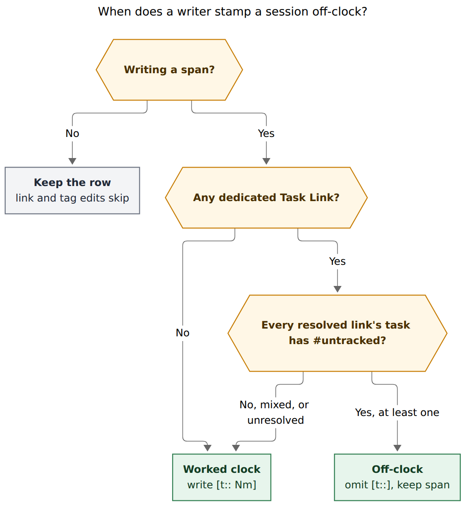

# Off-clock sessions deserve a second Stats clock

Keep the ledger as it is — a timed row with `[t::]` is Worked, a timed row
without it is off-clock — and give Stats a three-way clock (Worked ·
Off-clock · All) that reads that row. Do not add `[u::]`. Do not derive
trackedness from links at read time. Stamp off-clock at span-write when
every dedicated Task Link resolves to a `#untracked` task.

| | |
| --- | --- |
| **Researcher** | grk · 2026-11-01 |
| **Bead** | [`bob-cli-f6`](https://github.com/bobs-org/bob-cli--beads/blob/main/pages/bob-cli-f6/README.md) · in progress |
| **Plan** | `plan:202611/untracked_calendar_events.md` |
| **Decision to reopen** | `decisions:untracked-sessions-omit-t-field` (counting claim only) |
| **Recommendation** | Follow-up tale after f6 lands. Representation stays. Counting grows a second clock. |

---

## Verdict

The incoming idea is right, and the first implementation of it is wrong in
three places.

**Right:** lunch, pickup, and the gym still happened. Vanishing them from
every aggregate makes "where did 12:00–13:00 go?" unanswerable, and it
wastes `[root::]` on untracked Event Tasks. A second clock, defaulting to
today's Worked numbers, is the product. The Day strip, the Mac menu bar,
and `bob pomodoro --worked` stay on Worked.

**Wrong:** `[u::]` as a duration field; deriving "this Pomodoro is
untracked" by resolving links at read time; treating the new clock as a
replacement for omit-`[t::]`.

Those three are the same kind of mistake: they fight a representation that
already shipped, already reads honestly in Obsidian, and already carries
duration in the span. Stats already parses the rows, already stores
`range_minutes`, already counts them in `health.homes.untracked_sessions`,
and already exposes `completed_summary.untracked_count` on the agenda. The
hole is the default Worked aggregate, not the ledger.

Name the session **off-clock session** (aliases: untracked session,
untracked pomodoro). Keep the task tag `#untracked`. The time is tracked.
It lives on a second clock.

---

## What I investigated

Primary sources, all current as of 2026-11-01:

- Epic `bob-cli-f6` and closed phases `.1` (ledger readers/writers) and `.2`
  (Google `#untracked` + cluster split). Phases `.6` (plugins) and `.8`
  (Mac rail) are still in progress.
- `plan:202611/untracked_calendar_events.md`, including the reviewer
  choice `untracked_counts = exclude`.
- `decisions:untracked-sessions-omit-t-field` (accepted today) and the
  partial supersession of `decisions:synced-meetings-link-by-phase`.
- Glossary: Pomodoro, Event Task, Task Link, Stats Dash, Day Strip, Root
  Parent, Task Type.
- Engine: `session_tracking`, `set_ledger_tracking`,
  `evaluate_pomodoros`'s `if session.untracked { continue; }`,
  `attribute_session(..., untracked, ...)` with 0-minute parts,
  `SessionFact` minutes forced to 0, `completed_summary_for`.
- Stats dash and Day strip in bob-ledger-tools (`bob-stats-toggle`,
  `openStatsForDay`, window bars hardcoded to the `worked` metric).
- CLI contract (`cli_rules.md`) and schema-1 additive JSON
  (`SCHEMA_VERSION = 1`).

I did not read peer swarm reports.

---

## Critique of the incoming plan

The prompt proposes four moves. Two should survive. Two should not.

### 1. A separate stats group — keep, as a clock, not a bucket

"Group" suggests a `parts` key next to `root_parent` and `theme`, or a
hidden overview tile. Off-clock is a **filter over rows**, the same kind
of thing as Worked. Lunch rooted at `body` and a dentist rooted at `body`
should still group under `body` once you are looking at that clock.
Putting them in an "untracked" home would hide the interesting question
the second clock exists to answer: *where did the off-clock time go?*

The three views the prompt wants map cleanly onto one request-level clock:

| Clock | Rows | Minutes | Counts |
| --- | --- | --- | --- |
| **Worked** (default) | `[t::]` or stopwatch | recorded `[t::]` | those rows |
| **Off-clock** | timed, neither field | span (`range_minutes`) | those rows |
| **All** (Occupied) | both | sum | both |

Task, checklist, journal, and formula metrics ignore the clock.
Pomodoro metrics (`worked`, `sessions`, `review_time`, custom `in:`
metrics) all follow it, so `review_time --clock off-clock` is well-defined
and usually empty.

`occupied` as a formula `worked + off_clock` cannot feed "Where the time
went": formulas have no homes. All has to be the same pomodoro evaluator
with a wider row filter.

### 2. `[u::]` as the duration — drop

`[t::]` already lives on the **session row**, not the task
(`docs/reference/vault-format.md`: "`start` on a task line is out of
scope… Pomodoro entries use `[t:: 15m]` on the session row"). A task-line
`[u::]` would split one session's duration across several tasks and
duplicate the calendar span. A session-line `[u:: Nm]` is the only shape
that rhymes with `[t::]`, and it still loses.

Why it loses:

- **Duration is already on the row.** `(**1200-1300**)` is 60 minutes.
  `PomodoroSession.range_minutes` is already populated for off-clock
  rows. Stats currently throws that number away.
- **It is a ledger grammar change** in Rust
  (`duration_from_range_text` / `session_tracking`) and JS
  (`020-time-and-pomodoro.js` `formatDurationField`, `durationMetadata`).
  The accepted decision rejected `#untracked` on the Pomodoro line for
  that cost. `[u::]` costs the same.
- **Bryan's mental model is "does this row get `t::`?"** That model
  shipped today. Two duration fields (`t` vs `u`) is a second model.
- **Override is the only new power**, and it is rare. Tracked rows can
  already disagree with the span (`[t:: 45m]` inside a 60-minute range;
  `set_ledger_tracking` preserves that until untracking). Off-clock
  calendar occupancy wants the span. If a duration override is needed
  later, `[u::]` can be added as a refinement without changing the clock
  design: Worked = `[t::]`, off-clock default = span, off-clock override
  = `[u::]`.

The engine already toggles the representation with
`set_ledger_tracking(ledger, tracked)`, which writes `[t::]` from the
span or drops it. A second field would split that helper.

### 3. Read-time "iff all Task Links are `#untracked`" — drop as a reader rule, keep as a writer rule

The accepted decision rejected this alternative by name:

> Deriving trackedness from links at read time. Opaque, needs link
> resolution everywhere, and cannot be overridden per session.

That rejection still holds. Stats, homes, Day strip, `bob pomodoro
--worked`, the agenda, plugins, and the Mac indicator would all have to
resolve Task Links and parse `#untracked` to know how to count a row.
Hand-deleting `[t::]` on a work session would stop working. A tag flip on
a closed lunch would rewrite history the next time Stats runs. A vault
with a stale link would flicker between clocks.

The **write-time** version of the same sentence is the right
generalization, and it is almost what MEET starts already do. See
[Write rule](#write-rule-stamp-at-span-write) below.

### 4. Finish f6, then reopen counting — keep as sequencing

f6.1 already taught every reader to skip these rows. f6.2 already splits
past MEET clusters and omits `[t::]`. f6.6 is painting dashed Event pills
and home chips. Reopening `.1` mid-epic to count the rows a different way
would churn JSON that plugins are copying now.

The decision's own reopen clause is this request:

> Reopens when. An untracked session needs to count as a Pomodoro.

Count it — on the Off-clock clock — in a follow-up tale. Leave omit-`[t::]`,
dashed outlines, cluster split, and MEET event-run starts alone.

---

## Justified adjustments to the requirements

Call these out as changes to the prompt, not as extra polish.

| Incoming requirement | Adjustment | Why |
| --- | --- | --- |
| Use `[u::]` to store duration | **No new field.** Off-clock minutes are the span. | Span is already parsed; grammar change is the cost class already rejected. |
| `[u::]` as a *task* property | Duration stays on the session row, like `[t::]`. | A session can link several tasks; homes already split minutes across links. |
| A pomodoro is untracked iff all of its Task Links are `#untracked` | True as a **span-write rule**, with two guards. Readers still only look at the row. | Read-time derivation was rejected today for opacity and lost overrides. |
| Vacuous "all links" on an unlinked session | **At least one** dedicated Task Link, all tagged. Zero links → Worked. | Otherwise every unlinked MEET placeholder that gets a span would fall off the work clock. |
| Unresolved links | Fail toward Worked. | Do not hide work because a wikilink is stale. |
| Apply the iff on every link/unlink/tag flip | Apply when a writer **writes a span** (start, restart, close that creates a span, MEET finalize, gcal cluster, Obsidian `se`). Link, unlink, and later tag flips leave the row. | Matches "writers decide when they write a span"; preserves hand override; matches gcal's "flip after close is a hand edit". |
| Toggle on Stats dash and `bob stats` | Yes. Three-way **clock**, default Worked. Compact `clocks` summary always in JSON so the header and Day strip can show both totals without a fetch. | Matches existing range refetch; bob still owns every value. |
| Show "just untracked" and "all" | Labels: **Worked · Off-clock · All**. All's headline is **Occupied**, with a subtitle `6h 30m worked · 1h 30m off-clock`. | "Untracked" already means missing Stats points (`DataQuality::NotTracked`, `reason: "untracked"`). |
| Rename because the time is tracked | Canonical name **off-clock session**. Keep `#untracked` on tasks and in Google titles. | The slogan is already "on the ledger, off the clock"; dashed = timer-off; Google token is shipping. |
| Non-MEET sessions stay always-tracked | Drop that limit. Any session whose dedicated links are all `#untracked` at span-write is off-clock, including `GYM` / `BODY`. | This is the generalization the prompt asked for. MEET is the calendar factory, not the type gate. |
| Day strip toggles | Day strip **headline stays Worked**. A quiet dashed `+ 45m off-clock` sits under the Worked fact when the compact total is nonzero. Clicking it opens Stats with the Off-clock segment selected. | Five facts already fold at 34em; a sixth fact or a strip-level clock switch is cramped. |
| Menu bar / `--worked` / agenda minutes | Stay Worked-only. Add additive `untracked_minutes` next to existing `untracked_count` on the agenda. | Those surfaces answer "how much have I worked today?" |
| Do this inside f6 | **Follow-up tale** after f6 lands. New decision record supersedes the *counting* claim of `untracked-sessions-omit-t-field` and keeps the *representation* claim. | `.1` and `.2` are closed; `.6` is painting the dashed language this design reuses. |

---

## Current system (the engine is already most of the way there)

A timed ledger row is classified in one place:

```769:777:src/native/capture/pomodoro_adjust.rs
pub(crate) fn session_tracking(ledger_line: &str) -> SessionTracking {
    if parse_adjustment_range(ledger_line).is_none() {
        return SessionTracking::Placeholder;
    }
    match duration_from_range_text(ledger_line) {
        Some(minutes) => SessionTracking::Tracked { minutes },
        None => SessionTracking::Untracked,
    }
}
```

`duration_from_range_text` accepts `[t::]` or the legacy stopwatch. There
is no `[u::]` anywhere in the tree.

Stats indexing already keeps both numbers:

```586:613:src/native/stats/index.rs
            let tracking = crate::native::pomodoro::session_tracking(raw_line);
            let untracked = matches!(
                tracking,
                crate::native::pomodoro::SessionTracking::Untracked
            );
            let recorded = match tracking {
                crate::native::pomodoro::SessionTracking::Tracked {
                    minutes,
                } => u32::try_from(minutes).ok(),
                _ => None,
            };
            let range = entry
                .time_range
                .as_deref()
                .and_then(capture_pomodoros_agenda::range_minutes)
                .and_then(|minutes| u32::try_from(minutes).ok());
            PomodoroSession {
                // ...
                recorded_minutes: recorded,
                range_minutes: range,
                untracked,
            }
```

Then the Worked clock throws the row out:

```216:218:src/native/stats/metrics.rs
            if session.untracked {
                continue;
            }
```

Homes attributes it with **0 minutes** and still emits a `SessionFact`,
so the dash drill-down can list a 0m lunch under a root. Health increments
`untracked_sessions`. The agenda already returns `untracked_count`. The
Mac band already draws `┆untracked┆`. The product admits these sessions
exist everywhere except the number Bryan looks at for "how did I work?"

That is why a second clock is cheap, and why `[u::]` is not required to
make it real.

---

## Naming

"Untracked" is overloaded in this repo:

| Use | Meaning |
| --- | --- |
| `#untracked` task tag / Google token | Input: this task's sessions belong off the work clock |
| Untracked session (f6) | Timed ledger row without `[t::]` |
| Stats `DataQuality::NotTracked` / `reason: "untracked"` | Day with no data, before tracking started |
| `git` untracked | Files |

The plan already warned about the Stats collision and chose "untracked
session" in code (`SessionTracking::Untracked`). Once the rows *are*
counted, "untracked" is a lie. **Off-clock** is the name the docs already
use in the slogan, the Lucide `timer-off` mark, and the dashed outline
that f6.6 is shipping.

Keep three layers:

1. **Tag** `#untracked` — input, on the task, Google-owned on Event Tasks,
   user-owned anywhere else.
2. **Row** off-clock session — timed, no `[t::]`.
3. **View** Worked / Off-clock / All — Stats clock.

Code can keep `SessionTracking::Untracked` as an internal alias for one
release; docs, CLI help, and glossary say off-clock.

---

## Write rule: stamp at span-write

**Reader question:** When does a writer stamp a session off-clock?

**Caption:** A span write stamps the row off-clock only when every
dedicated Task Link resolves to a `#untracked` task; an empty lineup, a
mixed lineup, or a stale link stays on the Worked clock, and link or tag
edits after the span is written leave the row alone.



Rendered size: 721 × 784 px; fit scale: 90.5%.

Dedicated Task Links only: child bullets that are exactly one Task Link.
LINKS relations, LINKED FROM, mentions, and Depends-On lines never count
(glossary: Task Link).

This is the MEET event-run rule, lifted off Event Tasks:

- Gcal past clusters already split by trackedness, so a tagged lunch and
  a standup never share a closed MEET.
- `=` on MEET already omits `[t::]` when the run is untracked
  (`docs/capture.md`, `finalize_meet_start`).
- Mixed *current* events still share one running MEET and stay Worked
  (known f6 limit, one open timed Pomodoro). Leave that limit.

The generalization is that a non-MEET session with only `#untracked`
links (a gym task, a pickup task, a hand-written Event Task under BODY)
also omits `[t::]`. MEET remains how calendar sync files rows; it is not
the only session allowed off the work clock.

Hand override stays one character of grammar: add `[t:: Nm]` to move a
row onto Worked, delete it to park a row on Off-clock. Reconcile does not
fight that. Sync still reports a post-close tag flip once
(`kept_untracked`) and leaves the ledger.

---

## Stats UX

Bob owns every value. The plugin lays them out. That constraint, already
true of the dash and the Day strip, decides the fetch model.

### Compact summary on every report

Additive schema-1 object, present when the report includes any pomodoro
metric:

```json
"clock": "worked",
"clocks": {
  "worked":   {"minutes": 390, "sessions": 12, "display": "6h 30m"},
  "off_clock": {"minutes": 90,  "sessions": 2,  "display": "1h 30m"},
  "all":      {"minutes": 480, "sessions": 14, "display": "8h"}
}
```

`clock` echoes the request (default `"worked"`). The dash header, the CLI
overview, and the Day strip annotation paint from `clocks` with no extra
fetch.

### Segmented control, then refetch

Put a `bob-stats-toggle` group next to the range chips, same widget as
Root parents / Types:

`Worked` · `Off-clock` · `All`

Default Worked. Persist on the device, like the Day-strip lane switch.
Changing the segment refetches the report with `--clock`, the same way
range, offset, and compare already refetch. Typical-day, vs-prior, window
bars, "Where the time went", and session drill-down then all follow one
clock.

All-mode window bars use each root's **sum**, with the off-clock share of
that root drawn dashed in the same hue (solid Worked, dashed Off-clock).
Bob must send the split for that view — either All `parts` carry
`worked` / `off_clock` sub-totals, or the report includes both clocks'
`parts_summary` when `clock=all`. The plugin does not add.

Empty Off-clock: quiet copy, "No off-clock time in this window", no fake
zeros. The dashed visual word already means "on the calendar, off the
work clock" on Event pills, home chips, and the Mac band; reuse it on
Off-clock bars and on All's dashed share.

### `openStatsForDay`

Extend the existing options object (`metric`, `panel`, `day`) with
`clock: "worked" | "off-clock" | "all"`. The Day strip's dashed
annotation calls `openStatsForDay({ clock: "off-clock", panel: "homes" })`.

### CLI

Alphabetical, with a short alias, per `cli_rules.md`:

```
bob stats --clock worked        # default
bob stats --clock off-clock
bob stats --clock all
bob stats -k off-clock -f json
bob stats show worked -k all
```

Hidden aliases: `off`, `untracked` → `off-clock`; `occupied` → `all`.

Human overview, when `clocks.off_clock.minutes > 0`:

```
Worked 6h 30m  ·  Off-clock 1h 30m
```

then the usual sparklines for the selected clock. Help text says
"Worked clock, off-clock sessions, or all occupied time" and points at
`docs/stats.md`.

Pomodoro metric labels follow the clock so `bob stats show worked -k
off-clock` does not print a tile named Worked that is only lunch:
the `worked` tile's `label` / `definition` become "Off-clock" /
"Minutes in closed off-clock sessions". Custom `in:` metrics take a
suffix (`SASE time (off-clock)`). IDs stay stable.

### JSON sessions list

Today an off-clock row appears with `minutes: 0`. That is a papercut in
drill-down. Clock-filtered list:

- Worked: omit off-clock rows (stop listing 0m lunches under a root).
- Off-clock: only those rows, `minutes` = span.
- All: both, with additive `tracked: false` omitted when true.

Do not change Worked-clock `minutes` from 0 to 60 without the flag;
that would be a silent contract break. Schema stays 1 (additive).

### Surfaces that stay on Worked

| Surface | Behavior |
| --- | --- |
| Day strip headline (five facts) | Worked. Dashed `+ 45m off-clock` under Worked when nonzero. |
| Mac menu-bar total | `bob pomodoro --worked`, closed Worked rows only |
| Agenda `completed_summary.minutes` | Worked. Additive `untracked_minutes` next to `untracked_count` |
| Live home chips on the daily note | Still 0 Worked minutes, dashed outline. Tooltip: `off-clock · 60m on the second clock` |
| `plan.exempt` types (PLAN) | Unrelated mute on the Worked clock |

`[root::]` on an `#untracked` Event Task starts earning its keep: Off-clock
"Where the time went" attributes lunch to `love` / `body` / `job` the same
way Worked attributes meetings. That is the beauty of treating this as a
clock instead of a junk drawer.

---

## Glossary draft (for the follow-up plan's memory decision)

New strand `glossary:off-clock-session`. Also update
`glossary:event-task` (the "attributes no minutes" sentence becomes
"attributes no Worked minutes") and `glossary:pomodoro` ("work session"
becomes "timed session, Worked or off-clock").

```markdown
# Off-clock Session

aka untracked session, untracked pomodoro, off-clock pomodoro

A timed Pomodoro ledger row whose parentheses hold a span and no `[t::]`
(and no legacy stopwatch). It stays on the day's `## Pomodoros` list with
its Task Links and home chip, and it feeds Stats' **Off-clock** clock:
minutes come from the span, counts count, and `[root::]` attributes as
usual. The default **Worked** clock, `bob pomodoro --worked`, the Mac
menu-bar total, and the Day strip's headline ignore it.

Writers stamp a row off-clock when they write its span and every
dedicated Task Link resolves to a task tagged `#untracked` (at least one
link). Readers only look at the row. Hand-deleting `[t::]` parks a
session on this clock; adding `[t::]` puts it on Worked. A tag flip after
the row is closed is reported once and left for a hand edit.

Dashed outlines mark it everywhere: the Event time pill, the home chip,
the Mac Calendar band, and the Off-clock Stats bars.

It is not a missing Stats point (`not_tracked`), a git-untracked file, or
a `[t:: 0m]` bug. See [[pomodoro]], [[event-task]], [[task-link]],
[[stats-dash]], [[day-strip]], [[root-parent]].
```

That is the "excellent new glossary term" the prompt asked for, under the
name the time will actually deserve.

---

## Decision record (follow-up)

Do not edit `untracked-sessions-omit-t-field` in place. Write a new
accepted record, mark the old one `metadata.status: superseded-in-part`
with `superseded_by` pointing at the new keyword, and a `[[...]]`
back-link in the old body.

**Keep from the old claim.** A timed row with `[t::]` (or stopwatch) is
Worked; a timed row without either is off-clock. Writers decide when they
write a span. Readers only look at the row. Gcal splits past clusters.
MEET starts follow the event run.

**Replace.** "Stats, homes, `bob pomodoro --worked`, and the agenda skip
untracked sessions' minutes and counts."

**New counting claim.** The Worked clock, `--worked`, the menu bar, and
the Day strip headline skip off-clock minutes and counts. The Off-clock
clock counts them from the span. All sums both. Homes attribute Off-clock
minutes through Task Links and `[root::]` the same way they attribute
Worked minutes. Health keeps `untracked_sessions` and adds
`off_clock_minutes`.

**Reopen of the old record.** This is the reopen it invited.

**Rejected again.** `[t:: 0m]`; `#untracked` on the Pomodoro line;
`[u::]` as a duration field; read-time derivation from links.

**New reject.** A formula `occupied = worked + off_clock` as the All
view (no homes). A sixth Day-strip fact. Relabeling the Google token.

---

## Implementation sketch

A medium follow-up tale, three phases, after f6's remaining plugin and
Mac work. JSON additive, schema 1, no `!` in the train.

1. **bob-cli engine + CLI**
   - `StatsRequest.clock: Worked | OffClock | All`.
   - `evaluate_pomodoros` filters instead of `continue`. Off-clock minutes
     = `range_minutes` (missing span → `missing`, same as today).
   - Homes use those minutes; drop the hard-coded 0.
   - Compact `clocks` + echoed `clock`.
   - `--clock` / `-k` on overview and show, sorted alphabetically with
     the other flags.
   - Session list clock-filtered; additive `tracked`.
   - Agenda `untracked_minutes`.
   - Tests: extend
     `untracked_sessions_are_excluded_from_minutes_and_counts` with
     Off-clock and All cases; goldens for JSON.
   - Docs: `docs/stats.md`, `docs/reference/cli/stats.md` via
     `just docs-gen`, vault-format / gcal "off the clock" wording.

2. **bob-plugins dash + Day strip**
   - Segmented control, device persistence, refetch, dashed All-mode
     shares, empty state.
   - `openStatsForDay({ clock })`.
   - Day strip dashed annotation under Worked.
   - Home-chip tooltip names the second clock.
   - Older bob: control hidden when `clocks` is absent.

3. **Write-rule generalization + memory**
   - Shared predicate: dedicated Task Links, ≥1, all resolved lines
     carry `#untracked` (`line_has_untracked_tag` already exists).
   - Capture start/restart/MEET finalize, Obsidian `se` / `\p` / `\o`
     (already keep untracked untracked; teach non-MEET starts the same
     predicate), gcal clusters (already split by event tag).
   - Glossary + decision as drafted above.
   - Vectors copied into plugins, pinned to a bob-cli commit.

f6.6's dashed Event mark and dashed home chip stay; this tale consumes
them.

---

## Risks and limits

- **Mixed current events stay Worked.** One running Pomodoro is a hard
  ledger rule. A tagged lunch overlapping a standup still counts as work
  until it is split at close. Documented in f6; leave it.
- **Close does not re-stamp.** Linking a work task under a running
  off-clock lunch keeps the lunch off-clock. That is the override-friendly
  choice. If Bryan works through lunch, he adds `[t::]` or starts a
  Worked session.
- **Span vs recorded.** Off-clock minutes ignore a hand-edited duration
  because there is no field for one. Revisit `[u::]` only if that override
  shows up in real use.
- **JSON size.** Refetch-on-clock avoids tripling `parts_summary` on every
  overview. The compact `clocks` object is a few dozen bytes.
- **Typical-day for Off-clock** will look noisy until several tagged
  calendar days exist. Short-history `typical –` already handles that.
- **Naming during the handoff.** Code `Untracked` vs docs "off-clock"
  will coexist for one tale. Sweep docs in phase 1; leave the Rust enum
  until a later rename if desired.

---

## Recommended solution

Ship f6 as designed. Then, in a follow-up tale:

1. **Keep omit-`[t::]`** as the row representation. Duration for the
   second clock is the span. No `[u::]`.
2. **Name it off-clock session.** Tag stays `#untracked`.
3. **Writers stamp at span-write** iff there is at least one dedicated
   Task Link and every resolved target is tagged `#untracked`. Mixed,
   empty, and unresolved lineups stay Worked. Readers only look at the
   row. Hand-edit of `[t::]` remains the override. Link and tag edits
   after the span is written do not retoggle.
4. **Stats grows a clock, default Worked:**
   - JSON: `clock`, compact `clocks`, clock-filtered pomodoro metrics and
     sessions, additive `tracked` on session facts.
   - CLI: `bob stats --clock worked|off-clock|all` (`-k`), header line
     `Worked · Off-clock` when the second total is nonzero.
   - Dash: Worked · Off-clock · All segmented control, refetch, dashed
     All-mode shares, `openStatsForDay({ clock })`.
   - Day strip: Worked headline plus dashed `+ 45m off-clock`.
   - `--worked`, menu bar, agenda minutes: Worked-only, with additive
     `untracked_minutes` on the agenda.
5. **Homes attribute Off-clock minutes** through Task Links and
   `[root::]`, so the second clock has a real "Where the time went".
6. **Memory:** new `glossary:off-clock-session`; Event Task and Pomodoro
   strands updated; new decision superseding the counting claim of
   `untracked-sessions-omit-t-field` in part.

That is the intuitive version (glance at the ledger: `t::` or not), the
reliable version (one predicate, one write moment, one reader rule), and
the beautiful version (one dashed visual word, three clocks, Worked still
the number that means I worked).
