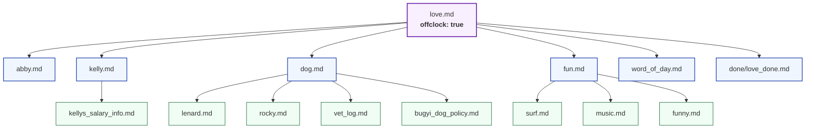
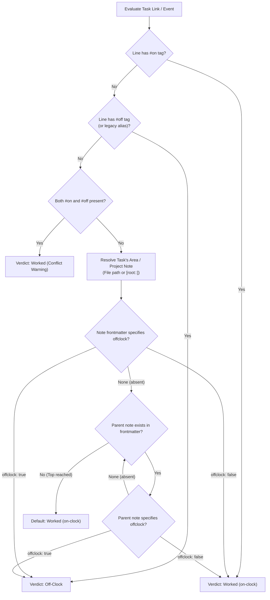
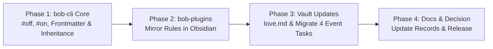

# Research Report: `#off` Tag Adoption, `#on` Overrides, and Recursive Area Frontmatter Inheritance

**Author:** researcher `gem` (Independent Research Swarm)  
**Date:** November 2, 2026  
**Context:** Epic `bob-cli-fl` ("Off-Clock Pomodoros, recorded and counted on their own clock")  
**Target Repository:** `bob-cli`, `bob-plugins`, `bob-mac-capture`, and Bryan's Bob Vault (`~/bob/`)

---

## 1. Executive Summary & Bottom Line

### 1.1 Bottom Line Recommendation: **Yes, Build It — With Key Architectural Refinements**

The proposal to transition from `#offclock` / `#untracked` to `#off`, introduce `#on` as an explicit on-clock override, and support recursive frontmatter inheritance (`offclock: true` / `offclock: false`) on area and project notes is **an outstanding design evolution that should be approved and implemented**.

This proposal directly fulfills the explicit reopening clause of the newly accepted decision `decisions:off-clock-pomodoros-count-apart` (established under epic `bob-cli-fl`):
> *"Reopens when: Per-task minute accounting is needed, or off-clock time should come from an area property instead of a task tag."*

By shifting the default off-clock classification from tedious per-task and per-event tagging to natural life-area inheritance, this design eliminates substantial manual toil, prevents tagging errors, and aligns the user interface with Bryan's actual mental model of his vault.

### 1.2 Summary of Recommended Adjustments

While the core plan is sound, four crucial refinements are recommended to ensure seamless reliability, zero performance regression in Obsidian, and complete vault integrity:

1. **Explicit Event Task Badge Stamping in `bob gcal sync`:** When an event inherits `offclock: true` via its resolved root (e.g. `@love` resolving to `love.md`), `bob gcal sync` should **explicitly write ` #off`** into the daily note row's badge run (and render ` #on` when overridden). This maintains self-contained, high-performance daily notes, allowing Obsidian Live Preview and `bob task reconcile` to evaluate event off-clock status instantaneously without filesystem traversals on every render frame.
2. **Four-Tier Precedence Hierarchy:** Formally specify the clock resolution order:
   $$\text{Task Tag (\#on / \#off)} \succ \text{Resident Note Frontmatter} \succ \text{Recursive Parent Chain} \succ \text{System Default (Worked)}$$
   Any explicit tag on a task line (`#on` or `#off`) strictly trumps note-level frontmatter.
3. **Deprecation Policy & Scope:** Treat all three legacy spellings (`#offclock`, `#off-clock`, and `#untracked`) as deprecated. In `bob gcal sync`, log an actionable, non-spamming deprecation warning per distinct event summary while automatically migrating the rendered daily note row to ` #off` in place.
4. **Vault Evidence & Cascade Scope:** A complete audit of `~/bob/` reveals that `love.md` has **14 direct child and grandchild notes** (including `abby.md`, `kelly.md`, `dog.md`, `fun.md`, `lenard.md`, and `vet_log.md`). Recursive inheritance is not merely a convenience; it immediately and cleanly covers Abby's park outings, Kelly's dates, and dog care without requiring any manual tagging on those sub-notes.

---

## 2. Context & Background: The `bob-cli-fl` Foundation

### 2.1 From `bob-cli-f6` to `bob-cli-fl`

In `bob-cli-f6`, Google Calendar events tagged `#untracked` were rendered into the daily note without a `[t::]` duration field. However, this caused personal and life time (lunch, gym, family outings) to vanish from all records, leaving gaps in the daily timeline and skewing capacity planning.

Epic `bob-cli-fl` ("Off-Clock Pomodoros, recorded and counted on their own clock") solved this by introducing:
- **The `[off:: Nm]` ledger key:** Timed rows carry `[off:: 60m]` instead of `[t:: 60m]`.
- **A second clock:** `bob stats -k worked|off-clock|total` separates work time from life time while keeping work metrics pure.
- **The Counted-Links Rule:** A Pomodoro is off-clock if and only if every task link it keeps resolves to an off-clock task.
- **The Canonical Tag:** `#offclock`, with `#untracked` and `#off-clock` as backward-compatible aliases.

### 2.2 Why Reopen Now?

The decision `decisions:off-clock-pomodoros-count-apart` explicitly contemplated this exact requirement:
```markdown
Cost: Mixed sessions count as Worked in full. Closed history is frozen at
write time, so later tag changes appear as drift.

Reopens when: Per-task minute accounting is needed, or off-clock time
should come from an area property instead of a task tag.
```

In `bob-cli-fl`, task lines were the *only* source of truth for off-clock status. A task was off-clock strictly if its own line text matched `line_has_off_clock_tag`. This created a major usability gap: every single task in a personal area like `love.md` (e.g. `Clean Lenard's ears`, `Buy Abby basketball hoop`) and every family event on Google Calendar had to be manually decorated with `#offclock`. 

Reopening the decision now to incorporate **area frontmatter inheritance** and streamline the tag to **`#off`** is timely and architecturally sound.

---

## 3. Critique of the Proposal

### 3.1 What Makes This a Great Idea?

1. **Ergonomics & Brevity (`#off` / `#on`):**
   - `#off` is 4 characters; `#offclock` is 9 characters; `#untracked` is 10 characters.
   - When typing on mobile Google Calendar or in quick capture, `#off` saves keystrokes.
   - `#off` and `#on` form an intuitive, symmetric binary toggle.
   - `#off` aligns perfectly with the positive ledger key `[off:: Nm]`. The tag `#off` stamps the key `[off::]`.
2. **Adherence to DRY (Don't Repeat Yourself):**
   - Areas like `love`, `personal`, and `body` represent non-work domains. Requiring the user to tag every chore, date, and errand as `#off` violates standard database normalization and GTD principles. Defining this once at the area root (`offclock: true`) is the correct abstraction.
3. **Graceful Subtree Control via Recursive Inheritance:**
   - Projects nested under `love` (e.g. `prj/anniversary_trip.md`) automatically inherit off-clock status.
   - If a specific project under an off-clock area represents taxable work or business (e.g. `prj/family_business.md`), setting `offclock: false` on that project cleanly flips the entire sub-tree back on-clock without touching parent or sibling notes.
4. **Granular Escape Hatch (`#on`):**
   - A general rule without an exception mechanism becomes frustrating. The `#on` tag provides an instantaneous, one-off escape hatch for individual tasks and calendar events.

### 3.2 Detailed Risks & Edge Cases Evaluated

#### Risk 1: False Positives with Short Hashtags (`#on` and `#off`)
*Concern:* Could the short words "on" and "off" trigger accidental matches?
*Evaluation:*
- In Markdown and Google Calendar, hashtags require a leading `#`. Plain English words ("on", "off") are never matched.
- In Markdown task lines:
  - Heading 1 is `# Heading` (with a mandatory space). A tag is `#on` (no space).
  - Nested tags like `#off/topic` or `#online` must not match.
  - The scanner in `src/native/event_task.rs` already validates word boundaries: left boundary must be whitespace or start of line (outside code spans and markdown links); right boundary must be whitespace, end of line, or punctuation (`]`, `)`, `}`, `:`, `.`, `,`, `;`, `!`, `?`).
  - An audit of the entire `~/bob/` vault revealed **zero occurrences** of `#off` or `#on` as task tags today. There are no collisions.

#### Risk 2: YAML 1.1 Boolean Parsing Quirks
*Concern:* In YAML 1.1, unquoted `on` and `off` parse as booleans (`true` and `false`).
*Evaluation:*
- The user's specification wisely proposed `offclock: true` and `offclock: false` as the frontmatter key, **not** `off: true` or `on: true`.
- Because the key is `offclock`, standard YAML parsers parse it cleanly.
- To ensure robustness against user variations in Obsidian YAML (where users might type `offclock: true`, `offclock: false`, `offclock: yes`, `offclock: no`, `offclock: on`, or `offclock: off`), the parser should normalize scalar strings case-insensitively.

#### Risk 3: Daily Note Event Task Representation — Explicit Stamping vs. Implicit Inheritance
*Concern:* When `bob gcal sync` syncs an event whose root has `offclock: true` (e.g. `@love`), should `gcal sync` write ` #off` on the daily note row? Or should the row omit the tag and rely on `[root:: love]`?
*In-Depth Architectural Analysis:*
- **Approach A (Implicit Inheritance only; no tag stamped on daily row):**
  - Daily row: `- [*] #task **1200-1300** Lunch [root:: love] [type:: MEET] ^lunch`
  - *Drawback:* Every single consumer that inspects the daily note must now perform cross-file lookups. Specifically:
    1. **Obsidian Live Preview Performance:** `bob-ledger-tools` paints off-clock events with dashed pills and borders in CodeMirror 6. Live Preview runs synchronously during scrolling and typing. If the line text lacks `#off`, the plugin would have to query Obsidian's `metadataCache` for `love.md`, check its frontmatter, and follow its parent links on every editor transaction.
    2. **Reconcile Settle Logic:** In `src/native/task_status_hooks/settle.rs`, line 85 checks `if !event.off_clock { continue; }`. Today, `event_task.rs` populates `off_clock` directly from line text. Without a tag, `event_task.rs` would have to load vault files to parse `[root::]`.
    3. **Dataview Interoperability:** External Dataview queries filtering on tags (`where contains(tags, "#off")`) would miss inherited events unless they replicate complex parent-walk queries.
- **Approach B (Explicit Stamping at Sync; Recommended):**
  - Daily row: `- [*] #task **1200-1300** Lunch #off [root:: love] [type:: MEET] ^lunch`
  - When overridden by `#on`: `- [*] #task **1200-1300** Lunch #on [root:: love] [type:: MEET] ^lunch`
  - *Advantages:*
    - **Self-contained ledger:** The daily note remains an immutable, human-readable record of the day.
    - **Instant styling & classification:** Live Preview, `settle.rs`, `meet_event_run.rs`, and Dataview parse off-clock status immediately from the row without disk or cache overhead.
    - **Clarity:** Anyone reading the daily note immediately sees which events were off-clock.
  - *Recommendation:* Adopt Approach B. `bob gcal sync` evaluates `off_clock = (has_off || root_is_offclock) && !has_on`. If `off_clock` is true, it renders ` #off` into the badge run. If false but `root_is_offclock` was true, it renders ` #on`. Resident tasks in area/project notes (like `love.md`) remain clean without tags, resolved via inheritance.

#### Risk 4: Conflicting Tags on a Single Task Line
*Concern:* What happens if a task line contains both `#off` and `#on`?
*Evaluation:*
- Following Bob's established resilience principles (e.g. clock conflicts falling back to Worked), a task with both `#off` and `#on` must default to **Worked (on-clock)** and emit a diagnostic conflict warning.

#### Risk 5: Mixed Pomodoro Sessions
*Concern:* If a Pomodoro links an on-clock task (e.g. `[[bob#^parser]]`) and an inherited off-clock task (e.g. `[[love#^clean-ears]]`), how is it classified?
*Evaluation:*
- The counted-links rule in `decisions:off-clock-pomodoros-count-apart` remains unchanged: **a session is off the clock if and only if EVERY kept task link is off-clock**.
- A mixed session remains Worked in full (`[t::]`), and capture emits the structured mixed warning: `◌ LUNCH stays on the clock: it also links Fix the parser`.

---

## 4. Empirical Vault Audit: Bryan's Real-World Hierarchy

An empirical audit of Bryan's Bob vault (`/home/bryan/bob/`) was conducted to evaluate the exact impact of this change on existing notes and tasks.

### 4.1 The `love.md` Area Tree

Inspection of `love.md` and notes declaring `parent: "[[...]]"` reveals that `love.md` is the root of a substantial 3-tier hierarchy:



#### Key Findings from the Tree:
1. **Immediate Multi-Note Benefit:** Setting `offclock: true` on `love.md` alone automatically cascades to **6 direct child notes** and **8 grandchild notes** (14 notes total).
2. **Event Task Synergy:**
   The daily notes currently contain event tasks with `[root:: abby]` (e.g. `Swings!`, `Lincoln Park w/ Abby`, `Grocery Store w/ Abby`). Because `abby.md` declares `parent: "[[love]]"`, all Abby events automatically resolve to `offclock: true` via inheritance from `love.md`!
3. **Selective Override Readiness:** If Bryan ever wants `kellys_salary_info.md` to be treated as on-clock, he simply adds `offclock: false` to its frontmatter.

### 4.2 Existing Event Tasks in Daily Notes

A search across all daily notes in `~/bob/2026/` located **exactly four past event tasks** using the legacy `#offclock` tag:
1. `2026/20261102.md:27`: `- [x] #task **0800-0815** Swings! ... #offclock [root:: abby] ... ^swings`
2. `2026/20261102.md:28`: `- [*] #task **1900-2000** Lincoln Park w/ Abby ... #offclock [buffer:: -30m] [root:: abby] ... ^lincoln-park-w`
3. `2026/20261031.md:27`: `- [x] #task **1330-1930** Halloween at Aunt Jenny's! ... #offclock [root:: family] ... ^halloween-aunt-jenny`
4. `2026/20261101.md:27`: `- [x] #task **1900-2000** Grocery Store w/ Abby ... #offclock [root:: abby] ... ^grocery-store-w`

*Migration Effort:* These 4 rows represent the entire historical footprint of `#offclock` in the vault. Migrating them to `#off` is trivial, safe, and guarantees 100% vault consistency.

---

## 5. Architectural Specification & Design

### 5.1 Precedence & Clock Evaluation Model

The off-clock status of any task (resident task or event task) is determined by evaluating the following ordered rules:



### 5.2 Component-by-Component Implementation Plan

#### 5.2.1 `bob-cli` Core

1. **Tag Parsing & Normalization (`src/native/event_task.rs`):**
   - Generalize `line_has_off_clock_tag`:
     - Canonical match: `#off`.
     - Deprecated matches: `#offclock`, `#off-clock`, `#untracked`.
   - Add `line_has_on_clock_tag`:
     - Matches standalone `#on`.
   - Update `clean_event_title` and `strip_trailing_off_clock` to strip `#off` and all legacy aliases.
2. **Note Facts & Frontmatter (`src/native/pomodoro_homes/facts.rs`):**
   - Add `pub(crate) offclock: Option<bool>` to `NoteFacts`.
   - In `NoteFacts::parse`:
     ```rust
     let offclock = frontmatter
         .as_ref()
         .and_then(|fm| frontmatter_value(fm, "offclock"))
         .and_then(|val| {
             let trimmed = trim_yaml_scalar(val);
             if trimmed.eq_ignore_ascii_case("true") || trimmed.eq_ignore_ascii_case("yes") || trimmed.eq_ignore_ascii_case("on") {
                 Some(true)
             } else if trimmed.eq_ignore_ascii_case("false") || trimmed.eq_ignore_ascii_case("no") || trimmed.eq_ignore_ascii_case("off") {
                 Some(false)
             } else {
                 None
             }
         });
     ```
3. **Parent Hierarchy Traversal (`src/native/pomodoro_homes/resolve.rs`):**
   - `HomeResolver::resolve_note` already builds `chain: Vec<(PathBuf, NoteFacts)>` by following `parent: "[[...]]"` up to `MAX_PROJECT_DEPTH` (10).
   - Add helper `HomeResolver::effective_offclock(&self, path: &Path) -> bool`:
     Traverses `chain` from the target note upwards to its ancestors. Returns the boolean from the first note where `facts.offclock.is_some()`. If no note specifies `offclock`, returns `false`.
4. **Task Link Resolution (`src/native/capture_pomodoro_start.rs` & `linked_tasks.rs`):**
   - When constructing `LinkFact { off_clock }`:
     ```rust
     let off_clock = if line_has_on_clock_tag(line) {
         false
     } else if line_has_off_clock_tag(line) {
         true
     } else if let Some(root_target) = parse_task_root(line).and_then(extract_root_str) {
         resolver.effective_offclock_for_root(root_target)
     } else {
         resolver.effective_offclock(note_path)
     };
     ```
5. **Google Calendar Model & Directives (`src/native/gcal/model.rs`):**
   - `is_off_clock_token`: accepts `#off`, `#offclock`, `#off-clock`, `#untracked`.
   - `is_on_clock_token`: accepts `#on`.
   - `strip_off_clock_tokens`: cleans title.
   - `description_directives`: parses `#off` and `#on`.
   - Add deprecation tracking: if `#offclock`, `#off-clock`, or `#untracked` is detected, set `deprecated_tag: Some(matched_str)`.
6. **Google Calendar Sync & Deprecation Warnings (`src/native/gcal/sync.rs` & `render.rs`):**
   - In `sync.rs`:
     - If `event.deprecated_tag.is_some()`, emit a warning:
       `warning: event "{title}" uses deprecated tag '{tag}'; use '#off' instead.`
     - Evaluate root inheritance:
       ```rust
       let root_offclock = choose_event_root(...).target.map_or(false, |t| resolver.effective_offclock(&t.path));
       let is_off_clock = (event.has_off_tag || root_offclock) && !event.has_on_tag;
       ```
   - In `render.rs`:
     - If `is_off_clock`: render ` #off` in the badge run.
     - If `!is_off_clock && root_offclock`: render ` #on` in the badge run.
     - Existing untouched rows with `#offclock` automatically update in-place to ` #off` during sync planning.

#### 5.2.2 `bob-plugins` (Obsidian)

1. **`plugins/bob-ledger-tools`:**
   - Update `src/291-plugin-gcal-events.js`:
     `const GCAL_EVENTS_OFF_CLOCK_TAG_RE = /^#(?:off|offclock|off-clock|untracked)$/i;`
     `const GCAL_EVENTS_ON_CLOCK_TAG_RE = /^#on$/i;`
     Paints `#off` event pills dashed.
   - Update `src/035-meet-event-run.js`:
     Add `#off` to `OFF_CLOCK_TAGS`; add `#on` to `ON_CLOCK_TAGS`.
   - Update `src/036-pomodoro-clock.js`:
     Mirror the 4-tier precedence: check line for `#on` / `#off`; if missing, query `app.metadataCache` for the target file's frontmatter and follow `parent` links.
2. **`plugins/task-status-cycler`:**
   - Update `src/062-pomodoro-clock.js` to mirror the updated vector contract.
3. Deploy updated plugins via `bob plugins sync`.

#### 5.2.3 `bob-mac-capture`

- **No Changes Required:** Bob Mac Capture is a thin client of `bob`. It decodes `off_clock: bool` from `bob capture-pomodoros --tasks` JSON. Because `bob-cli` handles all parsing and emits the unified `off_clock` boolean, the Mac menu-bar app works out of the box.

---

## 6. Phased Rollout Plan

To ensure clean delivery without breaking existing workflows, the implementation should be partitioned into four sequential phases:



### Phase 1: `bob-cli` Core Engine
- Implement `#off` and `#on` token parsing, title stripping, and line scanning in `event_task.rs`.
- Add `offclock: Option<bool>` to `NoteFacts` and implement recursive inheritance in `HomeResolver`.
- Update `capture_pomodoro_start.rs`, `capture_pomodoro_close/linked_tasks.rs`, and `stats/homes.rs` to query inherited note clock.
- Update `gcal/model.rs`, `gcal/sync.rs`, and `gcal/render.rs`:
  - Deprecation warnings for `#offclock`, `#off-clock`, `#untracked`.
  - Stamping ` #off` (or ` #on`) based on root inheritance.
- Expand `tests/fixtures/pomodoro_clock/vectors.json` with inheritance, override, and `#off`/`#on` test cases.

### Phase 2: `bob-plugins` (Obsidian)
- Update `bob-ledger-tools` regexes and Live Preview decorators for `#off` and `#on`.
- Update `pomodoro-clock.js` in `bob-ledger-tools` and `task-status-cycler` to read frontmatter `offclock` from `app.metadataCache`.
- Verify tests in `bob-plugins` against the updated vectors.
- Run `bob plugins sync` to deploy to `~/bob/`.

### Phase 3: Vault Updates & Migration
- Edit `~/bob/love.md`: insert `offclock: true` into frontmatter.
- Migrate the 4 historical event tasks in `2026/20261102.md`, `2026/20261031.md`, and `2026/20261101.md` from `#offclock` to `#off`.
- Verify with `bob gcal list` and `bob stats` that all metrics and classifications match expectations.

### Phase 4: Documentation & Decision Record
- Reopen `decisions:off-clock-pomodoros-count-apart.md` and document the `#off` / `#on` tags and area frontmatter inheritance.
- Update `docs/reference/vault-format.md`, `docs/gcal.md`, and `docs/capture.md`.

---

## 7. Conclusion

The user's plan is fundamentally sound, highly ergonomic, and directly supported by Bryan's actual vault hierarchy. With the recommended refinements—specifically explicit badge stamping on daily note event rows and strict 4-tier precedence—this change will provide an intuitive, elegant, and permanent solution for managing off-clock life and work.
