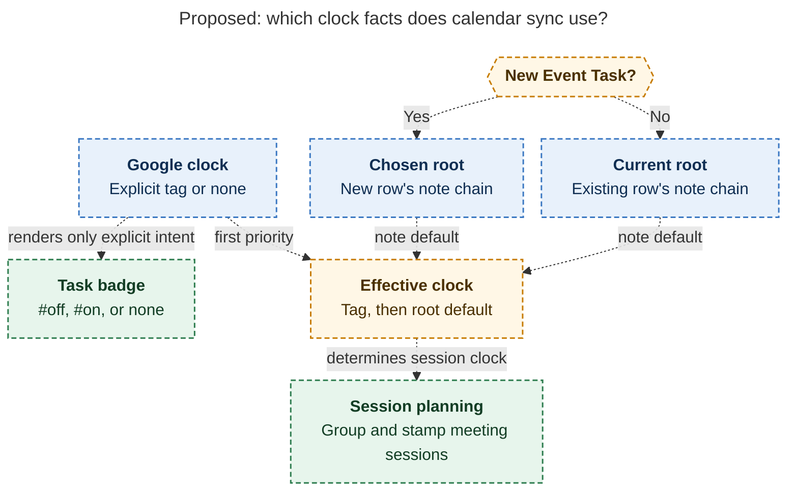
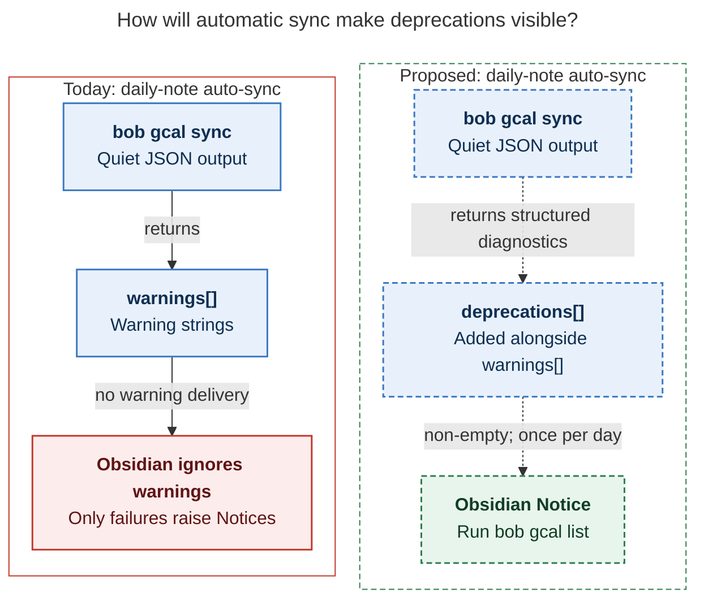

# Diagram proposals: `#off` / `#on` tags and inherited `offclock:` areas

Proposals for the swarm linker, not a report. Each diagram restates only what the source
report says.

```yaml
source: research:202611/off_on_tags_and_offclock_areas/off_on_tags_and_offclock_areas__final.md
producer: research.31.image
check: mmdc 12.0.0 with --no-sandbox and the PDF-mirroring config rendered 2 of 2 Mermaid diagrams; deliberately broken input
  exited nonzero
```

## explicit-effective

```yaml
anchor: |-
  sent neither, **even if the root inherits off-clock**.
question: |-
  Why must calendar rendering and session planning use different clock facts?
illustrates: |-
  The Google-owned badge span mirrors only explicit tags, while past closed clusters and created running MEETs use the Google tag followed by the chosen or current root's chain.
caption: "Proposed sync renders only explicit Google tags; session planning uses those tags first, then either the chosen or current root\u2019s default."
review: 808.815x788 px, fit 80.7%; question, source, arrow, label and visual checks passed; 1 revision, 2 look rounds; root branches are alternatives, tag
  has priority
```



## warning-visibility

```yaml
anchor: |-
  When the daily auto-sync result has a non-empty
question: |-
  How will a deprecation warning reach the user during automatic sync?
illustrates: |-
  Automatic sync currently ignores warnings, while the proposed deprecations[] result raises an Obsidian Notice once per day when non-empty.
caption: Proposed structured deprecations reach a daily Obsidian Notice, making warnings visible when automatic sync runs quietly.
review: 596x577 px, fit 100.0%; question, source, arrow, label and visual checks passed; 1 revision, 2 look rounds; today is left, proposed is right
```


