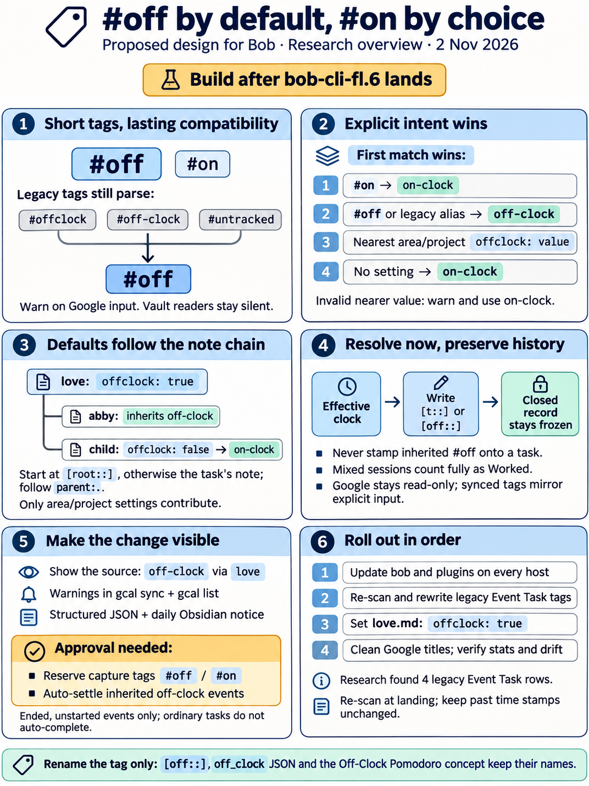
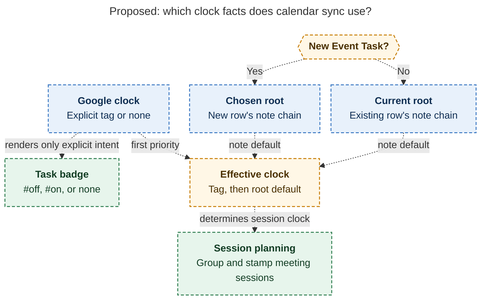
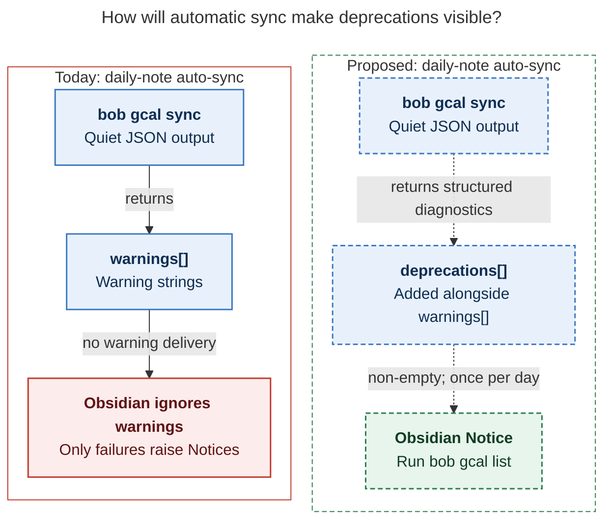

# `#off` / `#on` tags and inherited `offclock:` areas — consolidated report

> **Research query:** How should bob make `#off` the off-clock tag in Google Calendar
> events and in Obsidian, keeping `#offclock` and `#untracked` working with a
> `bob gcal sync` deprecation warning and migrating past event tasks to `#off`, and how
> should a new `offclock: true` area/project frontmatter field make tasks off-clock
> recursively, with a child's `offclock: false` and a new `#on` task tag (also read from
> Google Calendar events by `bob gcal sync`) as overrides, starting with `~/bob/love.md`?
> Is this a good idea, what adjustments to the requirements are justified, and what
> solution is recommended?

## Bottom line

**Build it. It is a good idea, and now is the cheapest time to do it.** Do it as
[a new epic](#recommended-solution) after `bob-cli-fl.6` lands, not as more work on
`bob-cli-fl`.

- **The decision record expects this change.** The accepted record
  `decisions:off-clock-pomodoros-count-apart` names its own reopen condition: _"off-clock
  time should come from an area property instead of a task tag."_ This request is that
  condition.
- **Nothing has shipped.** The last release is `v0.4.0` (2026-10-27). Neither
  `#untracked` nor `#offclock` appears in any release. Only Bryan's own Google events and
  [4 vault rows](#vault-survey) carry the old spellings.
- **The machinery already exists.** Both Rust (`HomeResolver` plus the type-default walk,
  PT13) and the Obsidian plugins (`pomodoroHomeResolveTaskThemeFacts`) already walk the
  note chain, start at `[root::]`, and read frontmatter. An `offclock:` default is one
  more field on a walk that already exists.

[The design in one sentence](#how-a-task-clock-is-resolved): **a task's effective clock
is `#on`, then `#off` (or a deprecated alias), then the nearest area/project `offclock:`
on the task's root walk, then on-clock.** Writers compute it when they stamp
`[t::]`/`[off::]`. Nothing ever writes an inherited `#off` onto a task. The
counted-links rule and frozen history stay exactly as they are.

Of the requirements, I would change or add ten things. They are called out in
[Adjustments](#adjustments-to-the-requirements). The two most important:

- **Warning visibility.** The deprecation warning, as requested, would almost never be
  seen. The only automatic `bob gcal sync` is Obsidian's daily-note trigger, which runs
  `-q -f json` and ignores `warnings`. The warning needs
  [an Obsidian Notice](#figure-warning-visibility).
- **Capture rejects the new tags.** `bob capture "Walk the dog #off"` is rejected today
  with `type_not_configured`, so the new short tags need a
  [capture reservation](#capture).

## Is this a good idea

**Yes.** All five researchers agree, and the evidence backs them:

- **It works at the right layer.** Off-clock life already has a structural home: love
  and its sub-areas. Bryan already routes Google events with `@love`, `@abby`, and
  `@family`. With inheritance, routing alone is enough, and "remember to tag it" goes
  away.
- **It reuses an accepted pattern.** `task_type:` is already "nearest area/project
  default; a task field stores only an exception", with an explicit opt-out.
  `offclock:` plus `#on` follows the same model.
- **`#off` fits where it gets typed.** It is short to type in a phone Calendar title, and
  it matches `[off::]` and the stats CLI's hidden `on`/`off` aliases.

Caveats to accept knowingly:

1. **The clock becomes less visible.** An untagged `Lunch @love` row is off-clock
   because of a frontmatter key two notes away. Mitigate by naming the source wherever
   the clock is shown, for example `60m · off-clock via love` and the painter tooltip
   "Off-clock · from love".
2. **Two inheritance implementations** (Rust and the ledger-tools JS) must agree. The
   shared `pomodoro_clock` vectors are the contract, so extend them with frontmatter
   cases.
3. **Settlement widens.** Every ended, unstarted, love-routed Event Task will
   auto-settle into `[off::]` and be marked done, not just the tagged ones (see
   [A6](#adjustments-to-the-requirements)).
4. **Short tags are generic.** The boundary rules contain the risk, and the vault has
   zero collisions today.
5. **The vocabulary keeps changing.** The canonical tag went `#untracked` → `#offclock`
   (yesterday) → `#off` (now). The new decision record should declare the vocabulary
   settled.
6. **"Worked" becomes a configurable boundary**, not a moral one. A hard family project
   can be put on the clock with `#on` or a child `offclock: false`.

## Adjustments to the requirements

Each entry names the requirement as stated, then the adjustment and why.

- **A1. Deprecate `#offclock` and `#untracked`**
  - *Adjustment:* **Also deprecate `#off-clock`**
  - *Why:* It is the third live alias. Leaving it silently canonical-adjacent is
    inconsistent (all 5 reports agree)
- **A2. Warning from `bob gcal sync`**
  - *Adjustment:* **Also an additive `deprecations[]` in sync/list JSON, the same
    warnings in `bob gcal list`, and a
    [once-a-day Obsidian Notice](#obsidian-plugins)**
  - *Why:* Verified: the only automatic sync runs `-q -f json` from Obsidian and drops
    warnings. Without this, Bryan would almost never see the warning
- **A3. (implicit) the warning says "use #off"**
  - *Adjustment:* **Suggest deleting the tag when the event's root already inherits
    off-clock**
  - *Why:* For love-routed events, deletion is the right fix
- **A4. "tasks belonging to that area/project"**
  - *Adjustment:* **Defined as the [PT13 root walk](#how-a-task-clock-is-resolved)**:
    start at `[root::]`, otherwise the residence note, then follow `parent:` through
    untyped notes. Only area/project notes contribute. Daily notes contribute nothing on
    their own
  - *Why:* "Belonging" needs a contract. This one matches root-parent and `task_type:`,
    and it is the only way Event Tasks (which live in daily notes) reach love
- **A5. `#on` overrides**
  - *Adjustment:* **`#on` wins over an off spelling on the same line or event, with a
    lint.** An explicit `#off` beats a note's `false`. Values must be strict
    `true`/`false`; an invalid nearer value resolves on-clock
  - *Why:* This gives deterministic precedence that fails toward Worked
- **A6. (implicit)**
  - *Adjustment:* **Area-inherited off-clock Event Tasks
    [auto-settle and complete](#settlement).** _Needs your explicit yes_
  - *Why:* This follows the existing settle rule, but it widens an accepted cost
- **A7. "Start using `#off` in Obsidian"**
  - *Adjustment:* **Reserve `#off`/`#on` at [capture](#capture) item edges** (separate
    small phase plus a decision record). _Needs your yes_
  - *Why:* Verified: `bob capture "… #off"` fails today with `type_not_configured`
- **A8. "Update all past event tasks"**
  - *Adjustment:* **Rewrite Event Task rows only, after every host runs the new bob and
    plugins.** [Re-scan at landing](#migration-and-the-love-rollout). Leave `bob.md:374`
    prose, code spans, `.bob/ref-sources/**`, and `_conflicts/**` alone
  - *Why:* Old readers would read `#off` as on-clock and report drift. Write-once sources
    must not change
- **A9. Rename the tag**
  - *Adjustment:* **Rename only the tag.** `[off::]`, the `off_clock` JSON keys, the
    Stats `off-clock` lens, and "Off-Clock Pomodoro" keep their names
  - *Why:* Avoids a third vocabulary sweep across three repos
- **A10. Sync "should start looking for `#on`"**
  - *Adjustment:* **Sync never writes an inherited `#off`/`#on` onto rows.** It renders
    only what Google sent
  - *Why:* Keeps the Google-owned span truthful, and lets a later `offclock: false` or
    root edit take effect

## Evidence base

_Lead researcher consolidation · 2026-11-02 · merges the cdx, cld, grk, mus, and gem
reports in this folder with my own source and vault checks. Context: epic `bob-cli-fl`
(Off-Clock Pomodoros), `plan:202611/off_clock_pomodoros.md`, vault task `bob.md`
`^off-tag` ("Rename `#untracked` to `#off`!")._

### What exists today

Every item below was checked against bob-cli `35c0a39a`, bob-plugins `4502b73`, and the
live vault, so this is the verified state. Where a researcher's claim turned out wrong,
the correction is in the item's notes.

- **The alias triple `["#offclock", "#off-clock", "#untracked"]` is hard-coded in 5 Rust
  places and 3–4 JS places**
  - *Evidence:* `event_task.rs:944,1073`; `gcal/model.rs:275,285`;
    `gcal/lifecycle.rs:215`; `gcal/render.rs:57,208` writes ` #offclock`. JS:
    `062-pomodoro-clock.js`, `035-meet-event-run.js`, and
    `291-plugin-gcal-events.js:14`, whose comment says _"permanent aliases"_
  - *Notes:* All 5 agree
- **The vault scanner already rejects prefixes. `#off` will not match inside `#offclock`,
  `#off-clock`, `#office`, or `#off/x`; the Google parser compares whole tokens**
  - *Evidence:* `line_has_off_clock_tag` right boundary is whitespace or `])}:.,;!?`;
    `model.rs` uses `eq_ignore_ascii_case` on whole tokens
  - *Notes:* Adding `#off` is safe; it is not a prefix bug
- **`EventTask.off_clock` comes from the line alone**
  - *Evidence:* `event_task.rs:563,581`: `off_clock: line_has_off_clock_tag(line)`
  - *Notes:* This is the one structural gap: an inherited clock needs note context
- **Writers that decide the clock**
  - *Evidence:* capture start (`clock_fact_from_task`), close (`linked_tasks.rs`), MEET
    event runs, gcal plan clusters and created MEETs (`plan.rs:1645,1725,1985`),
    reconcile settle (`settle.rs:85`), agenda/Mac JSON, stats drift
  - *Notes:* —
- **`HomeResolver` already exists in gcal (`root.rs:265`, `render.rs:183`,
  `doctor.rs:322`) and stats (`stats/homes.rs`). Capture start/close do not have one
  yet**
  - *Evidence:* grep
  - *Notes:* Threading a resolver into gcal is cheap; capture needs one added
- **The type-default walk (PT13) _starts at `[root::]` for every task, not just Event
  Tasks_. It walks `residence_chain` through untyped notes, and only Area/Project notes
  contribute**
  - *Evidence:* `pomodoro_themes/suggest.rs` `set_root_walk_start`, `note_default`
  - *Notes:* Settles a cdx-vs-others disagreement
    ([below](#where-the-reports-disagreed-and-the-resolution))
- **The walk cap is 16 notes and cycle-safe. `root: true` does not stop the residence
  chain**
  - *Evidence:* `pomodoro_homes/resolve.rs:13` `MAX_PROJECT_DEPTH = 16`
  - *Notes:* gem's "10" is wrong
- **Glossary: `[root::]` "attributes Pomodoro time and task metrics as if the checkbox
  lived in the named note"**
  - *Evidence:* `glossary:root-parent`
  - *Notes:* The clock is a Pomodoro-time question, so it should follow the same walk
- **_gcal sync re-baselines the journal when a row already matches the fresh render._ If
  `current_hash == fresh_hash` and the recorded hash differs, it updates the journal**
  - *Evidence:* `gcal/plan.rs` (span update loop after `kept_off_clock`)
  - *Notes:* A rewrite to exactly ` #off` needs **no journal surgery** once the new
    renderer ships. This settles cdx's journal concern
- **`kept_off_clock` compares `line_has_off_clock_tag(current_line)` with
  `occurrence.off_clock`**
  - *Evidence:* `plan.rs:542-547`
  - *Notes:* If `occurrence.off_clock` becomes the *effective* value, every untagged
    love-routed row would look like a flip. It must compare **explicit** tags
- **Settle completes every open, ended, off-clock Event Task still under an unstarted
  placeholder (`[x]`)**
  - *Evidence:* `settle.rs:85` `if !event.off_clock { continue; }`;
    `decisions:ended-off-clock-events-settle`
  - *Notes:* Inheritance widens this; it needs an explicit yes
- **_Obsidian's auto-sync hides warnings._ It runs `bob gcal sync -q -f json` on
  daily-note creation, and only failures raise a Notice**
  - *Evidence:* `291-plugin-gcal-events.js:423-437`
  - *Notes:* No user systemd timer on apollo runs gcal sync (athena not checked).
    Warnings reach Bryan only when he runs sync by hand
- **Capture rejects edge clock tags today**
  - *Evidence:* `bob capture --dry-run "Walk the dog #off"` returns
    `type_not_configured`; `#on` and `#offclock` do too. Mid-line `#off` stays prose
  - *Notes:* A free `#` at an item edge is a type marker
    (`capture_language/type_marker.rs`)
- **The cycler already calls the ledger-tools _runtime_ `api` (no build-time import)**
  - *Evidence:* `task-status-cycler/src/170-plugin-pomodoro.js:4`,
    `085c-successor-theme-write.js:391`
  - *Notes:* Reconciles grk's "plugins don't import each other" with cld's "use the
    api": both are true
- **ledger-tools already has a JS frontmatter-chain walker for type defaults**
  - *Evidence:* `279-plugin-task-theme-home-facts.js`
    `pomodoroHomeResolveTaskThemeFacts` ("sibling of pomodoroHomeResolve … needs each
    note's parsed frontmatter")
  - *Notes:* The clock walk reuses it

### Vault survey

Surveyed on apollo, 2026-11-02.

- **Event Task rows with a deprecated tag:** **4, all `#offclock`**: `2026/20261031.md:27`
  Halloween (`[root:: family]`, done); `2026/20261101.md:27` Grocery Store
  (`[root:: abby]`, done); `2026/20261102.md:27` Swings! (`[root:: abby]`, done);
  `2026/20261102.md:28` Lincoln Park (`[root:: abby]`, **open**, `[buffer:: -30m]`). All
  four are rooted in love's subtree. mus reported "zero", which is wrong
- **Other standalone hits:** `bob.md:374`, a closed task whose prose says "Add support
  for #untracked event tag…" (a mention, not intent). `.bob/ref-sources/chat/**`, which
  are write-once preserved sources. Leave both alone
- **Existing `#off` / `#on`:** None standalone. `bob.md:99` (`^off-tag`) has `` `#off` ``
  inside a code span. No collision
- **love's subtree:** Direct children: `abby`, `family`, `fun`, `kelly`, `vacation`
  (areas); `dog`, `word_of_day` (**untyped**); `done/love_done`. Grandchildren include
  `lenard`, `rocky`, `vet_log`, `bugyi_dog_policy` (under dog), `surf`, `music`, `funny`,
  `tv` (under fun), `kellys_salary_info`, `legacy_dad`, `vacation_sc_26`
- **love.md frontmatter:** `parent`/`type: [[area]]`, `color: yellow`, legacy
  `theme: CHORE`, `generated_from_zorg: true`, no clock key. 25 open tasks, all Blocked
- **Historical Worked time under love (cld's measurement):** 13 of 41,340 worked minutes
  over a year. Turning love off-clock creates essentially no discontinuity in Worked
- **Zorg overwrite risk (raised by grk):** **Not real.** The converter
  `convert_zorg_core.py` is not on disk, `~/org` was last committed 2026-05-09, and
  `love.md` has 176 vault commits since the 2026-05-30 import. The `zorg_*` keys are
  provenance only

### Where the reports disagreed and the resolution

- **Should sync stamp an inherited `#off` onto Event Task rows?**
  - *Positions:* **gem: yes** (for painter speed, settle, and Dataview). cdx, cld, grk,
    mus: no
  - *Resolution:* **No.** A materialized tag can't be told apart from an explicit one.
    It survives a later `offclock: false` child, a re-route, or a move, and it lies
    about what Google said in the Google-owned badge span. gem's performance concern
    doesn't hold up: the painter already resolves `[root::]` and home chips per row from
    the in-memory `metadataCache`, and reconcile has vault access. The Dataview-visible
    fact is the session's `[off::]` key, not the task tag
- **Where does the walk start for ordinary tasks with `[root::]`?**
  - *Positions:* **cdx:** residence note (`[root::]` is reporting-only; Event Tasks are
    the exception). cld, grk, gem: `[root::]` for all tasks
  - *Resolution:* **`[root::]` for all tasks**, exactly as PT13 does. The glossary
    defines `[root::]` as attributing *Pomodoro time* as if the task lived there. Clock
    and root-parent grouping should agree: time Stats files under love should not be
    Worked when love is off-clock. One walk also means one JS mirror
- **Frontmatter key**
  - *Positions:* **grk:** `off_clock:` (snake_case house style, matches the JSON key).
    Others: `offclock:` as requested
  - *Resolution:* **Keep `offclock:`.** The difference is cosmetic, and it's the name
    Bryan asked for. The YAML-1.1 argument applies to both spellings equally. Accept
    exactly one key, never both
- **Accepted values**
  - *Positions:* gem: `true/yes/on/false/no/off`; mus: add `1/0`; cld, grk, cdx: booleans
    only
  - *Resolution:* **`true`/`false` only** (case-insensitive, bare or quoted, so Rust's
    scalar reader and Obsidian's typed frontmatter agree). Obsidian's Properties
    checkbox writes a boolean. YAML 1.1/1.2 disagree on `yes`/`on`, so don't invite them
- **Invalid value on a nearer note**
  - *Positions:* cld, grk: lint and keep walking (the PT13 pattern). cdx: lint and
    resolve **Worked**
  - *Resolution:* **Lint and resolve Worked.** A typo'd `offclock: flase` under love
    should not inherit love's `true`. "Ambiguous means Worked" is the clock rule's
    established fail direction (an unresolved link is Worked). This deliberately departs
    from PT13
- **Warn in `bob gcal list` too?**
  - *Positions:* cld: yes; mus: no (list should stay glanceable); others: sync only
  - *Resolution:* **Yes, same parse.** The list is where Bryan audits upcoming events.
    Recurring events will keep warning until he edits them, and that is the point
- **Structured JSON for deprecations**
  - *Positions:* cld: add `deprecations[]`; mus, cdx: strings in `warnings[]` only
  - *Resolution:* **Both.** Keep the existing `warnings[]` strings and add an additive
    `deprecations[]` so the Obsidian plugin can raise a Notice without parsing prose
- **Aliases: permanent or deprecated?**
  - *Positions:* mus: permanent silent aliases; grk: deprecated, not permanent; cdx:
    deprecation means "prefer", with no removal date
  - *Resolution:* **Parse forever, warn only at the Google boundary.** Vault readers stay
    silent: old rows, `_conflicts/`, and hand-typed lines keep working. No removal date
- **Should Google `#on` render into the Google-owned badge span?**
  - *Positions:* mus: no (claims it corrupts hashing); others: yes
  - *Resolution:* **Yes.** `#offclock` already lives and hashes in that span.
    Google-sent `#on` is Google-owned in exactly the same way
- **Migration mechanism**
  - *Positions:* cdx: permanent journal-aware `bob task migrate-clock-tags`. cld, grk,
    mus: one-shot
  - *Resolution:* **One-shot scripted rewrite plus `git diff` review.** I verified that
    sync re-baselines the journal when a row equals the fresh render, so rewriting to
    exactly what the new renderer emits is self-consistent. Past days are never re-synced
    by default anyway. A permanent command for about 4 rows isn't justified
- **Migration scope**
  - *Positions:* cdx: every task row; others: Event Task rows only
  - *Resolution:* **Event Task rows.** The only non-event hit (`bob.md:374`) is prose
    *about* the tag in a closed task. Re-scan at landing time, because sync keeps writing
    `#offclock` until the new renderer ships
- **Extend `bob-cli-fl` or a new epic?**
  - *Positions:* grk, cld: new epic; others: unspecified
  - *Resolution:* **New epic after `fl.6` lands.** fl.6 is still IN_PROGRESS in
    ledger-tools and would collide on generated output. fl's memory authorization is
    scoped to other notes

## Recommended design

### Vocabulary

**Rename only the tag.**

- **Off-clock task tag**
  - *Spelling:* `#off`
  - *Status:* **canonical**: the only spelling writers emit
- **On-clock override**
  - *Spelling:* `#on`
  - *Status:* **new**
- **Legacy aliases**
  - *Spelling:* `#offclock`, `#off-clock`, `#untracked`
  - *Status:* parsed everywhere; **deprecation warning on Google input only**
- **Note default**
  - *Spelling:* `offclock: true` / `offclock: false`
  - *Status:* **new**; absence means "inherit"
- **Session key, JSON, stats lens, concept**
  - *Spelling:* `[off:: Nm]`, `off_clock` (+ deprecated `untracked`), `off-clock`,
    "Off-Clock Pomodoro"
  - *Status:* **unchanged**

Matching keeps today's scanner rules: standalone, case-insensitive, trailing `])}:.,;!?`
allowed, not nested, and not inside code spans or Markdown links. Replace the eight
hard-coded lists with **one spelling table per repo** (canonical, deprecated, on).

### How a task clock is resolved

The first matching entry wins:

- **1. The task's own line has standalone `#on`**
  - *Result:* **on-clock**. If an off spelling is also present, lint
    `clock_tag_conflict`; `#on` still wins (fail toward Worked)
- **2. The task's own line has `#off` or a deprecated alias**
  - *Result:* **off-clock** (beats a note's `offclock: false`)
- **3. The nearest _area or project_ note on the task's root walk that has a valid
  `offclock:`**
  - *Result:* that value. `false` ends inheritance, and a deeper `true` can turn it back
    on
- **3′. That nearest note's value is invalid**
  - *Result:* lint `note_offclock_invalid`; **on-clock**
- **4. Nothing set**
  - *Result:* **on-clock**

**Root walk.** This is the same walk as PT13:

- Start at the task's valid `[root:: NOTE]` target, otherwise at its residence note.
- Follow `parent:` through `HomeResolver::residence_chain` (16-note cap, cycle-safe).
- Archive and reference wrappers are walked through.
- A daily note contributes nothing unless `[root::]` retargets the walk, so Event Tasks
  inherit only through their root.
- An invalid or missing root falls back as today, with the existing `root_field_invalid`
  lint.

**Area/project notes only.** `offclock:` on an untyped note such as `dog.md` or
`word_of_day.md` is ignored and linted (`note_offclock_ignored`). Tasks in those notes
still inherit from `love` *through* them.

**Unchanged rules:**

- An unresolved link is still Worked.
- `clock_verdict` over the kept links is untouched, so **a mixed session (one love task
  plus one job task) is Worked in full**.
- An unlinked session is Worked.
- Tags on a parent task, a heading, or a Task Link never inherit. Only notes inherit.

Expected behavior after `love.md` gets `offclock: true`, as task and resulting clock:

- **Untagged task in `love.md`, `fun.md`, `lenard.md` (via untyped `dog`):** off
- **Event Task `[root:: abby]` / `[root:: family]`, no tag:** off
- **`1:1 @love #on` event, or a `#on` task anywhere under love:** on
- **Child area with `offclock: false` (untagged tasks):** on
- **`#off` task inside that `false` child:** off
- **`Dentist @body #off` (no note default):** off
- **Session linking a love task and a `bob.md` task:** on (mixed)

### Compute at write time and never materialize

Writers resolve the effective clock when they stamp `[t::]`/`[off::]`. Readers keep
trusting the stamp. Nothing derived is stored on task lines.

**Implementation shape (bob-cli):**

- **Parse a tri-state tag.** Add a
  `ClockTag = None | Off { deprecated: Vec<&str> } | On | Conflict` parse of the line. A
  deprecated hit is a parser diagnostic, so later code can warn even when `#on` wins.
- **Extend the note facts.** `NoteFacts` gains `offclock: Option<NoteOffClock>`
  (`True | False | Invalid(raw)`). Resolve the nearest value, plus the note that set it,
  over the existing residence chain.
- **One resolver function.** Add
  `effective_off_clock(tag, home) -> (bool, ClockSource)`, where
  `ClockSource = Tag | OnTag | Note(path) | Default`.
- **Enrich Event Tasks once.** `EventTask` keeps the line's `clock_tag`. One enrichment
  pass sets the effective `off_clock` at each entry point that has vault access:
  - capture start (including the same-note Event branch);
  - capture close (after selection, carrying, and deferral);
  - the agenda and its JSON;
  - gcal plan;
  - reconcile settle;
  - stats drift.

  Downstream code (event runs, clustering, settle) keeps reading `event.off_clock`. A
  path with no vault access falls back to tag-only, which fails toward Worked.
- **Show where the clock came from.** Start and close summaries name the source when it
  is inherited (`started LUNCH 1200-1300 (60m · off-clock via love)`). JSON may add
  `clock_source` and `clock_note` (additive) so clients can explain the clock without
  re-deriving it.

### Google Calendar sync and list

Changes to `bob gcal sync` and `bob gcal list`:

1. **Parse a tri-state.** `GcalEvent` gets
   `clock: Unspecified | Off{deprecated…} | On`. It is read from title tokens and from
   description directive-only lines. `#on` becomes a directive token next to `@route`
   and buffers, so `@love #on -30` routes, overrides, and buffers. Clock tokens are
   stripped from displayed titles. Test the route order after stripping
   (`Lunch @love #on`).
2. **Render the explicit tag only.** Render ` #off` or ` #on`, or nothing when Google
   sent neither, **even if the root inherits off-clock**. The badge span keeps mirroring
   Google. Untouched rows that carry `#offclock` migrate in place on that day's next sync
   (the same mechanism that carried `#untracked` → `#offclock`, covered by
   `preexisting_off_clock_title_migrates_both_spans_in_place`).
3. **Plan with the effective clock.** Past closed clusters, the created running MEET,
   and cluster grouping use: the Google tag, then the **chosen root's** chain for new
   rows, or the **row's current `[root::]`** for existing rows (Bryan's root edits win,
   per `gcal-root-follows-google-until-edited`).
4. **Flip reports compare explicit tags** (tri-state), not effective booleans. The copy
   names `#off` and `#on`.
5. **Deprecation warnings:**
   - Emit one line per event occurrence per run whenever a deprecated spelling is
     *observed*: on unchanged rows and in dry-run too, deduped across title and
     description. Example:
     `warning: Swings!: #offclock is deprecated in Google Calendar; write #off (or drop it — @abby is already off the clock via love.md)`.
     The parenthetical appears only when the inherited clock would be off without the
     tag. For love-routed events, the right fix is deletion.
   - Keep `warnings[]` strings (the existing contract, stderr for humans) and add
     additive `deprecations: [{event_id, title, token, where, replacement}]`.
   - When `#on` wins over a deprecated off spelling, the message says so.
   - `bob gcal list` prints the same warnings.
6. **Google stays read-only.** No new OAuth scope. Bryan fixes titles by hand, using the
   warnings as a to-do list.

[The explicit-versus-effective clock diagram](#figure-explicit-effective) shows the
proposed split: the badge renders only Google's explicit tag, while session planning
takes that tag first, then the chosen or current root's default.

_Proposed sync renders only explicit Google tags; session planning uses those tags first, then either the chosen or current root’s default._

### Capture

This is a new, small phase. Reserve `#off` and `#on` (and the three aliases) at capture
item edges, so they stay as tags on the task line instead of becoming type markers.
`bob types` refuses `OFF` and `ON` as type names. This is a narrow exception to
`decisions:capture-sigils-say-where-what-how` ("free `#` names a type"), so it needs its
own short decision record. Reserve them in bob's parser and editor scanner only. The Mac
renders bob's spans and needs no grammar.

### Settlement

With the effective rule, reconcile auto-settles **inherited** off-clock Event Tasks too.
Every ended, unstarted `@love`, `@abby`, or `@family` event becomes a closed `[off::]`
MEET and the row is marked done. This is the consistent reading: off-clock life should
need no gestures, and a rule like "only tagged events settle" would surprise. But it
widens the accepted cost ("the calendar is not proof of attendance"), so record it
explicitly. The escape hatches are unchanged: cancel the row before it ends, or mark the
event `#on`. Ordinary off-clock tasks do not become auto-completable.

### History and drift

- **Closed rows stay frozen.** Adding `offclock: true` never rewrites a stamp, and no
  re-clock migration is needed (13 Worked minutes in a year).
- **Stats `clock_drift` must use the same effective rule**, or it will disagree with the
  writers. Earlier love-rooted `[t::]` sessions will show as drift. Document that toggling
  a note's `offclock:` surfaces that way by design.
- **A running session is restamped at close.** Add the key when no love-only session is
  mid-flight.

### Obsidian plugins

- **Spelling table.** Use one table in each of `035-meet-event-run.js`,
  `036-pomodoro-clock.js`, `291-plugin-gcal-events.js` (ledger-tools), and
  `062-pomodoro-clock.js` (cycler). Drop the "permanent aliases" comments.
- **Inheritance.** Extend `pomodoroHomeResolveTaskThemeFacts` (or its chain helper) to
  read `frontmatter.offclock` with the same root-start and value rules. Export
  `taskEffectiveOffClock(lineText, file)` on the ledger-tools `api`.
  - `036` uses it for starts.
  - The cycler's close path calls it through the runtime api, as in
    `170-plugin-pomodoro.js`, and falls back to tag-only (fail toward Worked) when the
    api is missing.
  - Unsaved editor buffers win over disk.
- **Painter.** Inherited off-clock Event Tasks get the dashed chip and the tooltip
  "Off-clock · from love". Tagged rows keep their tag highlight. `#on` gets a neutral
  "On the clock (override)" tooltip. Do this in both the editor and Reading view.
- **Deprecation Notice.** When the daily auto-sync result has a non-empty
  `deprecations[]`, show one Notice per day, for example
  "3 calendar events still use #offclock — run `bob gcal list`".
- **Vectors.** Extend `tests/fixtures/pomodoro_clock/vectors.json` with notes that carry
  frontmatter:
  - `love` true;
  - an `abby` child;
  - a child set to `false`, with a grandchild `true` below it;
  - an untyped `dog`;
  - a `#on` task;
  - an `#on`+`#off` conflict;
  - an Event Task with `[root:: abby]`;
  - an invalid root;
  - `offclock: maybe`;
  - a cycle.

  Copy the vectors byte-for-byte into both plugins, as the epic already does.

[The warning-visibility diagram](#figure-warning-visibility) contrasts today's quiet
daily auto-sync, whose warnings Obsidian ignores, with the proposed path where a
non-empty `deprecations[]` raises one Notice per day.

_Proposed structured deprecations reach a daily Obsidian Notice, making warnings visible when automatic sync runs quietly._

### Mac Capture

No code change. It is a thin client (`decisions:mac-capture-is-a-thin-client`) that
decodes bob's `off_clock`, which now means the effective value. Per cdx, its agenda
already refreshes on Markdown changes (`CaptureAgendaRefreshFilter.swift`), so an edit
to `love.md` should be picked up; confirm that with a test. Refresh fixtures
opportunistically.

## Migration and the love rollout

Order of operations for the migration and the `love.md` rollout:

1. **Ship bob-cli and plugins first.** bob-cli rides the daily train
   (`decisions:bob-cli-releases-ride-a-daily-train`), then run `bob plugins sync`.
   Confirm that athena, apollo, and the Mac run the new bob.
2. **Rewrite legacy Event Task rows.** Rewrite each standalone `#offclock`, `#off-clock`,
   or `#untracked` on Event Task checkbox lines in canonical daily notes to ` #off`, in
   the same badge position the new renderer uses. Use the scanner's own token rules. Today
   that is the four rows [above](#vault-survey). **Re-scan at landing**, because sync
   keeps emitting `#offclock` until the new renderer ships. Review with `git diff`. No
   journal edits are needed: past days aren't re-synced by default, and if one is,
   `current == fresh` re-baselines its hash.
3. **Turn on the love default.** Add `offclock: true` to `~/bob/love.md`, next to
   `color: yellow`, once both writers share the rule. Otherwise an Obsidian close could
   still stamp Worked on a love-only session. Zorg preservation is not a concern
   (verified [above](#vault-survey)).
4. **Fix Google titles.** Use `bob gcal list` for the coming week:
   - delete tags on events routed to love/abby/family;
   - rename the rest to `#off`;
   - check the `@dad` route. cld found journal roots `@dad` ×2, and `dad.md` does not
     exist (`legacy_dad.md` sits under abby), so those events will not inherit until the
     route resolves.
5. **Verify.**
   - `bob stats -k off-clock` groups the time under love, abby, and family.
   - `clock_drift` shows only the expected few sessions.
   - Close `^off-tag` in `bob.md`.

## Memory and docs

To authorize in the implementation plan:

- **New decision record** (via `/sase_memory_write`), for example
  `decisions:off-clock-follows-tag-then-note-default`. It **partly supersedes**
  `off-clock-pomodoros-count-apart` (the "own line has the standalone `#offclock` tag"
  clause) and records:
  - the precedence table and walk definition;
  - stamp-time-only evaluation;
  - the deprecated spellings;
  - the settled vocabulary;
  - settle scope (A6).

  The capture reservation (A7) gets its own small record, partly superseding
  `capture-sigils-say-where-what-how`.
- **Glossary.** Update `off-clock-pomodoro` and `event-task` (`#offclock` → `#off`, add
  `#on` and `offclock:`), plus a sentence each in `area-note` and `project-note`.
  `bob-cli-fl`'s memory authorization does not cover these, so the new plan must grant
  its own.
- **Docs:**
  - `docs/gcal.md`: off-clock events, directives, JSON, deprecation;
  - `docs/reference/vault-format.md`: the tag table, plus `offclock:` beside
    `ready_cap`/`task_refresh`;
  - `docs/capture.md`: which clock a session is on, and the reserved tags;
  - `docs/task-status-hooks.md`: settle scope;
  - `docs/stats.md`: drift and `#off` examples;
  - a pointer from `docs/task-types.md` / `docs/pomodoro-homes.md` ("same walk,
    different field");
  - the plugin references.

  Then run `just docs-gen` and `just docs-check`.
- **Release notes.** No `!` is needed: none of `#untracked`, `#offclock`, or the
  `off_clock` key has ever shipped.

## Risks

Each risk is followed by its mitigation:

- **Rust and JS inheritance drift apart:** Shared vectors with frontmatter notes, copied
  byte-for-byte
- **Inherited settlement completes skipped love events:** Explicit A6 decision; cancel
  before the event ends, or use `#on`
- **Hidden clock source confuses later reading:** Show "via love" in summaries, the
  painter tooltip, and `clock_source` in JSON
- **Partial rollout: one writer inherits, another doesn't:** Land `love.md` and the row
  rewrite only after all hosts run the new code
- **Short tags produce false positives:** Standalone-token rules, zero vault collisions
  today; Dataview users should match bounded tokens (`contains(text,"#off")` also
  matches `#offclock`)
- **A missing or invalid root silently means no inheritance:** The existing
  `root_field_invalid` lint; the warning for an unresolved gcal route can mention that it
  also blocks inheritance

## Alternatives rejected

- **Stamp inherited `#off` onto rows or tasks** (gem's approach, or a `#prj_is_blocked`-
  style reconcile proxy). Derived state becomes sticky explicit intent. It fights `#on`,
  `false` children, moves, and Google ownership.
- **A Stats-only area filter.** It would leave the Day strip, `--worked`, the menu bar,
  the agenda, and settlement on the old clock. The `[off::]` stamp is the right lever.
- **`clock: on|off` or `task_type: off` as the switch.** YAML 1.1 parses `on`/`off` as
  booleans, `clock:` already means `worked|off-clock|total` in Stats, and `task_type: off`
  already stops the type walk.
- **Keep `#offclock` canonical and add `#off` as an alias.** That misses the typing win,
  and switching costs nothing before a release.
- **Split mixed sessions by task, or re-clock past love sessions.** Both need per-task
  minute evidence or would contradict frozen history.
- **Multi-day `bob gcal sync -D` or a permanent `migrate` verb as the migrator.** Sync
  talks to Google and can hit `kept_off_clock`. A permanent verb is too much machinery
  for about 4 rows.

## Recommended solution

Create **one new epic** (do not reopen `bob-cli-fl`) and start it after `bob-cli-fl.6`
lands. It has five phases.

1. **bob-cli: clock vocabulary and note inheritance (the contract).**
   - One spelling table (`#off` canonical, `#on`, three deprecated aliases) and a
     tri-state `ClockTag`.
   - `NoteFacts.offclock` plus the nearest-explicit resolution on the PT13 root walk,
     with lints and strict booleans where invalid means on-clock.
   - `effective_off_clock(tag, home) -> (bool, ClockSource)` and the Event Task
     enrichment pass.
   - Wire it into capture start/close/link edits, MEET event runs, the agenda JSON,
     reconcile settle (A6), and stats drift. Name the source in summaries.
   - Extend the `pomodoro_clock` vectors. Write the new decision record, the glossary
     updates, and the docs (see [Memory and docs](#memory-and-docs)).
2. **bob-cli: gcal `#off`/`#on` and deprecations.**
   - Google tri-state, with `#on` as a directive.
   - Render the explicit tag only; untouched rows migrate in place.
   - Effective clock for clusters and created MEETs (chosen or current root).
   - Tri-state flip reports.
   - Deprecation warnings in sync and list, plus `deprecations[]` (A1–A3).
   - Lifecycle and sync tests:
     - an alias renders `#off` and warns;
     - `#on` overrides an off-clock root;
     - an untagged `@love` event makes an off-clock past cluster;
     - a vault-edited root keeps its own inheritance;
     - no inherited tag is ever rendered.
3. **bob-cli: capture edge `#off`/`#on`** (A7, small, with its own decision record).
4. **bob-plugins: spelling table, inheritance, painter, and Notice.**
   - The ledger-tools chain walker gains `offclock`, exported as `taskEffectiveOffClock`
     on the api, with a tag-only fallback in the cycler.
   - The painter handles inherited, `#off`, and `#on` rows.
   - A once-a-day deprecation Notice.
   - Byte-identical vectors.
   - Ship with `npm test`, `build:check`, `validate`, `docs:check`, then
     `bob plugins sync`.
5. **Vault landing** (a checklist, not code; see
   [Migration and the love rollout](#migration-and-the-love-rollout)).
   - Confirm every host runs the new code.
   - Rewrite the (re-scanned) legacy Event Task rows to `#off` and review the diff.
   - Add `offclock: true` to `love.md`.
   - Clean the Google titles that `bob gcal list` names.
   - Verify stats grouping and drift.
   - Close `^off-tag`.

**Scratch-vault acceptance scenario** (`BOB_NOW`, fake `BOB_GCAL_GOG`):

1. Set up `love` with `offclock: true`, plus a child area with no setting.
2. An ordinary child task and a `Lunch @love` event both resolve off-clock with no tag.
   The row renders no tag, and `list` shows `off-clock` with `clock_source: note`.
3. A `false` child and a `Planning @love #on` event resolve Worked; the latter renders
   ` #on`.
4. An all-off start/close writes `[off::]` and says "via love". A love task plus a job
   task writes `[t::]` and warns `pomodoro_clock_mixed`.
5. `Gym #offclock` renders ` #off` and warns once per run, including on an unchanged
   re-sync.
6. An ended, unstarted `@abby` event settles once on `bob task reconcile`.
7. Flipping love back to `false` changes new decisions but leaves closed rows
   byte-identical.
8. The same vectors pass in bob-cli, bob-ledger-tools, and task-status-cycler.
