# Canonical `#off`, inherited `off_clock:`, and a Google `#on` hatch

Ship this as a follow-up epic after `bob-cli-fl` lands. Make `#off` the
canonical clock tag (matching `[off::]`), keep the old spellings as
accepted aliases that `bob gcal sync` warns on when Google still uses
them, and compute each task's clock at write time from `#on` / `#off`
then the nearest area or project `off_clock:` on the PT13 residence
chain. Put `off_clock: true` on `love.md` as the first use-case. Do not
stamp inherited `#off` onto every resident task.

| | |
| --- | --- |
| **Researcher** | grk · 2026-11-02 |
| **Bead** | [`bob-cli-fl`](https://github.com/bobs-org/bob-cli--beads/blob/main/pages/bob-cli-fl/README.md) · in progress (phase 6 plugins-stats still open) |
| **Plan** | `plan:202611/off_clock_pomodoros.md` |
| **Decision this reopens** | `decisions:off-clock-pomodoros-count-apart` — *“or off-clock time should come from an area property instead of a task tag”* |
| **Vault task already filed** | `bob.md` `^off-tag` — *Rename `#untracked` to `#off`!* |
| **Recommendation** | New epic after fl. Representation stays `[off::]`. The tag shortens. Notes grow a tri-state clock default. |

---

## Verdict

The incoming idea is right, and three of its spellings should change
before anyone implements it.

**Right:** `#offclock` is a mouthful next to `[off::]`. Bryan already
filed `^off-tag` to rename it. Family time is an area property, not a
per-event ritual: today's live Event Tasks are already rooted at `abby`
and `family`, both children of `love`, and the Stats fixture
`family_time: {clock: off-clock, in: [love]}` is waiting for that
default. The recorded reopen clause on
`decisions:off-clock-pomodoros-count-apart` is this work.

**Change before coding:**

1. The frontmatter key is `off_clock:`, not `offclock:`.
2. Writers compute the effective clock; they do not denormalize `#off`
   onto every love task.
3. This is a new epic. Do not extend `bob-cli-fl` while phase 6 is still
   in flight.

Those three are the same kind of mistake the last off-clock round
already paid for: fighting a representation that shipped yesterday, and
stamping derived state onto lines that already have a write-time rule.

---

## What I investigated

Primary sources, all current as of 2026-11-02. I did not read peer
swarm reports.

- Epic `bob-cli-fl` (phases 1–5 and 7 closed; 6 plugins-stats in
  progress) and `plan:202611/off_clock_pomodoros.md`.
- `decisions:off-clock-pomodoros-count-apart` (the reopen clause is
  this request) and `glossary:off-clock-pomodoro`,
  `glossary:event-task`, `glossary:area-note`, `glossary:project-note`,
  `glossary:root-parent`, `glossary:task-type`.
- Prior research `research:202611/off_clock_pomodoro_stats/` (the
  counting design this epic is landing).
- Engine: `event_task::line_has_off_clock_tag`, `clock_verdict`,
  `gcal/model.rs` `is_off_clock_token` / `strip_off_clock_tokens`,
  `gcal/render.rs` writing ` #offclock`, `gcal/plan.rs`
  `kept_off_clock`, `gcal/sync.rs` warning channel, PT13
  `note_default` in `pomodoro_themes/suggest.rs`,
  `NoteTheme::Off` for `task_type: off`, capture
  `type_marker.rs`.
- Plugins: `035-meet-event-run.js` `OFF_CLOCK_TAGS` and
  `062-pomodoro-clock.js` `POMODORO_CLOCK_TAGS`, both frozen
  `["#offclock", "#off-clock", "#untracked"]` with comments calling
  the aliases permanent.
- Docs: `docs/gcal.md` off-clock events, `docs/task-types.md` PT13,
  `docs/stats.md` hidden aliases `on` / `off` / `untracked`,
  `docs/capture.md`, `docs/reference/vault-format.md`.
- Vault via `bob query` and the daily notes: `love.md`, its children,
  and every 2026 Event Task that still carries `#offclock`.

---

## Critique of the incoming plan

The prompt proposes six moves. Four should survive. Two should be
rewritten. One missing hatch is already in the prompt (`#on`) and
must stay first-class.

### 1. Accept `#off` on Google, keep the old tags, warn on sync — keep

`bob gcal sync` already strips `#offclock` / `#off-clock` /
`#untracked` from Google titles, writes the canonical tag into the
Google-owned badge run, and prints `warning: {message}` on stderr plus
a `warnings` array in JSON (`gcal/sync.rs`, `gcal/ui.rs`
`bob gcal: warning:`). Adding `#off` to `is_off_clock_token` and
emitting one deprecation warning per occurrence that still used a
legacy spelling is the existing channel.

Do not treat the old spellings as permanent. Phase 1 of fl froze
`["#offclock", "#off-clock", "#untracked"]` in Rust and in both plugin
mirrors *yesterday*, with comments that call them permanent aliases.
This request is the course change. Keep accepting them so old Google
titles and in-flight Event Tasks keep working; warn when Google still
sends one; stop writing `#offclock`.

CLI hidden-alias policy (`cli_rules.md`: old command spellings stay
silent) does not apply to Google title tokens. A stderr warning on
`bob gcal sync` is the right product.

### 2. Use `#off` in Obsidian too, migrate past Event Tasks — keep, narrowed

Canonical vault spelling becomes `#off`. Readers accept every alias
with the existing right-boundary rules in `line_has_off_clock_tag`.
Migration is **Event Task checkbox lines only**.

Do not rewrite:

- `bob.md` `^off-tag` (*Rename `#untracked` to `#off`!*) or the
  completed Keep task whose title mentions `#untracked`.
- Code spans, Markdown links, nested `#offclock/x`.
- `.bob/ref-sources/` research copies.
- Closed `[t::]` / `[off::]` keys. Those are history.

Four 2026 Event Tasks currently carry `#offclock`:

| Day | Row | Root | Status |
| --- | --- | --- | --- |
| 2026-10-31 | Halloween at Aunt Jenny's | `family` | done |
| 2026-11-01 | Grocery Store w/ Abby | `abby` | done |
| 2026-11-02 | Swings! | `abby` | done |
| 2026-11-02 | Lincoln Park w/ Abby | `abby` | open `[*]`, `[buffer:: -30m]` |

No 2025 Event Task hits. Default `bob gcal sync` is **today only**
(`gcal/cli.rs`). Historical days will not pick up a renderer change
unless someone syncs each day or a one-shot rewrite walks Event Task
lines. Follow the existing
`preexisting_off_clock_title_migrates_both_spans_in_place` pattern in
`tests/gcal_lifecycle.rs`: title/badge journal hashes have to stay
honest, or the next sync will treat the rewrite as Bryan's edit and
keep the old tag.

Live Google-owned rows (Lincoln Park today, while untouched) migrate
on the next sync once the renderer writes ` #off`.

### 3. Area/project `offclock: true`, recursive, child override — keep, rename the key

This is the recorded reopen, and it is the right shape. Copy PT13,
do not invent a second tree.

PT13 already walks the R1 residence chain (16-note and cycle limits),
visits only `NoteKind::Area | Project`, treats absent/blank as
continue, treats ASCII-case-insensitive `off` as a walk stop, and
starts the walk at `[root:: X]` when that field is set — including
when the task lives in a daily note (`docs/task-types.md`,
`pomodoro_themes/suggest.rs` `note_default` / `set_root_walk_start`).
Event Tasks live in daily notes, so **without** the `[root::]` start
they would never see `love.md`. With it, Halloween at `family` and
Swings at `abby` inherit from `love` automatically.

`task_type: off` already means “stop the type walk”. Overloading that
sentinel as a clock switch would collide with PT13. A new tri-state
field is the clean copy: absent continues, `true` is off-clock,
`false` is on-clock (child override).

### 4. Task `#on` override, Google starts looking for it — keep, and make it win

`#on` is the hatch that makes an inherited default livable. A
love-rooted 1:1 that is actually work should be one token, the same
way a body dentist is one `#off`. Sync should strip `#on` from the
Google title the way it strips `#off`, write ` #on` into the
Google-owned badge run, and treat it as explicit on-clock.

When both tags are present, `#on` wins. That is the only order that
lets a child of `love` host a working meeting without first turning
the note default off.

### 5. First use-case: `off_clock: true` on `love.md` — keep, with two landing checks

`love.md` is `type: [[area]]`, `parent: [[area]]`, legacy
`theme: CHORE`, **no** `off_clock` yet, and it still carries
`generated_from_zorg: true` (`zorg_source: love.zo`). About 25 open
GTD tasks live on the note (all currently Blocked). Children:

| Note | Kind | Native or zorg |
| --- | --- | --- |
| `abby.md` | area | zorg (`dad.zo`) |
| `family.md` | area, created today | native Bob |
| `fun.md` | area | zorg |
| `kelly.md` | area | zorg |
| `vacation.md` | area | native Bob |
| `dog.md` | area | zorg |
| `word_of_day.md` | area | zorg |
| `done/love_done.md` | done | native |

`lenard.md` sits under `dog`, so it inherits too.

Putting the flag on `love.md` does what the prompt wants: every
resident GTD task, every descendant area, and every Event Task whose
`[root::]` starts the walk in that tree becomes off-clock unless a
child sets `off_clock: false` or a line carries `#on`.

Two landing checks:

- **Zorg overwrite.** Several of these notes, including `love.md`
  itself, are `generated_from_zorg`. A YAML key added only in the
  vault will vanish on the next conversion unless the converter
  preserves Bob-owned keys or the flag is re-applied after convert.
  `family.md` is native and would keep the field; that is not enough,
  because love's own residents would lose the default.
- **All-tasks, not Event-Tasks-only.** The 25 blocked love tasks
  include Christmas shopping, swingset cleaning, *and* “Download
  Equilibrium”, “Play most recent spiderman game”, “Give agents
  access to my Spotify”. A session that links only those tasks will
  stamp `[off::]` and leave Worked. That is what the prompt asked
  for. The safety net is already in the counted-links rule: a mixed
  lineup (one love task plus one job task) stays Worked in full.
  `#on` is the per-task hatch. Keep the all-tasks reading.

### 6. Do this as part of `bob-cli-fl` — drop

Phase 6 (Stats dash / Day strip) is still in progress. fl's memory
authorization is already spent (glossary and the two decision
records). Tag constants and plugin mirrors just shipped as
`#offclock`. Piling a rename, a new frontmatter walk, a Google `#on`
token, a vault rewrite, and a zorg-preservation check onto that epic
would stall the lander and rewrite work that has not even cooled.

New epic. New decision record. fl's counted-links rule stays; its
input grows from “the line has the tag” to “the resolved task is
effectively off-clock”.

---

## Named requirement adjustments

Each of these is a justified change to the prompt. The rest of the
request stands.

| # | Prompt said | Do this instead | Why |
| --- | --- | --- | --- |
| A | Frontmatter key `offclock:` | Canonical `off_clock:` (YAML boolean `true`/`false`). Do not also accept `offclock:`. | Vault YAML is already snake_case (`task_type`, `done_tasks`, `generated_from_zorg`). Gcal JSON already has `off_clock`. YAML 1.1 treats `on`/`off` as booleans (`projects/scan.rs` `is_yaml_non_string_scalar`), so a key named `offclock` with value `off` is a footgun. One key, one JSON field. |
| B | Stamp the inherited default somehow | Compute at write time. Do **not** write `#off` onto every resident task. | Denormalizing fights child `off_clock: false`, fights `#on`, fills the vault with tags Google did not send, and collides with the Google-owned badge span. Closed rows already freeze `[off::]`. |
| C | Aliases “still work” | They still **parse**. They are **deprecated**. `bob gcal sync` warns when Google still sent `#offclock`, `#off-clock`, or `#untracked`. Vault readers stay quiet. | fl called them permanent yesterday. This request is the course change. Silent forever aliases would leave Google titles forever ugly. |
| D | “Update all past event tasks” | Event-Task checkbox lines only, plus journal-hash honesty. No rewrite of titles that mention the old tag in prose. | `^off-tag` would otherwise rewrite itself. Closed `[off::]` keys stay. |
| E | Google `#on` “looked for” | Google `#on` is a first-class directive token: stripped from the title, written into the badge run, wins over `#off`. | Without a stamped `#on`, a love-rooted work meeting cannot survive the next sync. |
| F | Fold into fl | New epic after fl lands. | Phase 6 is open; memory edits for fl are scoped; the constants just shipped. |
| G | (implicit) bool `off_clock` on Google events | Google clock becomes a tri-state: explicit off, explicit on, unspecified. Unspecified inherits. Today's `off_clock: bool` on `GcalEvent` is not enough. | A love-rooted event with no Google tag must not look like Google said `#off`. |

`#off-clock` stays its own alias. Under the existing right-boundary
rules, a needle `#off` does **not** match `#offclock` (next char
`c`) or `#off-clock` (next char `-`, and `-` is not in
`])}:.,;!?`). That is a feature: adding `#off` is not a prefix
bug. `#office` and `#online` stay ordinary tags.

---

## Current system (the pieces this has to touch)

### Counted-links is write-time, not read-time

`clock_verdict` (`event_task.rs`): empty lineup, unresolved link, or
any resolved on-clock link → Worked; otherwise Off-clock. Writers
stamp `[off:: Nm]` or `[t:: Nm]` at start, close, sync, and
settling. Closed rows are history; later tag edits are drift.

`line_has_off_clock_tag` is the only input today. It searches
`#offclock`, `#off-clock`, `#untracked` with code-span / Markdown-link
masking and a right boundary of whitespace or `])}:.,;!?`.

That helper has to grow into **effective clock**: line `#on` wins,
else line `#off`/aliases, else nearest note `off_clock`, else
on-clock. `clock_verdict` stays. Its facts just get smarter.

### Google ownership of the badge run

`gcal/render.rs` appends ` #offclock` after the calendar/join/location
badges and before `[buffer::]` / `[root::]`. `gcal/plan.rs` treats a
tag flip on a worked (touched) row as `kept_off_clock` and leaves it
for a hand edit. Untouched rows follow Google.

Google is read-only (`decisions:bob-gcal-is-read-only-and-proposes-once`).
Bob cannot retitle Google events. Deprecation warnings are how Bryan
learns to type `#off` (or to drop the tag entirely once `love`
inherits).

`GcalEvent` currently folds title tokens and description directives
into a single `off_clock: bool` (`untracked` is the deprecated twin).
`#on` needs a third state so unspecified events can inherit.

### PT13 is the inheritance template

```yaml
task_type: WRITE   # canonical
theme: WRITE       # legacy alias
task_type: off     # stop the walk (not a clock)
```

Walk: residence chain, areas and projects only, 16-note / cycle
limits, daily notes have no default unless `[root::]` retargets the
start. Invalid values warn and skip. That is the clock walk, with
`off_clock: true|false` in place of a type name.

Do not reuse `task_type: off`. It already means “this note has no type
default”.

### Capture will steal `#off` and `#on` as types unless reserved

`capture_language/type_marker.rs` treats a free `#` plus an ASCII
letter as a type marker. Trailing `#off` on a capture line would
become type `off` (the same token that stops the PT13 walk). Trailing
`#on` would become type `on`. Clock tags have to be reserved the way
other capture sigils already are, on both the execution parser and the
editor scanner.

Mac Capture is a thin client of `bob` (`decisions:mac-capture-is-a-thin-client`).
Reserving the tokens in bob-cli is enough for the Mac; it must not
grow its own grammar.

### Plugins duplicate the tag list on purpose

`035-meet-event-run.js` and `062-pomodoro-clock.js` each freeze the
same three tags and reimplement `line_has_off_clock_tag`. Deployed
plugins must not import one another; the copy is intentional, and the
close vectors are byte-identical with
`tests/fixtures/pomodoro_clock/vectors.json`.

Obsidian start/close **writes** `[t::]` / `[off::]`. If plugins keep
looking only at the line tag, a love-only session closed in Obsidian
stays Worked after `love.md` grows `off_clock: true`. Plugins have to
mirror the effective-clock walk, not only the new `#off` needle.

### Stats vocabulary already matches `#off` / `#on`

Hidden CLI aliases (`docs/stats.md`, `stats/cli.rs`): `on` → Worked,
`off` and `untracked` → Off-clock, `all` → Total. Canonical JSON
stays `worked` / `off-clock` / `total`. The tag rename rhymes with a
lens that already shipped.

---

## How a task picks its clock

**Reader question:** Given a task line, a residence note, and optional
`[root::]`, which clock does a writer stamp?

**Caption:** A line tag wins first (`#on` over `#off` and its
aliases). Otherwise the nearest area or project `off_clock:` on the
residence chain — started at `[root::]` when that field is set —
decides. Absent all the way up, the task stays on the clock.



Rendered size: 703.867 × 756 px; fit scale: 92.7%.

Converging arrows are alternatives (one path fires). This is the
input to today's `clock_verdict`, not a replacement for it. Mixed
sessions stay Worked.

---

## What `bob gcal sync` should write

**Reader question:** When should sync stamp a clock tag onto the
Event Task, and when should it leave the badge run alone?

**Caption:** Google-owned `#off` and `#on` are written onto the Event
Task. An inherited off-clock root is computed at write time and is
not stamped into the Google badge run.



Rendered size: 767.54 × 736 px; fit scale: 85.1%.

That split is the whole design. If sync stamped `#off` onto every
love-rooted Event Task, a later `off_clock: false` on `abby.md`
could not take it back without a vault rewrite, and the badge span
would lie about what Google said. Google-read-only plus write-time
inheritance is the combination that already works for `[root::]`
(`decisions:gcal-root-follows-google-until-edited`): Google proposes,
Bryan's edit wins, derived meaning is computed.

Worked example after `love.md` has `off_clock: true`:

| Google title | Root | Badge run | Effective clock |
| --- | --- | --- | --- |
| `Swings @abby` | abby (inherits) | no clock tag | off-clock |
| `Swings @abby #off` | abby | ` #off` | off-clock (Google-owned) |
| `Swings @abby #offclock` | abby | ` #off` + deprecation warning | off-clock |
| `1:1 @love #on` | love | ` #on` | on-clock |
| `Dentist @body #off` | body (no default) | ` #off` | off-clock |
| `Standup @job` | job (no default) | no clock tag | on-clock |

Once love inherits, Bryan can drop `#offclock` from family Google
events. The deprecation warnings go quiet as those titles are
cleaned. `#off` remains the way to mark a non-love event (gym at
`body`, dentist at `body`).

---

## Recommended solution

### Canonical vocabulary

| Role | Spelling |
| --- | --- |
| Canonical tag | `#off` |
| Accepted aliases (deprecated on Google input) | `#offclock`, `#off-clock`, `#untracked` |
| Explicit on-clock hatch | `#on` |
| Note default | `off_clock: true` / `off_clock: false` |
| Session key (unchanged) | `[off:: Nm]` |
| Stats lens (unchanged) | `off-clock` (hidden CLI `off`, `untracked`) |
| JSON field (unchanged) | `off_clock` |

Precedence, one line: **`#on` > `#off`/aliases > nearest `off_clock:` > on-clock.**

### One effective-clock helper

Rust owns `effective_clock(line, residence, vault) -> OffClock | OnClock`.
Plugins mirror it the same way they already mirror
`line_has_off_clock_tag`. Inputs:

1. Standalone line tags, same mask and right boundary as today, plus
   `#off` and `#on`.
2. Note walk: PT13 residence chain, areas and projects only, start at
   `[root::]` when set, 16-note / cycle limits. Scalar YAML boolean
   only. Invalid values warn and skip (same channel as
   `theme_default_invalid`).
3. Daily notes contribute no default of their own.

`clock_verdict` keeps using `LinkFact.off_clock: Option<bool>`.
Unresolved stays `None` (Worked). Inheritance fills `Some(true/false)`
the way a tag does today.

Do not add a new CLI (`bob clock suggest`). Do not cache a sidecar
file. The walk is the same 16 notes PT13 already walks.

### Google tri-state

Replace the occurrence bool with unspecified / off / on:

- Title or description directive `#on` → on (wins).
- Title or description directive `#off` or a deprecated alias → off,
  and if the token was a deprecated alias, push one
  `bob gcal: warning:` naming the event and the canonical `#off`.
- Neither → unspecified; renderer stamps no clock tag; writers
  inherit from the chosen root.

`#on` is a valid description-directive token next to `@route`,
buffers, and `#off`, so `@love #on -30` routes, marks on-clock, and
buffers. Context rows still strip clock tokens.

Renderer canonical output is ` #off` or ` #on`, never `#offclock`.
`kept_off_clock` copy should name `#off` / `#on`. A Google flip
after the session closed still reports once and leaves the row.

### Capture reservation

Reserve `#off`, `#on`, `#offclock`, `#off-clock`, `#untracked` so
they are never type markers. Capture of a new love task does not
need a trailing `#off`; the note default covers it. Capture of a
love-rooted work task uses trailing `#on`. Existing-task capture
that types `#off` on a Blocked-by-deps line is out of scope here
(that is the capture-link-drops-blocking-deps gesture).

### Vault migration (one-shot, Event Task lines)

Rewrite standalone clock tags on Event Task checkbox lines in
canonical daily notes (`YYYY/YYYYMMDD.md`) from any alias to `#off`.
Skip code spans, links, nested tokens, and non-Event-Task lines.
Update gcal journal badge hashes so the next sync still sees an
untouched Bob write. Do not walk every past day through
`bob gcal sync -D`; that re-fetches Google and can hit
`kept_off_clock` on worked rows.

After the code ships, add `off_clock: true` to `love.md`. Confirm
the zorg converter preserves it (or re-apply it after convert) before
calling the use-case done. Do not also stamp `#off` onto the 25 GTD
tasks.

Closed `[off::]` / `[t::]` rows stay frozen. Adding the note flag
does not rewrite history. Apply the flag when no love-only session
is mid-close, because a running session is restamped at close.

### Decision and memory

Do not edit `off-clock-pomodoros-count-apart` in place beyond
`metadata.status` and `superseded_by`. Write a new accepted record
whose claim is:

> Writers stamp `[off::]` by the counted-links rule. A resolved
> Task Link is off-clock when its effective clock is off-clock:
> `#on` wins, then `#off` and its aliases, then the nearest area or
> project `off_clock:` on the PT13 chain started at `[root::]`.

Update `glossary:off-clock-pomodoro` and `glossary:event-task` so
the canonical tag is `#off` and the note default is part of
effective clock. `glossary:area-note` / `glossary:project-note` gain
one sentence on `off_clock:`.

fl already authorized those glossary strands once; the new epic
needs its own memory decision.

### Docs and contracts

Behavior lives in `docs/gcal.md` (canonical `#off`, `#on`,
deprecation warnings, tri-state, inherited roots),
`docs/reference/vault-format.md` (effective clock, `off_clock:`),
`docs/task-types.md` (pointer from PT13: same walk, different
field), `docs/capture.md` (reserved clock tags),
`docs/stats.md` (examples say `#off`), and the plugin references.
Schema stays 1. JSON keeps `off_clock` and deprecated `untracked`.
No new top-level CLI verb. `just docs-gen` for any help-text touch.

### Tests that have to move with the constants

One shared alias list. Grep already shows the old three-tag array in
`event_task.rs`, `gcal/model.rs`, `gcal/render.rs`, plugin JS, plugin
docs, `docs/gcal.md`, `docs/capture.md`, `docs/stats.md`,
`vault-format.md`, and a pile of fixtures. Add `#off` / `#on`
vectors: prefix non-match (`#offclock` still matches as its own
alias, not as `#off`), `#on` wins, inherited root without a tag,
child `off_clock: false`, capture does not steal `#off` as a type,
deprecation warning fires on Google `#untracked` and does not fire
on `#off`.

---

## Epic shape (after fl)

Four phases, none of them “also finish stats dash”:

1. **bob-cli vocabulary and helper.** Canonical `#off`, `#on`,
   reserved capture tokens, `off_clock:` walk, Google tri-state,
   renderer, deprecation warnings, `clock_verdict` facts, docs,
   decision record. No vault writes yet.
2. **bob-plugins mirrors.** Same helper in `035` and `062`, vectors,
   Event-Task mark copy (`#off` / `#on`), `bob plugins sync`.
3. **bob-mac-capture copy.** Vocabulary and chip only; no grammar.
4. **Vault landing.** Event-Task tag rewrite with journal hashes;
   `off_clock: true` on `love.md`; zorg-preservation check; close
   `^off-tag` once Google warnings are the remaining nudge, not a
   blocker.

Phase 1 is the contract. Phase 4 is the use-case. Do not land
`love.md` before writers and plugins share the helper, or an
Obsidian close will stamp Worked on a love-only session.

---

## Risks

- **Zorg clobber.** `love.md` is generated. Treat preservation as a
  landing gate, not a hope.
- **Plugin drift.** Two JS copies plus Rust. Keep the shared
  `pomodoro_clock` vectors as the contract, and add inheritance
  vectors the same way.
- **Running session restamp.** A session started Worked can close
  Off-clock if `love.md` gains the flag mid-session. Land the YAML
  when the day is quiet.
- **Google titles we cannot edit.** Warnings until Bryan retags or
  drops the token. Inheritance makes dropping the token the common
  path for family events.
- **`#off` vs `#offclock` in greps and Dataview.** `contains(text, "#off")`
  would already match `#offclock`. After the rename, Dataview users
  who want only the canonical tag should match a bounded token, the
  same way the engine does. Not a blocker.
- **Mixed sessions stay Worked.** A love task plus a job task in one
  Pomodoro still counts as work. That is existing policy, not a
  regression, and it is what makes the all-tasks love default safe.

---

## Alternatives I would not take

- **`task_type: off` as the clock switch.** Already a PT13 walk stop.
- **Denormalize `#off` onto every love task.** Fights `#on`, child
  `false`, and Google ownership.
- **Event-Tasks-only inheritance.** Safer for “Download Equilibrium”,
  weaker for `family_time in: [love]`, and not what the prompt asked.
  Mixed sessions plus `#on` are enough safety.
- **A new `[clock:: off]` field.** The tag is the Google-visible
  gesture; the note key is the default; the session key is already
  `[off::]`. A fourth spelling is how we got `#untracked` and
  `#offclock` in the same month.
- **Permanent silent aliases.** They were the fl choice. This request
  replaces it.
- **Extending `bob-cli-fl`.** Phase 6 is open.
- **Multi-day `bob gcal sync -D` as the migrator.** Wrong tool; it
  talks to Google. Rewrite Event Task lines and journal hashes.

---

## Open confirmations (do not block the design)

These are landing-day checks, not design forks:

1. Zorg converter preserves unknown YAML on `love.md`, or we re-apply
   `off_clock: true` after convert.
2. No love-only Pomodoro is running when the flag is added.
3. Bryan is content that the 25 blocked love GTD tasks become
   off-clock, with `#on` as the hatch. I would ship that reading.

Nothing here needs a product question before the follow-up plan is
written. The reopen clause already named this work; the vault already
has `^off-tag`; the first four Event Tasks already sit under `love`
children.

---

## Sources

- `plan:202611/off_clock_pomodoros.md`
- `decisions:off-clock-pomodoros-count-apart`
- `glossary:off-clock-pomodoro`, `glossary:event-task`,
  `glossary:task-type`
- `src/native/event_task.rs` (`clock_verdict`, `line_has_off_clock_tag`)
- `src/native/gcal/model.rs`, `gcal/render.rs`, `gcal/plan.rs`,
  `gcal/sync.rs`, `gcal/cli.rs`
- `src/native/pomodoro_themes/suggest.rs` (`note_default`,
  `set_root_walk_start`)
- `src/native/pomodoro_homes/facts.rs` (`NoteTheme::Off`)
- `src/native/capture_language/type_marker.rs`
- `docs/gcal.md`, `docs/task-types.md` PT13, `docs/stats.md`
- `sase/repos/linked/bob-plugins/plugins/bob-ledger-tools/src/035-meet-event-run.js`
- `sase/repos/linked/bob-plugins/plugins/task-status-cycler/src/062-pomodoro-clock.js`
- `tests/gcal_lifecycle.rs` (`preexisting_off_clock_title_migrates_both_spans_in_place`)
- Vault: `~/bob/love.md`, children, `~/bob/bob.md` `^off-tag`,
  `~/bob/2026/20261031.md`, `20261101.md`, `20261102.md`
