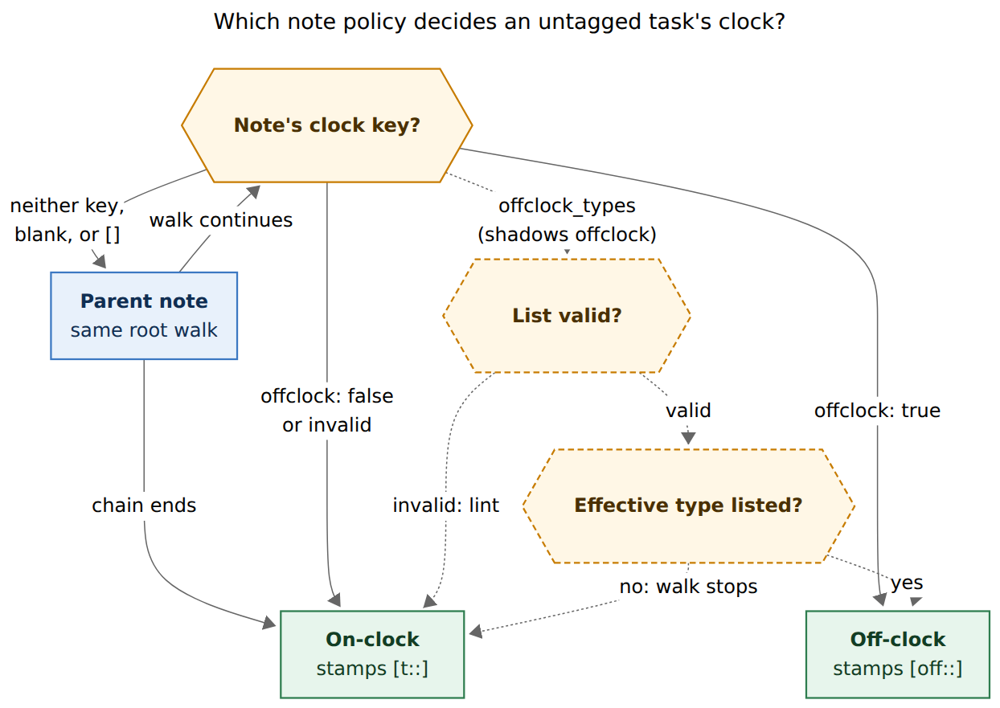
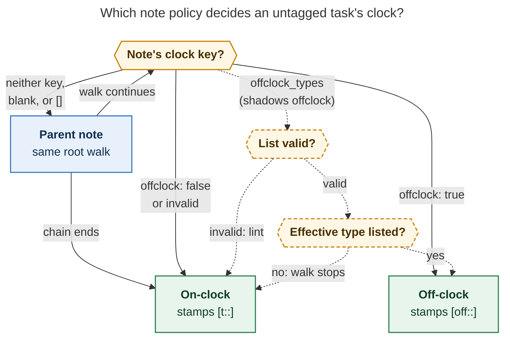

# `offclock_types`: off-clock by area and task type

Consolidated report, 2026-11-05. It merges five independent reports (`__cdx`,
`__cld`, `__grk`, `__mus`, `__gem` in this directory) with my own checks of
bob-cli at `7e437418`, bob-plugins at `cfb331e`, and read-only `bob query` /
`bob stats` runs against the live vault. No code, vault note, or memory file was
changed.

## Bottom line

**Build it.** A list-valued `offclock_types` key on area and project notes,
read on the same root walk as `offclock:`, is the right design. It is the only
proposed shape that expresses what you want: meetings in your life areas are
off the clock, while meetings under `job` and focused chores in `love` stay
Worked. Neither a global rule nor an area-wide rule can say that.

The feature is small in Rust. Most of the work is keeping the Obsidian copy of
the clock logic in step, plus three traps every implementation must avoid:

1. **Match the task's *effective* type, not just a literal `[type::]` field.**
   Effective type is the full inheritance chain: field, reading rule, note
   default, then `plan.default_type`. It must work for closed tasks too.
2. **The nearest note that declares a clock policy decides.** If its list does
   not include the task's type, the task is on-clock and the walk stops there.
   It does not fall through to a parent's `offclock: true`.
3. **Fix the `bob gcal list` preview.** It checks the clock using a made-up
   task line with no type, so after migration it would show love events as
   on-clock while sync writes them off-clock.

I also recommend six adjustments to your requirements, flagged ⚠️ in
[§5](#5-requirement-adjustments). The most important for the migration is
**⚠️ A3**: when one note has both keys, `offclock_types` wins. That allows a
safe two-step migration across your three machines.

The vault migration is safe for your history:

- All 10 closed off-clock Pomodoro rows are MEET sessions linking Event Tasks
  that carry an explicit `[type:: MEET]`, so none will drift.
- What changes is the future. The **24 open `love` tasks and 5 open `body`
  tasks** all inherit CHORE and carry no clock tag, so their sessions will
  start counting as Worked.
- Your in-progress task in `bob.md` says that is what you want: "Start only
  marking [[love]] and [[body]] MEET tasks with `#off`!"

## 1. What exists today (verified)

| Fact | Evidence |
| --- | --- |
| **Clock order today.** The first match decides: `#on` on the task line, then `#off` or an alias, then the nearest area/project `offclock: true\|false` on the root walk, then on-clock. | `pomodoro_homes/clock.rs` `effective_clock` / `resolve_note_default`; `decisions:off-clock-follows-tag-then-note-default` |
| **The walk.** It starts at a valid `[root::]` target, otherwise at the task's own note. It follows `parent:` links and visits each note at most once. Notes that are neither areas nor projects are walked through, and their keys are ignored with a lint. An invalid nearer value stops the walk on-clock. A daily note with no `[root::]` gives no default. | `clock.rs:150-222`; `docs/capture.md` "Which clock a session is on" |
| **`offclock:` parsing.** It is a strict scalar: `true`, `false`, or invalid. Absent or blank means inherit. A list or mapping is invalid. | `facts.rs` `parse_note_offclock` via `frontmatter_scalar` |
| **No list parser exists for this field yet.** The nearest one is the `project_name_aliases` reader. It handles flow and block lists but drops bad entries one by one. | `projects/scan.rs:545+` |
| **Effective type (PT13) already uses the same walk as the clock.** Order: field, then reading rule, then nearest `task_type:`/`theme:`, then `plan.default_type`. Both walks begin at `root_walk_start` and use the same `residence_chain`. | `pomodoro_themes/suggest.rs:81-200` |
| **`suggest_for_task` returns nothing for closed (`[x]`, `[-]`) tasks.** It needs the type catalog only for display names. It needs `PlanConfig` for `reading_type` and `default_type`. | `suggest.rs` `is_closed_task`, `with_global_default` |
| **A note's `task_type: off` blocks parent defaults but not `plan.default_type`.** `with_global_default` wraps `note_default`. | `suggest.rs` |
| **Event Tasks are MEET by construction.** Sync writes `[type:: MEET]` whenever the inherited suggestion is not already MEET. | `gcal/render.rs` `needs_meet_type` |
| **`bob gcal list` checks the clock with a line that has no type.** The check uses `- [ ] #task Event [root:: X]`. Sync is different: it resolves the line it actually wrote, so it is fine. | `gcal/clock.rs` `probe_line`; `gcal/plan.rs` `apply_effective_clocks` |
| **Obsidian has its own copy of the clock logic.** `taskEffectiveClockResolution` reads only `frontmatter.offclock`. task-status-cycler calls it through `taskEffectiveOffClock` and falls back to tags only. The plugin can already read `plan.default_type` and `reading_type` through `loadPlanCaps()`. | bob-ledger-tools `036-pomodoro-clock.js`, `279-plugin-task-theme-api.js:641-666`, `050-plan-budget.js` |
| **Shared clock test cases.** 23 cases with keys `id, now, token, day, notes, expected_*`. There is no `config` member, so no case can set `plan.default_type` yet. | `tests/fixtures/pomodoro_clock/vectors.json` |
| **Type rename only rewrites `task_type:`/`theme:` and task fields.** Split leaves both alone. | `pomodoro_themes/coverage.rs:3-5` |
| **Which writes re-stamp a running row's clock.** A running row's clock key is re-stamped only when its set of linked tasks changes. Editing a tag or root on an already-linked task does not re-stamp it; close does. Naming an entry retypes its open linked tasks. | `docs/capture.md:4051-4058`, `:9542` |

## 2. Vault evidence (read-only, 2026-11-05)

- **Exactly two notes declare `offclock`.**
  - `love.md`: `offclock: true`, `theme: CHORE`, parent `area`.
  - `body.md`: `offclock: true`, no type default (so `plan.default_type: CHORE`
    applies), parent `area`.
  - `area.md` and `meet.md` have no `offclock`. `meet.md` has
    `task_type: MEET`.
  - No note has `offclock_types` yet.
- **About 28 child notes sit under love or body.** They include the areas `abby`,
  `family`, `fun`, `kelly`, and `vacation`, and the non-area notes `gym`,
  `dentist`, `dog`, and `outlive`. The archive notes `done/love_done.md` and
  `done/body_done.md` also sit there. So archived tasks still reach the policy.
- **Open tasks that will flip to Worked.**
  - love: 24, body: 5.
  - All 29 inherit their type (none has a `[type::]` field).
  - None has `#on` or `#off`.
- **Closed off-clock rows.** All 10 `[off::]` rows in 2026 are `— MEET`. Each
  links a same-day Event Task.
  - Every November Event Task rooted in love or body carries an explicit
    `[type:: MEET]`: 9 rooted at `abby`, 1 at `body`.
  - So migrating creates no new `clock_drift` on closed history. This confirms
    cld.
- **Drift baseline.** `bob stats` shows **one** `clock_drift` warning today,
  before any change. Record that number before migrating so the after-count can
  be compared.
- **Intent.** Two tasks in `bob.md` are in progress:
  - "Start only marking [[love]] and [[body]] MEET tasks with `#off`!": this
    feature.
  - "Stop counting `#off` tasks as a part of task limit!": a sibling task being
    worked on athena. No commit for it has landed yet.
- **A pitfall for anyone checking types with Dataview.** On daily-note task
  rows, Dataview's `type` falls back to the page's own frontmatter
  `type: [[day]]`. Any check must parse the task line, never read Dataview's
  `task.type`.

## 3. Is this a good idea?

**Yes.** `offclock: true` covers more than you want: every untagged task under
love or body is off-clock today. That includes "Clean Lenard's ears" and the
CT-scan admin tasks, which are focused work you choose to sit down and do. The
first use case is a correction, not a speculative filter. It relies on a field
that calendar sync already writes reliably.

What it gets right:

- **The right scope: area plus type.** Only a note-scoped key can say "MEET,
  but only under love and body."
- **It reuses what is already decided.** Tags still win. Closed rows stay
  frozen. Nothing is written onto task lines. The rule that a session with any
  on-clock link counts as Worked is unchanged.
- **The cause is visible.** The type pill on each row shows why a task is
  off-clock. You can change it by retyping, or with `#on` / `#off`.

What it costs, and you should accept these on purpose:

1. **Type becomes an input to accounting.** Retyping a task, a type default
   changing above it, or editing its `[root::]` can now change its clock.
   - The less obvious path: naming a running Pomodoro retypes its open linked
     tasks. So naming a love session `MEET` turns its CHORE task into MEET, and
     the session becomes off-clock when it closes.
   - That is consistent ("a love meeting is off the clock") but new. It is why
     ⚠️ A6 exists.
2. **Off-clock activities other than meetings lose their default.** The
   glossary's own examples of off-clock time are "lunch, the gym, school
   pickup."
   - After the migration, a session linked to a non-MEET love or body task
     counts as Worked.
   - Ways out: `#off` on that task; add its type to the list
     (`[MEET, GYM]`); or give a child note its own `offclock: true`.
   - Today `gym.md` has no `type:`, so a key there would be ignored. It would
     need `type: [[area]]` first.
3. **Mixed sessions get more common.** A session linking a love MEET and a love
   CHORE is now Worked in full (`pomodoro_clock_mixed`). This is the existing
   rule, applied to more cases.
4. **A hand-written event with no type is not MEET.** It inherits CHORE and
   becomes on-clock. Sync-written rows are safe. Don't let membership in
   `## Events` imply MEET; that would mix up where a row sits with what type it
   is.

### Alternatives considered

| Alternative | Verdict |
| --- | --- |
| Global "MEET is off-clock" (config or a `types:` attribute) | Rejected: job meetings would leave Worked. The need is per area. |
| Put the list on `meet.md` | Rejected: the clock follows the task's root, not where its type is defined. A lunch rooted at `abby` never visits `meet.md`. |
| Let `offclock:` take either a boolean or a list | Rejected: Obsidian gives a property name one type across the whole vault. Every parser would also need three shapes, and a value that is invalid today would gain a new meaning. |
| Filter by Event Task (`offclock: events`) | Runner-up. It needs no type lookup, but it misses MEET tasks you capture by hand, keeps a retyped event off-clock, and ignores the type vocabulary you already use. |
| `onclock_types` exceptions under `offclock: true` | Rejected: wrong direction for this case. Every new type would default to off-clock. |
| Calendar sync writes `#off` on love/body events | Rejected by the existing decision record: it fights Google titles and rewrites history when routing changes. |
| No code: drop `offclock: true` and type `#off` in calendar titles | Works today as a fallback, but brings back the per-event friction `offclock:` was built to remove. |
| A general rules engine (conditions, unions, wildcards) | Too much for two notes and one type. |

## 4. Where the researchers disagreed, and how I resolved it

| Question | Positions | Resolution |
| --- | --- | --- |
| **Type not in the list: stop or keep walking?** | cdx, cld, grk, gem: stop, on-clock. mus: keep walking, so a parent's `true` still applies. | **Stop.** Otherwise a child list can never narrow a parent's `true`. Stopping also matches how `task_type:` and `offclock: false` already work. A child that wants both restates the parent's list. |
| **Both keys on one note** | cdx: lint, boolean wins. cld: list wins, plus a `note_offclock_shadowed` lint. grk: `false` wins, a list beats `true`. mus: a valid boolean wins. gem: conflict lint, on-clock. | **The list wins whatever `offclock:` says, with a stats-only `note_offclock_shadowed` lint.** One rule, and the only one that allows a dual-key rollout (§8). If the boolean wins (cdx, mus), adding the list does nothing until the boolean is deleted. gem's rule would put love's MEETs on-clock during the rollout, the worst outcome. |
| **Empty value (`[]`, blank, null, a lone `-` item)** | cdx, gem: valid, matches nothing, stops (= all on). grk, mus: invalid. cld: inherit. | **No declaration: inherit, with no lint.** A third-party report says Obsidian writes an emptied list as a bare `key:` or a lone `-` item, not `[]` (secondhand evidence; pin all three shapes with tests). Obsidian's Properties panel shows them all as an empty field, so giving them different accounting meanings would be invisible to you. `offclock: false` already provides an explicit "everything on-clock". |
| **Scalar shorthand `offclock_types: MEET`** | cld, grk, mus, gem: accept. cdx: reject. | **Accept** as a one-item list. Writers emit the block-list form. |
| **One bad entry** | cdx, cld, mus: the whole key is invalid. grk: drop that entry and keep the rest. | **The whole key is invalid**: on-clock, stop, lint. Blank entries are the exception and are skipped. A typo should fail toward Worked loudly, the same way `offclock: maybe` does today. |
| **What "type" means** | cdx, cld, grk, mus: full effective type, closed tasks included. gem: field plus note `task_type:` only, no config. | **Full effective type, from the task's own walk start.** gem's sketch has two bugs: it reads the *declaring note's* `theme`, not the nearest type default on the task's walk, and it compares with ASCII case-folding instead of `normalize_component`. It also skips `plan.default_type`, so `offclock_types: [CHORE]` would never match an untyped body task. |
| **`bob gcal list` check** | cdx, cld, mus: must add the type. grk, gem: not mentioned. | **Required** (verified in `probe_line`). |
| **Type rename and split** | cdx, grk: include. Others: silent. | **Include rename; split keeps the list and warns** (cdx). Otherwise renaming MEET silently moves love meetings to Worked. |
| **Re-stamp a running row when a linked task's type changes** | Only cld (restamp on every type-changing write). | **Narrower:** re-stamp in the naming/rename-entry path, which already rewrites that running row. Elsewhere, document that close corrects it, as tag and root edits already work today. |
| **Migration order** | cdx, grk: upgrade every host, then one edit. cld: dual-key. mus: audit each area. gem: edit the vault, then sync plugins. | **Dual-key** (§8). gem's order is unsafe: old plugins would read love MEETs as on-clock. mus's per-area audit is already settled by §2: two notes, and your intent is stated. |
| **JSON and tooltip** | cld: optional `clock_type`. gem: tooltip shows the type. grk, mus: no change. cdx: optional explanation. | **No required change in v1.** Keep `clock_source: "note"` and `clock_note`. An additive `clock_type` and a tooltip like `Off-clock · MEET from love` are fine follow-ups. |

## 5. Requirement adjustments

- **⚠️ A1: Match the effective type.**
  - A task matches when its effective type key (`normalize_component`) is in
    the list.
  - Effective type, first match wins: the task's `[type::]`/`[theme::]` field;
    the reading rule; the nearest `task_type:`/`theme:` default; then
    `plan.default_type`.
  - Closed tasks are included: use the field if present, otherwise inherit.
  - Resolve from the task's own walk start, not from the note that declares
    the list.
  - Types not in the configured catalog still match.
- **⚠️ A2: The nearest declaration is a complete policy.**
  - The walk stops at the first area or project note that declares
    `offclock:` or a non-empty `offclock_types`.
  - A type that isn't listed is on-clock, with source `note`.
- **⚠️ A3: The list wins on a note that has both keys.**
  - `offclock:` on that note is ignored, whatever its value.
  - A stats-only lint, `note_offclock_shadowed`, reports it. There is no
    per-capture warning.
  - Writers and the migration should leave this state temporarily at most.
- **⚠️ A4: Value rules.**
  - Accept flow lists, block lists, or a scalar.
  - Canonicalize each item with `canonical_theme_name`. Deduplicate by key.
  - An empty value, blank, null, `[]`, or a list of only blank items means
    no declaration (inherit).
  - The whole key is invalid if any non-blank item is one of these:
    - a composite (`A + B`)
    - a mapping or nested list
    - a non-string
    - a reserved clock name (`OFF`, `ON`, …)
  - An invalid key means on-clock, the walk stops, and `note_offclock_invalid`
    is raised, with the key named in the message. That reuses the existing
    code path through capture warnings and the plugin.
  - On notes that are neither areas nor projects, the key is ignored with
    `note_offclock_ignored` and the walk continues.
- **⚠️ A5: Type operations cover the new list.**
  - `bob types rename` rewrites matching entries in its existing previewed
    transaction, and deduplicates when a rename merges into an existing name.
  - `split` keeps the list and reports the remaining reference.
- **⚠️ A6: Make the gcal preview and the re-stamp rules honest.**
  - The `bob gcal list` check adds `[type:: MEET]` to its probe line for task
    rows. The deprecated-tag advice "already off-clock via love" uses the same
    check, so it is fixed too.
  - Naming or renaming a running entry recomputes that entry's clock key in the
    same write.

These stay as they were:

- Tags take precedence.
- The rule for sessions with several links.
- Frozen closed rows.
- Ended off-clock Event Tasks still settle.
- The name `offclock_types`. It matches `bob types` and `types:`;
  `offclock_task_types` would only matter if confusion with the note's own
  `type:` became a real problem.
- No `!` in the release notes: the change is additive.

## 6. Proposed contract



*Figure 1. Clock tags (`#on`, `#off`) are checked first, as today. For an
untagged task, the walk stops at the nearest area or project note that declares
a clock key. A valid `offclock_types` list sends only the listed effective types
off the clock; any other type is on-clock and the walk stops there. Dashed paths
are new. Rendered with Mermaid CLI 12.0.0 at 828.7 × 588 px (78.8% fit).*



Proposed wording for the vault-format docs:

> A task's clock is decided by the first match:
>
> 1. **`#on`** on the task line: on-clock.
> 2. **`#off`** or a deprecated alias: off-clock. This beats
>    `offclock: false` and an `offclock_types` list that doesn't include the
>    task's type.
> 3. **The nearest area or project note on the root walk that declares a clock
>    policy:**
>    - **`offclock_types: [T, …]`**: off-clock if the task's effective type is
>      listed, otherwise on-clock. It overrides an `offclock:` on the same note.
>    - **`offclock: true|false`**: as today.
>    - **An invalid value**: on-clock.
> 4. **No declaration:** on-clock.

## 7. Implementation sketch

### bob-cli

1. **`pomodoro_homes/facts.rs`.**
   - Add `offclock_types: Option<NoteOffClockTypes>` with two variants:
     `Keys(BTreeSet<String>)` holding canonical display names unique by key,
     and `Invalid(String)`.
   - Add a strict `frontmatter_string_list(frontmatter, key)` helper beside
     `project_name_aliases`. It must handle flow lists, block lists, a scalar,
     comments, and blank items, and report a non-string item as invalid.
   - Leave `frontmatter_scalar` alone.
2. **A catalog-free effective-type helper.**
   - Extract `effective_type_key(resolver, rules, residence, line) ->
     Option<String>` from `suggest.rs`. It reads the field even on closed
     rows.
   - `suggest_for_task` then uses the same helper, so the type pill and the
     clock cannot drift apart. That includes the
     `task_type: off`-plus-global-default behavior.
3. **Type rules on the resolver.**
   - `HomeResolver` holds an optional `TypeRules { reading, default }`.
   - Commands that already have a `PlanConfig` inject it: stats, gcal,
     capture, and settle. Otherwise it loads lazily on the first
     `offclock_types` hit, the same pattern as `needs_meet_type`.
   - Tests inject it. This avoids touching about 44 `HomeResolver::new` call
     sites.
   - Only resolve the type when a list is found. Tag checks and boolean
     policies stay as cheap as today.
4. **`clock.rs::resolve_note_default`.**
   - Pass in `line` and the walk start.
   - For each area or project note in the chain:
     - `offclock_types` present: lint `note_offclock_shadowed` if `offclock`
       is also there, then decide.
     - Otherwise: the existing `offclock` arm.
   - Keep `ClockSource::Note`. An optional `clock_type` field on
     `ClockResolution` is for later.
5. **Lints.** Add `note_offclock_shadowed` to `ResolverHealth` and to the
   stats health messages. Extend the invalid and ignored messages to name the
   key.
6. **gcal.** Add `[type:: MEET]` to `probe_line` when `task` is true. Test that
   `bob gcal list` and `bob gcal sync` agree for a love-rooted event, with and
   without an inherited MEET.
7. **Running rows.** In the naming and rename-entry paths, recompute the
   running entry's key using the existing lineup-restamp helper. Document that
   close corrects all other retypes.
8. **Rename coverage.** In `coverage.rs`, handle `offclock_types` entries in
   flow, block, and scalar form. Split reports them.
9. **Shared test cases.** Add a `config` member to the schema of
   `pomodoro_clock/vectors.json`. Cover:
   - a love MEET event (off) and a love CHORE task (on);
   - mixed MEET + CHORE, which is Worked and raises `pomodoro_clock_mixed`;
   - a child list narrowing a parent `true`;
   - a child `false` under a parent list;
   - both keys on one note: the list wins and the shadowed lint fires;
   - a scalar value;
   - each empty shape: `[]`, blank, null, and a lone `-` item, all inheriting;
   - an invalid item;
   - a list on a non-area note: ignored, and the walk continues;
   - `#on` on a MEET task and `#off` on a CHORE task;
   - a MEET inherited through a `meet` root with no field;
   - a closed `[x]` task with no field;
   - a CHORE that comes only from `plan.default_type`;
   - a reading task;
   - `task_type: off` combined with a global default.
10. **The sibling task-limit work** should call `effective_clock`, not
    `line_clock_tag`. Otherwise the two features will disagree about which
    tasks are off-clock.

### bob-plugins

- `036-pomodoro-clock.js::taskEffectiveClockResolution`:
  - Read `frontmatter.offclock_types` (an array or a string) with the same
    rules.
  - When a list is found, compute the type key with a new helper that also
    handles closed tasks. Build it on `pomodoroThemeTaskFieldState` and
    `pomodoroThemeResolveWithoutTaskField`, and feed it
    `loadPlanCaps().caps.defaultType` and `readingTheme`.
  - Parse the task line for its type. Never use Dataview's `task.type`.
- The off-clock link chips, home chips, gcal event clock, and
  task-status-cycler all go through this one function, so they pick up the
  change automatically. The cycler's tags-only fallback keeps working as it
  does today.
- Copy the test cases byte-for-byte. Add rows to the tables in
  `docs/off-clock-link-chips.md`. Run `npm test`, `npm run build:check`, and
  `docs:check`, then `bob plugins sync` on each host.
- Optional: register `"offclock_types": "multitext"` in `.obsidian/types.json`
  so the Properties panel shows a list editor.

### Docs and memory

- **Docs to update:**
  - `docs/reference/vault-format.md`: the clock table.
  - `docs/capture.md`: "Which clock a session is on" and the writer table,
    including the re-stamp on naming.
  - `docs/off-clock-link-chips.md`.
  - `docs/task-types.md`: the effective-type cross-reference and rename
    coverage.
  - `docs/gcal.md`, `docs/stats.md` (drift after narrowing), and
    `docs/task-status-hooks.md`.
- Run `just docs-gen` and `just docs-check`.
- **Decision record.** Add a new record, for example "Off-Clock Note Defaults
  Can Filter By Task Type", that partly supersedes
  `decisions:off-clock-follows-tag-then-note-default`.
- **Glossary.** Update `off-clock-pomodoro`, `area-note`, and `project-note`.
- Make the memory changes with `/sase_memory_write` during implementation.

## 8. Migration runbook

Your three machines (athena, apollo, the Mac) update bob-cli on the daily
release train and Obsidian plugins through `bob plugins sync`, so they will run
different versions for a while. If the vault drops `offclock: true` before
every host has upgraded, any old host would treat love and body MEETs as Worked
and freeze them that way. That matters most for whichever host runs calendar
sync, and for Obsidian closes on the Mac. ⚠️ A3 avoids this:

1. **Ship** bob-cli and bob-plugins with the feature.
2. **Dual-key phase.** Add the list next to `offclock: true` in `love.md` and
   `body.md`:

   ```yaml
   offclock: true
   offclock_types:
     - MEET
   ```

   - Old binaries ignore the new key and keep today's behavior.
   - Upgraded ones narrow to MEET and show `note_offclock_shadowed`.
3. **Confirm the upgrades.** Check `bob --version` and the plugin sync on
   athena, apollo, and the Mac.
4. **Before the cutover:**
   - Record the `bob stats` drift count. It is 1 today.
   - Re-scan love- and body-rooted Event Tasks for any that lack effective
     type MEET.
   - Finish or check any running love or body session.
5. **Delete `offclock: true`** from both notes. Change nothing else: no task
   tags, child notes, or archives. Review `git -C ~/bob diff` and let
   vault-sync run.
6. **Verify:**
   - `bob gcal list` shows love events as `· off-clock via love`.
   - Starting a love CHORE task previews `[t::]`.
   - A CFG Appt previews `off-clock via body`.
   - The drift count is unchanged; none is expected, because the closed rows
     are all MEET.
   - Off chips appear only on MEET links.

To roll back, put `offclock: true` back. Sessions recorded in the meantime keep
their keys.

## 9. Open questions for Bryan

1. **Non-MEET off-clock time in body.** Should gym, lunch, and similar time
   stay off-clock? If so, which of these do you want?
   - `#off` on those tasks
   - an extra type in the list
   - a child area note with `offclock: true`
2. **Type-change re-stamps.** Is the narrow scope enough: naming re-stamps, and
   everything else is corrected at close? Or do you want every retype to
   re-stamp a running row?
3. **Hand-written untyped events.** Confirm these stay on-clock until you type
   them MEET.

## 10. Recommended solution

Ship **`offclock_types`** as a list-valued area and project frontmatter key on
the existing clock root walk:

1. **Tags first:** `#on` and `#off` still win.
2. **Nearest declaration wins:** on a note with a list, a task is off-clock
   exactly when its effective type is listed. Effective type uses the full
   chain, from the task's own walk start, closed tasks included. Anything else
   is on-clock and the walk stops.
3. **On a note with both keys, `offclock_types` wins**, with a stats-only
   `note_offclock_shadowed` lint.
4. **Value rules:** a list or a scalar. Canonical names. Any empty shape
   inherits. Any bad item makes the key invalid: on-clock plus
   `note_offclock_invalid`. Ignored on notes that are neither areas nor
   projects.
5. **One implementation per runtime:** a catalog-free `effective_type_key`
   shared with the type suggestions, plus type rules held on `HomeResolver`.
   The Obsidian copy is updated in bob-ledger-tools'
   `taskEffectiveClockResolution` and pinned by the shared test cases, which
   gain a `config` member.
6. **Fixes alongside:**
   - the `bob gcal list` check gains `[type:: MEET]`;
   - type rename covers the lists;
   - naming a running entry re-stamps its clock;
   - the task-limit work uses `effective_clock`.
7. **Migrate in two steps:** dual-key first, then remove `offclock: true` from
   `love.md` and `body.md` once every host runs the new code.
8. **Record it:** a new decision record that partly supersedes
   `off-clock-follows-tag-then-note-default`, and glossary updates.

This gives you exactly "only love and body meetings are off the clock" today.
It rewrites no closed history, keeps one resolver behind every surface (capture,
close, gcal, settle, stats, Obsidian chips, and the status cycler), and leaves
room for lists like `[MEET, GYM]` later.

## Sources

- Researcher reports in this directory:
  - `offclock_types_area_type_clock__cdx.md`: contract matrix, writer
    boundaries, rename coverage.
  - `offclock_types_area_type_clock__cld.md`: vault drift audit, dual-key
    migration, the gcal check, running-row re-stamps.
  - `offclock_types_area_type_clock__grk.md`: vault survey, the complete-policy
    framing, and two figures. Its `clock-resolution.*` and
    `love-body-migration.*` files moved here with it.
  - `offclock_types_area_type_clock__mus.md`: hot-path cost, the type-source
    trap, the per-area audit concern.
  - `offclock_types_area_type_clock__gem.md`: dual-runtime survey, tooltip
    idea. Its example tasks are illustrative, not vault data.
- Memory: `decisions:off-clock-follows-tag-then-note-default`,
  `decisions:off-clock-pomodoros-count-apart`, `glossary:off-clock-pomodoro`,
  `glossary:task-type`.
- [Obsidian Properties documentation](https://obsidian.md/help/properties):
  list properties, and one type per property name across the vault.
- [inkeep/open-knowledge PR #400](https://github.com/inkeep/open-knowledge/pull/400):
  secondhand account of how Obsidian writes empty list properties (blank item
  or null).
