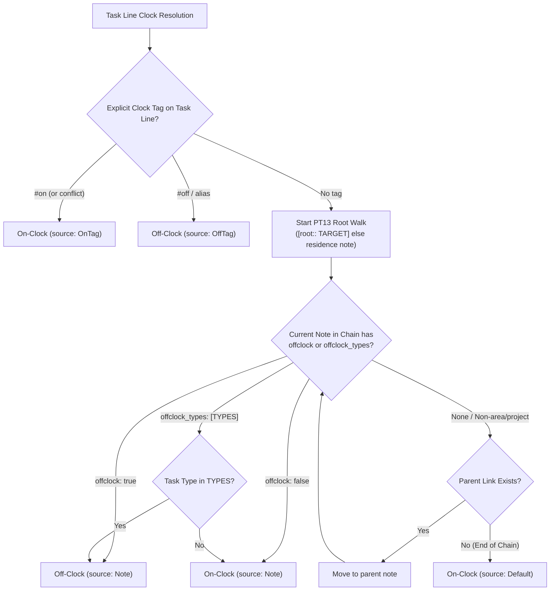

# Research & Critique: Introducing `offclock_types` Area/Project Property

**Author:** Researcher `gem` (5-Researcher Swarm)  
**Date:** 2026-11-05  
**Topic:** Adding `offclock_types` frontmatter property to area/project notes, migrating `love.md` and `body.md` to filter for `MEET`, critiquing the proposal, and establishing the end-to-end implementation blueprint across `bob-cli` and `bob-plugins`.

---

## Executive Summary

The proposal to introduce an `offclock_types` frontmatter property on area and project notes—and subsequently migrate `love.md` and `body.md` from `offclock: true` to `offclock_types: [MEET]`—is **conceptually sound, addresses a major operational friction point in Bob's day-to-day use, and should be implemented**.

However, the change introduces critical subtleties that require explicit architectural boundaries:
1. **Clock Resolution vs. Type Resolution Coupling:** Clock resolution (`effective_clock` in `bob-cli` and `taskEffectiveClockResolution` in `bob-plugins`) has historically been decoupled from the task type catalog and plan configuration. Coupling clock resolution to task types must be implemented cleanly—resolving task type via explicit inline field `[type::]` first, falling back to inherited note default `task_type:`—**without** introducing heavyweight catalog dependencies into the hot synchronous clock evaluation path.
2. **Inheritance & Conflict Semantics:** Bob follows a strict "nearest note default wins" inheritance model. `offclock_types` must act as a complete note default that stops the root walk (i.e. non-matching tasks in that area are strictly on-clock and do not fall through to ancestor `offclock: true` settings). Furthermore, specifying both `offclock` and `offclock_types` on the same note must be treated as a conflicting definition with an explicit health lint.
3. **Migration & Historical Clock Drift:** In Bob's frozen-history model (Decision `off-clock-follows-tag-then-note-default`), closed Pomodoro entries never have their recorded keys (`[off::]` / `[t::]`) rewritten. Migrating `love.md` and `body.md` will cause historical closed sessions linking non-`MEET` tasks in those areas to recompute as on-clock while stamped `[off::]`, tripping Bob's `session_drifted` check and surfacing `clock_drift` warnings in `bob stats`. A clear migration policy and audit step are mandatory.

Below is the complete architectural analysis, critique of alternatives, justified adjustments to requirements, and full implementation blueprint.

---

## 1. Background & Current Architecture

### 1.1 How `offclock` Works Today
In current Bob architecture (established in Decision `off-clock-follows-tag-then-note-default` and `off_on_tags_and_offclock_areas.md`), a task's effective clock determines whether Pomodoro sessions linking it are stamped with the work clock `[t:: Nm]` or off-clock `[off:: Nm]`, and whether ended Event Tasks settle automatically (Decision `ended-off-clock-events-settle`).

The precedence is:
1. Standalone `#on` on the task line $\rightarrow$ **On-clock** (wins conflicts over off spellings).
2. Standalone `#off` (or deprecated aliases `#offclock`, `#off-clock`, `#untracked`) $\rightarrow$ **Off-clock**.
3. The nearest area or project note default on the task's PT13 root walk:
   - `offclock: true` $\rightarrow$ **Off-clock**.
   - `offclock: false` $\rightarrow$ **On-clock**.
   - Invalid nearer value (e.g. `offclock: maybe`) $\rightarrow$ **On-clock** (with `note_offclock_invalid` lint).
4. Fallback $\rightarrow$ **On-clock** (`ClockResolution::default()`).



### 1.2 Dual Implementation Surface
Because Bob operates both as a command-line tool (`bob`) and inside Obsidian (`bob-plugins`), this clock evaluation logic is duplicated across two runtimes:
- **`bob-cli` (Rust):**
  - Parsing: `src/native/pomodoro_homes/facts.rs` (`parse_note_offclock`).
  - Resolution: `src/native/pomodoro_homes/clock.rs` (`effective_clock`, `resolve_note_default`).
  - Lints: `src/native/pomodoro_homes/resolve.rs` (`note_offclock_invalid`, `note_offclock_ignored`).
  - Stats validation: `src/native/stats/homes.rs` (`session_drifted`).
- **`bob-plugins` (TypeScript / Vanilla JS):**
  - Resolution: `plugins/bob-ledger-tools/src/036-pomodoro-clock.js` (`taskEffectiveClockResolution`).
  - Close execution: `plugins/task-status-cycler/src/062-pomodoro-clock.js` (`taskEffectiveOffClock`).
  - UI link chips: `plugins/bob-ledger-tools/src/141c-off-clock-link-chips.js` (`offClockLinkChipModel`).
- **Shared Specification:**
  - `tests/fixtures/pomodoro_clock/vectors.json` serves as the byte-for-byte conformance contract copied between `bob-cli` and `bob-plugins`.

---

## 2. Critique of the Plan

### 2.1 Is This a Good Idea?
**Yes.** The problem it solves is real and represents the natural evolution of Bob's area defaults.

When `offclock: true` was introduced, its primary beneficiary was Google Calendar event synchronization (`bob gcal sync`). Bryan routes calendar events using `@love` and `@body`. These sync into daily notes under `## Events` with `[root:: love] [type:: MEET]` or `[root:: body] [type:: MEET]`. With `offclock: true` on `love.md` and `body.md`, these personal appointments automatically settled when ended and did not clutter work time.

**The unintended consequence of `offclock: true`:**
Area notes in Bob are not merely calendar categories; they represent entire life domains. Under `love.md` and `body.md`, Bryan also tracks personal projects, health goals, family administration, financial planning, and household tasks:
- `- [ ] #task 45m High-intensity cardio ^workout`
- `- [ ] #task Prepare family tax return documents ^taxes`
- `- [ ] #task Research pediatric dentist specialists ^dentist`

Because `love.md` and `body.md` carried `offclock: true`, **any focused Pomodoro session run against these tasks was stamped `[off:: Nm]`**. If Bryan spent 50 focused minutes doing family finances, that time was excluded from `Worked` metrics unless he remembered to decorate the task line with `#on`. 

This inverted Bob's core philosophy: focused personal work was penalized as untracked by default, simply because calendar events in that same domain needed to be off-clock.

`offclock_types` resolves this asymmetry directly: it allows calendar meetings (`MEET`) to be off-clock by default, while allowing ordinary focused tasks in the same area to remain on-clock (`Worked`).

---

### 2.2 Critique of Alternative Approaches

Before committing to `offclock_types`, four alternative architectures were evaluated:

| Alternative | Architecture | Verdict | Rationale for Rejection |
| :--- | :--- | :--- | :--- |
| **Alt 1: Global `MEET` Off-Clock Rule** | Make `MEET` globally off-clock in `config.yml` (`offclock_types: [MEET]`). | **Rejected** | Work meetings (`[root:: job] [type:: MEET]`, `[root:: sase] [type:: MEET]`) constitute a major portion of a knowledge worker's day and **must count as Worked**. Off-clock status is fundamentally area-dependent, not type-dependent alone. |
| **Alt 2: Gcal Route-Level Configuration** | Add `offclock: true` to `@love` route in `~/.config/bob/config.yml`. | **Rejected** | Breaks the rule that the vault is the source of truth. Does not apply to manually created Event Tasks in Obsidian, capture syntax (`bob capture`), or tasks outside Gcal sync. |
| **Alt 3: `onclock_types: [...]` Inversion** | Keep `offclock: true` on areas, but specify which types are on-clock. | **Rejected** | Contradicts Bob's base philosophy that the system default is on-clock (`Worked`). Requires maintaining an open-ended, brittle list of work task types instead of a concise off-clock filter (usually just `[MEET]`). |
| **Alt 4: Pure `#off` Tagging (No Note Defaults)** | Deprecate area defaults; require explicit `#off` on personal calendar events. | **Rejected** | Rejected in Decision `off-clock-follows-tag-then-note-default`. Clutters Google Calendar titles on mobile devices and causes constant sync churn between calendar titles and task text. |

**Conclusion:** Note-level `offclock_types` on area/project frontmatter is the only design that preserves area-specific context while maintaining the vault as the single source of truth.

---

## 3. Key Architectural Challenges & Solutions

### 3.1 Challenge 1: Decoupled Type Resolution in Clock Evaluation

#### The Problem
In `bob-cli`, task type resolution (`pomodoro_themes::suggest::suggest_for_task`) requires `&Catalog` (loaded from daily notes) and `&PlanConfig` (from YAML config). In contrast, `effective_clock` in `pomodoro_homes::clock.rs` is lightweight, taking only `(&mut HomeResolver, &Path, &str)`.

Similarly, in `bob-plugins`, `plugins/task-status-cycler/src/062-pomodoro-clock.js` runs synchronously inside editor key handlers (Ctrl+Enter) without any reference to the type catalog.

If determining whether a task matches `offclock_types: [MEET]` required loading the full theme catalog, clock resolution would suffer massive performance degradation and architectural coupling.

#### The Solution: Structural Type Inspection
A task's effective type for clock matching can be determined purely through structural inspection without the theme catalog:
1. **Explicit inline field on task line:** Inspect `[type:: VALUE]` or `(type:: VALUE)` (or legacy `theme::`) using `parse_task_theme(line)`.
2. **Inherited note default:** If no inline field exists on the task line, inspect `task_type:` on the notes along the PT13 root walk. Note that `NoteFacts` in `src/native/pomodoro_homes/facts.rs` **already parses `task_type:`** into `NoteTheme::Name(String)`!
3. **Compare string keys:** Normalize the resolved type name using `normalize_component(name)` and check membership in `offclock_types`.

This requires **zero catalog loading** and **zero plan config access**, allowing `effective_clock` in Rust and `taskEffectiveClockResolution` in JS to remain purely synchronous and blindingly fast.

---

### 3.2 Challenge 2: Walk Termination & Inheritance Semantics

#### The Problem
Suppose `life.md` (Area) defines:
```yaml
---
type: [[area]]
offclock: true
---
```
And child area `fitness.md` (parent: `[[life]]`) defines:
```yaml
---
type: [[area]]
parent: [[life]]
offclock_types:
  - MEET
---
```
If a task in `fitness.md` is NOT of type `MEET` (e.g. `100 pushups`), does `fitness.md` decide it is on-clock? Or does the walk continue up to `life.md` where `offclock: true` catches it?

#### The Solution: Nearest Note Default Terminates the Walk
Under Bob's PT13 inheritance architecture (established across `color:`, `task_type:`, and `offclock:`):
- **Nearest note default wins.**
- Properties do **not** merge, cascade, or fall through.
- When `fitness.md` defines `offclock_types: [MEET]`, it establishes the complete clock policy for `fitness.md`: only `MEET` is off-clock, and everything else is on-clock.
- The root walk terminates at `fitness.md`. It does **not** fall through to `life.md`.

---

### 3.3 Challenge 3: Frontmatter Schema Validation & Conflicts

What happens if a user writes both properties on the same note?
```yaml
---
type: [[area]]
offclock: true
offclock_types:
  - MEET
---
```

#### Policy
- **Mutual Exclusivity:** A note must specify either `offclock` (boolean) or `offclock_types` (list of types), never both.
- **Lint:** If both are present, `bob` surfaces a new health lint: `note_offclock_conflict`.
- **Safe Fallback:** In the presence of a conflict, fail safe toward **on-clock** (`Worked`).

---

### 3.4 Challenge 4: Historical Clock Drift on Vault Migration

#### The Problem
The user prompt states:
> "As our first use-case I would like to migrate the area notes in my Obsidian vault that currently use `offclock` to start using `offclock_types` instead, with MEET being the only task type that they filter for."

Currently in Bryan's vault, `body.md` and `love.md` have `offclock: true`.
In Bob's stats engine (`src/native/stats/homes.rs`), `session_drifted()` compares each historical closed Pomodoro row against the recomputed effective clock of its linked tasks:
```rust
fn session_drifted(
    session: &PomodoroSession,
    daily_path: &Path,
    lookup: &ClockTaskLookup<'_>,
    resolver: &mut HomeResolver<IndexedHomeSource<'_>>,
) -> bool {
    let row_clock = session.stats_clock();
    let verdict = recompute_clock_verdict(...);
    match verdict {
        ClockVerdict::OffClock => row_clock == StatsClock::Worked,
        ClockVerdict::Worked { .. } => row_clock == StatsClock::OffClock,
    }
}
```

If Bryan ran a Pomodoro in October linking an untagged, non-`MEET` task in `love.md`, that Pomodoro was closed with `[off:: 25m]`.
If `love.md` is migrated to `offclock_types: [MEET]`, that task's clock recomputes as **Worked** (`ClockVerdict::Worked`).
Because the row has `[off:: 25m]`, `session_drifted` will detect a mismatch and emit:
`warning N closed sessions disagree with the linked tasks' current clocks; closed rows keep their keys clock_drift`

#### Vault Audit Findings
A live query of Bryan's vault indicates:
- Exactly two notes use `offclock: true`: `body.md` and `love.md`.
- Running `bob stats` shows currently `1 closed session disagrees with the linked tasks' current clocks`.
- Before migrating `body.md` and `love.md`, Bryan should run an audit script or query to count how many closed sessions in the last 4 weeks link non-`MEET` tasks in `body` and `love`. If any exist, Bryan can either:
  1. Accept the drift warning (it does not modify history and eventually rolls out of the 4-week window), or
  2. Restamp those specific historical rows if he desires clean stats.

---

## 4. Adjustments to the Requirements

Below are the concrete adjustments to the user's initial proposal, along with justifications:

### Adjustment 1: Lenient YAML Parsing (Scalar or Sequence)
- **Requirement:** `offclock_types` takes a list of task type names.
- **Adjustment:** Accept both YAML sequence syntax (`offclock_types: [MEET, CALL]`) and single scalar syntax (`offclock_types: MEET`). Coerce a scalar into a single-element list. Normalize all entries by trimming whitespace and capitalizing (`canonical_theme_name`). An empty list `offclock_types: []` is valid and means "no types are off-clock" (equivalent to `offclock: false`).
- **Why:** In Obsidian frontmatter, users frequently omit square brackets for single items. Being lenient avoids unnecessary `note_offclock_types_invalid` errors.

### Adjustment 2: Explicit Mutual Exclusivity and Precedence
- **Requirement:** `offclock_types` works just like `offclock`.
- **Adjustment:** Explicitly forbid defining both `offclock` and `offclock_types` on the same note. If both exist, emit a `note_offclock_conflict` lint and default to on-clock.
- **Why:** Ambiguity in note configuration must never guess or silently favor one field over another.

### Adjustment 3: Type Resolution Hierarchy
- **Requirement:** Only tasks which have one of the types listed should be treated as offclock.
- **Adjustment:** Define the exact matching hierarchy:
  1. Explicit `[type:: NAME]` or `(type:: NAME)` on the task line.
  2. Inherited `task_type: NAME` from the nearest note on the root walk.
  3. If neither is present, the task has no type and is on-clock.
- **Why:** Ensures tasks under notes with `task_type: MEET` are recognized without forcing explicit inline fields on every row, while avoiding any dependency on `Catalog` or `PlanConfig`.

### Adjustment 4: Link Chip Tooltip Transparency
- **Requirement:** (Implicit) UI link chips reflect the new clock status.
- **Adjustment:** In `bob-ledger-tools` (`141c-off-clock-link-chips.js`), update the tooltip for inherited off-clock chips from `Off-clock · from love` to `Off-clock · MEET from love` when resolved via `offclock_types`.
- **Why:** When sibling tasks under the same area have different clocks (one has an `off` chip and one does not), the tooltip must explain *why* (it was because of its `MEET` type).

---

## 5. Detailed Implementation Blueprint

### 5.1 Changes in `bob-cli` (Rust)

#### File 1: `src/native/pomodoro_homes/facts.rs`
1. Extend `NoteFacts`:
   ```rust
   pub(crate) struct NoteFacts {
       pub(crate) kind: NoteKind,
       pub(crate) parent: Option<String>,
       pub(crate) color: Option<String>,
       pub(crate) root: bool,
       pub(crate) theme: Option<NoteTheme>,
       pub(crate) theme_conflict: bool,
       pub(crate) offclock: Option<NoteOffClock>,
       pub(crate) offclock_types: Option<NoteOffClockTypes>, // NEW
       pub(crate) task_roots: HashMap<String, TaskRootFact>,
   }
   ```
2. Define `NoteOffClockTypes`:
   ```rust
   #[derive(Debug, Clone, PartialEq, Eq)]
   pub(crate) enum NoteOffClockTypes {
       Types(Vec<String>),
       Invalid(String),
   }
   ```
3. Parse `offclock_types` in `NoteFacts::parse`:
   - Support `FrontmatterScalar::Value` (single string coerced to list).
   - Support sequence parsing via YAML parser helper.
   - Normalize names with `canonical_theme_name`.

#### File 2: `src/native/pomodoro_homes/clock.rs`
Update `resolve_note_default`:
```rust
fn resolve_note_default<S: HomeSource>(
    resolver: &mut HomeResolver<S>,
    start: &Path,
    line: &str, // Pass task line to extract explicit or inherited type
) -> ClockResolution {
    let home = resolver.resolve_note(start);
    let explicit_type = parse_task_theme(line).set_value(); // extract [type::] if any

    for path_string in home.residence_chain {
        let path = PathBuf::from(&path_string);
        let Some(facts) = resolver.facts(&path) else { continue; };
        if !matches!(facts.kind, NoteKind::Area | NoteKind::Project) {
            continue;
        }

        // Check for conflicting frontmatter
        if facts.offclock.is_some() && facts.offclock_types.is_some() {
            resolver.lint_note_offclock_conflict(&path);
            return ClockResolution {
                off_clock: false,
                source: ClockSource::InvalidNote,
                note: Some(path_string),
                conflict: false,
            };
        }

        // Handle offclock_types
        if let Some(types_spec) = &facts.offclock_types {
            match types_spec {
                NoteOffClockTypes::Types(allowed_types) => {
                    let effective_type = explicit_type.as_deref().or_else(|| {
                        facts.theme.as_ref().and_then(|t| match t {
                            NoteTheme::Name(n) => Some(n.as_str()),
                            _ => None,
                        })
                    });

                    let is_match = effective_type
                        .is_some_and(|t| allowed_types.iter().any(|allowed| allowed.eq_ignore_ascii_case(t)));

                    return ClockResolution {
                        off_clock: is_match,
                        source: ClockSource::Note,
                        note: Some(path_string),
                        conflict: false,
                    };
                }
                NoteOffClockTypes::Invalid(raw) => {
                    resolver.lint_note_offclock_types_invalid(&path, raw);
                    return ClockResolution {
                        off_clock: false,
                        source: ClockSource::InvalidNote,
                        note: Some(path_string),
                        conflict: false,
                    };
                }
            }
        }

        // Handle existing boolean offclock
        if let Some(value) = facts.offclock {
            // Existing logic unchanged...
        }
    }
    ClockResolution::default()
}
```

#### File 3: `src/native/pomodoro_homes/resolve.rs` & `src/native/stats/report.rs`
Add health diagnostics:
- `note_offclock_conflict`: "{}: contains both offclock and offclock_types; resolve conflict"
- `note_offclock_types_invalid`: "{}: invalid offclock_types value {:?}; must be a list of type names"

#### File 4: `tests/fixtures/pomodoro_clock/vectors.json`
Add conformance test vectors covering:
- `offclock-types-match-is-off-clock`
- `offclock-types-mismatch-is-worked`
- `offclock-types-inherited-task-type-matches`
- `offclock-types-overrides-parent-offclock-true`
- `offclock-false-child-overrides-parent-offclock-types`
- `offclock-conflict-both-fields-stays-worked`

---

### 5.2 Changes in `bob-plugins` (TypeScript / JavaScript)

#### File 1: `plugins/bob-ledger-tools/src/036-pomodoro-clock.js`
In `taskEffectiveClockResolution(path, line, metadataCache, vault)`:
1. Extract line type via `taskTagTypeFieldOf(text).type`.
2. On each note visited during the root walk:
   - Check `frontmatter.offclock_types`.
   - If present:
     - Check if array or string.
     - Match against line type or note `frontmatter.task_type`.
     - Return `{ offClock: isMatch, source: "note", note: currentPath, typeMatched: isMatch ? matchedType : null }`.

#### File 2: `plugins/bob-ledger-tools/src/141c-off-clock-link-chips.js`
Update tooltip generation in `offClockLinkChipTooltip(model)`:
```javascript
if (model.source === "note") {
  const noteStem = String(model.notePath || "note").replace(/\.md$/i, "");
  if (model.matchedType) {
    return `Off-clock · ${model.matchedType} from ${noteStem}`;
  }
  return `Off-clock · from ${noteStem}`;
}
```

#### File 3: `plugins/task-status-cycler/src/062-pomodoro-clock.js`
Update `taskEffectiveOffClock` to pass through the resolution, and ensure test fixtures in `plugins/task-status-cycler/scripts/fixtures/pomodoro_clock/vectors.json` are synced byte-for-byte with `bob-cli`.

---

## 6. Migration Runbook for Bryan's Vault

When implementation lands, execute the migration on `~/bob/`:

1. **Pre-Migration Drift Audit:**
   Run `bob query` to list all tasks in `love.md` and `body.md` that have been completed in the last 28 days without `[type:: MEET]`.
2. **Edit Note Frontmatter:**
   In `~/bob/love.md`:
   ```yaml
   ---
   type: [[area]]
   offclock_types:
     - MEET
   ---
   ```
   In `~/bob/body.md`:
   ```yaml
   ---
   type: [[area]]
   offclock_types:
     - MEET
   ---
   ```
3. **Verify with CLI:**
   - Run `bob gcal list` and `bob gcal sync -d` to ensure personal calendar events are still marked off-clock.
   - Run `bob stats` to observe any shift in historical drift.
   - Run `bob capture --dry-run "Doctor @body #MEET"` vs `bob capture --dry-run "Pushups @body"` to verify clock divergence.
4. **Deploy Plugins:**
   Run `bob plugins sync` to deploy the updated `bob-ledger-tools` and `task-status-cycler` to the live Obsidian vault.

---

## 7. Recommended Solution & Next Steps

1. **Accept the Proposal with Adjustments 1–4:** Implement `offclock_types` as a typed filter default that stops the root walk and takes scalar or list YAML inputs.
2. **Phase 1: `bob-cli` Core & Vectors:**
   - Implement `offclock_types` parsing in `pomodoro_homes::facts`.
   - Update `effective_clock` in `pomodoro_homes::clock`.
   - Add test cases to `tests/fixtures/pomodoro_clock/vectors.json`.
   - Run `cargo test` and `just check`.
3. **Phase 2: `bob-plugins` Synchronization:**
   - Copy `vectors.json` to `bob-plugins`.
   - Implement matching logic in `bob-ledger-tools` and `task-status-cycler`.
   - Run plugin test suites (`npm test`).
4. **Phase 3: Vault Migration & Release:**
   - Apply frontmatter updates to `love.md` and `body.md`.
   - Document `offclock_types` in `docs/reference/vault-format.md` and `docs/capture.md`.
   - Update decision record `decisions:off-clock-follows-tag-then-note-default`.
