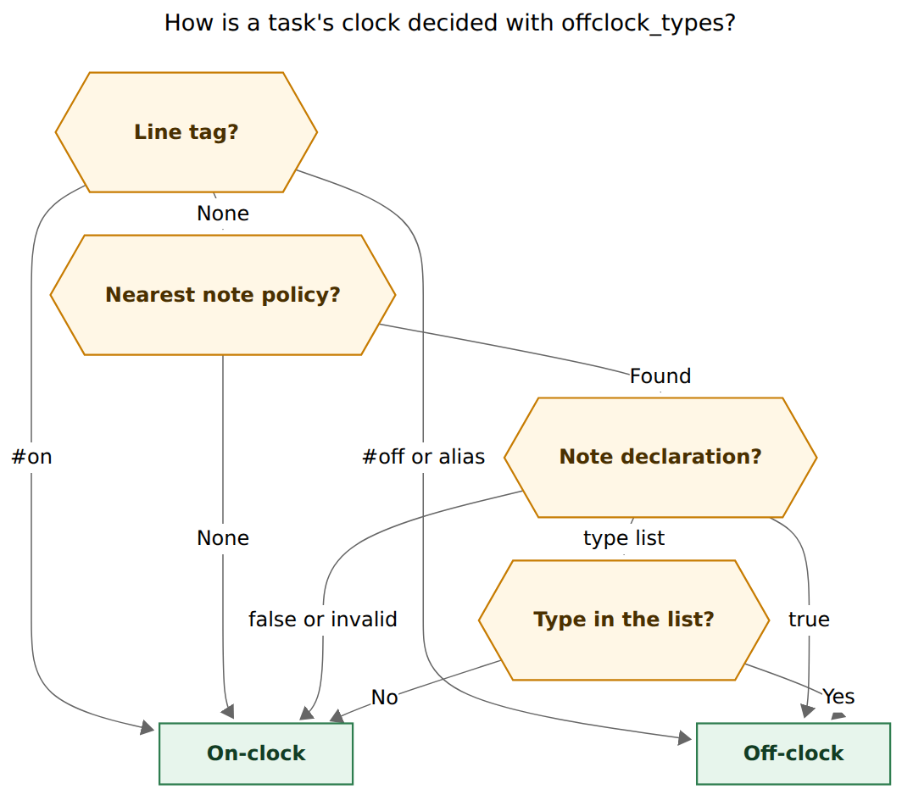
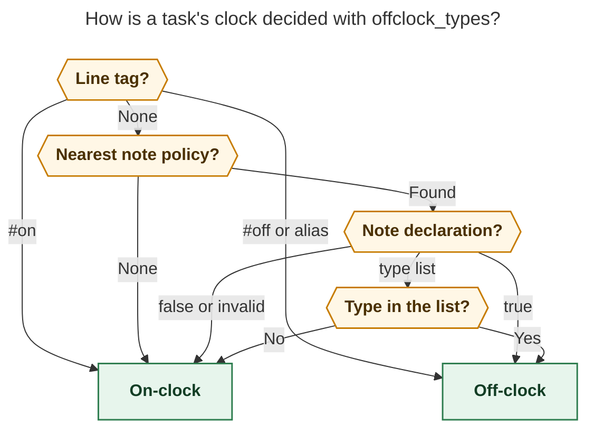
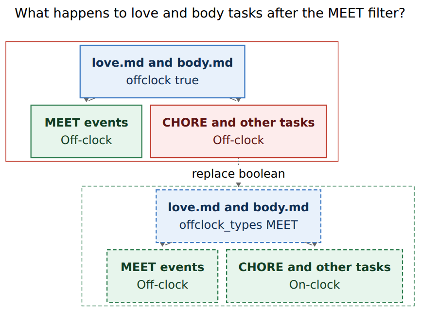
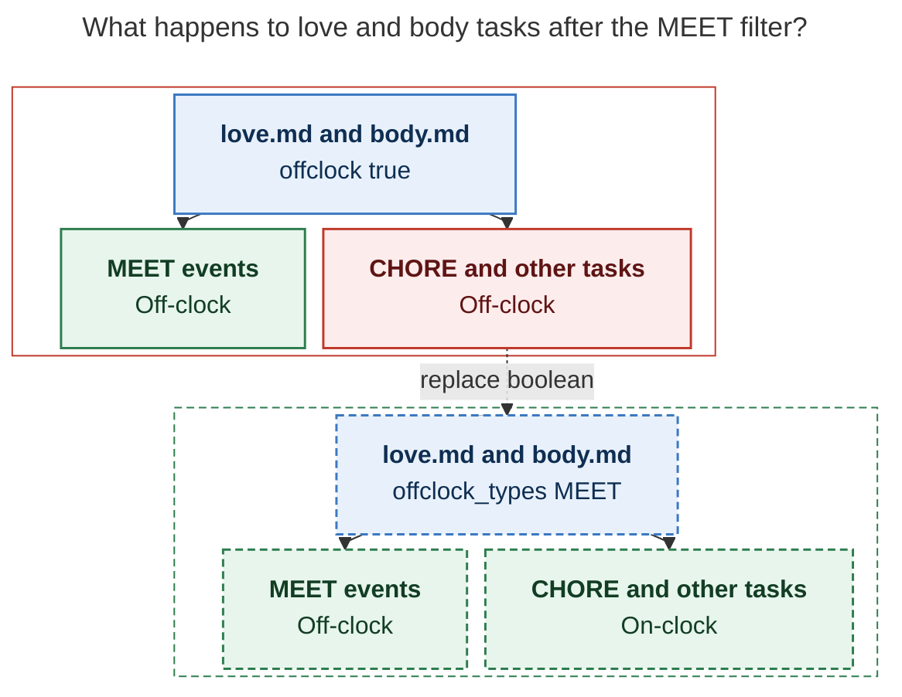

# `offclock_types`: type-filtered area clock defaults

> **Research query:** How should bob add an area/project frontmatter list
> `offclock_types` that works like `offclock:` but only for named task types, and
> should the vault notes that currently set `offclock: true` migrate to
> `offclock_types: [MEET]`? Is that a good idea, what adjustments are justified,
> and what solution should we implement?
>
> Independent report from researcher `grk`. I did not read peer swarm reports.

**Figures:** Mermaid CLI `@mermaid-js/mermaid-cli@12.0.0`. Clock-resolution SVG
708.1 × 626 px, fit 92.2%. Migration SVG 576.0 × 428 px, fit 100.0%.

## Bottom line

**Build `offclock_types`. It is a good idea, and the first use-case is the
correction the boolean default needs.** Keep `offclock: true|false`. Add a sibling
list that is a *complete policy at that note*: listed types go off the clock,
every other type at that note stays on-clock, and the walk stops. Then replace
`offclock: true` on `love.md` and `body.md` with `offclock_types: [MEET]`.

The boolean already does the recursive walk. What it cannot do is the thing
Bryan actually wants now: love- and body-routed *calendar meetings* off the
work clock, with the chores and admin tasks in those same areas counting as
Worked.

That split is already sitting in the vault:

- `love.md` has `offclock: true` and legacy `theme: CHORE`. Its 26 open tasks
  are untyped chores (gifts, movies, dog care). Its November Event Tasks are
  all `[type:: MEET]` with `[root:: abby]`.
- `body.md` has `offclock: true` and no `task_type`. Its 6 open tasks are
  hospital/CT-scan admin. Its Event Tasks are `[type:: MEET]` with
  `[root:: body]`.
- `meet.md` already defaults `task_type: MEET` and has **no** `offclock`. Job
  meetings stay Worked if the new list lives only on love and body.

Do **not** put the filter on `meet.md`. Clock inheritance follows the PT13
root walk (`[root::]`, then `parent:`), not the type's home note. A lunch
rooted at `abby` never visits `meet.md`.

## Is this a good idea

**Yes.** The boolean default shipped the reopen condition from
`decisions:off-clock-pomodoros-count-apart` ("off-clock time should come from
an area property"). It over-fired. Every untagged task under love or body is
off-clock today, including "Clean Lenard's ears" and "Make appointment for CT
scan". Starting a Pomodoro on those lines stamps `[off::]`. That is the wrong
clock for work Bryan actually sits down to do.

The MEET type is already the meeting mark:

- `bob gcal sync` writes `[type:: MEET]` when the root's suggested type is not
  already MEET (`src/native/gcal/render.rs` `needs_meet_type`).
- `love.md`'s default is CHORE, so love-routed events always get the field.
- `body.md` has no note default; `plan.default_type` is CHORE, so body-routed
  events get the field too.
- A 1–5 November 2026 sample of daily notes shows every Event Task as
  `[type:: MEET]`, rooted at `abby` or `body`. None were missing the type.

So the first use-case is not a speculative filter. It is "keep the meetings
off-clock, put the rest of love/body back on Worked," using a field the
writers already stamp.

Caveats to accept:

1. **This is a behavior change, not a rename.** After landing, a start on a
   love CHORE task writes `[t::]`. Closed `[off::]` rows that linked those
   tasks stay frozen and show as `clock_drift`. That wave is honest.
2. **A mixed lineup becomes Worked.** A session that keeps both a love MEET
   Event Task and a love CHORE task is mixed. Today both links are off-clock.
   After the filter, the CHORE link is on-clock, so the whole session stamps
   `[t::]` under the existing counted-links rule. Keep that rule.
3. **Clock resolution grows a type dependency.** `effective_clock` today
   reads tags and `NoteFacts.offclock` only
   (`src/native/pomodoro_homes/clock.rs`). A type list needs the task's
   *effective* type, including closed rows. `suggest_for_task` skips closed
   tasks, so clock must not call it.
4. **Rust and JS must stay in lockstep**, same as the boolean epic. Extend
   `tests/fixtures/pomodoro_clock/vectors.json` and copy it into both
   plugins.

## Critique of the request as written

The request is the right feature at the right layer. Three readings of
"work just like `offclock`" would implement the wrong thing.

**Nearest note with `offclock_types` filters only matching types and otherwise
keeps walking.** If a parent later has `offclock: true`, non-MEET children
would still inherit all-off, and the filter would fail as a narrowing tool.
Treat the nearest declaring note as a complete policy. A type miss is
on-clock *at that note*, and the walk stops.

**Match only an explicit `[type::]` field.** That happens to work for the
first use-case, because gcal writes `[type:: MEET]` on love- and body-rooted
events. It would make `offclock_types: [CHORE]` on `love.md` match nothing:
those 26 tasks have no type field; they inherit CHORE from `theme: CHORE`.
Match effective type (field, then reading rule, then note default, then
`plan.default_type`), and do it for closed rows too.

**Put the list on `meet.md`, or make MEET globally off-clock.** Clock follows
root, not type home. A global MEET switch would take job meetings off Worked.
Area-scoped lists are the point.

**Drop `offclock:`.** Keep the boolean. A future area may still want every
type off-clock. The list is the narrower tool; it does not replace the
boolean's job.

**Filter by Event Task kind** (checkbox rows under `## Events`) instead of
type. Tempting, because the first use-case is calendar rows. It would miss a
MEET-typed task that is not an Event Task, and it would catch an untyped
hand-written event. Type is the vocabulary Bob already uses; gcal already
maintains it. Use types, and re-scan Event Tasks at vault landing to confirm
they still carry MEET.

## Adjustments to the requirements

Each item names the request, then the change.

- **A1. "Work just like `offclock`"**
  - *Adjustment:* The nearest area/project clock declaration is a **complete
    policy**. `offclock: true` → every type off-clock. `offclock: false` →
    every type on-clock. `offclock_types` → listed types off-clock, all
    others on-clock. Invalid values → on-clock plus a lint. Absent → keep
    walking. Tags still beat every note policy.
  - *Why:* A type miss that continues walking cannot narrow a parent
    `true`. The first use-case is a narrowing.

- **A2. "Only tasks which have one of the types"**
  - *Adjustment:* "Have" means **effective type**, the PT13 cascade, and it
    applies to closed tasks. Do not call `suggest_for_task` (it returns no
    suggestion for `[x]` / `[-]`). Parse `[type::]` / legacy `[theme::]`,
    else the reading rule, else the nearest area/project `task_type:` /
    `theme:`, else `plan.default_type`. Compare with
    `normalize_component`.
  - *Why:* Love chores inherit CHORE with no field. Meet-rooted events may
    inherit MEET with no field. Closed Event Tasks keep `[type:: MEET]` as
    history and must still classify for drift and counted links.

- **A3. List syntax**
  - *Adjustment:* Accept flow (`offclock_types: [MEET]`), block (`- MEET`),
    **and a single scalar** (`offclock_types: MEET`) as a one-element list.
    Reuse the `project_name_aliases` list parser in
    `src/native/projects/scan.rs` for flow and block; add the scalar as a
    documented convenience.
  - *Why:* The first use-case is one name. People will write the scalar by
    analogy with `task_type: MEET`. Today's `frontmatter_scalar` treats a
    list as `NonScalar` / invalid, so the boolean parser cannot be reused
    as-is.

- **A4. Both keys on one note**
  - *Adjustment:* `offclock: false` wins (explicit all-on). A valid
    `offclock_types` list wins over `offclock: true` and raises
    `note_offclock_types_redundant`. Invalid `offclock:` still fails toward
    Worked and ignores the list.
  - *Why:* Migration can add the list before deleting `true` and take
    effect immediately. An explicit `false` remains the child opt-out.

- **A5. Empty or junk lists**
  - *Adjustment:* Empty list, non-list mapping, or a list whose every entry
    fails `canonical_theme_name` is invalid → on-clock, lint
    `note_offclock_types_invalid`. Drop individual bad entries (blank,
    `+` composites, reserved clock names `OFF` / `ON` / `OFFCLOCK` /
    `OFF-CLOCK` / `UNTRACKED`) with one lint each; keep the rest.
  - *Why:* Same fail-toward-Worked rule as an invalid `offclock:` scalar.
    Clock tag names are already refused as types.

- **A6. Recursion**
  - *Adjustment:* Same PT13 root walk as `offclock:`: start at a valid
    `[root::]`, otherwise residence; skip daily notes unless retargeted;
    ignore the key on non-area/non-project notes (`note_offclock_types_ignored`)
    and keep walking.
  - *Why:* Event Tasks live in daily notes. They reach love/body only
    through `[root::]`.

- **A7. First use-case notes**
  - *Adjustment:* Migrate **both** notes that currently set `offclock: true`:
    `love.md` **and** `body.md`. Leave child areas (`abby`, `family`, `fun`,
    `kelly`, `vacation`) without their own key so they inherit. Touch no
    project note (none set `offclock` today). Do not add the list to
    `meet.md`.
  - *Why:* The request said "the area notes … that currently use
    `offclock`". The vault has two, not one.

- **A8. Type rename and split**
  - *Adjustment:* `bob types rename` / `split` rewrite matching
    `offclock_types` entries the same way they rewrite `task_type:` /
    `theme:` defaults (`src/native/pomodoro_themes/coverage.rs`).
  - *Why:* Otherwise renaming MEET would silently stop matching.

- **A9. JSON and copy**
  - *Adjustment:* Keep `clock_source: note` and `clock_note` as the deciding
    note path. Keep `via love` / `via body`. Do not add a new source enum
    value.
  - *Why:* The note still decided. Additive JSON churn is unnecessary for
    v1. Mac Capture stays a thin client of `off_clock`.

- **A10. Stamp time, frozen history, settlement**
  - *Adjustment:* Unchanged. Writers resolve when they stamp. Ended
    unstarted Event Tasks still settle when they resolve off-clock; after
    the migration that is MEET rows under love/body, which they already
    are.
  - *Why:* No new settle scope. The previous epic's A6 does not widen
    again.

- **A11. Plugins**
  - *Adjustment:* `taskEffectiveClockResolution` in
    `bob-ledger-tools` `036-pomodoro-clock.js` must read `offclock_types`
    and the line's effective type. Cycler keeps calling the ledger-tools
    API. Shared vectors, byte-for-byte.
  - *Why:* Close and `se<X>` start stamp the clock in Obsidian.

- **A12. No release-note `!`**
  - *Adjustment:* Additive frontmatter. Aliases and `offclock:` keep
    parsing. Hidden CLI aliases are not involved.
  - *Why:* `cli_rules.md` and the daily train.

## How a task's clock is resolved

First match wins:

1. Standalone `#on` on the line (conflict with an off spelling still wins,
   with `clock_tag_conflict`).
2. `#off` or a deprecated alias.
3. Nearest area/project ClockPolicy on the root walk (A1, A6).
4. On-clock.



*Tags still win. The nearest area or project then applies a boolean or a type
list; a type miss is on-clock at that note. Rendered size 708.1 × 626 px; fit
92.2%.*



ClockPolicy at one note, in this order:

| Declaration | Policy | Walk |
| --- | --- | --- |
| `offclock:` present and not `true`/`false` | Invalid → on-clock, `note_offclock_invalid` | Stop |
| `offclock: false` | All types on-clock | Stop |
| `offclock_types` valid (after A3–A5) | Listed types off-clock; others on-clock | Stop |
| `offclock: true` | All types off-clock | Stop |
| `offclock_types` present but invalid | Invalid → on-clock, `note_offclock_types_invalid` | Stop |
| Neither key | Inherit | Continue |

`#off` still beats a type miss and beats `offclock: false`. `#on` still beats
a matching type.

The counted-links rule does not change: an unlinked, unresolved, or mixed
session is Worked in full.

## Implementation

### Parse

`NoteFacts` gains `offclock_types: Option<NoteOffClockTypes>`.

```text
NoteOffClockTypes::Names(Vec<String>)  // canonical display names, unique by key
NoteOffClockTypes::Invalid(String)     // raw, for the lint
```

Absent or blank inherits (`None`). Implement list parsing next to
`project_name_aliases` rather than extending `frontmatter_scalar`, which is
intentionally scalar-only and already classifies
`offclock:\n  - true` as invalid.

Canonicalize each name with `canonical_theme_name` (rejects `+` composites).
Store the canonical spelling (`MEET`, not `meet`). Match with
`normalize_component`.

Non-area/project notes that declare the key are ignored, same as
`offclock:`, with `note_offclock_types_ignored`.

### Resolve

Keep `effective_clock(resolver, residence_path, line)` as the writer API.
Inside it, after tags:

1. Resolve effective type from the line and the same root walk (A2). This
   needs `PlanConfig` only for `reading_type` and `default_type`. Thread a
   `PlanConfig` (or a tiny `ClockTypeDefaults`) through `HomeResolver` /
   `effective_clock` rather than loading config on every call. Capture, gcal,
   settle, and stats already have a plan config or can take one at the
   command boundary. Plugin JS already walks note `task_type` / `theme` for
   suggestions; reuse that walk and fail toward Worked when
   `plan.default_type` is unavailable.
2. Walk `residence_chain` and apply ClockPolicy.

Do not load the type catalog for matching. Unconfigured names still match.

`ClockSource::Note` remains the source when a note policy decided, including
a type-list miss (the note decided on-clock). `InvalidNote` covers both
invalid boolean and invalid list.

### Call sites

Almost every writer already goes through `effective_clock` or
`enrich_event_clocks`:

- capture start (`clock_fact_from_task`)
- capture close (`linked_tasks.rs`)
- MEET event runs
- gcal plan / list
- settle (`plan_settle`)
- stats drift (`ClockTaskLookup`)
- agenda JSON

They pick up the filter once the helper does. New tests belong in
`pomodoro_homes/tests.rs` and in `pomodoro_clock` vectors, not as a second
policy in each writer.

### Vectors to add

Extend `tests/fixtures/pomodoro_clock/vectors.json` (plugins copy
byte-for-byte):

- love `offclock_types: [MEET]`, Event Task `[root:: abby] [type:: MEET]` →
  off-clock via `love.md`
- same tree, untagged CHORE task in `love.md` → on-clock
- `#on` on a MEET row under that list → on-clock
- `#off` on a CHORE row under that list → off-clock
- child `offclock: false` under a parent list → on-clock even for MEET
- child list `[MEET]` under parent `offclock: true` → CHORE on-clock (A1:
  child list is complete)
- `offclock: true` plus `offclock_types: [MEET]` → same as list, warning
  `note_offclock_types_redundant`
- scalar `offclock_types: MEET` → same as `[MEET]`
- empty list / `offclock_types: [BUILD + FIX]` → on-clock,
  `note_offclock_types_invalid`
- untyped `dog.md` with a list is ignored; grandchild inherits love
- mixed MEET + CHORE links → `pomodoro_clock_mixed`, `[t::]`
- closed `[x]` Event Task with `[type:: MEET]` still matches (drift /
  counted-link case)

### Type rename

`coverage.rs` already rewrites `task_type:` / `theme:` scalars and task
fields. Teach it flow, block, and scalar `offclock_types` entries. Split
leaves note defaults alone today; decide in the implementation plan whether
split should rewrite lists or refuse when a list still names the old type.
Recommendation: rewrite on rename; on split, rewrite the old name to the
chosen new name when the map says so, same as other defaults.

### Plugins

`taskEffectiveClockResolution` currently reads only `frontmatter.offclock`
(`bob-ledger-tools/src/036-pomodoro-clock.js`). Obsidian's metadata cache
already gives arrays for YAML lists, so JS matching is straightforward.
Effective type: line field first (mirror `parse_task_theme`), then the
existing `pomodoroHomeResolveTaskThemeFacts` walk. Painter tooltip can stay
`Off-clock · from love`; a MEET-vs-CHORE distinction is visible from the
type pill.

### Docs and memory

New decision record, for example
`decisions:offclock-types-filter-note-default`, that partly supersedes
`decisions:off-clock-follows-tag-then-note-default` by adding the list as a
peer declaration on the same walk. Update `glossary:off-clock-pomodoro`,
`glossary:area-note`, `glossary:project-note`. Docs:

- `docs/reference/vault-format.md` (the policy table beside `offclock:`)
- `docs/task-types.md` (same walk, new field; rename coverage)
- `docs/pomodoro-homes.md` (one sentence)
- `docs/capture.md`, `docs/gcal.md`, `docs/stats.md` (drift after narrowing)
- plugin references

Author memory with `/sase_memory_write`. Run `just docs-gen` and
`just docs-check`.

No Mac Capture change (`decisions:mac-capture-is-a-thin-client`).

## Vault survey (2026-11-05)

Dataview via `bob query`. Event Task inline fields are stripped from
`T.text`; `T.type` and `T.root` are the usable columns.

| Note | `offclock` | Type default | Open tasks | Role after migration |
| --- | --- | --- | --- | --- |
| `love.md` | `true` | `theme: CHORE` | 26 untyped chores | `offclock_types: [MEET]`; chores become Worked |
| `body.md` | `true` | none | 6 medical-admin | same |
| `abby`, `family`, `fun`, `kelly`, `vacation` | inherit | none | fun has 1 | inherit the list |
| `meet.md` | absent | `task_type: MEET` | 0 | leave unset |
| project notes | none set | n/a | n/a | no vault edit |

November 2026 Event Tasks sampled (`20261101`–`20261105`): Swings!, Unami w/
Abby, Lincoln Park, Grocery Store, Disney Movie Night, CFG Appt. All
`[type:: MEET]`. Roots: `abby` (love subtree) or `body`. Several still carry
an explicit `#off` from Google; that tag continues to win.

`plan.default_type` is CHORE (`docs/plan.md` / configuration reference). Body
tasks without a field therefore inherit CHORE, not MEET.



*Today `offclock: true` sends every task off the work clock. After
`offclock_types` lists MEET, calendar rows stay off-clock and CHORE tasks
become Worked. Rendered size 576.0 × 428 px; fit 100.0%.*



Landing must wait until every host runs the new bob and plugins, same as the
`offclock:` landing. Re-scan Event Tasks for love/body roots missing
effective type MEET before deleting the boolean. Expected leftover `#off` on
Google-tagged rows is fine.

## Alternatives rejected

- **Overload `offclock:` to accept a list.** Today's parser treats a list as
  invalid and fails toward Worked. Reinterpreting lists would change the
  meaning of a currently-invalid key. A sibling `offclock_types` is explicit.
- **Global `types.MEET.offclock` in config.** Not area-scoped. Job meetings
  would leave Worked.
- **Filter by Event Task kind.** Wrong vocabulary; gcal already maintains
  MEET. Kind would also skip a MEET-typed non-event.
- **Materialize `#off` onto matching rows.** Rejected for the boolean
  (fights Google ownership, `#on`, and later toggles). Same here.
- **Field-only matching.** Cheap, and it would pass the first use-case, but
  it makes inherited types (CHORE on love, MEET on meet-rooted events)
  invisible to the filter.
- **Continue walking on a type miss.** Cannot narrow a parent `true`.
- **Remove `offclock:`.** The boolean is still the right tool for an area
  that is all off-clock.
- **Put the list on `meet.md`.** Clock does not walk the type's home.

## Risks

- **Historical drift:** Closed `[off::]` sessions that linked love/body
  CHORE tasks will report `clock_drift` after the note no longer makes those
  tasks off-clock. Document it; do not rewrite stamps.
- **Mixed sessions:** Family meeting plus a chore in one Pomodoro becomes
  Worked. That is the counted-links rule working. Bryan can split the
  session or tag the chore `#off` if a given block should stay off-clock.
- **Untyped Event Tasks:** A hand-written event under love without
  `[type:: MEET]` inherits CHORE and would become on-clock. Gcal-written
  rows are safe. Re-scan at landing; optional one-time fill of missing
  `[type:: MEET]` on love/body-rooted Event Tasks if any appear.
- **PlanConfig threading:** Forgetting `plan.default_type` in a plugin
  fallback fails toward Worked, which is safe for the MEET use-case (those
  rows have an explicit field) and wrong for a later `offclock_types:
  [CHORE]` on a note with no default. Tests should cover inherited CHORE
  with no field.
- **Two implementations:** Shared vectors, as before.

## Recommended solution

One new epic after the `offclock:` / `#off` work. Five phases.

1. **bob-cli contract.** `NoteOffClockTypes` parse (A3–A5), ClockPolicy (A1,
   A4), type-aware `effective_clock` (A2, A6), lints, unit tests on the
   love/body fixture tree. Decision record and glossary.
2. **Vectors and writers.** Extend `pomodoro_clock` (and meet-event-run if
   an event-run path needs a typed case). Existing start/close/gcal/settle/
   stats/agenda paths follow the helper. Rename/split coverage (A8).
   `just docs-gen` / `just docs-check`.
3. **bob-plugins.** List + effective type in `taskEffectiveClockResolution`.
   Copy vectors. Painter can keep current copy. `npm test`, `build:check`,
   `validate`, `docs:check`, `bob plugins sync`.
4. **Vault landing (checklist).** Confirm every host runs the new code.
   Re-scan love/body-rooted Event Tasks for effective type MEET. Replace
   `offclock: true` with `offclock_types: [MEET]` on `love.md` and
   `body.md` only. Review `git -C ~/bob diff`. Verify: start on a love
   CHORE previews Worked; start on a Swings! MEET previews `off-clock via
   love`; CFG Appt previews `off-clock via body`; `bob stats` drift matches
   the expected CHORE history wave.
5. **Scratch-vault acceptance.** love `offclock_types: [MEET]` plus `theme:
   CHORE`; body list only; job/meet unset. Cases: untagged lunch `@love` →
   `[off::]`; "Clean Lenard's ears" → `[t::]`; `#on` lunch → Worked; `#off`
   chore → off-clock; child `false`; mixed lineup; scalar form; rename MEET
   rewrites the list.

**Do not** fold this into a drive-by on the previous epic's leftover phases.
The boolean is shipped and in the vault; this is a new policy on the same
walk.
