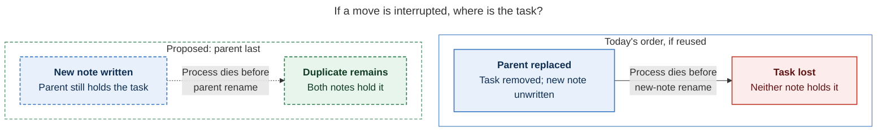

# Diagram proposals: Move bullets: bringing parent tasks into a new project note at capture time

Proposals for the swarm linker, not a report. Each diagram restates only what the source
report says.

```yaml
source: research:202611/parent_task_move_bullets/parent_task_move_bullets__final.md
producer: research.35.image
check: "mmdc 12.0.0 with the PDF-mirroring config rendered 1 of 1 Mermaid diagrams; Puppeteer --no-sandbox"
```

## interrupted-move-copies

```yaml
anchor: |-
  process death between renames then leaves a duplicate, not a loss.
question: |-
  If the process dies between writes, where is the moved task?
illustrates: |-
  Replacing the parent last leaves a duplicate rather than a loss if a process dies between renames.
caption: Parent-last order leaves a duplicate instead of a loss if the process dies between the destination and parent renames.
review: "616x409 px, fit 100.0%; question, source-trace and PNG visual checks passed; 0 revisions; batch check passed; invalid-source control failed as expected"
```


