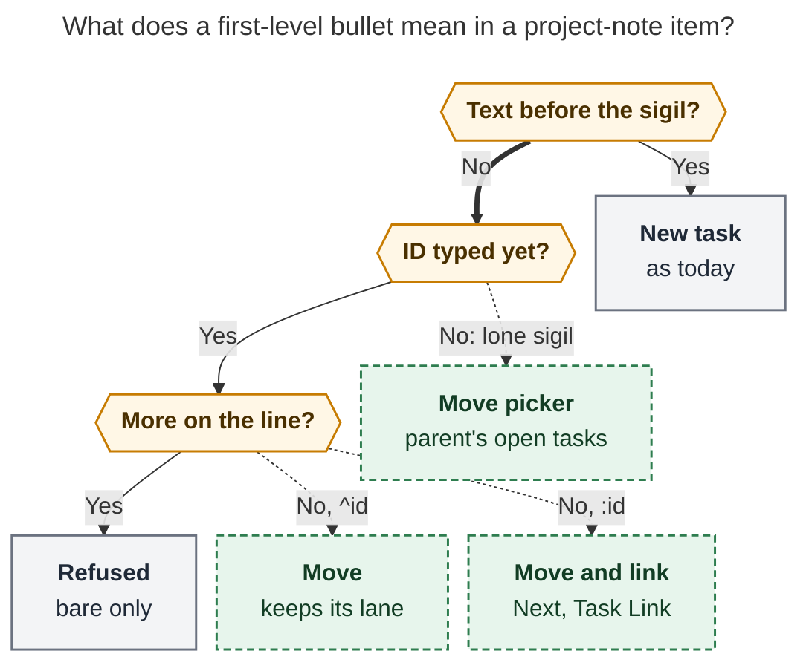
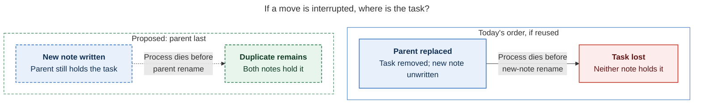
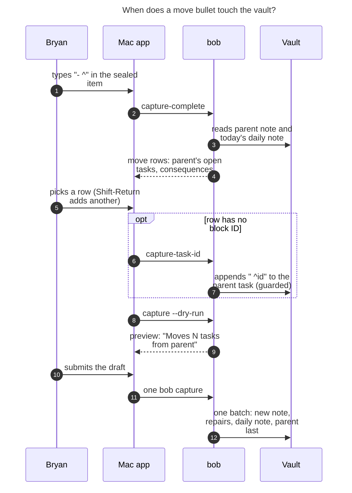

# Move bullets: bringing parent tasks into a new project note at capture time

> **Research query:** When the `@foo[:^]bar@` capture syntax creates a new project
> note, how should child tasks be pulled in from the parent project (`~/bob/foo.md`),
> for example with a `^some-id` reference on a bullet line by itself, with good `^`
> completion in bob-mac-capture, so that the feature is intuitive, reliable, and
> beautiful? Is this plan a good idea, would a different approach be better, which
> requirement adjustments are justified, and what is the recommended solution?


## Bottom line

**Build it.** Your spelling is the right one. A first-level bullet that holds only
`^some-id` inside an `@foo^bar@` / `@foo:bar@` item is a **refused input today**
("capture line N names a task but has no task text"). Giving it a meaning changes
no draft that works now. The hard machinery already exists:

- capture already runs the `bob task move` engine inside its guarded batch (inbox
  routing);
- the engine already moves whole blocks and repairs links vault-wide;
- the Mac app already has scoped task pickers with an "Add block ID" step.

All five researchers recommend building it. They split on about a dozen details,
and [the section on where they disagreed](#where-the-researchers-disagreed-and-the-resolution)
settles each one with evidence. The adjustments to your requirements that matter
most (all listed in [the requirement adjustments](#requirement-adjustments-called-out)):

1. **Call it *move*, never *pull*.** "Pull-in" already names successor offers
   (`-p/--pull-in`, the Mac Pull-In card), and both can appear in one
   `@foo:bar@` draft.
2. **Scope it to the item, not the whole capture.** Only first-level bullets of
   the item that carries the seal become move bullets.
3. **Add the twin `- :id`.** It moves the task, then makes it Next and links it,
   just as a trailing ` :id` does for a new task.
4. **List ID-less tasks in the picker.** 54% of candidate tasks have no block ID
   (226 identified, 265 ID-less; reproduced exactly). A picker that shows only
   identified tasks would hide half the backlog.
5. **Keep draft order.** Moved tasks land where their bullets sit, interleaved
   with new tasks.
6. **Stamp moved tasks fresh**, exactly as Ctrl+Shift+M and inbox routing do.
7. **Replace the parent note last.** I found
   [a real ordering hazard](#figure-interrupted-move-copies): as built today, the
   batch would rewrite `foo.md` before it creates `foo_bar.md`.

The one rule to teach: **a leading `^` or `:` points at an existing task; a
trailing one names a new task.** The recommended solution is in
[Recommended solution](#recommended-solution).

## What already exists (verified)

- **F1.** `- ^id` and `- :id` with no other text on a first-level project-note
  bullet fail with `names a task but has no task text`.
  - *Evidence:* `capture_language/project_tasks.rs::empty_project_task_body_error`;
    sandbox probes by cdx and cld
- **F2.** A lone `- ^` reports `needs: ["block_id"]`, and the Mac opens the New ID
  composer for the **new** note with no suggestions. That is a dead end.
  - *Evidence:* cdx and cld probes; `capture-complete` context
    `project_task_block_id`, intent `new`
- **F3.** Capture already moves tasks inside its batch. Inbox routing calls
  `task_move::plan_task_move` on a vault snapshot overlaid with staged texts. It
  applies link repair and the root freshness stamp under the same preimage guard.
  - *Evidence:* `docs/capture.md` "Routing inbox tasks out";
    `capture/inbox_route.rs`
- **F4.** The engine moves whole blocks (children, drawers, logs, anchors). It
  repairs `[[note#^id]]` links in daily notes, `done/`, `ref/`, aliases, and
  embeds, and updates `[id::]`/`[dependsOn::]`. It refuses closed, nested, `^prj`,
  and ambiguous selections. It also refuses non-`[?]` tasks into a Blocked
  destination.
  - *Evidence:* `docs/task-move.md`; `task_move/plan.rs`
- **F5.** The engine always **appends** at the end of the `## Tasks` intake.
  `MoveRequest` has no placement option, but it already carries two capture-only
  extensions: `allow_closed` and `MoveSelector::Line(usize)` (for ID-less inbox
  candidates).
  - *Evidence:* `task_move/plan.rs:62–81` (lead)
- **F6.** Human move gestures stamp freshness; `bob task move` does not, because
  it is listed under **Automation**. Ctrl+Shift+M stamps each open moved task.
  Inbox-route moves stamp "same as Ctrl+Shift+M". A generic stamp removes all
  `keeps` and `unblocked` fields.
  - *Evidence:* `docs/freshness.md` §5 table and the keeps paragraph (lead)
- **F7.** Root area/project notes: 98 projects, 17 areas. Their top-level open
  `#task` rows (excluding `^prj`): **226 with a block ID, 265 without (54%)**.
  - *Evidence:* cld count, reproduced exactly by lead
- **F8.** Six Mac task pickers list ID-less rows (`requires_block_id`) and run Add
  block ID through `bob capture-task-id`. That command returns ready-to-splice
  replacements (`parent_replacement`, `dependency_replacement`, …). Only those
  dedicated picker presentations handle such rows; the Block ID picker
  (`BlockIDPickerIndex`) does not.
  - *Evidence:* `capture_task_id.rs`; Mac `ParentTaskPickerPresentation.swift` and
    siblings (lead)
- **F9.** Mac decoding: an unknown `block_id.intent` becomes `.link` (browse
  mode). An unknown completion `context` becomes `nil` (neutral inline rows).
  - *Evidence:* `CaptureModels.swift:9158–9166`;
    `CompletionRowContent.swift:266–298` (lead)
- **F10.** `docs/capture.md` promises that for project-note capture "the parent
  note itself is never modified".
  - *Evidence:* `docs/capture.md` "Project notes"
- **F11.** The capture batch replaces files in **first-touch order**, and
  project-note planning touches the parent (parent validation) before it stages
  the new note. A naive move would therefore replace `foo.md` (block removed)
  before creating `foo_bar.md`. Handled failures roll back, but a process death
  between those two renames loses the task.
  - *Evidence:* `capture/batch.rs` (`files: Vec`, `current_contents_from_snapshot`);
    `capture/commit.rs::write_staged_files`; `capture/project_note.rs` parent
    validation (lead)
- **F12.** `GRAMMAR_REVISION` is 6. Every bump since it was introduced rode a `!`
  breaking commit. The Mac grammar gate accepts ≥ 5.
  - *Evidence:* `capture_language/mod.rs:42`; `git log -G GRAMMAR_REVISION` (lead)
- **F13.** Parent reads see earlier batch items, so a later item can parent onto a
  note an earlier item created.
  - *Evidence:* `docs/capture.md` "Project notes"
- **F14.** The project-note preview shows the `^prj` line, the basename, and the
  Links/Offers bands. It decodes `project_note.tasks` and `sections` but never
  displays them.
  - *Evidence:* cld survey of `CaptureProjectNotePresentation.swift`

## Is this a good idea?

**Yes.** Four reasons:

- **It finishes a job capture only half-does.** `@foo^bar@` can author a new
  project, but it cannot file existing work into it. Today, splitting `foo` into
  `foo_bar` takes one capture plus one Ctrl+Shift+M per task in Obsidian (or a
  `bob task move` call). That means N gestures across two apps, and the project
  starts life empty. The decision about which tasks belong in the project is made
  while you write the project, so it belongs in the same draft.
- **It breaks nothing** (F1). It fills a refused shape.
- **The draft reads like the note it writes.** `- ^call-ms` lands as the
  `^call-ms` task at that position in `## Tasks`. That is the same principle as
  `decisions:capture-bullets-mirror-the-task-block`.
- **The risky parts are already built and tested** (F3, F4, F8). The feature
  composes those pieces; it does not invent them.

**What the request gets wrong or leaves open**, in order of importance:

1. **The bare ID is opaque.** `- ^call-ms` shows an identifier, not a task. In
   Obsidian, `^` means "block identity", not "move". So the picker's *Move*
   label, the preview's titles, and (later) inline ghost titles are what make
   this usable. They are core features, not polish.
2. **`^` gains a third reading.** It already means "name a new task" (trailing
   ` ^id`) and "an existing task" (item-leading `^route:id`). One positional rule
   explains all three, and it matches the shipped `- #drawer` (leading) versus
   `#type` (trailing) split.
3. **A move does more than a create, and the preview has to say so.** A move:
   - rewrites the parent note;
   - rewrites historical daily-note links, so past Pomodoro time re-attributes to
     the new project wherever that project is its own root;
   - resets the moved task's keep streak.

   Ctrl+Shift+M already behaves exactly this way. The cost is accepted, but it
   should be visible.
4. **"Somewhere in this capture" is too broad.** A bulk draft can create several
   projects under different parents and mix in inbox tasks and lists.
5. **ID-only completion would hide half the tasks** (F7).
6. **This is not a small grammar patch.** It crosses the shared parser, a
   renderer that assumes new content, the move engine, the write boundary, and
   the native editor. It is still a good investment, because each of those
   mechanisms exists.

**Would I take a different approach?** No. Each alternative is weaker, though
some make good additions later:

- **Submit-time "Bring tasks from `foo.md`?" checklist card:** The choice lives
  outside the draft, so the preview can't show it before submit. It can't say
  "between these two new tasks", and it adds a third submit card. **Rejected.**
- **New sigil (`- >^id`, `- <id`):** Adds syntax and a new trigger without
  solving any of the hard parts. `- ^id` already looks like the line it becomes.
  **Rejected.**
- **Explicit `- [[foo#^id]]` or `- ^foo:id`:** Verbose, repeats the parent the
  seal already names, and reads as a link rather than a move. **Rejected for
  v1.** Reserve `- ^route:id` for future cross-note moves.
- **Search all ancestors or the whole vault for a bare `^id`:** The scope becomes
  ambiguous (`^fix` exists in many notes) and can't be completed well.
  **Rejected.**
- **Copy instead of move:** Leaves two actionable copies and splits identity.
  **Rejected.**
- **Create, then Ctrl+Shift+M per task:** Today's workaround: two gestures and
  two commits, and draft order is lost.
- **Obsidian "project from selected tasks" gesture:** Best when you are *looking
  at* the parent. **A later second front door**: compose a draft with move
  bullets and call `bob capture`, keeping one grammar and one writer.
- **Similar-tasks band "Move into project" action:** Helps you discover tasks
  without remembering them. **A later addition**: it inserts `- ^id`, which keeps
  it within `decisions:similar-tasks-are-a-settled-heads-up`.

## Requirement adjustments called out

- **A1. "pulled in"**
  - *Adjusted to:* **Move** in every contract, UI string, and doc
    (`project_task_move`, `moved_tasks`, "Moves 2 tasks from cash.md").
  - *Why:* "Pull-in" means successor offers. Under `@foo:bar@` you can *move* a
    task in and then *pull it in* to today.
- **A2. `@foo[:^]bar@` "used somewhere in this capture"**
  - *Adjusted to:* **Per item.** Only first-level bullets of the item carrying the
    seal (on the parent line or a sealing child line) are move bullets. Other
    items, `@file` lists, and nested lines keep today's meaning.
  - *Why:* Capture grammar is item-scoped everywhere else, and bulk drafts can
    create several projects.
- **A3. the parent *project* `~/bob/foo.md`**
  - *Adjusted to:* **The parent note `<route>.md`, area or project.**
  - *Why:* The existing parent rule admits both kinds.
- **A4. `- ^id` only**
  - *Adjusted to:* **Also `- :id`**: move, then make it Next and link it into the
    item's Pomodoro.
  - *Why:* Mirrors the trailing ` ^id` / ` :id` split on new-task bullets. It also
    lets `@foo^bar@#admin` (which needs at least one ` :` task) be satisfied by
    moved tasks.
- **A5. (unstated) placement**
  - *Adjusted to:* Moved tasks land **at their bullet's position** in `## Tasks`.
  - *Why:* The draft is the plan; the engine's default append (F5) would reorder
    it.
- **A6. (unstated) freshness**
  - *Adjusted to:* **Stamp each moved open, non-recurring root** `[fresh:: today]`.
    This is a generic stamp: it clears `keeps` and `unblocked`. Leave descendants
    alone.
  - *Why:* Matches Ctrl+Shift+M and inbox routing (F6). Choosing a task into a
    project confirms it.
- **A7. "good completion" on `^`**
  - *Adjusted to:* The picker lists **all** open top-level tasks of the parent.
    ID-less rows go through the existing Add block ID step.
  - *Why:* F7: 54% have no ID. F8: the flow already exists in six pickers.
- **A8. "a bullet line by itself"**
  - *Adjusted to:* **Strict in v1**: no text, checkbox, markers, or nested bullets
    on a move bullet, each with a teaching error. Nested notes under a move arrive
    in [phase 4](#phasing).
  - *Why:* Keeps v1's grammar and preview simple, with a clear growth path.
- **A9. (unstated) blocked destination**
  - *Adjusted to:* **v1 refuses** a non-Blocked task moving into a project that is
    Blocked at birth (future `s:<N>` or open project prerequisites).
  - *Why:* Matches `bob task move`. Converting the task (Ctrl+Shift+M parity)
    needs capture to stage today's Task Link pruning first.
- **A10. (implied) parent edits**
  - *Adjusted to:* Capture now edits the parent, **only to remove moved blocks**,
    and replaces it **last**. The Sub-projects line stays `bob projects sync`'s.
  - *Why:* F10 must be rewritten; F11 makes the order matter.
- **A11. (new) moving several tasks**
  - *Adjusted to:* **Shift-Return = "Move & add another"** in the picker.
  - *Why:* Splitting a project almost always moves several tasks.

## Where the researchers disagreed and the resolution

- **Name**
  - *Positions:* cdx, cld, grk (UI chrome): *move*. mus, gem: *pull in*.
  - *Resolution:* **Move.**
  - *Deciding evidence:* Glossary `successor-offer`: "aka pull-in offer".
- **`- :id` twin**
  - *Positions:* cld, grk, mus, gem: yes. cdx: no, keep "today" decisions on the
    offer card.
  - *Resolution:* **Yes**, built right after `^`. It links through the
    existing-task link path against the *new* address.
  - *Deciding evidence:* Grammar parity (`:` links, `^` names) and the create-form
    `#pomodoro` requirement. cdx's concern is met by routing the link through the
    existing link writer, not a new one.
- **Freshness**
  - *Positions:* cld, cdx: stamp. grk, mus: never stamp, citing `task move`.
  - *Resolution:* **Stamp the root** (generic stamp).
  - *Deciding evidence:* `docs/freshness.md` §5 lists `task move` as Automation,
    while Ctrl+Shift+M and inbox-route moves stamp. A generic stamp clears
    `keeps`, which also corrects cld's "keeps its streak".
- **ID-less tasks**
  - *Positions:* cld, gem: v1. grk: v1.1. cdx: defer, because it writes before
    submit. mus: silent.
  - *Resolution:* **v1**, through `capture-task-id` plus a new `move_replacement`.
  - *Deciding evidence:* F7 (54%). F8: six pickers already accept this pre-submit
    ID write. `capture-task-id` is guarded and never stamps, and the ID helps the
    new project anyway (offers, links).
- **Completion contract**
  - *Positions:* cld, cdx: a new context. grk, mus: reuse `project_task_block_id`
    with `intent: "move"`. gem: `intent: "link"`.
  - *Resolution:* **New context `project_task_move` and a new need.** A lone `- ^`
    stops reporting `block_id`.
  - *Deciding evidence:* The Block ID picker can't present ID-less rows or per-row
    consequences (F8), and choosing a task is a different job from naming an ID.
    grk is right that `intent: "move"` degrades more gracefully on an old Mac
    (F9). But both apps ship in the same epic, and an old Mac stays usable either
    way: a typed `- ^id` still captures.
- **Placement**
  - *Positions:* cld, cdx, grk, gem: draft order. mus: end of intake.
  - *Resolution:* **Draft order**, via `MoveRequest.placement: Intake | Slot(line)`.
  - *Deciding evidence:* F5. A slot inside the engine avoids a second
    fragment-splicing path.
- **Nested notes under a move bullet**
  - *Positions:* grk, gem: allow in v1. cdx, cld, mus: refuse in v1.
  - *Resolution:* **Refuse in v1** with a teaching error that points at
    `@<new-note>+<id>`. **Phase 4**: accept them under the existing `@route+id`
    note-filing rule (drawer bullets merge).
  - *Deciding evidence:* That filing rule already exists, so phase 4 reuses it
    rather than inventing new semantics.
- **Blocked-at-birth destination**
  - *Positions:* cld, cdx, mus: refuse. grk: convert to `[?]` + `#prj_is_blocked`.
  - *Resolution:* **Refuse in v1; convert in phase 4** once today's Task Link
    pruning can be staged.
  - *Deciding evidence:* `docs/task-move.md`. cdx: a clear refusal beats a move
    that looks successful but leaves stale links.
- **Block-ID collisions**
  - *Positions:* cdx, cld: refuse. mus, grk: let the engine suffix-rename.
  - *Resolution:* **Refuse**, naming both lines.
  - *Deciding evidence:* The destination is brand new, so a collision always comes
    from the draft's own authored IDs (or an imported descendant ID). The fix
    belongs in the draft.
- **Offers under `@foo:bar@`**
  - *Positions:* cld, cdx, grk: offer moved rows. mus: exclude them.
  - *Resolution:* **Offer them**, labelled `moved_from`. Already-linked rows fold
    into `already_planned`, and `- :id` rows count as planned.
  - *Deciding evidence:* Glossary: `@route:id@` "offers the new project note's
    open tasks". Picks must apply to the assembled blocks, not re-render authored
    bullets (cdx's trap).
- **Grammar number**
  - *Positions:* cld: 7. grk: keep 6. mus: "5" (stale). cdx: decide at
    implementation time.
  - *Resolution:* **Keep 6, no `!`.** Clients detect support by the new need and
    context.
  - *Deciding evidence:* F12: bumps have ridden only breaking commits, and filling
    an error form is additive.
- **Crash safety**
  - *Positions:* cdx: add a durable recovery record. Others: batch rollback is
    enough.
  - *Resolution:* **Write the parent last, now.** That is cheap and fixes the real
    hazard (F11). A durable recovery record can come later as hardening shared
    with inbox routing.
  - *Deciding evidence:* F11. Vault git is the backstop for whatever remains.
- **Moving several tasks**
  - *Positions:* grk: Shift-Return chain in v1. cld: later
    (`replacement_and_next`). cdx: optional.
  - *Resolution:* **v1 of the Mac phase**, with Bob supplying the continuation
    text.
  - *Deciding evidence:* Thin-client rule. Shift-Return already means "accept and
    continue" in other pickers (Link & Start, relation label).
- **Preview fingerprint**
  - *Positions:* cdx: bind the commit to a fingerprint of the previewed block.
  - *Resolution:* **Not needed.**
  - *Deciding evidence:* The draft names a stable `^id`, and the batch preimage
    guard covers drift during commit.

## Design

### Grammar

Inside an item sealed with `@route^id@` or `@route:id@`:

- **`- <text> ^<id>`:** Unchanged: a new Ready task named `^<id>`.
- **`- <text> :<id>`:** Unchanged: a new Next task, linked into the item's
  Pomodoro.
- **`- ^<id>`:** **New.** Move the open top-level task `^<id>` from `<route>.md`
  to this position in `## Tasks`. Its children, logs, links, and dependency IDs
  follow it. It keeps its lane and is stamped fresh.
- **`- :<id>`:** **New.** The same move, then Next plus a Task Link into the
  Pomodoro the item places (or the `#pomodoro` one).
- **`- ^` / `- :`:** **New.** An unfinished move: it opens the move picker.
  `bob capture` refuses it with a teaching error and never turns it into an empty
  task.



*Figure 1. Inside an item sealed with `@route^id@` / `@route:id@`, position
decides meaning: text before the sigil keeps today's new-task meaning, a bare ID
moves a parent task, and a lone sigil opens the move picker. Dashed green boxes
are new behavior. Bullets in other items keep today's meaning. (Rendered with
mermaid-cli 12.0.0 under the PDF config: 674 × 756 px, 96.8% fit.)*

**Worked draft:**

```text
Finish the Google exit packet @cash:goog-exit@#admin
- Draft the resignation memo :draft-memo
- ^equity-docs
- :call-ms
- Book the lawyer
- FUTURE WORK
  - Revisit the severance terms
```

One capture does all of the following:

- Creates `cash_goog_exit.md` with the `^prj` line.
- Creates **Draft the resignation memo** as Next, linked under ADMIN.
- Moves **Collect the equity paperwork** (`^equity-docs`) from `cash.md`. It
  keeps its status and children, is stamped fresh, and its links are repaired.
- Moves **Call Morgan Stanley…** (`^call-ms`), makes it Next, and links it under
  ADMIN.
- Creates **Book the lawyer** as Ready.
- Writes `## Tasks` in exactly that order, followed by `## Future Work`.
- Offers **equity-docs** and **Book the lawyer** on the Pull-In card.
  `draft-memo` and `call-ms` are already planned.
- Leaves `cash.md`'s Sub-projects line to `bob projects sync`.

**Lexical rules** (in `capture-parse`, no vault reads):

- A new lexer (`capture_language/move_bullet.rs`, modelled on
  `drawer_bullet.rs`) claims the bullet from its **raw line shape**, before
  `strip_trailing_task_id` runs. Stripped modifiers therefore can't make a line
  qualify, and a claimed bullet never reaches the new-task path. The execution
  parser (`item.rs`) and editor parser (`editor_parse.rs`) share it.
- The shared ID rules apply: `A-Za-z0-9-`, `prj` reserved. Move IDs and authored
  IDs share one namespace per item. Duplicates are checked across the whole batch.
- Escapes, inline code, and wikilinks keep precedence, so quoted text is never a
  move.
- Reserve `- ^route:id` (cross-note moves) now with a teaching error, so the
  spelling stays free.

### Execution (bob-cli)

Inside `plan_project_note_item`:

1. **Parse.** Each first-level bullet becomes a new task, a section, or a
   `MoveBullet { sigil, id, draft_range, slot }`.
2. **Resolve** each move against the **staged** parent, so earlier batch items
   are visible. Use one shared `movable_parent_task()` eligibility function,
   which completion uses too. A candidate must be:
   - a top-level `#task` outside fences and frontmatter;
   - open (`[ ]`, `[*]`, `[/]`, or `[?]`);
   - not `^prj`;
   - carrying a block ID that is unique in the note.

   A row the picker offers can then only be refused at submit if the vault
   changed in between.
3. **Guard.** Refuse in each of these cases:
   - a non-`[?]` task moving into a project that is Blocked at birth;
   - a project-level `&foo:x` combined with moving `^x` into that same project
     (the project would wait on itself);
   - collisions between moved IDs, including descendant IDs, and authored IDs.
4. **Render** the new note with ordered slots. Suppress the template placeholder
   whenever any task slot exists.
5. **Move.** Make one `plan_task_move` call per item with:
   - `MoveSelector::Block` for each bullet;
   - `allow_closed: false`;
   - a new `placement: Slot(line)`.

   One call per item means one vault-wide repair scan per item, not one per
   bullet.
6. **Stamp** each moved open, non-recurring root with `stamp_fresh`.
   - Extract a shared `capture::batch_move` helper from `inbox_route.rs`, so
     routing and moves can't drift apart.
7. **Link** each `- :id` through the existing-task link path (`plan_task_link`)
   at the new address. It inherits Next, the stamp, and the
   `decisions:capture-link-drops-blocking-deps` drop.
   - That decision lists its gestures explicitly, so add `- :id` to it.
8. **Offer** (`:` seal only). List offerable rows **after** the moves, and apply
   picks to the assembled blocks.
9. **Order the writes so a crash can't lose a task** (F11). Stage the new note
   first, then repaired notes, then the daily note, and the **parent last**. A
   process death between renames then leaves a duplicate, not a loss.
   - Implement it either way:
     - an explicit "source last" ordering in the batch commit;
     - a non-registering peek at the parent during validation.
   - Apply the same rule in the shared `batch_move` helper (inbox routing very
     likely shares this hazard).
   - The existing preimage guard and rollback then apply unchanged.

[The interrupted-move diagram](#figure-interrupted-move-copies) shows where the
task sits if the process dies between renames: lost under a reused first-touch
order, duplicated under parent-last order.

<div id="figure-interrupted-move-copies">



_Parent-last order leaves a duplicate instead of a loss if the process dies between the destination and parent renames._

</div>

**Interactions:**

- **Blocked parent.** Its residents are already `[?]` + `#prj_is_blocked`. The
  new note inherits the parent's block
  (`decisions:subprojects-inherit-project-blocking`), so the moved tags stay
  true, and reconcile still owns the cascade.
- **Dependencies.** Rebasing pathless links to siblings left behind, repairing
  dependents that stay in the parent, and keeping co-moved links pathless are all
  shipped engine behavior.
- **Chained items.** A later item can create `foo_bar_baz` under `foo_bar` and
  move a task that an earlier item moved into `foo_bar` (F13).
- **Ready cap.** If the new note's Ready lane would exceed
  `plan.max_ready_per_note`, show a soft warning in the preview. Never refuse.
- **Docs to rewrite.** Two sentences in `docs/capture.md` stop being true:
  - "the parent note itself is never modified";
  - the claim that `@route^id@` never touches the daily note (link repair can
    now rewrite it).

### Completion contract

**`capture-parse`:**

- **Spans.**
  - `project_task_move_marker` covers the sigil.
  - `project_task_move_block_id` covers the typed ID, and stays present while
    the ID is partial. That way the app keeps asking for completion as you type
    `^equ`. Today, typing past the caret drops the span (cld).
- **Lone sigil.** `- ^` reports mode `incomplete` and
  `needs: ["project_task_move"]`, with an `interactive_placeholder` over the
  sigil. It **stops reporting `block_id`**, which retires today's dead-end
  composer (F2).
- **Sub-bullet arrays.** Add `sub_bullet_moves`, parallel to
  `sub_bullet_task_ids`.

**`capture-complete` context `project_task_move`:**

- **Replacement.** `replacement` covers the ID only, so the typed sigil survives
  an accept. `query` is the typed prefix.
- **Picker descriptor.** It mirrors the `@route+` scoped parent picker:
  `{kind: "project_task_move", scope: "note", scope_token: "^" | ":", note_target: "cash.md", destination: "cash_goog_exit.md", marker_range, trigger_removal_range}`.
- **Rows.** Use the task-parent row shape:
  - `ref`, `block_id`, `requires_block_id`, `block_id_suggestions`;
  - `status_*`, `text`, `section`, `line`, `child_count`, `scheduled`;
  - the Pomodoro chip;
  - plus Bob-authored `consequence`, `disabled_reason`, `replacement`, and
    `next_replacement` (for Shift-Return).
    - **Ready task:** `Moves into cash_goog_exit.md`
    - **Linked under WORK today:** `Moves into cash_goog_exit.md · its WORK link follows`
    - **Any row in a `:` session:** `Moves in and links under ADMIN · becomes Next`
    - **ID-less row:** `Needs an ID first · ⊕ ^collect-equity-paperwork`
- **Order.**
  - With an empty query, rows follow the parent's document order, grouped by
    its headings. When you split a project, you think in its layout.
  - With a query, use the `@route+` ranking: ID prefix, then word prefix, then
    substring, then subsequence. Identified rows win ties.
- **Disabled rows** are shown with a reason:
  - "already moving on line 3";
  - "duplicate ^id in cash.md";
  - "project starts Nov 6 — only Blocked tasks can move in".
- **Hidden rows.** Closed tasks, nested tasks, `^prj`, and the template
  placeholder are not listed. `#hide` rows are listed but muted.
- **No parent yet** (`@^goog-exit@`, or a route still being typed): return no
  rows and the warning "choose the parent note first".
- **Cost.** It reads the parent plus today's daily note, the same footprint as
  the `@route+` picker. No vault-wide scan runs per keystroke; repair counts
  appear only in the dry run.

**`capture-task-id`** gains an additive `move_replacement` (`^<id>` or `:<id>`),
alongside the existing `parent_replacement` and `dependency_replacement`.

### Bob Mac Capture

Bob Mac Capture stays a renderer (`decisions:mac-capture-is-a-thin-client`).

- **Wiring.**
  - Add `project_task_move` to `completionNeeds` and `pickerNeed`, and the two
    span kinds to `completionSpanKinds` (`CapturePanelModel.swift` gating).
  - Add a `.projectTaskMove` context and picker source built on the
    `ParentTaskPickerPresentation` patterns, which already handle
    `requires_block_id`.
  - Update every exhaustive switch.
  - Tie async results to the draft generation and the resolved parent, so
    editing `@cash` to `@work` throws away rows from `cash` (cdx).
- **Picker card:**

```text
┌ Move into cash_goog_exit.md ─────────────────── from cash.md · 12 open ┐
│ ⌕ dra                                                                  │
├─ Tasks ───────────────────────────────────────────────────────────────┤
│ ○  Draft the resignation memo                            ^draft-memo   │
│ ◉  Call Morgan Stanley about the 401k   [WORK 13:30]     ^call-ms      │
│ ○  Collect the equity paperwork                 ⊕ ^collect-equity-pap… │
│ ⏸  Renew the passport            [Nov 6]                 ^passport     │
├─ Admin ───────────────────────────────────────────────────────────────┤
│ ○  Pay the credit card · already moving on line 3        ^pay-cc  (dim)│
├───────────────────────────────────────────────────────────────────────┤
│ Moves into cash_goog_exit.md · its WORK link follows                   │
│ ↵ move   ⇧↵ move & add another   ⎋ close                              │
└───────────────────────────────────────────────────────────────────────┘
```

- **Keys.**
  - **↵ / ⇥ on an identified row** inserts `^id`. On an ID-less row it opens the
    prefilled Add block ID prompt, and ↵ there writes the ID and inserts it.
  - **⇧↵** inserts Bob's `next_replacement` (`^id\n- ^`) and reopens the picker.
  - **⎋** closes the picker and leaves the lone sigil. The draft stays
    incomplete until you resolve or delete it; it never silently becomes an
    empty task.
  - A Return that accepts a row must never also submit the capture.
- **Styling.**
  - Paint the leading `^` in a calm accent of its own, such as the route colour,
    so a move reads differently from a trailing name.
  - Paint the `:` sigil in the existing explicit-toggle yellow.
  - Paint the ID in the block-ID indigo.
- **Preview.**
  - Add a **"Moves N tasks from cash.md"** band above the Linked and Offers
    bands. Each row shows the status glyph, title, `^id`, and Bob's suffix
    (`WORK link follows`, `^id added`, `2 links repaired`).
  - On the Pull-In card, label moved rows "from cash.md" so a move is never
    mistaken for an offer.
  - Give the band a VoiceOver label that reads the move in words.
- **Phase 4 polish.**
  - A **note-to-be outline** built from a Bob-supplied `project_note.outline[]`:
    `^prj`, then Tasks with `+` (new) and `↪` (moved) rows, then sections. It
    helps every project-note capture, not only moves (F14).
  - **Ghost titles**: a dimmed `Call Morgan Stanley about the 401k · Next` drawn
    after each `- ^call-ms`, anchored by `moved_tasks[].draft_range`. The
    submitted text stays exactly what you typed.



*Figure 2. Before submit, the only possible vault write is step 7, which gives an
ID-less task a block ID through the existing guarded command. Every move, link
repair, stamp, and link lands in the single batch at step 12, with the parent
replaced last. (mermaid-cli 12.0.0, PDF config: 689 × 1068 px, 83.6% fit.)*

### Teaching errors

Each message is Bob's exact wording, shared by `capture-parse` diagnostics and
`bob capture` refusals.

- **Text after the ID:** `` `- ^call-ms` moves a task and takes no other text; write a new task as `- tweak it` ``
- **Markers (`s:2`, `$`, `%`, `#type`):** `` a moved task keeps its own schedule and priority; remove `s:2` ``
- **Checkbox:** `` a moved task keeps its own checkbox; remove `[x]` ``
- **Nested bullets (v1):** `` notes under a moved task are not supported yet; add them after capture with `@cash_goog_exit+call-ms` ``
- **Duplicate move:** `` `^call-ms` is already moved on line 3 ``
- **Collision with a new task's ID:** `` task ID `call-ms` is moved from cash.md on line 3; rename the new task on line 5 ``
- **Unknown ID:** `` cash.md has no open task `^draft-mem`; type `^` after `- ` to pick one of its open tasks ``
- **Closed / nested / `^prj`:** `` `^pay-cc` in cash.md is done; only open tasks move into a new project `` / `` `^sub` is nested under `^parent`; move `^parent` to bring the whole block ``
- **Blocked at birth:** `` `s:3` starts cash_goog_exit on 2026-11-06, so it cannot take Ready task `^draft-memo` yet; drop `s:3` or move the task after it starts ``
- **Moved by an earlier item:** `` `^call-ms` already moved to cash_goog_exit.md in item 1 ``
- **Lone sigil at submit:** `` `- ^` needs a task from cash.md; pick one or delete the bullet ``
- **Cross-note (reserved):** `` moving from another note is not supported yet; `- ^<id>` moves from cash.md ``

### Output

Add an additive `project_note.moved_tasks[]`. Each entry carries `sigil`,
`draft_range`, `source`, `source_line`, `block_id`, `block_id_created`, `text`,
`previous_status_symbol`, `status_symbol`, `fresh`, `planned` (an existing link
that follows the task), `link` (a link created by `- :id`), and
`repaired_links`. Alongside it go `repaired_files` and `needs_reconcile`, as in
inbox routing. `schema_version` stays 1.

Human dry run:

```text
[dry-run] ok would capture  cash_goog_exit.md
  parent  [[cash]]
  - [ ] #task #prj Finish the Google exit packet #hide ^prj
  4 tasks · 2 moved from cash.md · sections Future Work
  would move  [ ] Collect the equity paperwork  cash.md:7 → ^equity-docs · 1 link repaired
  would move  [*] Call Morgan Stanley about the 401k  cash.md:9 → ^call-ms · WORK link follows
  would link  [[cash_goog_exit#^call-ms]] under ADMIN
```

## Phasing

- **Phase 1**
  - *Repo:* bob-cli
  - *Scope:* `docs/capture.md` contract first (grammar rows, "Moving parent tasks
    in", parse and complete contracts, rewritten parent sentence). Then: lexer and
    diagnostics; `movable_parent_task()`; the `project_task_move` context;
    `capture-task-id` `move_replacement`; `MoveRequest.placement` with unit tests;
    planner slots, `^` moves, stamping, parent-last ordering, and offers; JSON and
    human output. CLI users can type `- ^id` with no Mac changes.
- **Phase 2**
  - *Repo:* bob-cli
  - *Scope:* `- :id`: link composition at the new address, `#pomodoro` counting,
    and the `capture-link-drops-blocking-deps` extension.
- **Phase 3**
  - *Repo:* bob-mac-capture
  - *Scope:* Gating, picker source and presentation, Add block ID splice from
    `move_replacement`, Shift-Return chain, span styling, the "Moves N tasks"
    band, and `docs/protocol.md` compatibility rows. Compile on the Mac per its
    `AGENTS.md`; CI runs the tests.
- **Phase 4**
  - *Repo:* both
  - *Scope:* Nested notes under move bullets; converting into a blocked-at-birth
    project; the note-to-be outline; ghost titles.
- **Later**
  - *Repo:* both / bob-plugins
  - *Scope:* Similar-tasks "Move into project"; an Obsidian "project from selected
    tasks" front door that composes move bullets; cross-note `- ^route:id`; a
    durable recovery record shared with inbox routing.

All of this rides the daily release train, with no `!`
(`decisions:bob-cli-releases-ride-a-daily-train`). After you accept the design,
record a decision (through `/sase_memory_write`): **"A leading `^`/`:` points at
an existing task; a trailing one names a new task"**, with move bullets as its
first application. Also update the glossary `project-note` strand.

## Acceptance vectors (condensed)

- **MV1. `@cash^x@` + `- ^a` (Ready)**
  - *Expected:* `^a` moves to slot 1 and is stamped (keeps cleared). `cash.md`
    loses the block. Links are repaired. The dry-run JSON equals the real run
    apart from `dry_run`.
- **MV2. `- New` / `- ^a` / `- Other`**
  - *Expected:* `## Tasks` order is New, a, Other. With all bullets moves, no
    placeholder is written.
- **MV3. `^a` is Next and linked under WORK**
  - *Expected:* The link is rewritten to `[[cash_x#^a]]` and stays under WORK. No
    new link is made.
- **MV4. `@cash^x@#admin` + `- :a`**
  - *Expected:* `^a` moves, becomes `[*]`, and links under ADMIN. `#admin` is
    satisfied.
- **MV5. `@cash:x@` + `- ^a` + `- New`**
  - *Expected:* Both are offered, with `moved_from` on `^a`. `-p all` equals
    authoring `- :a` plus `- New :new`.
- **MV6. `^a` is closed, nested, `^prj`, or unknown**
  - *Expected:* Teaching refusal. The vault is byte-identical.
- **MV7. Duplicate move; move plus an authored `:a`; an imported descendant ID collides**
  - *Expected:* Refused in both parse and capture.
- **MV8. `- ^a tweak`, `- ^a s:2`, `- [x] ^a`, `- ^a` with nested bullets**
  - *Expected:* `move_bullet_*` diagnostics.
- **MV9. `s:3` + `- ^a` (Ready); `s:3` + `- ^b` (`[?]`)**
  - *Expected:* `^a` is refused; `^b` moves.
- **MV10. Item 1 moves `^a`; item 2 targets `cash:a`**
  - *Expected:* Item 2 says "already moved … in item 1", and the whole batch rolls
    back.
- **MV11. Item 2 creates `cash_x_y` under `cash_x` and moves `^a` from it**
  - *Expected:* Works, because parent reads see staged items.
- **MV12. A repaired file changes during planning**
  - *Expected:* `NoteChanged`. Nothing is written.
- **MV13. Injected failure after the first rename**
  - *Expected:* Rollback. Staged order puts the new note before the parent.
- **MV14. Dependencies: `^a` depends on `[[#^b]]` left behind; `^c` depends on `^a`**
  - *Expected:* The first is rebased to `[[cash#^b]]`; `^c` → `[[cash_x#^a]]`.
    Fields are updated.
- **MV15. The parent is an area**
  - *Expected:* Same behavior as a project parent.
- **MC1. `capture-complete` at `- ^`**
  - *Expected:* Context `project_task_move`; rows in document order; ID-less rows
    carry suggestions; `^prj` and closed rows are absent; `needs` no longer
    contains `block_id`.
- **MC2. `- ^dr`**
  - *Expected:* Query `dr`. The replacement covers `dr` only, and the span
    persists.
- **MC3. `  - ^` on a nested line; `- ^` in a non-project item or `@file` list**
  - *Expected:* Unchanged from today.
- **MC4. `capture-task-id` on a move row**
  - *Expected:* Returns `move_replacement: "^<id>"`.
- **MM1. Mac: ⇧↵ chain, ⎋, stale async response after editing `@cash`, accept-vs-submit, one undo step per accept**
  - *Expected:* Behaves as in [Bob Mac Capture](#bob-mac-capture).

## Open questions for Bryan

1. **`- :id` (A4).** I recommend it, as phase 2. Or do you want moves and
   "today" kept strictly separate, with links going through the offer card only?
2. **Keep-streak reset (A6).** A move stamp clears `keeps` and `unblocked`, as
   Ctrl+Shift+M does. Is that right for filing a task into a project?
3. **Blocked-at-birth projects (A9).** Refuse in v1, or follow Ctrl+Shift+M now
   (block the task and drop today's links)?
4. **ID-less accept.** Keep the prefilled Add block ID prompt (consistent with
   six pickers), or let ↵ take the first suggestion directly and use a modifier
   to edit it? I recommend the prompt for v1.
5. **Cross-note moves.** Is "these inbox items are really a project" common
   enough to schedule `- ^route:id`?

## Recommended solution

Build **move bullets** for project-note captures.

- **Grammar.** Inside an item sealed with `@route^id@` or `@route:id@`:
  - a first-level bullet that is exactly `^<id>` moves that open, top-level task
    from the parent note `<route>.md` (area or project) into the new note, at
    that bullet's position in `## Tasks`;
  - `:<id>` does the same, then makes the task Next and links it into the item's
    Pomodoro;
  - text before the sigil keeps today's new-task meaning;
  - a lone sigil opens the picker;
  - anything else on a move bullet is a teaching error.

  Teach one rule: *a leading sigil points at an existing task; a trailing one
  names a new task*. Say **move**, never pull.
- **Execution.** Inside the existing guarded capture batch:
  - reuse the `bob task move` engine with a new capture-only `Slot` placement;
  - stamp moved open roots fresh, like Ctrl+Shift+M;
  - let existing Task Links follow the task;
  - offer moved rows under `@foo:bar@`;
  - refuse collisions and blocked-at-birth moves in v1;
  - **replace the parent note last**, so an interrupted write can duplicate a
    task but never lose one.

  Factor the move step into one `capture::batch_move` helper that inbox routing
  shares.
- **Completion.** A lone `- ^` or `- :` reports the new need
  `project_task_move`. `capture-complete` then serves the parent's open
  top-level tasks:
  - in document order, grouped by heading;
  - with status, Pomodoro chip, and schedule;
  - with a Bob-authored consequence and any disabled reason;
  - **including ID-less tasks**, which get an ID through the existing
    `capture-task-id` step.
- **Mac.** A "Move into `<new>` · from `<parent>`" picker built on the scoped
  parent-task picker, with ⇧↵ "move & add another" and a "Moves N tasks from
  `<parent>`" preview band. The note-to-be outline and ghost titles come next.

This keeps one grammar, one eligibility resolver, and one writer. No draft that
captures today changes behavior. Every failure is a teaching error before any
write, and the only pre-submit write is the established Add block ID step.

## Evidence

*Consolidated report · lead researcher · 2026-11-03*

*Sources: five independent reports (`__cdx`, `__cld`, `__grk`, `__mus`, `__gem` in
this directory) plus my own checks against bob-cli `fa077d2f`, Bob Mac Capture
`f8832b3`, accepted decisions and glossary strands, and read-only counts over the
live vault.*

- **Researcher reports** (this directory):
  - `parent_task_move_bullets__cdx.md`: identity and recovery, sandbox probes,
    batch semantics;
  - `__cld.md`: vault counts, Mac survey, completion and picker design,
    conformance vectors;
  - `__grk.md`: old-Mac intent degradation, Shift-Return, offers versus
    residence;
  - `__mus.md`: `:`/`^` symmetry, guard reuse;
  - `__gem.md`: workflow framing, end-to-end sketch.
- **bob-cli** (`fa077d2f`):
  - docs: `docs/capture.md` ("Project notes", "Offer a new project's tasks",
    "Routing inbox tasks out", `capture-parse` JSON); `docs/task-move.md`
    ("Refusals and placement", "Identity and reference repair");
    `docs/freshness.md` §5 "Who stamps" and the keeps paragraph;
  - source: `src/native/capture_language/{mod.rs,project_tasks.rs}`;
    `src/native/task_move/plan.rs` (`MoveRequest`, `MoveSelector`);
    `src/native/capture/{batch.rs,commit.rs,project_note.rs,inbox_route.rs}`;
    `src/native/capture_task_id.rs`.
- **Bob Mac Capture** (`f8832b3`): `Sources/CaptureCore/CaptureModels.swift`
  (`CaptureBlockIDIntent`); `CompletionRowContent.swift`
  (`CaptureCompletionContext(rawContext:)`); `BlockIDPickerIndex.swift` versus
  `ParentTaskPickerPresentation.swift` (`requiresBlockID`);
  `BobMacCapture/CapturePanelModel.swift` (`isUsableBlockIDCompletion`,
  `blockIDSource`); `docs/task-pickers.md`; `docs/keyboard.md`.
- **Memory** (audited reads): decisions `mac-capture-is-a-thin-client`,
  `capture-bullets-mirror-the-task-block`, `capture-sigils-say-where-what-how`,
  `capture-link-drops-blocking-deps`, `task-move-never-advances-the-walk`;
  glossary `task-freshness`, `project-note`, `successor-offer`.
- **Vault** (read-only, 2026-11-03): 98 project and 17 area root notes; 226
  identified and 265 ID-less top-level open `#task` rows (excluding `^prj`,
  outside code fences).
