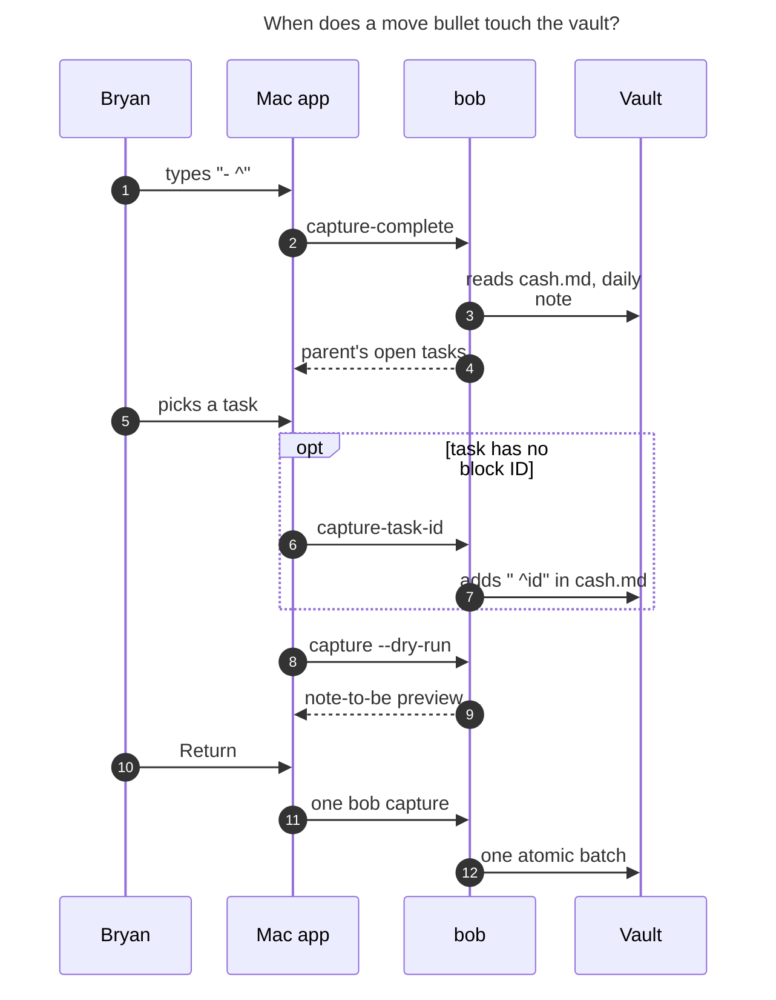

# Move bullets: bringing parent tasks into a new project note at capture time

*Researcher: cld · 2026-11-03 · bob-cli 0.4.0 (grammar 6) · Bob Mac Capture `f8832b3`*

## TL;DR

The idea is good, and almost all of the machinery already exists. A first-level
bullet that holds only `^some-id`, inside an `@foo^bar@` or `@foo:bar@`
project-note item, is an error in today's grammar. So the feature fills an
unused slot and breaks nothing. Capture already runs the `bob task move` engine
inside its atomic batch (inbox routing), so moving a task, repairing its links
vault-wide, and rolling back on failure are solved problems. The Mac app
already has rich task pickers, an "Add block ID" flow, and a gating rule that
fires on `- ^` today. The catch is that today it opens the wrong picker.

I recommend building it, with seven adjustments (§4):

1. **Call it *move*, never *pull*.** "Pull-in" already means "link a successor
   into today's Pomodoro".
2. **Teach one position rule.** A *leading* `^` points at an existing block; a
   *trailing* `^` names a new one.
3. **Add the twin `- :id`.** It moves the task, then links it, the same way a
   trailing ` :id` links a new task.
4. **Accept any parent note**, area or project.
5. **Write moved tasks where the bullets sit** in the draft, not at the end of
   `## Tasks`.
6. **Stamp moved open tasks fresh**, as `Ctrl+Shift+M` and inbox routing
   already do.
7. **Make ID-less tasks first-class** in the picker. About half of the
   candidate tasks in the vault have no block ID today.

The recommended solution is at the end (§13).

---

## 1. What exists today (verified)

### 1.1 The project-note capture family

`@route^id@` creates `<route>_<id>.md` under `<route>.md`.
`@route:id@` creates the same note and then **offers** its open tasks as
successors (`docs/capture.md` "Project notes" and "Offer a new project's
tasks"). First-level authored bullets become `## Tasks` rows, in draft order.
ALL-CAPS bullets that have nested bullets become `##` sections. A trailing
` ^id` names a task; a trailing ` :id` names it, makes it Next, and links it
into the Pomodoro the capture chose. The lexer lives in
`src/native/capture_language/project_tasks.rs`. Planning lives in
`src/native/capture/project_note.rs`, and rendering in
`src/native/capture_project_note.rs`.

### 1.2 The `- ^` slot is free

I checked this against a sandbox vault with the installed `bob` 0.4.0:

| Draft bullet under `Finish the exit packet @cash^goog-exit@` | Today |
| --- | --- |
| `- ^draft-memo` | **error**: `capture line 2 names a task but has no task text` |
| `- :call-ms` | **error**: same message |
| `- ^` | **error**: `` ` ^` on `` needs a task ID `` |
| `- ^` (in `capture-complete`) | context `project_task_block_id`, intent `new`, `body: ""`, `suggestions: []`. This is a "New ID" prompt with nothing to suggest from, so it is a dead end. |

Giving these inputs a meaning is therefore **purely additive**. No draft that
captures today changes behaviour.

### 1.3 Capture already moves tasks inside its batch

`--inbox-route` answers run "through the `bob task move` engine … in one
atomic batch: a full vault snapshot overlaid with the staged texts, per-group
move plans, the freshness stamp on each moved root line, and the same link
repair, collision renames, and preimage guard as any other batch write"
(`docs/capture.md` "Routing inbox tasks out"; `src/native/capture/inbox_route.rs`
`apply_inbox_routes`). The engine itself is `task_move::plan_task_move`
(`src/native/task_move/plan.rs`). Its behaviour:

- It carries children, managed logs, and anchors along with the task.
- It rewrites links to the moved block across Markdown notes, including
  `done/`, daily notes, `ref/`, aliases, embeds, and pathless links.
- It updates `[id::]` and `[dependsOn::]` identities.
- It renames a block ID that collides at the destination.
- It refuses closed, nested, `^prj`, and ambiguous selections.

The engine inserts moved blocks **at the end of the `## Tasks` intake**
(`insert_into_dest` → `tasks_intake_insert_byte`). §6.2 explains why that
placement is not good enough for this feature.

### 1.4 There is a pattern for ID-less tasks

Every task picker (`:`, `+`, `&`, `*`, `!`, `((`) lists ID-less rows with
`requires_block_id: true`, an empty `replacement`, and up to three
`block_id_suggestions`. Accepting such a row runs
`bob capture-task-id --route R --task-ref <line>:<digest> --block-id ID`. That
command appends ` ^ID` to the task line, guarded against stale lines and
written atomically, and returns a ready-to-splice replacement
(`parent_replacement`, `dependency_replacement`, …). It is the **only**
vault write that happens before submit, and only for an ID-less pick.

### 1.5 How the Mac app requests completion

This comes from a read-only survey of `bob-mac-capture`:

- **The gate.** `shouldRequestCompletion` (`CapturePanelModel.swift:14221`)
  asks for completion when a top-level `needs` value is in `completionNeeds`,
  or when the caret sits in a span whose kind is in `completionSpanKinds`.
  There is no per-character trigger list in Swift (comment at `:14246`).
- **Today `- ^` opens the New ID picker.** For `- ^` Bob returns
  `needs:["block_id"]` plus an `interactive_placeholder` span. The app maps
  that to the New ID picker card, which locks the editor. That is exactly the
  picker the new feature has to replace.
- **Typing past the caret stops completion.** `- ^goo` returns no span and no
  need, so the app stops asking and shows the red `invalid_project_task_id`
  status. The new design must keep a span over the typed ID.
- **The closest UI precedent** is the scoped `@route+` parent-task picker:
  - it is a picker card with `scope: note` and a `note_target`;
  - rows show a status glyph and colour, a Pomodoro chip, a scheduled capsule,
    and an `⊕ ^suggestion` locator for ID-less rows;
  - it already includes the Add block ID prompt.
- **Unknown contexts degrade to neutral inline rows**, and unknown span kinds
  paint as neutral text. An older app with a newer `bob` stays usable.
- **The preview never shows the new note's contents.** It shows the `^prj`
  line, the basename, a "Links N tasks into NAME" block, and the Pull-In
  successor rows. `project_note.tasks` and `sections` are decoded but never
  displayed.

### 1.6 What the vault looks like

These are read-only counts over `~/bob` root notes on 2026-11-03:

| Fact | Count |
| --- | --- |
| Root project notes | 98 (93 carry `template: "[[new_project]]"`) |
| Their parent is a **project** / an **area** | **89** / 9 |
| Top-level open `#task` rows in area and project notes, excluding `^prj`: with a block ID / without | 226 / **265** |

Two consequences follow:

- **Splitting a project into sub-projects is Bryan's dominant pattern.** The
  user's framing ("pull from the parent project") matches the data, but areas
  must work too.
- **ID-less tasks are the common case.** The picker cannot treat them as an
  edge case.

---

## 2. Critique: is this a good idea?

**Yes.** Here is what makes it right:

- **It removes a real multi-step chore.** Today, splitting `foo` into `foo_bar`
  takes one capture plus one `Ctrl+Shift+M` per task in Obsidian, or a
  `bob task move` CLI call. The step where you decide which tasks belong to
  the new project happens in a different app from the one where the project
  was born. Doing both in one draft is better.
- **The draft reads like the note it writes.** That is the accepted rule for
  capture bullets (`decisions:capture-bullets-mirror-the-task-block`). A
  `- ^call-ms` bullet in the draft lands as the `^call-ms` task at that
  position in `## Tasks`.
- **It is reliable by construction.** One atomic batch, one preimage guard,
  and one move engine that already ships under capture.
- **It respects the thin-client rule** (`decisions:mac-capture-is-a-thin-client`).
  Bob owns the grammar, the candidates, the preview, and the write; the app
  only presents them.

**What I would push back on or refine:**

1. **The vocabulary collides.** "Pull in" is already a defined, user-visible
   gesture: `-p/--pull-in`, the Mac **Pull-In card**, and the "Successor
   Offer" glossary term ("pull-in offer"). Under `@foo:bar@` both meanings can
   show up in one draft: you *move* a task in, then *pull it in* to today's
   Pomodoro. Name the new gesture **move**. Bob already uses that word for
   `bob task move`, `Ctrl+Shift+M`'s "Moved to …", and inbox routing's
   `moved`.
2. **`^` gains a third reading**, after "name a new task" (trailing ` ^id`)
   and "the active existing task" (item-leading `^route:id`). That is fine
   only if a single rule explains all three. One does: **a leading `^` points
   at an existing block; a trailing `^` names a new one.** The item-leading
   `^route:id` already follows it. Make it the documented rule (§3).
3. **Half the tasks you want to move have no ID.** The design must make
   choosing an ID-less task feel as smooth as choosing an identified one.
4. **A move is heavier than a create, and the preview must say so.**
   - Link repair rewrites historical daily-note links
     (`[[foo#^x]]` → `[[foo_bar#^x]]`).
   - So past Pomodoro time on that task is re-attributed (root parent, Stats)
     under the new project when that project is its own root.
   - This is identical to `Ctrl+Shift+M` today, so it is accepted behaviour,
     but it should be visible ("3 links repaired").
5. **`- ^call-ms` is opaque.** The draft shows an ID, not the task. Make it
   legible: the preview lists moved rows by title in phase 1, and an inline
   "ghost title" follows in phase 2 (§8.4).
6. **Restricting the source to the parent is right for v1, but say why.** The
   parent is the only source that needs no extra syntax. It covers the
   "split a project" story, and it keeps the picker small and recognisable.
   Moving tasks from the inbox into a brand-new project is a real second use
   case. Defer it, but reserve its spelling (`- ^route:id`, §9).

**Would I take a different approach?** Not fundamentally. I compared four
alternatives (§9): a submit-time checklist card, an Obsidian "project from
selected tasks" gesture, a Similar-tasks action, and cross-note moves. Each
one is a *complement*, not a replacement. The text-first design is the only
one that keeps the draft as the single source of truth, previews exactly what
will be written, and composes with authored tasks in order.

---

## 3. Design principles

1. **Position decides meaning.**
   - A first-level bullet that *starts* with `^`/`:` and holds nothing else
     refers to an existing task.
   - A ` ^`/` :` that *ends* a bullet with text names the new task on that
     bullet.
   - This parallels the shipped `#` rule: `- #drawer` at the start of a
     bullet versus a trailing `#type`.
2. **The draft is the plan.** Moved tasks land in `## Tasks` exactly where
   their bullets sit, interleaved with new tasks.
3. **One resolver.** `capture-parse` spans, `capture-complete` rows,
   `capture --dry-run`, and the commit all share one eligibility function.
   A row the picker offers can never be refused at submit unless the vault
   changed in between.
4. **Nothing moves until Return.** The only pre-submit write is the
   established Add block ID write, and only for an ID-less pick.
5. **Bob says everything the app shows.** That covers replacements,
   consequences, refusal reasons, and preview rows.

---

## 4. Adjustments to the requirements (called out)

| # | Requirement as stated | Adjusted to | Why |
| --- | --- | --- | --- |
| A1 | "pull … from the parent project" | **Move** in every contract and UI string (`project_task_move`, `moved_tasks`, "Moves from cash"). | "Pull-in" is taken by successor offers, which appear in the same draft under `@foo:bar@`. |
| A2 | "parent project (`~/bob/foo.md`)" | **The parent note**: area or project, whatever `<route>.md` is. | 9 of 98 projects have area parents. The parent-validation rule already admits both kinds. |
| A3 | `- ^id` only | **Also `- :id`**: move, then make Next and link into the Pomodoro the item chose (`#name` or type placement). | It mirrors the trailing ` :id` versus ` ^id` split Bryan already uses on new-task bullets. It also makes `@foo^bar@#admin` work with only moved tasks. |
| A4 | (unstated) placement | Moved tasks land **at their bullet's position** in `## Tasks`. | The draft reads like the note it writes. The engine's default "append to intake" would reorder Bryan's draft. |
| A5 | (unstated) freshness | Moved **open** tasks get `[fresh:: today]` and keep their keep streak. | This matches `Ctrl+Shift+M` and inbox routing. Picking a task into a project is a human confirmation that it still matters. |
| A6 | "triggers good completion" | The picker lists **ID-less tasks too**. Accepting one runs the existing Add block ID flow, then inserts `^new-id`. | 54% of candidate tasks have no ID. The flow has precedent in six pickers. |
| A7 | "bullet line by itself" | Kept strict in v1: no text, markers, checkbox, or nested bullets on a move bullet, each with a teaching error. Nested notes under a move bullet arrive in phase 2. | This keeps v1's grammar and preview simple, and still leaves a clear growth path. |
| A8 | (unstated) blocked new project | v1 **refuses** moving a non-Blocked task into a project whose `s:<N>` date is in the future. | This matches `bob task move`'s rule. Consuming today's links silently from a capture would surprise him. |
| A9 | "`@foo[:^]bar@` used somewhere in this capture" | Scope is **per item**. Only the item that carries the project-note marker (parent line or a sealing child line) gets move bullets. In a bulk draft, other items keep today's meaning. | Capture grammar is item-scoped everywhere else. |

---

## 5. Grammar specification

### 5.1 Grammar-at-a-glance rows (proposed)

| Marker | Meaning |
| --- | --- |
| `- ^<id>` alone on a first-level project-note bullet | **Move** the open top-level `^<id>` task from the parent note `<route>.md` into the new note, at this position in `## Tasks`. Its children, logs, links, and dependency IDs follow it. |
| `- :<id>` alone on a first-level project-note bullet | Same move, then make it Next and link `[[<stem>#^<id>]]` into the Pomodoro the item places, or the `#pomodoro` one. |
| `- ^` / `- :` (lone sigil) | Unfinished move: opens the move picker. `bob capture` refuses it with a teaching error. |

Example draft, where most bullets are moves:

```text
Finish the Google exit packet! @cash^goog-exit@#admin
- ^draft-memo
- :call-ms
- Collect the equity paperwork ^equity-docs
- FUTURE WORK
  - Revisit the severance terms
```

Resulting `cash_goog_exit.md` (`## Tasks` keeps draft order, and moved rows
keep their own fields):

```markdown
- [ ] #task #prj Finish the Google exit packet! #hide ^prj

## Tasks

- [ ] #task Draft the resignation memo [created::2026-10-01] [fresh:: 2026-11-03] ^draft-memo
	- keep it short
- [*] #task Call Morgan Stanley about the 401k [created::2026-10-01] [fresh:: 2026-11-03] ^call-ms
- [ ] #task Collect the equity paperwork [created::2026-11-03] ^equity-docs

## Future Work

- Revisit the severance terms
```

`cash.md` loses both blocks. `[[cash#^draft-memo]]` and `[[cash#^call-ms]]`
are rewritten vault-wide, and the existing `ADMIN` link for `call-ms` follows
it. The template placeholder line is **not** written, because the note has
task children.

### 5.2 Lexical rules (in `capture-parse`, no vault reads)

- **Where a move bullet can appear.** Only on a first-level authored bullet
  of an item whose kind is `ProjectNote` (either form). Nested lines keep
  their meaning: `  - ^` still names the owning task through the New ID
  flow.
- **Shape.** After the list marker, the body is exactly one token: a sigil
  `^` or `:` followed by an optional ID. The ID uses the shared block-ID
  rule. A lone sigil is the incomplete form.
- **Who claims the bullet.** A new lexer, `move_bullet.rs` (modelled on
  `drawer_bullet.rs`), runs **before** `strip_trailing_task_id`. A bullet it claims never reaches the new-task
  path. This is what keeps today's "has no task text" error from firing.
- **Diagnostics.** Each uses `bob capture`'s exact wording:

| Code | Example | Message |
| --- | --- | --- |
| `move_bullet_text` | `- ^call-ms tweak it` | `` `- ^call-ms` moves a task and takes no other text; write the new task as `- tweak it` `` |
| `move_bullet_markers` | `- ^call-ms s:2` | `` a moved task keeps its own schedule and priority; remove `s:2` `` |
| `move_bullet_checkbox` | `- [x] ^call-ms` | `` a moved task keeps its own checkbox; remove `[x]` `` |
| `move_bullet_children` (v1) | `- ^call-ms` + `  - note` | `` notes under a moved task are not supported yet; add them after capture with `@cash_goog_exit+call-ms` `` |
| `duplicate_project_task_move` | `^call-ms` twice | `` `^call-ms` is already moved on line 3 `` |
| `project_task_id_collision` | `- ^call-ms` + `- Ring them :call-ms` | `` task ID `call-ms` is moved from cash.md on line 3; rename the new task on line 5 `` |
| `invalid_project_task_id` | `- ^prj`, `- ^a_b` | the existing reserved and charset messages |
| `move_bullet_route` (reserved) | `- ^mac_inbox:fix-x` | `` moving from another note is not supported yet; `- ^<id>` moves from cash.md `` |

### 5.3 Execution checks (vault-dependent, in `capture` and `--dry-run`)

The candidate is read from the **staged** parent text, so earlier batch items
are visible. It must be:

- a top-level (column-0) `#task` list item outside frontmatter and fences;
- open: `[ ]`, `[*]`, `[/]`, or `[?]`;
- not `^prj`;
- carrying a block ID that is unique in the note.

Refusals:

| Case | Message |
| --- | --- |
| Unknown ID | `` cash.md has no open task `^draft-mem`; type `^` after `- ` to pick one of its open tasks `` |
| Closed | `` `^pay-cc` in cash.md is done; only open tasks move into a new project `` |
| Nested | `` `^sub` is nested under `^parent` in cash.md; move `^parent` to bring the whole block `` |
| Duplicate ID in source | the engine's ambiguous-identity message, plus "rename one in cash.md" |
| Future-dated project, non-`[?]` task (A8) | `` `s:3` starts cash_goog_exit on 2026-11-06, so it cannot take Ready task `^draft-memo` yet; drop `s:3` or move the task after it starts `` |
| Moved by an earlier batch item | `` `^call-ms` already moved to cash_goog_exit.md in item 1 `` (instead of a bare "not found") |

### 5.4 Interactions

- **Retired and conflicting forms.** `%c`, `--clip`, `=x`, and `@@` keep
  their existing project-note refusals. Move bullets add no new conflicts.
- **The `#pomodoro` name** (Create form) needs at least one ` :` task. A
  `- :id` move counts.
- **The offer form.** `@cash:goog-exit@` offers moved open rows exactly like
  authored ones, with `moved_from: "cash.md"` on the offer.
  - A moved task that already has a live Task Link today folds into
    `already_planned`.
  - A `- :id` row folds the same way.
  - A pick of a moved task is an existing task, so it is stamped fresh. It
    already is, from the move.
- **A blocked parent.** Its residents are already `[?]` plus
  `#prj_is_blocked`. The new note inherits the parent's block
  (`decisions:subprojects-inherit-project-blocking`), so moved tags stay
  true. Reconcile owns the cascade, as it does for every capture today.
- **Dependencies.**
  - A pathless `[[#^y]]` on a moved task that points at a sibling left
    behind is rebased to `[[cash#^y]]`.
  - Siblings that depend on the moved task are repaired.
  - Co-moved pathless links stay pathless.
  - All of this is engine behaviour that ships today.
- **Type.** A capture-created note has no `task_type:`, so it inherits its
  parent's type and no Task Link relocation (D8) happens.

---

## 6. Execution design (bob-cli)

### 6.1 Phases inside `plan_project_note_item`

1. **Parse.** Each first-level bullet becomes either an `AuthoredSubBullet`
   or a new `MoveBullet { sigil, id, draft_range, position }`.
2. **Resolve.** Run every move bullet against the staged parent with the
   shared `movable_parent_task()` eligibility function. The completion
   service uses the same function.
3. **Render.** The renderer takes an ordered list of slots: authored tasks,
   sections, and `Move(n)`. It emits one opaque slot line per move, and
   suppresses the template placeholder whenever any task slot exists.
4. **Stage** the new note, exactly as today (`planner.stage(&new_target, …)`).
5. **Move.** Call `plan_task_move` with
   `MoveRequest { source: <route>.md, dest: <new note>, selectors: [Block(id)], allow_closed: false, placement: Slot(line) }`,
   then stage its postimages. The engine:
   - removes the block from the parent;
   - **replaces the slot line** with the moved fragment;
   - repairs links and dependency identities vault-wide.
6. **Stamp** `[fresh:: today]` on each moved open root line. Reuse the inbox
   route's landing check and `stamp_fresh`. Factor both into a shared
   `capture::batch_move` helper, so routing and moves cannot drift apart.
7. **Link** each `- :id` through the existing-task link path against the
   **new** location, placed the same way as authored ` :` tasks.
8. **Offer.** In the offer form, enumerate offerable rows **after** the moves.
9. **Report.**

### 6.2 Why add a slot placement to the engine

`MoveRequest` already carries two capture-only extensions: `allow_closed` and
`MoveSelector::Line`. A third one, `placement: Intake | Slot(line)`, is small
and keeps the engine responsible for what it does well: removal, renaming,
link repair, and identity checks. It also avoids a second fragment-splicing
code path. Any failure aborts the batch, so a slot line can never survive to
disk. The alternative, "moved rows go after all authored tasks", is simpler.
But it breaks principle 2 the first time Bryan interleaves a move with a new
task, so I would not ship it.

### 6.3 JSON report (additive, `schema_version` stays 1)

```json
"project_note": {
  "basename": "cash_goog_exit.md",
  "form": "create",
  "moved_tasks": [
    {
      "n": 2,
      "sigil": ":",
      "draft_range": [61, 69],
      "source": "cash.md",
      "source_line": 9,
      "block_id": "call-ms",
      "previous_block_id": "call-ms",
      "block_id_created": false,
      "text": "Call Morgan Stanley about the 401k",
      "previous_status_symbol": "*",
      "status_symbol": "*",
      "status_name": "Next",
      "line": 9,
      "fresh": "2026-11-03",
      "planned": { "pomodoro": "WORK", "link_follows": true },
      "link": null,
      "repaired_links": 2
    }
  ],
  "repaired_files": [{ "path": "2026/20261101.md", "link_count": 1, "dependency_token_count": 0 }],
  "renamed_block_ids": [],
  "needs_reconcile": false
}
```

`draft_range` lets clients tie each preview row back to its bullet. That
enables the phase 2 ghost title, and it is the same anchor idea as
`capture-related`'s ranges. `planned` describes a link that already exists
and follows the task. `link` describes a new link made by `- :id`.

### 6.4 Human output

```text
[dry-run] ok would capture  cash_goog_exit.md
  parent  [[cash]]
  - [ ] #task #prj Finish the Google exit packet! #hide ^prj
  3 tasks · 2 moved from cash.md · sections Future Work
  would move  [ ] Draft the resignation memo  cash.md:7 → ^draft-memo
  would move  [*] Call Morgan Stanley about the 401k  cash.md:9 → ^call-ms · WORK link follows · 2 links repaired
  would link  [[cash_goog_exit#^call-ms]] under ADMIN
```

---

## 7. Completion design

### 7.1 `capture-parse`

- **Spans.**
  - `project_task_move_marker` over the sigil.
  - `project_task_move_block_id` over the typed ID, kept while the ID is
    partial, so the app keeps asking for completion as Bryan types.
  - Both carry the existing `"project_note": "create" | "offer"` modifier.
    The app then gets the manila wash for free.
- **The lone sigil.** `- ^` or `- :` reports mode `incomplete` with
  `needs: ["project_task_move"]` and an `interactive_placeholder` over the
  sigil. **It no longer reports `block_id`.** This is the one change that
  retires today's dead-end New ID prompt for this position.
- **Sub-bullet arrays.** Additive `sub_bullet_moves`, parallel to
  `sub_bullet_task_ids`: `null` or `{ "block_id", "link" }`.
- **Grammar revision.** `grammar: 7`. The app's gate is `>= 5`, so nothing
  breaks.

### 7.2 `capture-complete` context `project_task_move`

- **Field.** The cursor is in the move span or on the lone sigil.
  `replacement` covers the ID only, after the sigil, so the typed sigil
  survives an accept. `query` is the typed ID prefix.
- **Picker descriptor.**
  `{ kind: "project_task_move", scope: "note", scope_token: "^" | ":", note_target: "cash.md", destination: "cash_goog_exit.md", marker_range, trigger_removal_range }`.
  This deliberately mirrors the `@route+` scoped parent picker, so the Mac
  can reuse that presentation.
- **Rows.** Every open top-level task in the parent, using the `task_parent`
  row shape:
  - `ref`, `block_id`, `requires_block_id`, `block_id_suggestions`;
  - `status_*`, `text`, `section`, `line`, `child_count`, `scheduled`;
  - `pomodoro` (queued chip);
  - plus `consequence`, `disabled_reason`, and `replacement`.

  Examples of the Bob-authored `consequence`:

  | Row | `consequence` |
  | --- | --- |
  | Ready task | `Moves into cash_goog_exit.md` |
  | Task linked under WORK today | `Moves into cash_goog_exit.md · its WORK link follows` |
  | Any row under `:` | `Moves in and links under ADMIN · becomes Next` |
  | ID-less row | `Needs an ID first · ⊕ ^collect-equity-paperwork` |

- **Order.**
  - With an empty query, rows follow the parent's **document order**,
    grouped by its `##`/`###` headings. When you split a project, you think
    in the parent's own layout.
  - Queued tasks carry their chip in place rather than being hoisted.
  - `#hide` rows are muted.
  - With a query, the `@route+` ranking applies: block-ID prefix, word
    prefix, substring, then subsequence. Identified rows rank ahead of
    ID-less ones at equal score.
- **Disabled rows** have no `replacement`, and the reason is shown:
  - `already moving on line 3`;
  - `duplicate ^id in cash.md`;
  - for a future `s:<N>` item, non-`[?]` rows get
    `project starts Nov 6 — only Blocked tasks can move in`.
- **Hidden rows.** Closed tasks, nested tasks, `^prj`, and the template
  placeholder are not listed at all.
- **No parent yet.** When the parent route is missing or unresolved
  (`@^goog-exit@`, `@ca^goog-exit@`), the response is empty with one
  `warnings` entry: `choose the parent note first`.
- **Cost.** It reads the parent note plus today's daily note (for the
  Pomodoro chips). That is the same footprint as the `@route+` picker. No
  vault-wide scan runs on a keystroke. Link-repair counts appear only in the
  dry run.

### 7.3 Add block ID for move rows

Use the existing `capture-task-id --route <parent> --task-ref <ref> --block-id <id>`.
Add one additive field to its JSON success: `move_replacement: "^<id>"` (and
`":<id>"` when the picker's scope token is `:`). That makes the app splice
Bob's text, exactly as it already does with `parent_replacement` and
`dependency_replacement`. The prompt opens prefilled with the first
suggestion, the same as every other picker.

---

## 8. Bob Mac Capture design

### 8.1 Wiring

Using the hooks found in the survey:

- **Gating.** Add `project_task_move` to `completionNeeds` and `pickerNeed`.
  Add `project_task_move_marker` and `project_task_move_block_id` to
  `completionSpanKinds` (`CapturePanelModel.swift:14221–14258, 7477`).
- **Dispatch.** Add a `CaptureCompletionContext.projectTaskMove` case, and a
  `handleCompletionResponse` branch to a new `CapturePickerSource.projectMove`.
  Update every exhaustive switch in `CapturePickerPresentation.swift` and the
  Esc-restore switch.
- **Styling.**
  - Map `project_task_move_block_id` to `.blockID` (indigo), like a named
    ID.
  - Paint `project_task_move_marker` with the same `.explicitToggle` yellow
    used by ` :` for the `:` sigil.
  - Give the `^` sigil a calm accent of its own, such as the route colour,
    so a move reads differently from a trailing name.

### 8.2 The picker card

```text
┌ Move into cash_goog_exit.md ─────────────────── from cash.md · 12 open ┐
│ ⌕ dra                                                                  │
├─ Tasks ───────────────────────────────────────────────────────────────┤
│ ○  Draft the resignation memo                            ^draft-memo   │
│ ◉  Call Morgan Stanley about the 401k   [WORK 13:30]     ^call-ms      │
│ ○  Collect the equity paperwork                 ⊕ ^collect-equity-pap… │
│ ⏸  Renew the passport            [Nov 6]                 ^passport     │
├─ Admin ───────────────────────────────────────────────────────────────┤
│ ○  Pay the credit card · already moving on line 3        ^pay-cc  (dim)│
├───────────────────────────────────────────────────────────────────────┤
│ Moves into cash_goog_exit.md · its WORK link follows    ↵ move  ⎋ close│
└───────────────────────────────────────────────────────────────────────┘
```

- **Rows** use the existing task-row grammar: the status glyph and colour
  from `CaptureEditorPalette.taskStatus`, the Pomodoro chip, the scheduled
  capsule, and the `⊕ ^suggestion` locator for ID-less rows.
- **The footer** is the selected row's `consequence` or `disabled_reason`.
  That is the same convention as the drawer menu.
- **↵ on an identified row** inserts `^id`. On an ID-less row it opens the
  prefilled Add block ID prompt; ↵ there writes the ID and inserts it.
- **Phase 2 "move and add another".** A second accept key inserts
  `^id\n- ^` and leaves the caret after the new `^`, so the picker reopens at
  once. Bob should supply that text as `replacement_and_next`, so the app
  never composes bullet syntax itself.

### 8.3 Preview block (phase 1)

Add a **"Moves N tasks from cash.md"** block beside the existing "Links N
tasks into NAME" block. Each row shows the glyph, the title, `^id`, and
Bob's suffix (`WORK link follows`, `^id added`, `2 links repaired`). It is
rendered from `project_note.moved_tasks`.

### 8.4 Beauty upgrades (phase 2)

- **Note-to-be outline.**
  - A compact rendering of the new note: `^prj`, then `Tasks` with `+` rows
    for new tasks and `↪` rows for moved ones, then the sections.
  - It is built from a Bob-supplied `project_note.outline[]`, with entries
    `{kind: prj|task|moved|section|note, text, status_symbol, block_id, moved_from, link}`.
  - It helps *every* project-note capture, not just moves, and closes the
    gap the survey found (decoded fields that are never shown).
- **Ghost titles.** After each `- ^call-ms` in the editor, draw a dimmed
  trailing hint, `Call Morgan Stanley about the 401k · Next`, anchored by
  `moved_tasks[].draft_range` from the latest dry run. The draft keeps its
  exact text, and the opaque ID becomes readable.

---

## 9. Alternatives considered

| Approach | Strengths | Why not as the primary design |
| --- | --- | --- |
| **Text move bullets** (recommended) | The draft is the plan. Ordered, previewable, and atomic. Works from the CLI too. | Needs IDs, solved with the Add block ID flow. `^` overloading, solved with the position rule. |
| Submit-time **"Bring tasks from cash.md?" checklist card** (`--adopt 1,3` picks, like the Pull-In card) | No IDs needed (digest keys). Natural multi-select. | The choice lives outside the draft, so the preview cannot show it before Return. It adds a third submit card after Pull-In and inbox route, and cannot express "between these two new tasks". |
| **Obsidian "project from selected tasks"** (select sibling tasks → hotkey) | Best when you are *looking at* the parent backlog. | It belongs in a different app and moment. Better as a **second front door onto the same engine**: the plugin can compose a draft with move bullets and call `bob capture`, so there is still one grammar and one writer. |
| **Similar-tasks band action** (a "Move into project" action on matches from the parent) | Discovery without recall: Bob suggests what belongs. | It only matches the project *title*, so recall is limited. It works well as a phase 3 action that inserts `- ^id`, under `decisions:similar-tasks-are-a-settled-heads-up`'s explicit-edit rule. |
| **Cross-note moves** `- ^route:id` (for example from `mac_inbox`) | Covers "these inbox items are really a project". | The picker would need the vault catalog and the parent story gets blurred. Reserve the spelling now (§5.2) and ship it later if Bryan wants it. |
| **Status quo** (create, then `Ctrl+Shift+M` per task) | Already works. | N gestures across two apps, and the project starts life empty. |

---

## 10. Implementation plan

**bob-cli (lands first)**

1. **Contract docs.** Update `docs/capture.md`: the grammar rows, the
   project-notes subsection "Moving parent tasks in", the parse and complete
   contracts, and `grammar: 7`. Update the `docs/projects.md` cross-reference
   and the glossary "Project Note" strand (via `/sase_memory_write`).
2. **Lexer.** Add `capture_language/move_bullet.rs`, shared by the execution
   parser and the editor parser, with diagnostics from §5.2.
3. **Eligibility and completion.** Add a `movable_parent_task()` resolver.
   Add the `project_task_move` context in `capture_language/completion.rs`
   and `capture_complete/`. Add the `move_replacement` field to
   `capture_task_id.rs`.
4. **Engine.** Add `MoveRequest.placement` (`Intake | Slot(line)`) in
   `task_move/plan.rs`, with unit tests.
5. **Planner.** Add renderer slots and move bullets to
   `capture/project_note.rs`. Extract `capture::batch_move` from
   `inbox_route.rs`. Add freshness stamping, `- :id` linking, and the offer
   ordering.
6. **Output.** Add JSON and human rows in `capture/output.rs`.

**Bob Mac Capture (after a bob release; needs macOS CI)**

7. Gating, context, picker source, row and footer presentation, the Add
   block ID splice from `move_replacement`, span styling, the "Moves N tasks"
   preview block, and the `docs/protocol.md` compatibility rows.

**Phase 2:** nested notes under a move bullet (appended before managed logs,
using the `@route+id` sub-bullet rule), `replacement_and_next`, the note
outline, and ghost titles.

**Phase 3 (optional):** the Similar-tasks "Move into project" action, an
Obsidian front door, and cross-note `- ^route:id`.

**After acceptance, add a decision record** (via `/sase_memory_write`):
"Leading `^` points at an existing block; trailing `^` names a new one", with
the move-bullet rule as its first application.

---

## 11. Conformance vectors (sketch)

| ID | Draft / state | Expected |
| --- | --- | --- |
| MV1 | `@cash^x@` + `- ^a` (Ready `^a` in cash) | `^a` moves to slot 1, stamped fresh. cash loses the block. Links repaired. Dry-run JSON equals the real run apart from `dry_run`. |
| MV2 | `- New` / `- ^a` / `- Other` | `## Tasks` order is New, a, Other. |
| MV3 | `- ^a` where `^a` is Next and linked under WORK | The link is rewritten to `[[cash_x#^a]]` and stays under WORK. `planned.link_follows`. No new link. |
| MV4 | `@cash^x@#admin` + `- :a` (Ready) | Moved, `[*]`, linked under ADMIN, fresh. `#admin` is satisfied. |
| MV5 | `@cash:x@` + `- ^a` + `- New` | Both offered. `^a` offer has `moved_from`. `-p all` matches authoring `- :a` + `- New :new`. |
| MV6 | `- ^a` with `^a` done / nested / `^prj` / unknown | Teaching refusal. Vault byte-identical. |
| MV7 | `- ^a` twice; `- ^a` + `- New :a` | `duplicate_project_task_move` / `project_task_id_collision` in parse and capture. |
| MV8 | `- ^a tweak`; `- ^a s:2`; `- [x] ^a`; `- ^a` + nested | `move_bullet_*` diagnostics. |
| MV9 | `s:3` + `- ^a` (Ready) | A8 refusal. A `[?]` task moves. |
| MV10 | Item 1 moves `^a`; item 2 `@cash:a` | Item 2 fails with "already moved to cash_x.md in item 1". Whole batch rolls back. |
| MV11 | A linked file changes between plan and commit | `NoteChanged`. Nothing written. |
| MV12 | `- ^a` where `^a` depends on `[[#^b]]` left in cash; `^c` in cash depends on `^a` | Rebased to `[[cash#^b]]`; `^c` → `[[cash_x#^a]]`. `[id::]` and `[dependsOn::]` updated. |
| MV13 | Parent is an area | Works the same as a project parent. |
| MV14 | All bullets are moves | No template placeholder line. |
| MC1 | `capture-complete` at `- ^` | Context `project_task_move`, document order, ID-less rows with suggestions, `^prj` and closed tasks absent. |
| MC2 | `- ^dr` | Query `dr`. Replacement covers `dr` only. |
| MC3 | `- :` | Same rows. `consequence` names the link destination. |
| MC4 | `  - ^` on a nested line | Unchanged: `project_task_block_id` New ID flow. |
| MC5 | Item without a project-note marker | `- ^` keeps today's behaviour. |
| MC6 | `capture-task-id` on a move row | `move_replacement: "^<id>"`. |

---

## 12. Open questions for Bryan

1. **Fresh stamp on moved tasks (A5)?** I recommend yes. The alternative is
   `bob task move`'s "never stamp", which would leave moved tasks due for
   review the next morning.
2. **`- :id` in v1 (A3)?** I recommend yes, because it is a small delta on
   the existing-task link path.
3. **Future-dated new project with Ready tasks (A8):** refuse in v1, or
   follow `Ctrl+Shift+M` (block the task and consume today's links)?
4. **ID-less accept:** keep the prefilled prompt (consistent with all six
   pickers), or let ↵ accept the first suggestion directly and use a
   modifier to edit it? I recommend the prompt for v1, and revisiting if it
   feels slow in practice.
5. **Cross-note moves:** is "inbox items → new project" common enough to
   schedule phase 3?

---

## 13. Recommended solution

Build **move bullets** for project-note captures:

1. **Grammar.**
   - Inside an item marked `@route^id@` or `@route:id@`, a first-level bullet
     that is exactly `^<id>` moves that open, top-level task from
     `<route>.md` into the new note, at that bullet's position in `## Tasks`.
   - `:<id>` does the same and also makes the task Next and links it into
     the item's Pomodoro.
   - Any area or project parent works.
   - The rule to document is "a leading `^` points at an existing block; a
     trailing `^` names a new one". The words in contracts and UI are
     "move" and "moved", never "pull".
2. **Execution.**
   - Inside the existing atomic capture batch, reuse the `bob task move`
     engine. Add a capture-only `Slot(line)` placement, so moved tasks land
     where the draft puts them.
   - Factor inbox routing and project moves into one `capture::batch_move`
     helper.
   - Stamp moved open tasks `[fresh:: today]`. Let existing Task Links
     follow.
   - In the `:` form, offer moved rows like any other row.
   - In v1, refuse non-Blocked moves into a future-dated project.
   - Report everything in additive `project_note.moved_tasks[]`, plus
     repaired files and renames.
3. **Completion.**
   - `- ^` or `- :` reports the need `project_task_move` instead of today's
     dead-end `block_id`.
   - `capture-complete` serves a `project_task_move` context. Its rows list
     the parent's open top-level tasks in document order, with status,
     Pomodoro chip, schedule, a Bob-authored `consequence`, and disabled
     reasons.
   - ID-less rows go through the existing Add block ID flow. Bob returns a
     new `move_replacement`.
4. **Mac.**
   - Reuse the scoped parent-task picker card as a "Move into
     `<new note>` · from `<parent>`" picker.
   - Add a "Moves N tasks from `<parent>`" preview block.
   - In phase 2, add a full note-to-be outline and ghost titles after each
     `^id`, so the draft stays exact and still reads like prose.

This keeps one grammar, one resolver, and one writer. No draft that captures
today changes behaviour. Every failure mode is a teaching error before any
write.

---

### Figure: when the vault is touched



*Caption: Before Return, the only possible vault write is step 7, which gives
an ID-less task a block ID. Every move, link repair, and stamp happens in the
single atomic batch at step 12. (Rendered with mermaid-cli 12.0.0: 648 × 897
px, 99.5% fit.)*

### Evidence

- **bob-cli docs:** `docs/capture.md`, the sections on Project notes, Offer a
  new project's tasks, Routing inbox tasks out, Picking any open task with
  `:`, `capture-parse`, `capture-complete`, and `capture-task-id`;
  `docs/task-move.md`; `docs/projects.md` (Promotion successors, Inbox
  routing); `docs/task-dependencies.md` §13.6.
- **bob-cli source:** `src/native/capture_language/project_tasks.rs`,
  `drawer_bullet.rs`; `src/native/capture/project_note.rs`, `inbox_route.rs`;
  `src/native/task_move/plan.rs` (`MoveRequest`, `insert_into_dest`).
- **Memory:** `decisions:capture-bullets-mirror-the-task-block`,
  `capture-sigils-say-where-what-how`, `mac-capture-is-a-thin-client`,
  `projects-block-from-prj-line`, `subprojects-inherit-project-blocking`,
  `task-move-never-advances-the-walk`; glossary strands for Project Note,
  Successor Offer, Task Successor, and Leaf Project.
- **Bob Mac Capture survey** (read-only): `CapturePanelModel.swift`
  (gating at 14221/14230/14258, dispatch at 4461, pickerNeed at 7477),
  `CompletionRowContent.swift`, `CapturePickerView.swift`,
  `CaptureProjectNotePresentation.swift`, `BobProcessClient.swift`.
- **Sandbox runs** with installed `bob` 0.4.0 (`/tmp/cld_pull_sandbox`):
  `- ^id`, `- :id`, and `- ^` are errors today; `capture-complete` at `- ^`
  returns `project_task_block_id` with an empty body.
- **Vault counts** (read-only grep over `~/bob` root notes): 89 of 98
  projects have a project parent; 226 of 491 open top-level tasks have a
  block ID.
