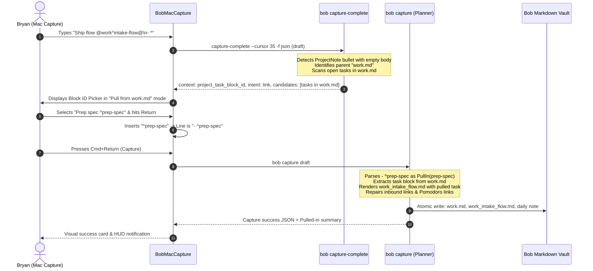
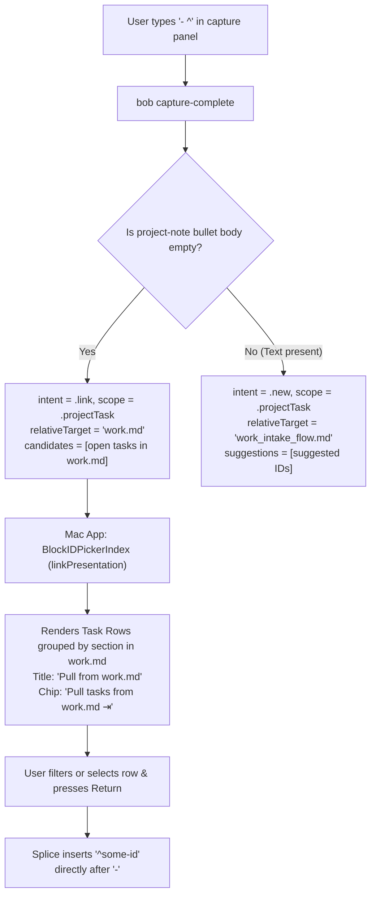

# Project-Note Task Pull-In: Seamless Subproject Extraction in Bob

> **Research query:** When the `@foo[:^]bar@` capture syntax is used to create a new project note (`foo_bar.md`), how can child tasks be easily pulled in from the parent project (`foo.md`)? Critique the proposal of using a `^some-id` reference on a bullet line by itself (`- ^some-id`) to specify moving that task from the parent project into the newly created project note. Ensure pressing `^` after `- ` triggers intuitive, reliable, and beautiful completion in `bob-mac-capture`. Evaluate alternatives, identify requirement adjustments, and recommend an end-to-end design.

---

## 1. Executive Summary (Bottom Line)

**The proposed plan is fundamentally sound, highly aligned with GTD subproject extraction workflows, and can be implemented with exceptional elegance across `bob-cli` and `bob-mac-capture`.**

Subproject extraction—carving out a cluster of tasks from an overburdened parent project into a dedicated subproject—is currently a multi-step chore in Bob. A user must create the new project note via capture or manual creation, switch to the parent note in Obsidian, cut the task blocks, paste them into the new note, and run link repairs. Enabling capture-time pull-in solves this friction at the exact moment of decomposition.

### Key Findings & High-Level Decisions

1. **Reclaim Currently Refused Grammar (`- ^some-id` and `- :some-id`):**
   - In `bob-cli`, a project-note task bullet containing only a block ID (e.g., `- ^some-id` or `- :some-id`) currently triggers `empty_project_task_body_error` ("capture line names a task but has no task text"). Reclaiming this syntax creates **zero grammar conflicts** and breaks no valid captures.
   - **Recommended Requirement Adjustment:** Support **both** `- ^some-id` (move preserving status) **and** `- :some-id` (move + promote to Next + create Pomodoro Task Link). This mirrors the canonical Bob project-note convention where `^` names a task and `:` makes it Next and links it into today's ledger.

2. **Leverage Existing Mac Capture Infrastructure:**
   - In `bob-mac-capture`, `BlockIDPickerContext` already has a dual-mode presentation architecture: `isNewIDMode` (intent `new` / `projectNote`) vs. task-browsing mode (intent `link`).
   - When the user types `- ^` on a project-note bullet with an empty body, `bob capture-complete` should return `context: "project_task_block_id"` with `intent: "link"`, `route: "<parent>"`, `relative_target: "<parent>.md"`, and `candidates: [tasks from parent]`.
   - The Mac capture app already knows how to render these candidates, filter them with fuzzy matching, and insert the selected block ID. With targeted UI tailoring (announcing "Move from parent.md" instead of "New ID"), the experience feels custom-crafted, fast, and native.

3. **Reuse the Robust `task_move` Engine for Execution:**
   - Moving an existing task is far more than copying text: it requires cutting the full task block (including nested checklist bullets, notes, and drawers), inserting it into the new note's `## Tasks` section at the authored order, repairing inbound wikilinks (`[[foo#^id]]` $\to$ `[[foo_bar#^id]]`), preserving or relocating today's Pomodoro Task links, and updating depends-on references.
   - `bob-cli`'s existing `task_move` and `collect_done::repair_links_in_note_with` engines already handle this transactional integrity.

---

## 2. Background & Problem Framing

### 2.1 The Subproject Decomposition Workflow in Bob

In Bob, projects reside in project notes (e.g., `projects/marketing.md` or `work.md`), and subprojects follow a strict hierarchical naming convention (Decision 47, `subprojects-inherit-project-blocking`):
- Parent: `foo.md` (or `work.md`)
- Subproject: `foo_bar.md` (or `work_intake_flow.md`)

When capturing a new project note:
- `@foo^bar@`: Creates project note `foo_bar.md` under parent `foo.md`.
- `@foo:bar@`: Creates project note `foo_bar.md` and offers its tasks as successors of the new `^prj` task (`ProjectNoteForm::Offer`).

During real-world work, a project note often accumulates 10–30 tasks. Eventually, a coherent sub-initiative emerges (e.g., "Refactor Auth" or "Intake Flow"). Bryan decides to decompose `foo.md` into `foo_bar.md`.

Today, moving 3–5 tasks from `foo.md` into `foo_bar.md` requires:
1. Capturing the new project note shell (`@foo^bar@`).
2. Running `bob task move foo foo_bar -b task1 -b task2 ...` or manually cutting and pasting in Obsidian.
3. Manually repairing any daily Pomodoro links or broken references.

Being able to specify:
```markdown
Intake Flow @work^intake-flow@
- ^prep-spec
- ^wireframe-ui
- Draft backend schema :schema
- Run dry-run migration
```
where `^prep-spec` and `^wireframe-ui` are existing tasks in `work.md` and `Draft backend schema` is a new task, transforms a 3-minute chore into a 10-second capture.

---

## 3. Critique of the Proposed Plan

### 3.1 Strengths of the Proposed Design

1. **Terse, Intuitive Markdown Outline Syntax:**
   A bullet containing `- ^some-id` reads cleanly as a reference or pointer. It blends seamlessly with standard Markdown outlines and Bob capture conventions.
2. **Backwards Compatible:**
   Because a bullet with only `^some-id` is currently an error in `ProjectTaskPass` (`empty_project_task_body_error`), adopting it does not alter the semantics of any existing working capture.
3. **Contextual Constraint Eliminates Ambiguity:**
   Because the route `@foo` is already declared in the parent marker (`@foo^bar@`), the reference `^some-id` does not need a verbose path like `- [[foo#^some-id]]` or `- @foo^some-id`. The scope is unambiguously the parent note `foo.md`.
4. **Natural Completion Anchor:**
   Typing `- ` followed by `^` provides an unambiguous trigger. In Bob's grammar, a bullet line with no preceding text where the first character is `^` cannot be a normal task description, making it an ideal completion trigger.

### 3.2 Risks, Edge Cases & Critique

While the core concept is sound, several critical edge cases require deliberate design:

#### A. The `:` vs `^` Dichotomy (Next & Pomodoro Linking)
In Bob project notes, trailing sigils have distinct, established meanings:
- `- Task ^id`: Creates a Ready task (`[ ]`) with block ID `^id`.
- `- Task :id`: Creates a Next task (`[*]`) with block ID `^id` **and** inserts a Task Link `[[note#^id]]` into today's Pomodoro ledger.

If the pull-in syntax *only* supports `- ^some-id`, how does the user pull in a task and immediately link it into today's Pomodoro? If an existing task in `foo.md` was Ready (`[ ]`), but the user wants to pull it into the new subproject and work on it *today*, forcing them to use `^` means they must separately link it later.
*Verdict:* The grammar should accept **both** `- ^some-id` and `- :some-id`.

#### B. Tasks Without Block IDs in the Parent Project
In Obsidian and Bob, open tasks in project notes do not require block IDs until they are linked or referenced (see `docs/concepts/tasks-and-lanes.md` §15). A parent project `foo.md` may have 15 open tasks, but only 5 have Obsidian block IDs (`^...`).
If completion only matches tasks that already have `^block-id`, the user cannot pull in the remaining 10 tasks without first opening `foo.md` and manually adding IDs.
*Verdict:* `bob capture-complete` must present **all** open tasks in `foo.md`. For ID-less tasks, it should supply candidate suggestions (just like the Task Link `:` picker), and the Mac capture app can mint an ID via `bob capture-task-id` before inserting `- ^minted-id`.

#### C. Child Bullets, Notes, and Drawers
What happens to child bullets under the task in `foo.md`?
For example, in `foo.md`:
```markdown
- [ ] Implement OAuth provider ^oauth-impl
  - check refresh token rotation
  - audit PKCE requirements
  ## WORK LOG
  - initial spike started
```
When `- ^oauth-impl` moves to `foo_bar.md`, the entire task block—including child checklist bullets, notes, and structural drawers—must move with it. Furthermore, what if the user types sub-bullets *under* `- ^oauth-impl` in the capture draft?
```markdown
Auth Service @work^auth-service@
- ^oauth-impl
  - newly captured sub-bullet
```
*Verdict:* The execution engine must move the entire existing task block, and append any newly captured sub-bullets to that task's children.

#### D. Link and Dependency Integrity
If task `^b` in `foo.md` depends on `^a` in `foo.md` (`[dependsOn:: [[foo#^a]]]`), and both are moved to `foo_bar.md`:
- Intra-project links must be rewritten to point to `foo_bar#^a`.
- Inbound links from other notes (e.g. daily notes, other projects) pointing to `foo#^b` must be updated to `foo_bar#^b`.
- Live Pomodoro Task Links in today's daily note pointing to `[[foo#^b]]` must be relocated to `[[foo_bar#^b]]`.
*Verdict:* This must not be hand-rolled; it must delegate to `collect_done::repair_links_in_note_with`.

---

## 4. Requirement Adjustments

The following adjustments to the user prompt's preliminary requirements are justified and recommended:

| # | Proposed Requirement | Recommended Adjustment | Justification |
|---|---|---|---|
| **R1** | Pull-in via `- ^some-id` | Support **both** `- ^some-id` and `- :some-id`. | In Bob, `:` denotes promoting to Next and creating a Pomodoro Task Link. Allowing `- :some-id` enables pulling an existing task and queuing it into today's ledger in one keystroke. |
| **R2** | Parent is always `~/bob/foo.md` | Parent is derived from `ParsedCaptureText.route` (which may be an Area or Project note). | Project notes can be created under area notes (e.g. `@work^project@`) or project notes (e.g. `@infra^db@`). Pull-in should work identically whether the parent is an area or project. |
| **R3** | Only identified tasks (`^id`) | Include ID-less open tasks in completion candidates, with auto-minting via `capture-task-id`. | Many project tasks lack block IDs. Forcing users to pre-seed IDs defeats capture speed. |
| **R4** | Bare bullet line only | Allow sub-bullets under `- ^some-id` in the capture draft. | Users often want to pull in an existing task *and* immediately jot down new sub-notes or next steps during capture. |
| **R5** | Simple move | Atomic transaction with vault-wide reference and Pomodoro link repair. | Prevents broken `[[parent#^id]]` links across daily notes and project dependencies. |

---

## 5. End-to-End System Design & Architecture



### 5.1 Capture Language & Grammar Parsing (`bob-cli`)

#### Grammar Rules for Child Bullets
In `src/native/capture_language/project_tasks.rs`, child bullets are evaluated through `ProjectTaskPass`.

Currently, `check_child` enforces:
```rust
let (_, without_checkbox) = split_leading_checkbox(body.trim_start());
if without_checkbox.split_whitespace().next().is_none() {
    return ChildTaskOutcome::Error {
        code: "invalid_project_task_id",
        message: empty_project_task_body_error(line_number),
    };
}
```

#### New Outcome: `ChildTaskOutcome::PullIn`
When `without_checkbox.split_whitespace().next().is_none()`:
1. If the bullet contains a valid trailing ID token (`^id` or `:id`):
   - In a `ProjectNote` capture, this is **not** an empty task; it is an explicit **Pull-In instruction**.
   - Return `ChildTaskOutcome::PullIn { sigil, id }`.
2. Update `ProjectTaskId` in `src/native/capture_language/model.rs`:
   ```rust
   #[derive(Debug, Clone, PartialEq, Eq, Serialize)]
   pub(crate) struct ProjectTaskId {
       pub(crate) block_id: String,
       pub(crate) link: bool,
       pub(crate) pull_in: bool,
   }
   ```
3. In `ProjectTaskPass`:
   - Duplicate check: ensure the pulled-in ID is not pulled in twice, and does not collide with newly authored IDs in the same draft.
   - Reserved check: ensure the ID is not `prj` (cannot pull in the parent project's `^prj` task).

### 5.2 Completion Engine (`bob capture-complete`)

#### Trigger Detection in `project_task_token_at`
In `src/native/capture_language/completion.rs`:
When cursor is at `- ^` or `- :` on a project-note child bullet:
1. Check if the line body (excluding the sigil) is empty.
2. If empty, the user is starting a pull-in reference rather than typing a new task title.
3. Determine the parent route:
   - For `@work^intake-flow@`, `route` is `work`.
   - The target note is `work.md`.

#### Constructing the Completion Response
In `src/native/capture_block_ids.rs` (`build_project_task_block_id_field`):
```rust
if is_pull_in_bullet {
    let parent_target = format!("{}.md", parent_route);
    let (candidates, warnings) = link_candidates(bob_dir, &parent_route, query)?;
    return BlockIdField {
        route: parent_route.to_string(),
        relative_target: parent_target,
        note_exists: true,
        marker: sigil.to_string(),
        marker_range,
        intent: BlockIdIntent::Link, // Triggers Link / Browse mode in Mac app!
        body: String::new(),
        allowed_character: "[A-Za-z0-9-]".to_string(),
        allowed_description: "A-Z, a-z, 0-9 or '-'".to_string(),
        suggestions: Vec::new(),
        used: Vec::new(),
        owner_line: Some(line_number),
        splice: Some(ProjectTaskSplice {
            range: replacement,
            before: String::new(),
            after: String::new(),
        }),
    };
}
```

In `src/native/capture_complete/engine.rs`:
When `context == CompletionContext::ProjectTaskBlockId` and `intent == BlockIdIntent::Link`:
- Populate `candidates` with `link_candidates(bob_dir, &parent_route, &field.query)`!
- Filter to open tasks in `parent_route.md`.

### 5.3 Native Client UX & Presentation (`bob-mac-capture`)

`bob-mac-capture` requires minimal changes because `BlockIDPickerIndex` was already architected to support `intent == .link` for block ID pickers!



#### UI Polish & Details in `bob-mac-capture`
1. **Picker Scope Caption:**
   In `CapturePickerPresentation.swift`:
   ```swift
   case .blockID(let context):
       if context.scope == .projectTask && context.intent == .link {
           return "Pull from \(context.route).md"
       }
   ```
2. **Reopen Chip Label:**
   ```swift
   case .blockID(let context):
       if context.scope == .projectTask && context.intent == .link {
           return "Pull tasks from \(context.noteTarget) ⇥"
       }
   ```
3. **Detail Summary Strip:**
   When highlighting a row in the picker:
   `"Moves task from work.md to work_intake_flow.md"`
4. **Zero-Prefix Splice Insertion:**
   Because `isProjectTask` is `true`, `rowInsertionPrefix` is `""`. Selecting `prep-spec` inserts `prep-spec` right after the typed `^`, yielding `- ^prep-spec`.

### 5.4 Execution Engine (`bob capture`)

When `bob capture` executes:
In `src/native/capture/project_note.rs`:

1. **Phase 1: Validation & Sourcing**
   - Identify all `sub_bullets` where `task_id.pull_in == true`.
   - Read `parent_path` (`foo.md`) through `planner.read_existing(&parent_path)`.
   - For each `^id`:
     - Verify it exists in `foo.md`. If missing, abort with: `task ^<id> not found in parent note foo.md`.
     - Verify it is an open task (`[ ]`, `[*]`, `[/]`, `[?]`). If completed, reject unless `--allow-closed` is explicitly passed.
     - Verify it is not the parent's `^prj` task.

2. **Phase 2: Task Extraction & Parent Note Slicing**
   - Extract the entire task block for each pulled task:
     - The checkbox task line.
     - All indented child lines (sub-bullets, nested checklist items, code fences, notes).
     - Any attached drawers (`## DRAWER`).
   - Remove these blocks from `foo.md`.
   - Stage the updated `foo.md` into `planner`.

3. **Phase 3: Subproject Note Rendering**
   - When rendering `foo_bar.md` (`render_project_note`):
     - Place pulled-in tasks in `## Tasks` at their exact authored position in the draft.
     - If the pull-in was authored with `:` (`- :some-id`):
       - Promote status to Next (`[*]`, or `[?]` if scheduled).
       - Enqueue Pomodoro Task Link into today's ledger.
     - If authored with `^` (`- ^some-id`):
       - Preserve the task's existing status and metadata exactly as they existed in `foo.md`.
     - If child bullets were authored under `- ^some-id` in the capture draft, append them to the moved task's child list.

4. **Phase 4: Vault-Wide Reference & Link Repair**
   - Call `collect_done::repair_links_in_note_with`:
     - Target: `MovedBlockTarget { old_note: "foo", new_note: "foo_bar", id: "some-id" }`.
     - Rewrites `[[foo#^some-id]]` to `[[foo_bar#^some-id]]` across all notes in the vault (including `done/` and `ref/`).
     - Updates `[dependsOn:: ...]` references across other tasks.
     - Updates today's daily note: if `^some-id` was linked in today's Pomodoro ledger, its link target is updated from `[[foo#^some-id]]` to `[[foo_bar#^some-id]]`.

5. **Phase 5: Output Summary Reporting**
   The CLI and JSON output should clearly celebrate the pull-in:
   ```text
   ✓ captured  work_intake_flow.md
     parent    [[work]]
     - [ ] #task #prj Ship the intake flow #hide ^prj
     pulled in from work.md:
       - [ ] Prep spec ^prep-spec
       - [*] Wireframe UI ^wireframe-ui (set Next · linked)
     created:
       - [ ] Draft backend schema ^schema
   ```

---

## 6. Edge Cases & Robustness Analysis

| Scenario | Risk | Mitigation & Behavior |
|---|---|---|
| **Parent is Area note** | Area notes have no `^prj` line, but can be parents of project notes (e.g. `@work^project@`). | `validate_project_note_parent` already allows Area notes. Pulling tasks from an Area note into a Project note is fully valid and supported. |
| **Parent task has no block ID** | User wants to move a task that lacks an ID in `foo.md`. | In completion, show ID-less tasks with a suggested slug. When selected, invoke `capture-task-id` logic to assign the ID in `foo.md`, then insert `- ^new-id`. |
| **Duplicate pull-in in draft** | User accidentally types `- ^task-1` twice in the draft. | `ProjectTaskPass` checks `seen` set and returns `duplicate_project_task_id` diagnostic. |
| **Collision with new task ID** | User pulls `- ^task-1` and also writes `- New task ^task-1`. | `ProjectTaskPass` checks the unified ID registry for the item and rejects collision with `duplicate_project_task_id`. |
| **Parent task is Blocked (`#prj_is_blocked`)** | In `foo.md`, the task had `#prj_is_blocked` because `foo`'s `^prj` was blocked. | If the new subproject `foo_bar.md` is NOT blocked, the `#prj_is_blocked` tag should be cleared by reconcile or stripped during placement. |
| **Dry-run mode (`--dry-run`)** | Capture previewed in Mac app or terminal. | Full plan executed in memory; diff shows both `foo_bar.md` creation and `foo.md` deletions without writing to disk. |
| **Git / Sync conflicts** | Concurrently edited note. | Standard Bob file coordination (`.forMerging`) applies across all touched files (`foo.md`, `foo_bar.md`, daily note). |

---

## 7. Comparison of Alternatives

```mermaid
flowchart TD
    subgraph Proposed["Proposed: Bullet Line '- ^id'"]
        P1["Capture: Ship @foo^bar@\n- ^task1\n- New task :task2"] --> P2["Familiar Markdown outline"]
        P2 --> P3["Instant completion on '- ^'"]
        P3 --> P4["Atomic creation & move in one go"]
    end

    subgraph Alt1["Alternative 1: Post-Capture Pull-In (-p / --pull-in)"]
        A1["Capture: Ship @foo:bar@\n(Creates note first)"] --> A2["Shows terminal card or modal"]
        A2 --> A3["Pick numbers: -p 1,3"]
        A3 --> A4["Two-step gesture; separates creation from drafting"]
    end

    subgraph Alt2["Alternative 2: Full Wikilink '- [[foo#^task1]]'"]
        W1["Capture: Ship @foo^bar@\n- [[foo#^task1]]"] --> W2["Verbose syntax"]
        W2 --> W3["Ambiguous: is it a link or a move?"]
        W3 --> W4["Harder to type on mobile / quick capture"]
    end
```



### Why the Proposed Approach Wins
- **Compared to Alternative 1 (Post-capture picker `-p`):** Bob's existing `-p/--pull-in` on `@foo:bar@` is designed for *successor offers* (linking newly created tasks into today's ledger). Reusing that for moving tasks from the parent note would conflate *creating new tasks* with *relocating existing tasks*, and requires a second interactive turn. The draft-native `- ^id` syntax allows authoring the entire new project structure in one thought.
- **Compared to Alternative 2 (Full Wikilinks):** Writing `- [[foo#^task1]]` is verbose, redundant (since `foo` is already known from `@foo^bar@`), and visually cluttered in a rapid-capture HUD.
- **Compared to Alternative 3 (Separate CLI Move):** Running `bob task move foo foo_bar -b task1` forces context switching out of the capture flow.

---

## 8. Detailed Specification for Implementation

### 8.1 Rust Changes (`bob-cli`)

1. **`src/native/capture_language/model.rs`**:
   - Add `pub(crate) pull_in: bool` to `ProjectTaskId`.
2. **`src/native/capture_language/project_tasks.rs`**:
   - In `check_child`:
     When `without_checkbox.split_whitespace().next().is_none()`:
     - If `stripped.lex` is `TaskIdLex::Valid { sigil, id }`:
       - Check if `id` is reserved (`prj`) -> Error.
       - Check if `id` is already seen in draft -> Error.
       - Return `ChildTaskOutcome::PullIn { sigil, id }`.
3. **`src/native/capture_language/completion.rs`**:
   - In `project_task_token_at`:
     - Detect when the bullet line has no text other than the trigger sigil (`^` or `:`).
     - Signal to caller that this is a pull-in position.
4. **`src/native/capture_block_ids.rs`**:
   - In `build_project_task_block_id_field`:
     - If at a pull-in bullet:
       - Set `intent: BlockIdIntent::Link`.
       - Set `route` to parent route (e.g. `foo`).
       - Set `relative_target` to `format!("{parent_route}.md")`.
5. **`src/native/capture_complete/engine.rs`**:
   - When `field.context == CompletionContext::ProjectTaskBlockId` and `block_field.intent == BlockIdIntent::Link`:
     - Query `link_candidates(bob_dir, &parent_route, &field.query)`.
     - Return these candidates.
6. **`src/native/capture/project_note.rs`**:
   - In `plan_project_note_item`:
     - Collect all `sub_bullets` with `pull_in == true`.
     - Load `parent_path`.
     - Slice out matching task blocks.
     - Splice them into `rendered.contents` and `rendered.task_rows`.
     - If `sigil == ':'`, mark `row.link = true` to trigger Pomodoro ledger linking.
     - Invoke link repair for moved block IDs across the vault.

### 8.2 Swift Changes (`bob-mac-capture`)

1. **`Sources/CaptureCore/CapturePickerPresentation.swift`**:
   - Update `scopeCaption`:
     ```swift
     if context.scope == .projectTask && context.intent == .link {
         return "Pull from \(context.route).md"
     }
     ```
   - Update `chipLabel`:
     ```swift
     if context.scope == .projectTask && context.intent == .link {
         return "Pull tasks from \(context.noteTarget) ⇥"
     }
     ```
2. **`Sources/CaptureCore/BlockIDPickerIndex.swift`**:
   - In `linkRow(for: ...)`:
     - When `isProjectTask` is `true`:
       - Set `row.detail.insertionPrefix = ""` (so Return inserts `id` instead of `@id`).
       - Set `row.detail.summary = "Moves task from \(route).md to new project"`.

---

## 9. Conclusion & Recommendation

The user's vision for pulling in parent tasks during project-note capture is intuitive, elegant, and directly addresses a recurring real-world workflow in Bob.

By implementing:
1. Grammar support for `- ^some-id` and `- :some-id` as pull-in directives on project-note bullets,
2. Contextual completion in `bob capture-complete` that browses open tasks in the parent note when `^` is pressed on an empty bullet,
3. Seamless integration with `bob-mac-capture`'s existing Link-intent Block ID picker, and
4. Transactional block extraction and vault-wide link repair via the proven `task_move` architecture,

Bob will gain a fast, reliable, and beautiful subproject extraction feature that feels like magic.
