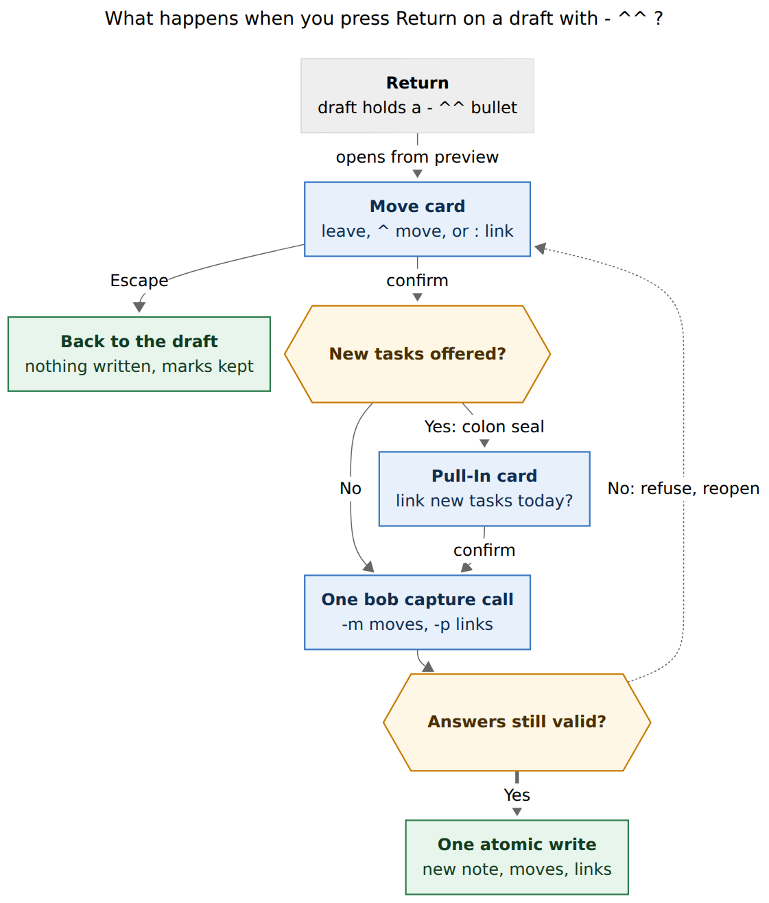
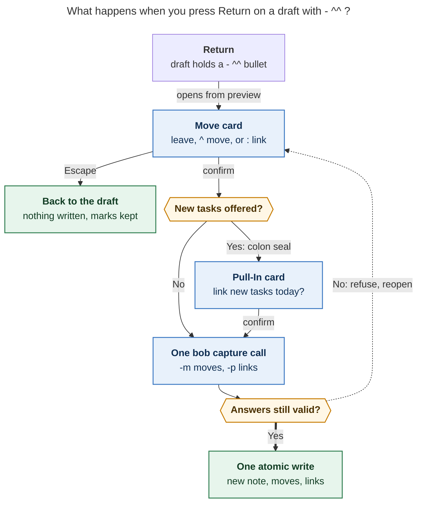

# `- ^^`: choose which parent tasks move into a new project

**Consolidated research report** · lead researcher, merging the cdx, cld, grk, mus,
and gem reports with independent verification · 2026-11-04

> **Request.** Add a `^^` capture bullet for `@foo^bar@` / `@foo:bar@` project-note
> items. When `^^` is the whole bullet, prompt after submit for one or more of the
> parent's tasks. Each task can be `^` (move), `:` (move and link), or unselected (the
> default). Picks behave as if the bob-cli-gl `- ^id` / `- :id` bullets had been typed.
> Take inspiration from the successor prompt, critique the plan, adjust requirements
> where justified, and recommend a solution that is intuitive, reliable, and beautiful.

---

## 1. Verdict

**Build it.** All five researchers reached this verdict independently, and my own
checks support it. bob-cli-gl made one-at-a-time moves precise. It left the common
job, *carving a project out of a big area*, slow. `^^` fills that gap without
competing with the live `- ^` picker:

- **`- ^` is the recall tool.** You already know the task: type it, pick it, chain
  with ⇧↩.
- **`- ^^` is the recognition tool.** You want to see the parent and sort it: some
  rows move, some move and link, most stay.

Four of the ideas in the request are exactly right:

- the slot marker in the draft;
- reusing the successor card's visual family;
- three states per row;
- unselected as the default.

The request is risky only where it is underspecified. Section 4 fixes eight things:

1. **When the prompt runs.** It runs after Return but *before any write*, not after
   the capture is saved.
2. **What "as if typed" means.** It is a vault-result equivalence; the draft text is
   never rewritten.
3. **What Return does with nothing marked.** It must *never* move the highlighted row.
   The successor card does move the highlighted row today.
4. **How the second caret becomes typeable.** The live `- ^` picker currently swallows
   it.
5. **What carries the answer.** A new `-m` flag does; `--pull-in` is never reused.
6. **How `^^` coexists with `@foo:bar@` successor offers.** A task is never asked about
   twice.
7. **How many `^^` bullets a draft may hold.** One per draft in v1.
8. **What happens to ID-less tasks.** IDs are minted inside the batch, never through
   the immediate `capture-task-id` write.

The recommended solution is in §7.

---

## 2. Evidence base

### 2.1 What I verified myself (bob-cli `dad9e660`, bob-mac-capture `2940666`)

| # | Fact | Where |
| --- | --- | --- |
| V1 | A `- ^^` bullet in a sealed project-note item **is a literal task titled `^^` today**. `scan_move_bullet` sees sigil `^`, then a word starting with `^`, which is not alphanumeric, so it returns `None`. Claiming `^^` is a grammar break. | `src/native/capture_language/move_bullet.rs:87-105` |
| V2 | `GRAMMAR_REVISION` is **10**. The in-flight transfer work bumped it (`706eab67`), and `docs/capture.md` still says 9 in the move section. bob-cli-go.10–12 are still IN_PROGRESS and touch the same lexer, editor parser, and `batch_move`. | `capture_language/mod.rs:45`; `sase bead read bob-cli-go` |
| V3 | **`-m` is free** on `bob capture`. Existing answer flags are `-p/--pull-in` and `-i/--inbox-route`. The `--require-*-choice` guards are hidden. | `src/native/capture/cli.rs:600-655` |
| V4 | Under a `:` seal, **caret-moved rows are offered as successors**, and colon moves count as planned. MV5 pins this: `-p all` equals `- :a`. Naively expanding `^^` picks would therefore ask about a `^` row a second time in the Pull-In card. | `capture/project_note.rs:264-335`; `docs/capture.md` MV5 |
| V5 | The project-note move path always builds `MoveSelector::Block(id)`. `MoveSelector::Line` exists, but only inbox routing uses it. | `capture/project_note.rs:2185`; `task_move/plan.rs:94-101` |
| V6 | Successor and note-pull picks **mint IDs inside the batch** (`capture_block_ids::mint_block_id`). The live `- ^` picker instead calls `bob capture-task-id`, which writes to the vault immediately. | `capture/note_pull.rs:721`; Mac `docs/task-pickers.md` §Move Picker |
| V7 | **The Pull-In card applies the highlighted row when nothing is marked.** When nothing is highlighted either, Return is inert and announces "No visible successor offer is selected". | Mac `CapturePullInChoice.swift:538-552`; `CapturePanelModel.swift:3184` |
| V8 | The Pull-In card opens from the **live preview** on Return, with no bob call. The `pull_in_choice_required` refusal is only the fallback. | Mac `CapturePanelModel.swift:2614-2630` |
| V9 | **Typing `- ^^` on the Mac doesn't work today.** The first `^` auto-opens the Move picker, and the picker's filter field takes the next keystroke, so the second `^` filters instead of reaching the draft. | Mac `docs/task-pickers.md` (Move Picker; "printable keys edit the filter field") |
| V10 | **A ready-made fix for V9 exists.** Bob's picker descriptor can carry `action_continuation_keys`. With an empty filter, typing one of those keys closes the picker, inserts the key, and suppresses reopening. The parent-task `+` and Complete `!` pickers already use it (`++`, `!!`). The Mac honors it only for those two sources today. | `capture_complete/model.rs:653`, `engine.rs:1072`; Mac `CapturePanelModel.swift:1542-1552, 7124-7160` |
| V11 | The move-consequence copy is a **string builder**, not a planner simulation. It chooses text from sigil, status, Pomodoro name, and existing link. It never mentions a dependency drop (MV16), and its `status != '*'` branch prints "becomes Next" for an In Progress `[/]` row too. Whether the link path really lowers In Progress needs checking against the planner. | `capture_complete/candidates.rs:410-450` |
| V12 | The `#name` rule flags a `^`-seal `#name` with no `:` task at parse time. An unfinished `- :` counts as a link. | `docs/capture.md` (`unused_project_note_pomodoro`) |
| V13 | Note pull refuses an empty pull write-free (`nothing_to_pull_in`). | `capture/note_pull.rs:1351-1407` |
| V14 | The Mac already has an **old-bob warning gate**: the first ⌘↩ on a `~` draft from a bob without relation grammar warns, and a second ⌘↩ submits. The grammar gate itself only checks `>= 5`. | Mac `CapturePanelModel.swift:2595-2612`; `CaptureGrammarGate.swift:6` |
| V15 | bob-cli-gl's plan rejected "a submit-time 'bring tasks from foo.md?' card" because "the choice would live outside the draft, so the preview could not show it or its order". A `^^` placeholder answers the order half. The card answers the preview half, because every row shows Bob's consequence. | `plan:202611/capture_move_bullets.md` §2.3 |

**Vault census.** I ran a read-only script over `~/bob` root area and project notes.
There are 115 such notes with 511 open top-level roots (excluding `^prj`), and **53%
of those roots have no block ID**. 17 notes have at least 10 open roots and 5 have at
least 20. The largest are `sase.md` (76), `bob.md` (69), and `cash.md` and `love.md`
(25 each). This matches cld's 18 / 6 / 77 and grk's 54% within heuristic noise. Moving
a dozen tasks one ⇧↵ at a time is the case `^^` fixes. ID-less rows are the majority,
so the chooser must handle them first-class.

### 2.2 Where the five reports agree

Each point below is now a settled part of the design:

- **Timing.** Prompt after Return and before any write, using the existing write-free
  refusal protocol.
- **Execution.** Expand the picks server-side into the same move list that authored
  `- ^id` / `- :id` bullets produce. Place them at the `^^` slot in **parent document
  order**. Reuse `batch_move`, the freshness stamp, the `:` link step, and
  destination-before-source writes. There is no second writer.
- **No draft rewriting.** The Mac never creates `- ^id` text and never runs
  `capture-task-id` from the card.
- **One mutually exclusive choice per row,** with Leave as the default.
- **Scope.** Exactly `^^` as the whole first-level bullet body, inside a sealed
  project-note item only. Escapes, nesting, and other contexts keep today's meaning.
- **Grammar.** A `feat(capture)!:` bump counted from the live constant.
- **CLI.** It never prompts, and an unanswered `^^` never silently moves nothing.

---

## 3. Is this a good idea? Critique

**Why it earns its place**

1. **It matches the real job.** Splitting an area is triage: read the parent top to
   bottom and sort it. A search picker serves recall; a checklist serves recognition.
   The census shows that the notes people split are exactly the large ones.
2. **It settles each task's plan lane while the whole parent is in view.** Deciding
   `^` vs `:` row by row is better than committing to a sigil before you see the
   candidates.
3. **The draft stays legible.** One `- ^^` line replaces eight opaque `- ^id` lines.
4. **It is cheap to build safely.** The engine, the choice protocol, the card chrome,
   the capability gate, and the in-batch ID minting all ship today. The new pieces are
   one lexer arm, one report object, one flag, and one card.
5. **It gives the CLI a real path.** Terminal capture has no live picker. Today it
   needs IDs that 53% of tasks lack.

**What it costs, and how to contain it**

| Cost | Containment |
| --- | --- |
| Two ways to move (`- ^` / `- ^^`) | Each surface teaches the other: the `move_hint` mentions both, and typing `^` again in the `- ^` picker turns it into `- ^^`. Docs give a one-sentence rule: *`^` when you know the task, `^^` when you want to look.* |
| Return becomes two steps, or three under a `:` seal | The card opens instantly from the preview. Empty stages are skipped, the next stage is announced, and a task is never asked about twice. |
| Another symbol in a rich grammar | Only one spelling: no `::` alias, no `^^query`, no suffix variants. `- ::` gets a teaching error that points at `^^`. |
| The answer lives outside the draft | Marks persist across ⎋, failed writes, and stale reopens for the same draft and parent. The docs say plainly that a stashed draft does not keep its marks. |
| A wrong pick relocates a task block | Each row shows Bob's consequence for its *current* state before you confirm. The notification counts moves and links. Recovery is `bob task move` or vault git; an "Undo move-in" notification action is a follow-up. |

**Alternatives rejected** (synthesized across reports):

| Approach | Why not |
| --- | --- |
| Write the project, then prompt (literal "after submit") | Two commits, a preview that lied, a crash window, and an awkward cancel. |
| Multi-select inside the live `- ^` picker, writing N lines | ID-less rows would need N vault writes before capture, the draft balloons, and drafting stops. |
| `^^` expands at type time | Same ID problem, plus grammar that exists only to be erased. |
| Always ask when the parent has tasks (no sigil) | Implicit, no slot, nags. bob-cli-gl was right to reject it. |
| Reuse `-p/--pull-in` with sigil prefixes (mus) | One flag with two meanings and a shared number space. A move-only answer is not a successor link. |
| Two checkboxes per row ("move", "link") | Creates an invalid "link without move" state. |
| Cycling three-state checkbox as the only control | A mixed checkbox means "partially checked", and repeated presses overshoot into the stronger action. |
| A one-key "move and link all" | Inflates today's plan in one keystroke. |
| Copy instead of move | Splits identity, as bob-cli-gl already decided. |

---

## 4. Requirement adjustments (called out)

✱ marks a change to the request's wording. The others fill gaps it left open.

| # | Request / gap | Adjusted requirement | Why |
| --- | --- | --- | --- |
| A1 ✱ | "prompt … after they submit" | **After Return, before any vault write.** The card collects answers, and one `bob capture` call then writes everything atomically. | Keeps cancel free and the batch atomic, and matches Pull-In and inbox routing (V8). To the user it still feels like "I pressed Return." |
| A2 ✱ | "select one or more" | **Zero or more.** Choosing none is explicit (⇧↩ or `-m none`). Escape means *back to the draft*, not *choose none and commit*. | Unselected is the default. Zero must be a deliberate choice, not an accident. |
| A3 ✱ | "added as `^foo` / `:foo` bullets as if typed" | **Equivalent vault result, not rewritten draft text.** Picks expand server-side at the `^^` slot, in parent document order whatever order they were marked in. | Rewriting text would force ID writes before capture, a second preview, and confusing undo (V6). |
| A4 ✱ | "take inspiration from the successor prompt" | **Reuse its chrome, not its selection rule.** The highlighted row **never** counts as a pick, and Return with nothing marked does nothing; ⇧↩ means none. | The Pull-In highlight fallback (V7) would silently move a task. |
| A5 | (gap) typing `^^` on the Mac | The `- ^` picker advertises `action_continuation_keys: ["^"]`. A second `^` on an empty filter closes the picker and types itself, so the draft reads `- ^^`. | Otherwise `^^` cannot be typed (V9). This reuses V10 rather than adding a new descriptor. |
| A6 ✱ | (gap) `@foo:bar@` successor offers | **Rows answered on the Move card are never re-offered.** The Pull-In card that may follow shows only still-undecided tasks, such as the new note's authored tasks. | The card's `:` already asks the link question. This deliberately departs from literal MV5 equivalence (V4). |
| A7 | (gap) how many `^^` | **One `- ^^` per draft in v1.** A second is the teaching error `move_choice_duplicate`. The JSON is shaped as `slots[]`, so supporting several later is additive. | Several `^^` bullets bring cross-slot exclusion (one parent, two slots) and staging chains (a slot's parent created by an earlier item). Both are rare and add risk. |
| A8 ✱ | (gap) ID-less rows | **Mint an ID inside the batch for every picked ID-less row,** collision-checked. The card never opens Add block ID, and canceling writes nothing. | The successor and note-pull precedent (V6). Every downstream path keys on `block_id` (V5). The result matches what the live picker produces. |
| A9 | (gap) CLI | **`-m, --move-in <PICKS>`.** A real run with an unanswered `^^` **always** refuses write-free, with no hidden opt-in flag. A dry run plans the capture as `none` and lists the numbered rows. | `^^` is an explicit request. Dropping it silently would misreport what happened. An old Mac then fails safe. |
| A10 | (gap) empty parent | A **live preview diagnostic**, and the real run refuses `move_choice_empty` with "nothing to choose … delete the `- ^^`". The same applies when every row is already claimed by an explicit move. | The note-pull precedent (V13). The user sees it before pressing Return. |
| A11 | (gap) consequences | Row copy for each state must be **what the planner will do**: dependency drops, held links, keeping an existing link, minted IDs. A conformance test pins copy to outcome. | V11. The card *is* the preview, so it has to be true. |
| A12 | (gap) `#name` | At parse time a `- ^^` counts as a possible link, like an unfinished `- :`. At confirm, if the item has a `#name` and the answers include no `:`, the card says "#admin needs a `:` pick, or remove it". Bob refuses `unused_project_note_pomodoro` as the backstop. | Never silently discard the name (V12), and never surprise the user after the card closes. |

---

## 5. The design

### 5.1 Grammar (bob-cli owns it)

The scope is the same as move bullets: a first-level `-` / `*` / `+` bullet of an
item sealed with `@<route>^<id>@` or `@<route>:<id>@`. `scan_move_bullet` claims the
line from its raw shape, before trailing-ID stripping, through a new arm
`MoveBulletHit::Choice { span }`. `item.rs` and `editor_parse.rs` share it, so the
messages stay byte-identical.

| First-level body (trimmed) | Meaning | Code |
| --- | --- | --- |
| `^^` | **Move choice:** ask on Return; picks land at this slot | — |
| `^^ text`, `^^^`, `^^x` | Teaching error: "`- ^^` takes no other text" | `move_choice_text` |
| `[ ] ^^` (any checkbox) | Teaching error (reused) | `move_bullet_checkbox` |
| `^^` with nested bullets | Teaching error | `move_choice_nested` |
| a second `^^` in the draft | Teaching error naming the first line | `move_choice_duplicate` |
| `::` | Reserved: "`::` is not a picker; write `- ^^` and choose `^` or `:` per task" | `move_choice_colon` |
| `\^^`, `` `^^` ``, nested `  - ^^`, non-project items, `@file` lists | Unchanged | — |

Bump `GRAMMAR_REVISION` from whatever the constant is when this lands. It is 10 now,
and go.10–12 may move it. Use a `feat(capture)!:` commit under the release-train
decision.

### 5.2 `capture-parse` and `capture-complete`

- The item stays **complete** (`project_note`) with **no `needs`**, because the
  question comes at Return, so the live preview keeps running. mus proposed a new need
  instead. That would block the dry-run preview that the card opens from, so I
  rejected it.
- New span: `project_task_move_choice_marker` over both carets, in the route accent
  (the same token as `project_task_move_marker`).
- **Report the slot in a new additive array, `sub_bullet_move_choices`, and leave that
  line's `sub_bullet_moves` entry null.** grk's `{sigil: "^", block_id: null}` would
  look like an unfinished lone `^` to today's Mac, which would then open the
  single-task picker. A two-character sigil might not decode at all.
- `capture-complete` at a lone `- ^` with an empty query adds
  `action_continuation_keys: ["^"]` to the `project_task_move` descriptor (A5). It is
  not offered for `- :`. The picker footer adds the hint `^ again · choose several on ↩`.
- `move_hint` copy (MV17) becomes "`- ^` moves one of cash.md's 25 open tasks; `- ^^`
  lets you choose several on ↩".

### 5.3 The `bob capture` report, answer, and refusals

**Report.** Every capture JSON carries `move_choice: {supported: true}` for capability
detection, the same way `pull_in` and `inbox_route` do. When the draft has a `- ^^`,
the object is filled in from the **staged** parent, using the parent and today's
daily note only, with no vault scan:

```json
"move_choice": {
  "supported": true,
  "slots": [{
    "item": 1, "item_line": 3, "draft_range": [97, 99],
    "parent": "cash.md", "destination": "cash_goog_exit.md",
    "pomodoro_name": "ADMIN", "name_needs_link": false,
    "open_count": 25, "answered": false,
    "copy": {
      "title": "Move into cash_goog_exit.md", "subtitle": "from cash.md · 25 open",
      "slot": "lands after “Draft the resignation memo”, in cash.md order",
      "ghost": "choose from cash.md's 25 open tasks on ↩",
      "then": "Then: choose today's links for 2 new tasks"
    },
    "rows": [{
      "key": "cash.md#^call-ms", "n": 2, "line": 12, "section": "Tasks",
      "block_id": "call-ms", "mint": null,
      "text": "Call Morgan Stanley about the 401k",
      "status_symbol": " ", "status_name": "Ready",
      "hidden": false, "scheduled": null, "pomodoro": null,
      "choices": [
        { "sigil": "^", "consequence": "Moves in · stays Ready" },
        { "sigil": ":", "consequence": "Moves in · becomes Next · links under ADMIN" }
      ],
      "locked": null, "disabled_reason": null, "answer": null
    }]
  }]
}
```

- **Rows** come from the shared `movable_roots` eligibility in document order. They
  include ID-less rows (`mint` holds Bob's collision-free suggestion) and `#hide` rows
  (muted). `^prj`, closed, and nested roots are excluded.
- **`choices`** lists only the states the row allows, each with planner-true
  consequence copy (A11). An empty list means the row is disabled, and
  `disabled_reason` says why. For example, `project starts Nov 6, so only Blocked
  tasks can move in`; under a future `s:N` project, `:` is left out.
- **`locked`** marks a row that an explicit `- ^a` / `- :a` elsewhere in the draft
  already claims (`{sigil, item_line}`). It is shown, but it cannot be changed.
- **Keys** reuse the successor-offer KEYS scheme: `path#^id`, or `path@<sha8>[~N]` for
  ID-less rows.

**Answer: `-m, --move-in <PICKS>`.** The option is repeatable and sorted between
`--inbox-route` and `--no-clip`. The help text reads "Answer a `- ^^` move choice:
none, all, or a comma list of row numbers and keys; a leading `:` also links".

| Pick | Meaning |
| --- | --- |
| `3` / `cash.md#^call-ms` | Move row 3 |
| `:3` / `:cash.md@1a2b3c4d` | Move row 3, then link it |
| `^3` | Accepted synonym for `3` (quote it; zsh `EXTENDED_GLOB` treats a bare `^3` as a glob) |
| `all` | Every enabled, unlocked row as a plain move |
| `none` | Move nothing; the `^^` contributes nothing |

Bare numbers mean *move*. A leading `:` mirrors the bullet spelling. There is
deliberately no `:all`: linking a whole parent into today should take a typed list.

**Refusals.** All of these write nothing. They are checked in this order:
`move_choice_*`, then `pull_in_choice_required`, then `inbox_route_choice_required`.
Any existing earlier refusals, such as the Pomodoro override, still win. Exit codes
mirror the pull-in and inbox-route equivalents.

| Code | When |
| --- | --- |
| `move_choice_required` | A real run with `^^` and no `-m`. The payload carries `move_choice` so a client can open the card from it. |
| `move_choice_stale` | A key or number no longer resolves, or its chosen state is no longer allowed. Carries fresh rows. |
| `move_choice_refused` | A pick of a locked or disabled row, or a `:` the row does not allow |
| `move_choice_conflict` | `3,:3` |
| `move_choice_unasked` | `-m` given, but the draft has no `^^` |
| `move_choice_empty` | No selectable rows (also a live preview diagnostic) |
| `unused_project_note_pomodoro` | A `#name` that the answers leave unused (A12 backstop) |

**Execution** happens in `plan_project_note_item`:

1. Resolve the answers against rows rebuilt from the staged parent.
2. Mint IDs for picked ID-less rows into the staged parent. Avoid the parent's IDs,
   the new note's authored IDs, `prj`, IDs of imported descendants, and other mints.
3. Splice the picks into the item's move list at the `^^` slot, in parent document
   order, as `ResolvedProjectMove { sigil, block_id }`.
4. Mark those rows `via: "choice"` so that **offer construction skips them** (A6).
5. From here the bob-cli-gl pipeline runs unchanged: slot rendering, one
   `apply_batch_move` with `IdCollisionPolicy::Refuse`, freshness stamps, the `:` link
   step (link guard, dependency drop, Ready → Next, Task Link placement),
   destination-before-source staging, and rollback.

This keeps the existing crash property: an interruption can duplicate a task but never
lose one. It is **not** database-grade multi-file atomicity, as bob-cli-gl already
documents. `moved_tasks[]` entries gain `via: "choice"`, and their `draft_range` is
the `^^` range. `move_choice.answered` flips to true, with `moved_count`,
`linked_count`, and per-row `answer`. Dry-run output equals the real result except for
`dry_run`.

**Staleness** is key-based, matching pull-in and inbox routing. cdx proposed binding
to a whole-source snapshot instead. That is stricter but spuriously refuses on
unrelated edits, and the ID-plus-text-hash key already identifies the block.

### 5.4 Terminal experience

```text
$ bob capture -d "$(cat draft.txt)"
[dry-run] ok would capture  cash_goog_exit.md · 2 tasks
  - ^^ on line 3 asks which of cash.md's 25 open tasks move in
  move 1  [/] Collect the equity paperwork       ^equity-docs · its WORK link follows
  move 2  [ ] Call Morgan Stanley about the 401k ^call-ms
  move 3  [ ] Renew the passport                 adds ^renew-the-passport
  …
  locked  Draft the memo · moving on line 2
  choose with -m 1,3 (move) · -m :2 (move & link) · -m none

$ bob capture "$(cat draft.txt)"
error: `- ^^` on line 3 asks which of cash.md's 25 open tasks move in; answer with -m 1,3 (move), -m :2 (move & link), or -m none

$ bob capture -m 1,:2,3 "$(cat draft.txt)"
✓ created  cash_goog_exit.md · 5 tasks · 3 moved from cash.md (1 linked under ADMIN)
  moved  [/] Collect the equity paperwork  cash.md:7 → ^equity-docs · WORK link follows
  moved  [ ] → [*] Call Morgan Stanley…    cash.md:12 → ^call-ms · links under ADMIN
  moved  [ ] Renew the passport            cash.md:15 → ^renew-the-passport · added ID
  repaired  3 links in 2 notes
```

### 5.5 Bob Mac Capture: the Move card

**While typing.** Typing `- ^` opens the Move picker as it does today. Typing `^`
again closes it and leaves `- ^^` (A5). The `^^` takes the route accent. A dim
**ghost hint** from Bob's `copy.ghost` follows it, reusing gl.7's ghost-title
mechanism. The gl.7 moves band adds a line such as
`↪ Asks about cash.md's 25 open tasks on ↩`. The preview shows the project as it would
be with no picks, which is honest because Leave is the default.

**On Return.** The card opens instantly from the preview's rows, with nothing marked:

```text
┌ ↪ Move into cash_goog_exit.md ─────────────────────── from cash.md · 25 open ┐
│ ⌕ Filter                                    3 move in · 1 links today  ▣ 9/10 │
├ Tasks ───────────────────────────────────────────────────────────────────────┤
│   ^   ◐ Collect the equity paperwork        WORK 13:30        ^equity-docs  │
│   :   ○ Call Morgan Stanley about the 401k  → ADMIN           ^call-ms      │
│ ▸ [· ^ :] ○ Renew the passport              Nov 6             ⊕ adds an ID  │
│   ·   ○ Ask Dana about the severance math                                   │
├ Admin ───────────────────────────────────────────────────────────────────────┤
│   ·   ○ Pay the credit card                                   ^pay-cc       │
│   :   ○ Draft the memo                      locked · moving on line 2       │
├──────────────────────────────────────────────────────────────────────────────┤
│ Renew the passport — stays in cash.md · ^ moves it in and adds ^renew-the-…  │
│ Lands after “Draft the resignation memo”, in cash.md order                   │
│ ^ move  : move & link  ␣ toggle  ⌘A move all  ⎋ back   ⇧↩ none   ↩ Move 3 · link 1 │
└──────────────────────────────────────────────────────────────────────────────┘
```

**Row anatomy: the card shows the syntax.** Each row starts with a **state well**
that shows the sigil itself, drawn in the editor's own move-span colours:

- `·` hairline: Leave;
- `^` route accent: Move (`project_task_move_marker`);
- `:` explicit-toggle yellow: Move and link (`project_task_move_link_marker`);
- a lock: locked.

Only the highlighted row expands its well into a three-segment control (`· ^ :`). That
gives mouse users explicit radio-group targets and gives VoiceOver an adjustable
element with named values: "Stays in cash", "Moves in", "Moves in and links". This
combines cdx's point about exclusive-choice semantics with the compact sigil well
from cld and grk. After the well come the status glyph, the title with fuzzy-match
highlights, and chips:

- the Pomodoro chip and the schedule chip;
- `→ ADMIN` while the row is marked `:`;
- the `^id` in block-ID indigo, or `⊕ adds an ID` while an ID-less row is marked.

Disabled rows are dimmed and show Bob's reason; `#hide` rows are muted. **The design
adds no new glyphs or hex colours,** following task-dependencies §12.6, so gem's
cyan, emerald, and violet badges are out.

**Header and footer.** The title, subtitle, slot line, and "Then:" line all come from
Bob's `copy`. A live counter reads, for example, `3 move in · 1 links today`. The
detail strip shows the highlighted row's consequence for its current state, followed
by what `^` would do. The projected TODAY badge rises with each `:` mark. The primary
button spells out the action, such as `Move 3 · link 1`. With nothing marked it reads
`Mark tasks with ^ or :` and is inert.

**Keys.** The rule is that sigils set a state, Space toggles, and focus never selects.

| Key | Action |
| --- | --- |
| `^` / `:` | **Set** the highlighted row to that state (idempotent), then move the highlight to the next enabled row. Sweep a long parent one key per row. A state the row does not allow is skipped with Bob's reason announced. |
| Space | Toggle in place: Leave → `^`, and `^` or `:` → Leave. It never escalates to `:`. |
| ↑ ↓ ⌃P ⌃N | Move the highlight |
| ⌘A | Mark every visible, enabled Leave row as `^`. A second ⌘A clears those marks. It respects the filter, so you can type "tax" and press ⌘A. There is no link-all key. |
| other printable keys, Backspace | Edit the filter. Marks survive filtering, and the counter notes "2 marked outside this filter". |
| ↵ | Apply the marks. **Inert with a hint when nothing is marked.** Auto-repeat is ignored. |
| ⇧↩ | Create without moves (`-m none`) |
| ⌃↩ | Apply, capture, and open Bob's reported notes |
| ⎋ | Back to the unchanged draft. Marks are kept for this draft and parent. |

Why Return is inert at zero marks (the reports disagreed, see §6): it keeps the Pull-In
contract that ↵ applies a selection and ⇧↩ applies none. It drops only the highlight
fallback. A reflexive double Return after typing `^^` does nothing rather than
creating a project the user meant to fill.

**Flow (Figure 1).** `submit()` checks `move_choice` *before* the Pull-In branch.
Confirming produces one `bob capture -m <keys>` call. Under a `:` seal with remaining
offers, the existing Pull-In card opens next from the same preview, with no extra bob
call. Its offers no longer depend on the move answers (A6). Escape on Pull-In returns
to the Move card with marks intact, and both answers ride a single
`bob capture -m … -p …`. A `move_choice_required` or `move_choice_stale` refusal
reopens the card from the refusal's rows. Marks whose keys survive are kept, and the
strip reads `cash.md changed · 1 marked task is gone`. Success notifies, for example,
`Created cash_goog_exit · moved 3 from cash (1 linked under ADMIN)`.



*Figure 1. Return opens the Move card from the live preview and writes nothing.
Escape returns to the draft with marks kept. Confirming may open the Pull-In card for
a colon-sealed project's new tasks. Then one `bob capture` call either writes
everything atomically or refuses as stale and reopens the Move card. Rendered with
mermaid-cli 12.0.0 at 746.6 × 878 px, 87.4% PDF fit.*



**Compatibility.**

| Mac × bob | Behavior |
| --- | --- |
| new × new | Full flow |
| old Mac × new bob | The Mac sends no `-m`, so bob refuses `move_choice_required` with its message. Safe, and nothing is written. |
| new Mac × old bob | The preview lacks `move_choice.supported`. Reuse the `~` relation-gate pattern (V14): the first ⌘↩ on a draft with a `- ^^` line warns `This bob predates - ^^; it would capture a task named ^^ · update bob`, and a second ⌘↩ submits. `-m` is only ever sent after a preview advertised support. |
| old × old | Unchanged (a literal `^^` task) |

Obsidian needs no change. The plugin's `^^` is the wikilink block search, a different
language, and Obsidian has no capture panel.

---

## 6. Where the reports disagreed, and how I resolved it

| Question | cdx | cld | grk | mus | gem | **Resolution** |
| --- | --- | --- | --- | --- | --- | --- |
| Return with nothing marked | Continue without moves | Moves the highlighted row (Pull-In consistency) | Continue | ⇧↩ none; ↵ unspecified | Zero moves, with a safeguard | **Inert with a hint; ⇧↩ = none.** This keeps Pull-In's ↵ = selection and ⇧↩ = none, drops the highlight fallback, and makes reflexive Returns harmless. |
| Answer channel | Separate typed answer (`--project-move-choices`) | `-m, --move-in` | `-m, --move-from` | Extend `-p` with `^`/`:` prefixes | `-m, --move-tasks` plus a hidden require flag | **`-m, --move-in`.** It matches the "Moving parent tasks in" docs and the card's verb. `--move-from` reads backwards, and `--move-tasks` blurs into `bob task move`. |
| Unanswered real run | Always refuse | Always refuse | Always refuse | Report offers, write nothing; refuse only with the hidden flag | Refuse only with the hidden flag | **Always refuse.** A hidden opt-in would let an old client silently drop the request. |
| How many `^^` | One per item, several items allowed | **One per draft** | One per item; one card grouped by destination | One per item | One per item | **One per draft in v1,** with `slots[]` in the JSON for a later additive extension. |
| ID-less picks | Mint at confirm | Move by `Line` for `^`; mint only for `:` | Mint at confirm | Not addressed | Mint at confirm | **Mint for every picked ID-less row.** Every downstream path keys on `block_id` (V5), and the result matches the live picker. |
| `@foo:bar@` interplay | Sequential; don't re-ask decided rows | One merged card with two sections | Sequential, with a "you'll choose links next" cue | One shared number space in `-p` | Sequential | **Sequential, and answered rows are never re-offered.** The Pull-In card is reused unchanged and opens from the same preview. A merged card is a possible v2 polish. |
| Row control | Segmented Leave / Move / Move & link; digit keys 0/1/2 | Sigil well; sigils set and advance; Space cycles 3 | Sigil chip; Space toggles skip↔^; `:` toggles; `^` forces | Space cycles 3; ⇧⌘A links all | `[ ] [^] [:]`; Space cycles; `x` clears | **Sigil well, expanded to a 3-segment control on the highlighted row.** Sigils set idempotently and advance; Space toggles Leave↔`^` only. No link-all key. |
| Parse state of `^^` | Complete, pending choice | Complete, no needs | Complete, no needs | Incomplete, with a new need | Complete | **Complete, no needs.** The dry-run preview must keep running, because the card opens from it. |
| How the 2nd `^` gets typed on Mac | Not addressed | New `choice_flip` descriptor | "Dismisses" (mechanism unspecified) | Completion inside `^^` | Not addressed | **Existing `action_continuation_keys`** (V10). No new descriptor field. |
| Empty parent | Empty state with Continue | Refuse | Drop the placeholder with a warning | Refuse | Succeed, dropping `^^` | **Preview diagnostic plus refusal** (note-pull precedent). |
| `- ::` | Not addressed | Reserved teaching error | Unclaimed | Teaching error | Not addressed | **Reserved teaching error** pointing at `^^`. |
| Staleness binding | Whole-source snapshot | Keys | Keys | Not addressed | Not addressed | **Keys,** plus re-checking each row's allowed states. |
| Consequence copy | Must come from the final planner | Bob per-state copy | Bob copy | Not addressed | Not addressed | **Planner-true copy with an outcome test** (V11, A11). |

---

## 7. Recommended solution

**Add `- ^^` as one explicit, slot-anchored move choice per draft. Bob asks about it
after Return and before any write. You answer on a three-state Move card whose rows
show the capture syntax itself, and the answers run through the shipped bob-cli-gl
move pipeline in one atomic batch.**

1. **Grammar (bob-cli).** Exactly `^^` as the whole first-level bullet body inside a
   sealed project-note item. Add a `MoveBulletHit::Choice` arm in the shared lexer and
   teaching errors for text, checkbox, nesting, a duplicate, and `::`. Bump the grammar
   with `feat(capture)!:`. `capture-parse` reports the item as complete, with a
   `project_task_move_choice_marker` span and an additive `sub_bullet_move_choices`
   array. The `- ^` picker advertises `action_continuation_keys: ["^"]`, so `- ^^` can
   be typed.
2. **Protocol (bob-cli).** Add a `move_choice` report built from the staged parent:
   rows in document order, planner-true per-state `choices`, locked and disabled rows,
   successor-style keys, and Bob-authored copy. Add `-m, --move-in`, taking `N`, `:N`,
   keys, `all`, and `none`. An unanswered real run always refuses
   `move_choice_required`, ahead of pull-in and inbox-route refusals. Stale,
   conflicting, refused, unasked, and empty cases each get a write-free code.
3. **Execution (bob-cli).** Mint IDs for picked ID-less rows into the staged parent.
   Splice the picks at the slot in parent order. Mark them `via: "choice"` so offers
   skip them. Then run the gl pipeline unchanged, keeping destination-before-source
   writes.
4. **Card (Bob Mac Capture).** It opens instantly from the preview with nothing
   marked:
   - the sigil state well in the editor's own span colours, expanding to `· ^ :` on
     the highlighted row;
   - `^` / `:` set and advance, and Space toggles Leave↔`^`;
   - a live counter, consequence strip, slot line, and TODAY badge;
   - an explicit primary label; ↵ is inert at zero marks, and ⇧↩ means none;
   - ⎋ back, with marks remembered.

   Under a `:` seal, the Pull-In card follows for the new tasks only, and both answers
   ride one call. Old bobs get the calm second-⌘↩ warning.
5. **Docs and memory.** Add a "Choosing several parent tasks (`- ^^`)" subsection
   under "Moving parent tasks in" with the copy tables, refusal codes, `-m` reference,
   and vectors. Update Mac `task-pickers.md`, `keyboard.md`, `capture-previews.md`,
   and `protocol.md`. **Write a decision record** stating: *`- ^^` asks after Return
   and before any write; nothing moves unanswered; focus never selects; answers ride
   `-m`, never `-p`; rows answered there are not re-offered.* This is a new choice
   protocol beside pull-in, the kind of policy later work would otherwise erode. Make
   the change through `/sase_memory_write`.

**Sequencing.** Land this after bob-cli-go.10–12. They are rewriting the same lexer,
`editor_parse.rs`, `batch_move`, and the grammar constant. Then build bob-cli first
and the Mac second:

1. **contract** (small): docs, copy, and vectors.
2. **cli-grammar** (medium): lexer, parse, continuation keys, and the bump. Add an
   interim execution refusal for `^^`.
3. **cli-choice** (large): report, `-m`, refusals, minting, expansion, offer
   exclusion, and planner-true consequences.
4. **mac-card** (large; can split into card and flow): card, keys, flow ahead of
   Pull-In, continuation key handling, ghost and band, old-bob gate, and real-bob JSON
   fixtures. Compile it per bob-mac-capture `AGENTS.md`: never land uncompiled Swift.

**Conformance vectors to pin (MQ).**

- **Recognition.** Both seals; `-`/`*`/`+`; text, checkbox, nested, duplicate, and
  `::` errors; escaped, nested, and non-project bullets unchanged; parse and capture
  messages byte-identical.
- **Typing.** `- ^` then `^` yields `- ^^`, a complete item, and a closed picker. No
  continuation for `- :` or a non-empty filter.
- **Unanswered.** Dry run is `ok`, planned as `none`, with rows. A real run refuses
  `move_choice_required` and the vault is byte-identical.
- **Equivalence.** `-m 1,:2` is byte-identical to authoring `- ^a` / `- :b` at the
  slot (outside a `:` seal). `-m 3,1` equals `-m 1,3`. Picks land between authored
  neighbors.
- **ID-less.** A pick mints the suggestion, or the next free suffix on collision. A
  descendant ID collision is refused. Canceling writes nothing.
- **`:` seal.** `-m 1` leaves row 1 unoffered. Authored tasks are still offered.
  `-m … -p …` in one batch.
- **Refusals.** Stale, conflict, refused, unasked, and empty; `s:N` birth-blocked rows
  with no `:` choice; locked rows from explicit moves; the `#name` backstop.
- **Consequences.** The `:` copy for each vector equals the `moved_tasks[].detail` it
  produces, covering dependency drop, an already-linked row, In Progress, and project
  blocking.
- **Writes.** Destination before source; an injected failure rolls everything back;
  `NoteChanged` races.
- **Mac.** Sigil sweep; Space toggle; ⌘A on filtered rows; ↵ inert at zero; ⇧↩ none;
  ⎋ keeps marks; stale reopen keeps surviving marks; Pull-In follow-on with Escape
  back; old-bob warning; keyboard-only and VoiceOver passes; light and dark themes;
  long titles; a 76-row parent.

**Before shipping,** walk three short tasks on the real card:

- move three tasks without linking;
- mix two moves and one link;
- cancel after marking an ID-less task.

You should be able to predict every task's resulting note and today's links from the
card alone. That is the bar for "intuitive, reliable, and beautiful".

---

## 8. Sources

- **Researcher reports** (now in this directory): `parent_task_move_choice__cdx.md`,
  `__cld.md`, `__grk.md` (with its `picker_timing`, `row_states`, and `slot_expansion`
  figures), `__mus.md`, `__gem.md`.
- **Epic and plan:** `bead:bob-cli-gl` (closed, 7 phases); `plan:202611/capture_move_bullets.md`
  §2.3 (the rejected submit-time card); `bead:bob-cli-go` (transfer phases 10–13 in
  progress).
- **bob-cli `dad9e660`:** `src/native/capture_language/move_bullet.rs`,
  `capture_language/mod.rs:45`, `capture/cli.rs`, `capture/project_note.rs`,
  `task_move/plan.rs`, `capture_complete/candidates.rs`, `capture_complete/model.rs`,
  `capture/note_pull.rs`, `capture/ensure_next.rs`; `docs/capture.md` ("Moving parent
  tasks in", MV1–MV17, MC1–MC5, "Offer a new project's tasks", the
  `unused_project_note_pomodoro` rule).
- **bob-mac-capture `2940666`:** `CapturePullInChoice.swift`, `CapturePanelModel.swift`
  (submit order, the relation gate, continuation keys), `CaptureGrammarGate.swift`;
  `docs/task-pickers.md`, `docs/capture-previews.md`, `docs/keyboard.md`, `AGENTS.md`.
- **Memory:** `cli_rules.md` and the decisions `mac-capture-is-a-thin-client` and
  `unblocked-tasks-are-offered` (read for this report). The researchers also cited
  `capture-link-drops-blocking-deps` and `bob-cli-releases-ride-a-daily-train`.
- **Vault census:** a read-only scan of `~/bob/*.md` area and project notes on
  2026-11-04.
