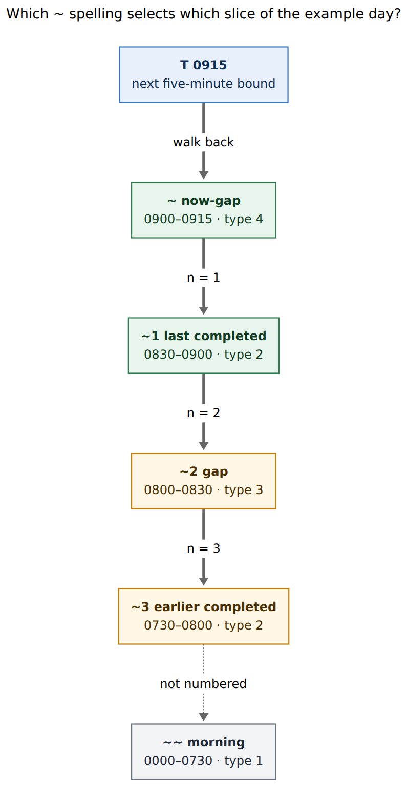
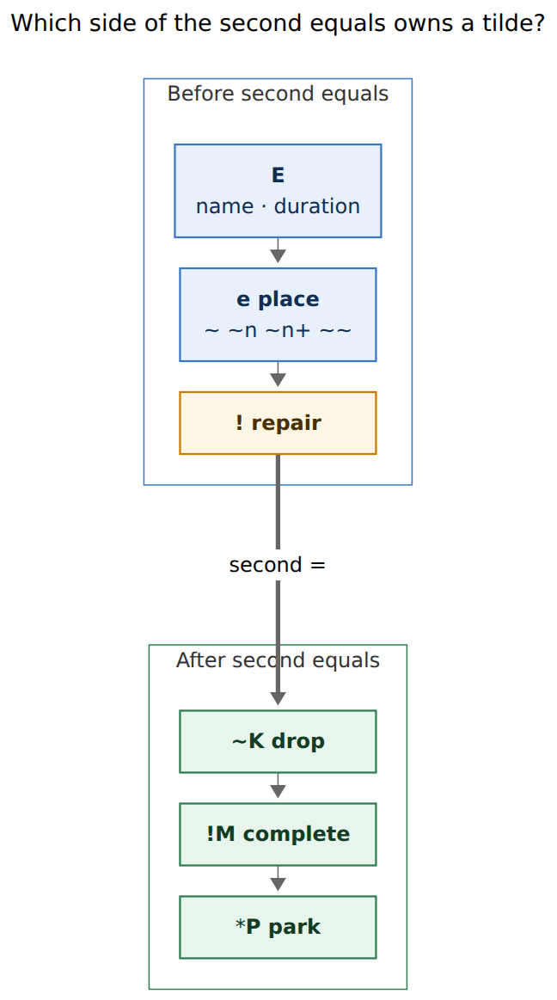
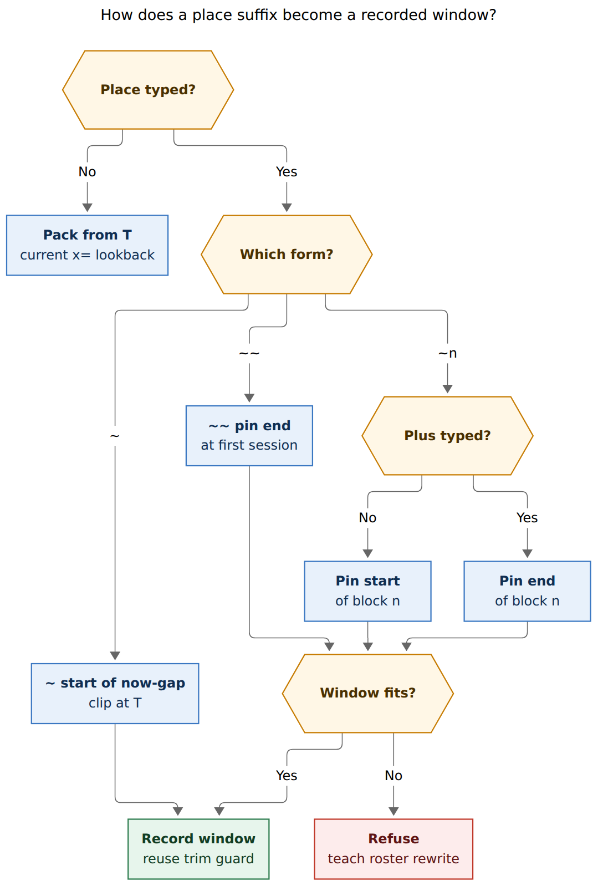

# Place a past Pomodoro with `x=E[e][!][=X]`

> **Research query:** Extend `x=<E>=<X>` so `<E>` may take an optional `<e>`
> suffix before the existing repair `!`. `<e>` is `~`, `~<n>[+]`, or `~~`,
> and it pins the recorded session to a time-range block of today's ledger
> instead of packing backward from `T = ceil5(now)`. Critique the plan, call
> out justified requirement changes, and recommend a design that is
> intuitive, reliable, and beautiful.

Researcher: **grk**. Independent of the other swarm reports.

Figures rendered with Mermaid CLI **12.0.0** (PDF-mirroring config, DejaVu
Sans, `useMaxWidth: false`). Measured fit against a 652.8 × 892.8 px text
box:

| Figure | Size | Fit |
| --- | --- | --- |
| Place index | 530.484 × 1022 px | 87.4% |
| Token anatomy | 431.234 × 776 px | 100.0% |
| Window routing | 718.395 × 1066 px | 83.8% |

## Bottom line

**Build it.** Packed `x=` cannot occupy an earlier hole in the day: every
window still ends at `T`, so a 10-minute insert at 08:00 also claims
08:10–`T` and the overlap guard either trims the wrong sessions or
refuses. The suffix is the missing *where* for a grammar that already has
*how long* and *which tasks*.

Ship it as **place** `e` on `<E>`, grammar 14, with these changes to the
request:

1. **Call the suffix a place**, never an offset. JSON already uses `anchor`
   for `T` as `HHMM` (`PomodoroPastSummaryJson.anchor`). The duration in
   `<E>` stays how long; `e` says which slice of the day to kiss.
2. **Keep packed `x=` byte-identical.** `x=~+` / `~0+` is that default;
   teach `write x=`. Bare `~` fills the now-gap from its start and clips
   at `T`.
3. **A placed token is a stack of one.** `preflight_overlaps` classifies
   closed rows against the union of a stack (`pomodoro_past.rs`). A
   non-contiguous union would erase sessions that sit between two
   independent inserts.
4. **Clip only `~`.** Historical `~n` / `~~` refuse a duration that does
   not fit, and the error prints today's roster. Type 2 (a completed
   session) also refuses a window that would consume the whole session
   (existing erase rule).
5. **Rewrite `-` → `~` in `bob capture-rewrite`**, probed like the other
   sigil aliases. Bob Mac Capture stays a thin client
   (`decisions:mac-capture-is-a-thin-client`).
6. **Print a roster and complete it.** Mixed type-2 / type-3 numbering is
   teachable when `~` opens labeled candidates (`~2  0800–0830  gap`).

Recommended spelling, block index, window math, JSON, and rollout are in
[Recommended solution](#recommended-solution).

## Is this a good idea?

**Yes.** The original past-Pomodoro research
(`research:202611/recording_past_pomodoros/recording_past_pomodoros.md`)
refused every dash form because *the duration was the lookback*. That was
right for v1. It left a hole: you can record "the last 15 minutes", and
you cannot record "10 minutes in the 08:00 hole" without occupying
everything from 08:00 to `T`.

Worked at `BOB_NOW=09:13` (`T=09:15`) against completed 07:30–08:00 and
08:30–09:00:

| Intent | Today's `x=` | Why it fails |
| --- | --- | --- |
| Fill 09:00–09:15 | `x=` tries 08:50–09:15 | Overlaps 08:30–09:00; needs `!` and steals 10 minutes from BUILD |
| Steal 08:50–09:00 | `x=5!` writes 08:50–09:15 | Also fills the now-gap |
| Fill 08:00–08:10 | a stack long enough to reach 08:00 | Union covers 08:00–09:15; erase/split of 08:30–09:00, refused even with `!` |

`x=~`, `x=2~1!`, and `x=2~2` are three different gestures. Packed lookback
is only the first of them, and it currently does the first *wrong* when a
previous session ended less than 25 minutes ago.

The `!` / `=` split already taught "before the second `=` is time; after
it are tasks." Putting place on the time side of that split is the same
move that put repair `!` on `<E>`. It is dense. It is also the language
Bryan already types.

**Would I take a different approach?** Absolute clocks
(`x=0800-0810#chore`) are clearer for a one-off and worse to type; the
original research deferred them as a backfill-another-day feature. Session
indexes with a separate before/after marker (`~1<` for the gap before
session 1) split one idea into two sigils. A `bob pomodoro record`
subcommand would hide from capture, which is where this work happens
(`cli_rules.md`: never add a subcommand under `bob capture`). The place
suffix is the right shape.

## Critique of the plan

The request is internally consistent on the worked examples. The six
tokens at 09:13 all land on the windows Bryan named, once the block index
is the one in [Time-range blocks](#time-range-blocks). The weak spots are
numbering, overflow, stacks, and the dash rewrite.

### What already works

- **Bare `~` as "fill since last session, clip at `T`."** At 09:13 with
  last end 09:00, default 25 minutes does not fit; clipping to 09:00–09:15
  is the "I forgot to start" gesture. Packed `x=` would steal from 08:50.
  Refusing `~+` is right: that *is* packed `x=`.
- **`+` as pin-end.** `x=2~1` kisses the start of the last session;
  `x=2~1+` hangs on its far wall. One extra byte, no second numbering
  domain.
- **`~~` implied pin-end.** Starting a session at midnight writes a
  00:00–00:25 row that Stats reads as tonight if it wraps, and as a
  nonsense early block if it does not. Pinning the end at the first
  timed start is the only morning gesture worth shipping.
- **Repair `!` still on `<E>`.** `x=2~1!=!1` is ugly until you see it as
  `time ! = tasks`. The original research moved repair there to keep
  `x1!` / `x*3!` close wildcards; this suffix has to sit in the same
  slot.

### The mixed index is the real cost

`n = 1` is always the last completed session. `n ≥ 2` walks *either* a
gap *or* a completed session, depending on whether neighbors touch.
Contiguous 07:30–08:00 and 08:00–08:30 make `~2` a session; a 08:00–08:30
hole makes `~2` a gap. The same integer names two kinds of thing.

That is still the right index. Counting "last session, then whatever sits
behind it" matches how you look at the ledger. Making it beautiful is a
roster problem, not a numbering problem. Without completion and without
errors that print the roster, it is a counting puzzle. With them, `~2`
is a wire encoding for a labeled row.

Original past research dropped `~K` *inside* `<E>` because it would create
two numbering domains in one token (link drops vs duration). This suffix
adds a numbering domain on the time side of the second `=`. The close's
`~K` stays on the task side. The collision is real and already solved in
kind: `x=~2` will mean place 2, and `x==~2` will keep dropping link 2.
Today `x=~2` is a teaching error that rewrites to `x==~2`
(`past.rs` `past_rest_error`, `docs/capture.md` retired table). After
this change that error becomes a valid different command. Preview has to
make the two meanings unmistakable. See [A6](#a6-preview-disambiguates-x2-from-x2).

### Overflow is specified only for `~`

The request clips the now-gap and is silent for `~n` / `~~`. Overflowing
a historical block into its neighbor is how packed `x=` already gets
people in trouble. [A3](#a3-clip-only-the-now-gap) clips `~` and refuses
the rest.

### Stacks plus places are unspecified

Every example is a single token. Consecutive `x=` items currently pack
from `T` (`compute_past_stacks` + `compute_preflight`). The overlap guard
then classifies each closed row against `[first.start, last.end)`. Two
placed inserts at 08:00–08:10 and 08:30–08:40 would union to 08:00–08:40
and report an erase of nothing that is actually touched, or a split of
08:30–09:00. [A2](#a2-a-placed-token-is-a-stack-of-one) keeps the packed
path for tokens with no `e` and isolates every placed token.

### The dash rewrite belongs in bob

"Replace `-` with `~` when appropriate in Bob Mac Capture" is the right
ergonomics (`-` is unshifted; `~` is not) and the wrong owner if the app
does it in Swift. Capture already rewrites `.` → `^`, `;` → `:`, `,` →
`+`, `\`/`/` → `#` through `bob capture-rewrite`
(`capture_language/rewrite.rs`, `expand_sigil_alias`). The Mac panel
calls that helper on each keystroke
(`docs/reference/mac-capture/protocol.md`). [A7](#a7-dash-becomes-tilde-through-capture-rewrite)
adds `-` → `~` there.

## Requirement adjustments

Each item changes or tightens what was asked. The six examples, the four
block kinds, `n = 1` as last completed, `+` as pin-end, implied `+` on
`~~`, and the refusal of `~+` stay.

### A1 Place, not offset

**The suffix is a place `e` on `<E>`.** Duration still lives in `<E>`
(default 5 blocks). `e` selects a time-range block and an alignment.

Do not reuse the JSON key `anchor`. Capture already reports
`pomodoro_past.anchor` as the packed boundary `T` (`"0915"`, or `"0000"`
when `T = 1440`). New wire:

```json
"place": {
  "raw": "~1+",
  "kind": "session",
  "index": 1,
  "align": "end",
  "block_start": "0830",
  "block_end": "0900"
}
```

`kind` is `now_gap` / `session` / `gap` / `morning`. Omit `place` on
packed tokens so old Macs keep decoding.

### A2 A placed token is a stack of one

**A token with `e` does not pack with neighbors.** Unplaced consecutive
`x=` items still stack from `T`. `x=build2 x=fix3` is unchanged.
`x=2~2 x=fix3` is two operations: a 10-minute insert at block 2, then a
packed 15-minute FIX ending at `T`.

Teaching: if a placed token sits next to another `x=` item, the preview
shows two groups. Do not invent in-block packing in v1 (`x=read1~1
x=chore1~1` filling 08:30–09:00 as a mini-stack). That can reuse this
planner later.

### A3 Clip only the now-gap

| Form | Typed duration vs block | Outcome |
| --- | --- | --- |
| `~` | longer than the now-gap | Clip at `T`; warn `pomodoro_past_clip` with the fitted minutes |
| `~` | shorter | Take that many minutes from the start of the now-gap |
| `~n` / `~~` | longer than the block | Refuse; print the roster and a rewrite that fits |
| `~n` on a session | equal to the session | Refuse: `!` still cannot erase |
| `~n` on a session | shorter | Record; `!` required (existing trim rule) |
| `~n` on a gap, `~~` | shorter or equal | Record; no `!` |

Crumb gaps of 1–4 minutes cannot take a 5-minute block. They stay empty.
That is honest: `x=` has always been a 5-minute grammar.

`blocks` on the spec stays the typed count; `window.minutes` is the
fitted span. Clipping `x=~` at 09:13 writes 15 minutes from a default of
25.

### A4 Open timed rows are obstacles, not index entries

Type 2 is completed rows only, as requested. Open timed rows (a running
session, a MEET with a span) do not occupy `n`. They still sit in the
overlap guard. Recording into a gap that contains a running session
refuses with the existing `x x=…!` composition.

Type 4 is `[end of last past completed, T)`. Last past completed is the
completed row with the greatest end among rows whose start is `< T`. A
completed row that starts at or after `T` is in the future of the
capture clock and is ignored.

Type 1 ends at the earliest timed start (completed or open). That is
"when the day's clock started." `~~` with no timed row refuses: `no
morning block; write x= or x=~`.

An empty day (no completed row): `x=~` equals packed `x=` (the now-gap
starts at 00:00, and clipping a default 25 minutes at `T` from midnight
would otherwise record 00:00–00:25). `~~` still refuses.

### A5 Half-open kisses, calendar edges stay truthful

Intervals stay half-open, as today. Touching 08:00 after 07:30–08:00 is
fine. Pinning to a MEET that ended at 09:03 writes 09:03–`T`, not a
snapped 09:05 that would leave a 09:03–09:05 orphan. Fitted `minutes`
need not be a multiple of 5 when the kissed edge is off-grid.

### A6 Preview disambiguates `x=~2` from `x==~2`

`x=~2` becomes "25 minutes at block 2." `x==~2` stays "drop link 2 on a
packed 25-minute record." When `x=~N` has no second `=` and `N` is a
plausible Task Link index (`≤ max_task_link_count`, default assist bound
10), the dry-run footer adds one line: `dropping a link? write x==~N`.
It is a notice, not an error. Out-of-range `N` mentions both the missing
block and the drop spelling.

### A7 Dash becomes tilde through `capture-rewrite`

Add rewrite rule `expand_past_place_alias`:

- The byte just typed is `-`.
- The token is a claimed `x=` past token.
- The byte sits outside a `#` name or `#"…"` literal (same exclusion
  `split_past_token` uses for `!` / `=`).
- After swapping to `~`, `validate_past_e` reports Valid (or Incomplete
  needing `pomodoro_name`).

Canonical draft is always `~`. The parser may also accept `-` as a
synonym in the place slot so CLI tests and quoted `bob capture 'x=3-1'`
match what the panel produces; teaching strings print `~`.

Bare names still cannot contain `-`. Hyphenated names stay `x=#deep-work`.
A dash after a complete bare name is a place (`x=fix-` → `x=fix~`). Cost:
the old teaching path `x=fix-it` → `x=#fix-it` is easier to miss, because
the dash rewrites before `it` is typed. `x=fix~it` then teaches both
"place takes `~n` / `~n+` / `~~`" and "a hyphenated name is `x=#fix-it`."

Do not rewrite dashes in `-[N]` / `--[N]` chain tokens. Those are
different items (`x=3 -2` is past then shorten).

### A8 `~0`, `~+`, `~~+`

| Typed | Teaching rewrite |
| --- | --- |
| `x=~0` / `x=3~0` | `x=~` / `x=3~` |
| `x=~+` / `x=~0+` | `x=` |
| `x=~~+` | `x=~~` |
| `x=~-` after rewrite | already `~~` |
| `x=3~1+!` | valid (place, pin-end, repair) |
| `x=3~1!+` | invalid; `+` after repair is not place |

`n` is a positive integer. No leading zeros (`~01` teaches `~1`).

### A9 Close outcomes still run on the recorded row

`x=2~1!=!1` completes task 1 of the *target* (the CHORE placeholder in
the examples), and trims only the clock of the old 08:30–09:00 row. Trim
already keeps name, checkbox, clock key, children, and links
(`docs/capture.md`). Do not move the old session's Task Links onto the
new row. That would be a split, which `=/` already does for types.

### A10 Grammar 14, additive JSON, `feat(capture)`

Currently valid packed tokens keep their meaning. Previously invalid
`x=~2` / `x=3~1` become valid. Bump `GRAMMAR_REVISION` 13 → 14. Keep
`schema_version` 1. Decode new fields with `decodeIfPresent`. Commit
subject `feat(capture): pin past records to a ledger place` — no `!`,
because no successful capture changes meaning. Help, `capture-parse`,
`docs/capture.md`, `docs/reference/capture-syntax.md`, and
`docs/reference/compatibility.md` all grow additively. `just docs-check`
is the docs gate (`docs.md`).

## Time-range blocks

Build the index from today's `## Pomodoros` section once per capture
clock (`now` truncated to minutes, `T = ceil5(now_min)`).

**Inputs.** Completed timed rows with `start < T`, plus every timed row
(completed or open) for type 1 and for the overlap guard. Skip
zero-length rows. Unwrap a midnight-ending span (`end <= start` →
`end + 1440`) the way `collect_timed_rows` already does. Sort by start,
then end, then line.

**Type 4 (now-gap), spelled `~`.** `[last_past_completed.end, T)`. If no
such completed row, packed `x=` (A4).

**Type 2 (completed session), `n = 1` and some `n ≥ 2`.** Each remaining
completed row, walking backward from last past completed.

**Type 3 (gap), some `n ≥ 2`.** A positive half-open hole between two
timed neighbors in that backward walk. Touching endpoints (`08:00–08:30`
then `08:30–09:00`) produce no type 3. Open timed rows do not appear as
their own `n`; they only split what a record is allowed to occupy via
the overlap guard.

**Type 1 (morning), spelled `~~`.** `[0, first_timed.start)` when
`first_timed.start > 0`.



*Caption: From `T` at 09:15, `~` is the now-gap, `~1` is the last
completed session, `~2` is the hole behind it, `~3` is the earlier
completed session, and `~~` is the morning. `~~` is off the number
line on purpose.*

Worked ledger (two completed, two future placeholders CHORE then READ):

| Spelling | Kind | Span | Notes |
| --- | --- | --- | --- |
| `~` | type 4 | 09:00–09:15 | implied `n = 0`; pin-start; clip at `T` |
| `~1` | type 2 | 08:30–09:00 | last completed |
| `~2` | type 3 | 08:00–08:30 | gap |
| `~3` | type 2 | 07:30–08:00 | earlier completed |
| `~~` | type 1 | 00:00–07:30 | implied pin-end |

`n = 4` on this day refuses with that table in the error.

## Grammar

```text
x=E[e][!][=X] [work-log entry]

E  = [D] [name | #name | #"LIT"] [D]
e  = ~ | ~<n> | ~<n>+ | ~~
```

`E` is unchanged: empty (5 blocks), a count, a name, or both, with the
same `#` / `#"…"` rules. `e` is consumed after the count/name prefix and
before repair `!`. Bare names still stop at `-` / `~` / `*` / `!` / `=`,
so `~` cannot be a name byte.



*Caption: Before the second `=`, `~` is a place and `!` repairs a closed
edge. After it, `~K` drops links, `!M` completes, and `*P` parks. The
second `=` is the same time/tasks split the original `x=` design already
ships.*

Lexer changes live in `capture_language/past.rs` next to
`validate_past_e`. After the current count/name scan, if `rest` starts
with `~` (or a synonymous `-` in the place slot):

1. `~~` → morning.
2. `~` + digits + optional `+` → `~n` / `~n+`.
3. `~` alone → now-gap.
4. Anything else stays a teaching error.

The current `rest.starts_with('~')` branch that rewrites to `x==~2` fires
only when the `~` tail is *not* a valid place (for example `x=~,2`,
`x=~1,3`, `x=~~2`). `x=~2` becomes Valid.

Spans: add `pomodoro_past_place` over the `e` bytes (including a
rewritten `~`). Keep `pomodoro_past` on `x=E`, `pomodoro_past_repair` on
`!`, `pomodoro_close` on the second `=` onward. Completion field
`PomodoroPastPlace` covers `e`; name completion still ends before it.

## Window routing

Let `B = [Bs, Be)` be the selected block, `D` the typed duration in
minutes (`blocks * 5`, default 25).

| `e` | Alignment | Window |
| --- | --- | --- |
| (absent) | pack | existing `start = T - 5*(blocks + offset_blocks)`, `end = T - 5*offset_blocks` |
| `~` | start, clip | `[Bs, min(Bs + D, Be, T))` |
| `~n` | start | `[Bs, Bs + D)` if `Bs + D ≤ Be`, else refuse |
| `~n+` | end | `[Be - D, Be)` if `Be - D ≥ Bs`, else refuse |
| `~~` | end (implied) | `[Be - D, Be)` if it fits, else refuse |

`closed_at = min(end, now)` as today. Work Log timestamps use that clock.
Event Task classification uses that clock. Chronological insert uses
`closed_insert_at` as today.



*Caption: Packed `x=` is the no-place path. Bare `~` starts at the
now-gap and clips at `T`. `~~` and `~n` / `~n+` record only when the
window fits the chosen block; the existing trim guard then runs on that
window alone.*

The six requested examples, `BOB_NOW=09:13`, completed 07:30–08:00 and
08:30–09:00, future CHORE then READ:

| Typed | Place | Window | Target | Old row |
| --- | --- | --- | --- | --- |
| `x=~=!1` | `~` clip | 09:00–09:15 | CHORE, complete 1 | — |
| `x=read2~=!1` | `~` 10m | 09:00–09:10 | READ, complete 1 | — |
| `x=2~1!=!1` | `~1` start | 08:30–08:40 | CHORE, complete 1 | 08:30–09:00 → 08:40–09:00 |
| `x=2~1+!=!1` | `~1+` end | 08:50–09:00 | CHORE, complete 1 | 08:30–09:00 → 08:30–08:50 |
| `x=2~2=!1` | `~2` start | 08:00–08:10 | CHORE, complete 1 | — |
| `x=2~2+=!1` | `~2+` end | 08:20–08:30 | CHORE, complete 1 | — |

Unnamed still takes `next_future_pomodoro` (CHORE here; MEET still
refused). Named `read` resolves like `=name`. `!` is present exactly
when the window overlaps closed history, as today; it is absent on the
gap examples.

Extra cases the request left implicit:

| Typed | Result |
| --- | --- |
| `x=~1=!1` (25m into a 30m session, no `!`) | Refuse overlap; teach `x=~1!=!1` or `x=4~1!=!1` |
| `x=6~1!` (whole 30m session) | Refuse erase |
| `x=5~2` (25m into a 30m gap) | 08:00–08:25, no `!` |
| `x=7~2` (35m into a 30m gap) | Refuse; `block ~2 is 30m (0800–0830); write x=6~2 or x=6~2+` |
| `x=~~` | 07:05–07:30 |
| `x=3~~` | 07:15–07:30 |
| `x=~` while a session runs 09:05–09:30 | Refuse open overlap; `x x=~=!1` |
| `x=~` on an empty day | Packed `x=` (25m ending at `T`) |

## Overlap and trim

Reuse `preflight_overlaps` / `classify_closed_row` / `TrimPlan` on each
placed token as a singleton stack. Packed stacks keep the union rule.
`!` still:

- is required on every token whose window overlaps closed history as it
  stood before the draft,
- is an error when nothing overlaps,
- trims one edge,
- refuses split and erase,
- never touches an open timed row.

A type 2 pin-start of 10 minutes from 08:30–09:00 is the same trim as
today's `!` against that row alone. The new power is that the recorded
window *stops* at 08:40 instead of continuing to `T`.

## Completion, rewrite, Mac

**`capture-complete`.** Cursor inside `e` (including a trailing `~` with
no `n` yet) offers today's roster, newest first:

```text
~     0900–0915  since last session
~1    0830–0900  BUILD  (session)
~2    0800–0830  gap
~3    0730–0800  READ   (session)
~~    0000–0730  morning
```

Replacement covers the `e` bytes. Accepting `~2` from `x=3~|` yields
`x=3~2`. Name completion still owns only the name
(`pomodoro_past_name_field` already stops before counts and close).

**`capture-rewrite`.** [A7](#a7-dash-becomes-tilde-through-capture-rewrite).
New `RewriteRule::ExpandPastPlaceAlias` with code
`expand_past_place_alias`. Feeding the rewrite's output back in is a
no-op, like the other rules.

**Mac.** Grammar 12 already unlocks the past card
(`docs/reference/mac-capture/protocol.md`). Grammar 14 is additive: the
card already renders `window.start` / `window.end` from bob. Decode
`place` with `decodeIfPresent` and, when present, append a subtitle
`since last session` / `gap 0800–0830` / `morning`. No new card. No
Swift grammar. Hyphen assist appears automatically once bob rewrites.
Arm `CapturePastBoundary` as today; placed windows still move when `T`
ticks if the place is `~`.

Old bob + new draft `x=~=!1`: capture-parse reports the current drop
teaching error; the panel shows it; nothing is written. New bob + old
Mac: extra JSON ignored; the window times still display.

## Alternatives considered

| Alternative | Verdict |
| --- | --- |
| Packed `x=` only (status quo) | Rejected: cannot occupy an earlier hole, and `x=` steals from the previous session when the now-gap is under 25 minutes |
| Bare `~` only (fill now-gap) | Tempting v0; it fixes the most common miss and leaves `~n` for a follow-up. Bryan's six examples need `~n` / `+` in the same ship |
| Absolute `x=0800-0810` | Deferred, as in the original research: `0800-0810` already lexes as duration-offset, and it does not kiss moving `T` |
| Session index plus `<` / `>` for before/after | Two axes for one idea; `~2` as "whatever is two steps back" is the smaller language |
| Type-2-only index (gaps via pin-end of the previous session) | Filling 08:00–08:10 would be "pin-end of `~2` plus a gap flag". Mixed 2/3 numbering is fewer bytes |
| Desugar to `=D-O x` with computed offsets | Inherits running-session restart, wall-clock close, and no overlap guard — the original research's rejected macro |
| Swift-side `-` → `~` | Violates the thin-client decision; every later client would retake the bug |
| `bob pomodoro record` | Fine as a later reuse of the planner; capture is the front door |
| In-block stacks in v1 | Isolated placed tokens first; packing inside a block can share this index later |

## Implementation sketch

All new behavior lands in bob-cli first. Mac only decodes.

1. **Lexer** (`capture_language/past.rs`, editor twin in
   `editor_pomodoro.rs`). Parse `e`; add `place` to `PomodoroPastSpec`;
   spans; teaching table; tests in `capture_language/tests/past.rs` and
   `tests/cli/capture/parse_pomodoro_past.rs` (the current `x=~2` →
   `x==~2` rows reverse meaning).
2. **Block index + window** (`capture/pomodoro_past.rs`). Extract
   `time_range_blocks(now, contents) -> Vec<Block>` next to
   `collect_timed_rows`. `compute_preflight` branches on `place`. Fitted
   minutes, clip warning, fit errors with roster text.
3. **Stacks.** `compute_past_stacks` treats a placed item as breaking a
   packed run (same as an invalid/unfinished item does today).
4. **Overlap.** Singleton preflight for placed tokens; packed path
   unchanged.
5. **`capture-complete`.** `PomodoroPastPlace` context; roster
   candidates from the same `time_range_blocks` helper.
6. **`capture-rewrite`.** `expand_past_place_alias`.
7. **JSON / human.** Additive `place`; `pomodoro_past_clip` warning;
   human line `recorded CHORE 0900–0915 (since last session)`.
8. **Docs.** `docs/capture.md` Recording a past Pomodoro; syntax table;
   compatibility grammar 14; Mac protocol one paragraph. `just
   docs-check`.
9. **Mac.** `decodeIfPresent` for `place`; subtitle; fixtures from
   `Scripts/generate-pomodoro-past-fixtures.sh`.

Shared helper `time_range_blocks` is the contract between parse
(text-only, `place` present or not), complete (needs the vault), and
execution (needs the vault). Parse remains lexical: it records `kind` /
`index` / `align` without resolving spans. Execution and complete
resolve against the daily note.

## Tests to pin first

Shared vectors for parser, planner, rewrite, complete, and Swift
decoding. `BOB_NOW=2026-11-05 09:13`, the two completed rows, CHORE then
READ:

- All six requested examples, dry-run matching write at fixed
  `BOB_NOW`.
- Packed `x=3` still 09:00–09:15 on a quiet ledger (regression).
- `x=~` vs `x=` when last end is 09:00 (clip 15m vs steal 08:50).
- `x=~2` Valid place; `x==~2` drop; footer notice on `x=~2`.
- `x=3-1` rewrite → `x=3~1`; `x=#deep-work` dashes preserved; `x=3 -2`
  chain untouched.
- `x=~0` / `x=~+` / `x=~~+` teaching table.
- Fit: `x=7~2` refuses with roster; `x=6~1!` refuses erase; `x=~`
  clips and warns.
- Open overlap: running 09:05–09:30 + `x=~` refuses.
- Empty day: `x=~` equals `x=`; `x=~~` refuses.
- Stack isolation: `x=2~2 x=fix3` two groups, windows 08:00–08:10 and
  09:00–09:15.
- Off-grid MEET end 09:03: `x=~` writes 09:03–09:15.
- Midnight: `x=~` at 00:05 with no completed row records 00:00–00:05
  (clip of default 25); `x=~~` with no timed row refuses. A first
  session starting at 00:20 makes `x=~~` (default 25 minutes ending at
  00:20) cross midnight; refuse with the existing midnight gate and
  teach `x=4~~` (00:00–00:20).
- Atomicity and dry-run identity, as in the original past suite.

## Recommended solution

Add **`x=E[e][!][=X]`** with optional place `e ∈ { ~, ~n, ~n+, ~~ }`,
documented under Recording a past Pomodoro, grammar 14, JSON mode
`pomodoro_past` plus additive `place`.

- **Packed default.** No `e` packs from `T` exactly as grammar 12/13.
  `~+` teaches `x=`.
- **Index.** Type 4 is `~`. Type 2 last completed is `~1`. Walking back,
  each earlier completed session and each positive hole between
  neighbors takes the next `n`. Type 1 is `~~` with implied pin-end.
  Open timed rows are obstacles. Empty type 4 (no completed row) makes
  `~` equal packed `x=`.
- **Alignment.** No `+` pins the start of the block. `+` pins the end.
  `~` pins the start of the now-gap and clips at `T`. `~~` pins the end
  at the first timed start.
- **Fit.** Clip `~`. Refuse overflow and whole-session erase for `~n` /
  `~~`. Errors print the roster.
- **Stacks.** Placed tokens are singleton stacks. Unplaced runs still
  pack.
- **Guard.** Existing half-open trim/erase/split/open rules, per window.
- **Typing.** `capture-rewrite` turns a place-slot `-` into `~`.
  `capture-complete` lists the roster. Mac renders bob's window and an
  optional `place` subtitle.
- **Mnemonic.** *Before the second `=` is when; after it are tasks.
  `~` hugs the hole you mean; `+` hangs the session on the far wall.*

This keeps every example, keeps packed `x=` stable, reuses the trim
engine that already knows how to steal an edge, and makes the mixed
index a labeled menu instead of mental arithmetic.

## Sources and method

Independent design report, 2026-11-05. Code and contracts read in this
workspace: `src/native/capture_language/past.rs`,
`src/native/capture/pomodoro_past.rs` (`compute_preflight`,
`preflight_overlaps`, `collect_timed_rows`),
`src/native/capture/output.rs` (`PomodoroPastSummaryJson.anchor`),
`src/native/capture_language/rewrite.rs` (`expand_sigil_alias`),
`src/native/capture_language/mod.rs` (`GRAMMAR_REVISION = 13`),
`docs/capture.md` Recording a past Pomodoro, `docs/reference/capture-syntax.md`,
`docs/reference/compatibility.md` grammar 12–13,
`docs/reference/mac-capture/protocol.md`,
linked Bob Mac Capture `CapturePastBoundary.swift` /
`CapturePomodoroPastPresentation.swift`. Prior research
`research:202611/recording_past_pomodoros/recording_past_pomodoros.md`
(place of `!`, refusal of dash offsets and of `~K` in `<E>`, deferred
absolute times). Glossary Capture / Pomodoro / Task Link; decisions
`mac-capture-is-a-thin-client`, `capture-sigils-say-where-what-how`. No
product code was changed. Peer swarm reports for this request were not
read.
