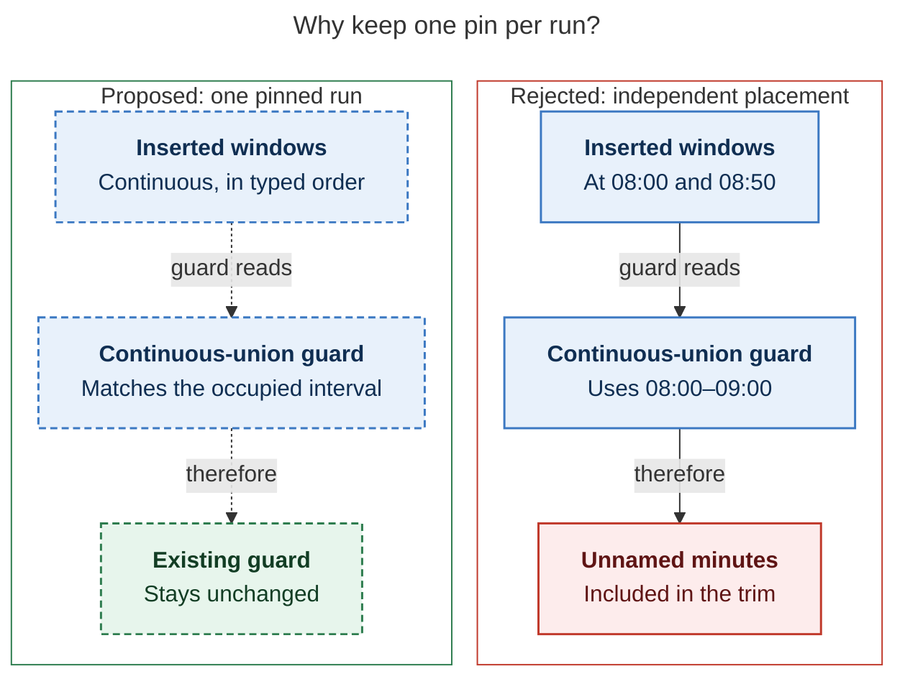
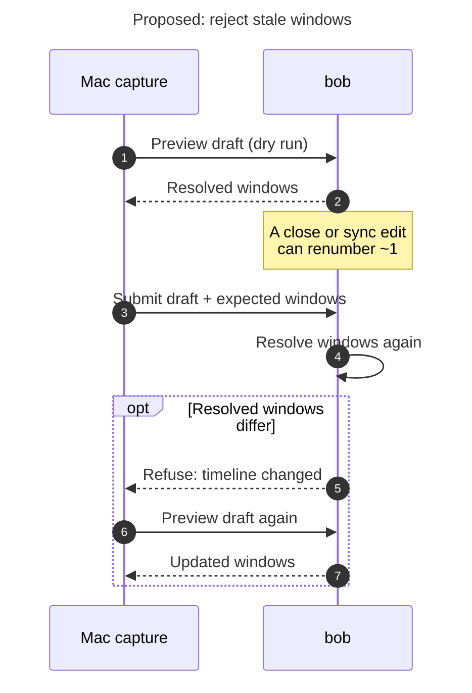

# Diagram proposals: Placing a past Pomodoro on today's timeline: the `x=` segment suffix

Proposals for the swarm linker, not a report. Each diagram restates only what the source
report says.

```yaml
source: research:202611/past_pomodoro_segment_suffix/past_pomodoro_segment_suffix__final.md
producer: research.3e.image
check: "mmdc 12.0.0 with the PDF-mirroring config rendered 2 of 2 Mermaid diagrams; Puppeteer --no-sandbox; SVG and PNG reviewed"
```

## guard-union

```yaml
anchor: |-
  item independently, with unsuffixed items still packing from `T`.
question: |-
  Why does one pin per run preserve the overlap guard?
illustrates: |-
  A run hanging from one pin remains one contiguous interval, so the unchanged continuous-union overlap guard does not trim minutes nobody named.
caption: Keeping each run contiguous lets the existing overlap guard cover exactly the recorded time, without trimming unnamed gaps.
review: "673.8×529 px, fit 96.9%; question and visual checks passed; 1 revision"
```



## preview-mismatch

```yaml
anchor: |-
  synced edit or a session closed elsewhere can renumber `~1`
question: |-
  What prevents a moved segment number from carving the wrong session after preview?
illustrates: |-
  The Mac passes its previewed windows on submit; bob refuses differing resolved windows and the Mac re-previews after a timeline change.
caption: If resolved windows move after preview, bob refuses the submit and the Mac re-previews before recording.
review: "466×740 px, fit 100.0%; question and visual checks passed; 1 revision"
```


