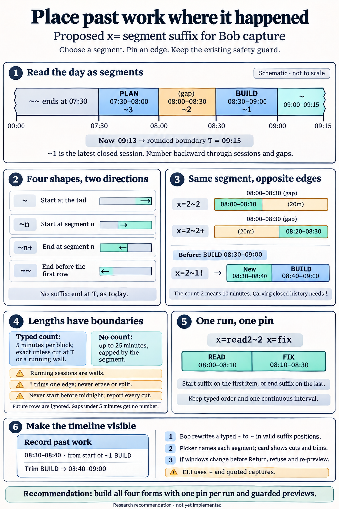
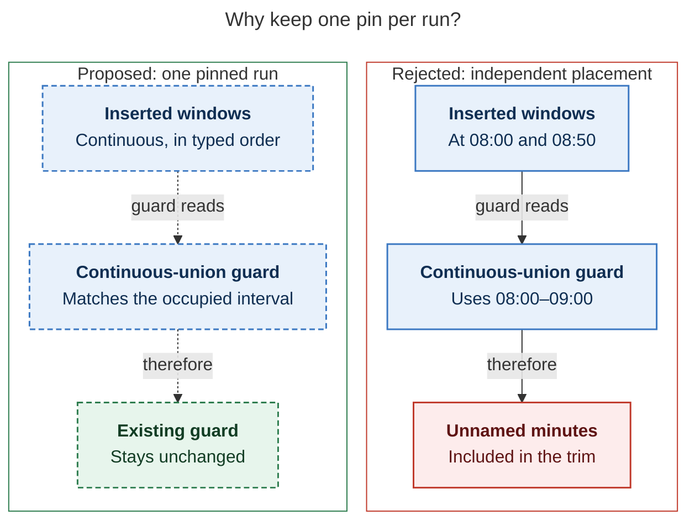
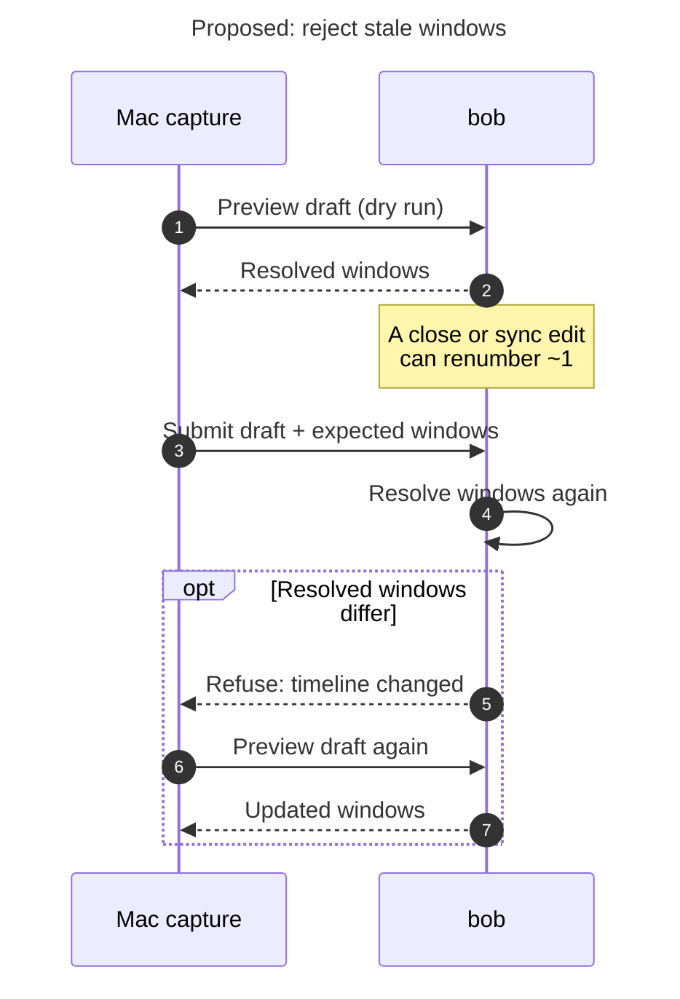
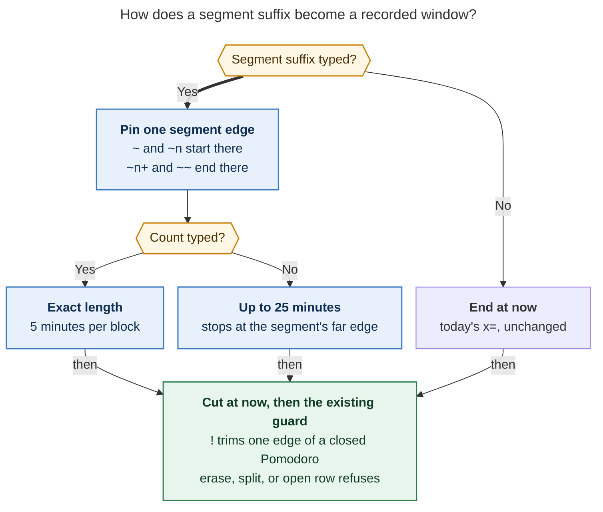

# Placing a past Pomodoro on today's timeline: the `x=` segment suffix

> **Research query:** How should the `x=<E>=<X>` capture syntax gain an optional `<e>`
> suffix on `<E>` (`~`, `~<n>[+]`, or `~~`, placed before its `!`) so a recorded past
> Pomodoro can start or end at the edge of a chosen time range block in today's daily file
> (before the first Pomodoro, a completed Pomodoro, a gap between Pomodoros, or the time
> since the last one), with the bob-mac-capture app replacing a typed `-` with `~`? Is
> this plan a good idea, would a different approach be better, and which requirement
> adjustments and recommended solution make the feature intuitive, reliable, and
> beautiful?



## Bottom line

- **Build it.** All five researchers agree, and [so do I](#is-this-a-good-idea). Today
  `x=` can only record work that ended *now*. Logging work that ended an hour ago, or
  reassigning the first ten minutes of a session you already closed, still means editing
  the daily note by hand. The suffix supplies the missing *where* for a token that
  already says *how long* (the count), *which session* (the name), and *what happened to
  its tasks* (after the second `=`).
- **Keep your four shapes and all six examples.**
  [Every example](#semantics-and-worked-examples) lands on the window you wrote under
  [the model below](#modeling-today-as-segments). The *number plus side* encoding is
  better than it looks: every interior edge of the day gets exactly two spellings, one
  per direction, and the number always names the segment the new Pomodoro grows *into*
  ([figure](#the-picture)).
- **Twelve adjustments** ([Requirement adjustments](#requirement-adjustments)) close
  holes the requirements leave open: a running session, future calendar rows, gaps of a
  few minutes, counts that do not fit, more than one `x=` in a draft, and empty days. The
  most visible ones: rename "time range block" to **segment**, since "block" already
  means five minutes. A typed count is exact. An untyped count fills up to the segment's
  far edge. Nothing ever records past now. `!` keeps exactly its current meaning. A run
  of `x=` items hangs from one pin.
- **The `-` → `~` assist belongs in bob**, as one more arm of `capture-rewrite`'s
  existing sigil-alias rule. The Mac adds `-` to its trigger keys and nothing else.
  `bob capture` never accepts `-` as a suffix
  ([R9](#r9-the-dash-to-tilde-assist-lives-in-bob-and-execution-never-accepts-a-dash)).
- **The suffix is only as friendly as its preview.**
  [Make the timeline visible](#r12-make-the-timeline-visible-and-guard-the-preview): a
  segment picker after `~`, the resolved segment named in every preview, and an internal
  guard that refuses a submit whose numbers moved after the preview.

## About this report

*Lead researcher's consolidated report · 2026-11-05 · bob-cli `84da37ba` (capture grammar
13) · bob-mac-capture `6e09f2c`. It merges five independent reports (`__cdx`, `__cld`,
`__grk`, `__mus`, `__gem`) and adds my own checks of the source and the shells.*

You asked for an optional suffix `<e>` on `<E>` in `x=<E>[!][=<X>]`, written `~`,
`~<n>[+]`, or `~~`. It would let a recorded past Pomodoro start or end at the edge of a
chosen "time range block" of today's ledger, instead of always ending now. This report
critiques the idea, settles the points where
[the five researchers disagreed](#where-the-reports-disagreed), calls out
[every change to your requirements](#requirement-adjustments), and ends with a
[recommended solution](#recommended-solution).

## Is this a good idea

**Yes.** The reasons, in order of weight:

1. **It closes the last real gap in recording past work.** Timeboxing usually fails
   because you forgot to start the timer. `x=` fixed that for work that just ended.
   Plain `x=` even gets the most common case slightly wrong: at 09:13, after a session
   that ended at 09:00, `x=` tries 08:50–09:15 and needs `!` to take ten minutes from
   the previous session. `x=~` records 09:00–09:15 (grk).
2. **Relative addressing matches how you remember a day.** You remember "the break
   before my last Pomodoro" or "the start of BUILD", not "08:00". `~n` reads like git's
   `HEAD~n`: *n steps back from now*.
3. **The encoding is tidier than it first appears** (cld). Segments tile the timeline,
   so the end of segment *n* is the start of segment *n−1*. `~2+` and `~1` both point at
   08:30. `~2+` grows backward into the gap; `~1` grows forward into BUILD. Because the
   number names the segment the new Pomodoro lands in, `!` (taking time from a closed
   Pomodoro) is needed when that segment is a Pomodoro. `!` works as a type check.
4. **[Most of the execution already exists](#what-exists-today).** Target resolution,
   the close at `C = min(window end, now)`, chronological filing, edge trims, and the
   overlap guard all apply unchanged. The new code is a timeline catalog, laying windows
   out from an edge, and a few length rules.

**Costs to accept on purpose:**

- **`~` gains a fourth meaning in the session family.** `x=3~2` (segment 2) and `x=3=~2`
  (drop link 2) differ by one `=`. The earlier `x=` design rejected `~K` inside `E` for
  exactly this "two numbering domains" reason. The risk is lower than it looks: `x=~2`
  has never succeeded, so there is no muscle memory to break. It is mitigated by the
  rule *before the second `=` is when; after it are tasks*, a distinct span colour, the
  picker, and `!`, which catches a mistyped index that lands on a Pomodoro.
- **Numbers move.** `~1` changes meaning whenever a session closes, and filling part of
  a gap splits it. Live preview covers typing; the stale-preview guard covers the moment
  between preview and submit.
- **The index mixes kinds.** Whether `~2` is a gap or a session depends on whether you
  took a break. All five reports flag this; all five keep the index anyway. A labelled
  picker turns the number into a choice you can see.
- **Grammar 14 and Mac work** are needed: a new span kind, picker rows, one trigger key,
  and a card line.

**Would I take a different approach?** No. The strongest rival is an absolute clock
(`x=2~0800`). It is precise and stable, but worse for the common case, because you have
to look up times. Reserve its spelling now and treat it as a follow-up
([Alternatives considered](#alternatives-considered)).

## What exists today

I checked these facts against the source myself. Several were first reported by one
researcher, as noted.

| Fact | Evidence |
| --- | --- |
| `E` is an optional count and/or name (`x=3`, `x=fix`, `x=2fix` ≡ `x=fix2`, `x=#deep-work`, `x=#"DEEP WORK"`). It has no index | `validate_past_e`, `src/native/capture_language/past.rs:159` |
| A run of consecutive `x=` items is a **stack**. Each member's `offset_blocks` is the sum of the blocks after it, and every window is `[T − 5·(blocks+offset), T − 5·offset)` with `T = ceil5(now)` | `compute_past_stacks` (`past.rs:559`); `compute_preflight` (`src/native/capture/pomodoro_past.rs:89`) |
| The overlap guard treats the stack as **one continuous union** `[first.start, last.end)`. An open row always refuses. A closed row may lose one edge with `!` if one nonempty piece remains; erase and split refuse; a stray `!` is an error | `preflight_overlaps` / `classify_closed_row` (`pomodoro_past.rs:381`, `:419`) |
| The guard reads a **pre-stack snapshot that already includes earlier items in the same draft**. That is why its open-row error teaches the composition `x x=…!` | `plan.rs:254` ("earlier batch items staged"); the `close it first: x {suggestion}` message in `preflight_overlaps` |
| `compute_preflight` takes only the specs and the clock. It never reads the vault | `pomodoro_past.rs:89`; the snapshot read comes *after* it in `plan.rs:240–290` (cdx) |
| **Every spelling you proposed is an error today.** `~` in `E` teaches the close-part drop (``write `x=2=~1` ``); a dash teaches "takes no offset". Claiming them changes no draft that currently succeeds | `past_rest_error`, `past.rs:426` (cld probed the messages) |
| `~` already means "drop Task Links" after the second `=` (`x==~2`), in the start family (`=3~2`), and on bare closes (`x~2`). `~`/`~~` are also the relation sigils on task items | `bob capture-parse --help`; `CompletionContext::RelationTo/From` (cld, mus) |
| JSON `pomodoro_past.anchor` already exists and means `T` | `src/native/capture/output.rs:291` |
| **Typing aliases already exist and are probe-gated.** `expand_sigil_alias` swaps `.`→`^`, `;`→`:` (and `,`, `\`, `/` via helpers) only when the swapped text opens the matching completion picker | `src/native/capture_language/rewrite.rs:117` |
| The Mac lists its rewrite trigger keys twice: in the controller and in the model | `CapturePanelController.swift:1115`; `CapturePanelModel.swift:2369` |
| `capture-complete` reads the **vault**, not the draft's staged state | `pomodoro_past_candidates(bob_dir, …)`, `src/native/capture_complete/engine.rs:488` |
| The Mac past card draws `window.start`–`window.end` and the trim rows that bob returns. It never computes a window, so an older app already shows a placed window correctly | `CapturePomodoroPastPresentation.swift` (cld, cdx) |
| **Shell hazard.** In bash, an unquoted `x=~` arrives as `x=/home/bryan`. With a directory stack, `x=~1` arrives as a `pushd` path. `x=2~1` and `x=~~` survive. zsh leaves all of them alone unless `magic_equal_subst` is set, in which case `x=~1` is an error | I probed `bash -c` (with `pushd`), `bash --posix`, and `zsh -f` (extending cld's probe) |
| The installed `bob 0.4.0` is older than this source: for example, it reads `x=read2` as a 25-minute `READ2` | cdx; verify against a binary built from source |

## Modeling today as segments

### The picture

Your example: two closed Pomodoros at 07:30–08:00 and 08:30–09:00, planned CHORE then
READ, and now 09:13, so `T` = 09:15. I call the closed rows PLAN and BUILD for
readability; the names are illustrative.

```text
          head                 ~3 PLAN         ~2 gap          ~1 BUILD     tail
   |.......................|###############|...............|###############|.........|
  0000                    0730            0800            0830            0900      0915 = T
 ends here:                ~~              ~3+             ~2+             ~1+      x=
 starts here:              ~3              ~2              ~1              ~
```

*Figure: every suffix names the edge the new Pomodoro hugs. The upper row grows
backward, ending at that edge; the lower row grows forward, starting there. A plain `x=`
ends at `T`, as today. Midnight gets no suffix, because nobody means "starting at
midnight".*

### Construction

bob builds the catalog from today's `## Pomodoros` section. Untimed `()` placeholders
are not on the timeline.

1. **Rows.** Every timed row that starts before `T`: closed or open, on- or off-clock,
   MEET or not. Zero-length rows are skipped and midnight-ending spans are unwrapped,
   as `collect_timed_rows` already does. Rows starting at or after `T`, such as a future
   synced MEET, are ignored.
2. **Pomodoro segments** are the closed rows. **Open timed rows are walls.** They get no
   number and are never written.
3. **Gaps** are the maximal stretches that no timed row covers, from the first row's
   start to the last closed row's end. A gap shorter than five minutes is slack and gets
   no number.
4. **The tail** (`~`) runs from the end of the last closed row to `T`, or to the start
   of a wall that begins in between, whichever comes first. It keeps its name even when
   it is short.
5. **The head** (`~~`) runs from midnight to the start of the first row.
6. **Numbering.** Order Pomodoro segments and numbered gaps by end time, newest first;
   on a tie, the later start comes first. `~1` is the closed row that ended last.
   Overlapping closed rows, which calendar sync and off-clock sessions can produce,
   each get their own number.
7. **Snapshot.** A run of `x=` items resolves every suffix against the day as the run
   finds it ([R7](#r7-numbers-come-from-the-day-as-the-run-finds-it)).

## Requirement adjustments

Each item changes, tightens, or adds to what you asked for. Everything else stays as
you wrote it: the four shapes; `~` = start of the tail; `~n` = start of segment *n*;
`~n+` = end of segment *n*; `~~` = end of the head; `1` = the last completed Pomodoro;
`n ≥ 2` counting back over Pomodoros and gaps; the cut at the tail's end; no `~+`; and
the `-` → `~` assist.

### R1 Call them segments

**Changes the vocabulary.** "Block" already means five minutes: `x=3` is three blocks,
and the errors say "at least one block". Call the pieces of the day **segments**, of
four kinds: **Pomodoro** (a closed row), **gap**, **tail** (`~`, "since your last
Pomodoro"), and **head** (`~~`, "before your first"). Call the syntax the **segment
suffix**. Do not call it an "anchor", because JSON `pomodoro_past.anchor` already means
`T`.

### R2 A running session is a wall and the tail stops at it

**Changes type (4).** "From the end of the last Pomodoro to `T`" breaks while a session
is running, because the last row in the file then ends in the future. `~1` stays the
last *closed* row. The tail ends at `T` or at the start of a running session that began
before `T`, whichever comes first. Example: BUILD closed 08:30–09:00 and WORK running
since 09:05; `x=~` records 09:00–09:05. This is what "I forgot to log what I did before
starting this timer" means. Without this rule, the stretch would have no spelling at
all (cdx noticed that gap). If the tail is empty, `x=~` refuses:
``nothing to record between BUILD (ended 0900) and WORK (running since 0900)``.

### R3 Future rows do not count

**Tightens types (1) and (4).** A synced MEET at 14:00 must not make `~~` mean "end at
14:00". Every segment kind uses only rows that start before `T` (cld).

### R4 Gaps shorter than five minutes get no number

**Tightens type (3).** Calendar edges sit off the five-minute grid. If BUILD ends at
09:25 and a MEET starts at 09:27, a two-minute sliver numbered `~2` would shift every
older number away from what you see in Obsidian. Slivers are slack; the segments on
either side count as adjacent (cld). The tail and the head keep their names even when
short, and windows that touch off-grid edges keep their true minutes (grk).

### R5 Typed counts are exact and untyped counts fill and nothing records past now

**Generalizes your `~` cut.** The five reports split here. cdx, grk, and mus refuse any
numbered placement that does not fit its segment. cld and gem let a typed count overflow
into a neighbour under the existing `!` rules. I side with cld, because it keeps one
guard instead of adding a second "must fit" rule, and because it can express
"08:00–08:40, BUILD actually started late" in one token:

1. **A typed count is exact.** `x=8~2` means 40 minutes. If that runs into BUILD, the
   existing guard applies: it refuses and teaches both fixes
   (``add ! to take it: x=8~2!, or fit the gap: x=6~2``).
2. **An untyped count is 25 minutes but stops at the segment's far edge.** `x=~2` over a
   10-minute gap records 10 minutes, not a 25-minute overlap error. This is exactly how
   your `x=~=!1` example behaves in the tail. Filling the *whole* segment by default is
   rejected, because `x=~` after a two-hour gap would record a two-hour "Pomodoro".
3. **Nothing records past now.** A window growing forward is cut at `T`, or at a
   running session's start. That is your `~` rule, and it applies to typed counts too:
   `x=read4~` at 09:13 records 09:00–09:15. Every cut is reported, never silent.
4. **Nothing starts before midnight.** The existing midnight gate refuses and suggests
   the largest count that fits.

### R6 `!` keeps exactly its current meaning

**Clarifies.** `!` is required exactly when the window overlaps closed history, and is an
error otherwise. It trims one edge, never erases or splits, and never touches an open
row. As a result, a carve into a Pomodoro segment always needs `!`, and a gap never does
unless a typed count overruns it. A typo that lands on a Pomodoro refuses instead of
quietly cutting it. One addition (cdx): `!` never lets a new record trim another record
made by the same capture.

### R7 Numbers come from the day as the run finds it

**Adds a rule the request is silent on; resolves a split.** cld wanted every suffix to
resolve against the vault as the capture found it, so the picker could never disagree.
cdx wanted the staged state just before the run. I side with cdx because that is the
snapshot the overlap guard already reads (`plan.rs:254`). Splitting the two would let
the numbering see one day and the guard another. It also keeps the documented
composition working: `x x=2~1!` closes the running session and carves the first ten
minutes of *that* session. Under cld's rule it would silently carve an older one, and
`!` would not catch it. All suffixes in one run share that one snapshot, so numbers
never move within a run. The picker reads the vault, so it can differ only when an
earlier item in the same draft changes today's timed rows. In that case the card, which
resolves on the staged snapshot, is authoritative.

### R8 A run of past-Pomodoro items hangs from one pin

**Adds a rule the request is silent on; resolves the biggest split.** Today a run of
consecutive `x=` items is one contiguous block in typed order, pinned at `T`. Keep that
invariant and let the suffix move the pin:

- **No suffix:** the run ends at `T` (unchanged).
- **A start suffix (`~`, `~n`) on the run's first item** pins its start; the rest flow
  forward. `x=read2~2 x=fix` gives READ 08:00–08:10, then FIX 08:10–08:30 (untyped, so
  it stops at the gap's far edge).
- **An end suffix (`~n+`, `~~`) on the run's last item** pins its end; the rest flow
  backward. `x=email1 x=read2~2+` gives EMAIL 08:15–08:20, then READ 08:20–08:30.
- **A suffix anywhere else, or two in one run,** is a teaching error:
  ``a run of x= items hangs from one place: put ~2 on its first item (x=b~2 x=a) or
  capture them separately``.

The other reports proposed three alternatives. cdx, grk, and mus place each suffixed
item independently, with unsuffixed items still packing from `T`. That breaks the
contiguous-union assumption in `preflight_overlaps`: two independent inserts at 08:00
and 08:50 would "union" to 08:00–09:00 and trim minutes nobody named. It therefore needs
a new true-union subtraction, which cdx calls "the essential regression to guard
against". gem's "tile inside one block" is a special case of the pin rule. cld's
splitting rule (a start suffix opens a new stack anywhere in a run) is the natural
superset of the pin rule. It turns today's teaching errors into valid forms later
without changing any accepted draft, so it is a clean follow-up if you ever want it.
The pin rule needs **no guard change at all**, because every run is still one
contiguous interval. [The one-pin diagram](#figure-guard-union) sets the rejected
independent inserts beside one pinned run, tracing how only the contiguous run keeps the
unchanged continuous-union guard from trimming minutes nobody named.

<div id="figure-guard-union">



_Keeping each run contiguous lets the existing overlap guard cover exactly the recorded time, without trimming unnamed gaps._

</div>

### R9 The dash-to-tilde assist lives in bob and execution never accepts a dash

**Pins down "when appropriate".** Four reports put the rule in bob. The thin-client
decision (`decisions:mac-capture-is-a-thin-client`) says the app "never decides syntax
itself", which settles mus's Swift-side proposal against it. Add a `-` arm to
`expand_sigil_alias` that swaps the typed `-` for `~` only when the swapped text opens
the new segment completion field at the cursor. This is the same probe `.` and `;`
already use.

- **Swaps:** `x=-`, `x=2-`, `x=fix-`, `x=fix2-`, `x=#"DEEP WORK"-`; and `x=~-` →
  `x=~~`, so typing `--` gives `~~`.
- **Never:** inside a `#name` (`x=#deep-work` types normally), after an index (`~2-`),
  after `!`, after the second `=`, in chain tokens (`x=3 -2`), or in prose.
- **Mac:** add `-` to both trigger allowlists. `.` and `,` already spawn
  `capture-rewrite` on ordinary prose, so an ungated `-` adds no new cost class; gating
  on the parse snapshot's `pomodoro_past` mode is an optional refinement (cld). The swap
  is its own undo step, so ⌘Z restores the literal dash.
- **Execution:** `bob capture 'x=2-1'` still refuses, now teaching both readings:
  ``x= takes no offset; to start at segment 1 write x=2~1, to end now write x=2``.
  Accepting `-` (grk) would give `x=2-1` a meaning opposite to `=2-1`, the start
  grammar's offset.
- **Side effect:** typing `x=deep-work` now becomes `x=deep~work` mid-word. Give that
  shape its own teaching error pointing at `x=#deep-work`.

### R10 One spelling per meaning

**Changes "0 is implied".** `~0` is a teaching error, not an alias, so the picker and the
docs show one spelling per place. Likewise `~+` and `~~+`
([Grammar and teaching errors](#grammar-and-teaching-errors)). Note that `~+` is not
*exactly* plain `x=` (cdx): plain `x=` packs back from `T` and may spill into the
previous session, while `~+` would stay inside the tail. Its teaching therefore names
both: ``to end now write x=; to fill since your last Pomodoro write x=~``.

### R11 Empty or degenerate days refuse with a lesson

**Adds rules.** No researcher's fallback survives scrutiny. grk silently turned `x=~`
into plain `x=`. mus started the window at midnight. So:

| State | Behavior |
| --- | --- |
| No closed row yet | `~` and `~n` refuse: ``nothing is recorded yet today; write x= to end now`` |
| No row before `T` | `~~` refuses as well |
| Tail empty (last close ends at `T`, or a running wall starts there) | `~` refuses, naming both edges |
| First row starts at 00:00 | `~~` refuses: no head |
| Index past the oldest segment | refuses and lists today's segments, plus `~~` |

### R12 Make the timeline visible and guard the preview

**Adds UI and protocol work.** Relative numbers are friendly only when you can see them
([The experience](#the-experience-where-beautiful-is-won)). The Mac passes an internal
`--expect-past-windows 0830-0840[,…]` with its submit. bob refuses if the resolved
windows differ (``your timeline changed since the preview: x=2~1! now means
0900–0910``), and the Mac re-previews. The plain CLI omits the flag. This is the
lighter form of cdx's opaque plan fingerprint. It is now worth its cost, because a
synced edit or a session closed elsewhere can renumber `~1` between keystroke and
Return, and a stale `!` would carve the wrong session.
[The stale-preview diagram](#figure-preview-mismatch) follows the proposed submit
handoff from the Mac to bob, showing where a changed timeline triggers the refusal and a
fresh preview.

<div id="figure-preview-mismatch">



_If resolved windows move after preview, bob refuses the submit and the Mac re-previews before recording._

</div>

## Grammar and teaching errors

```text
x=E[s][!][=X] [work-log entry]

E  = [N] [name | #name | #"LIT"] [N]      (unchanged)
s  = "~"          tail: start where your last Pomodoro ended
   | "~" n        segment n: start at its start
   | "~" n "+"    segment n: end at its end
   | "~~"         head: end where your first Pomodoro starts
n  = 1..99, no leading zero               (three or more digits reserved for ~HHMM)
```

Mnemonic for the docs: ***before the second `=` is when; after it are tasks. `~` steps
back along today's timeline; `+` hangs the session on the segment's far end.***

Lexing needs little new code. `~` already ends an unquoted name (`past_name_extent`,
`item.rs:3320`). `#"…"` literals keep protecting their contents. The repair `!` and the
second `=` split exactly as today. In `validate_past_e`, the `rest.starts_with('~')`
arm of `past_rest_error` becomes "lex a segment suffix, which must consume the rest of
`E`". Comma lists keep the drop teaching. Names may contain `+`, but `~` ends the name,
so `x=#c++~1+` is the name `c++` with suffix `~1+`.

| Typed | Teaches |
| --- | --- |
| `x=~0`, `x=3~0` | `~` already names the tail: `x=~`, `x=3~` |
| `x=~+`, `x=~0+` | to end now write `x=`; to fill since your last Pomodoro write `x=~` |
| `x=~~+`, `x=~~2` | `~~` already ends at your first Pomodoro and takes no number: `x=~~` |
| `x=2~01` | `x=2~1` |
| `x=2~123`, `x=2~0800` | reserved for a future clock suffix |
| `x=~4` (three segments) | ``today has 3 segments: ~1 BUILD 0830–0900, ~2 gap 0800–0830, ~3 PLAN 0730–0800; the time before 0730 is ~~`` |
| `x=~2fix`, `x=~2#deep-work` | the suffix comes last in `E`: `x=fix~2`, `x=#deep-work~2` |
| `x=2~1~2`, `x=2~~1` | one segment suffix per item |
| `x=3~1!+` | `+` belongs to the suffix, before `!`: `x=3~1+!` |
| `x=2~1,3` | a comma list is a drop: `x=2=~1,3` (existing teaching kept) |
| `x=2-1`, `x=-` (CLI) | see [R9](#r9-the-dash-to-tilde-assist-lives-in-bob-and-execution-never-accepts-a-dash) |
| `x=deep~work` | `x=#deep-work` |
| `x=a x=b~2` | see [R8](#r8-a-run-of-past-pomodoro-items-hangs-from-one-pin) |
| `x=/home/bryan…` (bash expanded `~`) | ``your shell expanded ~; quote the capture: bob capture 'x=~'`` (only when `E` starts with `$HOME`; a `pushd` expansion of `x=~1` is undetectable, so the docs must say to quote) |

## Semantics and worked examples

<div id="figure-segment-window">



</div>

*Figure: the suffix only chooses where the window is pinned and how long it may grow.
Every window, placed or not, then passes through the same overlap guard that `x=`
already uses. (Rendered with Mermaid CLI 12.0.0 under the research PDF config: 724 × 922
px, 90.2% fit.)*

**Unchanged:** unnamed targets take the next untimed placeholder (CHORE here), and a
MEET-first lineup still refuses. Named targets resolve like `=name`. The record closes
at `C = min(window end, now)`, and its Work Log uses that clock. Event Task
classification uses that clock too. Rows are filed chronologically, and the old row
keeps its name, ID, children, links, and clock key when trimmed. The suffix never
selects tasks from the session it carves (grk A9).

**Your six examples**, with `BOB_NOW` 09:13 (`T` = 09:15), PLAN 07:30–08:00 and BUILD
08:30–09:00 closed, and CHORE then READ planned. cdx checked these windows with an
independent arithmetic script, and all five reports agree on them.

| Draft | Records | Side effects |
| --- | --- | --- |
| `x=~=!1` | CHORE 09:00–09:15 (25m cut at now → 15m), closed 09:13 | completes CHORE task 1 |
| `x=read2~=!1` | READ 09:00–09:10, closed 09:10 | completes READ task 1 |
| `x=2~1!=!1` | CHORE 08:30–08:40 | BUILD → 08:40–09:00 |
| `x=2~1+!=!1` | CHORE 08:50–09:00 | BUILD → 08:30–08:50 |
| `x=2~2=!1` | CHORE 08:00–08:10 | — |
| `x=2~2+=!1` | CHORE 08:20–08:30 | — |

**Cases the request left open:**

| Draft | Result |
| --- | --- |
| `x=~~` | CHORE 07:05–07:30 |
| `x=~2` | CHORE 08:00–08:25 (the default fits the 30-minute gap) |
| `x=6~2` | 08:00–08:30, filling the gap |
| `x=8~2` | refuses: ``runs 10m into BUILD 0830–0900; add ! to take it (x=8~2!), or fit the gap (x=6~2)`` |
| `x=8~2!` | 08:00–08:40; BUILD → 08:40–09:00 |
| `x=~1` | refuses: ``would take 25m from BUILD; add !: x=~1!`` |
| `x=~1!` | 08:30–08:55; BUILD → 08:55–09:00 |
| `x=6~1!` | refuses: would erase BUILD; ``carve at most 5 blocks: x=5~1!`` |
| `x=2~2!` | refuses: ``takes no time from another session; drop the !`` |
| `x=read4~` | READ 09:00–09:15 (typed 20m, cut at now, reported) |
| `x=~` with WORK running since 09:05 | CHORE 09:00–09:05 |
| `x x=2~1!` with BUILD running since 08:30 | `x` closes BUILD; CHORE takes 08:30–08:40 of *that* session |
| `x=read2~2 x=fix` | READ 08:00–08:10; FIX 08:10–08:30 |
| `x=email1 x=read2~2+` | EMAIL 08:15–08:20; READ 08:20–08:30 |
| `x=~4` | refuses and lists the three segments, plus `~~` |
| first row at 00:20, `x=~~` | 00:00–00:20 (untyped stops at midnight); `x=5~~` refuses at the midnight gate |

## The experience where beautiful is won

1. **Typing.** `x=2-` becomes `x=2~` with the caret after `~`; `--` gives `~~`; ⌘Z
   restores the dash.
2. **Highlighting.** A new `pomodoro_past_segment` span gets its own style, in the
   `pomodoro_past` family but visibly different from `pomodoro_close_drop`. That way
   `~1` before the second `=` never looks like `~1` after it.
3. **Picker.** As soon as `~` appears (and while the caret is over an index),
   `capture-complete` offers today's segments. Accepting a row inserts the suffix only,
   never `!`: choosing time and authorizing a trim stay separate acts (cdx, cld). Rows
   come from bob; the app hard-codes nothing.

   ```text
   ~     since BUILD     0900–0915   15m   tail
   ~1    BUILD           0830–0900   30m   needs !
   ~2    gap             0800–0830   30m
   ~3    PLAN            0730–0800   30m   needs !
   ~~    before PLAN          –0730        head
   ```

4. **Card.** Extend the existing "Record past work" card; do not add a panel.

   ```text
   Record past work                              CHORE · 10m
   0830–0840          from the start of ~1 BUILD 0830–0900
   Adjust   BUILD 0830–0900 → 0840–0900                −10m
   Complete 1  Take out recycling
   ```

   For `x=~`, show "15m · 25m cut at now". Use theme colour for sessions and a lighter
   outlined treatment for gaps. Pair every colour with a text label ("tail", "gap",
   "Trim"), so colour is never the only signal (W3C use-of-colour guidance, cdx). A
   one-line strip of the chosen segment is optional; a day-wide proportional chart is
   not, because a long overnight head would squash the ten-minute changes that matter
   (cdx).
5. **Freshness.** The card already re-asks bob at each five-minute boundary
   (`CapturePastBoundary`). The expect guard ([R12](#r12-make-the-timeline-visible-and-guard-the-preview))
   covers ledger edits between preview and Return.
6. **Fast typing.** `--`, `-1+`, and Return can arrive before the first rewrite reply.
   Extend the existing generation and draft checks so a stale reply never edits a newer
   draft, and settle pending rewrites before submitting. Keep IME marked text and native
   undo untouched (cdx).

## Protocol and JSON

All changes are additive, and the frozen `capture-*` protocol names are unchanged
(`cli_rules`).

- **`capture-parse`** (lexical only):
  - `pomodoro_past.segment = {"raw":"~2+","kind":"index","index":2,"edge":"end"}`. The
    tail is `{"kind":"tail","edge":"start"}` and the head `{"kind":"head","edge":"end"}`.
  - `stack.pin` is `"start"` or `"end"`. `offset_blocks` keeps its meaning for
    end-pinned runs; add `lead_blocks` for start-pinned ones.
  - New span kind `pomodoro_past_segment`; `grammar: 14`.
- **`capture` / `--dry-run`** (resolved):
  - `pomodoro_past.segment = {"kind":"pomodoro","index":1,"edge":"start","start":"0830","end":"0900","name":"BUILD","line":4}`.
  - `window` gains `requested_minutes` and `cut: "now" | "wall" | "segment"`.
  - `anchor` stays `T`. The human line names the segment and any cut.
- **`capture-complete`:** context `pomodoro_past_segment`; rows carry `replacement`,
  `label`, `kind`, `start`, `end`, `minutes`, `needs_repair`, and optional `name` and
  `line`. zsh completion reuses them via one new arm in `capture_complete/shell.rs`.
- **`capture-rewrite`:** the `-` arm of `expand_sigil_alias`.
- **Internal:** `--expect-past-windows` (an internal subprocess argument, so no short
  alias is needed, per `cli_rules`).

Keep `schema_version` 1. The Mac decodes new fields with `decodeIfPresent`. Older bob
with a newer app reports the current teaching error and writes nothing. Newer bob with
an older app still shows the right window and trims, without the segment line.

## Implementation plan

| Layer | Change |
| --- | --- |
| Lexer | `past.rs`: lex the suffix in `validate_past_e` (`PastEValid.segment` with its byte range), new teaching errors, the `-` and `$HOME` cases; editor twin in `editor_pomodoro.rs` |
| Model | `PomodoroPastSpec.segment`; `compute_past_stacks` sets `pin`, `offset_blocks`, and `lead_blocks`, and diagnoses misplaced or double pins |
| Timeline | A `timeline` helper next to `collect_timed_rows`: rows → walls, Pomodoro segments, gaps ≥ 5 min, tail, head, numbering. The single source for execution, the picker, and errors |
| Execution | In `plan.rs`, read the pre-stack snapshot **before** `compute_preflight` and pass it in. Lay the run out from its pin, apply the length rules, and record `cut`. `preflight_overlaps` and the trim, target, close, and filing code are unchanged. Mark rows recorded earlier in the same capture as untrimmable |
| Output | Additive JSON ([Protocol and JSON](#protocol-and-json)); the human line names the segment |
| Completion | `CompletionContext::PomodoroPastSegment`; candidates in `capture_complete/pomodoros.rs` from the timeline helper; shell arm |
| Rewrite | The `-` arm in `expand_sigil_alias`, gated by the new completion field |
| Docs | `docs/capture.md` §Recording a past Pomodoro (`:5234`) gains "Placing it on today's timeline"; plus the syntax table, the teaching table, `reference/json-outputs.md`, `reference/compatibility.md` (grammar 14), the Mac protocol page, and the `capture-parse --help` paragraph that cites `x=~2` as a drop teaching. Say to quote captures in shells. Read the `docs.md` and `cli_rules.md` reference memories first; gate on `just docs-check` |
| Grammar | `GRAMMAR_REVISION` 13 → 14 (`capture_language/mod.rs:46`). Commit as `feat(capture)` with no `!`, since every claimed spelling was an error before. Ship on the release train, with no version or CHANGELOG edits |
| Decision | A new record via `/sase_memory_write`. Claim: *"A past Pomodoro may be placed by a segment suffix that counts closed rows and gaps back from now; a run hangs from one pin; typed counts are exact, nothing records past now, and `!` still only trims an edge."* |
| Mac | `-` in both allowlists; span style; picker rows on the existing completion surface; the card's segment line and cut note; grammar gate 14; `--expect-past-windows`. Watch the exact-SHA macOS CI run to green |

**Phases.** (1) bob grammar, timeline, execution, single items and pinned runs, JSON,
docs, grammar 14. (2) bob picker, rewrite arm, and shell completion. (3) Mac trigger,
style, picker, card, and expect guard. (4) Later, only if wanted: cld's stack-splitting
superset, then the `~HHMM` clock suffix.

**Tests to pin first** (merged from all five reports):

- The six examples as **exact ledger bytes**, not just JSON windows, at a fixed
  `BOB_NOW`, with the dry run matching the real run.
- Every row of the [Semantics and worked examples](#semantics-and-worked-examples) table
  and the [Grammar and teaching errors](#grammar-and-teaching-errors) teaching table.
- Timeline edge cases: no rows; only future MEETs; back-to-back rows; a two-minute
  sliver; overlapping closed rows; off-clock rows; a row starting at 00:00; a running
  wall before and at `T`; an empty tail just after a close; a row ending at 0000
  (minute 1440); an off-grid MEET end.
- Length: every cut path (untyped at an edge, typed at now, typed at a wall); the
  midnight gate; erase and split refusals on carves.
- Runs: both pins; misplaced and double pins; the contiguous-union guard still correct;
  and a whole-batch byte-identical rollback when a later member fails.
- Snapshot: `x x=2~1!` carves the just-closed session; numbers are stable across one
  run.
- Rewrite: swaps for `x=-`, `x=2-`, `x=fix-`, `x=#"A B"-`, and `x=~-`; no swap for
  `x=#fix-`, `x=~2-`, `x=2!-`, `x=2=-`, `x=3 -2`, or prose.
- Mac: rapid `--`, `-1+` then immediate Return, undo/redo, IME, a stale subprocess
  reply, and old/new bob × app pairs.

## Alternatives considered

| Alternative | Verdict |
| --- | --- |
| Absolute clock suffix (`x=2~0800`, `x=2~0830+`) | **Follow-up.** Stable and exact, but you must look up times. The same `~`/`+` grammar extends to it cleanly; reserve three-plus digits now |
| Name-relative anchors (`x=2~build+`) | Rejected: names repeat (an "again" row adds a second BUILD), and gaps have no name |
| Separate numbering for gaps and sessions, or a before/after marker | Rejected: two numbering domains and more syntax. One ordinal, a picker, and `!` as the type check are smaller |
| `@` as the sigil | Rejected: `@` is the routing sigil (`decisions:capture-sigils-say-where-what-how`), and `x=fix@3` was the old timing spelling |
| `-` as the canonical sigil, or accepting it at execution | Rejected: collides with the start grammar's offset (`=2-1`) |
| Dash rewrite in Swift | Rejected: violates the thin-client decision; every later client would repeat it |
| Independent placement of suffixed items in a run | Rejected: breaks the contiguous-run invariant and needs a new union algorithm ([R8](#r8-a-run-of-past-pomodoro-items-hangs-from-one-pin)) |
| Refuse suffixes on days with overlapping rows | Rejected: it would disable the feature on meeting days; the guard already protects every touched row |
| Number the head (`~4+` = `~~`) | Rejected: two spellings, and `~4` would always be an error |
| Untyped count fills the whole segment | Rejected: `x=~` after a long gap would record hours |
| Timeline drag editor | Rejected for now: a large new surface duplicating a keyboard workflow |
| Bare `~` only, as a v0 | Viable smaller ship that fixes the most common miss, but your examples need `~n` and `+` together |

## Where the reports disagreed

| Question | cdx | cld | grk | mus | gem | **Resolved** |
| --- | --- | --- | --- | --- | --- | --- |
| Overflow of `~n` / `~~` | refuse | typed exact + `!` | refuse | refuse | spill + `!` | typed exact + `!`; untyped fills ([R5](#r5-typed-counts-are-exact-and-untyped-counts-fill-and-nothing-records-past-now)) |
| Several `x=` in a run | independent; unsuffixed pack | suffixes split stacks | each placed item alone | independent | tile in one block | one pin per run ([R8](#r8-a-run-of-past-pomodoro-items-hangs-from-one-pin)) |
| Snapshot | pre-stack staged | pre-capture vault | per capture | execution time | — | pre-run staged ([R7](#r7-numbers-come-from-the-day-as-the-run-finds-it)) |
| Running session | `~` unavailable | wall; tail stops there | obstacle; `x=~` refuses | occupied | — | wall ([R2](#r2-a-running-session-is-a-wall-and-the-tail-stops-at-it)) |
| Overlapping rows | refuse placement | number each row | — | merge | merge gaps, number rows | number each row; gaps from coverage ([the model](#modeling-today-as-segments)) |
| Slivers < 5 min | numbered | unnumbered | stay empty | numbered | numbered | unnumbered ([R4](#r4-gaps-shorter-than-five-minutes-get-no-number)) |
| Empty day `x=~` | error | error | = plain `x=` | from midnight | — | error ([R11](#r11-empty-or-degenerate-days-refuse-with-a-lesson)) |
| Short tail | allowed | allowed | allowed | allowed | refuse < 5m, floor to 5 | allowed, true minutes |
| Dash rewrite owner | bob | bob | bob (+ accept `-`) | Mac | bob | bob, never accepted ([R9](#r9-the-dash-to-tilde-assist-lives-in-bob-and-execution-never-accepts-a-dash)) |
| Preview guard | opaque fingerprint | `--expect-past-windows` | — | — | — | `--expect-past-windows` ([R12](#r12-make-the-timeline-visible-and-guard-the-preview)) |

Two report claims I did not carry forward. First, gem's "floor the tail to whole
five-minute blocks" would turn a true 09:03–09:15 into 09:05–09:15 and leave an orphan
sliver. grk and cdx are right that off-grid edges stay truthful. Second, gem's examples
use the retired `x=A@2` spelling.

## Open questions for you

1. **Typed overflow out of a gap** (`x=8~2`): trim the neighbour with `!` (recommended),
   or refuse outright, as three researchers preferred?
2. **Runs:** one pin per run (recommended), or cld's splitting rule from the start?
3. **Snapshot:** is it right that `x x=2~1!` carves the session the `x` just closed
   (recommended), rather than the one closed before this capture?
4. **Clock suffix `~HHMM`:** want it next, or never? (Reserving the spelling costs
   nothing.)

## Recommended solution

Add an optional **segment suffix** at the end of `E`:

```text
x=[N][name][N][~ | ~n | ~n+ | ~~][!][=X]
```

- **Segments.** bob reads today's `## Pomodoros` rows that started before now. Closed
  rows are Pomodoro segments. Uncovered stretches of at least five minutes are gaps.
  `~` is the tail since your last closed Pomodoro, ending at now or at a running
  session. `~~` is the head before your first row. Numbers count back from now, newest
  end first, with `~1` the last closed row. They resolve against the day as the run of
  `x=` items finds it.
- **Placement.** `~` and `~n` start the session at the segment's start; `~n+` and `~~`
  end it at the segment's end. A suffix-less `x=` still ends at now, byte-for-byte as
  today.
- **Length.** A typed count is exact. An untyped count is 25 minutes but stops at the
  segment's far edge. Nothing records past now or into a running session, and every cut
  is reported. Nothing starts before midnight
  ([R5](#r5-typed-counts-are-exact-and-untyped-counts-fill-and-nothing-records-past-now)).
- **Safety.** Today's guard, unchanged. Carving a Pomodoro needs `!`, `!` only ever
  trims one edge, open sessions are never touched, and a typo that lands on a Pomodoro
  refuses instead of overwriting it.
- **Runs.** A run of `x=` items stays one contiguous block in typed order and hangs from
  one pin: now by default, a start suffix on its first item, or an end suffix on its
  last ([R8](#r8-a-run-of-past-pomodoro-items-hangs-from-one-pin)).
- **Editing.** bob's `capture-rewrite` swaps a typed `-` for `~` wherever `~` would open
  the segment picker, so `--` gives `~~`; the Mac only adds `-` to its trigger keys. The
  picker lists each segment with its times and kind. The card names the segment and
  shows every cut and trim. An internal `--expect-past-windows` guard refuses a submit
  whose windows moved.
- **Shipping.** Grammar 14, additive JSON, a `feat(capture)` commit on the release train,
  a new decision record, and `~HHMM` reserved for a future clock suffix.

This keeps your syntax and all six examples. It closes the running-session,
future-row, sliver, overflow, and multi-item holes in the original block definitions.
It keeps the existing principle that *you get the window you typed*, except at the one
wall where the future begins. And it reuses every piece of the trim, close, and filing
machinery without touching the overlap guard.
