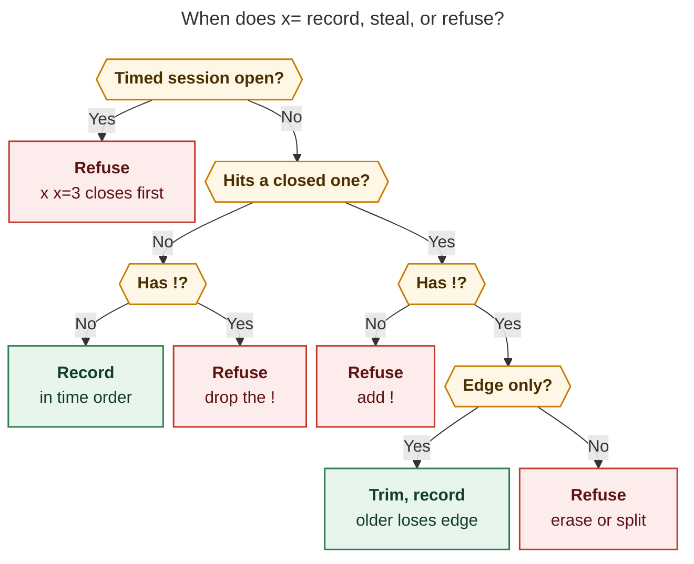

# Recording past Pomodoros with `x=` — design research (cld)

**Question.** Should capture gain an `x=<E>=<X>[!]` token that starts *and*
closes a new past Pomodoro in one step? If so, how should it be designed to be
intuitive, reliable, and beautiful?

**Short answer.** Yes. The core is already safe: today's `=N-N x` writes
exactly the window you want (verified below). The new token adds three
things capture lacks: brevity, automatic back-to-back stacking, and a guard
against overlapping history. I recommend building it with eight adjustments
to the requested rules. The most important ones:

1. **Move the force `!` onto `<E>`.** Write `x=<E>[!][=<X>]`, not
   `x=<E>=<X>[!]`. A trailing `!` clashes with the existing close forms `x!`
   and `x1!`.
2. **Refuse while any timed session is open.** Teach `x x=…` instead. Never
   restart or trim a running session.
3. **Check a stack as one window.** `!` only trims an edge of an older
   session; it never erases or splits one.
4. **Close each past session at its own clock,** `min(end, now)`, and file it
   in time order.

Everything below was checked against this checkout (grammar 10, `bob 0.4.0`
built from `master` at `d216f7eb`). A scratch vault and `BOB_NOW="2026-11-04
09:21"` were used. The timestamps match the request's examples.

---

## 1. What capture does today (verified)

### 1.1 The time math already gives the request's ranges

A start writes `start = ceil5(now − 5·offset)` and `end = start + 5·duration`
(`start_block_minute`, `src/native/capture/meet_event_run.rs:200`). A close
moves the end back only when at least 5 minutes remain before the planned
end (`close_timing`, `src/native/capture_pomodoro_close/ledger.rs:187`). For
`=N-N`, the end lands on `T = ceil5(now)`, which is never 5 or more minutes
after now. So **`=N-N x` always records `[T − 5N, T)` and the close never
trims it.** The request's equivalence `x=3 ≡ =3-3 x` therefore holds at every
minute, for any session that is not a MEET.

| Draft at 09:21 (today's grammar) | Result in the ledger |
| --- | --- |
| `=3-3 x` | `- [x] (**0910-0925** [t:: 15m]) — FIX`; links → `[/]`, carried to a new FIX |
| `=build@2-5 x =fix@3-3 x` | BUILD `0900-0910`, then FIX `0910-0925`. This is the request's stacked example, but you add up the offsets yourself, and the BUILD close prints the misleading `(ran 11m over)` |
| `=2-2#fix x*3 apollo agent` | FIX `0915-0925`; link 3 parked (`🍅`, not carried) with a Work Log entry `*2026-11-04 09:21* — apollo agent`; links 1–2 deferred, stay queued |
| `=-5 x1!2` | FIX `0900-0925`; link 1 `[/]`, link 2 `[x]` (struck), link 3 deferred |

So the request's `<X>` examples mean exactly what today's `x` grammar already
does. "Dismiss link 3 from the daily file" is a park: the link stays as `🍅`
history in the closed entry but is not carried forward.

### 1.2 Problems the new token must fix, not inherit

| Probe | What happens today | Why it matters |
| --- | --- | --- |
| `x=3` | Captured as the task `- [ ] #task x=3` in `mac_inbox.md` | `x=` is prose today. Claiming it is a grammar change (grammar 11). |
| `=3-3 x` with PLAN `0855-0920` already closed | Writes FIX `0910-0925` next to PLAN with no warning: 10 minutes overlap | Stats already treats closed-session overlap as a ledger health problem (`overlap_minutes`, warning `clock_overlap`, `docs/stats.md` "Quality of the ledger"; `detect_overlaps`, `src/native/stats/homes.rs:996`) |
| `=3-3 x` while WORK `0900-0925` runs | **Restarts WORK** as `0910-0925` (`⚠ overrode the running WORK`), then closes it | The desugaring silently rewrites the running session's history. `x=` must never do this. |
| `x x=3` | `x=3` becomes WORK's inline Work Log text | Once `x=` is claimed, a trailing `x=…` in a close line becomes a token (see §6) |
| `=-3 x` at 00:05 | Writes `2350-0005` into *today's* note | Stats reads that as tonight at 23:50. A past window must never cross midnight. |
| `x =` with nothing running | Fails: `no running Pomodoro to close` | Half of a useful safety property (§6) |

### 1.3 Existing code `x=` can reuse

- **Chronological insertion of a closed session.** `closed_insert_at`
  (`src/native/task_status_hooks/settle.rs:610`) places a closed entry
  "after the last completed entry at or before `start`, else before the
  first completed, else before the first open". It mirrors gcal's
  closed-insert. A past Pomodoro should land the same way. Today a start
  moves its entry to the "current slot" instead
  (`move_started_pomodoro_to_current_slot`,
  `src/native/capture/pomodoro_start.rs:624`).
- **Trimming sessions around each other.** Off-clock settlement already
  trims the pieces it creates so they don't overlap on-clock sessions
  (decision `ended-off-clock-events-settle`). That is the reverse direction:
  the new session yields. `!` makes the new session take the time instead.
- **Close at a given clock.** Event Task links are classified by the session
  start `S` and the close time `C` (decision
  `event-task-links-close-by-the-clock`). Passing the past session's own end
  as `C` classifies meetings by what was true then.
- **Pomodoro names cannot contain `!` or `=`.** The allowed bytes are
  `A–Z a–z 0–9 & ' ( ) + , . / -` (`is_pomodoro_selector_component`,
  `src/native/capture_language/tokens.rs:555`). So both characters can end
  `<E>` without breaking any valid name. Today `=build!` and `=build=*3`
  fail as invalid names, so no valid spelling changes meaning.

---

## 2. Is this a good idea?

**Yes. It removes the most common way a Pomodoro ledger loses accuracy.**
Forgetting to start a session is the normal failure mode of timeboxing. The
fix today is `=N-M x`, which has four problems:

- you work out the offsets yourself, and a stack needs running sums;
- it restarts a running session without asking;
- it writes overlaps without warning;
- it prints a misleading "ran N m over".

`x=` keeps the same well-tested start and close code and adds the missing
arithmetic and safety. Risk is low because every past Pomodoro is, by
construction, a start plus a close that already exists.

**What I'd watch:**

- **Whitespace now matters.** `x=3` records a past session; `x =3` closes and
  then starts. §6 shows the two can never both succeed against the same
  ledger, so a typo fails loudly instead of doing the wrong thing.
- **A trailing `!` is ambiguous.** `x!` (complete every link) and `x1!`
  (keep 1, complete the rest) are valid closes today (`capture-parse`
  verified). Under the requested `x=<E>=<X>[!]`, `x=build=!` could mean
  "complete everything" or "force". Adjustment A1 fixes this.
- **Stacking needs look-ahead.** An earlier token's window depends on later
  tokens. That's fine on one line, where you see all the tokens together, but
  it should not leak across items. A8 keeps it on one line.
- **`!` rewrites history.** It should only ever do the one safe thing: trim an
  older session's edge. Anything that would erase or split a session needs
  the user to fix it by hand. A3 enforces this.

**Would I take a different approach?** I considered six alternatives (§8).
None beats a capture token with an explicit force marker. My changes are to
the token's rules, not its shape.

---

## 3. Requirement adjustments (clearly called out)

Each one changes or tightens the request. Rationale follows each.

**A1 — `!` binds to `<E>`: `x=<E>[!][=<X>]`.**
`x=3!`, `x=build!`, `x=fix@2!=*3`, `x=!` (unnamed, 25 min, forced). The
request's own `x=3!` already has this shape. Only `x=<E>=<X>!` moves, to
`x=<E>!=<X>`. Reason: with `!` at the end, every `<X>` ending in `!` is
ambiguous (`x=build=!`, `x=3=1!`). On `<E>`, `!` reads as "force this
*window*", which is what it forces. `<X>` keeps the whole `x` grammar,
including `x!`.

**A2 — `x=` needs a quiet ledger: no open timed session at all.**
If one exists, refuse and teach the composed form:
`` `x=3` records a past Pomodoro, but WORK 0900-0925 is still running (line 5); close it first: `x x=3!` ``.
The suggestion includes `!` only when the session's closed span would still
overlap the window. Reasons:

1. The request's own desugaring would restart the running session (§1.2).
2. Every past window ends at `T`, so it always overlaps a session that started
   earlier. Trimming it implicitly would mean closing it implicitly, with all
   the link-carrying side effects.
3. This rule makes `x=` and `x ` strictly exclusive (§6).
4. The implementation gets much simpler: the existing close finds "the" open
   timed entry, and on a quiet ledger that is always the past session.

`x x=fix@3!` reads naturally: "close what's running; the last 15 minutes
were FIX."

**A3 — A stack is guarded as one window. `!` trims one edge only.**
The stack's combined window is `[T − 5·Σn, T)`. Each older closed session
(on-clock or off-clock) is compared to that whole window:

| Overlap shape | Without `!` | With `!` |
| --- | --- | --- |
| None | record | **error: unneeded `!`** (as the request asks) |
| Older session's tail inside the window | error | trim older end to the window start (the request's example) |
| Older session's head inside the window (it ends after `T`) | error | trim older start to the window end |
| Older session entirely inside the window | error | **error: would erase it** |
| Window entirely inside the older session | error | **error: would split it** |

An empty session (`1200-1200`, 0m) never overlaps. Per token, `!` is required
exactly on the tokens whose own window touches an older session's original
span. That keeps it precise and makes "unneeded `!`" exact. Checking the
whole stack at once matters. If you check token by token, `x=build@2
x=fix@3!` against PLAN `0855-0920` evaluates BUILD (`0900-0910`) first, finds
it strictly inside PLAN, and refuses it as a "split", even though the whole
stack only trims PLAN's tail.

**A4 — Each past session goes in time order; its leftovers stay put.**
The closed entry goes where `closed_insert_at` puts it. Links the close carries
forward stay in the original placeholder, in place ("peel"), instead of in a
new continuation right after the closed entry. A fully used placeholder
disappears, just as `=build@2-5 x` uses up an empty BUILD today. Reason:
completed entries come first and open entries after; a past session placed
in the middle of history must not leave a planned entry among completed ones.

**A5 — Each past session closes at its own clock, `C = min(end, now)`.**
`C` drives three things:

- Event Task classification (`ended_inside` / `running` / `not_started`);
- Work Log timestamps;
- the close summary.

Result: BUILD `0900-0910` in a stack logs `09:10` and classifies a 0905–0915
meeting as *running*, not *ended*. The bogus "ran 11m over" disappears. The
completion date doesn't change, because A7 keeps the window on today.

**A6 — `<E>` is the start grammar minus four things.** The request removes
`-N`. I also remove three more:

- **`-N` offset:** a past session always ends at `T` (the request's rule).
- **`~K` drop:** the close's `~K` already drops links, with no question about
  which lineup the numbers refer to. Teach `x==~2`.
- **`x=0`:** records nothing.
- **Start-time rules:** an unnamed target doesn't join a meeting in progress,
  and MEET doesn't use the calendar. A past window is what you typed. Ended
  meetings are already settled by reconcile and gcal.

**A7 — Refuse a window that crosses midnight.**
`` `x=6` would start before midnight (2350); record at most 2 blocks today: `x=2` ``.
Today's `=-3 x` at 00:05 shows what goes wrong otherwise (§1.2).

**A8 — A stack is one contiguous run of `x=` tokens on one line.**
This is the request's "same line" rule, tightened to *contiguous*. Other
session tokens may come before or after (`x x=3!`, `x=3 =`), but not in the
middle. Separate items (blank-line separated) each end at `T`, so a second
one overlays the first and needs `!`:

```text
x=build@5 wired the lexer

x=fix@2! fixed the flake
```

This records BUILD `0900-0915` and FIX `0915-0925`, each with its own Work Log
entry. That is how you give earlier sessions their own logs in v1. An inline
entry or bullets attach to the last `x=` on a line, just as they attach to
the last `x` today.

---

## 4. Proposed grammar

```text
past-close := "x=" E [ "!" ] [ "=" X ] [ SP work-log-entry ]
E          := [ D ] [ "#" name | "#" exact-literal | bare-name ] [ "@" D ]
                 -- bare-name only when no leading D (as with "=")
                 -- one count at most; D := [0-9]+ ; default 5 blocks
X          := the existing whole-item close selection after "x":
              N-list, "!"[M], "*"[P], "~"K, "@"N — any order, same rules
```

Lexing rules:

- Inside `x=`, a name also ends at `!` and `=`; a count also ends at `!` and
  `=`.
- `x==` means an empty `<E>` followed by `<X>`.
- `x=` alone is valid: the next future Pomodoro, 25 minutes.
- `x=build=` with an empty `<X>` is accepted and equals `x=build`. The
  editor passes through it on the way to typing `<X>`.
- A mid-body `x=` stays prose, like `Plan x`. Lookalikes `X=3` and `xx=3`
  stay prose.

**The request's examples under this grammar** (now 09:21, `T = 0925`):

| Draft | Records | Notes |
| --- | --- | --- |
| `x=build` | BUILD `0900-0925` | default 5 blocks |
| `x=build@2 x=fix@3` | BUILD `0900-0910`, FIX `0910-0925` | stack; BUILD closes at 09:10 |
| `x=2#fix=*3 apollo agent` ≡ `x=fix@2=*3 apollo agent` | FIX `0915-0925` | link 3 parked + logged; links 1–2 stay queued in FIX |
| `x==1!2` | next future (FIX) `0900-0925` | link 1 `[/]`, link 2 `[x]`, link 3 deferred |
| `x=3!` with PLAN `0855-0920` | FIX `0910-0925`; PLAN → `0855-0910` | `⚠ took 10m from PLAN` |

**Idioms worth documenting:**

| Draft | Meaning |
| --- | --- |
| `x=3 =` | Record the last 15 minutes, then start the next session now. They join at `T`, so there is no gap or overlap. |
| `x x=fix@3!` | Close what's running; the last 15 minutes of it were FIX |
| `x=build=!` | Record BUILD, 25 minutes, everything finished |
| `x=email@1 x=build@3 x=fix@2` | A 30-minute timeline ending now, typed in order |

Mnemonic, extending the existing one: *"`=` starts now, `x` stops now,
`x=` records what already happened."*

---

## 5. Semantics

### 5.1 Windows

For a stack of tokens with block counts `n₁ … n_k` and `T = ceil5(now)`,
token `i` covers

```text
[ T − 5·(nᵢ + … + n_k) ,  T − 5·(nᵢ₊₁ + … + n_k) )
```

That is exactly the start spec `=nᵢ-(nᵢ+…+n_k)` that `x=` lowers to. So the
"`x=3` ≡ `=3-3 x`" guarantee extends to stacks by construction. The stack
lengths are known from the text alone, so `capture-parse` can report each
token's `offset_blocks` without reading the vault.

### 5.2 Targets

Targets follow the `=` start rules:

- An empty `<E>` name takes the next future Pomodoro: the first open
  untimed placeholder, the same one `x` names as "next up".
- A name matches an open placeholder in place.
- A completed match starts a new session with that name ("again").
- Otherwise a new named session is created.

Each unnamed token in a stack takes the next future Pomodoro *at its turn*.
So `x=2 x=3` records FIX twice; the second takes the carried links. Today's
`x =` does the same.

### 5.3 The guard



*Figure 1. A past Pomodoro records only on a quiet ledger. `!` is required
exactly when the window touches an older closed session, and refused when it
doesn't. Even with `!`, the window may only trim an edge of that session.*
"Hits a closed one" is checked against the whole stack's window (A3). The
midnight and `x=0` refusals (A6, A7) come before this and aren't drawn.
Rendered with mermaid-cli 12.0.0 under the research-PDF config: 870 × 934 px,
fit 75.1%.

### 5.4 Writing

All of a stack's trims happen at its first token, before anything is staged,
so a refusal changes nothing. Each token then:

1. Starts its target with the lowered start spec.
2. Closes it with selection `<X>` at clock `C = min(end, now)`.
3. Moves the closed block to its chronological slot (A4).
4. Returns any carried links to the original placeholder's position.

A trim rewrites only the older line's span and keeps its clock key:
`(**0855-0920** [t:: 25m])` → `(**0855-0910** [t:: 15m])`, or `[off::]`.
`format_adjusted_range` already does this for `+N`/`-N`. If any step fails,
the whole capture rolls back, as every capture does today.

### 5.5 Output

Human output keeps the close's format, uses the verb *recorded*, and shows
one `⚠` line per trim. This is the request's "error downgraded to a warning":

```text
✓ recorded FIX 0910-0925 (15m) · 2026/20261104.md line 5
  ⚠ took 10m from PLAN: 0855-0920 → 0855-0910 (15m) at line 4
  1 [ ] → [/] Wire the lexer tasks.md ^lexer
  2 [ ] → [/] Fix flaky test tasks.md ^flaky
  3 [ ] → [/] Write docs tasks.md ^docs
  next: FIX at line 6 · carries 3 links
```

A stack prints one block per token, numbered `1/2`, `2/2` like today's
chains. Dry-run uses `would record` and `would take`.

JSON gains an item mode `pomodoro_backfill`. It embeds the existing
`pomodoro_start` and `pomodoro_close` objects, so clients reuse their
renderers:

```json
"pomodoro_backfill": {
  "raw": "x=3!", "target": {"name": "FIX", "source": "next_future"},
  "blocks": 3, "force": true,
  "stack": {"index": 1, "size": 1, "offset_blocks": 3},
  "window": {"start": "0910", "end": "0925", "minutes": 15},
  "closed_at": "0921",
  "steals": [{"line": 4, "name": "PLAN", "before": "0855-0920",
              "after": "0855-0910", "minutes": 10}],
  "start": { "…": "pomodoro_start" }, "close": { "…": "pomodoro_close" }
}
```

The recorded block also appears in `pomodoro_blocks`. A trim adds the warning
code `pomodoro_backfill_steal`. `capture-parse` reports only text-level facts:
`raw`, `name`, `name_is_literal`, `blocks`, `force`, `stack`, the `<X>`
close spec, and spans `pomodoro_backfill`, `pomodoro_name`, and
`pomodoro_backfill_force`.

### 5.6 Error messages

Each refusal says what is wrong and spells the fix:

| Case | Message |
| --- | --- |
| needs `!` | `` `x=3` would take 10m from PLAN 0855-0920 (line 4); add `!` to take it: `x=3!` (PLAN becomes 0855-0910) `` |
| unneeded `!` | `` `x=3!` takes no time from another session; drop the `!`: `x=3` `` |
| open session | `` `x=3` records a past Pomodoro, but WORK 0900-0925 is still running (line 5); close it first: `x x=3!` `` |
| would erase | `` `x=6!` would take all of CALL 0920-0925 (line 6); `!` only trims a session's edge `` |
| would split | `` `x=2!` would split DEEP 0850-0940 (line 4) in two; `!` only trims a session's edge `` |
| midnight | `` `x=6` would start before midnight (2350); record at most 2 blocks today: `x=2` `` |
| zero | `` `x=0` records nothing; give it at least one block: `x=1` `` |
| offset | `` `x=3-1` can't take an offset: a past Pomodoro always ends now; write `x=3` `` |
| start drop | `` drop links on the close side: `x==~2` `` |
| nothing to record | `` no future Pomodoro to record; name one: `x=build` `` |
| trailing `!` habit | none needed: under A1, `x=3=1!` is valid and means keep 1, complete the rest |

---

## 6. Safety guarantees (each one should be a test)

1. **`x=…` and `x …` never both succeed on the same ledger.** `x=` requires
   no open timed session (A2); `x` requires exactly one (§1.2). A missing or
   extra space therefore always fails before writing anything.
2. **A stray `x=` claim almost always fails loudly.** A trailing `x=…` after
   a close (`x tuned x=5`) would now be claimed as a token, not log text. A
   session closed on time ends at `T`, the same place the past window ends,
   so the two overlap and the token is refused unless written with `!`.
   **Exception:** a session that was already overdue keeps its earlier end.
   The trailing token then records silently. This is the one real prose
   collision. It needs a log that *ends* in `x=<word-or-digits>`, which is
   rare enough to document rather than design around.
3. **Same result as the long form.** On a quiet ledger with no overlap, `x=E=X`
   writes the same entry, links, task states, and Work Log as `=E-E x X`,
   apart from placement (A4) and close clock (A5). Golden tests should
   compare the two forms for every `<X>` shape.
4. **`!` never deletes or splits a session**, and never touches an open one.
5. **The ledger stays in time order:** completed entries before open ones,
   no planned entry among completed ones.

---

## 7. Implementation sketch

| Layer | Where | Change |
| --- | --- | --- |
| Lexer | `session_equals_token` / `EqualsToken` (`src/native/capture_language/item.rs:3280`, `:3560`); `start_name_extent` (`src/native/capture_language/bare_name.rs:23`) | New `EqualsToken::PastClose { e, force, x, len }` arm, ahead of the close classifier. In this context names and counts also end at `!` and `=`. |
| Chains | `is_session_chain_token` (`item.rs:3789`), `is_chain_close_token` / `split_inline_close_tokens` / `push_capture_item` (`src/native/capture_language/draft.rs:409–620`) | `PastClose` counts as a close: it can own an inline entry and child bullets. Attach `stack {index, size, offset_blocks}` while splitting, since only the splitter sees the whole line. |
| Model | `CaptureKind` (`src/native/capture_language/model.rs:156`) | `PomodoroBackfill { start: PomodoroStartSpec, name, literal, force, stack, close: PomodoroCloseSpec }` |
| Planner | dispatch in `src/native/capture/plan.rs:1053` | Lower to start + close. The first token of a stack runs the guard and trims. Then add a placement pass. |
| Close at a given entry and clock | `plan_pomodoro_close_outcome` / `plan_pomodoro_close` (`src/native/capture_pomodoro_close/linked_tasks.rs:974`, `:999`) | Thanks to A2, `find_running_pomodoro` already finds the right entry. Only `now` changes, to `C`. |
| Placement | `closed_insert_at` (`src/native/task_status_hooks/settle.rs:610`); `move_started_pomodoro_to_current_slot_tracked` (`src/native/capture/pomodoro_start.rs:642`) | Move `closed_insert_at` to a shared module. Use the tracked splice to return the continuation to the placeholder's position. |
| Suppressions | start event warnings; joining a meeting in progress; the MEET calendar span | Turn off for past windows (A6) |
| Grammar | `GRAMMAR_REVISION` (`src/native/capture_language/mod.rs:45`) → 11; `docs/reference/compatibility.md` | `x=` used to be prose: ship as `feat(capture)!` |
| Completion | `capture-complete` | After `x=`, offer Pomodoro names. After `x=<E>=`, offer the target's numbered lineup, so the vault must be read to resolve `<E>`. |
| Docs | `docs/reference/capture-syntax.md` (new `x=` entry between `x` and Work Log); `docs/capture.md` "Recording a past Pomodoro"; lifecycle table + mnemonic | Follow the reference-memory `docs.md` and `cli_rules.md` rules when editing |
| Clients | Bob Mac Capture | Thin client: needs only the new mode and span kinds, gated on `grammar ≥ 11`. No Obsidian plugin change is needed. An Obsidian past-session snippet would be a separate follow-up. |

**Suggested phases:**

1. Lexer, parse JSON, grammar 11, and the text-level refusals.
2. A single token: quiet ledger, overlap refusal, placement, close clock,
   output.
3. `!` trimming and stacks.
4. Completion, client gating, docs, and a decision record. Suggested
   claim: *"Past Pomodoros end now, never touch an open session, and `!`
   only trims an edge."* It changes how capture writes history, so it
   should be a decision record.

**Tests:**

- every row of §5.6;
- the five examples in §4;
- equivalence goldens against `=N-N x`;
- `x x=…!`;
- `x=3 =`;
- an off-clock older session being trimmed;
- a stack whose earlier token would look like a split if checked alone;
- 00:05 and 23:58 near-midnight cases;
- byte-identical rollback on every refusal.

---

## 8. Alternatives considered

| Alternative | Verdict |
| --- | --- |
| **Keep `=N-M x`** (status quo) | Works, but it is arithmetic-heavy, restarts a running session, writes overlaps, and prints a misleading overrun. These are the four reasons to build `x=`. |
| **Trailing `!` as requested** (`x=<E>=<X>!`) | Rejected: ambiguous with `x!` / `x1!` (verified valid closes). A1 keeps the request's `x=3!` spelling. |
| **Take time without asking** (no `!`) | Rejected: it rewrites history without the user saying so; the request rightly wants an error by default. |
| **Fill only free time** (settle-style) | Rejected for capture: you would not get the window you typed. Fine for automation (reconcile), wrong for a deliberate gesture. |
| **`!` also trims or closes the running session** | Rejected: it is an implicit close with link-carrying side effects. `x x=3!` says the same thing explicitly. |
| **Absolute times** (`x=0900-0925#build`) | Not now: `0900-0925` already lexes as `se<X>` duration-offset. A later form with a different sigil could add it. |
| **Stack across blank-line items** | Rejected for v1: items are planned in order, and one item's time should not depend on a later item. Overlay with `!` covers the per-session-log case (A8). |
| **A `bob pomodoro record` subcommand** | Not instead of capture: Bryan works in capture and Mac Capture. A CLI could later reuse the same planner. |

---

## 9. Open questions for Bryan

1. **Should `!` be per token or per stack?** I recommend per token, for
   precision and an exact "unneeded `!`" error. The cost is
   `x=build@2! x=fix@3!` when one old session overlaps both.
2. **Should overlaying a session recorded earlier in the same capture need
   `!`** (`x=build@5` then `x=fix@2!`)? I recommend yes: one rule, no
   exceptions.
3. **Should touching lines stack in v2?** That is, consecutive `x=` lines
   with no blank line between them, each with its own inline log or bullets.
   It's attractive, but it changes how drafts split into items, so I'd defer
   it.
4. **Should Work Log timestamps use `C` (A5) or the real capture time?** I
   recommend `C`: a log stamped inside its session reads true later.

---

## 10. Recommended solution

Add a past-Pomodoro token, **`x=<E>[!][=<X>]`**, documented as *Recording a
past Pomodoro* and reported as JSON mode `pomodoro_backfill`, in capture
grammar 11.

- **Window.** `<E>` picks the target and a length (default 5 blocks) with the
  `=` start grammar, minus `-N`, `~K`, and `0`. The window always ends at
  `T = ceil5(now)`. A contiguous run of `x=` tokens on one line stacks back
  to back, in typed order, ending at `T`.
- **Close.** `<X>` is the unchanged `x` close selection, plus an optional
  inline Work Log entry or bullets on the last token.
- **Lowering.** Each token becomes the existing start
  (`=n-(n+later)`) plus the existing close, run at clock `min(end, now)`.
  The closed entry goes in time order; carried links stay in the original
  placeholder.
- **Guard.**
  1. Refuse while any timed session is open, teaching `x x=…`.
  2. Refuse a window that crosses midnight.
  3. Check the whole stack's window against every closed session.
  4. Any overlap is an error unless the touching token carries `!`; `!`
     with nothing to take is an error.
  5. `!` only trims an older session's edge, keeps its clock key, and
     prints `⚠ took Nm from NAME`. It refuses to erase or split.

This keeps the request's surface (`x=build`, `x=build@2 x=fix@3`,
`x=2#fix=*3 apollo agent`, `x==1!2`, `x=3!` all work as described). It fixes
the trailing-`!` ambiguity. It reuses the start and close code everyone
already trusts, and it adds the overlap protection the ledger has been
missing.
